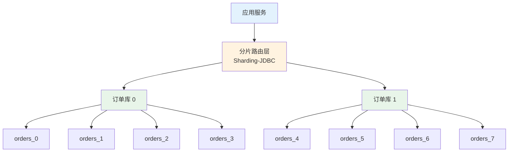
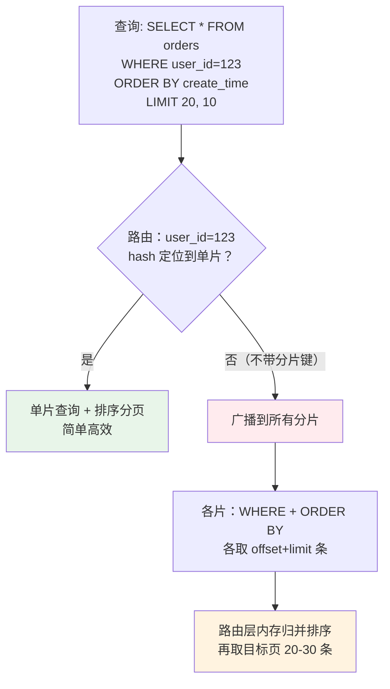
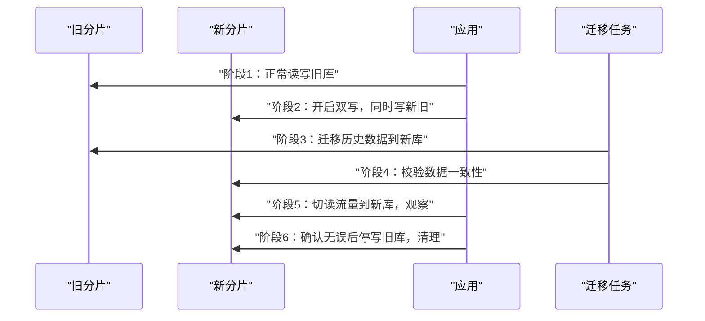

# 分库分表

> 定位：搞清楚什么时候该拆、怎么拆、拆分后怎么查询和扩容。分库分表不是「炫技」，而是单机 MySQL 扛不住时的最后一道大规模手段——它的收益是突破单机容量和连接数瓶颈，代价是引入分布式事务、跨片查询、数据迁移等一堆复杂度。这篇帮你把收益和代价都算清楚。

## 一、为什么需要分库分表

单台 MySQL 的瓶颈来得比你想象的早：

| 瓶颈 | 表现 | 大致量级（参考） |
|---|---|---|
| **连接数** | 高并发下连接打满，拒绝服务 | 单库连接数几百到上千 |
| **数据量** | 单表上亿行，B+树变高、索引膨胀、DDL 巨慢 | 单表建议千万级以内 |
| **磁盘 IO** | 热点数据放不进 Buffer Pool，磁盘打满 | 受限于单机磁盘 |
| **CPU/内存** | 复杂查询、排序、聚合吃满单机资源 | 受限于单机配置 |

优化手段是分层的：**SQL 优化 → 加索引 → 读写分离 → 分库分表**。前三层解决不了「单机物理上限」问题时，才轮到分库分表。

一个判断信号：**单表数据超过 1000 万行且还在快速增长，或单库 QPS 逼近硬件极限，就该认真评估拆分了**。（这是经验阈值，具体看硬件和访问模式，以实际压测为准。）

## 二、核心原理：拆分的两种维度与分片策略

### 2.1 垂直拆分与水平拆分

**垂直拆分**——「纵向切」，按业务或字段切：

| 方式 | 做法 | 例子 |
|---|---|---|
| **垂直分库** | 按业务把不同表拆到不同库 | 用户库、订单库、商品库分开 |
| **垂直分表** | 把一张宽表按字段冷热拆成多张表 | 把 `user` 的 `large_desc`、`头像二进制` 拆到 `user_ext` |

优点：拆分简单、业务清晰、每个库表变小。缺点：**没有解决单表数据量过大的根本问题**（订单表还是那么大）。

**水平拆分**——「横向切」，把同一张表的数据按规则分散到多张表/多个库：

| 方式 | 做法 | 例子 |
|---|---|---|
| **水平分表** | 同一库内，把 `orders` 拆成 `orders_0`~`orders_7` | 8 张表，每张 1/8 数据 |
| **水平分库** | 拆到不同库，甚至不同机器 | 2 个库 × 4 张表 = 8 份 |

优点：真正突破单机容量和性能上限。缺点：引入分片路由、跨片查询、分布式事务等复杂度。

这张图展示「2 库 × 4 表 = 8 分片」的典型部署。应用不再直连某个库，而是经过**分片路由层**，由它根据分片键算出数据落在哪个库哪张表。

### 2.2 四种分片策略

| 策略 | 规则 | 优点 | 缺点 | 适用 |
|---|---|---|---|---|
| **Hash 取模** | `user_id % N` | 数据分布均匀 | 扩容麻烦（N 变化要迁移大量数据） | 查询条件固定含分片键 |
| **Range 范围** | id 1-1000万→片0，1000万-2000万→片1 | 扩容简单（加新片即可） | 容易热点（新数据都写最后一片） | 有自增趋势的主键 |
| **列表 List** | 按地区/租户枚举映射 | 语义清晰、便于按维度隔离 | 需要预知枚举值，可能不均 | 按地区、租户分片 |
| **时间 Time** | 按月/按天分片 | 冷热分离、归档方便 | 近期数据热点、历史查询跨片 | 日志、流水、订单 |

**Hash 取模**最常用，但扩容是痛点：从 2 片扩到 4 片，`id % 2` 变 `id % 4`，约 75% 的数据要迁移。解决办法见「一致性 Hash / 倍增法」。

**Range + 时间**组合也很常见，比如订单按 `user_id hash` 分库、按 `create_time` 分表，兼顾均匀分布和冷热管理。

### 2.3 分片键选择原则

分片键（Sharding Key）选得好不好，决定拆分后 80% 的查询体验。原则：

1. **高频查询条件优先**：选 SQL 中最常出现在 WHERE 里的列（如 `user_id`、`order_id`），这样路由能直接定位到单片。
2. **区分度高**：值分布均匀，避免大量数据挤在一个分片。
3. **尽量让核心查询落在单片**：例如电商订单按 `user_id` 分片，「查我的订单」就只查一片；若按 `order_id` 分片，则「查某用户订单」要扫所有片。
4. **避免跨片join需求**：把经常一起查的实体用同一个分片键（如用户和用户订单都用 `user_id`），避免跨库关联。
5. **不要用会频繁更新的列**：分片键值变了意味着数据要迁移。

> 一个经典教训：订单表按 `order_id` 分片，结果 90% 的查询是「查某用户的订单列表」，每次都要广播到所有分片再聚合——这就是分片键选错的代价。改成按 `user_id` 分片后，查询落到单片，性能提升一个数量级。

## 三、关键机制：跨片查询、分布式主键、Sharding-JDBC、扩容

### 3.1 跨分片查询怎么做

一旦数据分散，原本简单的查询就变复杂了：

| 查询类型 | 处理方式 | 难点 |
|---|---|---|
| **等值查询（带分片键）** | 路由到单片，和普通查询一样 | 无，最优 |
| **排序 ORDER BY** | 各片先各自排序，路由层做**归并排序** | 内存归并、数据量大时开销高 |
| **分页 LIMIT** | 各片各取 `offset+limit` 条，归并后再取目标页 | 深分页时每片都要取大量数据，代价高 |
| **聚合 GROUP BY/COUNT** | 各片聚合，路由层二次聚合 | 结果合并逻辑 |
| **跨片 JOIN** | 尽量避免；改为分多次查询在应用层拼装，或字段冗余 | 跨库 join 性能极差，不推荐 |

这张图强调一个核心结论：**带分片键的查询落到单片，是分库分表性能的前提；不带分片键的广播查询，排序分页要在内存里归并，越深越慢**。所以分片键选择 = 查询模式设计。

**深分页优化**：避免 `LIMIT 100000, 10` 这种广播深分页；改用游标（`WHERE create_time < last_time`）或限制只能翻前 N 页。

### 3.2 分布式主键

分库分表后不能再用单库自增主键（会重复）。常见方案：

| 方案 | 原理 | 优点 | 缺点 |
|---|---|---|---|
| **Snowflake 雪花算法** | 64 位：1 符号位 + 41 位时间戳 + 10 位机器 ID + 12 位序列号 | 本地生成、趋势有序、高性能 | 依赖机器时钟（时钟回拨会重复） |
| **数据库号段（Leaf）** | 数据库存号段范围，应用批量取号缓存 | 有序、可控 | 需额外DB、有单点风险 |
| **Redis INCR** | Redis 原子自增 | 简单 | 依赖 Redis 可用性 |
| **UUID** | 随机生成 | 无依赖 | 无序、做聚簇索引会导致页分裂（见第 1 篇） |

Snowflake 是最主流方案。它生成的 ID 趋势递增，作为聚簇索引时插入相对有序，避免 UUID 的页分裂问题。注意解决**时钟回拨**（服务器时间倒退导致 ID 重复）：检测到回拨时等待或直接报错，各实现不同。

### 3.3 Sharding-JDBC 原理

Sharding-JDBC（现属 Apache ShardingSphere）是**客户端（应用层）分片框架**，它的特点是**无中心化代理**——以 JAR 包形式嵌入应用，拦截 JDBC 调用。

它的处理流程是一条流水线：

五个阶段：

1. **SQL 解析**：词法/语法解析成抽象语法树（AST），识别表名、WHERE 条件、分片键值。
2. **SQL 路由**：根据分片算法算出 SQL 该发往哪些库表（单路由 / 广播路由）。
3. **SQL 改写**：把逻辑表名改成真实表名（如 `orders` → `orders_3`），必要时改写列。
4. **SQL 执行**：并发把 SQL 发到各真实数据源执行。
5. **结果归并**：把各分片返回的结果做排序、分页、聚合、去重，返回给应用。

**Sharding-JDBC vs Sharding-Proxy**：

| 对比 | Sharding-JDBC | Sharding-Proxy |
|---|---|---|
| 形态 | 应用内 JAR，无中间层 | 独立代理服务，应用透明 |
| 性能 | 无网络转发，略高 | 多一跳网络 |
| 语言 | 仅 Java | 任意语言 |
| 运维 | 应用改造、配置分散 | 集中管理、对应用无侵入 |

### 3.4 扩容方案

分片数量一开始就要规划好（一般按未来 2-3 年容量预估），但业务增长常常超出预期，扩容不可避免。

**方案一：倍增法**——分片数翻倍（如 2→4→8），按「一致性 Hash」或特定路由让迁移量最小（倍增取模时约一半数据不动）。配合版本号切换路由配置。

**方案二：双写迁移（最通用）**——不停机扩片的六步：

每一步都要可回滚：阶段 5 如果发现新库有问题，能立刻把读切回旧库。

**扩容铁律**：先在测试环境完整演练，选低峰期执行，全程可监控可回滚。

### 3.5 分库分表带来的问题

收益的另一面是成本，必须认清：

| 问题 | 说明 | 缓解 |
|---|---|---|
| **分布式事务** | 跨库写无法用本地事务 | 最终一致、TCC、Seata（见分布式章节） |
| **跨片 JOIN / 排序分页** | 性能差、逻辑复杂 | 字段冗余、应用层拼装、避免跨片查询 |
| **全局唯一索引** | 无法跨片保证唯一（如唯一手机号） | 按该字段分片，或独立索引表/Redis |
| **数据迁移扩容** | 复杂、易错、需停机或双写 | 提前规划容量、双写迁移 |
| **运维复杂度** | 库表数量爆炸、监控/DDL/备份复杂 | 自动化平台、统一配置中心 |

> 一句话：**能不拆就不拆**。分库分表是「用复杂度换容量」的交易，拆之前先把 SQL、索引、读写分离、缓存都优化到位。

## 四、生产坑点与排查

### 坑点 1：分片键选错，查询变广播

**现象**：拆分后「查某用户订单」依然很慢，监控发现每次查询都打到所有分片。
**原因**：按 `order_id` 分片，但业务高频按 `user_id` 查，无法路由到单片。
**解法**：
- 重新评估分片键，把高频查询列作为分片键。
- 或者做「基因法」：把 `user_id` 的信息编码进 `order_id` 的低位，按两者都能路由。
- 建立 `user_id → order_id` 的映射表辅助查询。

### 坑点 2：扩容时数据迁移出错，数据丢失或重复

**现象**：双写迁移后，新旧库数据不一致，部分订单丢失。
**原因**：双写期间某个写入失败但应用无感知、迁移任务覆盖了双写期间的新数据、缺少校验环节。
**解法**：
- 双写时两个库都写成功才算成功（或记录失败补偿）。
- 迁移用「先全量、再增量 binlog 追平」的方式，避免覆盖新数据。
- 迁移前后做全量对账（行数、checksum），不一致不切流。
- 全程可回滚，切流后保留旧库一段时间。

### 坑点 3：分布式主键重复或热点

**现象**： Snowflake 生成的 ID 出现重复，或 ID 明显扎堆导致某分片过热。
**原因**：时钟回拨导致 ID 重复；机器 ID 配置重复；序列号用尽；分片键直接用了趋势递增 ID 导致Range分片热点。
**解法**：
- 处理时钟回拨（等待/报警/切换机器 ID）。
- 保证每台机器机器 ID 唯一（用配置中心/ZK 分配）。
- 趋势 ID 做分片键时用 Hash 而非 Range，避免全写最后一片。

### 坑点 4：跨片深分页拖垮数据库

**现象**：运营后台翻到第 1 万页，所有分片 CPU 飙高。
**原因**：广播深分页 `LIMIT 100000, 20`，每个分片都要取 10 万条回传，路由层再归并。
**解法**：限制最大页码；改游标分页（`WHERE create_time < last_time`）；此类「全量扫描型」查询走离线数仓/ES，别打在线库。

### 坑点 5：分片后本地事务失效，数据不一致

**现象**：一个业务操作写两个分片，中途失败，出现「订单创建成功但库存没扣」。
**原因**：分库后本地事务只能保证单库原子性，跨库无法回滚。
**解法**：
- 尽量把同一业务操作的数据放到同一分片（按同一分片键）。
- 确实跨库时用分布式事务框架（Seata AT/TCC）或最终一致 + 补偿 + 对账。

## 五、调优、选型与最佳实践

**是否需要分片的判断清单：**

1. 单表数据量是否已超千万且持续增长？→ 考虑水平分表。
2. 单库连接数/QPS 是否逼近瓶颈？→ 考虑垂直分库或读写分离。
3. SQL、索引、缓存是否已优化到极限？→ 是才轮到分片。
4. 团队是否有能力运维分布式系统？→ 没有的话慎重。

**选型决策表：**

| 需求 | 推荐 |
|---|---|
| 按业务模块隔离 | 垂直分库 |
| 单表数据过大 | 水平分表 |
| 单机性能和容量都到顶 | 水平分库 + 分表 |
| 冷热数据分明 | 按时间分片 |
| 分片键固定、分布均匀 | Hash 取模 |
| 需要频繁扩容 | Range / 一致性 Hash |

**最佳实践：**

1. **分片键选高频查询列**，让核心查询落单片。
2. **提前规划容量**，一次分够（如 32 片），避免频繁扩容。
3. **避免跨片 JOIN 和深分页**，用冗余字段、游标分页、离线查询替代。
4. **分布式 ID 用 Snowflake** 等有序方案，处理时钟回拨。
5. **扩容用双写迁移**，全程可回滚、可对账。
6. **分布式事务能避则避**，优先把相关数据放同一分片。

## 九、面试高频问法

> 这一节的答案按「面试时能讲透」的标准写：先给一句话结论，再展开机制、原因和坑点。

**Q1：为什么要分库分表？什么时候需要？**

**一句话结论**：单表数据量过大（千万级以上）或单库并发过高时，查询变慢、写入瓶颈；分库分表把数据分散到多个库表，突破单机限制。

展开：

- **分表**：一张大表拆成多张小表（同库或不同库），解决"单表数据量过大"。
- **分库**：一个库拆成多个库，解决"单库连接数/并发瓶颈"。
- **触发条件**：单表 > 千万行（经验值，看具体情况）、单库 QPS 到瓶颈、磁盘/连接数不够。

加分点：说"分库分表是'最后手段'——先优化索引、读写分离、缓存，实在不行才分；因为它会带来跨分片查询、分布式事务等一堆复杂问题"。

**Q2：垂直拆分和水平拆分有什么区别？**

**一句话结论**：垂直拆是"按列/按业务拆"（不同表/库存不同字段/业务），水平拆是"按行拆"（同一张表的数据分散到多个表）。

展开：

- **垂直分表**：把一张宽表按字段拆开（如用户表拆成"基本信息表"和"扩展信息表"），减少单行大小、提升缓存命中。
- **垂直分库**：按业务拆库（订单库、用户库），不同业务独立。
- **水平分表**：同一张表按某个规则（如用户 ID 取模）拆成多张结构相同的表。
- **水平分库**：水平拆到不同库。

加分点：说"垂直拆解决'表太宽/业务耦合'，水平拆解决'数据太多'；实际项目常组合使用——先垂直分库（按业务），再水平分表（单表太大）"。

**Q3：分片键怎么选？**

**一句话结论**：选**查询最频繁、分布均匀、不易变**的字段——通常是用户 ID 或订单 ID，避免选可能变或分布不均的字段。

展开：

- **查询频繁**：分片键要能命中大部分查询，否则跨分片查询很痛苦。
- **分布均匀**：避免热点（如按地区分，某地区数据特别多）。
- **不易变**：分片键变了要迁移数据，很麻烦。
- **常见选择**：用户维度用 userId，订单用 orderId（或 buyerId）。

加分点：说"分片键选错是分库分表最大的坑——比如按'创建时间'分，查'某用户的所有订单'就要扫所有分片；分片键要匹配'主要查询维度'"。

**Q4：分片策略有哪几种？**

**一句话结论**：Hash 取模、Range 范围、列表、一致性哈希——各有优劣。

| 策略 | 优点 | 缺点 |
|---|---|---|
| Hash 取模 | 分布均匀 | 扩容要重新分布（数据迁移） |
| Range 范围 | 范围查询快、扩容方便 | 可能热点（如按时间，新数据集中） |
| 列表 | 按业务指定 | 分布可能不均 |
| 一致性哈希 | 扩容影响小 | 实现复杂、可能不均 |

加分点：说"Hash 取模分布最均匀但扩容最痛（要 rehash），Range 扩容方便但可能热点——实际常用'Hash 取模 + 预分片'（一次分够，避免频繁扩容）"。

**Q5：分库分表后，跨分片查询怎么办？**

**一句话结论**：尽量在设计上避免（让查询都带分片键）；无法避免时用"广播查询 + 内存归并"或"冗余表/ES"。

展开：

- **带分片键**：查询条件包含分片键，直接路由到一个分片（最快）。
- **不带分片键**：要广播到所有分片查询，再在内存归并（慢，分片多时不可接受）。
- **优化**：
  - 建"异构索引表"（如按卖家 ID 再存一份，方便卖家维度查询）
  - 同步到 ES 做复杂查询
  - 冗余字段减少 join

加分点：说"跨分片查询是分库分表的'原罪'——设计时就要想清楚'主要查询维度'，让 90% 的查询带分片键，剩下的用异构索引或 ES 解决"。

**Q6：跨分片的分页和排序怎么做？**

**一句话结论**：各分片分别查询、返回前 N 条，协调节点归并排序取全局前 N——分片越多、翻页越深，性能越差。

展开：

- **分页**：`limit offset, size` 要每个分片都取 `offset + size` 条，归并后取 `[offset, offset+size)`。
- **深分页问题**：offset 越大，每个分片取的数据越多，性能越差。
- **优化**：用"游标分页"（search_after 思路）、限制最大翻页深度、或把结果同步到 ES。

加分点：说"分库分表后的深分页基本无解——要么限制翻页深度（如只允许前 100 页），要么用 ES；这是分库分表的固有代价"。

**Q7：分库分表后，分布式主键怎么生成？**

**一句话结论**：不能用数据库自增（多库会重复），用雪花算法、号段模式或 UUID。

展开：

- **雪花算法**：最常用，趋势递增、本地生成。
- **号段模式**：一次取一批，连续递增。
- **UUID**：无序，不适合做主键（页分裂）。

加分点：说"分库分表后主键必须'全局唯一且趋势递增'——雪花算法几乎是标配，但要注意时钟回拨"。

**Q8：分库分表后，分布式事务怎么处理？**

**一句话结论**：跨库操作不能用本地事务，用分布式事务（Seata）或最终一致（消息、补偿）——但尽量在设计上避免跨库事务。

展开：

- **避免**：把"总是一起操作"的数据放在同一分片（如订单和订单明细用同一个分片键）。
- **无法避免**：用 Seata AT/TCC，或消息最终一致。
- **取舍**：分布式事务有性能和复杂度代价，能拆就拆。

加分点：说"分库分表最理想的设计是'让事务不跨库'——同一个聚合根（如订单+明细）用同一个分片键，就不会有跨库事务"。

**Q9：Sharding-JDBC 是怎么工作的？**

**一句话结论**：Sharding-JDBC 是**客户端分片**——以 JDBC 驱动的方式拦截 SQL，改写成分片后的 SQL，路由到不同库表，再归并结果。

展开：

- **解析**：解析 SQL，提取分片键。
- **路由**：根据分片规则计算目标库表。
- **改写**：把逻辑表名改写成实际表名（如 `t_order` → `t_order_0`）。
- **执行**：并发执行到多个库。
- **归并**：合并结果（排序、分页、聚合）。

加分点：说"Sharding-JDBC 是'客户端分片'（无中心），对比 MyCat 是'代理分片'（有中心）——前者无额外部署、性能好，后者对应用透明但多一跳"。

**Q10：分库分表扩容怎么做？**

**一句话结论**：最难的是"数据迁移"——常用"双倍扩容法"（2 库扩到 4 库，只迁移一半数据）或"双写迁移"。

展开：

- **双倍扩容**：n 库扩到 2n 库，每个旧库的数据一半留下、一半迁到新库，迁移量最小。
- **双写迁移**：新旧库同时写，迁移历史数据，校验一致后切读。
- **平滑**：用双写 + 灰度读 + 校验，避免停机。

加分点：说"扩容是分库分表最痛的时刻——数据量大、不能停机、要保证一致；所以'一开始就分够'（预分片，如一次分 64 个库，用映射表路由）比'以后扩容'省事得多"。

## 小结

- 分库分表是「用复杂度换容量」的最后手段，先优化 SQL/索引/缓存/读写分离再谈拆分。
- 垂直拆分按业务/字段，水平拆分真正分散数据；分片键选高频查询列，让查询落单片。
- 分片策略：Hash 均匀但扩容难、Range 易扩容但热点、时间便于冷热分离。
- 跨片排序分页靠内存归并，深分页要避免；分布式主键首选 Snowflake（防时钟回拨）。
- Sharding-JDBC 五步：解析→路由→改写→执行→归并；扩容靠双写迁移，全程可回滚可对账。
