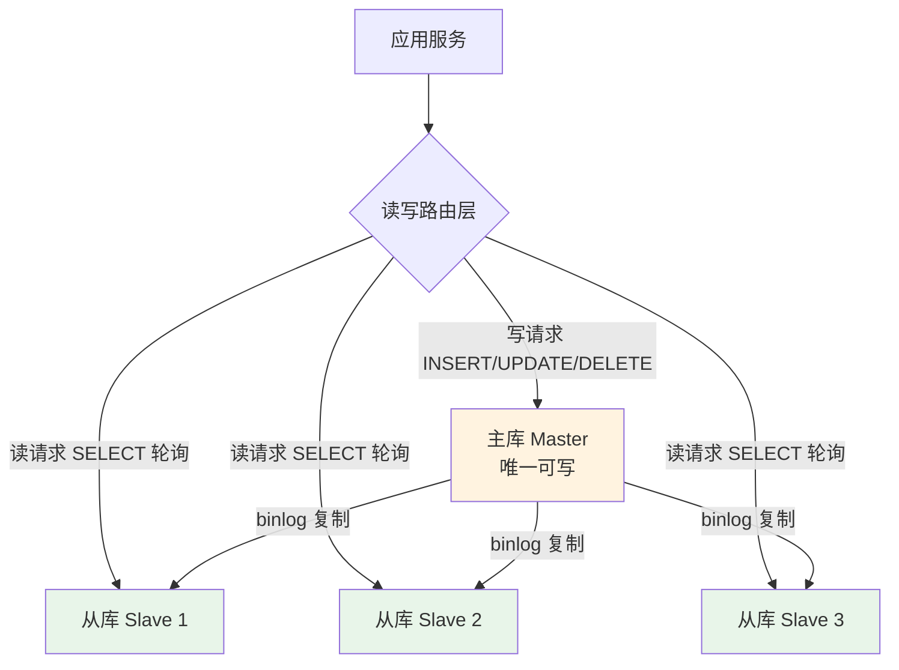

# 读写分离与主从复制

> 定位：搞清楚 MySQL 主从复制到底怎么把数据从主库同步到从库、异步/半同步的差别、主从延迟为什么发生以及怎么应对、读写分离后「写后读」一致性问题怎么解。这是绝大多数互联网公司数据库架构的基石——你可能没做过分库分表，但几乎一定用过读写分离，而「主从延迟」是绕不开的生产话题。

## 一、为什么需要读写分离与主从复制

先看一组现实数据：多数互联网应用是**读多写少**，读请求往往是写请求的 5-10 倍甚至更高。单台 MySQL 既要扛写又要扛读，很快读写互相争抢资源。

**主从复制 + 读写分离**的思路很朴素：

- **主库（Master）**：只处理写请求（INSERT/UPDATE/DELETE）。
- **从库（Slave/Replica）**：处理读请求（SELECT），通过复制保持和主库数据一致。
- 可以多挂几个从库横向扩展读能力，还能做备份、容灾、在线分析而不影响主库。

这套架构带来三大收益：**扩展读性能、数据备份、高可用基础**（主库挂了可从从库提升）。但引入一个绕不开的麻烦——**主从延迟**，以及由此产生的「写后读不一致」。这一篇就把这条链路讲透。

## 二、核心原理：主从复制机制

### 2.1 binlog：复制的「数据源」

主从复制的本质是：**主库把数据变更记成 binlog，从库拿回去重放一遍**。binlog（二进制日志）是 MySQL Server 层记录的逻辑日志，有三种格式：

| 格式 | 记录内容 | 优点 | 缺点 |
|---|---|---|---|
| **STATEMENT** | 原始 SQL 语句 | 日志小 | 依赖上下文，`NOW()`、随机数、存储过程可能导致主从不一致 |
| **ROW** | 每一行数据的变更前后镜像 | 精确、可靠，不会因上下文不一致 | 日志大（批量更新影响多少行就记多少行） |
| **MIXED** | 语句和行混合，MySQL 自动判断 | 折中 | 行为不够确定 |

生产强烈推荐 **ROW 格式**（MySQL 8.0 默认 ROW），可靠性最重要，日志大小问题可通过 binlog 过期时间控制。可用 `binlog_row_image = MINIMAL` 减少 ROW 日志量（只记必要列）。

> binlog 不仅服务复制，还用于**时间点恢复（PITR）**、数据归档。

### 2.2 复制流程：三个线程

主从复制涉及三个线程（两个从库线程 + 一个主库线程）：


完整流程：

1. **主库**把写操作记录到 binlog。
2. 主库的 **Binlog Dump 线程**监听从库的连接请求，把 binlog 事件推送给从库。
3. 从库的 **IO 线程**连接主库，接收 binlog 事件，写入本地的 **Relay Log（中继日志）**。
4. 从库的 **SQL 线程**读取 Relay Log，按顺序重放 SQL，把变更应用到从库数据。

这张图里三个线程的角色要分清：**Dump 线程在主库（发送），IO 线程在从库（接收并落 relay log），SQL 线程在从库（重放）**。主从延迟就发生在「IO 线程拉取」和「SQL 线程重放」这两个环节。

### 2.3 复制的三种模式

| 模式 | 主库何时返回成功 | 数据安全性 | 性能 |
|---|---|---|---|
| **异步复制** | 写完本地 binlog 就返回，不等从库 | 最低（主库挂可能丢数据） | 最高 |
| **半同步复制** | 至少一个从库收到 binlog 并落 relay log 后返回 | 较高（至少两台有数据） | 中等 |
| **全同步复制** | 所有从库都应用完事务后返回 | 最高 | 最低 |

**异步复制**是 MySQL 默认。风险：主库写完返回成功，还没同步给从库就宕机，数据丢失且从库切主后少数据。

**半同步复制**（semi-sync）由插件提供（MySQL 5.7+ 内置）：主库提交时至少等一个从库确认收到 binlog（写入 relay log 并 flush）才返回。这把「主库宕机丢数据」的窗口压缩到很小，但仍不是绝对不丢——因为从库收到 binlog 不等于已经应用，切主后可能还要补应用。

**全同步**：所有从库都应用完才返回，MySQL 原生不提供真正全同步；Group Replication 的多数派确认机制接近这个语义（下一篇讲）。

关键参数（半同步，以版本为准）：

```sql
rpl_semi_sync_master_enabled = ON       -- 主库开启半同步
rpl_semi_sync_master_timeout = 10000    -- 等待从库确认超时(ms)，超时退回异步
rpl_semi_sync_master_wait_for_slave_count = 1  -- 等待几个从库确认
```

> `rpl_semi_sync_master_timeout` 是个权衡：设太短，网络抖动时频繁退回异步，失去半同步意义；设太长，从库故障时主库写请求被长时间阻塞。需结合网络质量压测。

## 三、关键机制：延迟、读写分离、一致性、切换、GTID

### 3.1 主从延迟：原因与解决

**主从延迟（Replication Lag）**是主库已提交、从库还没应用上的时间差。这是读写分离架构最头疼的问题。

**常见原因**：

| 原因 | 说明 |
|---|---|
| 从库单线程重放（老版本） | MySQL 5.6 前 SQL 线程单线程，主库并行写、从库串行追，必然延迟 |
| 大事务 | 一个事务改几百万行，从库要整体应用完才可见，期间延迟飙升 |
| 从库性能差 | 从库配置低于主库，或磁盘 IO 慢 |
| 从库也扛读流量 | 慢查询占满从库资源，SQL 线程抢不到资源 |
| 网络延迟/抖动 | binlog 传输慢 |
| 锁等待 | 从库回放时遇到锁冲突 |

**解决手段**：

1. **并行复制（MTS）**：MySQL 5.7 引入基于「组提交（LOGICAL_CLOCK）」的并行复制，8.0 支持基于「writeset」的并行，大幅提速。关键参数 `slave_parallel_workers`（8.0 用 `replica_parallel_workers`）、`slave_parallel_type = LOGICAL_CLOCK`（以版本为准）。
2. **大事务拆小**：避免单事务更新海量数据（呼应第 4 篇）。
3. **提升从库配置**：从库不要明显弱于主库。
4. **读写分流要合理**：别让重查询拖垮从库的 SQL 线程；必要时专门加「只读从库」扛查询。
5. **监控延迟**：`SHOW SLAVE STATUS\G` 的 `Seconds_Behind_Master`（粗略）、对比主库 binlog 位点与从库应用位点更准确。

### 3.2 读写分离的实现

典型的读写分离部署是这样的：应用只面对一个「路由层」，写请求转发到主库，读请求按负载均衡分散到多个从库。



这张图要看清两条流：**实线是应用请求流**（写只到主库、读分散到多从库），**虚线是数据复制流**（主库 binlog 持续同步到每个从库）。「写后读不一致」正是因为读请求走到了还没完成复制的从库。

两种主流形态：

| 实现方式 | 代表 | 特点 |
|---|---|---|
| **应用层路由** | Sharding-JDBC、Spring 动态数据源、MyBatis 拦截器 | 无额外网络跳转、性能高；需改造应用、配置分散 |
| **中间代理层** | ProxySQL、MaxScale、MyCat | 应用无感知、集中管理；多一跳网络、代理自身要高可用 |

基本逻辑：**写操作走主库，读操作走从库**，多个从库之间做负载均衡（轮询/权重/最少连接）。

应用层实现的典型方式：用 Spring 的 `AbstractRoutingDataSource` + AOP，根据方法名（`get/select` 走从库，`insert/update` 走主库）或注解动态切换数据源。注意**事务内的读必须走主库**（否则读到旧数据且事务语义混乱）。

### 3.3 「写后读」一致性问题

这是读写分离最经典的坑：

```text
用户下单 → 写主库成功 → 立即跳转订单详情页 → 读从库
→ 从库还没同步到这条订单 → 页面显示「订单不存在」
```

用户刚提交完却查不到，体验极差。解决方案按「一致性强度 vs 复杂度」排序：

| 方案 | 做法 | 评价 |
|---|---|---|
| **写后读主库** | 写完短时间内（如几秒）的读强制走主库 | 最常用、最可靠；用缓存/ThreadLocal 标记用户 |
| **半同步复制** | 减少延迟窗口 | 降低概率但不能根除 |
| **等待位点/GTID** | 读前等待从库追上指定 binlog 位点或 GTID | 强一致，但可能阻塞，适合关键操作 |
| **缓存兜底** | 写完后把结果写缓存，读先查缓存 | 常用组合拳 |
| **sleep 一下** | 读前 sleep 几百毫秒 | 极不靠谱，禁止作为正式方案 |

**实践建议**：「写后读」采用「**写后 N 秒内读主库**」策略（N 根据监控的 P99 延迟设定），配合缓存。关键业务（如支付结果）用等待 GTID 方案保证强一致。

### 3.4 主从切换（Failover）

主库宕机时要把从库提升为新主库，让应用继续写。核心步骤：

1. 检测主库故障（心跳/多数派）。
2. 从从库中选出「数据最全」的（同步位点最靠前）。
3. 提升为新主库（停止复制、置为可写）。
4. 把写流量切过去（VIP 漂移 / DNS 切换 / 配置中心推送）。
5. 其他从库重新指向新主库。

切换到「数据最全的从库」是关键——异步复制下，不同从库进度不同，选错会丢数据。这就是 GTID 和半同步的价值所在。工具（MHA、Orchestrator）会自动化这个过程（下一篇展开）。

### 3.5 GTID

**GTID（Global Transaction Identifier）**是事务的全局唯一标识，格式 `source_id:transaction_id`，如 `3E11FA47-71CA-11E1-9E33-C80AA9429562:23`。

它带来两个核心好处：

1. **故障切换简单**：传统复制要记录 binlog 文件名和位点（`MASTER_LOG_FILE` + `MASTER_LOG_POS`），切换时容易搞错；GTID 用 `MASTER_AUTO_POSITION = 1` 让从库自动找到该从哪个事务开始同步。
2. **不丢事务**：GTID 保证每个事务在各库上只执行一次，切换后能自动补齐缺失的事务。

开启条件（以版本为准）：

```sql
gtid_mode = ON
enforce_gtid_consistency = ON
log_bin = ON
-- 从库切换用：CHANGE MASTER TO MASTER_AUTO_POSITION = 1;
```

> 注意：从传统复制切到 GTID 需要按步骤滚动操作，且开启 GTID 后有一些 SQL 限制（如不能用 `CREATE TABLE ... SELECT`），上线前要评估。

## 四、生产坑点与排查

### 坑点 1：写后立即读从库，查不到刚提交的数据

**现象**：用户提交表单后跳转详情页，偶尔显示「数据不存在」，刷新又好了。
**原因**：主从延迟，读请求打到还没同步的从库。
**解法**：写后读主库（N 秒内强制走主，N 参考 P99 延迟）；关键操作用 GTID 等待；配合缓存兜底。禁止用 sleep。

### 坑点 2：主从延迟持续增大追不上

**现象**：`Seconds_Behind_Master` 从几秒涨到几千秒，从库永远追不上主库。
**原因**：常见是主库有大事务、从库并行复制没开启或配置不当、从库被慢查询拖垮、从库硬件差。
**解法**：
- 开启并调大并行复制（`slave_parallel_workers`，`slave_parallel_type=LOGICAL_CLOCK`）。
- 拆分大事务。
- 把从库的分析类慢查询迁走或限流，保证 SQL 线程资源。
- 检查从库磁盘 IO 和网络。
- 用 `performance_schema.replication_applier_status_by_worker` 看具体卡在哪。

### 坑点 3：异步复制下主库宕机丢数据

**现象**：主库机器故障，提升从库后发现有部分已返回成功的事务丢失。
**原因**：异步复制主库写完 binlog 就返回，故障瞬间这部分 binlog 还没传到从库。
**解法**：开启半同步复制（至少等一个从库确认）；关键业务用 Group Replication 多数派提交；接受「RPO>0」的现实并用业务补偿（如可重放的消息）。

### 坑点 4：从库被误写入，导致复制中断

**现象**：从库出现 `Error 'Duplicate entry'`，复制线程停止。
**原因**：有人直连从库执行了写操作（或应用读写路由配错），从库数据和主库分叉，SQL 线程重放时冲突。
**解法**：
- 从库设为 `read_only = ON`（超级用户仍可写）或 `super_read_only = ON`（以版本为准）。
- 排查复制错误：看 `SHOW SLAVE STATUS\G` 的 `Last_SQL_Error`。
- 轻微冲突可跳过错误（`sql_slave_skip_counter` 或 GTID 注入空事务），严重时重建从库。

### 坑点 5：主从切换后应用连不上或连错库

**现象**：切换后应用大量报错，或写请求仍打到旧主库（已只读）。
**原因**：VIP/DNS 切换有缓存、连接池持有旧连接、应用配置未更新。
**解法**：
- 用配置中心 + 应用监听，切换后主动刷新连接池。
- VIP 切换配合连接池探活（`testOnBorrow`）。
- 切换演练要覆盖「应用重连」环节。

## 五、调优、选型与最佳实践

**复制模式选型：**

| 场景 | 推荐模式 |
|---|---|
| 追求性能、能容忍极低概率丢数据 | 异步 |
| 数据较重要、不能丢（大多数生产） | 半同步 |
| 金融级强一致、可接受性能损失 | Group Replication / 多数派 |

**落地 checklist：**

1. binlog 用 ROW 格式，配好过期时间（`binlog_expire_logs_seconds`）。
2. 生产开半同步，设置合理超时，监控退化次数。
3. 开启 GTID，切换用 `MASTER_AUTO_POSITION`。
4. 从库开并行复制，配置 `read_only`。
5. 读写分离用动态数据源或代理，事务内读走主库。
6. 「写后读」走主库 N 秒 + 缓存，关键操作用 GTID 等待。
7. 监控复制延迟、IO/SQL 线程状态、半同步状态。

**关键监控项：**

| 监控项 | 来源 |
|---|---|
| 复制延迟 | `Seconds_Behind_Master`、位点/GTID 差值 |
| IO/SQL 线程状态 | `SHOW SLAVE STATUS\G` 的 `Slave_IO_Running` / `Slave_SQL_Running` |
| 复制错误 | `Last_IO_Error` / `Last_SQL_Error` |
| 并行复制积压 | `performance_schema.replication_applier_status_by_worker` |
| 半同步状态 | `Rpl_semi_sync_master_status` 等状态变量 |

## 九、面试高频问法

> 这一节的答案按「面试时能讲透」的标准写：先给一句话结论，再展开机制、原因和坑点。

**Q1：MySQL 主从复制的原理是什么？**

**一句话结论**：主库把变更写 binlog，从库的 IO 线程拉取 binlog 写到 relay log，SQL 线程重放 relay log。

展开（三个线程）：

1. **主库 Binlog Dump 线程**：把 binlog 发给从库。
2. **从库 IO 线程**：接收 binlog，写入 relay log（中继日志）。
3. **从库 SQL 线程**：读取 relay log，重放 SQL，更新从库数据。

加分点：说"复制是**异步**的——主库写完 binlog 就返回，不等从库；所以主从之间天然有延迟，这是'主从延迟'的根源"。

**Q2：binlog 有哪几种格式？**

**一句话结论**：STATEMENT（记 SQL 语句）、ROW（记行变更）、MIXED（混合）。

| 格式 | 内容 | 优点 | 缺点 |
|---|---|---|---|
| STATEMENT | SQL 语句 | 日志小 | 某些函数（如 now()）主从不一致 |
| ROW | 每行的前后值 | 绝对一致 | 日志大（批量更新很大） |
| MIXED | 自动选择 | 折中 | 复杂 |

**生产推荐 ROW**：虽然日志大，但能保证主从一致，且支持数据恢复（能看到具体改了哪行）。

加分点：说"ROW 格式还有个好处——Canal 订阅 binlog 做数据同步时，ROW 能拿到完整的前后值，STATEMENT 只有 SQL 拿不到数据"。

**Q3：主从延迟的原因有哪些？怎么解决？**

**一句话结论**：主库并发写、从库单线程重放（老版本）、大事务、从库压力大——导致从库落后主库。

展开：

- **原因**：
  1. 主库并发写入，从库 SQL 线程单线程重放跟不上（MySQL 5.7 前）
  2. 大事务（一次改百万行）重放慢
  3. 从库还要承担读请求，资源竞争
  4. 网络延迟
- **解决**：
  1. **并行复制**（5.7+ 按组提交并行、8.0 按 write set 并行）
  2. 拆大事务
  3. 从库专用（不承担读）或加从库
  4. 半同步复制（减少丢数据，但不解决延迟）

加分点：说"主从延迟最典型的后果是'刚下单查不到订单'——写主库、读从库，从库还没同步；解法是'写后强制读主库'或'关键读走主库'"。

**Q4：读写分离怎么实现？有什么坑？**

**一句话结论**：写走主库、读走从库；坑在"主从延迟导致读到旧数据"和"事务内读写不一致"。

展开：

- **实现**：中间件（Sharding-JDBC、MyCat）或应用层（多数据源 + AOP 切换）。
- **坑一：主从延迟**——写完立即读，可能读到旧数据。解法：写后一段时间内读主库、或强制读主。
- **坑二：事务内**——事务里先写主库再读，如果读走了从库，可能读不到刚写的。解法：事务内强制走主库。

加分点：说"读写分离不是'配一下就行'——要处理'写后读一致性'，否则用户会看到'下单成功但订单列表没有'的诡异现象"。

**Q5：半同步复制是什么？和异步复制有什么区别？**

**一句话结论**：异步复制主库写完就返回（可能丢数据）；半同步要等至少一个从库确认收到 binlog 才返回（减少丢数据，但增加延迟）。

展开：

- **异步**：主库提交 → 写 binlog → 返回客户端 → 后台发给从库。主库挂了，未同步的 binlog 丢失。
- **半同步**：主库提交 → 等至少一个从库 ACK（收到 binlog）→ 返回。保证"至少一个从库有数据"。
- **代价**：延迟增加（等网络往返）；从库都挂了会退化为异步。

加分点：说"半同步是'性能与可靠性的折中'——比异步可靠（不丢数据），比全同步快（只等一个从库）；金融场景常用"。

**Q6：主从切换怎么做？有什么风险？**

**一句话结论**：主库挂了，把一个从库提升为主库，其他从库指向新主；风险是"数据丢失"（异步复制的未同步数据）和"脑裂"（旧主恢复后双写）。

展开：

- **手动切换**：DBA 操作，慢但可控。
- **自动切换**：MHA、Orchestrator、MGR 自动检测和切换。
- **风险**：
  1. 数据丢失：异步复制时，新主可能缺少旧主最后的数据。
  2. 脑裂：旧主恢复后如果还能写，会出现两个主。
- **防护**：切换前确保旧主真的挂了（fencing）、用半同步减少丢失、切换后校验。

加分点：说"主从切换最大的风险是'脑裂'——旧主没完全挂，新主已接管，两边都接受写入，数据就分叉了；所以切换必须有'隔离旧主'的机制"。

**Q7：什么是 GTID？它解决了什么问题？**

**一句话结论**：GTID 是全局事务 ID，每个事务有唯一标识；它让主从切换和故障恢复更简单——从库知道"我执行到哪个事务了"，不用算 binlog 位置。

展开：

- **传统方式**：主从同步靠"binlog 文件名 + 位置"，切换时要找新主的对应位置，容易出错。
- **GTID**：每个事务有全局唯一 ID（`server_uuid:事务号`），从库记录"已执行的 GTID 集合"，切换时自动找缺失的事务。
- **好处**：切换简单、避免重复执行、支持多源复制。

加分点：说"GTID 是'主从复制的现代化'——它把'位置'变成了'集合'，切换时不用人工算 offset，大幅降低运维风险"。

**Q8：为什么从库的读性能也可能成为瓶颈？**

**一句话结论**：从库要重放 binlog（写），还要处理读请求，两者竞争资源；且从库通常是单线程重放（老版本），写入能力有限。

展开：

- **重放开销**：SQL 线程重放 binlog 本身消耗 CPU/IO。
- **读写竞争**：读请求和重放竞争 buffer pool、磁盘 IO。
- **单线程瓶颈**：5.7 前 SQL 线程单线程，主库并发高时重放跟不上。

加分点：说"加从库不是'无限扩展读能力'——每个从库都要重放全量 binlog，主库写入压力会传导到所有从库；写压力大时，要从'减少写入'入手，不是加从库"。

**Q9：怎么监控主从延迟？**

**一句话结论**：看 `SHOW SLAVE STATUS` 的 `Seconds_Behind_Master`，但它不准；更可靠的是用 `pt-heartbeat` 或对比 GTID。

展开：

- **Seconds_Behind_Master**：从库 SQL 线程落后主库的秒数，但主库空闲时会显示 0（不准）。
- **pt-heartbeat**：主库定期写心跳时间戳，从库读出来对比，精确。
- **GTID 对比**：对比主从的 GTID 集合差异。

加分点：说"Seconds_Behind_Master 是个'坑指标'——主库没写入时它永远是 0，看起来没延迟，实际可能落后很多；生产要用 pt-heartbeat"。

**Q10：读写分离和分库分表能一起用吗？**

**一句话结论**：能，而且常见——先按业务分库，每个库再做读写分离；但复杂度叠加，要谨慎。

展开：

- **组合**：分库解决"数据量/并发"，读写分离解决"读多写少"。
- **复杂度**：分片路由 + 读写路由 + 主从延迟，问题叠加。
- **建议**：先用读写分离扛读，不够再分库分表；不要一上来就全套，复杂度会失控。

加分点：说"架构演进要'按需'——读写分离能解决的别急着分库分表；每加一层复杂度，运维和排查成本都翻倍"。

## 小结

- 主从复制 = 主库记 binlog + Dump/IO/SQL 三线程：Dump 发、IO 收写 relay log、SQL 重放；binlog 生产用 ROW。
- 复制模式取舍：异步（快但可能丢）→ 半同步（生产推荐）→ 全同步/MGR（强一致）。
- 主从延迟源于单线程回放、大事务、从库扛读等；靠并行复制、拆事务、提升从库来治。
- 写后读不一致：写后 N 秒读主库 + 缓存兜底，关键操作用 GTID 等待，禁用 sleep。
- GTID 让切换自动定位位点、事务不重不漏；切换要选数据最全的从库并防脑裂。
