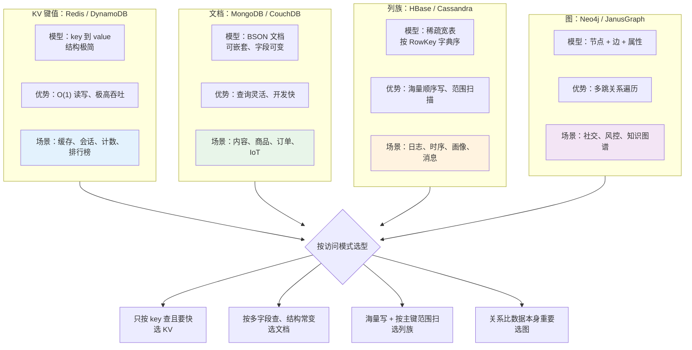
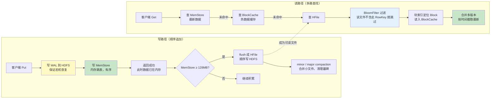
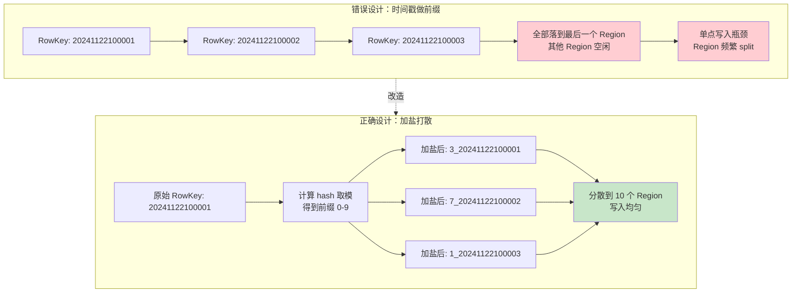

# NoSQL 选型：MongoDB 与 HBase

> 定位：很多团队的技术栈里只有 MySQL + Redis，一遇到「字段天天变」「单表几十亿行」「写入每秒几十万」就开始硬扛——加字段改表、分库分表、用 Redis 顶。其实这些场景本来就该换数据模型。这篇把 NoSQL 的四类版图讲清，重点拆 MongoDB 的文档模型/副本集/分片/事务和 HBase 的列族/LSM-Tree/RowKey 设计，最后给一张能直接拿去做技术选型的对比表。看完你要能回答：这个业务到底该用 MySQL、MongoDB 还是 HBase，以及为什么。

## 一、为什么需要 NoSQL

### 1.1 关系型数据库的三条硬约束

关系型数据库（以 MySQL 为代表）的强大来自三个东西：**强 schema、事务、SQL**。但同一批特性在特定场景下就是枷锁。

**（1）schema 僵化，迭代成本高**

MySQL 加字段要 `ALTER TABLE`。8.0 的 instant add column 已经能做到秒级，但仍有约束：加列只能在最后、不支持 instant 改列类型、大表加索引依然要建索引。更麻烦的是**业务本身就没有固定结构**——比如商品类目，家电有「功率」，服装有「尺码」，图书有「ISBN」，用关系表要么建一堆稀疏列，要么搞 EAV（Entity-Attribute-Value）三张表 join，查询和维护都痛苦。

**（2）水平扩展难**

MySQL 的单机容量有物理上限。超过之后只能分库分表：

- 要引入 ShardingSphere / MyCat 之类的中间件
- 跨分片 `join` 基本不可用
- 跨分片事务要用 Seata 之类的分布式事务，性能和复杂度都上一个台阶
- 扩容要重新分片、迁移数据，是典型的「凌晨割接」工程

**（3）海量数据的存储与写入瓶颈**

InnoDB 是 B+ 树：写入是**随机写**（找到页、改页、脏页刷盘），还有页分裂和写放大。当单表到十亿级、写入到每秒十万级，B+ 树的随机 IO 会成为瓶颈。而很多大数据场景（日志、埋点、时序）根本不需要 B+ 树那种「点查极快」的特性，它们要的是**顺序写 + 范围扫描**。

### 1.2 NoSQL 不是「不用 SQL」，是「换一种数据模型」

先纠正一个常见误解：NoSQL 的「No」不是「不要 SQL」的意思，更准确的理解是 **Not Only SQL**——在关系模型不合适的场景，换一种更贴合数据形态的模型。

| 诉求 | 关系模型的问题 | NoSQL 的答案 |
|---|---|---|
| 字段灵活多变 | 改表成本高 | 文档模型，一条记录自带结构 |
| 写入量极大 | B+ 树随机写、写放大 | LSM-Tree 顺序写 |
| 超宽稀疏表 | 大量 NULL 浪费空间 | 列族模型，空列不占存储 |
| 关系遍历（好友的好友） | 多表 join，深度一深就爆炸 | 图模型，按边遍历 |
| 极简高频访问 | 解析 SQL、事务开销 | KV，O(1) 查表 |

### 1.3 CAP 与 BASE，别背成八股

CAP 的实用版本只有一句话：**网络分区发生时，必须在一致性和可用性之间取舍**。HBase、ZooKeeper 选 CP（宁可不可用也不返回旧数据），Cassandra、DynamoDB 选 AP（优先可用，接受最终一致），MongoDB 默认读写主节点是强一致，但可以用 `readPreference` 降级。

对业务开发来说，比背 CAP 更有用的是三个问题：

1. 数据丢了会不会出事？（决定持久化级别）
2. 读到 1 秒前的旧数据能不能接受？（决定一致性级别）
3. 查询是按主键点查还是任意条件组合？（决定数据模型）

**这三个问题的答案，比背 CAP 更能决定选型。**

## 二、四类 NoSQL：先分清数据模型

NoSQL 不是一个大类，而是四种完全不同的东西，硬套在一起比较没有意义。

| 类型 | 代表 | 数据模型 | 查询方式 | 典型场景 | 一致性 |
|---|---|---|---|---|---|
| **KV 键值** | Redis、DynamoDB、Riak | key → value（字符串/哈希/列表） | 只能按 key 查 | 缓存、会话、计数器、排行榜 | 可调，Redis 主从异步 |
| **文档** | MongoDB、CouchDB | JSON/BSON 文档，可嵌套 | 按任意字段查、聚合管道 | 内容管理、商品、订单、IoT | 可调（主节点强一致） |
| **列族** | HBase、Cassandra、Bigtable | 稀疏宽表，按 RowKey 排序 | 按 RowKey 点查/范围扫描 | 日志、时序、画像、消息 | HBase 强一致，Cassandra 最终一致 |
| **图** | Neo4j、JanusGraph | 节点 + 边 + 属性 | 关系遍历（几跳邻居） | 社交、风控、知识图谱、推荐 | 依实现 |



看图的方法：**先看你的查询长什么样，再看数据长什么样**。四类的分野不是「谁更先进」，而是「谁的数据模型和访问模式更贴合」。选错了模型，后面所有优化都是在跟模型对抗——把 HBase 当 MongoDB 用（任意组合查询）只能全表 scan，把 MongoDB 当 HBase 用（每秒几十万条写入）会被 B-Tree 索引维护拖死。

## 三、MongoDB：以文档为中心

### 3.1 BSON 文档模型

MongoDB 存的是 **BSON**（Binary JSON），是 JSON 的二进制扩展。相比 JSON 多了这些类型：

| 类型 | 说明 | 用途 |
|---|---|---|
| `ObjectId` | 12 字节，含时间戳 + 机器码 + 进程号 + 计数器 | 默认主键，天然有序、分布式唯一 |
| `Date` | 64 位毫秒时间戳 | 时间字段 |
| `Decimal128` | 128 位十进制浮点 | **金额**，避免 double 精度问题 |
| `Binary` | 二进制 | 小文件、加密数据 |
| `Int32` / `Int64` | 区分位宽 | 需要精确控制存储时 |

一个典型订单文档：

```javascript
{
  _id: ObjectId("65f1c8a2e4b0a1b2c3d4e5f6"),
  orderNo: "SO20241122001",
  userId: 10086,
  status: "PAID",
  items: [
    { sku: "KB-001", name: "机械键盘", price: NumberDecimal("399.00"), qty: 1 },
    { sku: "MS-002", name: "无线鼠标", price: NumberDecimal("129.00"), qty: 2 }
  ],
  address: { province: "浙江", city: "杭州", detail: "西湖区..." },
  createdAt: ISODate("2024-11-22T10:00:00Z")
}
```

注意几个设计点：

- **订单和明细放在一个文档里**。关系型要两张表 join，文档模型一次查询就拿到完整聚合。这是文档数据库最大的价值——**聚合边界内的数据放在一起**。
- **金额用 `Decimal128`**，不要用 double。这是金融场景的铁律。
- **单文档上限 16MB**。这是硬限制，决定了「什么能放一个文档里」。超过就要拆（比如把明细拆成独立集合，或者用 GridFS 存大文件）。

### 3.2 无 schema 的利与弊

「无 schema」是 MongoDB 最大的卖点，也是最大的坑。

**利**：

- 快速迭代：加字段不用 DDL，代码先上，数据后补
- 异构数据：同一集合里可以有结构完全不同的文档（比如不同类目的商品）
- 稀疏字段：没有的字段不占空间，不像关系表要留 NULL 位

**弊**（生产上一定会遇到）：

| 问题 | 表现 | 后果 |
|---|---|---|
| **字段类型不一致** | 同一个 `age`，有的存 `18`（int），有的存 `"18"`（string） | 查询 `{age: {$gt: 18}}` 漏数据 |
| **字段名拼错** | `userid` / `userId` / `user_id` 混用 | 数据割裂，查询查不到 |
| **历史数据缺字段** | 老文档没有新字段 | 应用层到处判空，聚合结果偏差 |
| **嵌套过深** | 为了「一次查完」无限嵌套 | 文档膨胀到 16MB，更新性能骤降 |

**解法：把 schema 约束挪到应用层，但要真的做。**

MongoDB 3.2 之后支持 **schema validation**，可以在集合级别做校验：

```javascript
db.createCollection("users", {
  validator: {
    $jsonSchema: {
      bsonType: "object",
      required: ["name", "age", "createdAt"],
      properties: {
        name:      { bsonType: "string", maxLength: 64 },
        age:       { bsonType: "int", minimum: 0, maximum: 150 },
        createdAt: { bsonType: "date" }
      }
    }
  },
  validationLevel: "strict",   // 新写入和已有文档的更新都校验
  validationAction: "error"    // 直接拒绝，不是 warn
})
```

但校验只能防「新写入的脏数据」，**存量数据还得靠数据治理**：写迁移脚本统一字段名和类型、加 `schemaVersion` 字段标记版本、在 DAO 层做类型转换。

### 3.3 索引体系

MongoDB 的索引底层是 **B-Tree**（WiredTiger 引擎），和 InnoDB 的 B+ 树类似，但叶子节点存的是文档的 `RecordId` 而不是完整行。

| 索引类型 | 说明 | 场景 |
|---|---|---|
| 单字段 | 最基础 | 高频单条件查询 |
| 复合索引 | 多字段，**遵循最左前缀** | 多条件组合查询 + 排序 |
| 多键索引（Multikey） | 数组字段，每个元素一条索引项 | `tags: ["a","b"]` 按标签查 |
| 唯一索引 | 强制唯一 | 业务唯一键 |
| TTL 索引 | 到期自动删除文档 | 会话、验证码、临时日志 |
| 文本索引 | 分词 + 倒排 | 简单全文搜索（中文支持弱） |
| 地理索引（2dsphere） | GeoJSON | 附近的人、范围查询 |
| 部分索引（Partial） | 只索引满足条件的文档 | `{status: "PAID"}` 才建索引，省空间 |
| 稀疏索引（Sparse） | 只索引存在该字段的文档 | 可选字段 |

复合索引的关键规则和 MySQL 一样：**等值条件在前，范围/排序在后**。

```javascript
// 查询：某用户最近的订单
db.orders.createIndex({ userId: 1, createdAt: -1 });

db.orders.find({ userId: 10086 })
         .sort({ createdAt: -1 })
         .limit(20)
         .explain("executionStats");   // 看是否 IXSCAN + 无 SORT 阶段
```

`explain` 里看三件事：`stage` 是 `IXSCAN` 还是 `COLLSCAN`（全表扫）；`totalKeysExamined` 和 `nReturned` 是否接近（差太多说明选择性差）；有没有 `SORT` 阶段（有就是内存排序，超过 32MB 会直接报错）。

> 一个常见坑：复合索引的方向有影响。`{a:1, b:-1}` 和 `{a:1, b:1}` 对「a 等值 + b 排序」都能用，但「a 范围 + b 排序」不行——范围查询后面的字段无法继续用于排序，规则和 B+ 树一致。

### 3.4 副本集：高可用

MongoDB 的高可用靠**副本集（Replica Set）**，本质是「一主多从 + oplog 复制 + 自动故障转移」：应用写 Primary，Primary 把操作记进 oplog，Secondary 拉取重放；Primary 失联后由多数派选出新主。

关键机制：

| 机制 | 说明 |
|---|---|
| **oplog** | 固定大小的 capped collection，记录所有写操作；Secondary 拉取并重放 |
| **选举** | Primary 失联超过 `electionTimeoutMillis`（默认 10s）后，多数派投票选新主 |
| **心跳** | 每 2s 一次，10s 无响应判定为不可达 |
| **多数派** | 至少 3 个投票节点，最多 7 个投票节点（总成员最多 50） |
| **写关注** | `w:1` 写完主就返回；`w:"majority"` 多数派确认才返回 |
| **读关注** | `local`（可能读到回滚数据）、`majority`（多数派已确认）、`linearizable`（线性一致，最慢） |

生产配置的硬建议：

1. **至少 3 个节点，分布在不同可用区**。2 节点凑不齐多数派，没有意义。
2. **写关注用 `majority`**，`w:1` 在主节点崩溃时可能丢数据（新主没有这条 oplog）。
3. **读关注按业务分级**：订单、支付用 `majority`；商品详情、列表页用 `local` 或 `secondaryPreferred` 换吞吐。
4. **别用仲裁节点（Arbiter）**：它不存数据只投票，省一台机器的代价是数据副本只剩 2 份，坏一个就危险。

### 3.5 分片：水平扩展

单副本集扛不住（数据量 > 几 TB 或写入超单机上限）时上**分片集群**：`mongos` 做无状态路由、Config Server 存 chunk 与分片元数据、Shard 存数据、Balancer 迁移 chunk 做均衡。

| 组件 | 作用 | 注意 |
|---|---|---|
| **mongos** | 无状态路由，解析查询、路由到对应 shard、合并结果 | 至少 2 个，放在应用同机房 |
| **Config Server** | 存集群元数据（chunk 分布、分片键），必须是副本集 | 3 个节点，元数据丢了集群就废了 |
| **Shard** | 实际存数据的副本集 | 每个 shard 自己是一个完整副本集 |
| **Balancer** | 后台迁移 chunk，让各 shard 数据量均衡 | 迁移会消耗 IO，业务高峰可关闭 |

**分片键（Shard Key）是分片集群的生死线**，选错了后期几乎无法挽回（4.2 才支持改分片键值，5.0 才有 resharding，代价都很大）。

| 分片策略 | 原理 | 优点 | 缺点 |
|---|---|---|---|
| **范围分片（ranged）** | 按分片键值区间切 chunk | 范围查询高效（连续数据在一个 shard） | 单调递增的键会导致**写热点**（全打到最后一个 chunk） |
| **哈希分片（hashed）** | 对分片键做哈希再分 | 写入均匀打散 | 范围查询要扫所有 shard，效率低 |

分片键的选择标准（三条缺一不可）：**高基数**（`gender` 只有 2 个值，最多分出 2 个 chunk）、**低频率**（不能有占 80% 数据的超级热点值）、**非单调递增**（`ObjectId`、自增 ID、时间戳都会让新数据全落到最后一个 chunk）。

```javascript
// 典型配置：按 userId 哈希分片，写入均匀
sh.enableSharding("shop");
sh.shardCollection("shop.orders", { userId: "hashed" });

// 或者复合分片键：租户 + 时间，兼顾隔离和范围查询
sh.shardCollection("shop.logs", { tenantId: 1, createdAt: 1 });
```

> **唯一索引必须包含分片键**：唯一性只能在单个 shard 内保证，跨 shard 无法去重。全局唯一订单号要么做成分片键，要么用雪花 ID/去重表保证。

### 3.6 事务：从单文档到分布式

MongoDB 的事务能力分版本演进：

| 版本 | 能力 | 说明 |
|---|---|---|
| 4.0 之前 | **仅单文档原子** | 一个文档的更新是原子的（包括嵌套数组），多文档没有事务 |
| **4.0** | **副本集多文档事务** | 支持跨集合、跨文档事务，但只在副本集内 |
| **4.2** | **分片集群分布式事务** | 事务可以跨 shard，基于两阶段提交 |
| 5.0 | 事务内支持更多 DDL 外的操作 | 能力增强，限制减少 |

事务的基本写法：

```javascript
const session = db.getMongo().startSession();
session.startTransaction({
  readConcern:  { level: "snapshot" },
  writeConcern: { w: "majority" }
});
try {
  const accounts = session.getDatabase("bank").accounts;
  accounts.updateOne({ _id: "A" }, { $inc: { balance: -100 } });
  accounts.updateOne({ _id: "B" }, { $inc: { balance:  100 } });
  session.commitTransaction();
} catch (e) {
  session.abortTransaction();
  throw e;
} finally {
  session.endSession();
}
```

**必须知道的限制**：

| 限制 | 数值 | 影响 |
|---|---|---|
| 事务默认超时 | **60 秒**（`transactionLifetimeLimitSeconds`） | 长事务会被自动 abort |
| 单事务 oplog 总量 | **16MB** | 事务内写入的数据量有上限 |
| 事务内不能建集合 | 4.4 之前 | 集合要先建好 |
| 跨分片事务性能 | 明显低于单分片 | 两阶段提交 + 多次网络往返 |

**实践原则：能不用事务就不用。** 文档模型的设计目标就是「把需要一起改的数据放进一个文档」，单文档原子性就够了；真需要跨文档事务时，先反思是不是模型设计错了。

### 3.7 适用与不适用

| 适合 | 原因 |
|---|---|
| 内容管理（CMS、博客、商品详情） | 结构不固定、嵌套聚合、读多写少 |
| 订单/用户画像 | 一个聚合根一个文档，天然匹配 |
| IoT / 设备数据 | 字段随设备类型变化，写入量大 |
| 实时分析（聚合管道） | `$match`/`$group`/`$lookup` 能做中等复杂度分析 |
| 快速原型 / 迭代期业务 | 无 schema，改字段不用 DDL |

| 不适合 | 原因 | 替代 |
|---|---|---|
| 强事务（金融核心账务） | 跨文档事务性能差、有 60s 限制 | MySQL / 分布式事务 |
| 大量 join | `$lookup` 是嵌套循环，性能差 | MySQL / 宽表 |
| 超大规模写入（每秒几十万） | B-Tree 索引维护成本高 | HBase / Kafka + 批处理 |
| 复杂 OLAP（多表关联、窗口函数） | 聚合管道能力有限 | ClickHouse / Doris |
| 需要严格 SQL 标准的场景 | 查询语言是 MQL | PostgreSQL |

## 四、HBase：以 RowKey 为中心

### 4.1 列族模型：一张「无限宽、无限高」的稀疏表

HBase 的数据模型常被误解。它的层级是：

```
Table
 └── Row（由 RowKey 唯一标识，按字典序排序）
      └── Column Family（列族，建表时定义，物理存储单元）
           └── Column Qualifier（列限定符，可动态添加）
                └── Version（时间戳版本）
                     └── Value（字节数组）
```

几个关键点：

- **稀疏**：没有值的单元格**不占存储**。一张表可以有百万列，每行只存实际有值的那些。
- **列族是物理单元**：一个列族对应一个 Store（一个 MemStore + 多个 HFile），所以列族不能太多，一般 1-3 个。
- **列限定符是逻辑的**：同一列族下可以有任意多个列，不需要预定义，`info:name`、`info:age` 都可以。
- **按 RowKey 字典序排列**：这是 HBase 一切设计的核心，也是热点的根源。
- **同一行的写是原子的**：跨行没有事务。

HBase Shell 示例：

```bash
# 建表：两个列族，预分 9 个 Region
create 'user_profile',
  {NAME => 'info', VERSIONS => 3, BLOOMFILTER => 'ROW'},
  {NAME => 'behavior', VERSIONS => 1},
  SPLITS => ['1','2','3','4','5','6','7','8','9']

put 'user_profile', 'u1001', 'info:name', 'tom'
put 'user_profile', 'u1001', 'info:age', '28'
put 'user_profile', 'u1001', 'behavior:last_login', '2024-11-22 10:00:00'

get 'user_profile', 'u1001'
scan 'user_profile', {STARTROW => 'u1000', STOPROW => 'u2000', LIMIT => 10}
```

`VERSIONS => 3` 表示保留最近 3 个版本——HBase 天然支持多版本，每次写入带时间戳，读默认取最新。

### 4.2 集群架构

客户端先问 ZooKeeper 拿 `hbase:meta` 位置，再查 meta 表得到目标 Region 所在的 RegionServer（结果会缓存），之后直接读写。

| 组件 | 职责 | 单点风险 |
|---|---|---|
| **HMaster** | 建表/改表、Region 分配与迁移、负载均衡 | 可部署 backup master，**不是数据读写必经之路** |
| **RegionServer** | 管理多个 Region，处理读写、flush、compact | 挂了之后 Region 会被 Master 重新分配 |
| **ZooKeeper** | 存 `hbase:meta` 位置、Master 选举、RS 心跳 | 强依赖，ZK 挂了集群不可用 |
| **HDFS** | 存 WAL 和 HFile | 强依赖，通常 3 副本 |

**HMaster 不参与数据读写**，客户端拿到 Region 位置后直接连 RegionServer，所以 Master 短暂不可用不影响已有读写。

### 4.3 写路径：LSM-Tree 为什么能扛住海量写

HBase 的存储引擎是 **LSM-Tree（Log-Structured Merge Tree）**，核心思想是：**写入只做顺序追加，把随机写变成顺序写，用后台合并来整理数据**。

写一条数据的完整路径：

1. 客户端发 `Put` 到对应 RegionServer
2. **写 WAL（Write-Ahead Log，旧称 HLog）**：追加到 HDFS 上的日志文件。这一步保证宕机可恢复。
3. **写 MemStore**：内存中的有序结构（`ConcurrentSkipListMap`，按 RowKey + 列族 + 列 + 时间戳排序）
4. **返回客户端成功**
5. MemStore 达到阈值（`hbase.hregion.memstore.flush.size`，默认 **128MB**）→ **flush 成 HFile**（有序的、不可变的文件，存 HDFS）
6. HFile 越来越多 → **compaction（合并）**：minor compaction 合并小文件，major compaction 合并所有文件并清理删除标记（墓碑）



看图重点：

- **写路径没有随机 IO**：WAL 追加、MemStore 内存、HFile 顺序写，这是 HBase 能扛每秒几十万写入的根本原因。
- **代价在读**：数据散在 MemStore + 多个 HFile 里，所以需要 BloomFilter 和 BlockCache 兜底；**compaction 是双刃剑**，它清理垃圾、提升读性能，但消耗大量 IO 和 CPU，是 HBase 最典型的「半夜报警」来源。

### 4.4 读路径：BloomFilter + BlockCache

一次 `Get` 的查找顺序：

1. **MemStore**：最新写入还没 flush 的数据在这里，先查它
2. **BlockCache**：读缓存（LRU），热数据直接命中。默认占堆的 **40%**（`hfile.block.cache.size`）
3. **HFile**：
   - **BloomFilter**：判断「这个 HFile 里有没有这个 RowKey」。没有就直接跳过，避免无谓的磁盘 IO。默认类型 `ROW`，误判率约 1%
   - **块索引（Block Index）**：HFile 内部按 64KB 分块，多层索引定位到目标 block
   - 读 block 到 BlockCache，再解析出 KeyValue

**BloomFilter 是 HBase 读性能的关键**：没有它，一次读要扫遍所有 HFile；有了它，大部分不相关的文件在第一层就被排除。

```bash
# 建表时指定 BloomFilter 类型
create 'user_profile', {NAME => 'info', BLOOMFILTER => 'ROW'}
# ROW：按 RowKey 过滤（最常用）
# ROWCOL：按 RowKey + 列过滤（列族内列很多时更省）
# NONE：关闭（省内存，但读变慢）
```

**BlockCache 有两种策略**：`LRUBlockCache` 是堆内 LRU，实现简单；`BucketCache` 把缓存放到堆外或 SSD，减少 GC 压力。HBase 的 Full GC 问题大多来自 BlockCache 占满堆，生产推荐 BucketCache。

### 4.5 RowKey 设计与热点：HBase 最容易翻车的地方

**HBase 按 RowKey 字典序排序，按 RowKey 范围切 Region。** 这两句话组合起来就产生了一个致命问题：

> 如果 RowKey 是**单调递增**的（时间戳、自增 ID、雪花 ID），新写入的数据永远落在**最后一个 Region**，其他 Region 闲着。

这就是**写热点**：10 节点的集群，9 个节点围观，1 个被打满，写入吞吐还不如单机。



三种打散手段，各有取舍：

| 方法 | 做法 | 优点 | 缺点 |
|---|---|---|---|
| **加盐（Salting）** | 在 RowKey 前加随机/哈希前缀，如 `0_`~`9_` | 写入均匀，实现简单 | **失去按原 RowKey 的范围扫描能力**，读要查 N 个前缀再合并 |
| **哈希（Hashing）** | 对 RowKey 做 MD5/取模，用哈希值做前缀 | 均匀性最好 | 完全无法范围扫描，只适合点查 |
| **反转（Reversing）** | 把 RowKey 倒序，如手机号 `13812345678` → `87654321831` | 低位变化大的键（手机号、订单号）能打散 | 范围查询语义变了，只适合点查 |
| **预分区（Pre-splitting）** | 建表时按预估的 split points 切好 Region | 避免初期所有数据挤在一个 Region | 只解决「初始分布」，不解决「持续单调递增」 |

**最佳实践是组合使用**：

```
RowKey = salt + timestamp + userId
例：3_20241122100001_u10086
```

- `salt`（0-9 的哈希前缀）保证写入打散到 10 个 Region
- 在每个 salt 分区内部，`timestamp` 仍然有序，所以「查某个用户最近 1 小时的数据」可以按 `salt` 逐个前缀 + 时间范围 scan，10 个分区并行查
- `userId` 放最后保证唯一性

这个设计的本质是：**用「有限的分区数」换「写入均匀」，同时保留「分区内有序」以支持范围查询**。salt 的个数要等于预分的 Region 数，否则打散不彻底。

### 4.6 Region 分裂与负载均衡

| 机制 | 触发条件 | 说明 |
|---|---|---|
| **Region Split** | Region 大小超过 `hbase.hregion.max.filesize`（默认 **10GB**） | 一分为二，元数据操作，很轻量 |
| **Region 分配** | RegionServer 下线 / 新上线 | Master 把 Region 重新分配到存活节点 |
| **负载均衡** | 定期执行 | 2.0 引入 `RegionNormalizer`，按 Region 大小做均衡；`Balancer` 负责迁移 |

注意 split 和 compaction 的区别：

- **split 是轻量的**：只是把 Region 的元数据一分为二，不搬数据（HFile 通过引用共享，等 compaction 时才真正分离）
- **compaction 是重 IO 的**：major compaction 要重写整个 Store 的所有数据，默认 7 天一次（`hbase.hregion.majorcompaction`），生产上通常**关闭自动 major compaction，改到凌晨手动触发**

### 4.7 适用与运维成本

| 适合 HBase | 原因 |
|---|---|
| 海量数据（TB~PB 级） | 水平扩展，加机器就能扩容量和吞吐 |
| 稀疏宽表 | 空列不占空间，百万列也不怕 |
| 按 RowKey 点查 / 范围扫描 | 字典序 + Region 切分天然支持 |
| 时序数据（监控、埋点） | 顺序写 + 按时间范围扫 |
| 用户画像 / 标签 | 一个用户一行，标签是列，稀疏存储 |
| 日志 / 消息存储 | 高吞吐写入，按 RowKey 顺序读 |

| 不适合 HBase | 原因 | 替代 |
|---|---|---|
| 数据量小（< 1TB） | 运维成本远大于收益 | MySQL / MongoDB |
| 复杂查询（多条件组合） | 无原生二级索引，只能全表 scan | ES / ClickHouse |
| 跨行事务 | 只保证单行原子 | MySQL |
| 低延迟随机读（毫秒级 P99） | 读要合并多文件，毛刺明显 | Redis / Cassandra |
| 需要 join | 不支持 | 宽表 / ES |
| 团队没有大数据运维能力 | 依赖 HDFS + ZK，调优门槛高 | 云托管 HBase |

**运维成本必须说清楚**：HBase 依赖 HDFS、ZooKeeper，最少 5 台机器起步；要调 JVM 和 GC、监控 compaction 队列、处理 Region 热点、规划 RowKey。**没有专职大数据运维的团队，优先云托管或直接不用。**

## 五、选型对比：一张表看清

| 维度 | MySQL | MongoDB | HBase | Elasticsearch | Redis |
|---|---|---|---|---|---|
| **数据模型** | 关系表 | BSON 文档 | 稀疏宽表（列族） | 倒排索引 + doc | KV / 多结构 |
| **事务** | 完整 ACID，跨行跨表 | 4.0 副本集 / 4.2 分片多文档 | 仅单行原子 | 无事务（近实时） | 单命令原子，无回滚 |
| **扩展性** | 垂直为主，分库分表 | 原生分片，较平滑 | 原生水平扩展，最强 | 原生分片 | Cluster 分片 |
| **查询灵活度** | 极高（SQL、join、聚合） | 高（MQL、聚合管道，join 弱） | 低（只能按 RowKey） | 高（全文检索、聚合） | 低（按 key） |
| **一致性** | 强一致 | 可调（默认主节点强一致） | 强一致（单行） | 近实时（1s 刷新） | 主从异步，可能丢 |
| **写入吞吐** | 万级/秒 | 十万级/秒 | **百万级/秒** | 十万级/秒 | 十万级/秒 |
| **读延迟** | 毫秒 | 毫秒 | 毫秒~十毫秒（有毛刺） | 毫秒 | **亚毫秒** |
| **运维成本** | 低 | 中 | **高**（依赖 HDFS+ZK） | 中 | 低 |
| **典型场景** | 交易、账务、强关系 | 内容、商品、订单、IoT | 日志、时序、画像 | 搜索、日志分析 | 缓存、会话、排行榜 |

**选型决策树**：

```
数据量 < 1TB 且需要事务/join？
  └─ 是 → MySQL（别犹豫，90% 的业务都在这）

需要全文搜索 / 复杂聚合分析？
  └─ 是 → Elasticsearch（数据源仍是 MySQL，ES 做检索层）

数据结构不固定、要按多字段查、单条记录是聚合根？
  └─ 是 → MongoDB

写入量极大（每秒十万+）、按 RowKey 点查/范围扫、数据稀疏？
  └─ 是 → HBase

只是要快、数据能丢、按 key 访问？
  └─ 是 → Redis（做缓存，不做主存储）

关系遍历是核心（几跳好友、资金环路）？
  └─ 是 → Neo4j / 图数据库
```

选型最大的误区是「NoSQL 比 MySQL 快」——单条点查 MySQL 一点不慢，NoSQL 的优势在「特定数据模型 + 水平扩展」，不是绝对性能。

## 六、生产坑点与排查

### 坑点 1：MongoDB 无 schema 导致数据脏乱

**现象**：上线半年后，同一个集合里 `userId` 有 `int`、`string`、`Long` 三种类型；`status` 有 `"PAID"`、`"paid"`、`1` 三种写法；按 `status: "PAID"` 查询少了一半数据。

**原因**：早期没做校验，不同团队各写各的，也没有统一的 DAO 层。

**解法**：

1. **立刻加 schema validation**（`validationAction: "error"`），先挡住新增脏数据
2. **写数据治理脚本**：按 `$type` 查出类型异常的文档，批量修正
3. **加 `schemaVersion` 字段**，读取时按版本做兼容转换
4. **统一写入入口**：所有写操作走同一个 DAO/Repository，不允许业务代码直接拼 BSON

**排查命令**：

```javascript
// 统计字段类型分布
db.users.aggregate([
  { $group: { _id: { $type: "$age" }, count: { $sum: 1 } } }
]);

// 找出类型不对的文档
db.users.find({ age: { $not: { $type: "int" } } }).limit(10);
```

### 坑点 2：HBase RowKey 设计不当导致热点

**现象**：10 个 RegionServer 的集群，写入 QPS 上不去；监控看到 1 台机器 CPU 90%，其余 9 台 10%；Region 频繁 split。

**原因**：RowKey 用时间戳/自增 ID 做前缀，字典序单调递增，所有写入集中到最后一个 Region。

**排查**：

```bash
# 看每个 RegionServer 的请求分布
hbase shell> status 'detailed'

# 看 Region 的起止 RowKey 和大小
hbase shell> scan 'hbase:meta', {FILTER => "PrefixFilter('your_table')"}

# 或者用 HBase UI 看 Region 分布
```

**解法**：

1. **短期**：给 RowKey 加 salt 前缀（`hash(rowKey) % N + "_" + rowKey`），把写入打散
2. **中期**：建表时**预分区**（`SPLITS`），避免初期挤在一个 Region
3. **长期**：重新设计 RowKey，遵循「高基数 + 打散 + 保留必要的有序性」
4. **读的补偿**：加 salt 后范围查询要扫 N 个前缀，用多线程并行 scan 再合并

### 坑点 3：把 MongoDB 当 MySQL 用，大量 `$lookup`

**现象**：一个列表接口要查 5 张「表」（集合），用 `$lookup` 串起来，响应时间 2 秒，CPU 打满。

**原因**：把关系模型直接搬到 MongoDB——用户、订单、商品、地址、优惠券各一个集合，查询时全靠 `$lookup`。`$lookup` 本质是**嵌套循环 join**，没有索引优化器，数据量一大就崩。

**解法**：

1. **按聚合边界重构文档**：把「总是一起查」的数据放进一个文档（订单 + 明细 + 收货地址）
2. **适度冗余**：商品名称、图片 URL 直接冗余到订单文档里（下单时快照），避免每次 join
3. **真要 join 就在应用层做**：先查主表，再用 `$in` 批量查关联表，在内存里拼装——比 `$lookup` 可控
4. **复杂分析走 CDC 同步到 ES/ClickHouse**，不要让 MongoDB 干 OLAP 的活

### 坑点 4：MongoDB 分片键选错

**现象**：分片键用 `createdAt` 导致写热点（全打到最后一个 chunk）；用 `status` 这类低基数字段导致 chunk 分不开；用 `userId` 哈希但业务按 `orderNo` 查，每次都要**广播到所有 shard**。

**原因**：分片键只考虑了「写入均匀」，没考虑「查询模式」。

**解法**：

| 场景 | 分片键选择 |
|---|---|
| 写多读少、按用户查 | `{ userId: "hashed" }` |
| 按时间范围查 + 写入均匀 | `{ tenantId: 1, createdAt: 1 }` 复合键 |
| 按订单号点查 | 订单号做分片键（保证唯一索引包含它） |
| 多租户 SaaS | `tenantId` 哈希，但要注意大租户倾斜 |

**核心原则：分片键要同时满足「写入均匀」和「高频查询能定位到单个 shard」。** 两者冲突时，优先保证查询——因为广播查询的代价是每次都付，写入热点可以通过加 shard 缓解。

### 坑点 5：HBase 全表 scan

**现象**：一个「按城市查用户」的需求，直接 `scan 'user'` 全表，几千万行扫了 3 分钟，把 RegionServer 的 IO 打满，影响了其他业务。

**原因**：HBase 没有二级索引，`scan` 不带 `STARTROW`/`STOPROW` 就是全表遍历。

**解法**：

1. **禁止无边界 scan**：代码层面强制要求 `startRow`/`stopRow`，或加 `LIMIT`
2. **建二级索引表**：用「索引列 + 原 RowKey」作为新表的 RowKey，查询时先查索引表再回查主表（Phoenix 的二级索引就是这个思路）
3. **同步到 ES**：把需要多条件查询的字段同步到 Elasticsearch，复杂查询走 ES，HBase 只负责按 RowKey 存取
4. **监控 scan 大小**：在 RegionServer 侧统计 `scan` 返回的行数，超阈值告警

### 坑点 6：HBase 列族过多

**现象**：建表时图方便，按业务模块建了 10 个列族，结果写入慢、flush 频繁、Region 的 StoreFile 数量暴涨。

**原因**：**每个列族是一个独立的 Store（MemStore + HFile 集合）**。10 个列族意味着一次 flush 要写 10 份文件，compaction 也要 10 份，写放大和文件数都翻倍。

**解法**：列族控制在 **1-3 个**，把「访问模式相似」的列放一起（比如 `info` 放属性、`counter` 放计数）。列族内列限定符可以随便加，不需要为每个字段建列族。

### 坑点 7：MongoDB 索引过多拖慢写入

**现象**：为了优化各种查询，一个集合建了 12 个索引，写入 TPS 从 5 万掉到 1.5 万。

**原因**：MongoDB 每次写入要更新**所有**相关索引（B-Tree 插入），索引越多写放大越严重；而且索引占内存，挤占 WiredTiger cache。

**解法**：

1. **用 `$indexStats` 找出从未使用的索引**（`accesses.ops` 长期为 0），删掉
2. **合并复合索引**：`{a:1}` + `{a:1,b:1}` 可以只留后者（最左前缀）
3. **用部分索引**：只索引热点数据，比如只索引 `{status: "PAID"}` 的订单
4. **索引数量控制在 5-8 个**，超过就要审视查询设计

## 七、最佳实践

### MongoDB

1. **按聚合边界设计文档**，把「总是一起读写」的数据放一个文档，从源头消灭 join
2. **单文档不超过 16MB**，接近上限就拆分（明细独立集合 / GridFS）
3. **金额用 `Decimal128`**，时间用 `Date`，主键用 `ObjectId` 或雪花 ID
4. **必须开 schema validation**，别信「无 schema 就是自由」
5. **副本集至少 3 节点、跨可用区**，写关注用 `majority`
6. **分片键三原则**：高基数、低频率、非单调，且高频查询能定位单 shard
7. **事务和索引都要克制**：事务是最后手段；索引控制在 5-8 个，定期用 `$indexStats` 清理无用索引

### HBase

1. **RowKey 设计先行**：先想清楚查询模式，再定 RowKey，最后才建表
2. **单调递增的键必须打散**：salt / hash / reverse 三选一，或组合
3. **建表必须预分区**，`SPLITS` 数量 = 预期 RegionServer 数 × 每节点 Region 数
4. **列族 1-3 个**，按访问模式分组
5. **compaction 和缓存**：关闭自动 major compaction 改到低峰手动触发；BlockCache 用 BucketCache 挪到堆外减少 Full GC
6. **禁止无边界 scan**，代码层强制 `startRow`/`stopRow`
7. **没有大数据运维就别自建**，优先云托管

### 通用

不要为了 NoSQL 而 NoSQL——90% 的业务 MySQL 就够；主存储和检索层分离（MySQL/MongoDB 做真相源、ES 做检索、Redis 做缓存）；选型前用真实数据量压测，并想清楚「数据涨 10 倍怎么办」。

## 八、面试高频问法

> 每题按「一句话结论 + 展开 + 加分点」组织。

**Q1：为什么需要 NoSQL？关系型数据库有什么瓶颈？**

**一句话结论**：关系型在「schema 僵化、水平扩展难、海量写入」三个场景下成本过高，NoSQL 用更贴合数据形态的模型来解决。

展开：

- schema 僵化：加字段要 DDL，异构数据要用 EAV 模式，维护痛苦
- 水平扩展：分库分表要中间件，跨分片 join/事务几乎不可用
- 海量写入：InnoDB 的 B+ 树是随机写 + 页分裂，写放大明显

**加分点**：说「NoSQL 不是替代关系型，而是补位——牺牲 join、强事务、SQL 标准，换来特定场景的扩展性和灵活度」。

**Q2：NoSQL 有哪几类？分别适合什么场景？**

**一句话结论**：KV（Redis）、文档（MongoDB）、列族（HBase/Cassandra）、图（Neo4j），分别对应「按 key 快查」「结构灵活的多字段查」「海量顺序写 + 范围扫」「关系遍历」。

展开：

| 类型 | 模型 | 场景 | 代表 |
|---|---|---|---|
| KV | key→value | 缓存、会话、计数 | Redis |
| 文档 | BSON | 内容、商品、订单 | MongoDB |
| 列族 | 稀疏宽表 | 日志、时序、画像 | HBase |
| 图 | 节点+边 | 社交、风控、知识图谱 | Neo4j |

**加分点**：说「四类的分野是数据模型，不是性能排名；模型用错（HBase 多条件查、MongoDB 海量写）比选错库更致命」。

**Q3：MongoDB 的文档模型有什么优缺点？**

**一句话结论**：优点是一次查询拿到完整聚合、字段灵活、天然匹配「聚合根」；缺点是容易脏数据、单文档 16MB 上限、不适合跨文档 join。

展开：

- BSON 支持 `Date`、`ObjectId`、`Decimal128`、`Binary` 等类型
- 嵌套文档/数组把「一对多」收敛到一个文档，避免 join
- 无 schema 让迭代快，但也导致类型不一致、字段名混乱
- 单文档 16MB 是硬限制

**加分点**：说「文档模型的设计核心是『聚合边界』——把总是一起读写的数据放一个文档；边界划错了，就会退化成用 MongoDB 做关系模型，到处 `$lookup`」。

**Q4：MongoDB 副本集的原理？选举过程是怎样的？**

**一句话结论**：一主多从，主节点把写操作记到 oplog，从节点拉取重放；主节点失联超过 10s，多数派投票选新主。

展开：

- oplog 是 capped collection，幂等重放
- 心跳 2s，10s 无响应判定不可达
- 选举要求多数派（3 节点至少 2 票）
- 写关注 `w:majority` 保证多数派落盘，`w:1` 可能丢数据

**加分点**：说「2 节点副本集没有意义——主挂了凑不齐多数派；仲裁节点省钱但会让数据副本数不足，生产不建议」。

**Q5：MongoDB 分片集群的架构？分片键怎么选？**

**一句话结论**：`mongos` 路由 + `config server` 存元数据 + `shard` 存数据；分片键要满足高基数、低频率、非单调递增，同时兼顾高频查询。

展开：

- 范围分片适合范围查询但有写热点；哈希分片写入均匀但范围查询要扫全部 shard
- 唯一索引必须包含分片键
- 分片键后期修改代价极大（4.2 才能改值，5.0 才有 resharding）

**加分点**：说「分片键选错最典型的两种死法：用时间戳导致写热点，用低基数字段导致 chunk 分不开；选型时要同时看写入分布和查询模式」。

**Q6：MongoDB 支持事务吗？有什么限制？**

**一句话结论**：4.0 支持副本集多文档事务，4.2 支持分片集群分布式事务；但有 60 秒超时和 16MB oplog 限制，性能代价大。

展开：

- 4.0 之前只有单文档原子性（包括嵌套数组）
- 4.2 用两阶段提交实现跨 shard 事务
- 默认超时 60s（`transactionLifetimeLimitSeconds`），单事务 oplog 上限 16MB
- 跨分片事务比单分片慢一个数量级

**加分点**：说「MongoDB 的设计哲学是『用文档模型消灭事务需求』——需要事务往往说明聚合边界划错了；真需要跨文档事务，先反思模型」。

**Q7：HBase 的架构是怎样的？**

**一句话结论**：HMaster 管元数据和 Region 分配，RegionServer 管实际读写，ZooKeeper 存 meta 位置和做选举，数据落在 HDFS。

展开：

- HMaster 不参与数据读写，所以不是单点瓶颈
- 客户端先查 ZK 拿 `hbase:meta` 位置，再查 meta 拿 Region 位置，结果会缓存
- 一个 Region 是一段 RowKey 范围，一个 RegionServer 管多个 Region

**加分点**：说「HMaster 挂了不影响已有读写，只影响 DDL 和 Region 迁移——这是很多人误解的点」。

**Q8：HBase 的写入为什么快？LSM-Tree 的原理？**

**一句话结论**：写入只做「WAL 追加 + MemStore 内存写」，都是顺序操作；MemStore 满了才 flush 成 HFile，用后台 compaction 合并，把随机写变成了顺序写。

展开：

- 写路径：WAL（HDFS 追加）→ MemStore（内存跳表）→ 返回
- MemStore 128MB flush 成 HFile
- HFile 多了触发 minor/major compaction

**加分点**：说「代价在读——数据散在 MemStore 和多个 HFile 里，读要合并，所以需要 BloomFilter 和 BlockCache；这是典型的『写优化换读成本』」。

**Q9：HBase 的读路径？BloomFilter 有什么用？**

**一句话结论**：先查 MemStore，再查 BlockCache，最后查 HFile；BloomFilter 用来快速判断「这个 HFile 里有没有目标 RowKey」，避免无谓的磁盘 IO。

展开：

- BloomFilter 默认 `ROW` 类型，误判率约 1%
- 块索引定位到 64KB 的 block，读入 BlockCache
- 合并多版本，按时间戳取最新

**加分点**：说「BloomFilter 只能判断『一定不存在』，不能判断『一定存在』——所以它用于排除文件，不能替代索引」。

**Q10：HBase 的 RowKey 怎么设计？热点问题怎么解决？**

**一句话结论**：RowKey 要打散单调性，常用加盐、哈希、反转、预分区；核心是「高基数 + 均匀分布 + 保留必要的范围查询能力」。

展开：

| 方法 | 做法 | 取舍 |
|---|---|---|
| 加盐 | `hash % N + "_" + rowKey` | 均匀，但范围查要扫 N 个前缀 |
| 哈希 | MD5 前缀 | 最均匀，完全失去范围查 |
| 反转 | 字符串倒序 | 适合手机号/订单号点查 |
| 预分区 | 建表指定 SPLITS | 解决初始分布，不解决持续递增 |

**加分点**：说「最佳实践是组合：`salt + timestamp + id`，salt 打散写入，timestamp 在分区内保持有序，查询时按 salt 并行 scan」。

**Q11：HBase 和 MySQL 有什么区别？各自适合什么场景？**

**一句话结论**：MySQL 是行式 B+ 树、强事务、SQL 查询；HBase 是列族 LSM-Tree、单行原子、只能按 RowKey 查。前者适合交易型业务，后者适合海量写入和稀疏数据。

展开：

| 维度 | MySQL | HBase |
|---|---|---|
| 存储引擎 | B+ 树 | LSM-Tree |
| 写入 | 随机写、有写放大 | 顺序写、吞吐高 |
| 查询 | SQL、join、二级索引 | 只能按 RowKey |
| 事务 | 完整 ACID | 单行原子 |
| 扩展 | 垂直 + 分库分表 | 原生水平扩展 |

**加分点**：说「HBase 不是『更快的 MySQL』，它是『按 RowKey 排序的分布式 KV』；查询能力弱是设计取舍，不是缺陷」。

**Q12：MongoDB 和 HBase 怎么选？**

**一句话结论**：要「按多字段灵活查询、结构常变」选 MongoDB；要「海量写入、按 RowKey 范围扫、数据稀疏」选 HBase。

展开：

- 商品详情、CMS、订单这类「聚合根 + 灵活字段」→ MongoDB，一单一文档，单文档原子够用
- 日志、埋点、时序、用户画像这类「海量 + 稀疏 + 按主键扫」→ HBase，顺序写扛吞吐
- 需要复杂条件组合查询 → MongoDB；HBase 没有二级索引，只能全表 scan

**加分点**：说「MongoDB 分片运维复杂度中等，HBase 依赖 HDFS+ZK、运维成本高一个量级——没有大数据团队优先 MongoDB 或云托管」。

## 小结

- **NoSQL 是补位不是替代**：关系型的瓶颈在 schema 僵化、水平扩展、海量写入；NoSQL 换扩展性，代价是 join、事务和查询表达力。
- **四类按数据模型分**：KV 快查、文档灵活、列族海量写、图遍历；先看查询模式再看数据形态，模型错配（MongoDB 到处 `$lookup`、HBase 多条件查）比选错库更致命。
- **MongoDB 核心是文档模型**：按聚合边界设计、单文档 16MB、必须配 schema validation；副本集保高可用（3 节点 + `majority`），分片保扩展（分片键高基数/低频率/非单调），事务 4.0 副本集 / 4.2 分片但受 60s、16MB 限制。
- **HBase 核心是 RowKey**：列族 1-3 个，LSM-Tree 把随机写变顺序写（WAL→MemStore→HFile），读靠 BloomFilter + BlockCache；RowKey 单调递增必热点，用加盐/哈希/反转/预分区打散。
- **选型速查**：< 1TB 且要事务 → MySQL；结构灵活 + 多字段查 → MongoDB；海量写 + 按 RowKey 扫 → HBase；全文检索 → ES；极速 KV → Redis。
