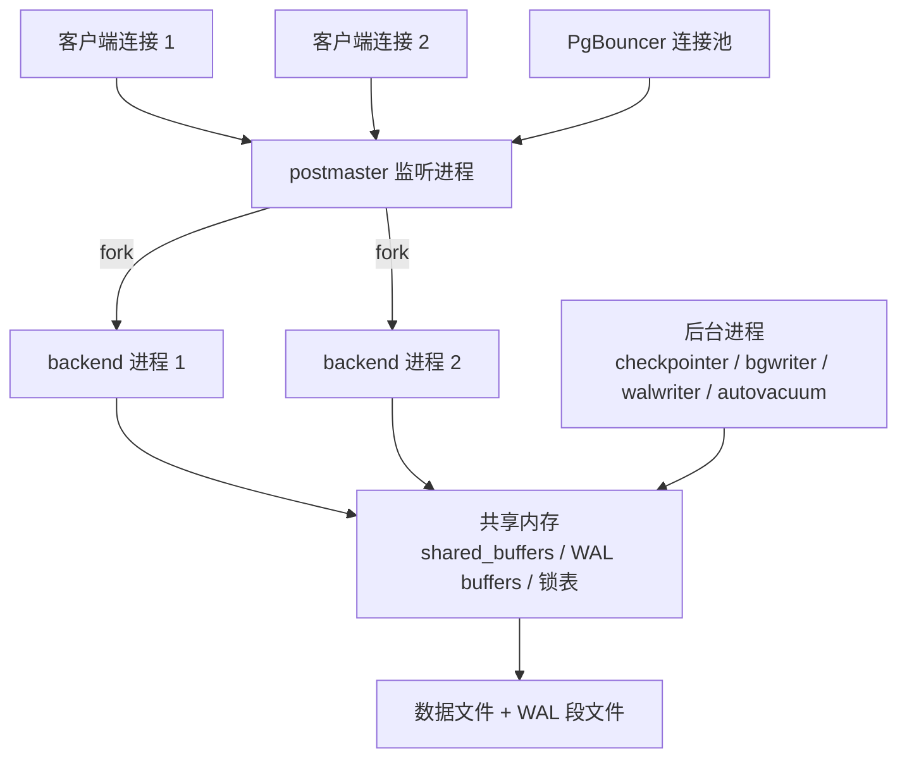
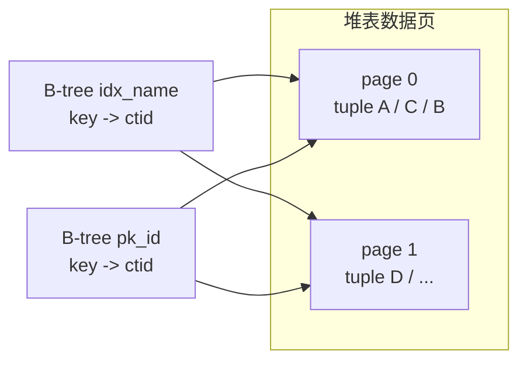
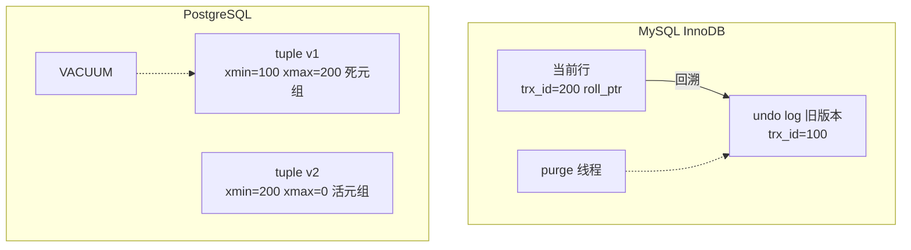
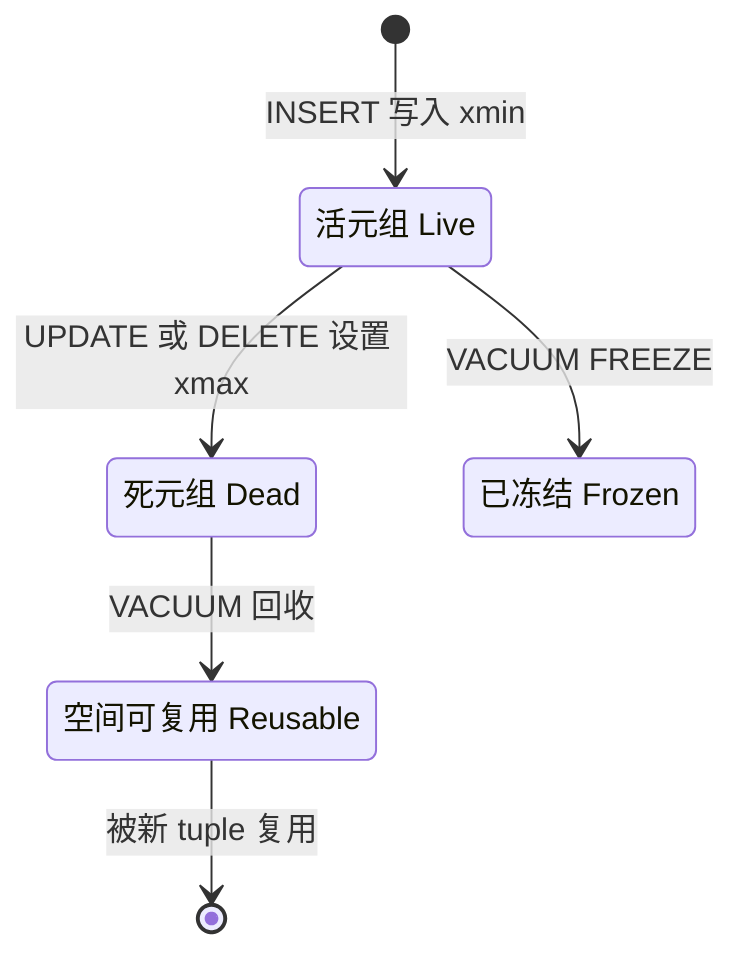
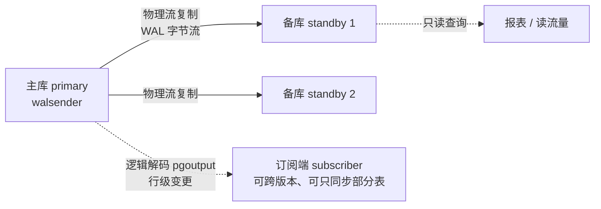

# PostgreSQL 核心机制与 MySQL 对比

> 定位：团队一直用 MySQL，某天业务要做 GIS、JSON 半结构化查询或复杂分析，第一次接触 PostgreSQL，结果发现「同样的表，PG 越跑越大」「改一行索引也膨胀」「一晚没跑 autovacuum 就报警」。这篇从进程模型、堆表存储、MVCC 实现讲到 VACUUM、索引类型、WAL 复制，最后给出 MySQL 与 PG 的选型对比和迁移清单，帮你把「MySQL 的直觉」翻译成「PG 的正确用法」。

## 一、为什么需要它

四个真实场景：

1. 日志明细表迁到 PG，业务量和数据量都没变，三个月后磁盘翻倍、查询变慢——**死元组占了 60%**，autovacuum 从没跟上。
2. MySQL 老手在 PG 里 `UPDATE` 一个带索引的列，发现表和索引同时膨胀——PG 的更新是**写新版本**，不是原地改。
3. 迁移时照抄 `ON DUPLICATE KEY UPDATE`、反引号、`datetime`，语法报错还算轻，时区语义错了才致命。
4. 连接数一涨就 `too many clients`，把 `max_connections` 调大后内存先撑不住——PG 是**一连接一进程**。

共同点：**SQL 长得像，物理实现完全不同**。这篇只讲机制差异，不重复 SQL 语法教程。

## 二、核心原理

### 2.1 进程模型：一个连接一个进程

MySQL 社区版默认 **one-thread-per-connection**；PG 是 **postmaster 监听，每个连接 fork 一个后端进程**，进程间靠共享内存通信。



读图要点：**每个连接一个独立进程**，单查询崩溃只终止自己，稳定性好；但进程私有内存无法共享、创建成本高，所以连接数不能靠调大 `max_connections` 硬扛，必须上连接池。

### 2.2 存储结构：堆表 + 独立索引

MySQL InnoDB 是**索引组织表**：数据就是主键 B+ 树的叶子，二级索引存主键值。PG 是**堆表**：tuple 按写入顺序堆在 8KB 数据页里，**所有索引都是独立结构，索引项指向物理位置 `ctid`（页号 + 偏移）**。



读图要点：索引与数据是两套结构，索引存的是**物理地址**。这带来两个后果——表没有天然的「按主键聚簇」顺序，范围扫描可能大量随机 IO；一行更新后位置变化，所有索引都要新增一项，**索引会膨胀**。

每行 tuple 头部是理解 PG MVCC 的钥匙：

| 字段 | 含义 |
|---|---|
| `xmin` | 创建这一行版本的事务 ID |
| `xmax` | 删除/锁定这一行版本的事务 ID，0 表示未删除 |
| `ctid` | 物理位置，更新后变化 |
| `infomask` | 标志位：空值、是否冻结（frozen）等 |

超过约 2KB 的大字段会被 **TOAST** 压缩后搬到独立 TOAST 表，主表只留指针。

### 2.3 MVCC 实现差异：堆内多版本 vs undo log

**MySQL**：更新**原地修改当前行**，旧版本写进 undo log，行上 `DB_TRX_ID` + `DB_ROLL_PTR` 指向 undo，读时按 ReadView 回溯，旧版本由 **purge 线程**清理。

**PostgreSQL**：更新**不覆盖旧行**，在堆里写全新 tuple，旧 tuple 的 `xmax` 设为当前事务，新 tuple 的 `xmin` 设为当前事务。读时比较 `xmin/xmax` 与快照，**无需回溯链**。旧 tuple 变成死元组，只能由 **VACUUM** 回收。



读图要点：MySQL 把旧版本放进**独立 undo 空间**，主表不膨胀但 undo 会涨；PG 把旧版本**留在堆表**，主表会膨胀，必须靠 VACUUM 标记可复用。「膨胀」只是搬到了不同地方。

PG 还有一个优化叫 **HOT（Heap-Only Tuple）更新**：若更新的列**不被任何索引引用**且新版本能放进同一数据页，就不新增索引项，用页内 `t_ctid` 串成链。前提是「非索引列 + 页内有空间」（`fillfactor` 要留余量，默认 100 即写满）。

### 2.4 VACUUM 与表膨胀

`VACUUM` 做三件事：**回收死元组空间**（标记可复用，不归还 OS）、**更新可见性映射**（让 index-only scan 生效）、**冻结老事务 ID**。

**为什么必须冻结**：事务 ID 是 32 位，可见性只比较大小，实际可用窗口约 21 亿。老 tuple 的 `xmin` 与当前事务 ID 差值超过 21 亿会被误判为「未来」而不可见——这就是**事务 ID 回卷（wraparound）**，PG 会强制进入保护模式拒绝写入。



读图要点：**死元组 → 可复用空间**只有 VACUUM 能做，没有别的后台线程兜底。autovacuum 跟不上写入，表就无限膨胀，顺序扫描、索引、备份全部变慢。

autovacuum 触发条件（以 PG 16 为准）：`阈值 = autovacuum_vacuum_threshold + autovacuum_vacuum_scale_factor × 活元组数`，默认 `50 + 0.2 × 活元组数`。一张 1000 万行的表要积累约 200 万死元组才触发一次，**大表默认参数明显迟钝**，需要按表覆盖。

### 2.5 索引类型全景

| 类型 | 结构 | 支持查询 | 典型场景 | 不适用 |
|---|---|---|---|---|
| **B-tree** | 平衡树 | `=`、范围、`ORDER BY`、`LIKE 'abc%'` | 90% 常规查询 | 多值类型、模糊匹配 |
| **Hash** | 哈希表 | 仅 `=` | 等值、宽列 | 范围查询 |
| **GIN** | 倒排 | `@>`、`?`、`@@`、数组包含 | `jsonb`、数组、全文、`pg_trgm` | 高频更新（写放大） |
| **GiST** | 可扩展平衡树 | 几何包含/相交、范围重叠、KNN | PostGIS、`tsrange`、排除约束 | 纯等值（不如 B-tree） |
| **SP-GiST** | 非平衡空间分区树 | 前缀、四叉树、k-d 树 | 号码前缀、GIS 点 | 通用场景 |
| **BRIN** | 块范围摘要 | 范围扫描（依赖物理相关性） | 按时间追加的超大日志表 | 物理顺序与条件不相关时无效 |

选型要点：B-tree 是默认，别乱换；**GIN 写放大明显**，高频写入要评估 `fastupdate`；**BRIN 索引极小但对随机写入无效**；PG **没有 MySQL 的前缀索引**，要用表达式索引 `left(col, n)` 模拟。

### 2.6 WAL 与两种复制

所有修改先写 **WAL**，再写数据文件；WAL 按 16MB 段组织，checkpoint 负责刷脏页。



读图要点：**物理复制复制磁盘字节变化**，主备必须同大版本、整实例；**逻辑复制复制行级变更**，可跨版本、可只同步部分表，但 **DDL 不复制、序列不同步**。

| 维度 | 物理流复制 | 逻辑复制 |
|---|---|---|
| 粒度 | 整个实例 | 表级 |
| 版本 | 同大版本 | 可跨大版本 |
| DDL | 自动 | 不复制 |
| 序列 | 一致 | 不同步 |
| 备库 | 只读 | 订阅端可读写 |
| 用途 | 高可用、读写分离、容灾 | 版本升级、分库拆分、异构同步 |

`synchronous_commit` 是关键开关：`off`（不等落盘，可能丢）、`local`（本地落盘）、`on`（默认，等同步备库）、`remote_write`（备库写 OS 缓存）、`remote_apply`（备库回放完成，延迟最高）。

### 2.7 JSONB、部分索引与表达式索引

`json` 存原始文本、每次访问重解析；`jsonb` 是二进制结构，**支持索引与 `@>` 包含查询**，生产几乎总是选 `jsonb`。

```sql
CREATE TABLE product (
    id     bigint GENERATED ALWAYS AS IDENTITY PRIMARY KEY,
    name   text NOT NULL,
    attrs  jsonb NOT NULL DEFAULT '{}'::jsonb,
    status smallint NOT NULL DEFAULT 1
);

-- GIN 索引：jsonb_path_ops 更小更快，但只支持 @>
CREATE INDEX idx_product_attrs ON product USING gin (attrs jsonb_path_ops);
SELECT id FROM product WHERE attrs @> '{"color": "red"}';

-- 部分索引：只索引未完成订单，索引很小
CREATE INDEX idx_order_pending ON orders (created_at) WHERE status = 'PENDING';

-- 表达式索引：查询条件必须字面匹配表达式才命中
CREATE UNIQUE INDEX uk_user_email_lower ON users (lower(email));
```

`jsonb_path_ops` 不支持 `?`/`?|`/`?&` 键存在判断，要支持就用默认 `jsonb_ops`。

## 三、关键机制、SQL 与参数

### 3.1 膨胀与死元组排查

```sql
-- 死元组最多的表
SELECT relname, n_live_tup, n_dead_tup,
       round(n_dead_tup * 100.0 / greatest(n_live_tup + n_dead_tup, 1), 2) AS dead_pct,
       last_autovacuum, last_autoanalyze
FROM pg_stat_user_tables
ORDER BY n_dead_tup DESC LIMIT 20;

-- 事务 ID 年龄，接近 20 亿即回卷风险
SELECT datname, age(datfrozenxid) AS xid_age FROM pg_database ORDER BY xid_age DESC;
```

`n_dead_tup` 是估算值，判断趋势够用。要精确看物理膨胀用 `pgstattuple` 扩展：`SELECT * FROM pgstattuple('orders');`。

### 3.2 autovacuum 关键参数

| 参数 | 默认值 | 说明 |
|---|---|---|
| `autovacuum` | on | 总开关，生产不要关 |
| `autovacuum_max_workers` | 3 | 大实例建议 5-8 |
| `autovacuum_naptime` | 1min | 检查间隔 |
| `autovacuum_vacuum_threshold` | 50 | 死元组绝对阈值 |
| `autovacuum_vacuum_scale_factor` | 0.2 | 死元组比例阈值 |
| `autovacuum_analyze_scale_factor` | 0.1 | analyze 触发比例 |
| `autovacuum_vacuum_cost_delay` | 2ms（PG 12+） | 限速休眠 |
| `autovacuum_freeze_max_age` | 2 亿 | 超过强制 freeze |
| `maintenance_work_mem` | 64MB | 每个 vacuum 进程可用内存 |

大表按表覆盖，不要全局调大（会抢占 IO）：

```sql
ALTER TABLE orders SET (autovacuum_vacuum_scale_factor = 0.02,
                        autovacuum_vacuum_threshold = 10000);
```

### 3.3 分区表

PG 10 起支持声明式分区，PG 11 起支持默认分区，PG 12+ 持续优化分区裁剪（以 PG 16 为准）：

```sql
CREATE TABLE order_log (
    id bigint GENERATED ALWAYS AS IDENTITY,
    order_id bigint NOT NULL,
    created_at timestamptz NOT NULL,
    payload jsonb
) PARTITION BY RANGE (created_at);

CREATE TABLE order_log_2026_01 PARTITION OF order_log
    FOR VALUES FROM ('2026-01-01') TO ('2026-02-01');
```

三个限制：**唯一约束/主键必须包含分区键**（全局唯一 ID 不能靠分区表主键）；**没有全局索引**（每个分区独立索引，靠裁剪减少扫描）；**跨分区更新会搬行**（改分区键代价高）。按月自动建分区建议用 `pg_partman`。

### 3.4 连接池 PgBouncer

| 模式 | 复用粒度 | 优点 | 限制 |
|---|---|---|---|
| `session` | 整个会话 | 兼容性最好 | 复用率低 |
| `transaction` | 事务结束即归还 | 复用率高，最常用 | 会话级状态失效（`SET`、临时表、`LISTEN`、advisory lock、命名 prepared statement） |
| `statement` | 语句结束即归还 | 复用率最高 | 多语句事务不可用 |

```ini
[pgbouncer]
pool_mode = transaction
max_client_conn = 2000
default_pool_size = 50
```

`transaction` 模式下，启用 server-side prepare 的 ORM 会串会话，需要关闭该特性（以驱动和 PgBouncer 版本为准）。

### 3.5 复制配置

```bash
# 主库 postgresql.conf
wal_level = replica
max_wal_senders = 10
wal_keep_size = 2GB
synchronous_standby_names = 'ANY 1 (standby1, standby2)'

# 备库：基础备份并接入流复制（PG 12+ 无需 recovery.conf）
pg_basebackup -h 10.0.0.11 -U replicator -D /var/lib/pgsql/16/data -Fp -Xs -P -R
```

```sql
-- 逻辑复制：发布端；订阅端需先建好表结构
CREATE PUBLICATION pub_orders FOR TABLE orders, order_items;
CREATE SUBSCRIPTION sub_orders
    CONNECTION 'host=10.0.0.11 dbname=app user=repl'
    PUBLICATION pub_orders;
```

## 四、生产坑点与排查

### 坑点 1：autovacuum 跟不上，表膨胀到查不动

**现象**：数据量没涨，磁盘占用和 `Seq Scan` 耗时持续上升，`n_dead_tup` 达数千万。
**原因**：大表 `scale_factor=0.2` 太迟钝；worker 被长事务/复制槽阻塞；或曾为省 IO 关掉 autovacuum。
**解法**：按表覆盖 `autovacuum_vacuum_scale_factor`；查最老事务与失活复制槽；已严重膨胀的表用 `pg_repack`（在线）或 `VACUUM FULL`（锁表，维护窗口做）。

### 坑点 2：长事务/长复制槽让 vacuum 白跑

**现象**：autovacuum 一直在跑，表还是膨胀。
**原因**：最老活跃事务 xid 之前的死元组都不能回收；一个几小时的只读事务或失活的逻辑复制槽就能让全库清理停摆。
**解法**：监控 `SELECT max(now() - xact_start) FROM pg_stat_activity WHERE state <> 'idle'` 并告警；复制槽设 `max_slot_wal_keep_size`；应用禁止「开事务后调远程接口」。

### 坑点 3：把 `ON DUPLICATE KEY UPDATE` 直接搬过来

**现象**：迁移脚本报语法错误，或改用 `ON CONFLICT` 后行为不一致。
**原因**：PG 必须显式指定冲突目标列，且用 `EXCLUDED` 伪表代表待插入行。
**解法**：

```sql
INSERT INTO inventory (sku, qty) VALUES ('A-1', 10)
ON CONFLICT (sku) DO UPDATE SET qty = inventory.qty + EXCLUDED.qty;
```

它只处理唯一约束/唯一索引冲突，不能像 MySQL 那样无条件覆盖。

### 坑点 4：连接打满，调大 `max_connections` 反而 OOM

**现象**：应用扩容后 `too many clients`，把 `max_connections` 从 100 调到 1000，内存吃紧、上下文切换严重。
**原因**：一连接一进程，每个进程有独立内存，进程数暴涨后私有内存合计超过物理内存。
**解法**：上 PgBouncer（`transaction` 模式）；`max_connections` 保持 200-500；应用连接池上限要小于 PgBouncer 的 `default_pool_size` × 实例数，避免层层放大。

### 坑点 5：`UPDATE` 改索引列导致双膨胀

**现象**：高频更新 `status` 列的表，表和索引都膨胀，VACUUM 追不上。
**原因**：PG 更新写新 tuple，若更新的列在索引里，每个索引都要新增一项。
**解法**：设 `fillfactor=80` 提高 HOT 命中率；高频变更列尽量不建索引，需要就建部分索引；极端的把「频繁变的列」拆到窄表。

### 坑点 6：迁移后时间错 8 小时、大小写查不到

**现象**：`created_at` 差 8 小时；`WHERE name='Tom'` 查不到 `tom`。
**原因**：`timestamp`（无时区）与 `timestamptz`（UTC 存储、按会话时区显示）语义不同；PG 默认 collation 区分大小写，MySQL 常用 `_ci` 不区分。
**解法**：跨时区一律 `timestamptz`；不区分大小写用 `citext` 或 `lower()` 表达式索引；迁移前做 collation 映射与抽样校验。

## 五、选型对比与迁移注意点

### 5.1 MySQL 8.0 vs PostgreSQL 16

| 维度 | MySQL 8.0 | PostgreSQL 16 |
|---|---|---|
| 存储模型 | 索引组织表 | 堆表 + 独立索引 |
| 默认隔离级别 | REPEATABLE READ | READ COMMITTED |
| MVCC | undo log + ReadView，purge 清理 | 堆内多版本，VACUUM 清理 |
| 膨胀形态 | undo 表空间 | 表与索引 |
| 锁 | 行锁 + Gap/Next-Key | 行锁，无间隙锁 |
| 索引能力 | B-tree、全文、空间、前缀索引 | B-tree、Hash、GIN、GiST、BRIN、部分/表达式索引 |
| JSON | JSON + 多值索引 | jsonb + GIN，能力更强 |
| 复制 | binlog、半同步、MGR | WAL 物理流复制、逻辑复制 |
| 高可用 | MHA、Orchestrator、MGR | Patroni + etcd、repmgr |
| 连接模型 | 线程 | 进程（必须配连接池） |
| 扩展生态 | 偏存储引擎插件 | PostGIS、pg_trgm、TimescaleDB、pgvector |
| 团队门槛 | 国内最熟，DBA 多 | 需专门学 VACUUM / WAL / 膨胀治理 |

### 5.2 什么时候选、什么时候别选

**适合 PG**：复杂 SQL（窗口、CTE、递归、`LATERAL`）、`jsonb` 半结构化、PostGIS/全文/pgvector 一库多能、需要逻辑复制做升级或拆分。

**不适合 PG**：团队无 PG 运维能力也无 DBA；数万短连接又拒绝上连接池；只做简单主键 KV 查询且已有成熟 MySQL 体系；强依赖 MySQL 特有生态工具。

> 选型的判断标准不是「谁更强」，而是「谁的成本结构匹配团队」。

### 5.3 迁移注意点清单

| 类别 | MySQL | PostgreSQL | 处理方式 |
|---|---|---|---|
| 标识符 | 依 `lower_case_table_names` | 未加引号转小写 | 统一小写命名 |
| 引号 | 反引号 | 双引号 | SQL 改写 |
| 自增 | `AUTO_INCREMENT` | `GENERATED ... AS IDENTITY` | 迁移后 `setval` 对齐序列 |
| UPSERT | `ON DUPLICATE KEY UPDATE` | `ON CONFLICT ... DO UPDATE` | 显式指定冲突列 |
| 分页 | `LIMIT offset, size` | `LIMIT size OFFSET offset` | 语法改写 |
| 布尔 | `tinyint(1)` | `boolean` | 类型映射 |
| 时间 | `datetime` | `timestamp` / `timestamptz` | 跨时区用 `timestamptz` |
| 无符号整数 | `int unsigned` | 无此类型 | 更大范围类型 + `CHECK` |
| 前缀索引 | `INDEX(col(10))` | 不支持 | `left(col,10)` 表达式索引 |
| 隔离级别 | 默认 RR | 默认 RC | 依赖 RR 的逻辑显式设置 |

迁移的正确姿势是「双写 + 全量校验 + 灰度读 + 切写」，不要指望停机导数，流程见 [数据归档、冷热分离与在线迁移](11-数据归档-冷热分离与在线迁移.md)。

## 六、面试高频问法

**Q1：PG 和 MySQL 的 MVCC 实现有什么本质区别？**

**一句话结论**：MySQL 原地更新 + undo log 存旧版本，purge 线程清理；PG **写新 tuple、旧 tuple 留堆里**，靠 `xmin/xmax` 判断可见性，只能由 VACUUM 回收——所以 PG 是「表膨胀」，MySQL 是「undo 膨胀」。

展开：MySQL 行长上 `DB_TRX_ID` + `DB_ROLL_PTR`，读时沿 undo 链回溯；PG 更新生成新 tuple、旧 tuple 置 `xmax`，读时比较快照无需回溯。两者都不阻塞读。

加分点：补一句 HOT 更新——更新的列不在索引里且页内有空间时不新增索引项，这是控制索引膨胀的关键。

**Q2：PG 为什么需要 VACUUM？不跑会怎样？**

**一句话结论**：VACUUM 回收死元组空间、更新可见性映射、冻结老事务 ID；不跑会导致表与索引无限膨胀，最终触发**事务 ID 回卷保护**拒绝写入。

展开：空间只标记可复用、不归还 OS（`VACUUM FULL`/`pg_repack` 才归还）；可见性映射让 index-only scan 生效；32 位事务 ID 可用窗口约 21 亿，必须 freeze。

加分点：说清「长事务和失活复制槽会阻止死元组回收」，比背参数更能体现排障经验。

**Q3：PG 进程模型和 MySQL 线程模型各有什么利弊？**

**一句话结论**：PG 一连接一进程，**稳定性和隔离性强、连接成本高**，必须靠 PgBouncer；MySQL 一连接一线程，**连接轻、共享内存方便，但单点崩溃影响面大**。

展开：进程私有内存无法共享、fork 成本高，`max_connections` 默认 100 有内存依据；线程共享地址空间、创建便宜，但一个线程崩溃可能拖垮进程。

加分点：指出「PG 高并发架构里 PgBouncer 是标准配置」，并说明 `transaction` 模式会破坏会话级状态。

**Q4：PG 有哪些索引类型，分别什么时候用？**

**一句话结论**：B-tree 覆盖 90% 场景；Hash 只做等值；**GIN 给 jsonb/数组/全文**；**GiST 给地理与范围**；**BRIN 给物理有序的超大表**；SP-GiST 用于特定非平衡结构。

展开：GIN 是倒排、写放大明显，适合读多写少；GiST 支撑 PostGIS、`tsrange` 与排除约束；BRIN 索引极小但只在物理顺序与查询范围相关时有效。

加分点：指出 PG 没有前缀索引，要用 `left(col, n)` 表达式索引模拟。

**Q5：物理复制和逻辑复制怎么选？**

**一句话结论**：高可用、读写分离、整实例容灾用**物理流复制**；跨版本升级、分库拆分、部分表同步用**逻辑复制**（DDL 和序列不同步）。

展开：物理复制是字节级、要求同大版本、备库只读；逻辑复制是行级、可跨版本、订阅端可读写，但需手工同步 DDL 和序列。

加分点：说「逻辑复制做版本升级的路径是新库订阅追平 → 校验 → 切流」，比只背概念更有工程感。

**Q6：为什么 PG 的 UPDATE 会让索引也膨胀？怎么缓解？**

**一句话结论**：索引项存的是 `ctid`，更新后新 tuple 位置变了，每个索引都要新增一项；只有 HOT 更新能避免。

展开：普通更新 = 新 tuple + 新索引项，旧项等 VACUUM；HOT 更新 = 页内链式连接、不新增索引项。用 `pg_stat_user_tables.n_tup_hot_upd / n_tup_upd` 看 HOT 命中率。

加分点：说「`fillfactor` 默认 100 意味着页写满，HOT 很难命中，高频更新表设 80 更合适」。

**Q7：autovacuum 一直跑却清不掉，可能是什么原因？**

**一句话结论**：多半是**长事务**或**失活逻辑复制槽**钉住了最老可见 xid；其次是 worker 太少、单表阈值太迟钝、`maintenance_work_mem` 太小。

展开排查顺序：`pg_stat_activity` 找最老 `xact_start` → `pg_replication_slots` 看 `active=false` → `pg_stat_user_tables` 看 `n_dead_tup` 趋势 → 看是否被 cost limit 限速。

加分点：强调调参数只解决容量问题，长事务必须从应用侧消灭。

**Q8：PG 分区表有什么限制？**

**一句话结论**：唯一约束必须含分区键、**没有全局索引**、跨分区更新会搬行、分区过多增加计划时间。

展开：全局唯一性靠外部 ID 生成器；每个分区独立索引，靠裁剪减少扫描；按月/按天分区要权衡计划开销。

加分点：说「分区表配合冷热分离，把冷分区 `DETACH` 后归档，是 PG 做数据生命周期管理最自然的方式」。

**Q9：从 MySQL 迁到 PG，最容易踩哪些坑？**

**一句话结论**：大小写与引号、UPSERT 语法、无符号整数、`datetime` vs `timestamptz`、前缀索引、默认隔离级别、序列对齐、连接模型——每条都可能「语法通过但语义错了」。

展开：标识符未加引号转小写；`datetime` 迁成 `timestamp` 丢时区；序列要 `setval` 到 max(id)；依赖 RR 的逻辑要显式设隔离级别。

加分点：说迁移必须做「双写 + 行数/checksum 对账 + 灰度读」，把话题引到在线迁移方法论。

## 小结

- PG 是**一连接一进程**，连接成本高，高并发必须配 PgBouncer。
- PG 是**堆表 + 独立索引**，索引存 `ctid`，更新写新 tuple，表与索引都会膨胀。
- MVCC 差异决定治理手段：MySQL 清 undo，PG 靠 **VACUUM/autovacuum**，长事务和失活复制槽会让清理失效。
- 索引按场景选：B-tree 默认、GIN 给 jsonb/数组/全文、GiST 给地理与范围、BRIN 给物理有序超大表。
- 复制分两条路：物理流复制做高可用，逻辑复制做跨版本/分表/异构，DDL 与序列不自动同步。
- 迁移的难点在语义不在语法：大小写、时区、UPSERT、隔离级别、序列对齐，逐项对照再双写校验。

## 参考资料

- PostgreSQL 16 官方文档：Concurrency Control、Routine Vacuuming、Index Types、Logical Replication、Partitioning 章节
- PostgreSQL 16 官方文档：`pg_stat_user_tables`、`pg_stat_activity`、`pg_replication_slots` 视图说明
- PostgreSQL 源码：`src/backend/access/heap/heapam.c`（tuple 更新与 HOT）、`src/backend/commands/vacuum.c`
- MySQL 8.0 Reference Manual：InnoDB Multi-Versioning、InnoDB Locking、Online DDL Operations 章节
- PgBouncer 官方文档：Pool Modes、Configuration 章节
