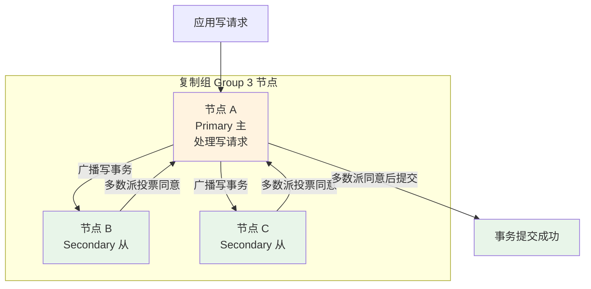
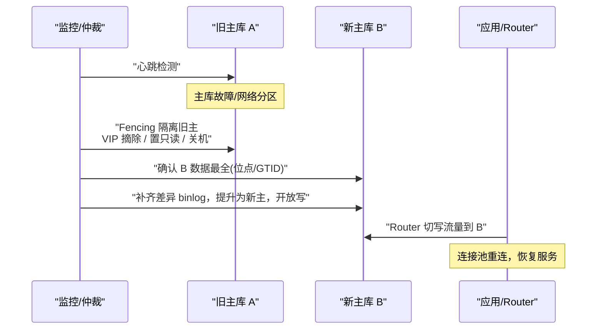

# 数据库高可用

> 定位：搞清楚数据库高可用的方案演进、MGR 组复制的原理、InnoDB Cluster / MHA / Orchestrator 各自解决什么、同城双活与异地多活的取舍，以及故障切换中「数据一致性」这个核心难题。高可用不是「加个从库」那么简单——真正的考验是主库宕机那一刻，能不能既快速恢复服务（RTO），又不丢数据（RPO），还不能脑裂。

## 一、为什么需要数据库高可用

数据库是整个系统的「单点之王」——它一挂，上层所有服务都瘫。但硬件故障、网络分区、机房断电、误操作删库这些事，迟早会发生。高可用的目标就两个字：

- **RTO（Recovery Time Objective）**：故障后多久能恢复服务——越短越好。
- **RPO（Recovery Point Objective）**：故障后丢多少数据——越接近 0 越好。

不同方案在这两个指标上取舍不同，成本和复杂度也天差地别。这一篇帮你把它们摆到一张图上，做选型时心里有数。

## 二、核心原理：高可用方案演进与 MGR

### 2.1 高可用方案演进路线

这条演进路线背后是三个不断提升的能力：

1. **切换自动化**：从人工到自动，RTO 从几十分钟降到秒级。
2. **数据不丢**：从异步（可能丢）到半同步（少丢）到组复制多数派（基本不丢），RPO 逼近 0。
3. **故障域扩大**：从单机到单机房到跨机房，抗灾能力从「机器故障」升级到「机房/城市故障」。

### 2.2 MGR（MySQL Group Replication）原理

**MGR** 是 MySQL 官方提供的**组复制**插件，是 InnoDB Cluster 的核心。它把一组 MySQL 实例组成一个「复制组」，组内通过**分布式一致性协议（基于 Paxos 变体 XCom）**协调写操作。

核心机制：

1. **写事务的认证（Certification）**：一个节点要提交写事务时，先把事务广播给组内所有节点；**只有多数派（quorum）同意，事务才提交**。这保证了「同一时刻最多一个写被多数派认可」，天然避免脑裂。
2. **冲突检测**：基于 GTID + 写集合做冲突检测（writeset），如果两个并发事务改了同一行，只有一个能成功，另一个回滚。
3. **成员管理**：组内节点通过心跳感知彼此，故障节点会被自动「驱逐」出组。
4. **自动选主**：单主模式下主节点故障时，组内自动选出新主。

这张图是 MGR 的精髓：**写事务必须拿到多数派（3 节点里 2 个）同意才能提交**。这意味着：

- 少数派分区（如节点 A 与 B、C 断开）：A 因为拿不到多数派，无法提交写 → **不会出现两个主同时写 → 天然防脑裂**。
- 容忍 `f` 个节点故障需要至少 `2f+1` 个节点（3 节点容 1 个故障，5 节点容 2 个）。

MGR 的前置要求（以版本为准）：

- 必须开启 GTID、binlog 用 ROW 格式
- 表必须用 InnoDB 且**有主键**（冲突检测需要）
- 建议 `binlog_checksum = NONE`（部分版本要求）、开启 `log_slave_updates`（老版本）

**单主模式 vs 多主模式**：

| 模式 | 写节点 | 优点 | 缺点 |
|---|---|---|---|
| **单主**（默认推荐） | 只有一个 Primary 可写 | 无写冲突、行为简单 | 写不能横向扩展 |
| **多主** | 所有节点可写 | 写高可用、就近写 | 写冲突需处理、限制多，生产慎用 |

### 2.3 半同步复制在 HA 中的角色

半同步（上一篇讲过）是 MHA 等切换方案的重要搭档：它保证主库提交时至少有一个从库已收到 binlog，这样主库宕机后，**至少有一个从库拥有完整数据**，切主时 RPO 接近 0。

记住半同步的局限：它只保证「从库收到 binlog 并写入 relay log」，不保证「从库已应用」。所以极端情况下切主后仍可能有短暂的数据「可见性」差异，但对大多数场景可接受。

## 三、关键机制：InnoDB Cluster、切换工具、多活、一致性

### 3.1 InnoDB Cluster：官方全家桶

**InnoDB Cluster** 是 MySQL 官方把 MGR 包装成的一站式高可用方案，三个组件：

| 组件 | 作用 |
|---|---|
| **MySQL Shell** | 管理命令行，一条命令建集群、加节点、做切换 |
| **Group Replication** | 底层组复制，负责数据同步与一致性 |
| **MySQL Router** | 应用前面的透明代理，自动路由读写、故障时切换后端 |

应用只连 MySQL Router，不感知后端拓扑变化。主库挂了，MGR 选出新主，Router 自动把写流量导向新主，应用几乎无感（连接可能需重连）。这是官方主推的「开箱即用」高可用方案。

### 3.2 MHA 与 Orchestrator

在 MGR 成熟之前（以及不用 MGR 的场景），业界靠第三方工具做主从切换：

**MHA（Master High Availability）**：

- 用 Perl 编写的老牌切换工具，基于异步/半同步复制。
- 主库故障时，自动挑「数据最全」的从库，补齐各从库差异 binlog，提升为新主，切 VIP。
- 优点：切换快（通常十几秒）、尽量少丢数据。缺点：项目已不活跃维护（以版本为准），架构较老。

**Orchestrator**：

- Go 编写，GitHub 开源，更现代活跃。
- 自动发现 MySQL 拓扑、可视化 Web UI、支持自动/手动/优雅切换、故障转移。
- 支持「优雅切换」（先让从库追平再切，RPO=0）和「强制切换」（主库彻底挂时的救急，可能丢数据）。

两者定位类似，都是「主从复制 + 自动切换」层的工具。对比 MGR：

| 对比 | MHA / Orchestrator | MGR / InnoDB Cluster |
|---|---|---|
| 底层复制 | 传统异步/半同步 | 组复制（多数派） |
| 数据一致性 | 尽量少丢，依赖工具补齐 | 多数派保证，RPO 更可控 |
| 脑裂防护 | 靠工具 fencing，配置复杂 | 机制内置，天然防脑裂 |
| 官方支持 | 第三方 | MySQL 官方 |
| 成熟度/生态 | 久经考验、社区大 | 新一代，官方主推 |

### 3.3 同城双活与异地多活

当可用性要求从「机房级」升级到「城市级/地域级」，就要多机房部署：

**同城双活**：

- 两个机房距离较近（如同城，光纤延迟几毫秒），通过高速网络做数据同步。
- 两个机房**同时对外服务**（都承载读写），互为备份。
- 延迟低，可以做到 RPO≈0（半同步/MGR 跨机房部署）。
- 难点：跨机房网络质量、资源成本翻倍、流量调度。

**异地多活**：

- 多个城市/地域部署多个「单元」，每个单元能独立完成完整业务。
- 用户按维度（如 user_id）就近路由到单元，单元间做数据双向同步。
- 能抗「城市级故障」，但难度极大：**分布式事务、数据冲突、时钟一致性、全局唯一 ID、跨单元查询**全是硬骨头。
- 是大厂级别的工程，不是买几台机器就能搞定。

**RPO/RTO 对比：**

| 方案 | RPO | RTO | 抗故障域 | 复杂度 |
|---|---|---|---|---|
| 主从 + 自动切换 | 秒级~分钟（可能丢） | 秒~分钟 | 单机 | 中 |
| MGR 同城 | ≈0 | 秒级 | 单机/机房 | 中高 |
| 同城双活 | ≈0 | 秒级 | 单机房 | 高 |
| 异地多活 | ≈0（单元内） | 分钟级 | 城市级 | 极高 |

### 3.4 故障切换与数据一致性

一次安全的故障切换，关键在「**防止脑裂**」和「**保证数据不丢/不重**」：

关键步骤解读：

1. **故障检测**：靠心跳，但要防止「网络抖动误判」——通常需要多个监控节点多数派确认。
2. **Fencing（隔离）**：**这是防脑裂的关键**。在提升新主前，必须确保旧主不能再接受写（摘 VIP、置 read_only、甚至远程关机/断网）。否则旧主「假死」期间还在写，就出现两个主同时写、数据分叉——这就是**脑裂（Split-Brain）**。
3. **选数据最全的节点**：比较 GTID/b 位点，选同步最靠前的从库，补齐差异 binlog。
4. **切流量 + 应用重连**：Router/VIP 切换，应用刷新连接池。

> 核心原则：**宁可短暂不可用，也不能脑裂**。数据分叉比停机难处理得多。MGR 用多数派机制把这条原则内置了——拿不到多数派的节点根本无法提交写，从机制上杜绝脑裂。

## 四、生产坑点与排查

### 坑点 1：切换时脑裂，出现两个主库同时写

**现象**：网络分区后，原主库和新主库都接受写，恢复后发现两边数据冲突、无法合并。
**原因**：切换流程缺少 fencing，旧主「假死」未真正隔离就被提升新主。
**解法**：
- 切换前必须 fencing 旧主：置 `read_only`/`super_read_only`、摘 VIP、必要时 STONITH（爆头，远程断电）。
- 用带多数派仲裁的方案（MGR）从机制上防脑裂。
- 监控网络分区，避免单监控节点误判。

### 坑点 2：切主后丢数据

**现象**：异步复制下主库宕机，提升从库后丢失了最后一批已返回成功的事务。
**原因**：异步复制主库写完即返回，binlog 未传从库；或从库不是「数据最全」的那个。
**解法**：
- 生产开半同步或 MGR，保证多数派有数据才返回。
- 切换时选 GTID/位点最靠前的从库，补齐差异 binlog。
- 接受 RPO>0 的方案要用业务补偿（消息重放、对账）。

### 坑点 3：误判故障导致「切换风暴」

**现象**：网络抖动，监控误判主库宕机，反复主备切换，服务剧烈波动。
**原因**：单点监控、心跳超时设置过短、缺少「多数派确认」。
**解法**：
- 多个独立监控节点多数派投票确认故障。
- 心跳超时设置合理，加「连续 N 次失败」才判定。
- 切换后加冷却时间，避免频繁抖动。
- 区分「优雅切换」和「强制切换」，能优雅就不强制。

### 坑点 4：MGR 因表无主键导致复制异常

**现象**：部署 MGR 后，某些表的写事务被拒绝或冲突检测异常。
**原因**：MGR 的冲突检测依赖主键/唯一键，无主键表无法正常参与组复制。
**解法**：
- 上线前审计所有表，确保都有主键（呼应第 1 篇：每表必须有主键）。
- 用 MGR 的检查工具/视图排查不合规的表（以版本为准）。

### 坑点 5：异地多活数据冲突，业务数据错乱

**现象**：两个地域同时修改同一用户的数据，双向同步后出现覆盖、丢失、不一致。
**原因**：多活单元同时可写，缺乏冲突检测和合并策略。
**解法**：
- 按 user_id 等维度做「单元化」，保证同一用户的数据只在一个单元写。
- 全局冲突检测（如 MGR 多主、CRDT 数据类型）或避免热点数据跨单元共享。
- 关键数据做对账和冲突告警，准备人工介入流程。

## 五、调优、选型与最佳实践

**方案选型决策表：**

| 需求/场景 | 推荐方案 |
|---|---|
| 中小业务、可容忍秒级丢数据 | 主从 + 半同步 + Orchestrator |
| 追求 RPO≈0、官方支持、不想脑裂 | MGR / InnoDB Cluster |
| 想要应用透明的路由与切换 | InnoDB Cluster + MySQL Router |
| 同城机房级容灾 | MGR 跨机房 / 同城双活 |
| 城市级容灾、超大业务 | 异地多活单元化（极高成本） |
| 老系统、MGR 改造成本高 | MHA / Orchestrator（以维护状态为准） |

**高可用 checklist：**

1. 明确 RTO/RPO 目标，再选方案——不要为了「高可用」而上不匹配的复杂度。
2. **每表必须有主键**（MGR 前提，也是基本规范）。
3. 开启 GTID、ROW binlog、半同步。
4. 切换流程必须有 fencing，宁可短暂不可用也要防脑裂。
5. 切换演练常态化：定期做故障注入（chaos），验证切换真的可用。
6. 监控齐全：复制状态、延迟、节点健康、脑裂告警。
7. 多活场景做好单元化和冲突处理，关键数据对账。

**核心认知**：高可用不是「不出故障」，而是「故障发生时可控、可恢复、数据可接受」。方案越复杂，运维和认知成本越高——**够用就好，别过度设计**。

## 六、面试高频问法

> 这一节的答案按「面试时能讲透」的标准写：先给一句话结论，再展开机制、原因和坑点。

**Q1：MySQL 高可用有哪些方案？**

**一句话结论**：主从 + 手动切换、MHA、MGR（组复制）、InnoDB Cluster、云托管 RDS——从简单到复杂，可靠性递增。

展开：

| 方案 | 原理 | 可靠性 | 复杂度 |
|---|---|---|---|
| 主从+手动 | 人工切换 | 低 | 低 |
| MHA | 自动检测+切换 | 中 | 中 |
| MGR | 组复制、多数派 | 高 | 高 |
| InnoDB Cluster | MGR + Router | 高 | 高 |
| 云 RDS | 托管 | 高 | 低（托管） |

加分点：说"选型看'能接受多长停机'——手动切换可能几十分钟，MGR 能做到秒级自动切换；但 MGR 对网络和运维要求高"。

**Q2：MGR 是什么？它怎么保证一致性？**

**一句话结论**：MGR（MySQL Group Replication）是基于 **Paxos 变种**的组复制——写操作要多数派确认后才提交，保证强一致和自动故障转移。

展开：

- **组**：多个节点组成一个组，通过组通信（GCS）同步。
- **多数派**：事务要得到多数节点确认才提交，少数派节点不能提交。
- **自动切换**：主节点挂了，组内自动选新主。
- **防脑裂**：多数派机制保证分区时只有一边能写。

加分点：说"MGR 的'多数派'是关键——3 节点容 1 个故障，但网络分区时少数派那边不能写，避免了脑裂；代价是写性能受限于最慢的节点"。

**Q3：MGR 有哪几种模式？**

**一句话结论**：单主模式（一个主多个从，自动选主）和多主模式（所有节点都能写）。

展开：

- **单主模式**：只有一个节点接受写，其他是只读副本。主挂了自动选新主。**推荐**，避免写冲突。
- **多主模式**：所有节点都能写，但有写冲突检测，冲突时回滚。性能好但冲突处理复杂。

加分点：说"生产多用单主模式——多主虽然能提升写吞吐，但写冲突会导致事务回滚，业务要处理重试，复杂度高"。

**Q4：MHA 是什么？它怎么工作？**

**一句话结论**：MHA（Master High Availability）是"主库故障自动切换"的工具——监控主库，挂了自动提升从库、切换其他从库。

展开：

- **组成**：MHA Manager（管理节点）+ MHA Node（每个 MySQL 节点）。
- **流程**：检测主库故障 → 选一个从库（数据最全的）→ 应用差异 relay log → 提升为主 → 其他从库指向新主。
- **优势**：能尽量减少数据丢失（补差异日志）。

加分点：说"MHA 是'外部工具做切换'，MGR 是'数据库内置高可用'——MHA 兼容老版本 MySQL，MGR 是 5.7+ 的新方案，更彻底但要改造"。

**Q5：什么是脑裂？怎么防？**

**一句话结论**：脑裂是网络分区后出现"两个主库"同时接受写入，导致数据分叉；用"多数派"或"fencing（隔离旧主）"防。

展开：

- **原因**：主从之间网络断了，从库以为主挂了，自己升主；旧主还活着继续写。
- **后果**：两边数据不一致，恢复后无法合并。
- **防护**：
  1. 多数派机制（MGR）——少数派不能写
  2. Fencing——切换前强制关闭/隔离旧主
  3. 仲裁节点——第三方判断谁是真主

加分点：说"脑裂是高可用的'终极噩梦'——它比'主库挂了'更可怕，因为数据分叉后很难恢复；所以自动切换必须有'防脑裂'机制"。

**Q6：同城双活和异地多活有什么区别？**

**一句话结论**：同城双活是"同城两个机房都对外服务"（延迟低、可做单元化）；异地多活是"不同城市多个机房都服务"（容灾强、但数据一致性难）。

展开：

- **同城双活**：两个机房距离近（延迟 < 2ms），可以共享存储或同步复制，数据一致容易保证。
- **异地多活**：机房距离远（延迟几十 ms），同步复制不可行，要"单元化"（用户按地域路由到最近机房），数据异步同步。
- **异地多活的难点**：跨地域数据一致性、路由、故障时的流量调度。

加分点：说"异地多活是'最高级别的容灾'——一个城市整个没了，其他城市还能服务；但它的复杂度极高（单元化、数据同步、冲突解决），一般只有大厂才做"。

**Q7：数据库备份策略怎么设计？**

**一句话结论**：全量备份 + 增量备份（binlog）+ 定期恢复演练——只备份不演练等于没备份。

展开：

- **全量**：定期（如每天）全量备份，用 xtrabackup（热备，不锁表）。
- **增量**：binlog 持续归档，可以恢复到任意时间点（PITR）。
- **保留**：按合规要求保留（如 30 天、半年）。
- **演练**：定期在测试环境恢复，验证备份可用。

加分点：说"备份最怕'以为备份了，真出事发现恢复不了'——必须定期演练恢复，这是很多公司血的教训"。

**Q8：数据库连接池怎么配置？**

**一句话结论**：连接数不是越多越好——设成"能支撑并发的最小值"，配合超时和监控；过大反而拖垮数据库。

展开：

- **公式**：`连接数 = CPU 核数 × 2 + 磁盘数`（经验值），或压测确定。
- **过大问题**：每个连接占内存，连接多了数据库内存耗尽、上下文切换开销大。
- **配置**：最大连接数、最小空闲、获取连接超时、空闲检测。
- **监控**：活跃连接数、等待连接数、获取连接耗时。

加分点：说"连接池耗尽是'没报错但很慢'的常见原因——请求在等连接，看起来没报错但 RT 飙升；要监控'等待获取连接的线程数'"。

**Q9：数据库的监控要看哪些指标？**

**一句话结论**：连接数、QPS/TPS、慢查询、主从延迟、锁等待、Buffer Pool 命中率、磁盘空间。

展开：

| 指标 | 关注点 |
|---|---|
| 连接数 | 是否接近上限 |
| QPS/TPS | 突增突降 |
| 慢查询 | 数量、具体 SQL |
| 主从延迟 | 是否影响读一致性 |
| 锁等待 | 是否有长事务/死锁 |
| Buffer Pool 命中率 | 是否内存不足 |
| 磁盘 | 是否快满（满了写不了） |

加分点：说"磁盘空间是最容易被忽略的——MySQL 磁盘满了会直接不可写，比性能问题更致命；要设告警（如 80% 告警）"。

**Q10：数据库高可用和分布式事务能同时满足吗？**

**一句话结论**：能，但有代价——高可用（主从/MGR）解决"节点故障"，分布式事务解决"跨库原子性"，两者是不同层面的问题。

展开：

- **高可用**：保证"数据库不宕机/快速恢复"。
- **分布式事务**：保证"跨多个库的操作原子"。
- **组合**：MGR 做高可用 + Seata 做跨库事务，但复杂度和性能代价都高。
- **建议**：能在单库解决的别跨库；必须跨库时，优先"最终一致 + 对账"，而不是强一致分布式事务。

加分点：说"高可用和分布式事务是两个正交的问题——高可用不等于一致，一致也不等于高可用；设计时要分开考虑，别混为一谈"。

## 小结

- 高可用看两个指标：RTO（恢复时间）、RPO（丢数据量）；方案演进是「自动化 + 不丢数据 + 扩大故障域」。
- MGR 用多数派提交保证一致性、天然防脑裂；容忍 f 故障需 2f+1 节点；单主模式推荐、需 GTID+ROW+每表有主键。
- InnoDB Cluster = Shell + MGR + Router，官方开箱即用；MHA/Orchestrator 是传统主从切换工具。
- 同城双活 RPO≈0、抗机房故障；异地多活单元化抗城市故障但复杂度极高。
- 切换核心是 fencing 防脑裂 + 选数据最全节点；宁可短暂不可用，也不能数据分叉。
