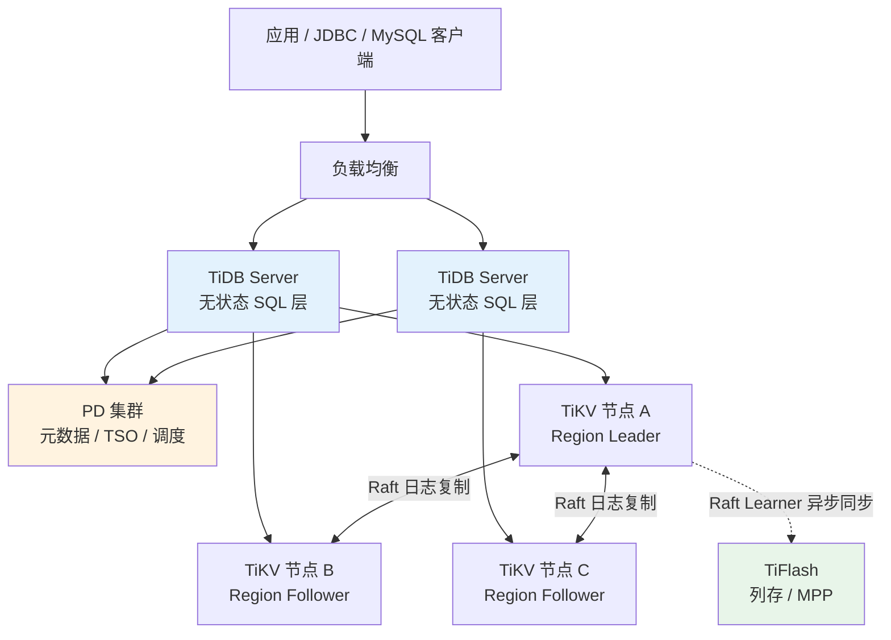
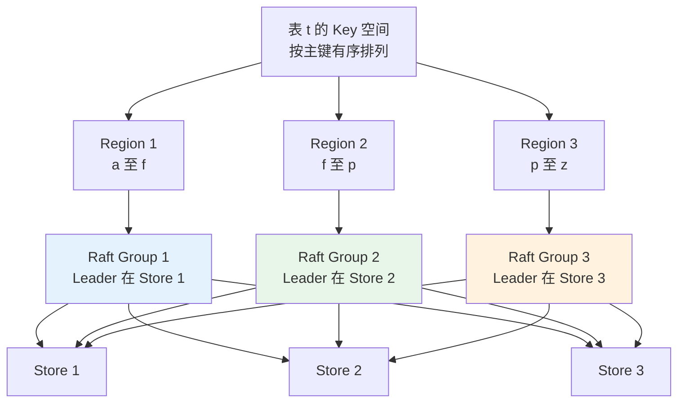
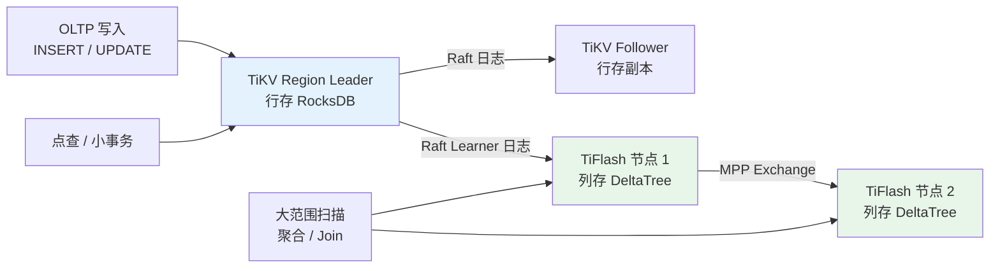

# NewSQL：TiDB 与 HTAP

> 定位：分库分表解决了单机容量问题，却把「分片键、跨片查询、扩容迁移、分布式事务」四座大山留给了业务。NewSQL 试图把这几件事收回到数据库内部——自动分片、原生分布式事务、SQL 兼容。这篇以 TiDB 为样本，讲透它如何用 Region 分片、Raft 复制、Percolator 事务和 TiFlash 列存，把 TP 与 AP 装进一个系统，以及它在生产里真实会踩的坑。

## 一、为什么需要 NewSQL

### 1.1 分库分表把复杂度推给了业务

分库分表不是免费的。它用「业务复杂度」换「单机容量」，具体账单大致是这样：

| 成本项 | 具体表现 | 谁在承担 |
|---|---|---|
| **分片键选择** | 按 `user_id` 分片后，运营要按商户查订单，只能广播到所有分片 | 业务开发 |
| **跨片查询** | `JOIN`、`ORDER BY`、`COUNT`、深分页要在中间件内存里归并 | 中间件 + 内存 |
| **扩容迁移** | 取模分片扩容要 rehash，一致性哈希缓解但仍有数据搬迁，通常要双写 + 校验 | DBA + 业务 |
| **分布式事务** | 本地事务失效，要上 TCC、Saga、本地消息表，代码侵入且要处理悬挂、空回滚 | 业务开发 |
| **全局唯一** | 自增主键失效，要引入号段、雪花、UUID，还要考虑热点 | 架构 |
| **运维** | N 个 MySQL 实例、N 套备份、N 次 DDL、N 份监控 | DBA |

最难受的是**分片键一旦选错，几乎改不回来**。想从 `user_id` 改成 `merchant_id`，等于把全量数据重洗一遍，还要改所有查询的路由逻辑。很多团队的分库分表方案上线三年后，最大的技术债就是那张分片键表。

### 1.2 NewSQL 的三个承诺

NewSQL 的定义可以概括成一句话：**保留关系模型和 ACID，同时具备水平扩展能力**。它和「NoSQL」的区别在于不放弃 SQL 和事务，和「分库分表」的区别在于把分片做进了存储引擎。

具体是三个承诺：

1. **自动分片**：数据按范围自动切成小块（TiDB 里叫 Region），随数据量自动分裂、随负载自动迁移，业务不感知分片键。
2. **原生分布式事务**：跨节点的写对应用表现为一个本地事务，`BEGIN / COMMIT` 的语义不变，隔离级别可配。
3. **SQL 与生态兼容**：MySQL 协议、JDBC 驱动、ORM 框架、binlog 生态基本可用，迁移成本可控。

代表产品：Google Spanner（TrueTime + Paxos）、CockroachDB（Raft + 范围分片）、OceanBase（Paxos）、TiDB（Raft + Percolator）。它们的技术路线不同，但目标一致：**让「数据量变大」不再等于「架构必须改造」**。

> 一句话记住：分库分表是「应用层自己造一个分布式数据库」，NewSQL 是「数据库厂商替你造好了」。

## 二、TiDB 整体架构

TiDB 是典型的**计算存储分离**架构，四个组件各司其职。



这张图要看三件事：TiDB Server 可以随便加（无状态）；数据只在 TiKV/TiFlash 里；PD 是唯一的「大脑」，但它不存业务数据。

| 组件 | 角色 | 关键点 |
|---|---|---|
| **TiDB Server** | SQL 层 | 无状态；解析、优化、执行 SQL；MySQL 协议；向 PD 取 TSO 和 Region 路由；把计算下推到 TiKV |
| **TiKV** | 分布式 KV 存储 | 数据按 Region 切分；每个 Region 一个 Raft group；单机引擎是 RocksDB；默认 3 副本 |
| **PD** | 调度与元数据 | 存储 Region 路由；分配全局 TSO 和自增 ID；调度负载均衡与热点；自身用 etcd 保证高可用 |
| **TiFlash** | 列存副本 | 以 Raft Learner 身份同步 TiKV 日志；列式存储 + MPP；只读，不参与投票 |

**一条 SQL 的旅程**（以点查为例）：

1. 客户端通过 MySQL 协议连到某个 TiDB Server（前面通常挂 LB）。
2. TiDB 解析 SQL、做逻辑优化和物理优化，生成执行计划。
3. 向 PD 申请一个 `start_ts`，作为本次事务的读快照。
4. 从本地缓存的 Region 路由中，找到目标 key 落在哪个 Region、Leader 在哪个 TiKV。
5. 把过滤、聚合等算子下推给 TiKV 的 Coprocessor 执行。
6. TiKV 在 Region Leader 上读取（Leader 通过 lease read / ReadIndex 保证读到的数据足够新），返回结果。
7. TiDB 做最终聚合，按 MySQL 协议返回。

**为什么无状态很重要**：TiDB Server 挂了不影响数据，重启即恢复；扩容只需加机器挂到 LB 后面；慢查询打挂一台不会丢数据，只会短暂影响部分连接。这也是它比「中间件 + 分库分表」更好运维的根本原因——**计算和存储的故障域分开了**。

**部署上的几个常识**：

- PD 部署 3 个或 5 个（奇数），因为它内部是 etcd，需要多数派。
- TiKV 至少 3 个节点，否则副本数不够，挂一台就不可用。
- TiFlash 至少 2 个副本才有意义（单副本挂了 AP 查询就不可用），生产常见 2~3 个。
- TiDB Server 和 TiKV 尽量分开部署，避免 OLTP 查询和存储争抢 CPU。

## 三、数据分片：Region 是调度与复制的原子单位

### 3.1 表在 TiKV 里长什么样

TiDB 的表最终都映射成有序 KV：

| 数据 | Key 编码 | Value |
|---|---|---|
| 聚簇表行 | `t{表ID}_r{行ID}` | 整行数据 |
| 二级索引 | `t{表ID}_i{索引ID}_{索引值}` | 主键值（或行 ID） |
| 非聚簇表行 | `t{表ID}_r{隐式 RowID}` | 整行数据 |

编码是**有序**的：行按主键排列，索引按索引列排列。所以「一张表」在 TiKV 里就是一段连续的 Key 区间，`WHERE id BETWEEN 100 AND 200` 天然是一个范围扫描——这是 Range 分片相对 Hash 分片最大的优势。

### 3.2 Region：默认 96MB 的 Range 分片

TiKV 把连续的 Key 空间切成一段段 `[startKey, endKey)`，每一段就是一个 **Region**。

| 属性 | 默认值 | 说明 |
|---|---|---|
| Region 大小 | **96MB** | 超过阈值触发分裂，参数 `region-split-size` |
| Region Key 数 | 96 万 | 防止「大 value 小 key」导致 Region 数量爆炸 |
| 合并阈值 | 20MB | 小于该值且相邻 Region 空闲时合并，`max-merge-region-size` |
| 副本数 | 3 | 每个 Region 一个 Raft group，1 Leader + 2 Follower |

为什么是 96MB？这是一个工程折中：

- **太大**：调度粒度粗，一次迁移要搬很久；故障恢复要补的数据多；热点 Region 难以打散。
- **太小**：Region 数量暴涨（TB 级数据会有上万个），PD 的元数据、心跳、调度压力都会上来。

96MB 大致对应「一次迁移几秒到几十秒、单机几千个 Region」的平衡点。



这张图的核心是 **Multi-Raft**：不是整个集群一个 Raft，而是每个 Region 各自一个 Raft group。一台 TiKV 上可能同时承载上千个 Region 的副本，它们共享同一个 RocksDB 实例和网络连接，心跳会做合并（batching），否则光心跳就能压垮集群。

Region 的分裂由 Leader 发起：当 Region 大小超过 96MB，Leader 生成一个 split 提案，走 Raft 提交后，原 Region 一分为二。**分裂出来的新 Region 副本初始仍在原来的 Store 上**，随后由 PD 调度迁移到其他节点——这一点很关键，它意味着「分裂」本身不产生网络传输，只有「调度」才会。

### 3.3 调度：PD 怎么让集群均匀

PD 内部有多个调度器，各管一摊：

| 调度器 | 作用 | 触发条件 |
|---|---|---|
| `balance-leader` | 让 Leader 在各 Store 均匀 | Leader 数量/分数偏差超过阈值 |
| `balance-region` | 让 Region 数量与大小均匀 | Store 容量或 Region 数不均衡 |
| `hot-region` | 识别读写热点并迁移 | 单 Store 的读写流量远超均值 |
| `label-scheduler` | 按机架/机房打散副本 | 副本分布违反 label 约束 |

调度是「软实时」的：`leader-schedule-limit`、`region-schedule-limit` 控制并发，避免调度流量把正常的 Raft 复制挤掉。集群刚扩容时看到大量 Region 迁移是正常的，等 `pd-ctl store` 里各节点的 Region 数接近就稳定了。

如果新建表后 Region 分布不均，可以手动打散：

```bash
# 查看某张表的 Region 分布
pd-ctl -u http://pd:2379 region store --jq '.stores[].status.region_count'

# 对指定表做 scatter，把 Region 尽量打散到所有节点
pd-ctl -u http://pd:2379 scheduler add scatter-range t_100 0 18446744073709551615
```

> 注意：`scatter` 解决的是「分布不均」，解决不了「写入热点」。如果所有新数据都落在最后一个 Region，迁移再多次也没用——因为新数据永远写到 Key 最大的那个 Region。这是下一节要讲的自增主键问题。

## 四、分布式事务：Percolator 模型

TiDB 的事务基于 Google Percolator，核心是「**全局时间戳 + 两阶段提交 + 主锁**」。理解这三样，就理解了 TiDB 事务的全部。

### 4.1 TSO：全局单调递增的时间戳

单机 MVCC 用本地事务 ID 就能排序，分布式不行——两台机器的本地时钟不可比。TiDB 的方案是让 PD 提供一个全局唯一的 **TSO（Timestamp Oracle）**：

- 64 位整数：高 46 位是物理毫秒，低 18 位是逻辑计数器。
- 严格单调递增，PD Leader 内存里递增分配，批量发给 TiDB Server（一次给一批，减少 RPC）。
- `start_ts` 决定事务读哪个快照，`commit_ts` 决定写入在哪个时刻对外可见。

为什么不用本地时钟？因为时钟回拨、漂移会让「后提交的事务时间戳更小」，破坏快照一致性。Spanner 用原子钟 + TrueTime 把误差控制在 7ms 内，TiDB 则干脆把时间戳收归单点（PD），代价是每次事务要多一次（或半次）PD 交互。

### 4.2 三个列族：data / lock / write

TiKV 里每个逻辑 key 对应三类物理记录：

| 列族 | Key 格式 | 内容 | 作用 |
|---|---|---|---|
| **data** | `{key}_{start_ts}` | 实际的 value | 多版本数据 |
| **lock** | `{key}` | `{primary, start_ts, ttl, type}` | 未提交事务的锁 |
| **write** | `{key}_{commit_ts}` | `{start_ts, type}` | 提交记录，指向 data |

读一个 key 的流程是：先看 `write` 列族里 `commit_ts <= read_ts` 的最大记录，拿到对应的 `start_ts`，再去 `data` 列族取值。如果读的时候遇到 `lock`，说明有并发事务正在写，需要检查这把锁的 `primary` 是否已提交，再决定是等待、跳过还是帮忙回滚。

### 4.3 两阶段提交 + 主锁

Percolator 把 2PC 的协调者放到了客户端（TiDB Server），并引入一个 **primary key** 作为「原子提交点」。

```text
# 阶段一：Prewrite
start_ts = PD.getTSO()
primary  = keys[0]

for k in keys:
    TiKV.prewrite(
        key       = k,
        value     = new_value,
        start_ts  = start_ts,
        lock      = { primary: primary, ttl: 3s }
    )
    # 若 k 上已有其他事务未过期的 lock -> 写冲突，回滚或等待

# 阶段二：Commit
commit_ts = PD.getTSO()

TiKV.commit(primary, start_ts, commit_ts)
# 写 write 列族 {primary}_{commit_ts} -> {start_ts, PUT}
# 删除 lock 列族的 primary
# 这一步成功 = 事务已提交（原子决策点）

for k in keys[1:]:
    TiKV.commit(k, start_ts, commit_ts)
    # 可以异步；即使失败，后续读遇到残留 lock 会查 primary 自行修复
```

关键在最后两步的顺序：**先提交 primary，再提交 secondary**。因为 primary 的 `write` 记录一旦落盘，事务就「已提交」了；此时哪怕所有 secondary 的 lock 都还在，读请求遇到 lock 时只要去查 primary，发现 primary 已提交，就能推断出整个事务已提交，并顺手把残留的 lock 清理掉（crash recovery）。

反过来，如果 primary 的 commit 失败，事务就是「未提交」，所有 secondary 的 lock 最终会被清理或回滚。**主锁把「多个 key 的原子性」压缩成了「一个 key 的原子性」**，这是 Percolator 最漂亮的地方。

### 4.4 乐观事务 vs 悲观事务

| 维度 | 乐观事务 | 悲观事务 |
|---|---|---|
| 加锁时机 | 提交时（Prewrite）才检测冲突 | DML 执行时就加锁（`SELECT ... FOR UPDATE` 也加） |
| 冲突暴露 | 晚，可能白做一堆计算再失败 | 早，冲突立刻阻塞或报错 |
| 适用场景 | 读多写少、冲突概率低 | 高并发写同一批行、冲突频繁 |
| 失败代价 | 重试整个事务 | 等待锁，超时报 `lock wait timeout` |
| TiDB 默认 | 4.0 之前默认 | **4.0 起默认悲观** |

悲观事务的意义在于「把冲突前移」：乐观模式下两个事务都跑完了才发现写冲突，重试成本高；悲观模式下第二个事务在 `UPDATE` 那一刻就排队等锁，行为更接近 MySQL，业务迁移时体感更平滑。

### 4.5 隔离级别与大事务限制

TiDB 支持 **RC（读已提交）** 和 **RR（可重复读）**，默认 RR，底层是快照隔离（SI）。

- RR：整个事务用同一个 `start_ts`，读到的是事务开始时的快照。
- RC：每条语句取一个新的读时间戳，能看到事务期间其他事务已提交的数据。
- **SI 不防写偏斜（write skew）**：两个事务各读一批数据、各写另一批，彼此不冲突但结果违反约束。需要 `SELECT ... FOR UPDATE` 把读也加锁，或者用唯一约束兜底。

大事务是 TiDB 的硬约束，因为 Percolator 要在客户端维护所有 key 的锁信息：

| 限制 | 默认值 | 参数 | 超限表现 |
|---|---|---|---|
| 单事务总大小 | 100MB | `txn-total-size-limit` | `txn too large` |
| 单行大小 | 6MB | `txn-entry-size-limit` | `entry too large` |
| 单条 SQL 内存 | 1GB | `tidb_mem_quota_query` | `memory exceeds quota` |

所以「一条 `DELETE` 删一千万行」在 TiDB 里必然失败。正确做法是分批：`DELETE FROM t WHERE ... LIMIT 1000` 循环，或者用 Lightning / BR 做批量导入，绕开事务路径。

## 五、HTAP：一份数据，两种引擎

### 5.1 传统 HTAP 链路的痛点

经典方案是「MySQL → binlog → Kafka → Flink → ClickHouse」：

- 链路长，任何一环挂掉都影响数据新鲜度；
- 至少两套存储，成本翻倍；
- 数据口径容易不一致（ETL 逻辑和业务逻辑各写一遍）；
- 实时性取决于链路延迟，通常是秒级到分钟级。

HTAP 的目标是：**TP 写入，AP 直接读同一份逻辑数据，不用 ETL**。TiDB 的实现是「行存 + 列存」双引擎。

### 5.2 TiFlash 怎么同步数据



TiFlash 不是「另起一套同步链路」，而是**作为 Raft Learner 加入 Region 的 Raft group**：

1. 对每张需要 AP 能力的表执行 `ALTER TABLE t SET TIFLASH REPLICA 1`，PD 就会在 TiFlash 节点上调度出 learner 副本。
2. Region Leader 把 Raft 日志发给 learner，learner **只接收、不投票**，因此不增加写多数派的负担。
3. TiFlash 把行格式的日志转换成列存（DeltaTree 引擎：增量写 delta 层，后台 merge 到稳定层）。
4. 复制是**异步**的，所以 TiFlash 天然可能落后于 TiKV。

**为什么用 Learner 而不是普通 Follower**：普通 Follower 参与选举和多数派计算，加一个 TiFlash 就等于把写确认的等待面扩大；Learner 不投票、不算 quorum，加多少个都不影响 TP 的写延迟。这是「隔离 AP」的第一层设计。

### 5.3 为什么 AP 查询必须隔离

列存适合大扫描，但一个没加限制的 `SELECT COUNT(*) ... GROUP BY` 能瞬间吃满 CPU 和 IO。如果它和 TiKV 混布，OLTP 的尾延迟立刻爆炸。TiDB 的隔离手段有三层：

| 层次 | 手段 | 效果 |
|---|---|---|
| **物理隔离** | TiFlash 独立进程、独立节点 | AP 查询不抢 TiKV 的 CPU/IO |
| **副本隔离** | Learner 不参与投票 | AP 副本不影响 TP 写延迟 |
| **查询隔离** | `tidb_isolation_read_engines` 指定引擎 | 精确控制某条 SQL 走行存还是列存 |

常用设置：

```sql
-- 只允许走 TiFlash（适合报表、BI）
SET SESSION tidb_isolation_read_engines = 'tiflash';

-- 允许优化器在两者间选（默认只有 tikv）
SET SESSION tidb_isolation_read_engines = 'tikv,tiflash';

-- 查看 TiFlash 副本同步进度，AVAILABLE 为 1 表示可用
SELECT TABLE_SCHEMA, TABLE_NAME, REPLICA_COUNT, AVAILABLE, PROGRESS
FROM information_schema.tiflash_replica
WHERE TABLE_NAME = 'orders';
```

### 5.4 一致性读与「读不到最新数据」

TiDB 的读默认是**强一致快照读**：TiDB 选定一个 TSO，要求 TiFlash 至少 apply 到这个时间戳对应的日志位置才返回。如果 TiFlash 落后太多，查询会等待，等不到就报错（常见 `region unavailable` 或 TiFlash timeout）。

这带来一个典型现象：**刚写入的数据，走 TiFlash 查不到**。原因不是丢数据，而是 learner 还没追上。三种处理方式：

1. **等**：重试查询，通常几十到几百毫秒就追上了。
2. **回退**：`tidb_isolation_read_engines = 'tikv,tiflash'`，让优化器在 TiFlash 不可用时回退 TiKV。
3. **降级新鲜度**：用 Stale Read 明确接受旧数据，换取低延迟：

```sql
-- 读 10 秒前的快照，不等待 TiFlash 追平
SELECT * FROM orders AS OF TIMESTAMP NOW() - INTERVAL 10 SECOND;
```

> Stale Read 是 HTAP 场景的常用手段：报表本来就不需要「刚刚那一毫秒」的数据，明确声明「我可以读旧 10 秒」，反而能让查询稳定走 TiFlash。

## 六、生产坑点与排查

### 坑点 1：自增主键导致写入热点

**现象**：写入 QPS 上不去，TiKV 某个节点 CPU 打满，PD 面板上 `hot write` 集中在少数几个 Region；扩容加机器也没用。

**原因**：`AUTO_INCREMENT` 单调递增，新行永远落在 Key 最大的 Region。Range 分片下这是结构性热点——**所有写都打到同一个 Leader 上**，其他节点闲着。这不是调度能解决的问题，因为数据位置由 Key 决定。

**解法**：

```sql
-- 方案一：聚簇表用 AUTO_RANDOM，主键高位随机打散
CREATE TABLE orders (
    id BIGINT PRIMARY KEY AUTO_RANDOM,
    user_id BIGINT,
    amount DECIMAL(10,2)
);

-- 方案二：非聚簇表用 SHARD_ROW_ID_BITS，把隐式 RowID 的高位打散
ALTER TABLE orders SHARD_ROW_ID_BITS = 4;

-- 方案三：业务侧生成雪花 ID / UUID，彻底摆脱数据库自增
```

注意 `AUTO_RANDOM` 只能在建表时指定，已有表改不了；`SHARD_ROW_ID_BITS` 可以 `ALTER`，但只对非聚簇表有效。已经上线的自增表，最现实的做法是「新表用新方案 + 老表按时间分区归档」。

### 坑点 2：大事务直接报错

**现象**：批量导入或大批量 `DELETE` 报 `txn too large`，或者事务持锁太久把其他事务全部堵死。

**原因**：Percolator 事务要在 TiDB 内存里维护所有 key 的锁和写入缓冲，事务越大内存占用越高，所以有 100MB 的硬限制。

**解法**：分批提交（每批 500~1000 行）；`DELETE ... LIMIT` 循环；大批量导入用 TiDB Lightning（物理导入模式绕开事务）；确实需要大事务时评估后调大 `txn-total-size-limit`，但要同步评估 TiDB Server 内存。

### 坑点 3：TiFlash 读不到刚写入的数据

**现象**：业务刚下单，报表查不到这笔订单；或者查询偶发 `region is unavailable`。

**原因**：TiFlash 是异步 learner，落后于当前 TSO；或副本还在同步中（`PROGRESS < 1`）；或 TiFlash 节点故障导致副本不可用。

**解法**：先查 `information_schema.tiflash_replica` 确认 `AVAILABLE = 1`；监控 `tiflash_schema_apply_duration_seconds` 和 apply lag；对实时性要求高的查询强制走 TiKV；报表类查询用 Stale Read 明确降级。

### 坑点 4：统计信息不准导致执行计划突变

**现象**：同一条 SQL 昨天 10ms，今天 10s；`EXPLAIN` 显示走了错误的索引或错误的 Join 顺序。

**原因**：TiDB 的优化器依赖统计信息（直方图 + CMSketch），大批量导入或频繁更新后统计信息过期，`estRows` 严重偏离实际。

**解法**：`ANALYZE TABLE t` 手动收集；确认 auto analyze 没被关掉；用 `EXPLAIN ANALYZE` 对比 `estRows` 和 `actRows`；临时用 `USE INDEX` 或 optimizer hint 兜底；长期看要避免「一天内数据量翻十倍」这种突变。

### 坑点 5：大查询把 TiDB Server 打 OOM

**现象**：TiDB Server 进程被杀，日志里有 `memory exceeds quota` 或 OOMKilled。

**原因**：`GROUP BY`、`ORDER BY`、大 `JOIN` 的中间结果在 TiDB 内存里物化，超过 `tidb_mem_quota_query`（默认 1GB）后要么报错要么 OOM。

**解法**：开启中间结果落盘（`tidb_enable_tmp_storage_on_oom`）；加 `LIMIT`；把聚合下推到 TiKV/TiFlash；调大单查询内存配额前先确认机器余量；对 BI 类查询做资源组隔离（Resource Control）。

### 坑点 6：以为「换了 TiDB 就不用管索引」

**现象**：迁移后大量慢查询，`EXPLAIN` 显示全表扫描。

**原因**：TiDB 的索引模型和 MySQL 类似，但优化器对 `LIKE '%x%'`、函数索引、隐式类型转换的容忍度不同；从 MySQL 迁过来的 SQL 未必还有效。

**解法**：迁移前用 TiDB 的慢查询日志和 `EXPLAIN` 逐条过核心 SQL；注意 TiDB 对 `JOIN` 的驱动表选择更依赖统计信息；不要假设「分布式 = 自动快」。

## 七、与分库分表的对比与选型

| 维度 | 分库分表 | TiDB |
|---|---|---|
| **分片方式** | 应用/中间件按 hash 或 range 路由 | 数据库按 Range 自动切 Region |
| **扩容** | rehash + 数据迁移 + 双写校验，通常按「倍数」扩 | 加 TiKV 节点，PD 自动搬迁 Region |
| **跨片查询** | 中间件归并，`JOIN`/深分页受限甚至禁用 | 优化器自由下发，支持跨 Region Join |
| **分布式事务** | 自研 TCC / Saga / 消息表，业务侵入 | Percolator 原生，`BEGIN/COMMIT` 不变 |
| **一致性** | 最终一致或自己保证 | 快照隔离，默认 RR |
| **二级索引** | 全局索引实现困难，通常要冗余表 | 本地索引随 Region 自动分裂 |
| **运维** | N 套 MySQL，备份/DDL/监控都要乘 N | 一套集群，统一运维 |
| **单次写延迟** | 单机本地事务，低 | 多一次 Raft 复制 + PD 取号，略高 |
| **成本** | 中（普通 MySQL 机器） | 高（3 副本 + TiFlash 列存） |
| **适用场景** | 超大规模、分片键稳定、成本敏感 | 数据量 TB 级、查询模式多变、需要 HTAP |

选型上可以按这个顺序判断：

1. **单表几千万、QPS 几千以内**：单机 MySQL + 读写分离，别上分布式。
2. **单表过亿、分片键天然稳定（如按租户）、团队有中间件经验**：分库分表更省钱。
3. **数据量 TB 级、查询维度多变、还要实时报表**：TiDB 的「自动分片 + HTAP」能省掉大量架构工作。
4. **强依赖 MySQL 存储过程、触发器、特定函数**：先做兼容性评估，TiDB 对这些支持有限。

> 一句话：分库分表是「用业务复杂度换机器成本」，TiDB 是「用机器成本换业务简单」。没有绝对优劣，只有阶段匹配。

## 八、小结

- 分库分表把「分片、跨片查询、扩容、分布式事务」推给业务；NewSQL 把这几件事收回数据库，代价是机器成本。
- TiDB 四组件：TiDB Server 无状态管 SQL、TiKV 按 Region 存数据、PD 授时与调度、TiFlash 列存做 AP。
- Region 默认 96MB，是分片、复制、调度的原子单位；Multi-Raft 让每个 Region 独立复制，分裂不搬数据、调度才搬。
- 事务基于 Percolator：PD 全局 TSO + 两阶段 + primary 主锁；primary 的 commit 是唯一原子点，残留锁可由读路径自愈。
- HTAP 靠 TiFlash 以 Raft Learner 异步同步，物理隔离 AP 查询；代价是同步延迟，实时查询要回退 TiKV 或用 Stale Read。
- 最大的坑是自增主键热点——Range 分片下这是结构性问题，只能从主键设计解决。

## 九、面试高频问法

**Q1：TiDB 的整体架构是怎样的？四个组件分别负责什么？**

**一句话结论**：TiDB 是计算存储分离架构，TiDB Server 管 SQL、TiKV 存数据、PD 做调度和授时、TiFlash 做列存分析。

展开：TiDB Server 无状态，负责解析/优化/执行，通过 MySQL 协议对外；TiKV 是按 Region 分片的分布式 KV，每个 Region 一个 Raft group，默认 3 副本；PD 存 Region 路由、分配全局 TSO、调度负载均衡，自身用 etcd 保证高可用；TiFlash 是 Raft Learner，提供列存和 MPP 能力。

加分点：强调「TiDB Server 挂了不丢数据」，这是它比中间件方案好运维的根本；再补一句「PD 是大脑但不存业务数据，所以 PD 的压力主要是元数据和 TSO，通常 3 个就够」。

**Q2：Region 是什么？为什么默认是 96MB？**

**一句话结论**：Region 是 TiKV 里一段连续的 Key 区间，是数据分片、Raft 复制和调度的最小单位，默认 96MB。

展开：表按主键编码成有序 KV，连续区间切成 Region；每个 Region 是一个 Raft group（1 Leader + 2 Follower）；超过 96MB 自动分裂，小于 20MB 且相邻空闲会合并；分裂不搬数据，迁移才走网络。

加分点：解释 96MB 的取舍——太大则调度粗、恢复慢、热点难打散，太小则 Region 数量多、心跳和元数据压力大；再说「分裂后新副本还在原节点，靠 PD 调度迁走」，说明分裂和迁移是两件事。

**Q3：TiDB 的分布式事务是怎么实现的？**

**一句话结论**：基于 Percolator，核心是「PD 全局 TSO + 两阶段提交 + primary key 作为原子提交点」。

展开：Prewrite 阶段给所有 key 写 lock 和 data（带 start_ts）；全部成功后取 commit_ts，先提交 primary（写 write 列族、删 lock），再提交 secondary；primary 的提交是唯一原子决策点。

加分点：说清「为什么主锁能保证原子性」——secondary 的状态可以由 primary 推导，读遇到残留 lock 时查 primary 就能判断事务是否提交，所以 secondary 提交失败也能自愈。

**Q4：Percolator 里读操作遇到锁怎么办？**

**一句话结论**：检查锁指向的 primary 是否已提交，已提交就按 commit_ts 判断可见性并帮忙清理，未提交则等待或回滚。

展开：读先看 write 列族找 `commit_ts <= read_ts` 的记录；遇到 lock 时，如果锁的 start_ts 比自己的 read_ts 小，说明是并发未提交事务，需要等；如果 primary 已经有 write 记录，说明事务已提交，只是 secondary 没清完，可以直接读并异步清理。

加分点：指出这就是「两阶段提交 + 主锁」相对普通 2PC 的优势——协调者宕机不会让数据永久卡住，任何读者都能根据 primary 恢复出正确状态。

**Q5：乐观事务和悲观事务有什么区别？TiDB 默认用哪个？**

**一句话结论**：乐观事务提交时才检测冲突，悲观事务执行 DML 时就加锁；TiDB 4.0 起默认悲观。

展开：乐观适合冲突少的场景，失败要重试整个事务；悲观把冲突前移，行为更接近 MySQL，适合高并发写同一批行；悲观锁在 TiKV 里以内存锁 + 持久化的方式实现。

加分点：说「悲观不等于串行」——它只锁住被修改的行，不同行之间仍然并发；再补一句「锁等待超时会报 `lock wait timeout`，要设合理值并监控」。

**Q6：TSO 是怎么生成的？为什么不用本地时钟？**

**一句话结论**：TSO 由 PD Leader 统一分配，64 位（46 位物理毫秒 + 18 位逻辑计数），严格单调递增。

展开：TiDB Server 批量向 PD 申请，减少 RPC；start_ts 定读快照，commit_ts 定写可见时刻；PD 用 etcd 保证 Leader 唯一，避免双主授时。

加分点：对比 Spanner 的 TrueTime——Spanner 用原子钟把时钟误差压到 7ms 内，TiDB 选择「单点授时」换取实现简单；代价是跨地域部署时 TSO 请求的 RTT 会成为写延迟的一部分。

**Q7：HTAP 是怎么实现的？TiFlash 为什么用 Raft Learner？**

**一句话结论**：TiKV 行存扛 TP，TiFlash 列存扛 AP，TiFlash 以 Learner 身份异步同步 Raft 日志，不参与投票。

展开：Learner 只收日志不投票，不扩大写多数派，所以加 TiFlash 不影响 TP 写延迟；列存用 DeltaTree，支持实时更新；AP 查询物理隔离在独立节点，避免大查询打爆 OLTP。

加分点：强调「一份数据、两种形态」——不是 ETL 出第二份数据，所以没有口径不一致问题；再说「TiFlash 复制是异步的，所以有同步延迟」，自然引出下一个问题。

**Q8：TiFlash 读不到最新数据怎么办？**

**一句话结论**：这是异步复制的正常现象，可以重试等待、回退 TiKV、或用 Stale Read 明确接受旧数据。

展开：TiDB 默认要求 TiFlash apply 到指定 TSO 才返回，落后太多会等待或报错；查 `information_schema.tiflash_replica` 看 `AVAILABLE` 和 `PROGRESS`；报表场景用 `AS OF TIMESTAMP` 读历史快照最稳。

加分点：说「不要为了实时性把 TiFlash 副本设成同步」——那会让 AP 拖慢 TP，违背 HTAP 的隔离初衷；正确做法是按查询的 freshness 要求分流。

**Q9：自增主键为什么会导致热点？怎么解决？**

**一句话结论**：自增主键单调递增，新数据永远落在 Key 最大的 Region，所有写打到同一个 Leader。

展开：Range 分片按 Key 切，热点由数据分布决定，PD 迁移解决不了「新数据总在末尾」；解决靠打散主键：`AUTO_RANDOM`、`SHARD_ROW_ID_BITS`、业务雪花 ID。

加分点：区分「读热点」和「写热点」——读热点可以靠 Follower Read 分担，写热点只能改主键设计；再说 `AUTO_RANDOM` 只能建表时指定，老表改造要评估。

**Q10：TiDB 和分库分表怎么选？**

**一句话结论**：看数据规模、查询模式和团队成本——分库分表省钱但复杂度高，TiDB 省事但机器成本高。

展开：分片键稳定、成本敏感、团队有中间件积累，选分库分表；查询维度多变、需要跨片 Join、还要实时报表，选 TiDB；单表几千万以内，老老实实用 MySQL。

加分点：说「分库分表最大的隐性成本是分片键改不动」，这是很多团队三年后的技术债；再补一句「TiDB 也不是银弹，3 副本 + TiFlash 的机器成本要算清楚」。

**Q11：TiDB 的大事务有什么限制？批量导入怎么做？**

**一句话结论**：单事务默认 100MB、单行 6MB，超限直接报错；批量导入用 Lightning 或分批提交。

展开：限制来自 Percolator 要在客户端维护所有 key 的锁和缓冲；`DELETE` 要加 `LIMIT` 循环；Lightning 的物理导入模式绕过事务层，适合初始化。

加分点：说「不要为了省事把 `txn-total-size-limit` 调到很大」——内存会先炸；正确姿势是让事务变小，而不是让限制变大。

**Q12：TiDB 能完全替代 MySQL 吗？有哪些不兼容？**

**一句话结论**：大部分 OLTP 场景可以，但存储过程、触发器、部分函数和 MySQL 特有语法支持有限，要逐项评估。

展开：TiDB 兼容 MySQL 5.7 协议和大部分语法，但历史上不支持外键（新版本逐步支持）、触发器、存储过程能力弱；自增主键行为、`AUTO_INCREMENT` 连续性、锁语义也有差异。

加分点：说「迁移的真正难点不是 SQL 语法，而是事务语义和性能特征」——比如原来依赖 `SELECT ... FOR UPDATE` 的悲观逻辑，在 TiDB 上要确认锁行为和超时设置。
