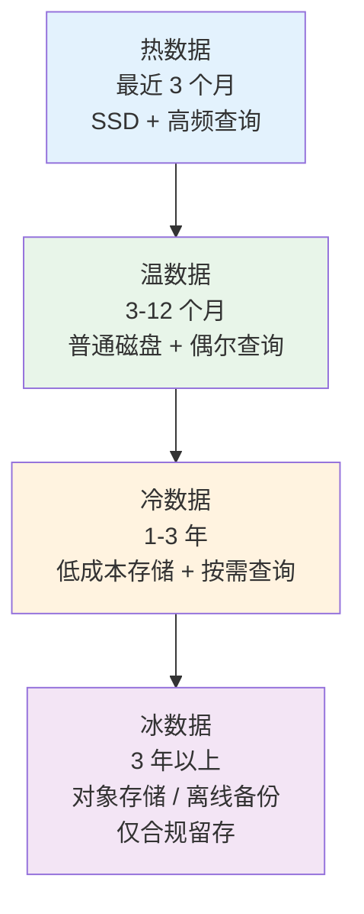
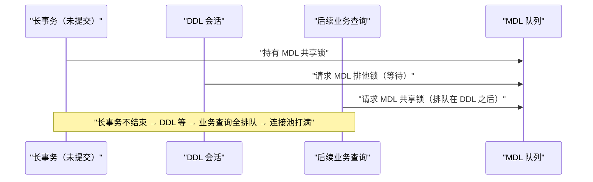
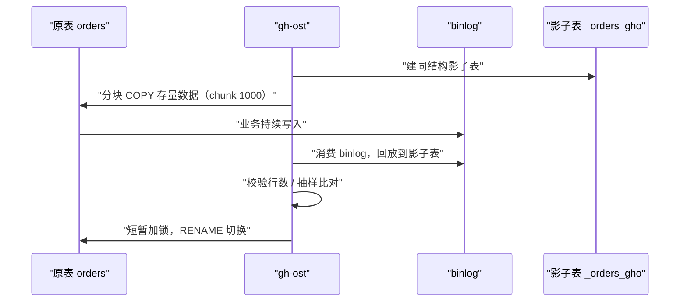
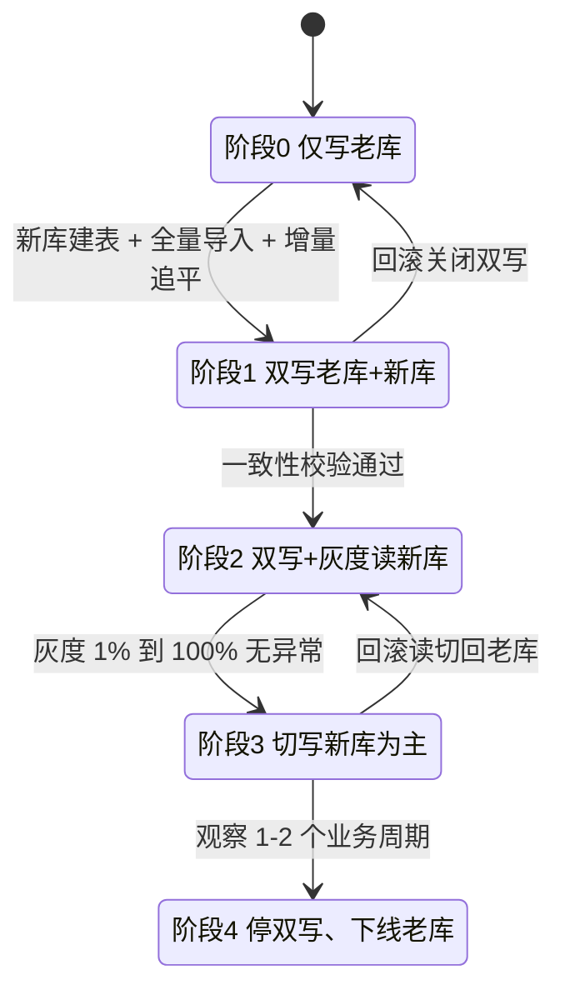
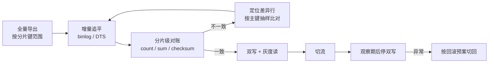

# 数据归档、冷热分离与在线迁移

> 定位：单表涨到 20 亿行后，查询越来越慢、备份越来越久、DDL 根本做不动，于是「归档老数据」和「换库迁移」被提上日程。这篇讲清冷热分层的落地形态、归档任务怎么做才不会丢数据、在线 DDL（MySQL Online DDL / gh-ost / pt-osc）为什么仍会锁表，以及双写迁移的完整阶段与回滚窗口——这是一份能直接照着排期的迁移作战手册。

## 一、为什么需要它

一张订单表从 500 万涨到 20 亿，通常会依次出现这些问题：

1. **查询变慢**：即使走索引，B+ 树变高、buffer pool 命中率下降，P99 从 20ms 涨到 300ms。
2. **备份变久**：全量备份从 20 分钟变成 6 小时，恢复演练根本不敢做。
3. **DDL 做不动**：加一个字段，`ALTER TABLE` 跑了 9 小时还没结束，主从延迟持续扩大。
4. **存储成本失控**：三年前的数据一年被查不到几次，却和热数据一样占着 SSD。

直觉方案是「删掉老数据」，但财务、审计、客诉追溯都要求「可查」。所以真正要解决的是三件事：**把冷数据搬到便宜介质（归档）**、**让查询能透明地跨热冷两端（冷热分离）**、**在不停止写入的前提下完成结构调整或换库（在线迁移）**。这三件事的技术底座是同一套：分批处理 + 幂等 + 对账 + 可回滚。

## 二、核心原理

### 2.1 数据生命周期与冷热分层

数据的访问频率随时间单调衰减，典型曲线是「上线首周最热，一个月后趋于平稳，三个月后接近零」。按访问特征分层：



读图要点：分层不是按「数据重不重要」，而是按**访问频率 × 查询 SLA × 合规要求**。热层追求低延迟，冷层追求低成本，冰层只保证「能取回来」。分层的边界要写进制度（比如「订单主表只保留 12 个月」），否则数据只会一直往热层堆。

### 2.2 三种落地形态

| 形态 | 做法 | 优点 | 缺点 | 适用 |
|---|---|---|---|---|
| **同库分区表** | 按时间 RANGE 分区，冷分区 `DROP`/`DETACH` | 应用零改造，删除是元数据操作，秒级 | 单实例仍有容量上限；分区过多影响计划 | 单表亿级、按时间天然可分 |
| **归档表/历史库** | 老数据搬到 `orders_archive` 或独立实例 | 热库变小，冷库可用廉价硬件 | 应用要路由；跨库查询麻烦 | 热冷查询比例悬殊 |
| **对象存储 + 查询引擎** | 导出 Parquet 到 S3/OSS，用 Trino/Athena/ClickHouse 查 | 成本最低，几乎无限容量 | 查询延迟高、需要数据湖链路 | 审计、合规、离线分析 |

选择顺序建议：**能分区就分区，分区扛不住再拆历史库，历史库还嫌贵再下沉对象存储**。不要一上来就上数据湖——多一套链路就多一套故障面。

MySQL 8.0 分区表的两个关键操作：

```sql
-- 把冷分区从主表摘出来（元数据操作，秒级）
ALTER TABLE orders EXCHANGE PARTITION p202501 WITH TABLE orders_202501;
-- 确认归档完成后直接丢弃
ALTER TABLE orders DROP PARTITION p202501;
```

PG 对应的是 `DETACH PARTITION`，之后可以把分区表当成独立表迁走或直接 `DROP`。

### 2.3 归档任务的设计要点

归档不是「一条 DELETE 删完」，而是一个**可中断、可续跑、可对账、可回滚**的批处理作业：读 watermark → 按主键游标取一批 → 幂等写入归档库 → 记录校验和 → 小事务删除 → 推进 watermark。

关键设计：

- **双条件圈定范围**：`create_time < cutoff AND id <= watermark`。只按时间会与业务写入竞态（边界数据可能被删了却没归档）。
- **批次要小**：500-2000 行/批，每批独立事务。批次太大导致主从延迟、undo 膨胀、锁等待。
- **限流**：批间 sleep 或按主从延迟动态调整（延迟超过阈值就暂停）。
- **幂等**：归档表用 `INSERT IGNORE` / `ON DUPLICATE KEY UPDATE` / `ON CONFLICT DO NOTHING`。
- **对账**：每批记录 `count`、`sum(amount)`、`BIT_XOR(CRC32(...))`，与源表范围比对。
- **可回滚**：归档表保留 N 天（如 30 天）再下沉对象存储，期间提供反向导入脚本。

### 2.4 在线 DDL：为什么「Online」仍会锁表

MySQL 8.0 的 DDL 有三种算法：

| 算法 | 行为 | 是否重建表 | 并发 DML | 典型操作 |
|---|---|---|---|---|
| `INSTANT` | 只改元数据 | 否 | 允许 | 8.0.12+ 末尾加列；8.0.29+ 任意位置加列、删列 |
| `INPLACE` | 原地重建或改元数据，不拷贝到临时表外 | 可能重建 | 大多允许（`LOCK=NONE`） | 加索引、改索引、部分列属性变更 |
| `COPY` | 建临时表逐行拷贝 | 是 | **不允许** | 改列类型、改字符集等 |

执行时建议显式声明，让不满足条件时直接报错而不是悄悄降级：

```sql
ALTER TABLE orders ADD COLUMN remark varchar(255) NULL,
    ALGORITHM=INSTANT, LOCK=NONE;
```

**真正的风险不是算法，是 MDL（Metadata Lock）**。即使 `ALGORITHM=INPLACE, LOCK=NONE`，DDL 执行期间持 MDL 共享锁，并在**开始和结束时短暂升级为排他锁**；如果此时有长事务持有 MDL 共享锁，DDL 会等待升级，而**后续所有访问该表的语句也会排在 DDL 后面**——表现为「一条 DDL 把整张表的读写全堵死」。



读图要点：**DDL 本身不慢，慢在排队**。上线 DDL 前必须先查 `information_schema.innodb_trx` 里是否有长事务，并设置 `lock_wait_timeout`（如 5 秒）让 DDL 快速失败而不是无限等待。

大表 DDL 的两种主流工具：

| 维度 | gh-ost | pt-online-schema-change |
|---|---|---|
| 原理 | 伪装成从库**消费 binlog** 回放增量 | 在原表建**触发器**，把 DML 同步到影子表 |
| 对原表影响 | 无触发器，写入开销小 | 每个 DML 多一次触发器写入，高并发下明显 |
| 切换方式 | `RENAME TABLE` 原子切换，配合锁 | `RENAME TABLE` 切换 |
| 限流 | 支持按主从延迟/负载自动限流 | 支持 `--max-load`、`--critical-load` |
| 限制 | 需要 `ROW` 格式 binlog、需要有从库或可连 binlog | 原表不能已有触发器；触发器可能引入死锁 |
| 磁盘 | 需要约 1 倍额外空间 | 同上 |



读图要点：**存量拷贝与增量回放并行**，最后靠一次短暂锁完成原子切换。所以 gh-ost 的「在线」指的是**大部分时间不锁表**，切换瞬间仍有毫秒到秒级阻塞，必须放在低峰期。

### 2.5 双写迁移：完整阶段与回滚窗口

换库、换分片方案、换存储引擎，本质都是「把读写从 A 迁到 B」。标准五阶段：



读图要点：**读和写分两步切**，先让读流量验证新库正确性，再切写。每一步都要保留回滚开关：阶段 1-2 的回滚是「关双写、读回老库」；阶段 3 的回滚是「写回老库、读回老库」，前提是老库还在、数据仍可回灌。

工程要点：

- **双写顺序**：先写老库（成功才返回），再写新库；新库失败进补偿队列，不能因为新库失败影响主流程。
- **ID 冲突**：新老库自增会撞，迁移期统一用分布式 ID，或建立「老 ID → 新 ID」映射表。
- **灰度读**：按用户 ID 哈希或白名单分流，同时**双读比对**（异步比对，不一致只告警不阻断）。
- **影子表**：新结构先用影子表承接双写，验证 DDL 与索引设计，再正式切换。
- **回滚窗口**：至少保留一个业务周期（如 7 天）的老库写入能力，别切完就删。

### 2.6 分库分表后的迁移与一致性校验

分片扩容（如 4 库 → 8 库）本质是「部分分片的数据要搬到新分片」。流程与双写迁移一致，但校验更复杂：



读图要点：**对账不是「总数相等」就完事**，要做「分片级 + 表级 + 行级抽样」三层校验。`count` 相等但内容不同是很常见的（少一条 A、多一条 B），必须用能反映内容的校验和。

对账 SQL 模板（按分片/按天）：

```sql
-- 行数 + 金额校验
SELECT DATE(create_time) AS d, COUNT(*) AS cnt, SUM(amount) AS amt
FROM orders WHERE create_time >= '2026-01-01' AND create_time < '2026-02-01'
GROUP BY d;

-- 内容校验和（MySQL）：对关键字段做 CRC32 后按位异或，可增量合并
SELECT COUNT(*) AS cnt,
       BIT_XOR(CRC32(CONCAT_WS('#', id, user_id, amount, status, create_time))) AS checksum
FROM orders WHERE create_time >= '2026-01-01' AND create_time < '2026-02-01';
```

两边分别算、逐天比对，定位到天后再按主键区间二分，几轮就能锁定差异行。注意 `CRC32` 有碰撞概率，关键表可换 `MD5` 聚合（更慢）或直接抽样比对明细。

## 三、关键脚本与配置

### 3.1 归档 SQL 模板

```sql
-- 每批：先查后删，主键游标推进
START TRANSACTION;

INSERT INTO orders_archive
SELECT * FROM orders
WHERE id > :watermark AND create_time < :cutoff
ORDER BY id LIMIT 1000;

DELETE FROM orders
WHERE id > :watermark AND create_time < :cutoff
ORDER BY id LIMIT 1000;

COMMIT;
-- 成功后把 watermark 更新为本批最大 id
```

`ORDER BY id LIMIT 1000` 保证每批范围确定；删除条件与查询条件完全一致，避免「查出来的没删、删了的没归档」。

### 3.2 双写开关（Spring 示例）

```java
@Component
public class DualWriteOrderRepository {

    private final OrderMapper masterMapper;   // 老库
    private final OrderMapper shadowMapper;   // 新库
    private final DualWriteSwitch dualWriteSwitch;

    @Transactional(rollbackFor = Exception.class)
    public void save(Order order) {
        masterMapper.insert(order);           // 老库成功是主流程前提
        if (dualWriteSwitch.isShadowWriteEnabled()) {
            try {
                shadowMapper.insert(order);
            } catch (Exception e) {
                // 新库失败不影响主流程，进补偿队列
                compensationQueue.offer(order);
            }
        }
    }
}
```

开关放配置中心，支持按租户/按比例灰度；补偿队列要有重试上限和死信告警，否则「双写不一致」会静默积累。

### 3.3 gh-ost 常用命令

```bash
gh-ost \
  --host=10.0.0.11 --port=3306 --user=ghost --password=*** \
  --database=shop --table=orders \
  --alter="ADD COLUMN remark varchar(255) NULL" \
  --allow-on-master \
  --chunk-size=1000 \
  --max-load="Threads_running=30" \
  --critical-load="Threads_running=60" \
  --cut-over-lock-timeout-seconds=5 \
  --postpone-cut-over-flag-file=/tmp/ghost.postpone \
  --execute
```

`--postpone-cut-over-flag-file` 是关键：拷贝完成后先不切换，等你确认业务低峰再删掉文件触发切换。

## 四、生产坑点与排查

### 坑点 1：DDL 等 MDL，把整张表的读写堵死

**现象**：一条 `ALTER TABLE` 执行后，所有访问该表的请求超时，连接池打满，CPU 反而不高。
**原因**：DDL 在开始/结束需要 MDL 排他锁；有长事务持有共享 MDL 时 DDL 排队，后续所有业务 SQL 又排在 DDL 后面。
**解法**：上线 DDL 前查 `information_schema.innodb_trx` 清长事务；设置 `lock_wait_timeout=5`；大表用 gh-ost 或低峰窗口执行；监控 `performance_schema.metadata_locks` 看排队。

### 坑点 2：先删后归档，中断就丢数据

**现象**：归档任务跑一半失败重启，发现部分数据两头都没有。
**原因**：删除与归档不在同一顺序保证内，或批次大小与实际删除不一致。
**解法**：**先写归档库并提交，再删热库**；每批记录 watermark；归档表加唯一键保证幂等；上线前用影子表做全流程演练。

### 坑点 3：双写不一致，切换后才发现

**现象**：切到新库后，部分订单状态与老库不同，客服查到的数据和用户看到的不一致。
**原因**：新库写入失败被吞掉、补偿队列没消费、双写顺序导致覆盖（后写的老库值覆盖新库）。
**解法**：双读比对（异步）+ 定时全量对账；补偿队列必须有死信告警；写操作以「业务更新时间戳」做冲突判定，避免旧值覆盖新值。

### 坑点 4：大批量删除拖垮主从与 undo

**现象**：归档任务跑起来后，从库延迟飙升到几十分钟，业务读从库超时。
**原因**：单批删除行数过多，产生大事务，binlog 巨大，从库回放慢；同时 undo 膨胀。
**解法**：单批 500-2000 行、批间 sleep；按主从延迟动态暂停；删除走主键范围避免间隙锁；在低峰执行。

### 坑点 5：分区裁剪失效，分区表反而更慢

**现象**：建了按月分区，查询还是扫全部分区。
**原因**：查询条件对分区键做了函数运算（`DATE_FORMAT(create_time,'%Y-%m')`），优化器无法裁剪。
**解法**：分区键用**原始列的范围条件**（`create_time >= '2026-01-01' AND < '2026-02-01'`），不要在分区键上套函数；用 `EXPLAIN` 看 `partitions` 列是否只剩目标分区。

### 坑点 6：迁移中断后「从断点续跑」却重复写入

**现象**：增量同步重启后，新库出现重复行或唯一键冲突。
**原因**：位点（binlog position/GTID）与业务事务不是原子提交，重启后重放了已应用的部分。
**解法**：消费端做幂等（唯一键 + `INSERT IGNORE`/`ON DUPLICATE KEY UPDATE`）；位点提交放在业务事务之后，宁可重放不可跳过；定期对账兜底。

## 五、方案对比与决策

### 5.1 归档方案对比

| 维度 | 分区表 | 归档表/历史库 | 对象存储 |
|---|---|---|---|
| 应用改造 | 无 | 需要路由 | 需要数据湖查询链路 |
| 删除成本 | 元数据操作，秒级 | 分批 DELETE | 直接删文件 |
| 冷数据查询 | 与原表同延迟 | 取决于历史库配置 | 秒级到分钟级 |
| 成本 | 中 | 中低 | 最低 |
| 运维复杂度 | 低 | 中 | 高 |
| 适用数据量 | 亿级 | 十亿级 | 百亿级以上 |

### 5.2 DDL 方案对比

| 维度 | 原生 Online DDL | gh-ost | pt-osc |
|---|---|---|---|
| 是否锁表 | 切换瞬间 | 切换瞬间 | 切换瞬间 |
| 对写入影响 | 小 | 小 | 中（触发器） |
| 主从延迟可控 | 弱 | 强（自动限流） | 中 |
| 使用门槛 | 低 | 中 | 中 |
| 不适用 | 改列类型等需 COPY 的操作 | 无 ROW binlog、无权限读 binlog | 原表已有触发器 |

**什么时候不该做归档/迁移**：数据量在千万级以内、查询延迟可接受、合规也不要求分层时，优先优化索引和 SQL。归档和迁移都会引入「两套数据源」，一致性和运维成本是长期负担。

## 六、面试高频问法

**Q1：单表数据量太大，你会怎么处理？**

**一句话结论**：先判断瓶颈是查询、存储还是 DDL——**索引/SQL 优化 → 分区表 → 冷热分离归档 → 分库分表 → 换 NewSQL**，按成本从低到高逐级上，不要一上来就分库分表。

展开：千万级优先优化索引与 SQL；亿级按时间分区 + 归档；十亿级再考虑分片；分片后跨片查询和分布式事务成本陡增。

加分点：说「分区和归档解决的是『历史数据』，分片解决的是『写入与容量』，两者解决的不是同一个问题」。

**Q2：归档任务怎么保证不丢数据、可回滚？**

**一句话结论**：**先归档后删除、主键游标分批、每批记 watermark 与校验和、归档表幂等、保留回滚窗口**。

展开：`create_time < cutoff AND id <= watermark` 双条件圈定；单批 1000 行独立事务；批间限流防主从延迟；归档表留 30 天再下沉对象存储。

加分点：说「顺序反了就是事故——先删后归档，中断时数据两头都没有」，这是最容易被忽略的细节。

**Q3：MySQL Online DDL 为什么还会锁表？**

**一句话结论**：算法层面 `INPLACE/LOCK=NONE` 确实允许并发 DML，但 DDL 开始和结束要拿 **MDL 排他锁**，长事务会让 DDL 排队，而后续业务 SQL 又排在 DDL 之后，表现为整表阻塞。

展开：`INSTANT` 只改元数据最快；`INPLACE` 可能重建但不阻塞 DML；`COPY` 全程锁写。MDL 排队才是线上事故主因。

加分点：给出「先清长事务 + `lock_wait_timeout=5` + 大表用 gh-ost」的组合拳。

**Q4：gh-ost 和 pt-online-schema-change 的区别？**

**一句话结论**：gh-ost **消费 binlog 回放增量、无触发器**；pt-osc **在原表建触发器**同步增量——前者对写入影响小、可控性强，后者实现简单但触发器有额外开销和死锁风险。

展开：gh-ost 需要 ROW 格式 binlog 和相应权限，支持按负载/延迟自动限流，切换靠 `RENAME TABLE`；pt-osc 原表不能已有触发器。

加分点：指出「两者都要求约 1 倍额外磁盘，且切换瞬间仍有短暂锁」，所以必须低峰执行。

**Q5：双写迁移的完整步骤是什么？**

**一句话结论**：**全量导入 → 双写 → 校验 → 灰度读 → 切写 → 观察 → 停双写**，读和写分两步切，每一步都留回滚开关。

展开：双写以老库成功为前提，新库失败进补偿队列；灰度读按用户哈希分流并双读比对；切写后保留一个业务周期的老库写入能力。

加分点：说「ID 冲突要在迁移前解决——统一分布式 ID 或建映射表」，这是很多人漏掉的硬问题。

**Q6：迁移后怎么做数据一致性校验？**

**一句话结论**：三层校验——**表级行数与聚合值、分片级 checksum、行级抽样明细**；`count` 相等不代表内容一致，必须用反映内容的校验和。

展开：`BIT_XOR(CRC32(...))` 可按区间增量合并，适合大表；定位到区间后二分缩小范围；关键表用 MD5 或直接抽样比对。

加分点：说「校验要能重复执行且结果可解释，否则运营不信、研发也不敢切」。

**Q7：分库分表扩容时，数据怎么迁？**

**一句话结论**：**成倍扩容（2→4→8）+ 按分片键范围迁移 + 全量增量追平 + 分片级对账 + 双写灰度切流**；成倍扩容能让「老分片的数据只拆不跨」，迁移量最小。

展开：用一致性哈希或成倍取模减少搬迁比例；增量靠 binlog/DTS；切流前必须完成对账。

加分点：说「扩容方案要在分片设计时就定好，事后改成非成倍扩容，迁移量会翻几倍」。

**Q8：归档时怎么避免影响线上业务？**

**一句话结论**：**小批次 + 批间限流 + 主从延迟反馈 + 低峰执行 + 主键范围删除**，把大事务拆成可暂停的小事务。

展开：单批 500-2000 行；监控 `Seconds_Behind_Master` 动态暂停；避免 `DELETE ... WHERE create_time < ?` 这种无界大事务；分区表直接 `DROP PARTITION`。

加分点：说「归档任务要有 kill switch 和进度看板」，否则出问题只能干等。

**Q9：什么情况下不应该做冷热分离？**

**一句话结论**：数据量不大、冷数据仍被高频访问、团队没有跨库查询与对账能力时，不该做——**冷热分离引入两套数据源，一致性和运维成本是长期负债**。

展开：先算「省下的存储成本」是否大于「多一套链路的研发与故障成本」；如果冷数据查询占比超过 10%，分层收益有限。

加分点：说「分层边界要写进制度并由任务自动执行，否则半年后热库又堆满了」。

## 小结

- 分层依据是**访问频率 × 查询 SLA × 合规要求**，不是数据重要性；能分区就分区，再考虑历史库、对象存储。
- 归档必须**先写后删、主键游标分批、watermark 续跑、校验和对账、保留回滚窗口**。
- Online DDL 的真正风险是 **MDL 排队**，不是算法本身；大表用 gh-ost/pt-osc，并先清理长事务。
- 双写迁移的核心节奏是**先双写、再灰度读、后切写**，读和写分两步，每步可回滚。
- 一致性校验要三层：行数/聚合、checksum、行级抽样；`count` 相等不等于内容一致。
- 迁移与归档都是长期负债，数据量与收益不匹配时，优先优化索引和 SQL。
