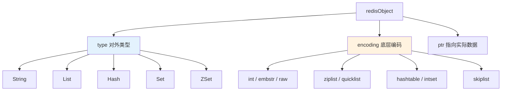
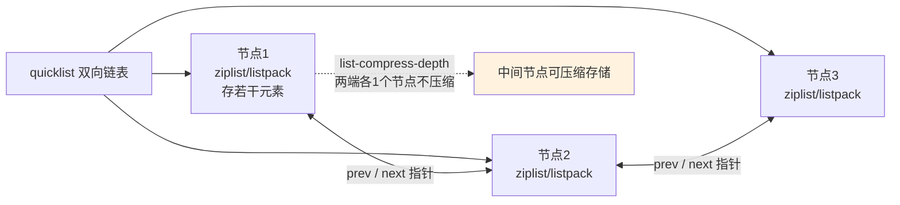
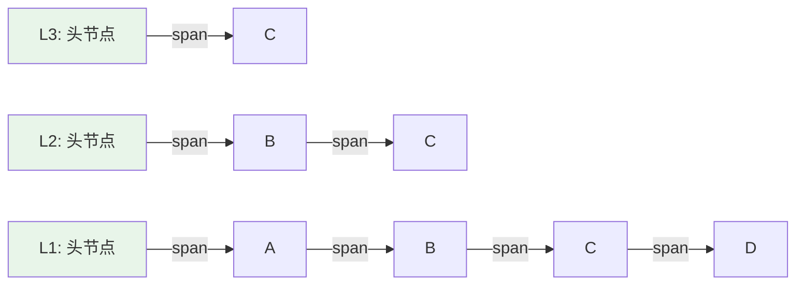

# Redis数据结构与底层

> 定位：Redis 快，一半靠内存，一半靠「为每种场景挑对数据结构」。这篇讲透五种对外数据结构（String/List/Hash/Set/ZSet）与六种底层实现（SDS、ziplist、quicklist、hashtable、skiplist、intset）的对应关系、编码转换条件和内存取舍。搞懂它，你才能解释「为什么这个 key 占这么多内存」「为什么这个命令突然变慢」。

## 一、为什么需要关心底层结构

面试背「Redis 五种数据结构」很简单，但线上问题往往卡在底层：

- 同样是存对象，用 `String` 存 JSON 和用 `Hash` 存字段，内存可能差 2-3 倍；
- 一个 `HGETALL` 让 Redis 主线程卡了 200ms，因为字段从 ziplist 转成了 hashtable；
- `ZRANGE 0 -1` 在 10 万元素的 zset 上很慢，因为跳表虽然 O(logN)，但返回 M 个元素是 O(M)。

**Redis 对外是 5 种类型，对内是「redisObject + 多种编码」的两层抽象**。同一个 type，在不同数据规模下会自动切换底层编码——这正是它兼顾「小数据省内存」和「大数据快」的关键。

## 二、核心原理：两层结构与对象编码

### 2.1 redisObject：所有值的统一外壳

Redis 里每个 value 都是一个 `redisObject`，结构大致如下（不同版本字段略有差异，以你使用的版本为准）：

| 字段 | 占用 | 作用 |
|---|---|---|
| `type` | 4 bit | 对外类型：String/List/Hash/Set/ZSet |
| `encoding` | 4 bit | 底层编码：int/embstr/raw/ziplist/quicklist/hashtable/skiplist/intset |
| `lru` / `lfu` | 24 bit | 内存淘汰用（LRU 时间戳或 LFU 计数） |
| `refcount` | 4 byte | 引用计数，用于对象共享和回收 |
| `ptr` | 8 byte | 指向真正的数据结构 |

**type 与 encoding 解耦**是设计的精髓：对外 API 只认 type，内部可自由换 encoding。你执行 `OBJECT ENCODING key` 就能看到某个 key 当前用的编码。

这张图要建立的核心认知是：**type 是「是什么」，encoding 是「怎么存」**，下面逐一拆 encoding。

### 2.2 SDS：字符串不是 C 字符串

Redis 没用 C 原生字符串，而是自己实现了 SDS（Simple Dynamic String）。结构包含：

- `len`：已用长度 → **O(1) 取长度**（C 字符串要 O(n) strlen）
- `alloc`：分配的总空间 → 支持空间预分配
- `flags`：类型标记（sdshdr5/8/16/32/64，按长度选最小头文件省内存）
- `buf[]`：真正的字节数组，末尾仍保留 `\0` 兼容 C API

三个关键优化：

1. **空间预分配**：修改后若 len < 1MB，分配 2×len；若 ≥ 1MB，多分配 1MB。减少连续 append 的内存重分配次数。
2. **惰性释放**：缩短字符串时不立即收缩内存，留给后续复用。
3. **二进制安全**：靠 len 判断结束，不靠 `\0`，可存图片、序列化对象。

String 的三种编码：`int`（值是整数且能用 long 表示，直接存指针不存字符串）、`embstr`（≤44 字节，redisObject 和 SDS 一次性连续分配，分配/释放各一次）、`raw`（>44 字节，两次分配）。embstr 是**只读的**，一旦修改（如 APPEND）就转成 raw。

### 2.3 ziplist 与 quicklist：紧凑存储的两端

**ziplist（压缩列表）** 是一块**连续内存**， entry 结构：`prevlen（前一 entry 长度）+ encoding（编码类型）+ content（内容）`。

- 优点：紧凑、无指针开销、缓存友好
- 缺点：查找 O(n)；新增/删除可能触发**连锁更新**（prevlen 从 1 字节变 5 字节，后面全跟着变）

> Redis 7.0 起 ziplist 被 **listpack** 逐步取代（listpack 用「从后往前记录自身长度」消除了连锁更新），配置项也从 `hash-max-ziplist-*` 变为 `hash-max-listpack-*`，以你的版本为准。下文逻辑对两者通用。

**quicklist** 是「双向链表 + 每个节点是一个 ziplist/listpack」的组合（Redis 3.2+ 的 List 底层）：

这张图想说明：quicklist 用「链表」规避了大 ziplist 的连锁更新和重分配代价，又用「每个节点是小 ziplist」保留了紧凑性。关键参数 `list-max-ziplist-size`（每个节点最大多少元素/字节）和 `list-compress-depth`（两端不压缩的节点数，默认 0 不压缩；设为 1 可压缩中间节点省内存，代价是中间元素访问需解压）。

### 2.4 hashtable：dict 与渐进式 rehash

Hash 和 Set 的大数据编码是 hashtable。Redis 的字典 `dict` 里有**两个哈希表 ht[0] 和 ht[1]**，这是为了**渐进式 rehash**：

- 扩容/缩容时不一次性搬迁（几百万 key 会卡死主线程），而是每次 CRUD 顺带搬 1 个桶
- rehashidx 记录搬迁进度，全部搬完后交换 ht[0]/ht[1]
- 哈希算法用 MurmurHash2，冲突用**链地址法**

触发扩容的负载因子：`ht[0].used / ht[0].size >= 1`（无持久化时）或 `>= 5`（有 BGSAVE/BGREWRITEAOF 时，避免写时复制期间频繁扩容）。

### 2.5 skiplist：ZSet 的核心

**跳表（skiplist）** 是在有序链表上加多层索引，实现平均 O(logN) 的查找、插入、删除。ZSet 节点 `zskiplistNode` 包含：

- `sds ele`：member 字符串
- `double score`：分值
- `backward`：后退指针（用于反向遍历）
- `level[]`：每层的前进指针 + span（跨度，**用于计算 rank 排名**）

层高由**随机算法**决定：每个新节点有 p=0.25 的概率升到更高层，最大层数 32。它是**概率平衡**而非严格平衡，但实现比红黑树简单得多，且范围查询天然高效。

> 为什么 ZSet 用跳表而不是红黑树？①范围查询（ZRANGE）在跳表上就是链表遍历，红黑树要中序遍历更复杂；②实现简单、插入删除只需改局部指针；③性能与红黑树同阶（O(logN)）但常数更小、更易优化。ZSet 实际上**同时用了 hashtable + skiplist**：hashtable 存 member→score 支撑 O(1) 的 `ZSCORE`，skiplist 支撑有序范围操作。

### 2.6 intset：整数集合

Set 全是整数且元素 ≤ `set-max-intset-entries`（默认 512）时用 intset。它是**连续内存 + 按整数编码（int16/int32/int64）**存储，查找用二分 O(logN)。

- **升级**：插入超出当前编码范围的整数时，整集合升级到更大编码（int16→int32→int64）
- **不降级**：升级后即使删除大数也不会降回小编码（避免反复升降）

## 三、对象编码与转换条件

这是最该背下来的一张表——它直接决定内存占用和命令复杂度。阈值都是默认值，可在 `redis.conf` 调整，以版本为准。

| type | 编码 | 转换条件（默认） |
|---|---|---|
| String | int → embstr → raw | 整数用 int；≤44 字节用 embstr；>44 字节用 raw；embstr 被修改转 raw |
| List | quicklist | Redis 3.2+ 统一用 quicklist（老版本小数据 ziplist / 大数据 linkedlist） |
| Hash | listpack/ziplist → hashtable | 字段数 >512 **或** 任一 value >64 字节转 hashtable |
| Set | intset → hashtable | 元素非整数 **或** 元素数 >512 转 hashtable |
| ZSet | listpack/ziplist → skiplist | 元素数 >128 **或** 任一 member >64 字节转 skiplist+hashtable |

相关配置：`hash-max-listpack-entries 512`、`hash-max-listpack-value 64`、`set-max-intset-entries 512`、`zset-max-listpack-entries 128`、`zset-max-listpack-value 64`。

一旦转成 hashtable/skiplist，**不会自动转回**紧凑编码（即使删到很小）。这是生产上内存「只增不减」的常见原因之一。

## 四、命令复杂度速查

理解底层后，复杂度就是查表：

| 结构 | O(1) 命令 | O(logN) | O(N) 或更差 |
|---|---|---|---|
| String | GET/SET/INCR/APPEND(均摊) | — | MGET N 个、GETRANGE 取 M 字符 O(M) |
| List | LPUSH/RPUSH/LPOP/RPOP/LLEN | — | LINDEX/LSET O(N)、LRANGE O(S+N) |
| Hash | HGET/HSET/HEXISTS/HDEL(单字段) | — | HGETALL/HKEYS/HVALS O(N) |
| Set | SADD/SREM/SISMEMBER/SCARD | — | SMEMBERS O(N)、SINTER O(N×M)、SDIFF O(N) |
| ZSet | ZSCORE(hashtable) | ZADD/ZREM/ZRANK/ZRANGE(取 M 个 O(logN+M)) | ZRANGEBYSCORE 返回大量元素 O(logN+M) |

**规律**：带 `ALL`/`MEMBERS`/`KEYS` 的往往是 O(N)，`LRANGE`/`ZRANGE` 的成本随返回元素个数 M 增长——大 key 上一次取全量就是慢命令的根源。用 `SCAN`/`HSCAN`/`ZSCAN` 游标分批替代全量取。

## 五、生产坑点与排查

### 坑点 1：Big Key 导致主线程阻塞

**现象**：Redis 偶发几百毫秒延迟，业务超时，监控看到 `latency` 尖刺。
**原因**：单个 String 几 MB、单个 Hash/Set/ZSet 几十万字段。`DEL` 大 key 要释放大量内存，一次就能阻塞；`HGETALL`/`SMEMBERS` 大 key 传输也慢。
**解法**：
- 用 `redis-cli --bigkeys` 或 `MEMORY USAGE key` 找大 key
- Redis 4.0+ 用 `UNLINK` 异步删除；配置 `lazyfree-lazy-eviction yes` 等
- 拆 key：大 Hash 按业务维度拆成多个（如按用户 ID 尾号分 10 个）
- 遍历用 `HSCAN`/`SSCAN`/`ZSCAN` 代替 `HGETALL`/`SMEMBERS`

### 坑点 2：编码从紧凑结构升级后内存暴涨

**现象**：一个 Hash 原本很省内存，某次批量写入后内存突然涨一大截，删回去也不降。
**原因**：某个 field 的 value 超过 64 字节（如塞了大 JSON），触发 ziplist→hashtable 转换；hashtable 有指针和桶开销，且转换不可逆。
**解法**：
- 用 `OBJECT ENCODING key` 确认编码
- value 超长时拆字段或独立存 String
- 评估调大 `hash-max-listpack-value`，但过大又会让 ziplist 变慢，需权衡
- 重建 key（删了重写）才能回到紧凑编码

### 坑点 3：zset/liset 的编码误用导致慢查询

**现象**：排行榜 `ZRANGE 0 99` 尚可，但某次 `ZRANGE 0 -1` 拉全量导致卡顿。
**原因**：ZSet 底层跳表返回 M 个元素是 O(logN+M)，百万元素全量返回既耗 CPU 又占网络带宽。
**解法**：
- 分页拉取，控制 M；用 `ZRANGE key start stop` 明确范围
- 需要全量导出时放到从节点执行，或用 `ZSCAN`
- 关注 `slowlog get` 里的慢命令，定位具体 key

### 坑点 4：SDS 预分配带来的「内存比数据大」

**现象**：`INFO memory` 显示 used_memory 远大于实际字符串总长度。
**原因**：SDS 空间预分配 + 惰性释放，分配的空间大于 len；加上 redisObject 头部开销。
**解法**：这是正常设计，不必强求一致；`MEMORY USAGE key` 看单个 key 真实占用；必要时 `MEMORY PURGE`（部分分配器）或重启整理。

## 六、调优与最佳实践

1. **小对象优先紧凑编码**：能用整数就用整数；Hash 字段数/值大小控制在阈值内；Set 尽量存整数。
2. **警惕大 key**：单 key 建议 String <10KB、集合元素 <5000，超了就拆。
3. **分批遍历**：`SCAN` 家族替代 `KEYS`/`HGETALL`/`SMEMBERS`。
4. **异步删除**：开启 lazy-free 相关配置，避免大 key 删除阻塞。
5. **关注内存碎片**：`INFO memory` 里 `mem_fragmentation_ratio`，>1.5 考虑重启或用 `activedefrag yes`（Redis 4.0+）。
6. **按场景选类型**：对象属性用 Hash 而非多个 String；去重/集合关系用 Set；需要排序用 ZSet。

## 七、面试高频问法

> 这一节的答案按「面试时能讲透」的标准写：先给一句结论，再展开机制、原因和坑点。建议先自己答一遍，再对照补全。

**Q1：Redis 有哪几种数据结构？底层分别怎么实现？**

**一句话结论**：对外 5 种 type（String/List/Hash/Set/ZSet），对内是「redisObject + 多种 encoding」两层抽象，同一个 type 在不同数据规模下自动切换底层编码。

先把这层映射讲清楚：

| 对外类型 type | 底层编码 encoding |
|---|---|
| String | int / embstr / raw |
| List | quicklist（Redis 3.2+ 统一） |
| Hash | listpack/ziplist → hashtable |
| Set | intset → hashtable |
| ZSet | listpack/ziplist → skiplist + hashtable |

关键要点：

- **type 与 encoding 解耦**是设计精髓：对外 API 只认 type，内部可自由换 encoding。你执行 `OBJECT ENCODING key` 就能看到某个 key 当前真实用的编码。
- 同一个 type 对应多种编码，比如 String 可能是 int、embstr 或 raw，取决于值和大小。正是这套机制让 Redis 兼顾「小数据省内存」和「大数据快」。

加分点：补一句「对外 5 种、对内不止 5 种编码，且会自动转换、转换不可逆」——自然把话题引到编码转换，那是下一个高频追问。

**Q2：redisObject 结构是怎样的？为什么要把 type 和 encoding 解耦？**

**一句话结论**：redisObject 是所有 value 的统一外壳，含 type/encoding/lru/refcount/ptr 等字段；解耦让 API 与实现分离，可以透明切换底层编码。

结构大致如下（不同版本字段略有差异，以你使用的版本为准）：

| 字段 | 占用 | 作用 |
|---|---|---|
| `type` | 4 bit | 对外类型：String/List/Hash/Set/ZSet |
| `encoding` | 4 bit | 底层编码 |
| `lru`/`lfu` | 24 bit | 内存淘汰用（LRU 时间戳或 LFU 计数） |
| `refcount` | 4 byte | 引用计数，对象共享与回收 |
| `ptr` | 8 byte | 指向真正的数据结构 |

要点：

- **解耦的好处**：对外的 GET/HSET 等命令不用改，内部可针对数据规模优化。比如小 Hash 用 listpack 省内存，变大后转 hashtable 保性能，调用方完全无感知。
- `refcount` 服务于对象共享和引用回收；`lru/lfu` 服务于 `maxmemory` 淘汰策略（如 `allkeys-lru`、`volatile-lfu`）。

加分点：能说出 `OBJECT ENCODING`（看编码）、`OBJECT REFCOUNT`（看引用）、`OBJECT IDLETIME`（看空闲时长）这组命令，说明你真的排查过内存问题，而不是背书。

**Q3：String 的 int/embstr/raw 有什么区别？embstr 为什么是 44 字节？**

**一句话结论**：整数值用 int 直接存指针；≤44 字节用 embstr（redisObject 与 SDS 一次性连续分配）；>44 字节用 raw（两次分配）；embstr 只读，一改就转 raw。

展开三种编码：

- **int**：值是 long 范围内的整数时，`ptr` 直接存整数值，不额外分配 SDS，最省空间。
- **embstr**：redisObject 和 SDS **一次性连续分配**，内存分配/释放各一次，且连续内存对缓存友好。44 字节这个数来自 64 字节减去 redisObject 头（16 字节）和 SDS 头（约 3 字节）与结尾 `\0` 后剩下的空间。
- **raw**：>44 字节，redisObject 与 SDS 分两次分配。
- **embstr 是只读的**：一旦 APPEND 等修改就转 raw，因为连续内存不方便原地扩展。

加分点：主动说「44 这个阈值历史上变过（早期是 39），取决于 SDS 头大小，以版本为准」——不把数字说死，面试官很吃这种严谨。

**Q4：SDS 相比 C 原生字符串有什么优势？**

**一句话结论**：SDS 用 len 字段记录长度，实现了 O(1) 取长度、二进制安全、空间预分配减少重分配、惰性释放四大优势。

展开：

- **结构**：`len`（已用长度）+ `alloc`（总容量）+ `flags`（类型标记）+ `buf[]`（字节数组，末尾仍保留 `\0` 兼容 C API）。
- **O(1) 取长度**：C 字符串 `strlen` 要 O(n) 遍历，SDS 直接读 len，所以 `STRLEN` 是 O(1)。
- **空间预分配**：修改后若 len < 1MB 分配 2×len，≥ 1MB 多分配 1MB，大幅减少连续 append 的内存重分配次数。
- **惰性释放**：缩短字符串时不立即收缩内存，留给后续复用。
- **二进制安全**：靠 len 判断结束而不是 `\0`，可以存图片、序列化对象等任意二进制数据。

加分点：指出「flags 有 sdshdr5/8/16/32/64 五种，按字符串长度选最小的头省内存」——这是较新版本的优化，体现你看过源码实现。

**Q5：ziplist 的连锁更新是什么？listpack 怎么解决？**

**一句话结论**：ziplist 连续紧凑但 prevlen 变长会引发连锁更新；listpack 改用「记录自身长度」从根上消除了连锁更新。

展开：

- **ziplist**：一块连续内存，entry = `prevlen（前一 entry 长度）+ encoding + content`。优点是紧凑、无指针、缓存友好；缺点是查找 O(n)。
- **连锁更新成因**：prevlen 用 1 字节表示（前一 entry < 254 字节）或 5 字节（≥ 254）。当某 entry 从 <254 涨到 ≥254，它的 prevlen 从 1 字节变 5 字节，自身变长又可能让下一个 entry 的 prevlen 变化……一次插入/删除触发一连串内存重分配。
- **listpack（Redis 7.0+ 逐步取代 ziplist）**：每个 entry 在末尾记录**自身长度**（从后往前解析），不再依赖前一个 entry 的长度，因此彻底消除连锁更新。配置项也从 `hash-max-ziplist-*` 变为 `hash-max-listpack-*`，以版本为准。

加分点：补一句「quicklist 的节点仍是 ziplist/listpack，所以 listpack 的引入直接降低了 quicklist 的连锁更新风险」——把两个知识点串起来。

**Q6：quicklist 为什么这样设计？list-compress-depth 有什么用？**

**一句话结论**：quicklist 是「双向链表 + 每个节点挂一个小 ziplist/listpack」，用链表规避大 ziplist 的连锁更新和重分配，用紧凑节点保留内存优势。

展开：

- **背景**：单个大 ziplist 查找 O(n)、插入删除可能大范围重排；纯 linkedlist 又浪费指针内存。quicklist 取两者平衡——链表负责分段，小 ziplist 负责紧凑存储。
- **关键参数**：
  - `list-max-ziplist-size`：每个节点最多放多少元素/字节，控制单节点大小。
  - `list-compress-depth`：两端各多少个节点不压缩，默认 0（不压缩）；设为 1 可压缩中间节点省内存，代价是访问中间元素要解压。
- Redis 3.2+ 的 List 统一用 quicklist。

加分点：能解释「为什么两端不压缩」——List 典型场景是队列/栈，LPUSH/RPUSH/LPOP/RPOP 都发生在首尾，压缩中间节点对热点性能几乎无影响却能省内存。讲出设计意图，比背参数强得多。

**Q7：Redis 的 dict 为什么有两个哈希表？渐进式 rehash 怎么回事？**

**一句话结论**：dict 维护 ht[0] 和 ht[1] 两张表，扩容/缩容时靠渐进式 rehash 分摊搬迁成本，避免一次性迁移卡死主线程。

展开：

- **为什么两张表**：rehash 需要新旧表同时存在。若一次性把几百万 key 从旧表搬到新表，主线程会长时间阻塞。
- **渐进式 rehash**：设置 `rehashidx`，每次 CRUD 顺带搬一个桶的元素从 ht[0] 到 ht[1]；期间查询会同时查两张表；全部搬完后交换 ht[0]/ht[1]、重置 rehashidx。
- **扩容负载因子**：`ht[0].used / ht[0].size >= 1`（无持久化）或 `>= 5`（有 BGSAVE/BGREWRITEAOF 时，避免 COW 期间频繁扩容）。哈希算法用 MurmurHash2，冲突用链地址法。

加分点：说出「rehash 期间删除、更新、查找要在两张表都做，而新插入只写 ht[1]」——这是理解渐进式 rehash 正确性的关键细节，很多人答不到。

**Q8：ZSet 为什么用跳表不用红黑树？跳表复杂度怎么来的？**

**一句话结论**：跳表在有序链表上加多层索引实现平均 O(logN)，范围查询天然高效、实现简单常数小；ZSet 还同时用 hashtable 支撑 O(1) 的 ZSCORE。

展开：

- **为什么不用红黑树**：①范围查询（ZRANGE）在跳表上就是链表顺序遍历，红黑树要做中序遍历更复杂；②实现简单，插入删除只改局部指针；③性能与红黑树同阶 O(logN)，但常数更小、更易优化。
- **复杂度来源**：多层索引、每层跨度递减，查找时从顶层往底层逐层推进，平均 O(logN)。层高由随机算法决定：新节点以 p=0.25 的概率升层，最大 32 层，是概率平衡而非严格平衡。
- **span 字段**记录跨度，用于计算 rank 排名（ZRANK/ZRANGE 的下标）。
- **双索引**：ZSet 实际同时有 hashtable（member→score，O(1) ZSCORE）和 skiplist（有序范围操作）两套结构。

加分点：强调「ZSet 是 hashtable + skiplist 双索引」——很多人只知道跳表、不知道还有 hashtable，这是面试官爱追问的点。

**Q9：Hash/Set/ZSet 什么时候触发编码转换？能转回去吗？**

**一句话结论**：超过阈值（默认 Hash 字段 >512 或值 >64 字节、Set 元素 >512 或非整数、ZSet 元素 >128 或 member >64 字节）就转 hashtable/skiplist，且**不可逆**。

展开这张必背表（阈值为默认值，可在配置调整，以版本为准）：

| type | 紧凑编码 | 转换条件 | 转成 |
|---|---|---|---|
| Hash | listpack/ziplist | 字段 >512 或 value >64B | hashtable |
| Set | intset | 元素 >512 或含非整数 | hashtable |
| ZSet | listpack/ziplist | 元素 >128 或 member >64B | skiplist + hashtable |

相关配置：`hash-max-listpack-entries 512`、`hash-max-listpack-value 64`、`set-max-intset-entries 512`、`zset-max-listpack-entries 128`、`zset-max-listpack-value 64`。

要点：转成 hashtable/skiplist 后**不会自动转回**，即使删到很小。这是生产上内存「只增不减」的常见原因。

加分点：给出解法——「要回到紧凑编码只能删了重建 key」；同时提醒调大阈值虽省内存但会让紧凑结构变慢（`HGETALL` 从 O(1) 退化感知），必须权衡。

**Q10：intset 的升级和降级机制是怎样的？**

**一句话结论**：Set 全是整数且元素数 ≤512 时用 intset（连续内存 + 二分查找）；插入超出当前编码范围的整数会升级编码，但升级后不降级。

展开：

- **intset**：按整数编码分 int16/int32/int64，连续内存、二分查找 O(logN)，比 hashtable 省内存得多。
- **升级**：插入超出当前编码范围的整数（如 int16 集合插入 40000），整集合升级到 int32（再超升 int64）。升级要重新分配内存并逐元素转换，是一次性成本，但换来后续统一编码的高效访问。
- **不降级**：升级后即使删掉大数也不降回小编码，避免反复升降带来抖动。
- 一旦元素非整数或数量 > `set-max-intset-entries`（默认 512），转 hashtable。

加分点：用「升级一次性、不可逆」类比 Q9 的 ziplist→hashtable——提炼出「Redis 用不可逆换稳定性能」的设计哲学，体现体系化理解。

**Q11：什么是大 key？有什么危害？怎么排查和处理？**

**一句话结论**：大 key（单个 String 几 MB、集合几十万元素）会阻塞主线程造成延迟尖刺，要用 `--bigkeys`/`MEMORY USAGE` 排查，靠拆分、异步删除、SCAN 处理。

展开：

- **危害**：`DEL` 大 key 释放大量内存会阻塞主线程；`HGETALL`/`SMEMBERS`/`LRANGE 0 -1` 传输海量数据既耗 CPU 又占带宽；还会放大 AOF 重写、RDB fork 的成本。
- **排查**：`redis-cli --bigkeys` 扫描全库、`MEMORY USAGE key` 看单 key 真实占用、`slowlog get` 定位慢命令。
- **处理**：
  - 拆 key：大 Hash 按业务维度拆（如按用户 ID 尾号分 10 个）。
  - 异步删除：Redis 4.0+ 用 `UNLINK` 替代 DEL，并开启 `lazyfree-lazy-eviction yes` 等。
  - 分批遍历：`HSCAN`/`SSCAN`/`ZSCAN` 替代全量取。
- 经验阈值：String <10KB、集合元素 <5000。

加分点：点出「DEL 大 key 的阻塞在 4.0 后可用 lazy-free 异步化，这是 lazy-free 最重要的价值之一」——把特性和它解决的真实痛点绑定。

**Q12：为什么 Redis 内存会「只增不减」？怎么用 OBJECT 命令排查编码问题？**

**一句话结论**：编码转换不可逆、SDS 预分配、删除后内存未归还 OS 共同导致内存只增不减；用 OBJECT/MEMORY/INFO 命令定位。

展开三个原因：

1. **编码不可逆**：listpack/ziplist 转 hashtable/skiplist 后不会退回（见 Q9）。
2. **SDS 预分配与惰性释放**：分配空间大于 len。
3. **分配器策略**：删除 key 后内存返回给 jemalloc 而非 OS，RSS 不降，出现 used_memory 与 RSS 的差异。

排查命令：

- `OBJECT ENCODING key`：看真实编码，确认是否已升级为 hashtable。
- `MEMORY USAGE key`：看单 key 占用。
- `INFO memory`：看 `used_memory`、`mem_fragmentation_ratio`（>1.5 考虑 `activedefrag yes` 或重启整理，Redis 4.0+）。

处理：确认编码问题后，删了重建 key 回到紧凑编码；碎片高就开主动碎片整理。

加分点：区分「used_memory 涨」和「RSS 涨」——前者是逻辑使用量，后者还受碎片和分配器策略影响。面试能讲清这个区别非常加分。

## 小结

- Redis 是「type + encoding」两层结构：`OBJECT ENCODING` 看真实编码。
- String 三编码（int/embstr/raw），List 是 quicklist，Hash/Set 小数据用紧凑结构大数据用 hashtable/intset，ZSet 是 skiplist + hashtable。
- 编码转换有阈值且**不可逆**，是内存「只增不减」的常见原因。
- 复杂度看返回值个数：带 ALL/MEMBERS 和 `LRANGE 0 -1` 这类操作是慢命令根源。
- 大 key 是万恶之源：拆 key、`SCAN` 分批、`UNLINK` 异步删、开 lazy-free。
