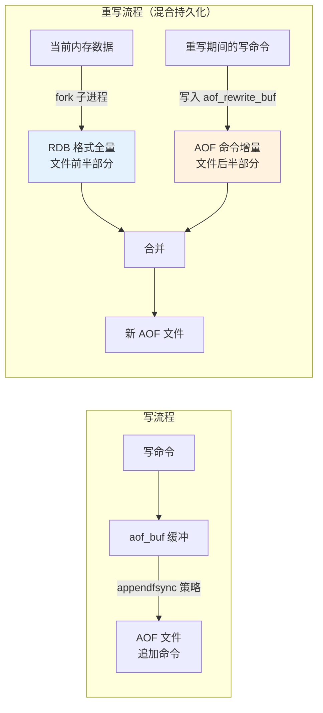
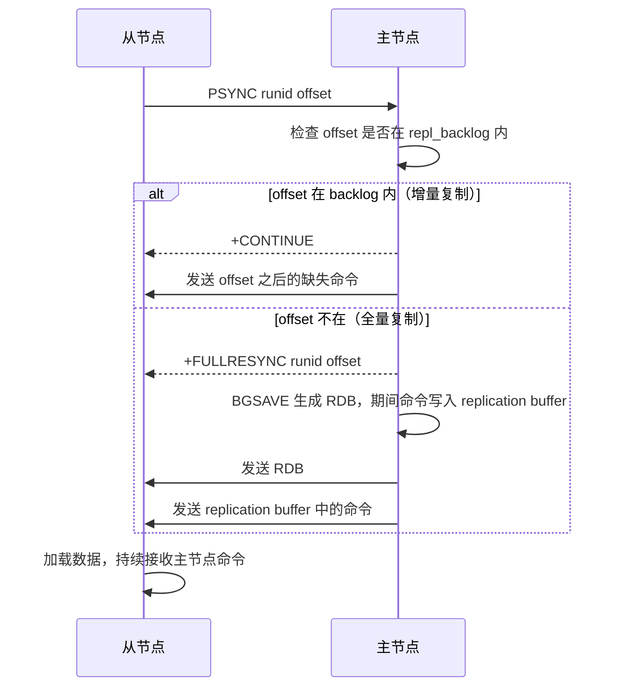
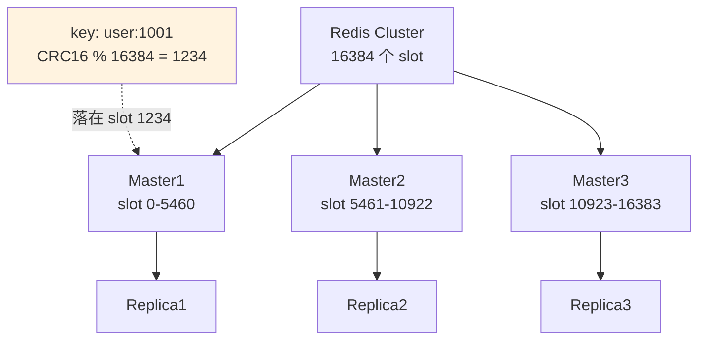

# Redis持久化与集群

> 定位：Redis 单进程内存数据库，宕机即丢数据。持久化解决「数据能不能保住」，主从/哨兵/Cluster 解决「服务能不能不中断」。这两件事是 Redis 高可用的地基，也是线上故障（数据丢失、脑裂、切换后雪崩）的高发区。

## 一、为什么需要持久化和集群

先分清两个问题，别混为一谈：

- **持久化**：Redis 是内存库，进程一挂内存数据全没。RDB/AOF 是把数据落到磁盘的手段，决定了「宕机最多丢多少数据」。
- **集群/高可用**：单机有单点故障、内存容量和吞吐上限。主从复制提供数据冗余和读写分离，哨兵提供自动故障转移，Cluster 提供水平分片。

真实故障链往往是：**主库宕机 → 异步复制丢数据 → 哨兵切主 → 客户端还连旧主 → 数据写错/读到旧值**。这一篇把每个环节讲清楚。

## 二、持久化：RDB 与 AOF

### 2.1 RDB：某一时刻的快照

RDB（Redis Database）是**某个时间点的全量二进制快照**，文件紧凑、加载快，适合备份和灾难恢复。

触发方式：

| 方式 | 命令/配置 | 特点 |
|---|---|---|
| 手动阻塞式 | `SAVE` | 主线程执行，**阻塞所有请求，生产禁用** |
| 手动后台式 | `BGSAVE` | fork 子进程写盘，主线程继续服务 |
| 自动 | `save 900 1` / `save 300 10` / `save 60 10000` | 满足「N 秒内 M 次修改」自动 BGSAVE |
| 关闭服务 | `SHUTDOWN` / `FLUSHALL` 等 | 触发保存（视配置） |

**BGSAVE 依赖 fork + 写时复制（Copy-On-Write）**：fork 出的子进程和主进程共享内存页，主进程写数据时才复制被改的页。所以在 BGSAVE 期间，写入越多，复制的页越多，**内存占用会上涨**——这是「RDB 时内存告警」的原因。

RDB 的取舍：

- 优点：文件小、恢复快、fork 子进程不阻塞主线程、适合做冷备
- 缺点：**有数据丢失窗口**（两次快照之间的写入全丢）；fork 大内存实例时可能卡顿（fork 本身耗时随内存增大）

### 2.2 AOF：只追加写命令日志

AOF（Append Only File）把每条**写命令**以协议格式追加到文件末尾。恢复时重放命令重建数据。

核心配置 `appendfsync` 决定刷盘策略（这是数据安全与性能的权衡核心）：

| 策略 | 行为 | 最多丢失 | 性能 |
|---|---|---|---|
| `always` | 每个写命令都 fsync 到磁盘 | 0（最多丢一条） | 最慢 |
| `everysec`（默认） | 每秒 fsync 一次 | **1 秒数据** | 较快，推荐 |
| `no` | 交给操作系统决定何时 fsync | 不可控，可能很多 | 最快 |

**AOF 重写（rewrite）**：AOF 文件会越来越大（同一个 key 被改 100 次就记 100 条），`BGREWRITEAOF` 会 fork 子进程，把当前数据快照**逆向生成**最小命令集写入新 AOF，替换旧文件。触发配置：`auto-aof-rewrite-percentage 100`（比上次重写后大 100%）、`auto-aof-rewrite-min-size 64mb`。

AOF 的取舍：

- 优点：数据丢失少（everysec 最多 1 秒）、文件格式易懂、可误删恢复（编辑 AOF 删掉 FLUSHALL 再重放）
- 缺点：文件比 RDB 大、**恢复比 RDB 慢**、everysec 下仍可能丢 1 秒

### 2.3 混合持久化

Redis 4.0 引入 `aof-use-rdb-preamble yes`（默认开启），AOF 重写时：

```
AOF 文件 = [RDB 格式的全量数据] + [RDB 之后的增量 AOF 命令]
```



这张图的关键是：混合持久化让**文件前半段是紧凑的 RDB（恢复快），后半段是增量 AOF（丢数据少）**，兼顾两者优点。恢复时先加载 RDB 部分，再重放增量命令。

### 2.4 怎么选

| 场景 | 建议 |
|---|---|
| 纯缓存，数据可丢 | 可关持久化，追求性能 |
| 允许丢几分钟，重视恢复速度 | 只开 RDB |
| 不能丢数据（如分布式锁、计数器） | RDB + AOF 混合持久化，`appendfsync everysec` |
| 极致数据安全（金融） | AOF `always`，接受性能损失 |

## 三、主从复制

单主扛不住读压力和数据安全，加从节点做冗余和读写分离。

### 3.1 全量复制与增量复制

复制的核心是 `PSYNC` 命令，分两种：

**全量复制**（首次连接或 offset 不在 backlog 内）：

1. 从节点发送 `PSYNC ? -1`
2. 主节点执行 BGSAVE 生成 RDB，同时把期间的写命令存入 **replication buffer**
3. 主节点把 RDB 发给从节点，从节点清空旧数据加载 RDB
4. 主节点把 replication buffer 里的命令发给从节点追平

**增量复制**（网络闪断重连后）：

1. 从节点发送 `PSYNC <runid> <offset>`
2. 主节点检查 offset 是否在 **repl_backlog_buffer**（复制积压缓冲区，环形，默认 1MB）内
3. 在则发送「从 offset 开始」的缺失命令；不在则退回全量复制



这张图揭示了 Network 抖动后的关键风险：**repl_backlog 太小，断线重连就来不及增量复制，被迫全量复制**，大内存实例全量复制代价很高。所以生产要按断线时长和写入速率调大 `repl-backlog-size`（如 100MB）。

### 3.2 异步复制的代价

Redis 主从复制是**异步**的：主节点写完就返回客户端，再异步发给从节点。这带来两个经典问题：

- **数据丢失**：主库写入后未同步到从库就宕机，切换后这部分数据丢了
- **数据不一致**：网络分区时主从数据分叉

`min-replicas-to-write` 和 `min-replicas-max-lag` 可以让主库在「从库太少或延迟太大」时拒绝写入，用可用性换一致性——金融场景值得开。

## 四、哨兵 Sentinel：自动故障转移

哨兵是独立的分布式进程，监控主从节点，主库挂了自动选新主并通知客户端。

**故障发现的两级判断**：

- **主观下线（SDOWN）**：单个哨兵 30 秒内（默认 `down-after-milliseconds`）没收到主库有效回复，认为它挂了——可能误判
- **客观下线（ODOWN）**：超过 `quorum` 个哨兵都认为主库下线，才确定故障——避免单个哨兵误判

确定 ODOWN 后，哨兵们**选举一个 leader**（Raft 类似算法），由 leader 执行故障转移：选一个从库 → 提升为主库 → 让其他从库指向新主 → 通知客户端。

关键参数与原则：

- 哨兵部署**至少 3 个且为奇数**（满足过半选举、防脑裂）
- `quorum` 一般设为哨兵数的一半+1
- **脑裂**：主库假死（网络隔离但进程还在）时，哨兵切了新主，旧主恢复后仍有客户端写入。缓解：`min-replicas-to-write` + `min-replicas-max-lag`
- 客户端要用**哨兵感知**的连接方式（如 Lettuce/Jedis 的 Sentinel 配置），能从哨兵订阅新主地址

## 五、Redis Cluster：水平分片

数据量超单机内存、吞吐超单机上限时，用 Cluster 分片。

**槽位（slot）机制**：整个键空间划分为 **16384 个槽**，每个 key 通过 `CRC16(key) % 16384` 映射到槽，每个 master 节点负责一部分槽。



**请求重定向**：客户端可能连错节点，Cluster 用两种重定向纠正：

| 重定向 | 含义 | 客户端动作 |
|---|---|---|
| `MOVED <slot> <ip:port>` | 槽已**永久**迁移到新节点 | 更新本地 slot→node 缓存，直接连新节点 |
| `ASK <slot> <ip:port>` | 槽正在**迁移中**（临时） | 临时连目标节点查一次，**不更新缓存**（下次还问原节点） |

节点间用 **Gossip 协议**交换状态，故障检测也是通过多数 master 投票完成，从节点被提升为新主。

**使用限制**：

- 只支持 **db0**
- **多 key 操作必须在同一 slot**，否则报 `CROSSSLOT`。用 **hash tag** `{}` 强制同槽：`user:{1001}:name` 和 `user:{1001}:age` 按 `1001` 计算槽
- 客户端必须支持 Cluster 协议（ smart client 缓存 slot 映射），老客户端需要代理

## 六、生产坑点与排查

### 坑点 1：复制积压缓冲区太小导致频繁全量同步

**现象**：网络抖一下，监控看到 `sync_full` 计数器猛增，随后 Redis 内存和 CPU 飙升，业务变慢。
**原因**：`repl-backlog-size` 默认只有 1MB，断线期间写入超过它就放不下，重连只能全量复制。
**解法**：按「最大断线时长 × 写入速率」估算，如断线 5 分钟、每秒 1MB，至少设 300MB：`repl-backlog-size 300mb`。

### 坑点 2：主库内存过大导致 fork 阻塞

**现象**：RDB/AOF 重写时，主库出现秒级卡顿，客户端超时。
**原因**：fork 大内存实例（如 20GB）耗时随内存增大，且 fork 瞬间要复制页表。
**解法**：
- 单实例内存控制在 10GB 以内，用 Cluster 分片
- 关闭 THP（透明大页）：`echo never > /sys/kernel/mm/transparent_hugepage/enabled`
- 在从节点上做持久化，主节点关闭（代价是切换后要重新做）
- 用 `INFO stats` 的 `latest_fork_usec` 监控 fork 耗时

### 坑点 3：Cluster 跨 slot 报 CROSSSLOT

**现象**：业务用 `MGET key1 key2` 或 Lua 脚本操作多个 key，报 `CROSSSLOT Keys in request don't hash to the same slot`。
**原因**：多个 key 计算出的槽不同，不在同一节点。
**解法**：用 hash tag `{}` 把相关 key 圈到同一槽；或者客户端拆分命令分别执行；批量操作用 `{}` 设计好 key 结构。

### 坑点 4：主从切换后数据丢失 + 客户端连旧主

**现象**：故障转移后，发现切换前几秒的写数据没了，或有客户端还在往旧主写。
**原因**：异步复制丢数据 + 客户端没刷新拓扑 + 旧主假死未隔离。
**解法**：
- 开 `min-replicas-to-write 1` + `min-replicas-max-lag 10`，旧主延迟大时拒写
- 客户端用支持自动刷新拓扑的连接池（Lettuce）
- 哨兵 quorum 过半防脑裂，切换后确认旧主已降为从

## 七、调优与选型

| 维度 | 建议 |
|---|---|
| 持久化 | 混合持久化（RDB 前段 + AOF 后段）+ `everysec`，平衡安全与恢复速度 |
| 内存 | 单实例 ≤10GB，避免 fork 卡顿；留 30%-40% 空闲内存应对 COW |
| 复制 | `repl-backlog-size` 按断线时长调大；读写分离注意延迟 |
| 哨兵 | ≥3 奇数节点，跨机房/机架部署，`quorum` 设过半 |
| Cluster | ≥3 主 3 从；相关 key 用 hash tag；客户端用 smart client |
| 监控 | `INFO persistence`、`INFO replication`、`latest_fork_usec`、`sync_full`、主从延迟 `master_repl_offset` 差值 |

## 八、面试高频问法

> 这一节的答案按「面试时能讲透」的标准写：先给一句结论，再展开机制、原因和坑点。建议先自己答一遍，再对照补全。

**Q1：RDB 和 AOF 的区别？生产怎么选？**

**一句话结论**：RDB 是某时刻全量二进制快照，文件紧凑、恢复快，但有丢数据窗口；AOF 追加写命令、丢失少（everysec 最多 1 秒）但文件大、恢复慢；生产用混合持久化取长补短。

先讲清取舍：

| 维度 | RDB | AOF |
|---|---|---|
| 内容 | 某时刻全量快照 | 写命令日志 |
| 文件大小 | 紧凑、小 | 大 |
| 恢复速度 | 快 | 慢（重放命令） |
| 数据安全 | 有丢失窗口 | everysec 最多丢 1 秒 |
| 触发 | SAVE/BGSAVE/自动 save | appendfsync 策略 |

选型建议：

- 纯缓存、数据可丢 → 可关持久化追性能
- 允许丢几分钟、重视恢复速度 → 只开 RDB
- 不能丢数据（分布式锁、计数器）→ 混合持久化 + `appendfsync everysec`
- 极致数据安全（金融）→ AOF `always`，接受性能损失

加分点：一句「生产几乎都用混合持久化 + everysec，兼顾恢复速度和丢数据少」——直接给出可落地的默认答案。

**Q2：BGSAVE 的原理？为什么期间内存会上涨？**

**一句话结论**：BGSAVE 靠 fork 子进程 + 写时复制（COW）写盘，主线程继续服务；期间主进程写入会复制被改的内存页，导致内存上涨。

展开：

- `SAVE` 在主线程执行、阻塞所有请求，生产禁用；`BGSAVE` 则 fork 一个子进程去写 RDB。
- fork 后父子进程**共享内存页**，主进程写数据时才复制被改的页（Copy-On-Write）。所以 BGSAVE 期间写入越多、复制的页越多，内存占用越大——这就是「RDB 时内存告警」的根因，必须预留空闲内存（建议留 30%-40%）。
- fork 本身耗时随内存增大，大内存实例（如 20GB）fork 会秒级卡顿。用 `INFO stats` 的 `latest_fork_usec` 监控 fork 耗时。

加分点：给出组合解法——「单实例控制在 10GB 内、关闭 THP（`echo never > /sys/kernel/mm/transparent_hugepage/enabled`）、或把持久化放到从节点做」。这是生产标准动作。

**Q3：AOF 重写（rewrite）是怎么回事？为什么能减小文件？**

**一句话结论**：AOF 重写把当前数据逆向生成最小命令集替换旧文件来瘦身，由 BGREWRITEAOF fork 子进程执行，靠 `auto-aof-rewrite-percentage/min-size` 触发。

展开：

- **问题**：AOF 只追加，同一个 key 改 100 次就记 100 条，文件不断膨胀。
- **重写原理**：fork 子进程读取当前数据库状态，生成重建这些数据所需的**最小命令集**（如 counter 被 INCR 了 100 次，重写后直接一条 `SET counter 100`），写入临时文件再原子替换旧文件。
- 重写期间的新写命令进入 `aof_rewrite_buf`，最后追加到新 AOF，保证重写期间不丢数据。
- **触发配置**：`auto-aof-rewrite-percentage 100`（比上次重写后大 100%）、`auto-aof-rewrite-min-size 64mb`。

加分点：点出「重写也是 fork + COW，所以同样有 fork 卡顿和内存上涨问题，和 BGSAVE 一脉相承」——把两个看似独立的机制串成一条线。

**Q4：appendfsync 的三种策略？最多丢多少数据？**

**一句话结论**：`always` 每条命令 fsync、最多丢一条、最慢；`everysec`（默认）每秒 fsync、最多丢 1 秒、最推荐；`no` 交给操作系统、不可控、最快。

| 策略 | 行为 | 最多丢失 | 性能 |
|---|---|---|---|
| `always` | 每个写命令都 fsync | 最多丢一条 | 最慢 |
| `everysec`（默认） | 每秒 fsync 一次 | 1 秒数据 | 较快，推荐 |
| `no` | 由 OS 决定何时 fsync | 不可控，可能很多 | 最快 |

要点：`appendfsync` 是数据安全与性能的权衡核心，这里的 fsync 指把 aof_buf 刷到磁盘的动作。`everysec` 是绝大多数场景的平衡点。

加分点：说清「everysec 下宕机最多丢 1 秒，是『可能丢』而非必丢；要真正 0 丢失得 `always` + 同步复制 + 同步刷盘，并接受性能损失」——避免把「最多丢 1 秒」说成「一定丢 1 秒」。

**Q5：什么是混合持久化？为什么能兼顾 RDB 和 AOF 的优点？**

**一句话结论**：Redis 4.0+ 的混合持久化让 AOF 文件 = RDB 格式全量数据 + 之后的增量 AOF 命令，前半段恢复快、后半段丢数据少。

展开：

- 配置 `aof-use-rdb-preamble yes`（默认开启）。
- **重写时**：子进程把当前数据以 RDB 格式写入新 AOF 文件的**前半部分**；重写期间的写命令以 AOF 格式追加到**后半部分**。
- **恢复时**：先加载 RDB 部分（快），再重放增量 AOF 命令（丢数据少）。
- 结果是同时拿到 RDB 的「恢复快」和 AOF 的「丢失少」。

加分点：能说出「AOF 文件前半 RDB、后半 AOF」的具体结构，并点明这是 4.0 引入的特性——体现版本意识，面试官爱听。

**Q6：主从复制的全量和增量怎么区分？repl_backlog 的作用？**

**一句话结论**：靠 PSYNC 命令——首次连接或 offset 不在 backlog 内走全量复制（BGSAVE 的 RDB + buffer 命令）；offset 还在 backlog 内走增量复制，只发缺失命令。

展开：

- **全量复制**：从节点发 `PSYNC ? -1` → 主节点 BGSAVE 生成 RDB，期间写命令进 `replication buffer` → 把 RDB 发给从节点 → 再把 buffer 中命令发给从节点追平。
- **增量复制**：从节点发 `PSYNC <runid> <offset>` → 主节点检查 offset 是否在 `repl_backlog_buffer`（环形复制积压缓冲区，默认 1MB）内 → 在就发 offset 之后的缺失命令，不在就退回全量。
- **repl_backlog 的作用**：正是为了支持断线重连后的增量复制，避免动不动就全量。

加分点：结合生产——「backlog 默认 1MB 太小，网络抖一下就全量复制，大内存实例代价很高。按『最大断线时长 × 写入速率』估算，如断线 5 分钟、每秒 1MB，设 `repl-backlog-size 300mb`，并监控 `sync_full` 计数器」。

**Q7：主从异步复制有什么代价？min-replicas-to-write 怎么用？**

**一句话结论**：Redis 主从是异步复制，主库写完立即返回、再异步发给从库，带来数据丢失和数据不一致两个风险；`min-replicas-to-write` 用可用性换一致性。

展开：

- **数据丢失**：主库写入后还没同步到从库就宕机，切换后这部分数据丢了。
- **数据不一致**：网络分区时主从数据分叉。
- **缓解**：`min-replicas-to-write 1` + `min-replicas-max-lag 10`，要求至少有 1 个从库且延迟不超过 10 秒，否则主库**拒绝写入**。这样旧主假死或延迟过大时无法写入，从源头减少数据丢失。

加分点：说清这是「用可用性换一致性（CAP 的取舍）」——金融场景值得开，普通业务要权衡写入可用性下降的代价。

**Q8：哨兵怎么发现故障并完成切换？SDOWN 和 ODOWN 的区别？**

**一句话结论**：哨兵用两级判断发现故障——SDOWN（单个主观下线）→ ODOWN（quorum 个哨兵确认客观下线）→ 选举 leader 执行故障转移。

展开：

- **主观下线 SDOWN**：单个哨兵在 `down-after-milliseconds`（默认 30 秒）内没收到主库有效回复，认为它挂了——可能误判。
- **客观下线 ODOWN**：超过 `quorum` 个哨兵都认为下线，才真正确认故障——避免单哨兵误判。
- **选举 leader**（类 Raft 算法）：由 leader 执行转移——选一个从库 → 提升为主 → 让其他从库指向新主 → 通知客户端。
- **部署原则**：至少 3 个且为奇数，`quorum` 一般设为哨兵数的一半 +1，跨机房/机架部署。

加分点：强调「客户端必须用哨兵感知的连接方式（如 Lettuce/Jedis 的 Sentinel 配置），能从哨兵订阅新主地址」——否则切主后客户端还连旧主，这是真实生产事故。

**Q9：什么是脑裂？怎么缓解？**

**一句话结论**：脑裂是主库假死（网络隔离但进程还在）时哨兵切了新主、旧主恢复后仍接受写入，导致新旧主并存、数据写错；用 `min-replicas` 参数 + 过半 quorum 缓解。

展开：

- **场景**：主库被网络隔离但进程存活，哨兵判定它挂了并切了新主；旧主其实还在跑，部分客户端继续往旧主写；网络恢复后旧主被降为从，但期间写到旧主的数据丢失或与新主冲突。
- **缓解手段**：
  - `min-replicas-to-write 1` + `min-replicas-max-lag 10`：旧主假死时连不上从库、延迟超标就拒写，从源头减少脏写。
  - 哨兵 quorum 过半，只有多数派确认才切换。
  - 切换后用 `INFO replication` 确认旧主已降为从。

加分点：点出「异步复制丢数据 + 脑裂是 Redis 高可用丢数据的两大根源，本质都是 CAP 下的取舍」——体现体系化认知。

**Q10：Redis Cluster 的 slot 机制？为什么是 16384 个槽？**

**一句话结论**：Cluster 把键空间划成 16384 个槽，key 经 `CRC16(key) % 16384` 映射到槽、每个 master 负责一部分槽；16384 是作者权衡心跳带宽与管理成本后的选择。

展开：

- **映射公式**：`slot = CRC16(key) % 16384`。CRC16 结果本是 16 位（65536 种），但 Redis 选了 16384。
- **为什么 16384**（作者 antirez 的解释）：①节点间心跳要携带各自负责的槽位信息，用 bitmap 表示，16384 个槽只需 16384/8 = **2KB**，若用 65536 则要 8KB，节点多时心跳带宽开销显著；②一般集群节点数不超过 1000，16384 个槽足够均匀分配，迁移和管理成本可控。
- 每个 master 负责一段槽（如 0-5460），从节点复制对应主节点。

加分点：能说出「2KB vs 8KB 的心跳 bitmap 带宽差异」这个具体数字，说明你了解 Cluster 的底层实现，而不是死记 16384。

**Q11：MOVED 和 ASK 重定向有什么区别？**

**一句话结论**：MOVED 表示槽已**永久**迁移到新节点，客户端更新本地缓存后直连新节点；ASK 表示槽**正在迁移中**，客户端临时连目标节点查一次、不更新缓存。

| 重定向 | 含义 | 客户端动作 |
|---|---|---|
| `MOVED <slot> <ip:port>` | 槽永久迁移 | 更新本地 slot→node 缓存，直连新节点 |
| `ASK <slot> <ip:port>` | 槽迁移中（临时） | 临时连目标节点查一次，**不更新缓存**，下次还问原节点 |

要点：

- smart client（Lettuce/Jedis Cluster）会缓存 slot→node 映射，收到 MOVED 就刷新映射。
- ASK 不更新缓存，是因为槽还没迁移完，下次这个槽可能还在原节点，贸然更新会路由错误。
- 迁移过程中，单个 key 先走 ASK，等整槽迁完再统一 MOVED。

加分点：一句话总结「MOVED 改映射、ASK 不改映射」——这是最容易记混的点，面试官很吃这个对比。

**Q12：Redis Cluster 有哪些限制？多 key 操作怎么办？**

**一句话结论**：Cluster 只支持 db0、多 key 操作必须在同一槽否则报 CROSSSLOT；解决办法是用 hash tag `{}` 把相关 key 圈到同一槽。

展开：

- **限制**：
  - 只支持 **db0**（SELECT 不可用）。
  - 多 key 操作（MGET、Lua 脚本、事务）必须在同一槽，否则报 `CROSSSLOT Keys in request don't hash to the same slot`。
  - 客户端必须支持 Cluster 协议（smart client 缓存 slot 映射），老客户端需要代理。
- **hash tag**：key 里含 `{}` 时只用括号内内容算槽。如 `user:{1001}:name` 和 `user:{1001}:age` 都按 `1001` 算槽、落同一节点，就能 MGET。
- 节点间用 **Gossip 协议**交换状态，故障检测靠多数 master 投票，从节点被提升为新主。

加分点：提醒「hash tag 虽解决多 key，但把大量 key 圈到同一槽会造成数据倾斜和热点，要控制被 tagged 的数据量」——这是生产经验的体现。

## 小结

- 持久化：RDB 快照（紧凑快、有丢失窗口）+ AOF 日志（丢失少、文件大），混合持久化取长补短。
- `appendfsync everysec` 是最常用的平衡点，最多丢 1 秒。
- BGSAVE/AOF 重写靠 fork+COW，大内存实例 fork 卡顿，单实例控制在 10GB 内。
- 主从异步复制 → 数据丢失风险；repl_backlog 太小 → 频繁全量同步。
- 哨兵 ≥3 奇数过半防脑裂；Cluster 16384 槽 + MOVED/ASK 重定向，多 key 用 `{}` hash tag。
