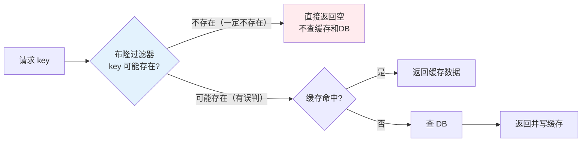
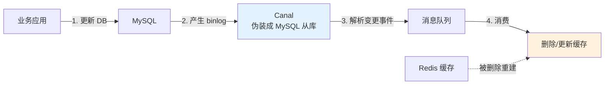

# 缓存三大问题与一致性

> 定位：引入缓存就是「用一致性换性能」，但换不好会连性能都保不住——穿透、击穿、雪崩任何一个都能把数据库打挂。这篇讲清三大问题的成因与对策，以及「缓存与数据库双写一致性」这个面试与生产的双重难点，给出可落地的组合方案。

## 一、为什么缓存会出问题

缓存的本质是「用更快的存储挡在数据库前面」。一旦这个「挡」失效：

- 请求绕过缓存直接打到 DB → DB 被压垮 → 整个服务雪崩
- 缓存和 DB 的数据对不上 → 用户读到脏数据

三大问题是按「失效原因」区分的，不要混：

| 问题 | 触发条件 | 后果 | 关键词 |
|---|---|---|---|
| 穿透 | 查**根本不存在**的数据 | 每次都打到 DB | 无中生有 |
| 击穿 | **单个热点 key** 过期 | 瞬间大量并发打到 DB | 单点爆点 |
| 雪崩 | **大量 key 同时**过期或 Redis 宕机 | DB 瞬时压力暴涨 | 批量崩盘 |

## 二、缓存穿透：查不存在的数据

### 2.1 成因

请求一个 DB 里也不存在的 key（如 id=-1、不存在的订单号）。缓存没有 → 查 DB → DB 也没有 → 不写缓存 → **下次同样请求又穿透**。恶意攻击时伪造大量不存在的 key，能把 DB 打挂。

### 2.2 两种主流解法

**方案一：缓存空值（空对象）**

DB 查不到时也写一个空值到缓存，但设**较短 TTL**（如 60 秒）：

```
GET user:-1 → nil → 查 DB → 没有 → SET user:-1 "" EX 60
```

- 优点：实现简单
- 缺点：空值占内存；短时间内的真实数据写入可能读不到空值（TTL 内不一致）

**方案二：布隆过滤器（Bloom Filter）**

在缓存前加一层布隆过滤器，预先把所有可能存在的 key 哈希到位图中。请求时先问布隆过滤器：



这张图的关键是布隆过滤器的语义：**说「不存在」一定不存在（可放心拦截），说「存在」可能误判（仍要走正常流程）**。所以它能挡住绝大部分穿透请求。

布隆过滤器原理：k 个哈希函数把 key 映射到位数组的 k 个位置并置 1。查询时 k 个位置都为 1 才说「可能存在」。

- 误判率由位数组大小 m、哈希函数个数 k、预期元素数 n 决定
- 1000 万元素、1% 误判率大约需要 ~10MB 位图
- 删除困难（置 1 的位置可能被多个 key 共享）→ 用计数布隆过滤器或定期重建
- Redis 4.0+ 有 RedisBloom 模块，也可用本地 Guava BloomFilter

**选型**：空值简单、适合 key 空间有限的场景；布隆过滤器适合 key 海量、恶意攻击防护，但有误判和维护成本。生产常**两者结合**。

## 三、缓存击穿：热点 key 过期

### 2.3 成因

一个被高并发访问的热点 key 到期瞬间，所有请求同时发现缓存 miss，一起涌向 DB。和穿透的区别是：**这个 key 在 DB 里是存在的**，只是缓存那一刻空了。

### 2.4 两种解法

**方案一：互斥锁（mutex / singleflight）**

只允许一个线程重建缓存，其他线程等待后读缓存：

```java
// 伪代码
String value = redis.get(key);
if (value == null) {
    if (redis.setnx("lock:" + key, "1", 30)) {  // 抢到锁
        try {
            value = db.query(key);
            redis.setex(key, 3600, value);
        } finally {
            redis.del("lock:" + key);
        }
    } else {
        Thread.sleep(100);
        return get(key);  // 重试
    }
}
return value;
```

- 优点：强一致，DB 只被一个请求打到
- 缺点：互斥锁有性能损耗，等待线程可能超时；锁要设过期时间防死锁

Redisson 的 `RLock`、Guava 的 `LoadingCache`（singleflight）都封装好了这套逻辑。

**方案二：逻辑过期（不设物理 TTL）**

**不给缓存设过期时间**，而是在 value 里存一个逻辑过期时间字段：

```json
{ "data": {...}, "expireAt": 1730000000000 }
```

读线程发现逻辑过期 → 抢锁 → **开异步线程**去重建缓存 → 当前线程**直接返回旧数据**（不阻塞）。

| 对比 | 互斥锁 | 逻辑过期 |
|---|---|---|
| 一致性 | 强一致，读到最新 | 弱一致，重建期间读旧值 |
| 性能 | 其他线程阻塞等待 | 不阻塞，体验好 |
| 适用 | 不能接受脏数据（金融） | 可用性优先（商品详情、首页） |

## 四、缓存雪崩：大面积失效

### 4.1 成因

两种触发方式：

1. **大量 key 同一时刻过期**（如批量导入时设了相同 TTL）——某一刻所有请求穿透到 DB
2. **Redis 实例宕机**——所有缓存请求全部失败

### 4.2 对策

| 对策 | 做法 | 防哪种 |
|---|---|---|
| TTL 打散 | 在基础 TTL 上加随机值，如 `3600 + random(0,300)` 秒 | 批量过期 |
| 多级缓存 | 本地缓存（Caffeine）+ Redis，Redis 挂了本地还能挡一阵 | Redis 宕机 |
| 熔断降级 | Hystrix/Sentinel 限流降级，DB 扛不住时返回兜底 | 两种情况 |
| Redis 高可用 | 主从+哨兵或 Cluster，避免单点 | Redis 宕机 |
| 互斥重建 | 同击穿的锁方案，控制并发重建 | 批量过期 |

> 实践：TTL 打散是最低成本、最高收益的手段，**任何批量写缓存的地方都应该加随机抖动**。多级缓存能显著提升系统韧性，但引入本地缓存的一致性问题要单独处理。

## 五、缓存更新策略与双写一致性

这是核心难点。先讲**四种缓存更新模式**，再讲一致性。

### 5.1 四种模式

| 模式 | 读流程 | 写流程 | 评价 |
|---|---|---|---|
| **Cache Aside**（旁路缓存） | 命中返回；miss 读 DB 后写缓存 | **更新 DB，删除缓存** | **最常用，推荐** |
| Read/Write Through | 应用只读缓存，缓存组件负责回源和写 DB | 应用写缓存，缓存同步写 DB | 一致性好，但要缓存组件支持 |
| Write Behind（Write Back） | 同上 | **只写缓存**，异步批量写 DB | 性能最高，但可能丢数据 |
| 先删缓存再更新 DB | — | 删缓存 → 更新 DB | **不推荐**，易脏数据 |

**为什么 Cache Aside 是「更新 DB 后再删缓存」，而不是「更新缓存」？**

1. **并发写导致脏数据**：线程 A 更新 DB 为 1，线程 B 更新 DB 为 2。若都「更新缓存」，A、B 写缓存的顺序可能和 DB 顺序不一致 → 缓存是旧值。**删缓存是幂等的**，删两次结果一样。
2. **计算成本**：有些缓存值是多表聚合算出来的，每次更新都重算写缓存代价高，删掉让它按需重建更划算。

### 5.2 Cache Aside 的两种经典竞态

**场景 A：先删缓存，再更新 DB（不推荐）**

```
线程A：删除缓存
线程B：读缓存 miss → 读 DB（旧值）→ 写缓存（旧值）
线程A：更新 DB（新值）
→ 缓存里是旧值，脏数据！
```

**场景 B：先更新 DB，再删缓存（推荐，但仍有极小概率）**

```
缓存刚好失效
线程A：读 DB（旧值），准备写缓存（还没写）
线程B：更新 DB（新值）→ 删除缓存
线程A：把旧值写入缓存
→ 缓存里是旧值，脏数据！
```

场景 B 概率极低，因为要满足「读 DB 慢于写 DB + 写缓存恰在删缓存之后」。但生产上量大了仍会遇到，于是有了下面的加强方案。

### 5.3 加强方案

**方案一：延迟双删**

```
删除缓存 → 更新 DB → sleep(N 毫秒) → 再次删除缓存
```

第二次删除清掉「线程 A 延迟写入的旧值」。sleep 时间要大于「读 DB + 写缓存」的耗时，通常几百毫秒，按业务压测调。缺点：sleep 阻塞线程，可用异步任务做第二次删。

**方案二：删除失败重试**

删缓存失败会导致脏数据。用**消息队列重试**：删失败就发一条消息，消费者重试删除；或订阅 binlog 兜底。

**方案三：监听 binlog（Canal）**

这是目前非常主流的**解耦方案**。流程：



这张图的关键：**业务代码只管更新 DB，缓存删除交给 Canal 异步做**。好处是：
- 业务与缓存解耦，不用在代码里到处写删缓存逻辑
- Canal 顺序消费 binlog，能保证删除顺序与 DB 更新顺序一致
- 消费失败可重试，可靠性高

代价：引入 Canal + MQ 组件，有**同步延迟**（毫秒级），短时间内可能读到旧缓存。适合对一致性要求「最终一致」的场景。

### 5.4 一致性等级怎么选

| 一致性要求 | 方案 |
|---|---|
| 强一致（不能有任何脏读） | 分布式锁串行化读写，或干脆不强依赖缓存（直接读 DB） |
| 最终一致（能容忍毫秒级脏读） | Cache Aside（先更新 DB 再删缓存）+ 重试 |
| 最终一致 + 解耦 | Canal 订阅 binlog 删缓存 |
| 写多读少、能容忍丢数据 | Write Behind |

> 大实话：**分布式场景下做不到完美的强一致**（CAP 限制）。面试要能说出「最终一致 + 兜底手段」，而不是幻想有一个银弹。

## 六、生产坑点与排查

### 坑点 1：批量导入设了相同 TTL 引发雪崩

**现象**：定时任务凌晨批量刷缓存后，某整点 DB 连接数瞬间打满，大量慢查询。
**原因**：批量写入的 key TTL 完全相同，同一时刻集体过期。
**解法**：TTL 加随机抖动 `baseTTL + random(0, 300)`；大批量用 `EXPIREAT` 错峰；刷缓存分批进行。

### 坑点 2：删缓存失败导致长期脏数据

**现象**：商品改价后，用户看到的价格长时间不对，重启应用或清缓存才恢复。
**原因**：更新 DB 成功，但删缓存那一步因网络抖动失败，没有重试。
**解法**：删缓存失败走 MQ 重试队列；或接 Canal 订阅 binlog 异步删；监控缓存删除失败率。

### 坑点 3：热点 key 击穿压垮 DB

**现象**：秒杀商品缓存过期瞬间，DB QPS 飙升到数万，接口大面积超时。
**原因**：热点 key 物理过期，海量并发同时回源。
**解法**：热点 key 用逻辑过期 + 异步重建；或永不过期、后台定时续期；加互斥锁 singleflight。

### 坑点 4：空值缓存导致新数据不可见

**现象**：用户注册后立即查询，查不到（返回空），几秒后才正常。
**原因**：之前查过这个不存在的用户名，缓存了空值，TTL 内新注册的数据被空值挡住。
**解法**：空值 TTL 设短（如 10-60 秒）；写操作主动删除对应空值 key；或用布隆过滤器替代空值缓存。

## 七、调优与最佳实践清单

1. **TTL 永远加随机抖动**，防批量过期。
2. **缓存更新首选 Cache Aside**：先更新 DB，再删缓存；删失败要重试。
3. **热点 key 特殊处理**：逻辑过期 or 互斥重建 or 永不过期+后台续期。
4. **防穿透组合拳**：空值缓存（短 TTL）+ 布隆过滤器。
5. **多级缓存**提升韧性：Caffeine（本地）+ Redis（分布式），本地缓存设置更短 TTL。
6. **可观测性**：监控缓存命中率、穿透量、慢查询、删除失败率、大 key。
7. **一致性兜底**：接受最终一致，用重试 + binlog 订阅收敛。

## 八、面试高频问法

> 这一节的答案按「面试时能讲透」的标准写：先给一句结论，再展开机制、原因和坑点。建议先自己答一遍，再对照补全。

**Q1：什么是缓存穿透、击穿、雪崩？分别怎么解决？**

**一句话结论**：三者按失效原因区分——穿透是查根本不存在的数据，击穿是单个热点 key 过期，雪崩是大量 key 同时过期或 Redis 宕机，对策完全不同。

必须先分清，别混为一谈：

| 问题 | 触发条件 | 后果 | 关键词 |
|---|---|---|---|
| 穿透 | 查**不存在**的数据 | 每次都打到 DB | 无中生有 |
| 击穿 | **单个热点 key** 过期 | 瞬间大量并发打到 DB | 单点爆点 |
| 雪崩 | **大量 key 同时**过期或 Redis 宕机 | DB 压力暴涨 | 批量崩盘 |

对策：

- **穿透**：缓存空值（短 TTL）+ 布隆过滤器。
- **击穿**：互斥锁（singleflight）或逻辑过期。
- **雪崩**：TTL 打散 + 多级缓存 + 熔断降级 + Redis 高可用。

加分点：开头就强调「三者是三个不同问题，根因和对策都不同」——很多候选人把它们混为一谈，一开口就暴露没想清楚。

**Q2：布隆过滤器的原理？误判率由什么决定？怎么删除？**

**一句话结论**：布隆过滤器用 k 个哈希函数把 key 映射到位数组的 k 个位置置 1；说「不存在」一定不存在、说「存在」可能误判；误判率由位数组大小 m、哈希数 k、元素数 n 决定。

展开：

- **原理**：写入时 k 个哈希函数把 key 映射到位数组的 k 个位置置 1；查询时 k 个位置都为 1 才说「可能存在」。所以「不存在」是绝对的（可放心拦截），「存在」有误判（仍走正常流程查缓存/DB）。
- **误判率**：由 m、k、n 共同决定。经验值——1000 万元素、1% 误判率约需 10MB 位图。
- **删除困难**：置 1 的位可能被多个 key 共享，直接置 0 会影响其他 key。解法是用**计数布隆过滤器**（每位改成计数器）或定期重建。
- **实现**：Redis 4.0+ 有 RedisBloom 模块，也可用本地 Guava BloomFilter。

加分点：点出「布隆过滤器适合 key 海量、防恶意攻击的场景；key 空间有限时缓存空值更简单，生产常两者结合」——体现选型思维。

**Q3：缓存空值有什么坑？新数据不可见怎么办？**

**一句话结论**：缓存空值能挡穿透，但空值占内存、且 TTL 内新写入的真实数据被空值挡住读不到；要设短 TTL、写操作主动删空值 key，或改用布隆过滤器。

展开：

- **做法**：DB 查不到时也写个空值到缓存，设较短 TTL，`GET user:-1` miss → 查 DB 没有 → `SET user:-1 "" EX 60`。
- **优点**：实现简单。
- **两个坑**：①空值大量堆积占内存（尤其被恶意伪造 key 攻击时）；②**新数据不可见**——之前查过不存在的用户名缓存了空值，用户注册后立即查询，TTL 内仍读到空值。
- **解法**：空值 TTL 设短（10-60 秒）；写操作成功后主动删除对应空值 key；或用布隆过滤器替代空值缓存，从源头不留空值。

加分点：说出「空值 key 建议加统一前缀并设较短 TTL，配合监控空值比例」——这是生产里防内存被空值挤爆的实用经验。

**Q4：缓存击穿怎么解决？互斥锁和逻辑过期怎么选？**

**一句话结论**：击穿是热点 key 过期瞬间海量并发回源；互斥锁（singleflight）强一致但阻塞等待，逻辑过期不阻塞、读旧值，按能不能接受脏数据来选。

展开两种方案：

- **互斥锁**：只让一个线程重建缓存，其他线程等待。伪代码：`SETNX lock:key` 抢到才查 DB 重建，没抢到 sleep 后重试。要设锁过期时间防死锁。优点是 DB 只被打一次、强一致；缺点是有性能损耗、等待线程可能超时。Redisson 的 RLock、Guava 的 LoadingCache 已封装。
- **逻辑过期**：不设物理 TTL，在 value 里存 `expireAt` 字段。发现逻辑过期就抢锁、**开异步线程重建**，当前线程**直接返回旧数据**不阻塞。

| 对比 | 互斥锁 | 逻辑过期 |
|---|---|---|
| 一致性 | 强一致，读最新 | 弱一致，重建期间读旧值 |
| 性能 | 其他线程阻塞等待 | 不阻塞，体验好 |
| 适用 | 不能脏读（金融） | 可用性优先（商品详情、首页） |

加分点：能说出「逻辑过期本质是拿一致性换可用性，是不阻塞用户体验的取舍」，并点出热点 key 还可「永不过期 + 后台定时续期」——方案讲全。

**Q5：缓存雪崩怎么防？TTL 打散具体怎么做？**

**一句话结论**：雪崩由大量 key 同时过期或 Redis 宕机引发；核心对策是 TTL 打散（基础 TTL + 随机值）、多级缓存、熔断降级、Redis 高可用。

展开：

- **TTL 打散**：在基础 TTL 上加随机值，如 `3600 + random(0,300)` 秒，让 key 分散过期。这是**成本最低、收益最高**的手段，任何批量写缓存的地方都该加随机抖动。也可用 `EXPIREAT` 错峰、分批刷新。
- **多级缓存**：本地缓存（Caffeine）+ Redis，Redis 挂了本地还能挡一阵。代价是引入本地缓存的一致性问题要单独处理。
- **熔断降级**：Sentinel/Hystrix 限流降级，DB 扛不住时返回兜底值。
- **Redis 高可用**：主从 + 哨兵或 Cluster，避免单点。

加分点：点出「TTL 打散是防雪崩的第一优先级，因为它一行代码就能消除『批量同时过期』这个最大诱因」——给出明确的优先级判断。

**Q6：有哪几种缓存更新模式？为什么 Cache Aside 最常用？**

**一句话结论**：四种模式里 Cache Aside（旁路缓存）最常用，因为实现简单、一致性可接受；Read/Write Through 要缓存组件支持，Write Back 可能丢数据，先删缓存再更新 DB 易脏数据。

| 模式 | 读流程 | 写流程 | 评价 |
|---|---|---|---|
| **Cache Aside** | 命中返回；miss 读 DB 写缓存 | 更新 DB，**删除缓存** | 最常用，推荐 |
| Read/Write Through | 只读缓存，缓存组件回源 | 写缓存，缓存同步写 DB | 一致性好，但要组件支持 |
| Write Behind | 同上 | 只写缓存，异步批量写 DB | 性能最高，可能丢数据 |
| 先删缓存再更新 DB | — | 删缓存 → 更新 DB | 不推荐，易脏数据 |

要点：Cache Aside 之所以主流，是因为它对缓存组件无特殊要求、逻辑在业务侧可控，且「删除缓存」比「更新缓存」更能规避并发脏数据（见 Q7）。

加分点：能说出「Write Behind 适合写多读少、能容忍丢数据的场景（如点赞计数），因为异步批量写 DB 性能最高」——体现对每种模式适用边界的理解。

**Q7：为什么是「先更新 DB 再删缓存」，而不是「更新缓存」？**

**一句话结论**：因为删缓存是幂等的，能避免并发写顺序错乱导致脏数据；同时删掉让缓存按需重建，省去复杂聚合计算。

展开两个理由：

1. **并发写导致脏数据**：线程 A 更新 DB 为 1，线程 B 更新 DB 为 2。如果都「更新缓存」，A、B 写缓存的顺序可能和写 DB 的顺序不一致（比如 B 先写缓存、A 后写），最终缓存是旧值 1。**删缓存是幂等的**，删两次结果一样，不会有顺序问题。
2. **计算成本**：有些缓存值是多表聚合算出来的，每次更新都重算写缓存代价高；删掉让它按需重建（读时才算）更划算。

加分点：强调「『删缓存幂等』是这个问题的题眼」——面试官就是要听你讲清楚并发写顺序这个本质原因，而不是背结论。

**Q8：Cache Aside 有哪两种经典竞态？**

**一句话结论**：先删缓存再更新 DB 会稳定产生脏数据；先更新 DB 再删缓存也有极小概率脏读，但概率极低，是推荐方案。

**场景 A：先删缓存，再更新 DB（不推荐）**：

```
线程A：删除缓存
线程B：读缓存 miss → 读 DB（旧值）→ 写缓存（旧值）
线程A：更新 DB（新值）
→ 缓存里是旧值，稳定脏数据！
```

这个竞态很容易触发，所以先删缓存是错的。

**场景 B：先更新 DB，再删缓存（推荐，仍有极小概率）**：

```
缓存刚好失效
线程A：读 DB（旧值），准备写缓存（还没写）
线程B：更新 DB（新值）→ 删除缓存
线程A：把旧值写入缓存
→ 缓存里是旧值，脏数据！
```

场景 B 要满足「读 DB 慢于写 DB + 写缓存恰在删缓存之后」，概率极低，但量大仍会遇到，于是需要延迟双删等加强方案（见 Q9）。

加分点：说清场景 B 概率极低的本质原因——「DB 的读通常比写快，且写缓存要在删缓存的狭小时间窗口内发生」，体现你对竞态条件的精确理解。

**Q9：延迟双删是怎么回事？sleep 时间怎么定？**

**一句话结论**：延迟双删是「删缓存 → 更新 DB → sleep(N 毫秒) → 再删一次缓存」，第二次删除清掉线程 A 延迟写入的旧值；sleep 要大于「读 DB + 写缓存」耗时，按压测定。

展开：

- **流程**：`删除缓存 → 更新 DB → sleep(N) → 再次删除缓存`。
- **作用**：针对 Q8 场景 B，第二次删除把「线程 A 在线程 B 删缓存之后才写入的旧值」清掉。
- **sleep 怎么定**：必须大于「读 DB + 写缓存」的总耗时，通常几百毫秒，按业务压测确定。太短清不掉旧值，太长影响吞吐。
- **缺点**：sleep 阻塞线程；生产可用异步任务（如线程池、MQ 延迟消息）做第二次删除，避免阻塞主流程。

加分点：主动指出「延迟双删是工程兜底、不是完美解——第二次删除也可能失败，所以还要配合删除失败重试」——不迷信单一方案。

**Q10：删缓存失败怎么办？怎么做重试和兜底？**

**一句话结论**：删缓存失败会导致长期脏数据；要用 MQ 重试队列或订阅 binlog 兜底，并监控删除失败率。

展开：

- **问题**：更新 DB 成功、删缓存那一步因网络抖动失败，没有重试 → 用户长时间读到旧值，重启或清缓存才恢复。
- **方案一：MQ 重试**：删缓存失败就发一条消息到重试队列，消费者重试删除；可设多次重试 + 死信队列。
- **方案二：订阅 binlog（Canal）**：把缓存删除交给 binlog 订阅异步做，天然带重试和顺序保证（见 Q11）。
- **可观测性**：监控缓存删除失败率，异常时告警。

加分点：说清「重试要保证幂等（删缓存本身就是幂等的，重复删无害），这是这个方案能成立的前提」——把 Q7 的「删缓存幂等」知识点复用过来。

**Q11：怎么用 Canal 保证缓存一致性？有什么代价？**

**一句话结论**：Canal 伪装成 MySQL 从库订阅 binlog，解析变更事件后异步删缓存；好处是业务解耦、顺序有保证、可重试，代价是组件增多、毫秒级延迟、只能最终一致。

展开流程：

```
业务应用 → 1.更新 DB → 2.产生 binlog → Canal（伪装从库）→ 3.解析变更 → MQ → 4.消费删缓存
```

好处：

- 业务代码只管更新 DB，不用到处写删缓存逻辑，彻底解耦。
- Canal 顺序消费 binlog，能保证删除顺序与 DB 更新顺序一致。
- 消费失败可重试，可靠性高。

代价：

- 引入 Canal + MQ，组件和运维复杂度上升。
- 有**同步延迟**（毫秒级），短时间内可能读到旧缓存。
- 只能做到**最终一致**，不是强一致。

加分点：点出「Canal 方案适合对一致性要求『最终一致 + 解耦』的场景；它和延迟双删不是互斥的，而是不同复杂度档位的选型」——体现架构权衡能力。

**Q12：分布式场景下能做到缓存与 DB 的强一致吗？一致性等级怎么选？**

**一句话结论**：分布式下做不到完美强一致（CAP 限制）；工程上追求「最终一致 + 兜底手段」，按业务对脏读的容忍度分档选型。

一致性等级选型表：

| 一致性要求 | 方案 |
|---|---|
| 强一致（不能有任何脏读） | 分布式锁串行化读写，或干脆不强依赖缓存、直接读 DB |
| 最终一致（容忍毫秒级脏读） | Cache Aside（先更新 DB 再删缓存）+ 删除失败重试 |
| 最终一致 + 解耦 | Canal 订阅 binlog 删缓存 |
| 写多读少、能容忍丢数据 | Write Behind |

要点：

- 追求强一致要付很大代价（分布式锁串行化会牺牲吞吐），多数业务不值得。
- 主流做法是「Cache Aside 打底 + 重试 + binlog 订阅兜底」，接受最终一致。

加分点：这句大实话一定要说——「分布式场景下没有缓存一致性的银弹，面试要能讲出『最终一致 + 兜底收敛』，而不是幻想一个完美方案」。这是面试官判断你是否成熟的分水岭。

## 小结

- 穿透（不存在）、击穿（单热点过期）、雪崩（批量过期/宕机）是三个不同问题，对策不同。
- 防穿透：空值短 TTL + 布隆过滤器；防击穿：互斥锁 or 逻辑过期；防雪崩：TTL 打散 + 多级缓存 + 熔断 + 高可用。
- 缓存更新首选 Cache Aside（先更新 DB 再删缓存），删除失败要重试。
- 加强一致性：延迟双删 / 删缓存重试 / Canal 订阅 binlog（最终一致）。
- 分布式强一致代价极高，工程上追求「最终一致 + 兜底收敛」，别迷信银弹。
