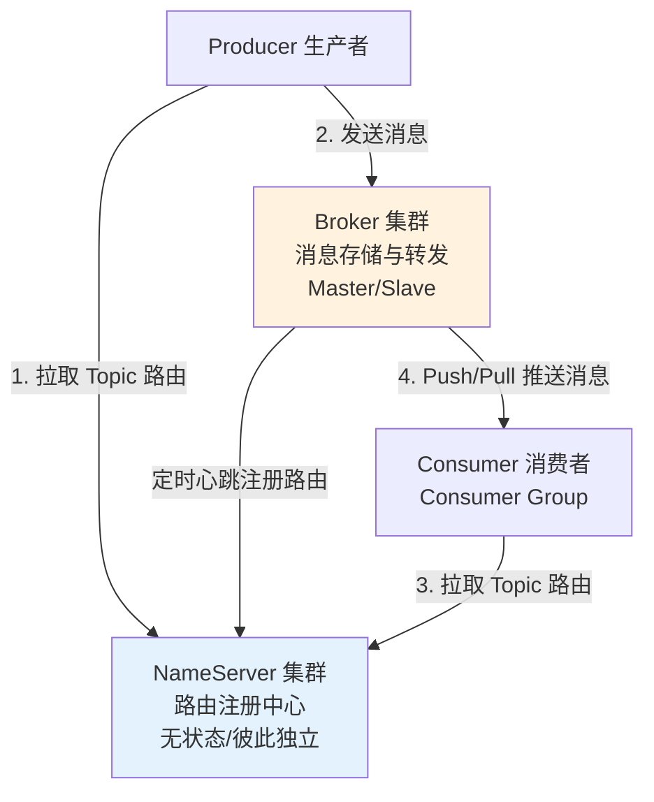
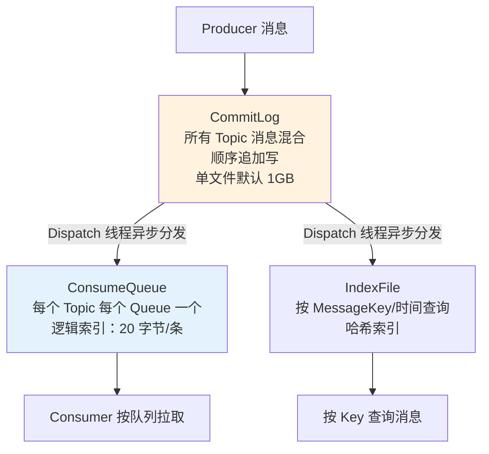
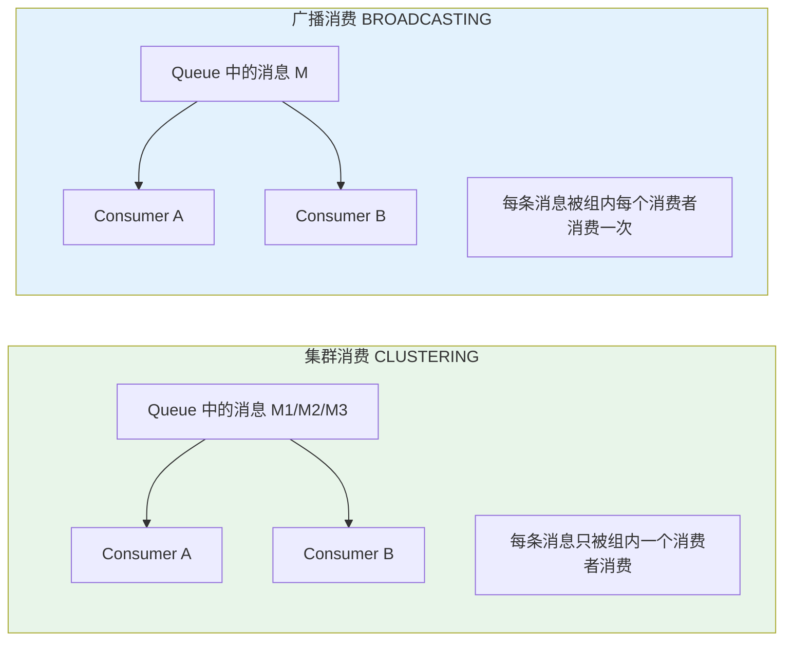

# RocketMQ架构与原理

> 定位：RocketMQ 是阿里开源、Apache 顶级的分布式消息中间件，事务消息、顺序消息、定时消息是它的招牌能力。这篇讲清「它由哪些角色组成、消息怎么落盘、怎么被消费」这条主线——理解了存储结构和消费模型，才能解释它的高吞吐从哪来、顺序和可靠怎么保证。

## 一、为什么需要消息队列与 RocketMQ

消息队列的三大作用：**削峰填谷、异步解耦、削峰**。RocketMQ 相比 Kafka 更偏业务场景（事务消息、顺序消息、定时消息），相比 RabbitMQ 吞吐更高。要读懂它的设计，得先看它的角色分工和存储模型。

## 二、架构角色



这张图要建立的整体认知：**NameServer 是「轻量路由表」，Broker 才是「干活的」**。Producer/Consumer 都先问 NameServer「Topic 在哪些 Broker 上」，再直接和 Broker 打交道。

### 2.1 NameServer：轻量服务发现

- 角色类似 Kafka 的 ZooKeeper，但**极其轻量**：每个 NameServer 独立，**相互之间不通信**，各自维护一份路由信息
- Broker 启动后向**所有** NameServer 注册，并每 30 秒心跳；NameServer 每 10 秒扫描，超过 120 秒没心跳就移除该 Broker
- Producer/Consumer 从任意 NameServer 拉取路由，本地缓存 + 定时更新
- **不持久化**路由数据，宕一台不影响整体（这也是它能保持简单的原因）

> 为什么不用 ZooKeeper？NameServer 不需要选主、不需要强一致，AP 足够。省掉 ZK 的复杂度和运维成本，是 RocketMQ 刻意做的减法。

### 2.2 Broker：消息存储与转发核心

Broker 是真正存消息、收发消息的节点：

- 接收 Producer 的消息并落盘
- 提供消息拉取给 Consumer
- 主从架构（Master/Slave）保证高可用：Master 可读写，Slave 一般只读（特定版本支持读）
- 每个 Broker 管理多个 Topic，每个 Topic 分多个 Queue

### 2.3 Topic / Queue / MessageQueue

这是 RocketMQ 并行的核心概念：

- **Topic**：逻辑上的消息分类（如 `OrderTopic`）
- **Queue（MessageQueue）**：Topic 的物理分区。一个 Topic 在多个 Broker 上，每个 Broker 上有多个队列（默认每个 Broker 4 读 4 写，以版本为准）
- **并行度由队列数决定**：Producer 往多个 Queue 并发写，Consumer Group 里多个 Consumer 各分几个 Queue 并发消费

> 关键认知：**队列数是 RocketMQ 并发能力的上限**。Topic 只有 1 个队列， consumer 起 100 个实例也只有 1 个在干活，其余闲置。

## 三、消息存储结构：CommitLog / ConsumeQueue / IndexFile

这是 RocketMQ 高性能的精髓——**混合存储 + 顺序写**。



这张图的核心是：**消息本体只写一份到 CommitLog，ConsumeQueue 和 IndexFile 只是索引**。这样既保证顺序写（快），又能按队列/按 Key 快速定位。

### 3.1 CommitLog

- **所有 Topic 的消息混合存储在一个（组）文件里**，消息顺序追加写（append），这是顺序 IO，吞吐极高
- 单文件默认 1GB，写满开新文件，文件名是起始偏移量（20 位补零）
- 每条消息包含：消息体 + 属性 + CRC 校验等

### 3.2 ConsumeQueue

- 每个 Topic 的每个 Queue 对应一个 ConsumeQueue 文件
- 每条索引**固定 20 字节**：`8 字节 CommitLog 物理偏移量 + 4 字节消息长度 + 8 字节 Tag 的 hashcode`
- Consumer 消费时先读 ConsumeQueue（小、顺序读），拿到偏移量再去 CommitLog 读消息本体

> 为什么这么设计？因为消息本体大小不一，直接按 Queue 存会变成随机写。把本体统一塞进 CommitLog 顺序写，再用定长的轻量索引指向它，兼顾了「写快」和「按队列读」。

### 3.3 IndexFile

- 用于**按 MessageKey 或时间范围查询消息**（如根据业务 ID 查消息）
- 采用哈希索引结构，存 key 的 hash → 消息在 CommitLog 的偏移量
- 是查询辅助，不影响主消费链路

## 四、刷盘机制与主从复制

### 4.1 刷盘：SYNC_FLUSH vs ASYNC_FLUSH

消息写入 CommitLog 时先进入 PageCache，再刷到磁盘：

| 策略 | 行为 | 可靠性 | 性能 |
|---|---|---|---|
| `SYNC_FLUSH`（同步刷盘） | 写入 PageCache 后**立即刷盘**，刷完才返回 ACK | 断电不丢 | 低（每次一次 fsync） |
| `ASYNC_FLUSH`（异步刷盘，默认） | 写入 PageCache 就返回，后台线程批量刷盘 | 宕机/断电可能丢少量 | 高 |

刷盘方式由 Broker 配置 `flushDiskType` 决定。**金融级用同步刷盘，一般业务用异步刷盘 + 主从冗余**。

### 4.2 主从复制

- Broker 配置 `brokerRole`：
  - `ASYNC_MASTER`：异步复制，主写成功就返回，从库异步追——性能高，主挂可能丢
  - `SYNC_MASTER`：同步复制，主从都写成功才返回——可靠但延迟高
  - `SLAVE`：从节点
- 常用组合：`SYNC_MASTER + SYNC_FLUSH`（最可靠）或 `ASYNC_MASTER + ASYNC_FLUSH`（最高性能）

## 五、消费模型

### 5.1 集群消费 vs 广播消费



- **集群消费（CLUSTERING，默认）**：同一个 Consumer Group 内，一条消息只被**一个**消费者消费——用于「分摊处理」
- **广播消费（BROADCASTING）**：一条消息被 Group 内**每个**消费者都消费一次——用于「每个实例都要感知」（如刷新本地缓存）

### 5.2 负载均衡与 Rebalance

- 一个 Consumer Group 里的多个消费者，通过 **Rebalance** 分配 Queue：
  - 默认 `AllocateMessageQueueAveragely`（平均分配）
  - 还有一致性哈希、机房分配等策略
- 分配规则：**一个 Queue 同一时刻只能被一个 Consumer 消费**（集群模式），所以消费者数 > 队列数时，多出的消费者闲置
- 消费者上下线时触发 Rebalance，重新分配 Queue
- 消费进度 offset 以 **Consumer Group + Queue** 为单位记录（广播模式存在各 Consumer 本地，集群模式存在 Broker）

### 5.3 顺序消息

- **全局顺序**：整个 Topic 只有一个 Queue，单 Producer 单线程发送——吞吐极低，很少用
- **分区顺序**（常用）：同一业务 ID（如订单 ID）的消息发到**同一个 Queue**，保证该业务内有序。用 `MessageQueueSelector` 按 ID 取模选队列

```java
SendResult result = producer.send(msg, new MessageQueueSelector() {
    public MessageQueue select(List<MessageQueue> mqs, Message msg, Object arg) {
        int id = (Integer) arg;
        return mqs.get(id % mqs.size());  // 同一 id 落到同一队列
    }
}, orderId);
```

消费端要**串行消费**用 `MessageListenerOrderly`（对同一 Queue 加锁顺序处理），而非并发的 `MessageListenerConcurrently`。

## 六、生产坑点与排查

### 坑点 1：队列数太少导致消费并行度上不去

**现象**：消费者从 2 个扩到 20 个，消费速度几乎没变，消息仍然堆积。
**原因**：Topic 队列数只有 2，集群模式下 18 个消费者闲置。
**解法**：按预期峰值吞吐量规划队列数（如 16/32），**队列数只能增不能减**（减会丢未消费消息），扩容前评估。

### 坑点 2：异步刷盘 + 异步复制断电丢消息

**现象**：机房断电恢复后，发现有少量消息丢失。
**原因**：`ASYNC_FLUSH + ASYNC_MASTER`，消息在 PageCache 还没刷盘/同步到从库就断电。
**解法**：重要业务改 `SYNC_FLUSH` 或 `SYNC_MASTER`；接受「性能换可靠」。用事务消息 + 本地事务表兜底。

### 坑点 3：Rebalance 导致重复消费

**现象**：消费者扩缩容时，短暂出现重复消息。
**原因**：Rebalance 期间，Queue 从一个 Consumer 转移到另一个，offset 提交有延迟，新 Consumer 从旧 offset 重读。
**解法**：消费端做**幂等**（业务唯一键 + 去重表/Redis）；用 `MessageListenerOrderly` 减少并发冲突。

### 坑点 4：消费失败反复重试阻塞

**现象**：某条消息一直消费失败，反复重试，后面消息积压。
**原因**：默认重试 16 次，间隔递增；失败消息不处理会卡住队列。
**解法**：配置最大重试次数和死信队列，超过阈值进死信队列人工处理；关键业务记录失败日志告警。

## 七、调优与最佳实践

1. **队列数**：按峰值 TPS / 单队列消费能力估算，预留 2-3 倍余量；只能增不能减。
2. **刷盘/复制组合**：一般业务 `ASYNC_FLUSH + ASYNC_MASTER`；金融 `SYNC_FLUSH + SYNC_MASTER`。
3. **消费幂等**：所有消费者必须幂等，这是消息中间件的默认前提。
4. **消费端控制批次**：`consumeThreadMin/Max`、`pullBatchSize` 按处理能力调。
5. **顺序消息**：用分区顺序 + `MessageListenerOrderly`，业务 ID 做路由键。
6. **监控**：`./bin/mqadmin stats`、`consumerProgress` 看堆积；关注 Broker 磁盘水位、PageCache、GC。

## 八、面试高频问法

> 这一节的答案按「面试时能讲透」的标准写：先给一句结论，再展开机制、原因和坑点。建议先自己答一遍，再对照补全。

**Q1：RocketMQ 有哪些角色？NameServer 和 ZooKeeper 有什么区别？**

**一句话结论**：四大角色 Producer / Consumer / Broker / NameServer；NameServer 是极轻量的路由中心——无状态、彼此不通信、不持久化，是刻意做的「减法」，比 ZK 简单得多。

展开角色：

- **Producer**：生产者，先问 NameServer 拿到 Topic 路由，再直接和 Broker 通信发送。
- **Consumer**：消费者，同样先查路由，再从 Broker 拉取消息。
- **Broker**：真正存消息、转发消息的节点，主从架构（Master 可读写、Slave 一般只读）。
- **NameServer**：轻量路由注册中心。

NameServer vs ZooKeeper：

| 维度 | NameServer | ZooKeeper |
|---|---|---|
| 一致性 | AP，各节点独立 | CP，需选主、强一致 |
| 节点通信 | 彼此**不通信** | 节点间有 ZAB 协议 |
| 持久化 | 路由数据**不落盘** | 数据持久化 |
| 复杂度 | 极简 | 重 |

加分点：说出「RocketMQ 不需要选主、不需要强一致，AP 足够，省掉 ZK 的复杂度和运维成本是刻意设计」——把技术选型背后的思考讲出来，比背角色列表有价值。

**Q2：NameServer 为什么能做到无状态、彼此不通信、不持久化？**

**一句话结论**：因为路由信息由 Broker 主动上报、客户端本地缓存，NameServer 只是个「查表中心」，不需要协调，所以可以做得极轻、宕一台不影响整体。

展开：

- **Broker 主动注册**：Broker 启动后向**所有** NameServer 注册路由，每 30 秒发一次心跳；NameServer 每 10 秒扫描，超过 120 秒没心跳就移除该 Broker。
- **客户端本地缓存**：Producer/Consumer 从任意 NameServer 拉取路由，本地缓存 + 定时更新，不是每次都问。
- **为什么可以彼此不通信**：每个 NameServer 都能从 Broker 收到完整的注册信息，各自维护一份相同的路由表，不需要互相同步——没有共识需求，自然不需要 ZAB/Raft 这类协议。
- **为什么可以不持久化**：路由信息可从Broker 重新注册重建，宕一台其他节点照常服务。

加分点：点出「这种设计的代价是路由更新有短暂延迟（靠心跳和客户端定时拉取），属于 AP 取舍」——体现你理解简单性背后的代价。

**Q3：Topic、Queue（MessageQueue）是什么关系？并行度由什么决定？**

**一句话结论**：Topic 是逻辑分类，Queue 是 Topic 的物理分区；一个 Topic 分布在多个 Broker、每个 Broker 有多个 Queue；**并行度由队列数决定**。

展开：

- **Topic**：逻辑上的消息分类（如 `OrderTopic`）。
- **Queue（MessageQueue）**：Topic 的物理分区。一个 Topic 在多个 Broker 上，每个 Broker 上有多个队列（默认每 Broker 4 读 4 写，以版本为准）。
- **并行机制**：Producer 往多个 Queue 并发写；Consumer Group 里多个 Consumer 各分几个 Queue 并发消费。
- **关键认知**：一个 Queue 同一时刻只能被一个 Consumer 消费（集群模式）。所以 Topic 只有 1 个队列时，consumer 起 100 个实例也只有 1 个干活，其余闲置。

加分点：直接给出生产结论「队列数是并发能力的硬上限，要按峰值 TPS 规划队列数（如 16/32），且 RocketMQ 队列数只能增不能减」——这正是下一个高频坑点。

**Q4：RocketMQ 的存储结构是怎样的？为什么吞吐高？**

**一句话结论**：采用「混合存储 + 顺序写」——消息本体只写一份到 CommitLog（顺序追加），ConsumeQueue 和 IndexFile 只做索引，兼顾写得快和按队列/按 Key 读得快。

展开：

- **CommitLog**：所有 Topic 的消息混合存储在同一个（组）文件，顺序追加写（append），是顺序 IO，吞吐极高。单文件默认 1GB，写满开新文件，文件名是起始偏移量。
- **ConsumeQueue**：每个 Topic 的每个 Queue 对应一个索引文件，每条索引**固定 20 字节**（8 字节 CommitLog 偏移量 + 4 字节消息长度 + 8 字节 Tag hashcode）。Consumer 先读它（小、顺序读）拿到偏移量，再去 CommitLog 读消息本体。
- **IndexFile**：哈希索引，支持按 MessageKey 或时间范围查消息（如按业务 ID 查），是查询辅助，不影响主消费链路。

加分点：讲清设计动机——「消息本体大小不一，直接按 Queue 存会变成随机写；把本体统一塞进 CommitLog 顺序写、再用定长轻量索引指向它，就同时拿到了『写快』和『按队列读』」。

**Q5：为什么 RocketMQ 不按 Topic 分文件存消息，而要混合存 CommitLog？**

**一句话结论**：因为按 Topic/Queue 分文件会让不同大小的消息写入变成随机 IO；混合存 CommitLog 保证全局顺序写，把随机性转移到极小的定长索引上。

展开对比：

- **朴素做法**：每个 Queue 一个文件存消息本体。 Producer 并发往不同 Queue 写，磁盘要在多个文件间来回跳转 → 随机写，吞吐骤降。
- **RocketMQ 做法**：所有消息本体按到达顺序追加到**同一个 CommitLog**，永远是顺序写；再用 Dispatch 线程异步把索引分发到各 ConsumeQueue 和 IndexFile。
- **读的时候**：ConsumeQueue 是定长 20 字节、顺序读，拿到偏移量再去 CommitLog 定点读本体——把一次随机读的代价控制在可接受范围。

加分点：提炼成一句话——「用一次顺序写 + 一次小索引随机读，换掉了多次大消息随机写」。能讲出「写放大到读」的取舍，是理解存储设计的钥匙。

**Q6：同步刷盘和异步刷盘的区别？怎么选？**

**一句话结论**：`SYNC_FLUSH` 写入 PageCache 后立即 fsync、刷完才返回 ACK（断电不丢但慢）；`ASYNC_FLUSH`（默认）写 PageCache 就返回、后台批量刷盘（宕机可能丢少量但快）。

| 策略 | 行为 | 可靠性 | 性能 |
|---|---|---|---|
| `SYNC_FLUSH` | 写 PageCache 后立即刷盘 | 断电不丢 | 低（每次 fsync） |
| `ASYNC_FLUSH`（默认） | 写 PageCache 就返回，后台批量刷 | 宕机/断电可能丢少量 | 高 |

要点：由 Broker 配置 `flushDiskType` 决定。刷盘解决的是**单机**数据落盘时机问题——记住这个定位，别和主从复制混。

加分点：给出选型——「金融级用 SYNC_FLUSH，一般业务用 ASYNC_FLUSH + 主从冗余；接受『性能换可靠』」。强调刷盘和复制是两个独立维度（见 Q7）。

**Q7：同步复制和异步复制的区别？和刷盘怎么组合？**

**一句话结论**：复制解决的是**主从之间**的同步时机——`SYNC_MASTER` 主从都写成功才返回（可靠但延迟高），`ASYNC_MASTER` 主写成功就返回（快但主挂可能丢）。

展开 `brokerRole` 三种取值：

- `ASYNC_MASTER`：异步复制，主写成功就返回，从库异步追——性能高，主挂可能丢。
- `SYNC_MASTER`：同步复制，主从都写成功才返回——可靠但延迟高。
- `SLAVE`：从节点。

常用组合：

- `SYNC_MASTER + SYNC_FLUSH`：最可靠（金融级），延迟最高。
- `ASYNC_MASTER + ASYNC_FLUSH`：最高性能，可能丢少量。

加分点：这里有个面试官爱考的辨析——「刷盘是单机落盘时机，复制是主从同步时机，是两个独立维度，常常组合配置」。很多人把这俩混为一谈，讲清这点立刻显出功力。

**Q8：集群消费和广播消费的区别？**

**一句话结论**：集群消费（CLUSTERING，默认）下一条消息只被 Group 内**一个**消费者消费（分摊处理）；广播消费（BROADCASTING）下一条消息被 Group 内**每个**消费者都消费一次。

| 模式 | 语义 | 典型场景 |
|---|---|---|
| 集群消费 CLUSTERING | 一条消息组内只被一个消费 | 订单处理等「分摊」场景 |
| 广播消费 BROADCASTING | 一条消息被组内每个消费者消费 | 刷新本地缓存等「每个实例都要感知」 |

要点：

- 集群消费是默认模式，用于水平分摊处理压力。
- 广播消费用于「配置变更通知所有实例刷新本地缓存」这类场景，每个实例都要收到。

加分点：指出「广播模式下消费进度 offset 存在各 Consumer 本地，集群模式下存在 Broker」——这是两者一个容易被忽略的实现差异。

**Q9：Rebalance 是什么？为什么会导致重复消费？**

**一句话结论**：Rebalance 是消费者上下线时重新分配 Queue 的过程；期间 offset 提交有延迟，新 Consumer 可能从旧 offset 重读，导致短暂重复消费，所以消费端必须幂等。

展开：

- **分配策略**：默认 `AllocateMessageQueueAveragely`（平均分配），还有一致性哈希、机房分配等。分配规则是一个 Queue 同一时刻只能被一个 Consumer 消费。
- **触发时机**：Consumer 上下线、订阅变化。
- **重复消费成因**：Rebalance 期间 Queue 从 Consumer A 转移到 B，offset 提交有延迟，B 从旧的（未提交的）offset 开始重读，造成重复。
- **解法**：消费端做**幂等**（业务唯一键 + 去重表/Redis）；用 `MessageListenerOrderly` 减少并发冲突。

加分点：上升到原则——「重复消费在 MQ 里不可避免，幂等是消费端的默认前提，不是可选优化」。这句话体现生产成熟度。

**Q10：RocketMQ 怎么保证顺序消息？**

**一句话结论**：靠「分区顺序」——同一业务 ID（如订单 ID）的消息用 `MessageQueueSelector` 发到**同一个 Queue**，消费端用 `MessageListenerOrderly` 对该 Queue 串行处理。

展开：

- **全局顺序**：整个 Topic 只有一个 Queue、单 Producer 单线程发送——吞吐极低，很少用。
- **分区顺序（常用）**：同一业务 ID 的消息进同一 Queue，保证该业务内有序，不同业务间并行。

```java
SendResult result = producer.send(msg, new MessageQueueSelector() {
    public MessageQueue select(List<MessageQueue> mqs, Message msg, Object arg) {
        int id = (Integer) arg;
        return mqs.get(id % mqs.size());  // 同一 id 落到同一队列
    }
}, orderId);
```

- **消费端**：必须用 `MessageListenerOrderly`（对同一 Queue 加锁串行处理），不能用并发的 `MessageListenerConcurrently`，否则顺序会被打乱。

加分点：说出顺序消息的代价——「某个业务卡住会阻塞同一 Queue 里其他业务消息（队头阻塞），且牺牲并行度」，体现你理解顺序与吞吐的权衡。

**Q11：消费者从 2 个扩到 20 个，消费速度没变，怎么回事？**

**一句话结论**：因为 Topic 队列数太少（如只有 2 个），集群模式下多出的消费者闲置——并行度上限是队列数，不是消费者数。

展开：

- **现象**：消费者扩容后消费速度几乎不变，消息仍堆积。
- **原因**：一个 Queue 同一时刻只能被一个 Consumer 消费，2 个队列最多 2 个 Consumer 干活，其余 18 个闲置。
- **解法**：按预期峰值吞吐量规划队列数（如 16/32），预留 2-3 倍余量。
- **重要约束**：RocketMQ **队列数只能增不能减**（减会丢未消费消息），扩容前务必评估好。

加分点：补充「扩容队列会改变按 key 取模的路由，可能影响顺序性，要在低峰期做并评估」——把队列扩容的两个副作用都点出来，很全面。

**Q12：某条消息一直消费失败、反复重试，后面全积压了怎么办？**

**一句话结论**：毒药消息反复重试会卡住队列；要配置最大重试次数 + 死信队列，超过阈值进死信队列人工处理，并记录日志告警。

展开：

- **现象**：某条消息一直失败，默认重试 16 次、间隔递增，失败消息不处理会持续卡住队列，后面消息全部积压。
- **解法**：
  - 配置最大重试次数，超过后进**死信队列**（DLQ），不让它无限阻塞主队列。
  - 死信队列单独处理、人工介入；必须监控死信队列，有消息就告警。
  - 关键业务记录失败日志，便于排查。
- **原则**：重试必须**有界**（最大次数 + 间隔递增），无限重试是生产大忌。

加分点：说明「死信队列是 MQ 系统的标准兜底设施——重试解决临时性故障，死信隔离永久性故障（如数据格式错误），两者分工」——把重试和死信的职责讲清。

## 小结

- 角色：NameServer（轻量路由）+ Broker（存储转发）+ Producer/Consumer。
- 存储：CommitLog 顺序写本体 + ConsumeQueue 定长索引 + IndexFile 查询索引——高吞吐的根源。
- 可靠性组合：刷盘（SYNC/ASYNC）+ 复制（SYNC_MASTER/ASYNC_MASTER），按业务取舍。
- 消费：集群（分摊）vs 广播（都收到）；并行度受队列数限制，消费者数超过队列数就闲置。
- 顺序消息靠「同业务 ID 同队列 + 串行消费」；消费端永远要幂等。
