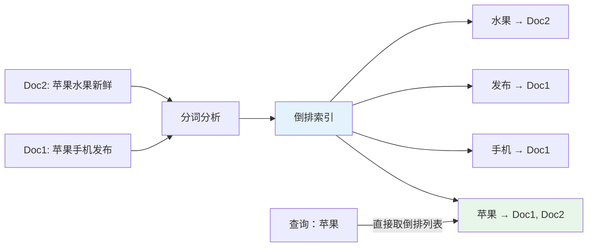
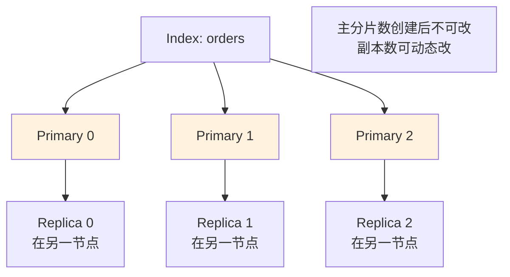
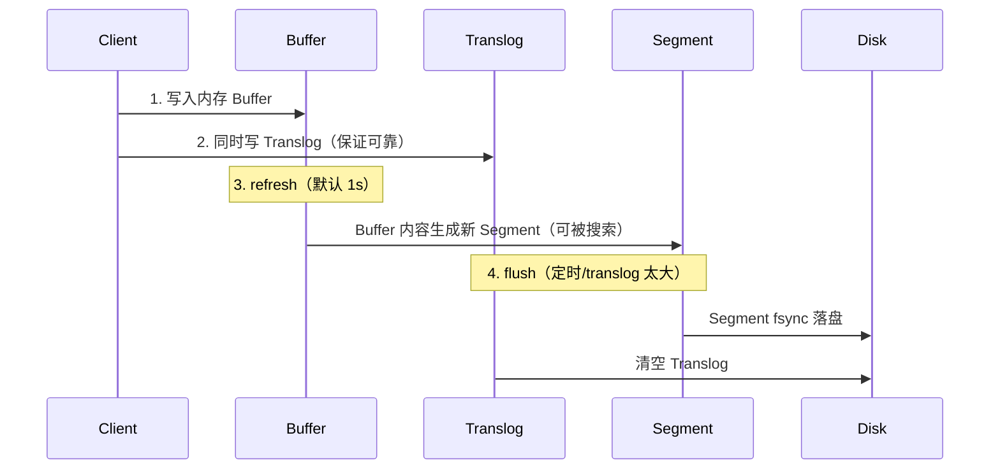

# Elasticsearch原理与调优

> 定位：Elasticsearch（ES）是分布式搜索与分析引擎，速度快源于倒排索引，扩展性强源于分片。但用不好就会出现「写入丢数据、查询慢、深分页查不动、字段类型选错导致查不到」。这篇讲清倒排索引、写入流程（refresh/flush/translog）、分片路由、查询与深分页优化、mapping 设计。

## 一、为什么需要 Elasticsearch

关系型数据库做全文搜索时 `LIKE '%关键词%'` 会全表扫描， Scores 排序、模糊匹配、聚合分析都力不从心。ES 用**倒排索引**解决「词 → 文档」的快速定位，用**分布式分片**解决海量数据，用**近实时（NRT）**在写入后约 1 秒就可搜索。

## 二、倒排索引与分词

### 2.1 倒排索引

正排索引是「文档 ID → 内容」，倒排索引反过来：**词条（Term） → 包含它的文档列表（Postings List）**。



每张图要点：**查询时不用遍历文档，直接按词查到文档列表**，这是 ES 快的根本原因。Postings List 里通常还记录词频（TF）、位置（Position），支撑相关性打分和短语匹配。

### 2.2 分词（Analysis）

Analyzer 由三部分组成：`Character Filter（字符过滤）→ Tokenizer（分词）→ Token Filter（词元过滤）`。

- 英文常用 `standard`：按空格分词、转小写、去停用词可选
- 中文常用 **IK 分词器**（`ik_max_word` 细粒度 / `ik_smart` 粗粒度），以你安装的版本为准
- 分词直接决定倒排索引里有哪些 Term——**写入和查询必须用同一套分析器**，否则查不到

> 经典坑：字段用 `text` + 默认 standard 分析器存中文，会把整句话当一个词或拆得乱七八糟，搜索中文词查不到。必须用 IK 等中文分词器。

## 三、分片、副本与路由

### 3.1 分片与副本

- **Primary Shard（主分片）**：把索引数据水平切开，每个分片是一个独立的 Lucene 实例。分片数决定索引能存多少数据、并行能力
- **Replica Shard（副本分片）**：主分片的拷贝，提供高可用（主分片挂了副本顶上）和读吞吐（搜索可打到副本）



**关键**：**主分片数创建后不能改**（要改只能 reindex 重建索引），所以建索引前必须估算好数据量。副本数可以随时调。

分片不是越多越好：每个分片有开销（文件句柄、内存、段），分片过多反而拖慢。一般单分片 10-50GB 为宜，小索引别切太多片。

### 3.2 路由机制

文档写到哪个分片，由路由公式决定：

```
shard = hash(routing) % number_of_primary_shards
```

- 默认 `routing = 文档 _id`，所以同一 ID 总落到同一分片
- 可自定义 routing（如按 tenant_id），让同一租户数据集中在同一分片，查询时可指定 routing 只查一个分片，**大幅提升效率**
- 因为公式依赖主分片数，所以主分片数不能改——否则所有数据路由全乱

## 四、写入流程：refresh / flush / translog

这是 ES「近实时」和「可靠性」的核心，必须理解三件事：



各步骤作用：

| 概念 | 作用 |
|---|---|
| **Buffer** | 写入先进内存缓冲区，**此时不可被搜索** |
| **refresh** | 默认每秒一次，把 Buffer 刷成**新 Segment**，之后**可被搜索**——这就是 NRT（近实时，写入后约 1 秒可查） |
| **Translog** | 写 Buffer 的同时记事务日志，防止宕机丢数据；未 flush 的数据可从 translog 恢复 |
| **flush** | 把 Segment fsync 到磁盘并清空 translog，是真正的持久化 |

- 想立即查到：写入时带 `?refresh=true`（或 `wait_for`），但频繁 refresh 会产生大量小 Segment，影响性能
- 批量写入时可调大 `refresh_interval`（如 30s），写完再改回，提升吞吐

### 4.1 段合并（Segment Merge）

Segment **不可变**，每次 refresh 产生新 Segment，久了会积累很多小 Segment，查询要逐个查、浪费资源。后台会自动做 **Merge**：把小 Segment 合并成大 Segment，并物理删除标记为删除的文档。

- Merge 消耗 IO 和 CPU，大批量写入后可能观察到写入抖动
- 相关参数 `index.merge.scheduler.max_thread_count`（以版本为准）

## 五、查询优化

1. **用 filter 代替 query（不关心相关性得分时）**：`filter` 不计算相关性得分、结果可缓存，比 `query` 快

```json
GET /orders/_search
{
  "query": {
    "bool": {
      "filter": [
        { "term": { "status.keyword": "PAID" } },
        { "range": { "amount": { "gte": 100 } } }
      ]
    }
  }
}
```

2. **精确匹配用 `keyword` 字段 + `term` 查询**，不要用 `match` 查 `text` 字段做精确匹配
3. **避免通配符开头**：`*abc` 无法利用倒排索引，极慢
4. **`_source` 过滤**：只要部分字段时用 `_source: ["title", "price"]`，减少传输和反序列化
5. **不要深分页**：见下一节
6. **用 `profile: true` 和慢查询日志**定位慢在哪

## 六、深度分页问题

ES 默认 `index.max_result_window = 10000`，`from + size > 10000` 就报错。原因：分布式场景下查 `from=9990, size=10` 要从每个分片取 10000 条到协调节点排序，代价随 from 线性增长。

三种方案对比：

| 方案 | 原理 | 优点 | 缺点 |
|---|---|---|---|
| `from/size` | 协调节点排序取回 | 简单，可跳页 | 深分页代价爆炸，上限 1 万 |
| `search_after` | 用上一页的排序值作游标，逐页往后 | 性能好，可深分页 | **不能随机跳页**，只能往下一页 |
| `scroll` / PIT | 创建快照游标，批量遍历 | 适合全量导出 | 非实时，占用资源，新版本推荐 PIT+search_after |

```json
// search_after 示例：第一页
GET /orders/_search
{
  "size": 10,
  "sort": [{ "createTime": "asc" }, { "_id": "asc" }]
}
// 下一页带上一页最后一条的 sort 值
GET /orders/_search
{
  "size": 10,
  "sort": [{ "createTime": "asc" }, { "_id": "asc" }],
  "search_after": [1710000000000, "order_100"]
}
```

> 实践：用户交互分页用 `search_after`（配合稳定的唯一排序字段如 `_id` 避免并列）；后台全量导出用 scroll/PIT。新版本 ES 推荐用 **PIT（Point In Time）+ search_after** 替代 scroll——以版本为准。

## 七、Mapping 设计与聚合

### 7.1 字段类型选择

| 场景 | 类型 | 说明 |
|---|---|---|
| 全文搜索（文章标题/内容） | `text` | 会被分词，建倒排索引 |
| 精确匹配/排序/聚合（状态、ID、标签） | `keyword` | 不分词，整体作为一个 Term |
| 数字/日期范围 | `integer`/`long`/`date` | 范围查询、排序 |
| 不参与查询只展示 | `index: false` | 不建索引省空间 |
| 不聚合不排序 | `doc_values: false` | doc_values 默认开（支撑聚合/排序），关掉省磁盘 |

- **一个字段既要全文搜索又要精确匹配** → 用 `fields` 多字段：`title` 为 text，`title.keyword` 为 keyword
- **对象数组要保留关系** → 用 `nested` 类型（普通 object 会把数组元素拍平，导致跨元素错误匹配）
- **谨慎动态映射**：生产建议 `dynamic: strict`，字段显式定义，避免脏数据写出意外字段类型

### 7.2 聚合（Aggregation）

聚合分两类：

- **Bucket（分桶）**：`terms`（按字段分组）、`date_histogram`（按时间分桶）、`range`
- **Metric（指标）**：`avg`/`sum`/`max`、`cardinality`（去重计数，用 HyperLogLog 近似，`precision_threshold` 调精度）

聚合基于 **doc_values**（列式存储）而非倒排索引，这也是为什么字段要开 doc_values。高基数去重（`cardinality`）是近似值，大数据量下有误差，要评估精度要求。

## 八、生产坑点与排查

### 坑点 1：中文搜索查不到结果

**现象**：存了中文文档，用 `match` 搜「苹果」查不到。
**原因**：字段用了默认 standard 分析器，中文被整句当一词或乱拆，倒排索引里没有「苹果」这个词条。
**解法**：安装 IK 分词器，字段 mapping 指定 `"analyzer": "ik_max_word"`，写入和查询用同一分析器；用 `_analyze` API 验证分词结果。

### 坑点 2：深分页报错或越翻越慢

**现象**：`from=20000` 报 `result window is too large`，或翻页越来越慢。
**原因**：`max_result_window` 上限 1 万 + 分布式排序代价随 from 增长。
**解法**：改用 `search_after` + 稳定唯一排序字段；全量导出用 PIT+search_after；必要时调大 `max_result_window`（治标不治本，慎用）。

### 坑点 3：主分片数设错，数据量涨了没法扩

**现象**：索引数据涨到几 TB，单个分片过大，查询慢，想加分片发现不能改。
**原因**：主分片数创建后固定，无法直接修改。
**解法**：建索引前按数据量估算分片数（单分片 10-50GB）；用**索引别名（alias）+ 按时间滚动索引**（如 `logs-2026-11`），扩容时新建更多分片的索引再切别名，必要时 reindex 迁移。

### 坑点 4：写入后立刻查不到

**现象**：写完数据马上查，查不到，过 1 秒才出现。
**原因**：refresh 默认 1 秒间隔，写入先到 Buffer 和 translog，refresh 后才生成可搜索的 Segment——这是 NRT 的正常表现。
**解法**：能接受就用默认；强立即可见用 `?refresh=true`（或 `wait_for`）；批量导入时反而调大 `refresh_interval` 提吞吐。

## 九、调优与最佳实践

1. **分片规划**：单分片 10-50GB，主分片数建前算好；副本保证 HA 和读吞吐。
2. **Mapping 先设计**：text/keyword 分明，生产用 `dynamic: strict`；不查的字段 `index:false`，不聚合的关 doc_values。
3. **写入优化**：批量 `bulk` 写入、调大 refresh_interval（导入时）、合理 translog 配置。
4. **查询优化**：filter 缓存、term 精确查、`_source` 过滤、避免通配前缀、深分页用 search_after。
5. **滚动索引 + 别名**：时间序列数据按天/月建索引，用别名对外，便于生命周期管理和扩容。
6. **监控**：慢查询日志、`_cat/indices`、JVM 堆、段数量、refresh/merge 耗时。

## 九、面试高频问法

> 这一节的答案按「面试时能讲透」的标准写：先给一句话结论，再展开机制、原因和坑点。

**Q1：Elasticsearch 为什么快？倒排索引是什么？**

**一句话结论**：ES 快在**倒排索引**——把"文档→词"反过来变成"词→文档列表"，查词直接定位文档，不用全表扫描。

展开：

- **正排 vs 倒排**：正排是"文档 ID → 内容"，要查某个词得遍历所有文档；倒排是"词 → 包含它的文档 ID 列表"，查词直接命中。
- **结构**：词典（所有词）+ 倒排列表（每个词对应的文档 ID、词频、位置）。
- **分词**：写入时把文本切词，建索引；查询时对查询词同样分词。

加分点：说"倒排索引是全文检索的核心——MySQL 的 LIKE '%关键词%' 是全表扫描，ES 是直接查词典，差距是数量级的"。

**Q2：ES 的分片和副本是什么？**

**一句话结论**：分片（Shard）把索引水平切分（提升容量和并发），副本（Replica）是分片的拷贝（提升可用性和读吞吐）。

展开：

- **主分片**：索引创建时指定数量，**创建后不能改**（除非 reindex）。数据按路由分配到主分片。
- **副本分片**：主分片的拷贝，可以动态调整。主分片挂了副本顶上；读请求可以打到副本。
- **默认**：1 个主分片 1 个副本（7.x 之前是 5 主 1 副）。

加分点：说"主分片数创建后不能改——这是 ES 最常见的坑，分片太少扛不住、太多管理开销大，要提前规划"。

**Q3：ES 的写入流程是怎样的？为什么是"近实时"？**

**一句话结论**：写入先进内存 buffer 和 translog，每隔 1 秒 refresh 到文件系统缓存（可被搜索），这就是"近实时"；再定期 flush 落盘。

展开：

1. 写入内存 buffer + translog（事务日志，防丢）。
2. 每 1 秒 **refresh**：buffer 的数据生成新的 segment 写入文件系统缓存，此时**可被搜索**。
3. 定期 **flush**：把 segment fsync 到磁盘，清空 translog。

**为什么近实时**：refresh 是 1 秒一次，所以写入后最多 1 秒才能搜到，不是"实时"。

加分点：说"1 秒的 refresh 间隔是可调的（refresh_interval），但调小会增加 segment 数量、影响性能；批量导入时可以临时设为 -1（关闭 refresh）再恢复"。

**Q4：什么是段合并（merge）？为什么需要？**

**一句话结论**：每次 refresh 生成一个小 segment，segment 太多会拖慢查询、浪费资源；ES 在后台把多个小 segment 合并成大 segment。

展开：

- **问题**：频繁 refresh 产生大量小 segment，查询要遍历所有 segment，性能下降；还有大量已删除文档占空间。
- **合并**：后台自动把多个小 segment 合并成一个，合并时真正删除标记删除的文档。
- **代价**：合并消耗 CPU 和 IO，大合并期间可能影响性能。

加分点：说"段合并是 ES 的'后台 GC'——它保证了查询性能，但合并本身有开销；大量写入时合并压力大，要控制写入速率"。

**Q5：ES 的深度分页有什么问题？怎么解决？**

**一句话结论**：`from + size` 深分页要每个分片都取 from+size 条再汇总，越翻越慢；用 `search_after`（推荐）或 `scroll`。

展开：

- **问题**：`from=10000, size=10`，每个分片都要取 10010 条，协调节点汇总排序——分片越多越慢，且 `max_result_window` 默认限制 10000。
- **search_after**：用上一页最后一条的排序值作为游标，下一页从它之后取——适合"逐页往后翻"。
- **scroll**：生成快照，适合"导出全量数据"，不适合实时翻页。

加分点：说"深度分页的本质是'分布式排序'——要全局有序就得到处取数据；search_after 用游标避免了这个问题，是分页的正解"。

**Q6：ES 的 mapping 怎么设计？**

**一句话结论**：显式定义字段类型（不要全靠动态映射）、合理用 `keyword` vs `text`、控制字段数量（避免 mapping 爆炸）。

展开：

- **text vs keyword**：text 会分词（全文检索），keyword 不分词（精确匹配、聚合、排序）。
- **显式 mapping**：动态映射可能把数字识别成 text、把日期识别错，生产要显式定义。
- **避免爆炸**：字段太多（如动态 key）会导致 mapping 过大、集群不稳定，用 `flattened` 或关闭动态映射。

加分点：说"一个字段既要全文检索又要精确匹配，可以定义成 text + 子字段 keyword（multi-field），这是标准做法"。

**Q7：ES 的查询为什么有时很慢？怎么优化？**

**一句话结论**：常见原因——深度分页、大聚合、脚本查询、分片过多、mapping 不合理；优化靠"减少数据量、用 filter、避免脚本、合理分片"。

展开：

- **用 filter 代替 query**：filter 不计算相关性评分，可缓存，更快。
- **避免脚本**：script 查询无法索引，逐条计算，很慢。
- **控制聚合**：大基数聚合（如按用户 ID 聚合几千万）极耗内存，用 `cardinality` 近似或预聚合。
- **合理分片**：分片太多协调开销大，太少单分片压力大。

加分点：说"ES 优化的第一原则是'减少扫描的数据量'——能用 filter 缩小范围就先缩小，别让它在全量数据上算评分"。

**Q8：ES 和 MySQL 怎么配合使用？**

**一句话结论**：MySQL 存主数据（事务、强一致），ES 存索引（全文检索、复杂查询），通过 binlog/双写同步。

展开：

- **职责分离**：MySQL 是"真相源"（source of truth），ES 是"查询加速层"。
- **同步方式**：Canal 订阅 binlog → 写 ES；或应用双写（注意一致性）。
- **查询**：先查 ES 拿到 ID，再回 MySQL 查详情（避免 ES 存全量数据）。

加分点：说"ES 不适合当主存储——它没有事务、近实时、可能丢数据；正确姿势是'MySQL 存数据、ES 做检索'，两者配合"。

**Q9：ES 集群的脑裂是什么？怎么防？**

**一句话结论**：脑裂是集群网络分区后，出现多个"主节点"，各自管理一部分节点，导致数据不一致；用 `discovery.seed_hosts` + 多数派选举防。

展开：

- **原因**：网络分区，两边都以为对方挂了，各自选主。
- **防护**：`minimum_master_nodes`（7.x 之前）设为"半数 + 1"，保证只有一个分区能选出主；7.x 用 `cluster.initial_master_nodes` + 自动选举。
- **专用主节点**：`node.master: true, node.data: false`，主节点不存数据，更稳定。

加分点：说"脑裂的后果很严重——两个主各自接受写入，数据就分叉了；所以主节点数要是奇数，且选举要多数派"。

**Q10：ES 的 refresh、flush、merge 有什么区别？**

**一句话结论**：refresh 让数据可搜索（内存→文件缓存），flush 让数据落盘（文件缓存→磁盘），merge 合并 segment（优化查询）。

| 操作 | 作用 | 频率 |
|---|---|---|
| refresh | buffer → 新 segment，可搜索 | 默认 1 秒 |
| flush | segment fsync 到磁盘，清 translog | 定期/translog 满 |
| merge | 合并小 segment，删已删除文档 | 后台自动 |

加分点：说"三者容易混淆——记住'refresh 管能不能搜到、flush 管会不会丢、merge 管查得快不快'，一句话区分"。

## 小结

- ES 快在倒排索引（词→文档），分词器决定索引里有哪些 Term，中英文要选对分析器。
- 主分片数建后不可改（路由公式依赖），单分片 10-50GB；副本管 HA 和读吞吐。
- 写入：Buffer+translog → refresh（1s，NRT 可搜）→ flush（落盘）；段后台自动合并。
- 深分页：from/size 上限 1 万，用 search_after 逐页、PIT/scroll 导出。
- Mapping 先设计（text/keyword/doc_values），查询用 filter 缓存，生产用别名+滚动索引便于扩容。
