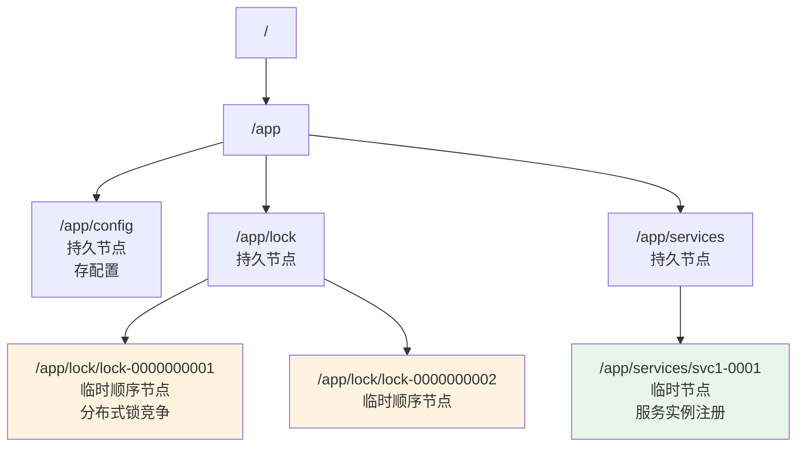
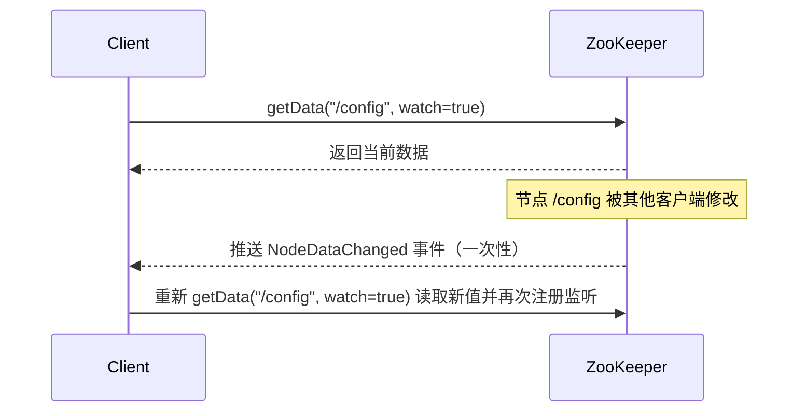
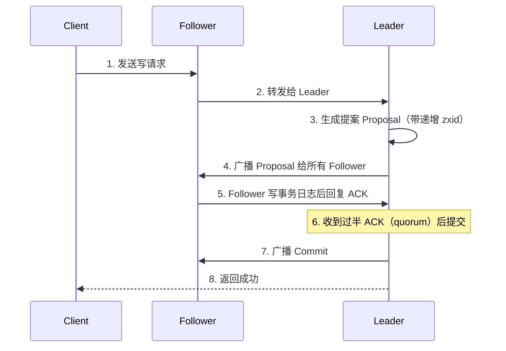

# Zookeeper原理

> 定位：ZooKeeper（ZK）是分布式协调服务，用「文件系统 + 监听通知」的模型解决分布式锁、配置中心、选主、注册中心等问题。理解 ZAB 协议、节点类型、Watcher、过半写机制，才能明白它的一致性边界，以及为什么大规模服务注册场景后来转向了 Nacos/Eureka。

## 一、为什么需要 ZooKeeper

分布式系统里多个进程要协同，需要解决：谁当老大（选主）、配置怎么同步（配置中心）、资源怎么互斥（分布式锁）、服务在哪（注册中心）。这些问题的共性是「**需要一个高可用的、强一致的、能感知变化的共享存储**」——ZK 就是干这个的。

ZK 保证：

- **顺序一致性**：客户端的更新按发送顺序生效
- **原子性**：更新要么成功要么失败
- **单一视图**：客户端连哪个节点看到的数据一样
- **可靠性**：一旦更新生效，不会丢失
- **实时性（最终）**：一定时间内客户端能看到最新数据

## 二、数据模型：ZNode 与节点类型

ZK 的数据是一棵**树形目录结构**，每个节点叫 **ZNode**，可存少量数据（默认上限 1MB，以版本为准），也可有子节点。

节点类型（四种，关键区别是**持久/临时** × **顺序/非顺序**）：

| 类型 | 生命周期 | 特点 |
|---|---|---|
| **PERSISTENT（持久）** | 客户端断开仍存在 | 存配置、存元数据 |
| **EPHEMERAL（临时）** | 客户端会话结束自动删除 | 服务注册（实例挂了自动摘除）、锁 |
| **PERSISTENT_SEQUENTIAL（持久顺序）** | 持久 | ZK 自动在名字后加递增序号 |
| **EPHEMERAL_SEQUENTIAL（临时顺序）** | 会话结束删除 | **分布式锁的核心**：序号 + 自动释放 |

**顺序节点**的序号由父节点维护，单调递增（如 `lock-0000000001`），这是实现公平锁和选主的基础。

## 三、Watcher 机制

Watcher 是 ZK 的「事件通知」：客户端在某个 ZNode 上注册监听，节点变化时 ZK 推送事件给客户端。

**核心特性**：

- **一次性**：触发一次后监听失效，要重新注册（避免重复通知风暴）
- **事件类型**：节点数据变更（`NodeDataChanged`）、子节点变更（`NodeChildrenChanged`）、节点删除/创建、连接状态
- **异步通知**：ZK 推送的是「发生了变化」的通知，**不包含新数据**——客户端收到通知后要**主动重新读取**

这张图要点：**Watcher 只通知「变了」，具体新值要自己再查，且每次触发后要重新注册**。这是 ZK 使用上的核心心智负担，也是 ZK 客户端封装库（如 Curator）帮你屏蔽的复杂度。

## 四、ZAB 协议与集群角色

### 4.1 集群角色

| 角色 | 职责 |
|---|---|
| **Leader** | 唯一写节点，负责处理所有写请求并发起提案 |
| **Follower** | 处理读请求；参与写提案投票；参与 Leader 选举 |
| **Observer** | 处理读请求、参与投票？**不参与投票**，只同步数据——用于扩展读能力不增加写投票负担 |

### 4.2 ZAB 协议（ZooKeeper Atomic Broadcast）

ZAB 是 ZK 的核心一致性协议，保证**消息原子广播和崩溃恢复**。写流程是典型的「**两阶段提交 + 过半机制**」：

关键点：

- **zxid**：全局递增的事务 ID（高 32 位是 epoch，低 32 位递增），保证顺序
- **过半机制（quorum）**：写操作必须得到**超过半数**节点同意才提交。所以 ZK 集群通常是**奇数台**（3/5/7），且能容忍的故障节点数 = (N-1)/2（3 台容忍 1 台挂，5 台容忍 2 台）
- Observer 不参与投票，所以增加 Observer 不影响写性能，适合读多写少场景扩容

### 4.3 选举机制

Leader 挂了要选新 Leader。选举基于 **zxid 最大**原则：谁的数据最新（zxid 最大）谁优先当 Leader，保证已提交的数据不丢。

- 进入 `LOOKING` 状态，各节点互相投票
- 节点投票给自己推荐的对象（通常选 zxid 最大的）
- 某节点收到**过半**选票即当选 Leader，进入 `LEADING`，其他进入 `FOLLOWING`
- 选主期间 ZK **不可用**（不处理写请求）——这是 CAP 中 CP 的取舍

> 为什么奇数台？3 台和 4 台的容错能力都是 1 台（4 台过半需要 3 台，挂 2 台就没法过半），4 台反而多花一台机器。所以部署奇数台。

## 五、会话与心跳

- 客户端和 ZK 建立 **Session**，会话有超时时间 `sessionTimeout`
- 客户端定期发**心跳**维持会话；服务器挂了或网络断开，客户端会尝试重连其他节点
- 会话超时后，该会话创建的**临时节点全部删除**——这是服务注册「实例宕机自动摘除」和分布式锁「宕机自动释放」的实现基础
- 心跳机制也用于 Follower 和 Leader 之间检测存活

## 六、典型应用

### 6.1 分布式锁

用**临时顺序节点**实现公平锁：

1. 所有竞争者在 `/lock` 下创建 `EPHEMERAL_SEQUENTIAL` 节点
2. 序号最小的获得锁
3. 其他节点监听前一个节点（只监听前一个，避免羊群效应）
4. 前一个节点删除（释放锁或会话超时），后一个被唤醒获得锁

- 优点：临时节点保证宕机自动释放，避免死锁；顺序节点保证公平
- 缺点：频繁创建删除节点、Watcher 通知，性能不如 Redis 锁；有**羊群效应**风险（要优化成只监听前驱节点）

### 6.2 配置中心

把配置写在持久 ZNode，客户端注册 Watcher。配置变更时更新节点，所有客户端收到通知重新读取。

### 6.3 注册中心

服务实例启动时创建**临时节点**（`/services/svc/ip:port`），Watcher 监听节点变化实现服务发现。实例宕机会话超时，临时节点删除，自动摘除。

### 6.4 选主

多个候选者创建临时顺序节点，序号最小的为主；主挂了节点删除，次小的接管。

## 七、为什么不建议做大规模注册中心

这是高频讨论点。ZK 作为注册中心的问题：

1. **CP 特性牺牲可用性**：选主期间（几十秒）ZK 不可用，期间服务无法注册/发现。注册中心更看重 AP（Eureka/Nacos 的设计哲学）
2. **规模瓶颈**：服务实例成千上万时，每个实例创建临时节点 + Watcher，节点数暴涨；变更时大量 Watcher 推送，ZK 压力大
3. **健康检测不够灵活**：靠会话心跳判断存活，网络抖动可能导致误摘除（心跳超时就删临时节点），没有 Eureka 的自我保护机制
4. **运维复杂**：需要独立运维 ZK 集群，理解 ZAB、处理脑裂和选主

于是演进：ZK（CP）→ Eureka（AP，专为注册中心）→ Nacos（AP/CP 可切换，配置+注册一体）→ Kubernetes Service。

> 结论：**ZK 依然适合分布式锁、选主、小规模协调场景**；大规模微服务注册中心更推荐 Nacos/Eureka/Consul。技术选型要看场景，不是否定 ZK。

## 八、生产坑点与排查

### 坑点 1：会话超时导致临时节点误删

**现象**：网络抖动后，服务实例还在运行，但注册中心把它摘除了（临时节点消失）。
**原因**：`sessionTimeout` 设置过短，GC 停顿或网络抖动导致心跳没及时发送，会话超时删临时节点。
**解法**：合理设置 `sessionTimeout`（如 30s-60s）；避免长时间 Full GC；客户端加重连逻辑，重连后重新注册。

### 坑点 2：羊群效应

**现象**：分布式锁释放瞬间，大量等待客户端同时被唤醒争抢，ZK 压力骤增。
**原因**：所有等待者都 watch 同一个锁节点，节点一删全部收到通知。
**解法**：用**临时顺序节点 + 只监听前驱节点**（每个节点只 watch 序号紧邻的前一个），锁释放只唤醒一个，避免惊群。Curator 的 `InterProcessMutex` 已实现。

### 坑点 3：Watcher 只触发一次却没重新注册

**现象**：第一次配置变更收到了通知，之后再变更就收不到了。
**原因**：Watcher 是一次性的，触发后失效，客户端没重新注册。
**解法**：收到通知后重新注册 Watcher（Curator 的 `NodeCache`/`PathChildrenCache` 会自动重注册）；理解「通知不含新数据，要主动读」。

### 坑点 4：脑裂与写不可用

**现象**：网络分区后，少数派分区的节点仍在接受写请求，恢复后数据冲突。
**原因**：没有正确理解过半机制，或节点数部署不当（偶数台导致两边都可能不过半）。
**解法**：部署奇数台（3/5/7）；写请求必须过半才提交，少数派分区自动停止写入；选主期间服务短暂不可用是正常 CP 取舍，客户端要有重试。

## 九、最佳实践清单

1. **集群规模**：3/5/7 台奇数；Observer 扩展读能力；隔离部署、跨机架。
2. **会话超时**：按网络和 GC 情况设 `sessionTimeout`，避免误摘除。
3. **分布式锁**：用 Curator 的 `InterProcessMutex`，临时顺序节点 + 监听前驱，避免羊群效应。
4. **Watcher**：理解一次性语义，用 Curator 高级 API 自动重注册。
5. **场景选型**：锁/选主/小规模协调用 ZK；大规模注册中心用 Nacos/Eureka。
6. **监控**： Leader 状态、节点数、Watch 数、会话数、请求延迟。

## 九、面试高频问法

> 这一节的答案按「面试时能讲透」的标准写：先给一句话结论，再展开机制、原因和坑点。

**Q1：ZooKeeper 是什么？它解决了什么问题？**

**一句话结论**：ZK 是一个**分布式协调服务**，提供"配置管理、命名服务、分布式锁、选主、集群管理"等能力，核心是"一个高可用的、强一致的小数据存储 + 监听通知"。

展开：

- **数据模型**：类似文件系统的树（ZNode），每个节点存少量数据（默认 1MB 限制）。
- **核心能力**：ZNode 的增删改查 + Watcher 监听 + 临时节点（会话级）。
- **典型用途**：注册中心（Dubbo 传统）、分布式锁、选主、配置中心。

加分点：说"ZK 不是'数据库'——它只适合存'小数据、读多写少、需要强一致'的协调信息，别拿它存业务数据"。

**Q2：ZAB 协议是什么？和 Paxos 有什么关系？**

**一句话结论**：ZAB 是 ZK 的原子广播协议，保证"所有写操作按顺序、要么全部成功要么全部失败"；它是 Paxos 的变种，专为"主备模式"设计。

展开：

- **两种模式**：崩溃恢复（选主、同步）+ 消息广播（正常写）。
- **消息广播**：所有写请求发给 Leader，Leader 分配 ZXID（递增），广播给 Follower，过半确认后提交。
- **和 Paxos**：ZAB 要求"顺序性"（所有事务按 ZXID 顺序执行），Paxos 不保证；ZAB 是"为复制状态机优化的 Paxos"。

加分点：说"ZAB 的核心是 ZXID——它既是事务 ID 也是选举依据，保证了'顺序'和'一致性'"。

**Q3：ZK 的节点类型有哪几种？**

**一句话结论**：四种——持久节点、持久顺序节点、临时节点、临时顺序节点。

| 类型 | 特点 | 场景 |
|---|---|---|
| 持久 | 创建后一直存在 | 配置、元数据 |
| 持久顺序 | 持久 + 自动追加序号 | 队列、顺序 |
| 临时 | 会话结束自动删除 | 服务注册、存活检测 |
| 临时顺序 | 临时 + 顺序 | 分布式锁 |

加分点：说"临时节点是 ZK 的精华——客户端崩溃后会话超时，临时节点自动删除，天然实现'服务下线自动摘除'和'锁自动释放'"。

**Q4：ZK 的 Watcher 机制是怎样的？**

**一句话结论**：客户端在 ZNode 上注册 Watcher，节点变化时 ZK 推送一次通知；**Watcher 是一次性的**，触发后要重新注册。

展开：

- **一次性**：Watcher 触发后失效，要再次注册才能继续监听。
- **异步**：ZK 推送的是"变了"的通知，不含新数据，客户端要自己重新读取。
- **类型**：节点创建、删除、数据变更、子节点变更。

加分点：说"Watcher 一次性是很多人踩的坑——以为注册一次就一直监听，结果只收到一次通知；Curator 帮你封装了'自动重新注册'"。

**Q5：ZK 的选举机制是怎样的？**

**一句话结论**：ZK 集群选主用"过半机制 + ZXID 比较"——得票过半且 ZXID 最大的节点当选 Leader。

展开：

- **投票**：每个节点先投自己，然后交换投票信息。
- **比较**：优先比 ZXID（事务 ID，越大越新），ZXID 相同比 myid。
- **过半**：得票超过半数（如 3 节点要 2 票）才当选。

**为什么用奇数节点**：3 节点容 1 个故障，5 节点容 2 个——奇数性价比最高（4 节点和 3 节点容错一样，但成本更高）。

加分点：说"ZK 集群要奇数个节点（3、5、7）——偶数节点不能提升容错能力，反而增加投票成本"。

**Q6：ZK 的写流程是怎样的？为什么写性能不高？**

**一句话结论**：所有写请求发给 Leader，Leader 广播给 Follower，过半确认后提交——写要走"两阶段 + 多数派"，所以写性能不高。

展开：

1. 客户端写请求发给任意节点（若是 Follower，转发给 Leader）。
2. Leader 分配 ZXID，广播 Proposal 给所有 Follower。
3. Follower 写日志、返回 ACK。
4. Leader 收到过半 ACK，提交并通知 Follower 提交。

加分点：说"ZK 写慢在读快——它适合'读多写少'；如果写很频繁（如高频注册），ZK 会成为瓶颈，这也是 Nacos 用 AP 模式替代 ZK 做注册中心的原因之一"。

**Q7：ZK 能做什么？典型应用有哪些？**

**一句话结论**：分布式锁、选主、配置管理、服务注册、分布式队列、命名服务。

展开：

- **分布式锁**：临时顺序节点 + 监听前一个。
- **选主**：所有节点抢创建同一个临时节点，创建成功的当主。
- **配置管理**：配置存 ZNode，客户端监听变更。
- **服务注册**：临时节点存服务地址，会话结束自动删除。

加分点：说"ZK 的很多用途本质是'利用临时节点 + Watcher'——临时节点表达'存活'，Watcher 表达'变更通知'，这两个原语组合出各种协调能力"。

**Q8：为什么现在不建议用 ZK 做注册中心？**

**一句话结论**：ZK 是 CP 系统——网络分区时不可用；而注册中心更需要 AP（可用性优先），且 ZK 写性能有限、容量受限于单机内存。

展开：

- **CP 的代价**：分区时整个注册中心不可用，服务无法注册/发现——对微服务是灾难。
- **性能**：写要走多数派，高频注册场景扛不住。
- **容量**：数据全在内存，服务多时内存压力大。

加分点：说"注册中心的诉求是'永远能查到服务'，短暂不一致可接受——这是 AP 的典型场景，ZK 的 CP 反而成了缺点，所以 Nacos/Eureka 更合适"。

**Q9：ZK 的会话（Session）机制是什么？**

**一句话结论**：客户端连接 ZK 时建立会话，有超时时间；会话期间临时节点有效，会话超时后临时节点自动删除。

展开：

- **心跳**：客户端定期发 ping 维持会话。
- **超时**：超过 sessionTimeout 没心跳，会话失效，临时节点删除、Watcher 失效。
- **重连**：网络短暂中断，客户端在超时前重连成功，会话保持。

加分点：说"会话超时时间是关键配置——太短，网络抖动就误判下线；太长，真正挂了的客户端很久才被清理，服务列表里有'僵尸节点'"。

**Q10：ZK 和 etcd 有什么区别？**

**一句话结论**：都是强一致的协调服务；ZK 用 ZAB、Java 实现、生态老；etcd 用 Raft、Go 实现、API 更现代（HTTP/gRPC）、是 K8s 的默认存储。

| 维度 | ZooKeeper | etcd |
|---|---|---|
| 一致性协议 | ZAB | Raft |
| 语言 | Java | Go |
| API | 自定义协议 | HTTP/gRPC |
| 生态 | Hadoop/Dubbo | Kubernetes |
| 监控 | 一般 | 更好（Prometheus） |

加分点：说"新项目（尤其云原生）优先 etcd——它是 K8s 的基石，API 友好；ZK 在传统大数据生态里仍是标配"。

## 小结

- 数据模型是树形 ZNode，四种节点（持久/临时/顺序组合），临时节点随会话消亡是注册和锁的基础。
- Watcher：一次性、异步通知、通知不含新数据、要重新注册。
- ZAB：Leader 广播 + 过半提交 + zxid 保证顺序；奇数台、(N-1)/2 容错；Observer 扩读不投票。
- 应用：分布式锁（临时顺序+监听前驱）、配置中心、注册中心、选主。
- 适合锁/选主/小规模协调；大规模注册中心更推荐 Nacos/Eureka（AP 优先）。
