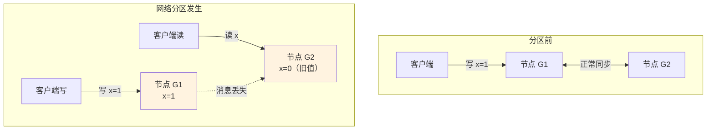
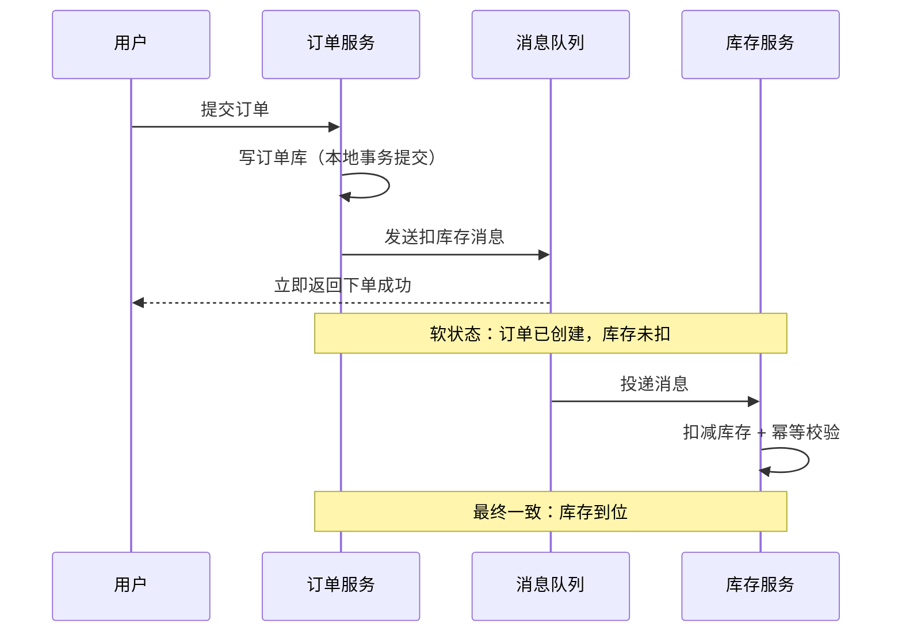
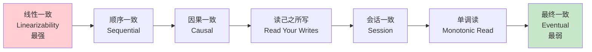

# CAP、BASE 与一致性

> 定位：CAP 不是「三选二」的口号，BASE 也不是「不要一致性」的借口。这篇帮你把 CAP/BASE 的准确含义、常见误解、PACELC 的补充，以及线性一致/因果一致/会话一致这条「一致性光谱」彻底理清——这是看懂 ZK、Redis、Eureka 取舍，以及做分布式设计决策的公共底座。

## 一、为什么需要它

你大概听过这句话：「CAP 定理，一致性、可用性、分区容错，三者只能取其二。」

这句话流传很广，但它**既不完整，也容易误导**。实际工作中，因为这些误解导致的糟糕设计并不少见：

- 有人用「我们是 AP 系统」来掩盖数据错乱，结果对账时发现金额对不上；
- 有人纠结「ZK 到底是 CP 还是 AP」，却答不出「CP 的 C 在什么时刻生效」；
- 有人把「最终一致」当成「随便什么时候一致都行」，用户体验直接崩掉。

CAP 的真正价值，不是给你一个分类标签，而是提供一副**思考眼镜**：当网络必然会出问题（分区是常态而非异常）时，你的系统在「每次读都返回最新写」和「每个请求都得到响应」之间，究竟愿意牺牲哪一个？想清楚这个问题，才能理解为什么 ZK 在选主时会拒绝服务、为什么 Eureka 宁可返回旧数据、为什么 Redis 主从切换会丢写。

这一篇不背定义，从「网络分区」这个真实故障切入，把概念还原成工程决策。

## 二、CAP 定理的准确含义

### 2.1 三个字母的严格定义

CAP 由 Eric Brewer 提出，后由 Gilbert 和 Lynch 形式化证明。它的严格表述是：

> 在一个**异步网络**的分布式系统中，当发生**网络分区（Partition）**时，无法同时保证**线性一致性（Consistency）**和**可用性（Availability）**。

注意这里的措辞和日常理解差别很大，逐字拆解：

| 字母 | 常见理解 | CAP 里的严格含义 |
|---|---|---|
| **C** | 数据一致 | **线性一致性（Linearizability）**：任何读都返回「最近一次完成的写」的值，如同操作一个单机副本 |
| **A** | 服务可用 | **每个非失败节点都必须返回一个响应**（哪怕数据旧），不能超时、不能报错 |
| **P** | 容错 | **网络分区**：节点间消息丢失或延迟无限大，把集群切成互不连通的多个区 |

**这里有三个关键误解需要澄清。**

**误解一：CAP 是「三选二」。** 真相是：在分布式系统里，P（网络分区）是**客观存在、无法回避**的——你无法选择「不要分区」，网线会被挖断、交换机可能故障、机房之间可能延迟飙升。所以 CAP 的实际决策是在 **P 已经发生的前提下，选 C 还是选 A**。所谓「三选二」只在单机系统（放弃 P）时才成立。

**误解二：C 是「最终一致」里的那个一致。** 不对。CAP 的 C 特指**强一致（线性一致）**，是最严格的一致性级别。一个最终一致的系统，在 CAP 语境下其实是**不满足 C** 的。

**误解三：A 是「高可用率 99.99%」。** 不是。CAP 的 A 是一个**二值判定**：分区期间，每个请求是否都得到了非错误响应。SLA 里的「几个 9」是可用性的量化指标，和 CAP 的 A 不是一回事。

### 2.2 用一次分区看懂 C 与 A 的冲突

假设有两个节点 G1、G2，初始数据都是 `x=0`。现在网络分区，G1 和 G2 无法通信。一个客户端连接 G1 写入 `x=1`，另一个客户端连接 G2 读取 `x`。

此时 G2 面临两难：

- **如果要 C（线性一致）**：G2 必须返回 `x=1`，但它拿不到 G1 的更新。它只能**拒绝服务（报错或超时）**，等分区恢复。这就是 **CP**：宁可不服务，也不返回可能错误的数据。
- **如果要 A（可用性）**：G2 直接返回本地旧值 `x=0`。每个请求都有响应，但读到了过期数据，破坏了线性一致。这就是 **AP**：宁可返回旧数据，也要保证服务可用。

**这就是 CAP 的全部冲突点**：在分区那一刻，你无法既让 G2 返回正确的新值，又让它立即响应。这张图是理解所有后续内容的钥匙。

### 2.3 「分区期间」是关键前提

很多人忽略了一点：**CAP 只在分区发生时才逼你二选一**。没有分区（网络健康）时，一个设计良好的系统可以同时提供 C 和 A。所以：

- 不要说「ZK 是 CP，所以不可用」——ZK 在网络健康时完全可用；
- 分区是短暂的，但**在分区期间的选择**，决定了系统的数据正确性和可用性表现。

## 三、BASE 理论：AP 的工程化落地

CAP 给出了「分区时二选一」的约束，但生产系统不能整天在「强一致」和「完全不一致」之间跳。BASE 理论就是 **AP 方向的工程化实践指南**，它由 ebay 的架构师提出，是 ACID 的「反向」思路（BASE 的单词 base「碱」对 ACID 的 acid「酸」）。

BASE 的三要素：

| 要素 | 全称 | 含义 |
|---|---|---|
| **BA** | Basic Availability（基本可用） | 分区时允许损失部分可用性：响应时间变长、降级返回、部分功能不可用，但核心功能可用 |
| **S** | Soft state（软状态） | 允许数据存在「中间态」，多个副本之间的同步可以滞后，不要求时刻一致 |
| **E** | Eventually consistent（最终一致性） | 软状态不能永远持续，经过一段时间后，所有副本最终会收敛到一致 |

**BASE 的核心不是「放弃一致性」，而是「放弃强一致，换取可用性，但保证最终收敛」。** 最终一致性有一个隐含的、极其重要的前提——**收敛必须有时间上界（或大致可预期）**。如果系统永远不收敛，那不叫最终一致，叫「数据丢了」。

一个直观例子：电商下单后，订单库写成功，但库存扣减通过 MQ 异步进行。在 MQ 消息投递的这几百毫秒里，订单已创建、库存还没扣，这就是「软状态」。但只要消息不丢、消费端幂等，几秒后库存一定扣减到位，这就是「最终一致」。

## 四、一致性模型光谱：从强到弱

「一致性」不是非黑即白，而是一条从强到弱的光谱。理解这条光谱，才能精准描述你的系统「到底一致到什么程度」。

### 4.1 线性一致性（Linearizability）

最强的单对象一致性。要求：**所有操作看起来像是瞬时完成、且按全局实时顺序发生**。一旦某个写返回成功，之后任何读都必须看到这个值。实现手段通常是 Raft/Paxos 共识算法或主副本串行化。ZK 的写、etcd 的读写就是线性一致的典型。

### 4.2 因果一致性（Causal Consistency）

只保证**有因果关系**的操作顺序，无因果的并发操作可以乱序。经典例子：你在朋友圈发了一条状态（A），我评论了这条状态（B）。B 因果依赖于 A，所以任何用户看到 B，必须先看到 A；但另外两条互不相关的评论之间，顺序无所谓。相比线性一致，因果一致在跨地域场景性能更好。

### 4.3 会话一致性（Session Consistency）

因果一致的一个实用简化版：在**同一个客户端会话内**，保证「读己之所写」「单调读」等。典型实现是客户端携带一个会话版本号，服务端保证读到的版本不低于该版本。很多 NoSQL（如 MongoDB、DynamoDB）提供的「读己之所写」就属于此类。

> 「读己之所写」（Read Your Own Writes）：用户自己刚写的数据，自己马上能读到——这是对用户体验最关键的一致性保证。用户能接受别人的状态晚几秒，但绝不能接受自己刚改的资料刷新后变回旧的。

### 4.4 最终一致性（Eventual Consistency）

最弱：不保证任何读取顺序，只保证「如果没有新的更新，最终所有读都会返回最后写入的值」。DNS、大多数缓存系统、AP 数据库默认都是最终一致。它的问题在于「最终」到底多久——工程上必须配合监控收敛延迟（如 MQ 堆积量），否则用户会感知到明显的数据错乱。

## 五、PACELC：对 CAP 的重要补充

CAP 有个盲区：它只描述了**分区发生时（Partition）**的取舍，却没说**系统正常运行时（Else）**的取舍。而现实里，绝大多数时间系统都是正常的，这时你依然要在**延迟（Latency）和一致性（Consistency）**之间做权衡。

PACELC 由 Daniel Abadi 提出，表述是：

> 如果发生分区（P），在可用性（A）和一致性（C）之间取舍；否则（Else），在延迟（L）和一致性（C）之间取舍。

| 系统 | 分类 | 分区时 | 正常时 | 说明 |
|---|---|---|---|---|
| ZooKeeper | **PC/EC** | 选一致性 | 选一致性 | 写入需多数派确认，延迟高但强一致 |
| etcd | **PC/EC** | 选一致性 | 选一致性 | Raft，线性一致 |
| MySQL 半同步 | **PC/EC** | 偏一致性 | 选一致性 | 主库等至少一个从库确认 |
| Cassandra | **PA/EL** | 选可用性 | 选低延迟 | 可调一致性，默认最终一致 |
| DynamoDB | **PA/EL**（默认） | 选可用性 | 选低延迟 | 可配置为强一致读 |
| MongoDB | **PC/EC**（默认） | 选一致性 | 选一致性 | 主副本读写，可配读偏好 |

PACELC 的意义在于：**它提醒你，强一致是有持续成本的**。即便没有故障，强一致系统也要为每个写付出多节点协调的延迟。这就是为什么很多互联网核心交易链路宁可用最终一致 + 对账，也不全程强一致。

## 六、真实系统的取舍分析

### 6.1 ZooKeeper：典型的 CP

ZK 用 ZAB 协议，写入需要**超过半数节点（quorum）**确认。当集群 5 个节点挂了 2 个，剩余 3 个仍构成多数派，可以继续服务；但如果只剩 2 个（不足半数），**ZK 会直接拒绝写入甚至拒绝读写，即使这 2 个节点本身是活的**。

这就是 CP 的表现：宁可不可用，也绝不在无法达成共识时返回可能不一致的数据。ZK 常被用作选主、配置中心、分布式锁——这些场景**正确性远比可用性重要**，所以 CP 是合适的。

> 一个经典生产坑：ZK 集群节点数通常部署为**奇数**（3、5、7）。不是迷信，而是为了在相同容错能力下节省节点：3 节点和 4 节点都只能容忍 1 个节点故障，4 节点纯属浪费。

### 6.2 Redis：主从异步复制下的「弱一致 AP 倾向」

Redis 主从之间是**异步复制**：主库写成功后立即返回，再异步把数据推给从库。这意味着：

- 正常时主从之间有毫秒级延迟（软状态）；
- 主库宕机、从库升主时，**尚未同步的写会丢失**；
- Sentinel 或 Cluster 故障切换期间，短暂的写不可用。

所以 Redis 严格来说既不是纯 CP 也不是纯 AP——它是**弱一致的**，默认偏向可用性和性能。如果你的业务用 Redis 存锁、存分布式 ID，就必须意识到主从切换时**锁可能失效、ID 可能重复**（详见分布式锁、分布式 ID 两篇）。

### 6.3 Eureka：典型的 AP

Eureka 是 Spring Cloud 生态的服务注册中心。和 ZK 做注册中心最大的区别是：

- **Eureka 各节点平等（去中心化）**，节点间通过异步复制同步注册信息；
- 当部分节点失联，Eureka 节点**继续用本地注册表提供服务**，不会像 ZK 那样因为失去多数派而拒绝服务；
- Eureka 有「**自我保护模式**」：当短时间内大量服务实例心跳失败（可能是网络分区而非实例真挂了），Eureka 会**停止剔除实例**，宁可保留可能已死的实例，也不误删健康实例。

这正是 AP 的思路：服务发现场景下，**「拿到一个可能稍微过时的地址列表」远好于「完全拿不到地址导致调用失败」**。这也是为什么 Spring Cloud 生态后来普遍推荐 Eureka/Nacos（AP 倾向）而非 ZK 做注册中心。

## 七、生产坑点与排查

### 坑点 1：用「AP」当数据错乱的挡箭牌

**现象**：订单金额和账户余额对不上，开发说「我们是 AP 系统，最终一致，数据不一致是正常的」。
**原因**：把「最终一致」曲解成「可以不收敛」。真正的问题是消息丢失/消费失败没有补偿，数据永远不会一致。
**解法**：最终一致必须配套三样东西——① 可靠投递（本地消息表或事务消息）；② 消费端幂等；③ 对账 + 告警，监控收敛延迟。没有这三样的「最终一致」就是数据丢失。

### 坑点 2：误把 ZK 当高可用注册中心，选主期间全站不可用

**现象**：ZK 集群网络抖动，失去多数派，导致所有依赖 ZK 的服务无法获取配置/实例，全站故障。
**原因**：把 CP 系统用在了需要高可用的服务发现场景。ZK 为保证一致性，宁可拒绝服务。
**解法**：服务发现选 AP 系统（Eureka/Nacos/Consul）；ZK 只用于选主、分布式锁、配置（变更频率低、正确性优先）场景。这是组件选型层面的 CAP 决策。

### 坑点 3：Redis 主从切换导致分布式锁失效

**现象**：主库加了锁还没同步到从库，主库宕机，从库升主后锁「消失」，另一个线程也拿到了锁，出现并发写。
**原因**：Redis 异步复制 + 主从切换，破坏了锁的互斥性。这是 CAP 里 C 被牺牲的直接后果。
**解法**：对正确性要求极高的锁场景，用 Redlock（多主节点多数派）或直接改用 CP 系统（ZK/etcd）；接受极小概率锁失效的场景可用 Redisson 看门狗 + 延迟检测。详见「分布式锁」篇。

### 坑点 4：「读己之所写」都做不到，用户投诉刷新后数据没了

**现象**：用户改完昵称，刷新页面又变回旧昵称，反复几次。
**原因**：读写分离架构下，写走主库、读走从库，主从延迟期间读到了旧从库数据。只保证「最终一致」但没保证「会话一致」。
**解法**：用户刚写的资源，短时间内强制读主库（写后读策略），或让写请求携带版本号，读时带上版本号路由到已同步的副本。这是会话一致性的典型落地。

## 八、调优与选型决策

### 8.1 什么时候选 CP，什么时候选 AP

| 场景 | 选择 | 理由 |
|---|---|---|
| 选主、分布式锁、配置中心 | **CP**（ZK/etcd） | 正确性第一，宁可短暂不可用也不能出现双主/锁失效 |
| 金融交易、账户余额 | **CP 或强一致** | 数据错误代价极高，一致性不能妥协 |
| 服务注册与发现 | **AP**（Eureka/Nacos） | 拿到略旧的实例列表好过完全不可用 |
| 社交动态、评论、点赞 | **AP + 因果/最终一致** | 用户体验优先，短暂不一致可接受 |
| 商品详情页、缓存 | **AP + 最终一致** | 允许秒级延迟，靠缓存刷新收敛 |
| 秒杀库存 | **混合**：强一致扣减 + 异步落库 | 核心扣减强一致，非核心链路异步 |

### 8.2 落地清单

1. **先问「分区时会怎样」**，而不是先问「是什么分类」——分类是结果，取舍是本质。
2. **强一致有持续成本**：PACELC 提醒你，正常时也要为一致性付出延迟。
3. **最终一致必须可收敛**：可靠投递 + 幂等 + 对账告警，三件套缺一不可。
4. **明确你的一致性级别**：是线性一致、会话一致还是最终一致？用精确词汇描述，别只说「一致」。
5. **「读己之所写」是底线**：涉及用户自己数据的场景，至少保证会话一致。

## 九、面试高频问法

> 这一节的答案按「面试时能讲透」的标准写：先给一句话结论，再展开机制、原因和坑点。

**Q1：CAP 定理是什么？为什么三者不可兼得？**

**一句话结论**：CAP 指一致性（Consistency）、可用性（Availability）、分区容错性（Partition tolerance），分布式系统在网络分区时只能在 C 和 A 之间二选一。

展开：

- **C 一致性**：所有节点同一时刻看到同一份数据（强一致）。
- **A 可用性**：每个请求都能在有限时间内得到非错误响应。
- **P 分区容错**：网络分区（节点间通信中断）时系统仍能工作。

**为什么不可兼得**：网络分区（P）在分布式系统中是**客观必然**的（网络会断），所以 P 必须保证。那么分区发生时，要么拒绝服务保证一致（选 C），要么返回可能过期的数据保证可用（选 A）。

加分点：说"很多人误以为'可以放弃 P'——单机系统才没有 P，分布式系统必然有网络，所以 P 是必选项，真正要选的是 C 还是 A"。

**Q2：常见的系统是怎么选 CAP 的？**

**一句话结论**：注册中心 Eureka 选 AP（可用优先）、ZooKeeper 选 CP（一致优先）、Redis Cluster 偏 AP、Nacos 可切换。

| 系统 | 选择 | 原因 |
|---|---|---|
| Eureka | AP | 服务发现短暂不一致可接受，可用性更重要 |
| ZooKeeper | CP | 分布式协调必须强一致（锁、选主） |
| Redis Cluster | 偏 AP | 主从异步复制，故障时可能丢数据 |
| Nacos | AP/CP 可切 | 临时实例 AP、持久实例 CP |
| MySQL 主从 | 偏 AP | 异步复制，主从延迟 |

加分点：说"选 C 还是 A 取决于业务——注册中心选 AP 是因为'少一个实例'比'整个注册中心不可用'代价小；ZK 选 CP 是因为锁必须一致"。

**Q3：BASE 理论是什么？和 CAP 什么关系？**

**一句话结论**：BASE 是"基本可用（Basically Available）、软状态（Soft state）、最终一致（Eventually consistent）"，是对 CAP 中 AP 方向的延伸，主张牺牲强一致换可用性。

展开：

- **基本可用**：允许降级（响应变慢、功能裁剪），但系统整体可用。
- **软状态**：允许中间状态存在（数据在同步中）。
- **最终一致**：经过一段时间，数据最终会一致。

**和 CAP 的关系**：CAP 说"分区时选 A 或 C"，BASE 是"选 A 之后，怎么让系统最终回到一致"的具体实践。

加分点：说"BASE 是'工程化的妥协'——大部分互联网业务不需要强一致，能接受'几秒后一致'，换来高可用和性能，这是电商、社交的普遍选择"。

**Q4：强一致、弱一致、最终一致有什么区别？**

**一句话结论**：强一致=任何时刻读到的都是最新值；弱一致=不保证读到最新；最终一致=一段时间后能读到最新。

展开：

- **强一致（线性一致）**：写完成后，任何后续读都能读到新值。实现代价高（要同步复制、多数派确认）。
- **弱一致**：读可能读到旧值，甚至乱序。
- **最终一致**：介于两者之间——短期可能不一致，但最终会一致（如 DNS、主从复制）。

**典型例子**：银行转账要强一致；微博点赞可以最终一致（晚几秒看到赞数没关系）。

加分点：说"最终一致的关键是'最终'要可预期——要有机制保证'一定会一致'（如对账、补偿），而不是'可能永远不一致'"。

**Q5：PACELC 是什么？比 CAP 多了什么？**

**一句话结论**：PACELC 是 CAP 的扩展——分区时选 A 或 C（PAC），**没有分区时**在延迟（Latency）和一致性（Consistency）之间选（ELC）。

展开：

- **PAC**：Partition 时选 Availability 还是 Consistency（同 CAP）。
- **ELC**：Else（无分区时）选 Latency 还是 Consistency。

**意义**：CAP 只讨论了"故障时"，但系统大部分时间没故障，这时要在"低延迟"和"强一致"之间权衡——强一致要同步复制，延迟高。

加分点：说"PACELC 更贴近现实——大部分时间系统是健康的，这时'要不要为了强一致牺牲延迟'才是日常决策；比如 Redis 主从异步复制就是选了低延迟"。

**Q6：分布式系统为什么很难做到强一致？**

**一句话结论**：因为网络不可靠（延迟、丢包、分区）、节点可能故障、时钟不同步，导致"确认一个写成功"本身就很困难。

展开：

- **网络**：消息可能延迟、丢失、乱序，无法确定对方是否收到。
- **故障**：节点随时可能宕机，无法区分"慢"和"死"。
- **时钟**：各节点时钟不同步，无法用时间戳排序事件（要用逻辑时钟）。
- **FLP 不可能定理**：异步网络中，即使只有一个节点故障，也不存在能在有限时间内达成一致的确定性算法。

加分点：说"强一致的代价是'等所有节点确认'，任何一个节点慢都会拖慢整体——这就是为什么跨地域强一致延迟高，Google Spanner 要用原子钟（TrueTime）"。

**Q7：什么是线性一致性？和顺序一致性有什么区别？**

**一句话结论**：线性一致性最强——所有操作像在单机上按实时顺序执行；顺序一致性稍弱——所有节点看到相同的操作顺序，但不要求和实时时间一致。

展开：

- **线性一致**：操作的生效时间点在"调用"和"返回"之间，且全局有序。等价于"单机多线程"的语义。
- **顺序一致**：所有节点看到相同的顺序，但这个顺序不一定符合真实时间。
- **强度**：线性一致 > 顺序一致 > 因果一致 > 最终一致。

加分点：说"线性一致是'最强的一致性'，实现代价最高（要全局时钟或共识算法）；大部分系统用的是更弱的因果一致或最终一致"。

**Q8：什么场景必须用强一致？**

**一句话结论**：涉及**钱、库存、唯一性约束**的场景必须强一致；其他大部分场景可以最终一致。

展开：

- **必须强一致**：账户余额、转账、库存扣减（不能超卖）、唯一用户名注册。
- **可以最终一致**：点赞数、浏览量、推荐列表、日志、消息通知。

**判断标准**：不一致会导致"资损"或"业务错误"的，必须强一致；不一致只是"体验差一点"的，可以最终一致。

加分点：说"强一致是有成本的（性能、可用性），不要滥用——'为了保险全都强一致'会导致系统又慢又脆弱"。

**Q9：分布式系统怎么实现最终一致？**

**一句话结论**：靠**可靠消息、补偿、对账**——保证操作最终会被执行，失败的会被重试或修正。

展开：

- **可靠消息**：本地消息表、事务消息（RocketMQ），保证"业务操作"和"消息发送"原子。
- **补偿**：失败时执行反向操作（如退款）。
- **对账**：定时比对两边的数据，发现不一致就修复。
- **幂等**：所有操作要幂等，才能安全重试。

加分点：说"最终一致的'最终'靠的是'不断重试 + 对账兜底'——消息可能丢，但定时对账能发现并修复，这是金融系统'日终对账'的意义"。

**Q10：CAP 在实际架构设计中怎么用？**

**一句话结论**：不是"选两个"，而是**按业务分层**——核心链路保一致，非核心保可用；不同数据用不同策略。

展开：

- **分层设计**：交易核心用 CP（强一致），商品浏览用 AP（高可用）。
- **同一业务分场景**：下单扣库存要一致，订单列表展示可以延迟。
- **降级策略**：分区时，核心功能保一致，非核心功能降级。

加分点：说"CAP 不是'整个系统选一个'，是'每个决策点选一次'——一个电商系统里，支付是 CP、推荐是 AP、购物车可能是 AP，这才是真实的架构"。

## 小结

- CAP 的准确含义：分区发生时，线性一致（C）和可用性（A）无法同时保证；P 无法回避，实际是 P 下二选一。
- 三个误解：不是简单三选二、C 不是最终一致里的「一致」、A 不是 SLA 可用率。
- BASE 是 AP 的落地：基本可用 + 软状态 + 最终一致，最终一致必须可收敛（可靠投递+幂等+对账）。
- 一致性是光谱：线性一致 > 顺序一致 > 因果一致 > 会话一致 > 单调读 > 最终一致。
- PACELC 补充了无分区时的「延迟 vs 一致性」；ZK 是 CP、Redis 偏弱一致、Eureka 是 AP——选型本质是取舍。
