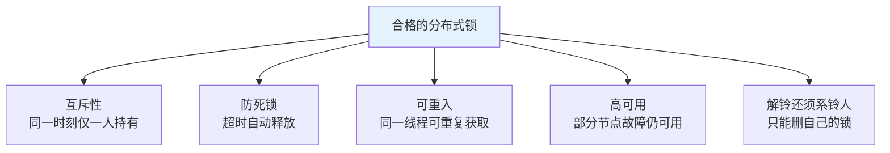
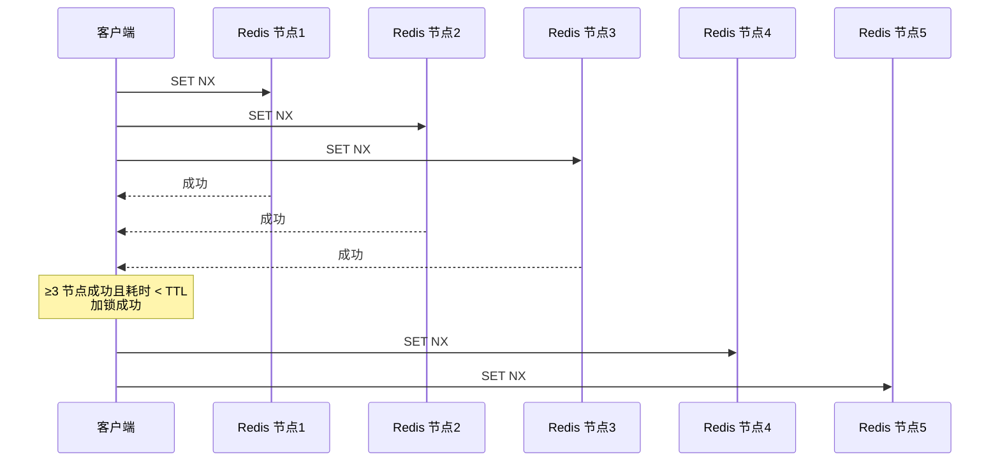
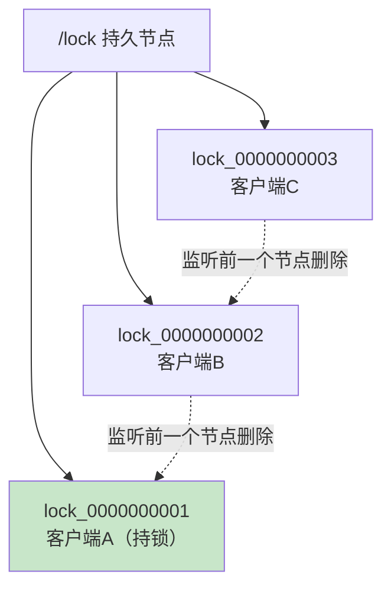

# 分布式锁

> 定位：分布式锁解决的是「跨 JVM 的互斥」——当多个进程要抢同一份共享资源时，如何保证同一时刻只有一个在操作。这篇从 Redis 锁的演进一路讲到 Redlock/Redisson、ZK 锁、数据库锁，把每条路的坑（锁失效、时钟漂移、主从切换丢锁）和选型讲透。

## 一、为什么需要它

单机时代，Java 的 `synchronized`、`ReentrantLock` 就能搞定线程互斥，因为所有线程共享同一块堆内存。但微服务拆开后，同一个功能部署了 10 个实例，运行在 10 台机器的 10 个 JVM 里，`synchronized` 只能锁住自己进程内的线程，锁不住别的实例。

于是出现了这些真实事故：

- 定时任务在 10 个实例上各跑一遍，用户收到 10 条重复短信；
- 两个请求同时扣减同一账户余额，都读到 `100`，都扣成 `90`，本该是 `80`；
- 订单超时关闭和支付回调并发，一个关单一个改支付状态，数据错乱。

这些场景的共同点是：**互斥的粒度超出了单个 JVM，需要一个所有进程都能看到、且能达成「谁拿到锁」共识的第三方组件**。这就是分布式锁。

先明确一个判断标准：**能用数据库唯一约束、乐观锁、状态机解决的问题，就别上分布式锁**。分布式锁引入了新的故障点，复杂度高。只有当「必须串行执行某段跨进程逻辑」且无法用数据约束表达时，才需要它。

## 二、分布式锁的必备条件

一个可用于生产的分布式锁，必须满足四个条件：

| 条件 | 含义 | 不满足的后果 |
|---|---|---|
| **互斥性** | 任意时刻只有一个客户端持有锁 | 并发写、数据错乱（最核心） |
| **防死锁** | 锁必须能自动释放，不能因客户端崩溃永久占用 | 锁永远不释放，所有人阻塞 |
| **可重入性** | 同一客户端可重复获取同一把锁 | 方法内嵌套调用自己把自己锁死 |
| **高可用 / 容错** | 部分节点故障时锁服务仍可用 | 锁服务挂了，业务全停 |

此外还有一个工程上极其重要、但常被遗漏的条件：**解铃还须系铃人**——释放锁时只能释放自己持有的锁，不能误删别人的锁。这一条坑倒了无数人（见坑点 1）。



## 三、基于 Redis 的实现演进

Redis 因为性能好、部署简单，是分布式锁最常见的载体。它的实现经历了一条「踩坑—修补」的演进路线，理解每一步为什么被淘汰，比记住最终方案更重要。

### 3.1 第一代：SETNX + 单独 EXPIRE

最朴素的想法：用 `SETNX key value` 抢锁（key 不存在才设置成功），成功者拿到锁，再用 `EXPIRE key seconds` 设置过期时间防死锁。

```redis
SETNX lock:order:123 "client-a"   # 返回 1 抢到，0 没抢到
EXPIRE lock:order:123 30          # 设置 30 秒过期
```

**致命问题**：两条命令不是原子的。如果 `SETNX` 成功后、还没执行 `EXPIRE` 时客户端崩溃，这把锁就**永远不过期**（没有 TTL），造成死锁。这一代已被淘汰。

### 3.2 第二代：`SET key value EX seconds NX`

Redis 2.6.12 之后，`SET` 命令支持原子地带上过期时间和 NX 参数，一步到位：

```redis
SET lock:order:123 "client-a" EX 30 NX
```

其中 `NX` 表示仅当 key 不存在时设置（互斥），`EX 30` 表示 30 秒后自动过期（防死锁）。这一条命令原子完成「抢锁 + 设过期」，解决了第一代的死锁问题。释放锁时用 Lua 脚本保证「校验 + 删除」原子：

```lua
-- 解铃还须系铃人：先比对 value 是不是自己的，是才删
if redis.call('get', KEYS[1]) == ARGV[1] then
    return redis.call('del', KEYS[1])
else
    return 0
end
```

为什么必须用 Lua？因为「先 GET 比对，再 DEL」两步之间，锁可能已过期并被别人重新获取，此时你的 DEL 会**误删别人的锁**。Lua 脚本在 Redis 里原子执行，杜绝了这个竞态。

### 3.3 第三代：Redlock（多节点多数派）

第二代有个根本缺陷：**单 Redis 实例**——如果这个实例宕机，锁服务就不可用（不过稿）；更糟的是主从架构下主库宕机导致丢锁（见坑点 3）。

Redis 作者 antirez 提出 **Redlock**：部署 N 个（通常 5 个）**相互独立**的主节点（不做主从复制），加锁流程：

1. 记录开始时间 T1；
2. 依次向 5 个节点发送 `SET key value EX NX`（带相同 key 和唯一 value）；
3. 当在**超过半数**（≥3）节点上加锁成功，且总耗时小于锁的有效时间，才算加锁成功；
4. 锁的实际有效时间 = 初始 TTL − 加锁耗时；
5. 加锁失败则向所有节点发起释放。



Redlock 争议很大：分布式系统专家 Martin Kleppmann 撰文指出，Redlock 依赖「同步假设」，在**时钟漂移**和 GC 停顿下仍可能失效（见坑点 2）。antirez 随后反驳。结论是：Redlock 比单实例可靠，但**不是绝对安全的强一致锁**。对正确性要求极高的场景，应该改用 ZK/etcd。

### 3.4 第四代：Redisson 与看门狗

生产环境很少手写 Redis 锁，通常用 **Redisson**。它把上面所有坑都封装了：

- **可重入**：内部用 Hash 结构存锁，记录线程 ID 和重入次数，同一线程可重复加锁；
- **看门狗（Watchdog）自动续期**：加锁时若没指定过期时间，Redisson 启动一个后台定时任务，默认每 **10 秒**（`lockWatchdogTimeout` 默认 30 秒的 1/3）检查锁还持有就把 TTL 续到 30 秒。这样即使业务执行超过 30 秒，锁也不会在执行中途过期——解决了「锁过期了业务还没执行完」这个经典难题；
- **原子释放**：Lua 脚本校验 + 删除；
- **公平锁、读写锁、联锁**等丰富实现。

```java
RLock lock = redissonClient.getLock("lock:order:123");
lock.lock();  // 不传时间 → 启用看门狗自动续期
try {
    // 业务逻辑，跑多久都不怕锁过期
} finally {
    lock.unlock();
}
```

> 注意：如果调用 `lock.lock(10, TimeUnit.SECONDS)` 传入了过期时间，Redisson **不会启用看门狗**，锁到点就自动释放。业务耗时可能超过 10 秒时要特别小心。

## 四、其他实现方案

### 4.1 ZooKeeper 锁：临时顺序节点

ZK 实现分布式锁靠「**临时顺序节点**」两个特性：

- **临时（EPHEMERAL）**：客户端会话断开，节点自动删除 → 天然防死锁；
- **顺序（SEQUENTIAL）**：ZK 自动为每个节点编号 → 天然排队，避免羊群效应。

流程：所有客户端在锁节点下创建临时顺序节点，编号最小的获得锁；没拿到锁的客户端**只监听自己前一个节点**的删除事件（而不是所有人都监听锁节点），前一个节点删了，自己就尝试加锁。这叫「**羊群效应（Herd Effect）**」的规避——如果所有人都监听锁节点，一次释放会唤醒所有等待者同时抢，造成惊群。



ZK 锁是 **CP 的**，正确性比 Redis 锁强（无主从异步丢锁问题），但性能较低、需要维护 ZK 集群。Curator 框架已封装好 `InterProcessMutex`，生产不推荐自己写。

### 4.2 数据库锁

- **悲观锁**：`SELECT ... FOR UPDATE`，靠数据库行锁互斥。简单可靠，但锁粒度、超时、死锁都交给 DB，并发高时性能差、容易拖垮数据库。
- **乐观锁**：加 `version` 字段，`UPDATE ... WHERE version = old_version`，更新行数为 0 说明被别人改了，重试。适合冲突少的场景，**严格说它不是锁，而是一种冲突检测机制**。
- **唯一索引**：插入一条带唯一约束的「锁记录」，插入成功=抢到锁，删除记录=释放锁。适合简单互斥。

数据库锁的优点是简单、无需额外组件；缺点是性能差、有死锁风险。**适合低并发、强一致、不想引入新组件的小系统**。

## 五、生产坑点与排查

### 坑点 1：释放锁时误删别人的锁

**现象**：线程 A 持锁执行，因 GC 停顿或业务超时，锁过期被自动释放；线程 B 抢到锁；A 恢复后执行 `DEL lock`，把 B 的锁删了，导致线程 C 又能进来，出现并发。
**原因**：释放时没有校验锁的归属，直接 `DEL`。
**解法**：加锁时 value 存一个全局唯一标识（UUID + 线程 ID），释放时用 Lua 脚本「先 GET 比对 value，相同才 DEL」，两步原子。Redisson 已内置。

### 坑点 2：锁过期了业务还没执行完

**现象**：设了 30 秒过期，但业务偶发跑 40 秒。第 30 秒锁自动释放，另一个线程进来，两段业务逻辑并发执行，数据重复处理。
**原因**：TTL 是静态的，无法预估业务耗时；网络抖动、GC、下游慢查询都会让业务超时。
**解法**：① 用 Redisson 看门狗自动续期；② 合理评估 TTL 并留足余量；③ 关键业务加幂等兜底（即使锁失效也不会重复处理，见「幂等设计」篇）。**不要盲目把 TTL 设得极大**——那样客户端崩溃后锁长期占用，反而招致死锁。

### 坑点 3：Redis 主从切换丢锁

**现象**：主库写入锁成功，还没同步到从库，主库宕机，Sentinel 把从库提升为主库。新主库上没有这把锁，另一个客户端成功加锁，出现两个线程同时持锁。
**原因**：Redis 主从是**异步复制**，主从切换时未同步的数据丢失。这是 CAP 中牺牲 C 的直接后果。
**解法**：① 对正确性要求高的场景改用 Redlock（多独立主节点）或 ZK/etcd；② 业务端加幂等和版本校验兜底；③ 接受极低概率，用「 fencing token（栅栏令牌）」——每次加锁返回一个递增 token，操作共享资源时校验 token 是否为最新，旧的直接拒绝。

### 坑点 4：时钟漂移导致 Redlock 失效

**现象**：Redlock 在多节点上加锁，某节点系统时钟向前跳变，导致锁提前过期，多个客户端同时认为自己持锁。
**原因**：Redlock 依赖各节点「本地时间流逝速度大致相同」的假设。NTP 校时、虚拟机时钟漂移都会破坏这个假设。Martin Kleppmann 对此有经典论述。
**解法**：① 严格同步时钟，避免大幅 NTP 调整（用 slewing 而非 step）；② 对强一致场景放弃 Redlock，改用 ZK/Raft；③ 配合 fencing token。

## 六、调优与选型决策

### 6.1 方案对比

| 方案 | 一致性 | 性能 | 可重入 | 防死锁 | 复杂度 | 适用场景 |
|---|---|---|---|---|---|---|
| SETNX + EXPIRE | 弱 | 高 | 否 | 否（有坑） | 低 | 已淘汰 |
| SET EX NX + Lua | 弱（单点） | 高 | 否 | 是 | 中 | 一般互斥，能接受主从丢锁 |
| Redisson | 弱（单点） | 高 | 是 | 是（看门狗） | 中 | **最常用**，业务量大、有幂等兜底 |
| Redlock | 中等 | 中 | 视实现 | 是 | 高 | 要更高可靠、能容忍争议 |
| ZK 临时顺序节点 | 强（CP） | 低 | 是（Curator） | 是 | 高 | 选主、强一致互斥 |
| 数据库唯一索引 | 强 | 低 | 否 | 是 | 低 | 低并发、简单场景 |
| 数据库乐观锁 | — | 中 | — | — | 低 | 冲突少的更新竞争 |

### 6.2 落地清单

1. **优先用成熟封装**：Redisson（Redis）、Curator（ZK），别手写锁，尤其别手写释放逻辑。
2. **value 必须唯一**，释放必须「校验 + 删除」原子，这是底线。
3. **TTL 与看门狗二选一**：业务耗时可控且短可指定 TTL；不可控就用看门狗。
4. **锁内逻辑尽量短**，把耗时操作（远程调用、大计算）挪出临界区，降低锁过期概率。
5. **锁 + 幂等双保险**：分布式锁不是数据正确性的唯一防线，幂等设计才是最后兜底。
6. **高可靠场景用 fencing token**：即便锁机制出问题，也能阻止过期持有者写入。
7. **监控锁等待与持有时长**：加锁失败率、平均持有时间异常升高，往往是故障前兆。

## 九、面试高频问法

> 这一节的答案按「面试时能讲透」的标准写：先给一句话结论，再展开机制、原因和坑点。

**Q1：分布式锁需要满足哪些条件？**

**一句话结论**：四个基本条件——互斥（同一时刻只有一个持有）、防死锁（能自动释放）、可重入（同一线程可重复获取）、高可用（锁服务不能单点）。

展开：

- **互斥**：这是锁的根本，任何时刻只能一个客户端持有。
- **防死锁**：持有者崩溃后锁要能释放——靠过期时间（TTL）。
- **可重入**：同一线程重复加锁不会死锁（可选，但生产常用）。
- **高可用**：锁服务本身要可靠，不能因为锁服务挂了导致业务全挂。

加分点：说"防死锁和互斥是有冲突的——过期时间太长，持有者挂了锁释放不了；太短，业务没执行完锁就过期了。这是分布式锁的核心矛盾"。

**Q2：基于 Redis 的分布式锁怎么实现？SETNX 有什么问题？**

**一句话结论**：用 `SET key value NX PX timeout` 一条命令实现"不存在才设置 + 过期时间"；单纯 SETNX 的问题是"设置锁和设过期不是原子操作"。

展开：

- **演进**：
  1. `SETNX key value` + `EXPIRE key timeout`——两步不原子，中间宕机就死锁。
  2. `SET key value NX EX timeout`——一条命令搞定，原子。
  3. 释放时用 Lua 脚本校验 value 再删——防止误删别人的锁。

```lua
-- 释放锁的 Lua：只有 value 匹配才删
if redis.call('get', KEYS[1]) == ARGV[1] then
    return redis.call('del', KEYS[1])
else
    return 0
end
```

加分点：说"value 要用唯一标识（如 UUID + 线程 ID），释放时校验——否则 A 的锁过期了、B 拿到了锁，A 执行完把 B 的锁删了，就乱了"。

**Q3：Redis 锁的过期时间怎么定？业务没执行完锁过期了怎么办？**

**一句话结论**：过期时间要大于业务最大执行时间；但无法准确预估时，用**看门狗（watchdog）自动续期**。

展开：

- **问题**：业务执行时间不确定，设短了锁提前过期（别的线程进来），设长了持有者挂了锁很久不释放。
- **看门狗**：Redisson 的实现——加锁成功后启动一个定时任务，每隔 `过期时间/3` 检查一次，如果还持有就续期。
- **前提**：看门狗只在"业务线程还活着"时续期，线程挂了就不再续，锁自然过期。

加分点：说"看门狗解决了'业务没执行完锁过期'的问题，但它依赖客户端存活——如果整个客户端进程挂了，锁还是靠过期释放，所以过期时间不能太长"。

**Q4：什么是 Redlock？它可靠吗？**

**一句话结论**：Redlock 是 Redis 作者提出的"多实例多数派加锁"算法——向 N 个独立 Redis 加锁，超过半数成功才算成功；但它有争议，不是绝对可靠。

展开：

- **算法**：向 5 个独立 Redis 实例加锁，超过 3 个成功且总耗时小于锁有效期，才算加锁成功。
- **目的**：解决单 Redis 主从切换丢锁的问题。
- **争议**：分布式专家 Martin Kleppmann 质疑——Redlock 依赖时钟，且无法防止"持锁期间 GC 停顿导致锁过期"，对需要严格互斥的场景不够。

加分点：说"Redlock 的争议核心是'它假设时钟可信'，但真实系统时钟会漂移；所以对强一致要求高的场景，业界更推荐 ZooKeeper/etcd 锁"。

**Q5：基于 ZooKeeper 的分布式锁怎么实现？**

**一句话结论**：用**临时顺序节点**——每个客户端创建临时顺序节点，序号最小的持有锁，其他监听前一个节点。

展开：

- **加锁**：在锁目录下创建临时顺序节点（如 `/lock/00000001`），判断自己是不是最小的，是就持有锁。
- **等待**：不是最小就监听前一个节点，前一个删除时收到通知，再判断。
- **释放**：删除节点（或会话结束临时节点自动删除）。

**为什么用临时节点**：客户端崩溃后会话超时，临时节点自动删除，锁自动释放——天然防死锁。

加分点：说"ZK 锁用'监听前一个'而不是'监听所有'，避免了**羊群效应**——所有客户端同时被唤醒去抢锁，造成惊群"。

**Q6：什么是羊群效应（惊群）？怎么避免？**

**一句话结论**：羊群效应是"锁释放时，所有等待的客户端同时被唤醒去抢锁"，造成瞬时压力；ZK 用"监听前一个节点"避免。

展开：

- **场景**：所有客户端都监听锁节点，锁一释放，全部收到通知，同时去抢——大量无效竞争。
- **ZK 的解法**：每个客户端只监听**前一个**节点，锁释放只唤醒下一个，形成"排队链"。
- **Redis 的解法**：用 pub/sub 精确通知，或者干脆轮询（有延迟）。

加分点：说"羊群效应不只是性能问题——大量唤醒会导致锁服务瞬时负载飙升，甚至雪崩；ZK 的顺序节点设计就是为这个"。

**Q7：Redis 锁和 ZK 锁怎么选？**

**一句话结论**：Redis 锁性能高、实现简单，适合大部分场景；ZK 锁可靠性高、能防死锁，适合对一致性要求极高的场景。

| 维度 | Redis 锁 | ZK 锁 |
|---|---|---|
| 性能 | 高 | 较低（要写 ZK） |
| 可靠性 | 主从切换可能丢锁 | 高（CP） |
| 防死锁 | 靠过期时间 | 临时节点自动删除 |
| 实现复杂度 | 简单（Redisson） | 中等 |
| 适用 | 大部分业务 | 强一致、金融 |

加分点：说"选型看'锁失效的后果'——如果锁失效只是'多一次重复操作'（有幂等兜底），Redis 够了；如果锁失效会导致'资损'，用 ZK 或加数据库兜底"。

**Q8：分布式锁的锁失效有哪些场景？**

**一句话结论**：主要有四种——业务超时锁过期、主从切换丢锁、GC 停顿导致锁过期、时钟漂移。

展开：

- **业务超时**：业务执行超过锁 TTL，锁自动释放，别的线程进来。
- **主从切换**：Redis 主节点加锁成功但还没同步到从节点就挂了，从节点升主后锁丢了。
- **GC 停顿**：持锁线程发生长时间 Full GC，锁过期了但线程还以为自己持有。
- **时钟漂移**：不同机器时钟不一致，过期判断出错。

加分点：说"这些场景说明'分布式锁不是绝对安全的'——所以关键业务一定要有'幂等 + 唯一约束'兜底，锁只是'减少并发'，不能作为'唯一保证'"。

**Q9：怎么实现可重入的分布式锁？**

**一句话结论**：用 Hash 结构记录"持有者标识 + 重入次数"，同一线程再次加锁时次数 +1，释放时 -1，减到 0 才删。

展开：

- **Redisson 的实现**：key 是锁名，field 是"客户端 ID + 线程 ID"，value 是重入次数。
- **加锁**：field 存在且是自己 → 次数 +1；不存在 → 创建，次数 = 1。
- **释放**：次数 -1，减到 0 删除 key。

加分点：说"可重入的分布式锁比不可重入的复杂——要维护持有者标识和计数，Redisson 帮你封装了；自己用 SETNX 实现可重入很容易出 bug"。

**Q10：分布式锁和本地锁有什么区别？什么时候必须用分布式锁？**

**一句话结论**：本地锁只能锁住**单个 JVM 内**的线程；多个服务实例共享资源时必须用分布式锁。

展开：

- **本地锁**：`synchronized`、`ReentrantLock`，只在单进程内有效。多实例部署时，每个实例的锁互不相干。
- **分布式锁**：跨进程、跨机器的锁，所有实例共享。
- **必须用分布式锁的场景**：多实例同时操作同一资源（如扣库存、抢红包、定时任务防重复执行）。

加分点：说"很多 bug 是'以为本地锁能解决'——单机测试没问题，一上多实例就出并发问题；判断标准是'这段代码会不会在多个实例上同时跑'"。

## 小结

- 分布式锁 = 跨 JVM 互斥；能用唯一索引/乐观锁/状态机解决时，优先别上锁。
- 四个必备条件：互斥、防死锁、可重入、高可用；外加「只删自己的锁」。
- Redis 演进：SETNX+EXPIRE（弃）→ SET EX NX + Lua → Redlock → Redisson 看门狗。
- ZK 锁用临时顺序节点 + 前驱监听，强一致但性能低；数据库锁简单但重。
- 三大坑：误删他人锁、锁提前过期、主从切换丢锁；兜底靠幂等 + fencing token + 正确选型。
