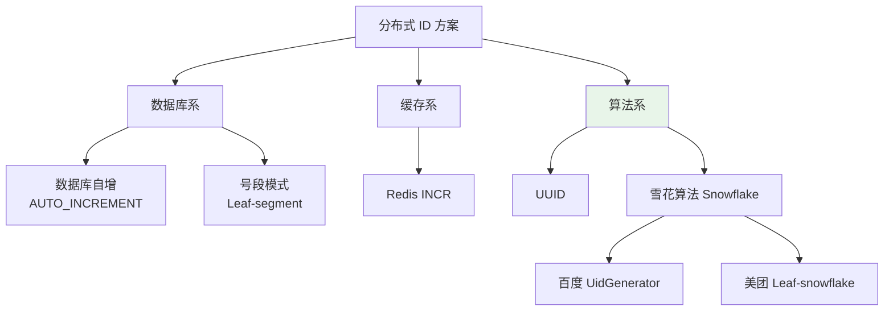
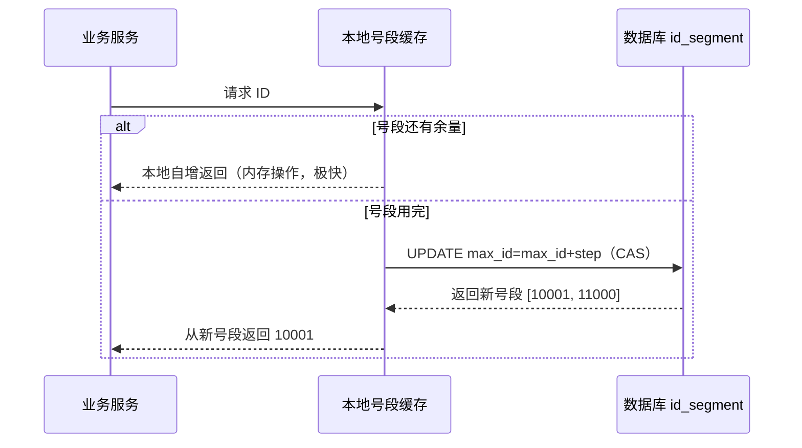
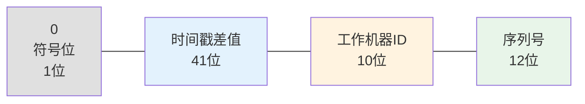
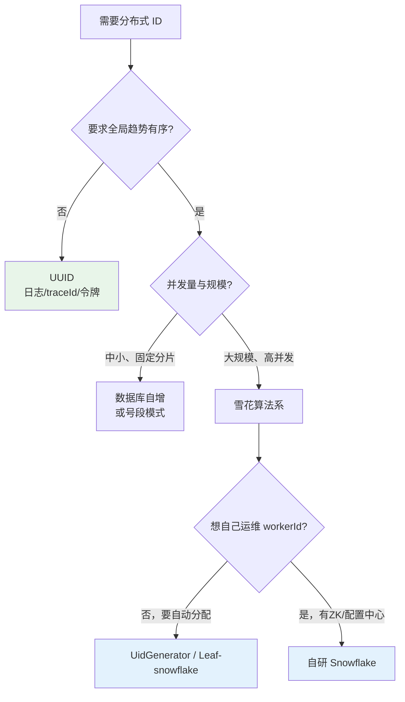

# 分布式 ID

> 定位：分库分表后，数据库自增 ID 撑不住了，你需要一个「全局唯一」的 ID 生成器。这篇把 UUID、数据库自增、号段模式、Redis 自增、雪花算法及各大厂实现（Leaf/UidGenerator）讲透，重点讲清雪花算法的结构、时钟回拨这个灵魂难题，以及怎么选型。

## 一、为什么需要它

在单库单表时代，主键用 `AUTO_INCREMENT` 就够了。但业务量上来后，一旦分库分表，问题就来了：

- 订单表拆成 16 个库 64 张表，**每张表各自自增**，ID 会重复，无法作为全局主键；
- 用数据库自增做订单号，**订单量可被推算**——竞对看下昨天的订单号是 10000，今天的是 10500，就知道你一天卖了 500 单，商业机密泄露；
- 数据库自增有**锁竞争**，高并发插入时自增锁成为瓶颈；
- 分布式场景下，多个服务都要生成 ID（订单号、支付流水号、消息 ID、链路追踪 ID），需要统一方案。

一个合格的分布式 ID，通常要满足：

| 要求 | 说明 |
|---|---|
| **全局唯一** | 任何时刻、任何节点生成的 ID 不重复（最基本） |
| **趋势有序** | ID 大致递增，写数据库时 B+ 树索引顺序插入，避免页分裂 |
| **高性能 / 低延迟** | 本地生成最佳，不能每次都远程调用 |
| **高可用** | 不能因单个组件故障导致全系统无法生成 ID |
| **信息安全** | 不暴露业务量、不暴露规则（某些场景要求） |
| **可读可控**（可选） | 含时间戳、机器号等，便于排查和排序 |

其中「**趋势有序**」是最容易被忽视、但对数据库性能影响极大的一点。InnoDB 用 B+ 树聚簇索引，如果主键完全随机（如 UUID），插入时会在索引中间随机位置插入，导致**页分裂、随机 IO、索引碎片**，写入性能断崖式下降。所以「全局唯一 + 趋势递增」是工程上的黄金组合。

## 二、方案全景

主流方案可以分成三大流派：



- **数据库系**：靠数据库事务和锁保证唯一，简单可靠，但性能和扩展性受限于 DB。
- **缓存系**：靠 Redis 的 `INCR` 原子自增，性能好，但要处理持久化和单点。
- **算法系**：本地按规则生成，无外部依赖、性能极高，代表是雪花算法。这是目前互联网公司的主流选择。

下面逐一拆解。

## 三、各方案原理与细节

### 3.1 UUID

UUID（Universally Unique Identifier）是 128 位的字符串，标准形式 `550e8400-e29b-41d4-a716-446655440000`。版本 4 基于随机数生成。

```java
String id = UUID.randomUUID().toString().replace("-", "");
```

**优点**：本地生成、无网络开销、性能极高、全球唯一（碰撞概率可忽略）。

**缺点**：
- **太长**：32 位字符串（带横杠 36 位），做数据库主键占空间大，索引臃肿；
- **无序**：完全随机，作为 InnoDB 聚簇主键会导致严重页分裂和随机 IO；
- **不可读**：看不出时间、业务含义。

**适用**：不要求有序、对存储不敏感的场景，如日志 traceId、临时令牌。**不推荐做数据库主键**。

> 有人用「UUID 转数字」或「有序 UUID（如 UUID v7，包含时间戳）」来缓解无序问题，这是可行的改进方向，但 Java 标准库原生支持有限，以你使用的版本为准。

### 3.2 数据库自增 ID

利用 `AUTO_INCREMENT`，多台机器用不同步长和初始值：

```sql
-- 节点1：从1开始，步长16
SET @@auto_increment_offset = 1;
SET @@auto_increment_increment = 16;
-- 节点2：从2开始，步长16
SET @@auto_increment_offset = 2;
```

**优点**：简单、天然有序、DBA 熟悉。

**缺点**：
- **强依赖数据库**，DB 挂了就生成不了 ID；
- **水平扩展困难**：扩容要改步长、重新规划 offset；
- **性能瓶颈**：高并发下自增锁竞争；
- **暴露业务量**：ID 连续，可被推算。

**适用**：中小规模、分库数量固定的系统。

### 3.3 号段模式（Leaf-segment）

这是对数据库自增的重要优化。核心思想：**不再每次插入都访问数据库，而是批量从数据库取一段 ID 缓存在本地**。

数据库里有一张分配表：

```sql
CREATE TABLE id_segment (
    biz_tag VARCHAR(64) PRIMARY KEY,
    max_id BIGINT NOT NULL,
    step INT NOT NULL,
    version BIGINT NOT NULL
);
```

服务启动时（或缓存用完时），执行一条原子更新，一次性取 `step` 个 ID：

```sql
UPDATE id_segment
SET max_id = max_id + step, version = version + 1
WHERE biz_tag = 'order' AND version = #{oldVersion};
```

取到后，本地维护 `[max_id - step + 1, max_id]` 这个号段，发号时本地自增内存计数器，用完再取下一段。



**优点**：
- 大幅降低数据库压力（从「每次插入访问 DB」变成「每 step 次访问一次」）；
- ID 趋势递增；
- step 可调，故障时号段缓存能撑一段时间。

**缺点**：
- ID 是连续的，仍暴露业务量（美团 Leaf 后来加了「双 buffer 异步取号段」优化，并提供了「无序」模式缓解）；
- DB 仍是单点，需做高可用；
- 服务重启会浪费当前号段剩余的 ID（ID 不连续，但通常可接受）。

**双 buffer 优化**：当号段用到 10% 时就异步去数据库取下一段，避免取号段时的网络延迟影响发号。这是美团 Leaf-segment 的做法。

### 3.4 Redis 自增

利用 Redis 的 `INCR` / `INCRBY` 原子命令：

```redis
INCR global:order:id    # 返回递增后的值
```

**优点**：性能高（单线程原子、内存操作）、实现简单、天然有序。

**缺点**：
- **依赖 Redis 可用性**，Redis 挂了发不了号；
- **持久化问题**：RDB 快照可能丢数据导致 ID 回退重复；AOF 配置不当也有风险；
- 单点 / 主从切换同样有丢数据风险（和分布式锁类似）；
- 每次发号都有网络开销（除非也用「批量取号段」思路，用 `INCRBY step` 一次取一段）。

**适用**：已经有 Redis 集群、对 ID 连续性要求不高的场景。同样可以用「号段思想」在客户端缓存来减少网络调用。

### 3.5 雪花算法（Snowflake）—— 主流方案

Twitter 开源的雪花算法是**本地生成、无外部依赖**的代表，也是目前互联网最主流的方案。

#### 3.5.1 ID 结构

一个 64 位的 `long`，从高位到低位划分：



| 部分 | 位数 | 含义 |
|---|---|---|
| 符号位 | 1 位 | 固定 0，保证 ID 为正数 |
| 时间戳 | 41 位 | 当前时间 − 自定义起始时间的毫秒差，可用约 69 年 |
| 机器 ID | 10 位 | 可拆成 5 位数据中心 + 5 位工作节点，最多 1024 个节点 |
| 序列号 | 12 位 | 同一毫秒内同一节点的自增序号，每毫秒最多 4096 个 ID |

理论上单机每毫秒能生成 4096 个 ID，每秒约 409 万个，性能极高。

#### 3.5.2 生成流程

1. 取当前毫秒时间戳，减去起始时间戳，放入高位；
2. 如果当前时间和上次相同，序列号自增；序列号超过 4095 则**自旋等待下一毫秒**；
3. 如果当前时间大于上次，序列号归零；
4. 把各部分拼成一个 64 位 long 返回。

**关键点**：机器 ID（workerId）必须全局唯一，否则不同机器在同一毫秒可能生成相同 ID。生产上 workerId 通常通过配置中心、ZK 注册或数据库分配，不能写死。

#### 3.5.3 时钟回拨 —— 雪花算法的灵魂难题

雪花算法强依赖系统时钟。**如果机器时钟往后退（时钟回拨）**，生成的时间戳比上次小，就可能重复，甚至导致 ID 非递增。

时钟回拨的常见原因：
- NTP 网络校时，时间被往回调；
- 虚拟机/容器迁移、快照恢复；
- 闰秒调整；
- 人工改时间。

**解决思路（按处理力度递进）**：

| 策略 | 做法 | 适用 |
|---|---|---|
| 直接抛异常 | 检测到回拨就拒绝服务并告警 | 回拨罕见、要求绝对不重复 |
| 小幅等待 | 回拨 ≤ 5ms，自旋等待时间追上 | 轻微抖动 |
| 借用未来时间 | 维护 lastTimestamp，回拨时继续用 lastTimestamp 自增序列号 | 小幅回拨 |
| 备用WorkerId/逻辑时钟 | 用逻辑时钟替代物理时钟，回拨时逻辑时钟继续前进 | 较彻底 |
| 切换节点 | 回拨节点下线，切到备用节点 | 有冗余节点 |

> 实践中主流实现（如 Leaf-snowflake）的处理是：启动时不依赖本地时钟，而是和集群其他节点对时；运行时检测到回拨则**直接报错拒绝服务 + 告警**，因为这通常意味着机器时间异常，强行发号风险更大。百度 UidGenerator 则通过「逻辑时钟」和环形缓冲做了更精细的处理。具体行为以你使用的版本为准。

### 3.6 大厂实现：Leaf 与 UidGenerator

#### 3.6.1 美团 Leaf

美团开源的 Leaf 同时提供两种模式：

- **Leaf-segment**：号段模式，双 buffer 优化，解决数据库压力；
- **Leaf-snowflake**：在雪花算法基础上，**启动时会向 ZK 注册节点并检测时钟**。它周期性上报自己的时间到 ZK，启动时对比集群时间，若发现本机时钟落后太多则启动失败，从而规避时钟回拨问题。

#### 3.6.2 百度 UidGenerator

百度开源的 UidGenerator 是基于雪花算法的增强实现，主要改进：

- **无需手工配置 workerId**：默认通过数据库（worker_node 表）或 ZK 自动分配 workerId，节点启动时注册、定时续约，解决了 workerId 分配这个运维痛点；
- **用「约定时间」代替「系统时间」**：维护一个 CachedUidGenerator 的缓冲环（RingBuffer），通过 Future 预生成 ID，平滑突发流量；
- **支持自定义 epoch、workerId 位数、序列号位数**，灵活适配不同规模。

它提供两种实现：`DefaultUidGenerator`（每次实时生成，简单）和 `CachedUidGenerator`（预生成 + 环形缓存，高性能，推荐）。

## 四、生产坑点与排查

### 坑点 1：workerId 重复导致 ID 冲突

**现象**：高峰期偶发主键冲突，数据库报 `Duplicate key`，但代码里看不出问题。
**原因**：两个节点配置了相同的 workerId，在同一毫秒生成了相同序列号组合的 ID。常见于容器化部署时 workerId 写死在配置里、扩容时忘了改。
**解法**：workerId 必须**动态分配**——通过数据库自增记录、ZK 临时顺序节点、或配置中心分配，保证全局唯一且节点下线后释放；容器环境尤其不能写死。启动时应校验 workerId 合法性并告警。

### 坑点 2：时钟回拨导致 ID 重复或倒退

**现象**：NTP 校时后，生成的 ID 突然变小，或出现重复 ID，导致依赖 ID 排序的业务（如按 ID 分页、消息顺序）错乱。
**原因**：雪花算法依赖物理时钟，回拨破坏了时间戳单调性。
**解法**：① 服务器关闭 NTP 的 step 校时，改用 slew 缓慢调整；② 采用 Leaf-snowflake 的启动时对时检测；③ 检测回拨时直接拒绝服务并告警，而非强行发号；④ 用 UidGenerator 的逻辑时钟方案。

### 坑点 3：号段模式下服务重启浪费大量 ID / ID 跳变

**现象**：服务频繁发布重启后，ID 出现大段跳跃（如从 10000 直接跳到 11000），虽然不影响正确性，但监控和排查时很困惑。
**原因**：每次重启都重新取一个新号段，旧号段未用完的部分被丢弃。
**解法**：① 调小 step，减少单次浪费（权衡 DB 压力）；② 用双 buffer 在关机前尽量用完；③ 接受 ID 不连续——**分布式 ID 本就不该假设连续**，业务上不要依赖 ID 的连续性。如果确实需要严格连续，只能放弃号段模式。

### 坑点 4：把 ID 当业务量暴露出去

**现象**：竞对通过订单号推算日均订单量；或用户能从流水号看出系统规模。
**原因**：自增 ID 或号段 ID 是连续的，规律明显。
**解法**：① 用雪花算法并隐藏时间戳起始值，打乱可推算性；② 在 ID 上叠加hash扰动；③ 对外暴露的「业务单号」和内部「数据库主键」分离——内部用有序 ID 保证索引效率，对外用不规则的业务编号。

## 五、调优与选型决策

### 5.1 方案对比

| 方案 | 有序性 | 性能 | 外部依赖 | 扩展难度 | 信息安全 | 推荐度 |
|---|---|---|---|---|---|---|
| UUID | 无序 | 极高 | 无 | 易 | 好 | 不推荐做主键 |
| 数据库自增 | 绝对递增 | 低 | 数据库 | 难 | 差 | 小规模 |
| 号段模式 | 趋势递增 | 高 | 数据库（弱） | 中 | 差 | 中大型，需有序 |
| Redis INCR | 绝对递增 | 高 | Redis | 中 | 差 | 已有 Redis 的场景 |
| 雪花算法 | 趋势递增 | 极高 | 无（需管 workerId） | 易 | 较好 | **主流首选** |
| Leaf/UidGenerator | 趋势递增 | 极高 | 弱（ZK/DB 管 workerId） | 易 | 较好 | **大厂推荐** |

### 5.2 选型决策



### 5.3 落地清单

1. **默认选雪花算法系**：本地生成、性能高、趋势有序；直接用 Leaf/UidGenerator 这类成熟实现，别从零手写。
2. **workerId 必须动态分配且全局唯一**，容器环境严禁写死。
3. **重视时钟**：关闭 NTP step 校时，启动时对时检测，回拨时拒绝服务 + 告警。
4. **不要依赖 ID 连续性**：业务设计上假设 ID 会跳变、不连续。
5. **内外分离**：内部用有序 ID 保证 DB 写入效率，对外暴露不规则业务单号。
6. **监控**：ID 生成 QPS、重复率、workerId 冲突告警、时钟回拨告警。

## 九、面试高频问法

> 这一节的答案按「面试时能讲透」的标准写：先给一句话结论，再展开机制、原因和坑点。

**Q1：分布式 ID 需要满足哪些要求？**

**一句话结论**：全局唯一、趋势递增（利于索引）、高性能、高可用、安全（不暴露业务量）。

展开：

- **唯一**：最基本，绝不能重复。
- **趋势递增**：MySQL InnoDB 主键用递增 ID 插入性能好（减少页分裂），所以 ID 最好递增。
- **高性能**：高并发下生成 ID 不能成为瓶颈。
- **高可用**：ID 生成服务不能单点。
- **安全**：连续 ID 会暴露业务量（对手能算出你一天多少单），有时需要不可预测。

加分点：说"趋势递增这点很多人忽略——随机 ID（如 UUID）作为 MySQL 主键会导致频繁页分裂，写入性能差，所以业务表主键最好用递增 ID"。

**Q2：UUID 做分布式 ID 有什么问题？**

**一句话结论**：UUID 能保证唯一，但**无序**（作为 MySQL 主键性能差）、太长（36 字符）、不可读。

展开：

- **无序**：UUID 是随机的，插入时主键位置随机，导致 B+ 树频繁页分裂，写入变慢、索引碎片多。
- **太长**：36 字符，占空间，索引大。
- **优点**：本地生成，无网络开销，绝对唯一。

加分点：说"UUID 适合'不需要作为数据库主键'的场景（如链路 TraceId、文件名），不适合当业务表主键"。

**Q3：雪花算法（Snowflake）的结构是怎样的？**

**一句话结论**：64 位——1 位符号位（固定 0）+ 41 位时间戳 + 10 位机器 ID + 12 位序列号。

| 部分 | 位数 | 作用 |
|---|---|---|
| 符号位 | 1 | 固定 0（正数） |
| 时间戳 | 41 | 毫秒级，可用约 69 年 |
| 机器 ID | 10 | 最多 1024 台机器 |
| 序列号 | 12 | 同一毫秒内最多 4096 个 |

**特点**：趋势递增（时间戳在高位）、本地生成（无网络）、高性能（每秒百万级）。

加分点：说"41 位时间戳是从某个起始时间算起的差值，不是绝对时间——所以雪花 ID 可以反解出生成时间，方便排查"。

**Q4：雪花算法的时钟回拨问题是什么？怎么解决？**

**一句话结论**：服务器时钟回拨（NTP 校时、闰秒）会导致生成重复 ID；解决方案有等待、抛异常、用历史最大时间、或用扩展位。

展开：

- **问题**：时钟回拨后，时间戳变小，可能生成和之前重复的 ID。
- **解决方案**：
  1. **等待**：回拨幅度小就等时钟追上（简单但阻塞）。
  2. **抛异常**：回拨就报错，让上层重试。
  3. **用历史最大时间**：记录上次生成的最大时间戳，回拨时用它继续递增。
  4. **扩展位**：用几位记录"回拨次数"，回拨时次数 +1，保证唯一。

加分点：说"生产环境时钟回拨很常见（NTP 同步、虚拟机迁移），雪花算法必须处理这个问题，否则会出现重复 ID 的严重事故"。

**Q5：号段模式是什么？和雪花算法有什么区别？**

**一句话结论**：号段模式是"一次从数据库取一批 ID（如 1000 个）缓存在内存，用完再取"；雪花是本地生成，号段依赖数据库。

展开：

- **号段模式**：数据库维护一个 `max_id`，每次 `UPDATE ... SET max_id = max_id + step`，返回这段区间，应用在内存里分配。
- **优点**：ID 连续递增（对索引友好）、性能好（批量取）。
- **缺点**：依赖数据库（数据库挂了影响发号）、ID 可预测（不安全）。

**对比雪花**：雪花无依赖、性能更高，但 ID 不连续；号段连续、可读，但依赖 DB。

加分点：说"美团 Leaf 就是号段模式 + 雪花模式的结合——号段模式保证趋势递增，双 buffer 预加载避免取号阻塞"。

**Q6：Redis 自增做分布式 ID 有什么优缺点？**

**一句话结论**：用 `INCR` 原子自增，简单高效、ID 连续；但依赖 Redis、持久化不当会丢 ID、集群下不好扩展。

展开：

- **优点**：`INCR key` 原子操作，性能高；ID 连续递增。
- **缺点**：
  - Redis 重启（未持久化）会从头开始，导致重复。
  - 集群模式下，不同 key 在不同节点，要保证同一业务用同一 key。
  - 依赖 Redis 可用性。

加分点：说"Redis 自增适合'量不大、能接受依赖 Redis'的场景；生产要开 AOF 持久化，且考虑 Redis 故障时的降级方案"。

**Q7：数据库自增主键能做分布式 ID 吗？怎么做？**

**一句话结论**：单库自增不行（性能瓶颈、单点）；可以用"多实例设置不同步长"（如步长 2，实例 1 生成奇数、实例 2 生成偶数）或"分段"。

展开：

- **多实例步长**：实例 1 `auto_increment_offset=1, increment=2`（1,3,5...），实例 2 offset=2（2,4,6...）。扩展难（加实例要改步长）。
- **号段模式**：一个数据库专门发号，每次取一段（如 1000 个），应用内存分配。

加分点：说"纯数据库自增在互联网高并发下基本不可行——数据库是瓶颈；号段模式是对它的改良，把'每次取一个'改成'每次取一批'"。

**Q8：Leaf、UidGenerator 这些开源方案了解吗？**

**一句话结论**：美团 Leaf 支持号段和雪花两种模式；百度 UidGenerator 基于雪花改进（用 RingBuffer 缓存、借用未来时间）。

展开：

- **Leaf**：号段模式（依赖 DB，双 buffer 预加载）+ 雪花模式（解决时钟回拨），可切换。
- **UidGenerator**：雪花变种，用 RingBuffer 缓存 ID（预生成，提高性能），用"借用未来时间"避免时钟回拨。

加分点：说"这些方案的核心改进都是'预生成 + 缓存'——把 ID 提前生成好放内存，用的时候直接取，避免实时生成的开销"。

**Q9：分布式 ID 怎么保证高可用？**

**一句话结论**：多实例部署 + 本地缓存 + 降级方案——不能因为 ID 服务挂了导致业务停摆。

展开：

- **多实例**：ID 生成服务集群部署，前面的机器 ID 分配好（雪花）。
- **本地缓存**：号段模式预取一批，服务挂了还能用缓存撑一会。
- **降级**：ID 服务不可用时，降级到本地生成（如 UUID 或本地雪花）。
- **监控**：ID 生成延迟、剩余号段量。

加分点：说"ID 服务是'基础设施'，它挂了所有业务都写不了数据——所以它的可用性要求比业务还高，必须有降级"。

**Q10：ID 生成要不要保证"趋势递增"？为什么？**

**一句话结论**：最好保证，因为 MySQL InnoDB 的主键是聚簇索引，递增 ID 插入是"追加"，随机 ID 插入是"随机插入"，后者性能差很多。

展开：

- **InnoDB 聚簇索引**：数据按主键顺序存储。递增插入 → 新数据总在末尾，顺序写；随机插入 → 数据要插到中间，导致页分裂、数据移动。
- **影响**：随机主键（如 UUID）在高并发写入时，性能可能只有递增主键的几分之一。
- **例外**：如果表很小、或写入不频繁，影响不大。

加分点：说"这就是为什么'UUID 做 MySQL 主键'是经典反模式——它不是不能用，是高并发写入时会成为瓶颈"。

## 小结

- 分布式 ID 核心：全局唯一 + 趋势有序；UUID 因无序和过长不适合做主键。
- 三大流派：数据库系（自增、号段）、缓存系（Redis INCR）、算法系（雪花）。
- 雪花算法 = 符号位 + 41 位时间戳 + 10 位机器 ID + 12 位序列号，本地生成性能极高。
- 时钟回拨是雪花的灵魂难题，workerId 重复是另一大坑，都要靠动态分配与检测机制解决。
- 选型默认走雪花算法系（Leaf/UidGenerator），内外 ID 分离，不依赖 ID 连续性。
