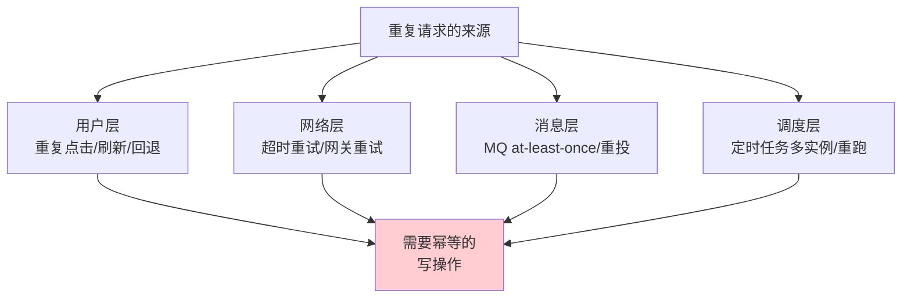
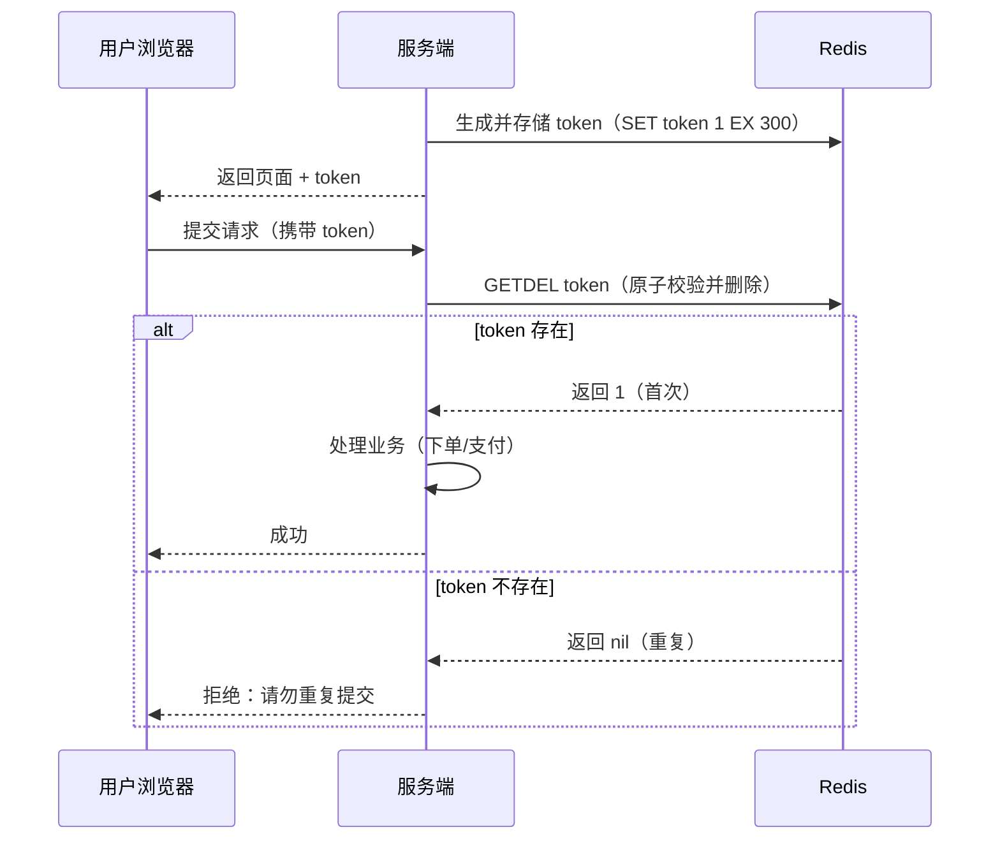
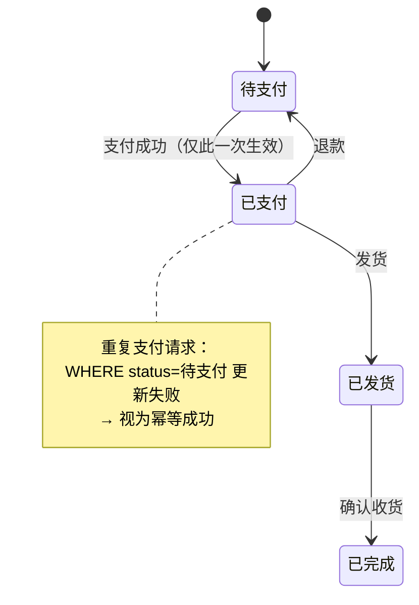
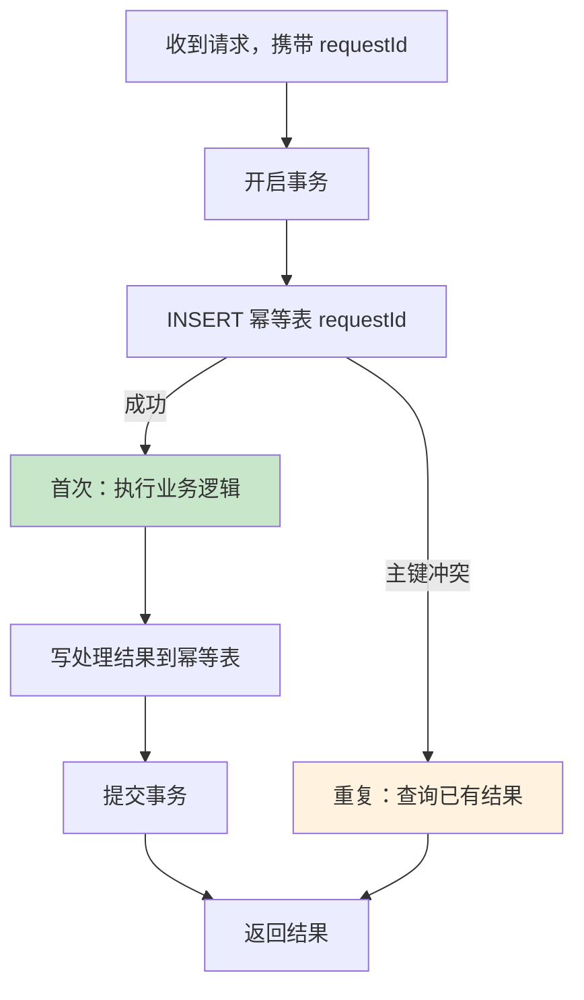
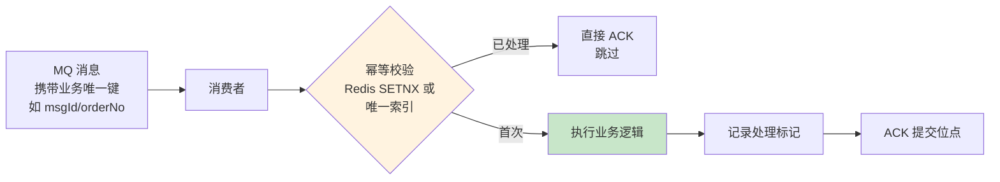

# 幂等设计

> 定位：幂等是分布式系统的「防重复执行」保险丝——同一个请求执行一次和执行多次，效果必须一样。这篇从概念讲起，覆盖重复提交、重复消费的真实场景，把唯一索引、Token、状态机、幂等表、分布式锁、乐观锁六大方案讲透，并落到 HTTP 语义和 MQ 消费的实战上。

## 一、为什么需要它

先看几个让人血压升高的真实事故：

- 用户点击「支付」按钮，网络卡了一下，用户又点了一次，结果**扣了两次款**；
- MQ 消息因为消费失败被重试，或因为网络原因投递了两次，导致**发了两张优惠券**；
- 调用下游接口超时，网关自动重试，结果**创建了两条订单**；
- 定时任务在多实例上各跑一遍，或任务重跑，**同一笔账单结算了两次**。

在分布式环境里，「请求恰好被处理一次（exactly once）」在现实中几乎无法保证——网络超时、重试机制、消息队列的 at-least-once 投递、用户手抖，都会导致**同一逻辑被触发多次**。既然无法阻止重复，那就让「重复执行」变得无害——这就是幂等要解决的问题。

> **幂等（Idempotency）的严格定义**：一个操作执行任意多次，对系统状态的影响与执行一次相同。数学上 `f(f(x)) = f(x)`。

注意：幂等关注的是**副作用**（对系统状态的改变），而不是返回值。多次执行返回相同结果是「结果幂等」，但更重要的是「不重复产生副作用」。

**幂等不是为了消灭重复请求，而是为了让重复请求不再产生新的副作用。**

## 二、哪些场景必须幂等



需要幂等的典型写操作：

- **支付/扣款/转账**：钱相关，重复一次就是资损；
- **下单/创建订单**：重复下单产生脏数据；
- **发券/积分/奖励**：重复发放造成损失；
- **状态流转**：订单从「待支付」变「已支付」，重复触发不应重复结算；
- **消息消费**：几乎所有 MQ 消费者都应该幂等。

而纯查询、纯删除（按唯一 ID）天然幂等，不需要额外设计。

## 三、六大实现方案

### 3.1 方案一：唯一索引 —— 最简单粗暴

利用数据库唯一约束，让重复数据插不进去。

```sql
CREATE TABLE `order` (
    id BIGINT PRIMARY KEY,
    order_no VARCHAR(64) NOT NULL UNIQUE,   -- 业务唯一单号做唯一索引
    amount DECIMAL(10,2)
);
```

插入时如果重复，数据库抛 `DuplicateKeyException`，捕获后按「已处理」返回成功。

**适用**：创建类操作，且有天然唯一业务键（订单号、流水号）。这是**成本最低、最优先**的方案。

**局限**：只能防「插入重复」，无法处理「更新」类操作的重复（比如重复扣款）。

### 3.2 方案二：Token 机制 —— 防重复提交

专门解决「用户重复点击 / 表单重复提交」：

1. 页面加载时，服务端生成一个 token（如 UUID），存到 Redis（带过期时间），返回给前端；
2. 前端提交请求时带上这个 token；
3. 服务端校验 token 是否存在，**存在则删除它并处理业务**（「校验 + 删除」必须原子，通常用 Lua 或 Redis 的 `GETDEL`）；
4. 第二次提交时 token 已被删，校验失败，拒绝处理。



**关键**：校验和删除必须原子，否则两次并发请求都读到 token 存在，就都放行了。

**适用**：前端表单、支付确认页等防重复点击场景。

### 3.3 方案三：状态机 —— 用状态流转防重复

很多业务有明确的状态流转，如订单：`待支付 → 已支付 → 已发货 → 已完成`。重复请求通常是想做**同一个状态流转**，那就用「带状态条件的更新」保证只流转一次：

```sql
UPDATE `order`
SET status = 'PAID'
WHERE order_no = 'xxx' AND status = 'UNPAID';
```

检查 `affectedRows`：**等于 1 说明本次真正流转成功**；等于 0 说明已是 `PAID`（之前处理过），直接返回幂等成功。



**适用**：有清晰状态流转的业务（订单、工单、审批）。这是**业务层面最自然的幂等方式**。

### 3.4 方案四：幂等表 —— 通用记录法

建一张幂等记录表，记录「请求唯一标识 → 处理结果」：

```sql
CREATE TABLE idempotent_record (
    request_id VARCHAR(64) PRIMARY KEY,
    response TEXT,
    status TINYINT,
    created_at DATETIME
);
```

处理流程（必须在**同一个本地事务**里）：

1. 开启事务；
2. 尝试插入 `request_id`；
3. 插入成功 → 首次请求，执行业务，把结果写入记录，提交事务；
4. 插入失败（主键冲突）→ 重复请求，直接返回已存的结果。



**关键**：业务处理和幂等记录必须在**同一事务**，否则「业务成功但记录失败」会导致重试时重复执行。

**适用**：通用的、需要精确返回结果的幂等场景。

### 3.5 方案五：分布式锁 —— 串行化

处理前先拿分布式锁（锁的 key 用业务唯一键），拿到的执行，拿不到说明正在处理或已处理，直接返回。详见「分布式锁」篇。

**局限**：锁只是把并发请求串行化，**并不天然幂等**——如果第一个请求处理完后锁释放，第二个请求拿到锁仍会再执行一次。所以分布式锁通常要配合状态检查或幂等表使用：**「加锁 + 查状态 + 处理」** 组合起来才幂等。

**适用**：短时间内的并发去重（防重复点击），不适合作为长期幂等方案。

### 3.6 方案六：乐观锁 —— 版本号控制

在数据上加 `version` 字段，更新时带上版本条件：

```sql
UPDATE account
SET balance = balance - 100, version = version + 1
WHERE id = 1 AND version = 3;
```

重复请求用同一个 version，第二次更新时 version 已从 3 变成 4，`WHERE` 不匹配，`affectedRows = 0`，不会重复扣款。

**适用**：更新类操作、冲突概率不高的场景。和状态机方案思路相近，都是「带条件的更新」。

## 四、HTTP 方法的幂等性

理解 HTTP 语义，是设计 RESTful 接口幂等的基石：

| 方法 | 是否幂等 | 说明 |
|---|---|---|
| **GET** | 是（天然） | 查询操作，多次执行不改变资源状态（注意别在 GET 里写数据） |
| **PUT** | 是（天然） | 用完整资源替换，`PUT /order/1 {status:paid}` 执行一次和多次结果相同 |
| **DELETE** | 是（天然） | 按唯一标识删除，删一次和删多次效果相同（返回码可能不同） |
| **HEAD / OPTIONS** | 是 | 类 GET，无副作用 |
| **POST** | **否（天然不幂等）** | 通常用于「创建」资源，多次调用会创建多个资源 |

重点在 **POST**：它是非幂等的典型。但工程上我们需要让 POST 幂等——常见做法：

- 让 POST 携带**幂等键**（Idempotency-Key 请求头或业务 requestId），配合幂等表；
- 或者把「创建」语义改成「upsert」——用唯一键 + 状态机保证重复请求不产生新资源。

> 补充：「安全（safe）」和「幂等（idempotent）」是两个概念。GET/HEAD 是安全的（无副作用），PUT/DELETE 幂等但不安全（有副作用，只是多次执行效果一样）。POST 通常既不安全也不幂等。

## 五、MQ 消费幂等

消息队列是幂等的重灾区。主流 MQ（Kafka、RocketMQ、RabbitMQ）默认都是 **at-least-once（至少一次）** 投递——消息**可能重复**，但保证不丢。所以**消费者必须自己做幂等**。

### 5.1 重复消费的两种原因

1. **生产者重复发送**：如事务消息回查、发送重试；
2. **消费者重复消费**：消费成功后，提交消费位点（offset）前消费者宕机，重启后会从旧位点重新消费。

### 5.2 消费端幂等落地



**落地要点**：

- **消息带唯一业务键**：最好用业务主键（订单号、流水号），而不是 MQ 自带的 msgId（不同 MQ 语义不同，且重投时 msgId 可能变）。
- **用 Redis `SETNX msgKey 1 EX ...` 做去重**：设置成功才处理，失败说明已消费。但要注意「处理成功」和「设置标记」的一致性——处理失败要删除标记，允许重试。
- **更稳妥用数据库唯一索引**：消费后插入一条「已消费记录」，靠唯一约束去重，和业务处理放同一事务，保证强一致。
- **注意消费失败的处理**：不能简单地「先标记再处理」——标记了但处理失败，消息就被跳过了。要么处理成功后才标记，要么失败时回滚标记。

## 六、生产坑点与排查

### 坑点 1：「校验 + 处理」非原子，并发下幂等失效

**现象**：两个相同请求同时到达，都通过了幂等校验（都查到「未处理」），都执行了业务，产生两条记录。
**原因**：幂等校验和业务处理之间有竞态窗口。常见于「先查幂等表，没有就处理」的非原子实现。
**解法**：① 靠数据库唯一索引兜底——即使都通过了业务校验，插入时只有一个能成功；② Token 用 `GETDEL` 原子操作；③ 幂等记录用「插入即占位」方式，插入成功的才处理；④ 加分布式锁把校验和处理包起来。

### 坑点 2：业务成功但幂等标记失败

**现象**：扣款成功，但幂等记录写入失败（或网络中断），重试请求进来时又扣了一次款。
**原因**：业务处理和幂等记录不在同一个事务，或跨了不同存储（业务在 DB、标记在 Redis），无法原子提交。
**解法**：① 把幂等记录和业务数据放在**同一个数据库事务**里；② 如果标记必须在 Redis，采用「业务事务提交后再标记」+ 对账兜底；③ 用数据库唯一索引作为最终防线——扣款流水表对业务键加唯一索引，重复插入直接失败。

### 坑点 3：MQ 先标记后处理，处理失败消息被吞

**现象**：消费时先用 `SETNX` 标记消息已消费，再处理业务；业务处理失败了，但标记还在，重试消费时被跳过，数据永久丢失。
**原因**：标记时机错误，标记先于业务成功。
**解法**：① **业务处理成功后才标记**；② 处理失败时删除标记，允许下次重试；③ 更稳妥的做法是把「业务处理 + 消费记录」放同一 DB 事务，用唯一索引去重，事务回滚则标记也回滚。

### 坑点 4：幂等键设计不当，过度去重或去重不足

**现象**：同一个用户不同订单被当成重复请求拒绝（过度去重）；或同一订单的合理重试没被拦截（去重不足）。
**原因**：幂等键粒度选错——用了用户 ID 这种过粗的键，或用了每次都变的随机键。
**解法**：幂等键必须是**能唯一标识一次业务意图**的键，如订单号、支付流水号、业务 requestId。同一业务意图的重试用同一个键，不同意图用不同键。

## 七、调优与选型决策

### 7.1 方案对比

| 方案 | 适用场景 | 实现成本 | 一致性 | 注意点 |
|---|---|---|---|---|
| 唯一索引 | 创建类、有天然业务键 | 低 | 强 | 兜底首选，能处理并发插入 |
| Token 机制 | 前端防重复提交 | 中 | 中 | 校验+删除须原子 |
| 状态机 | 有状态流转的业务 | 低 | 强 | 用带状态条件的更新 |
| 幂等表 | 通用、需返回结果 | 中 | 强（同事务） | 业务与记录同事务 |
| 分布式锁 | 短时并发去重 | 中 | 中 | 需配合状态检查，不单独幂等 |
| 乐观锁 | 更新类、低冲突 | 低 | 中 | 冲突高时重试开销大 |

### 7.2 落地清单

1. **组合拳，不要单方案**：唯一索引做「最终防线」+ Token/状态机做「前置拦截」，这是最稳的模式。
2. **幂等键是核心**：选能唯一标识业务意图的键（订单号/流水号/requestId），不用每次都变的随机值。
3. **原子性优先**：校验和处理、标记和业务，要么原子，要么靠唯一索引/事务兜底。
4. **MQ 默认当会重复**：消费者必须幂等，用业务键去重，业务成功后才标记。
5. **失败要能重试**：幂等标记不能因为一次业务失败就把消息永久吞掉。
6. **可观测**：记录「拦截了多少重复请求」，异常高的重复率往往意味着上游有问题。

## 九、面试高频问法

> 这一节的答案按「面试时能讲透」的标准写：先给一句话结论，再展开机制、原因和坑点。

**Q1：什么是幂等？为什么分布式系统必须考虑幂等？**

**一句话结论**：幂等是"同一个操作执行一次和执行多次，结果相同"；分布式系统因网络重试、消息重复，同一请求可能到达多次，不幂等就会重复扣款/重复下单。

展开：

- **幂等的本质**：操作的"副作用"只发生一次，无论调用多少次。
- **为什么必须**：网络超时重试、MQ 重复投递、用户重复点击、定时任务重复执行——这些在分布式系统里是常态。
- **典型场景**：支付、下单、扣库存、消息消费。

加分点：说"幂等不是'可选项'，是分布式系统的'必选项'——只要你用了重试或消息队列，就必须考虑幂等"。

**Q2：HTTP 方法里哪些是幂等的？**

**一句话结论**：GET、HEAD、PUT、DELETE 是幂等的；POST 不是（语义上每次创建新资源）。

展开：

| 方法 | 幂等 | 说明 |
|---|---|---|
| GET | 是 | 查询，无副作用 |
| HEAD | 是 | 只取头 |
| PUT | 是 | 更新到指定状态，多次执行结果相同 |
| DELETE | 是 | 删除，多次执行结果相同（第一次删了，后面删不存在） |
| POST | 否 | 每次创建新资源 |

加分点：说"注意'幂等'是指'结果相同'，不是'响应相同'——DELETE 第二次返回 404，但结果（资源不存在）是一样的，仍算幂等"。

**Q3：唯一索引怎么实现幂等？**

**一句话结论**：给业务字段（如订单号、请求 ID）建唯一索引，重复插入会报唯一键冲突，捕获后返回成功——最简单可靠的幂等方案。

展开：

- **做法**：`INSERT INTO orders (order_no, ...) VALUES (...)`，`order_no` 唯一索引。重复插入抛 `DuplicateKeyException`，捕获后当作"已处理"返回。
- **优点**：数据库层面保证，绝对可靠。
- **缺点**：依赖数据库，高并发下唯一键冲突有性能开销。

加分点：说"唯一索引是最'硬'的幂等——它不依赖应用逻辑，数据库帮你兜底；但它只能防'插入'重复，不能防'更新'重复"。

**Q4：Token 机制怎么实现幂等？**

**一句话结论**：客户端先申请一个唯一 Token，提交时带上，服务端校验 Token 是否已用过，用过就拒绝。

展开：

1. 客户端请求"获取 Token"接口，服务端生成唯一 Token 存 Redis（或返回给客户端）。
2. 客户端提交业务请求，带上 Token。
3. 服务端校验 Token：存在则删除并处理，不存在则说明重复，拒绝。

**适用**：表单提交、支付等"一次性"操作。

加分点：说"Token 机制的关键是'校验和删除要原子'——用 Redis 的 `DEL` 返回值判断，或用 Lua 脚本，否则并发下可能都通过"。

**Q5：状态机怎么实现幂等？**

**一句话结论**：业务状态只能单向流转（如 待支付→已支付→已发货），更新时校验当前状态，非法流转就拒绝。

展开：

- **做法**：`UPDATE order SET status='已支付' WHERE id=? AND status='待支付'`——只有当前是"待支付"才能更新成功。
- **幂等**：重复执行时，`status` 已经不是"待支付"，更新影响 0 行，天然幂等。
- **优点**：业务语义清晰，适合有明确状态的流程。

加分点：说"状态机幂等的精髓是'带条件的更新'——把'状态校验'和'更新'放在一条 SQL 里，原子且幂等"。

**Q6：幂等表和唯一索引有什么区别？**

**一句话结论**：唯一索引防"重复插入"；幂等表记录"某个请求是否处理过"，防"重复处理"，更通用。

展开：

- **唯一索引**：给业务字段加唯一约束，重复插入报错。
- **幂等表**：单独一张表，记录 `(业务类型, 请求ID, 处理状态)`，处理前先查/插入。
- **区别**：幂等表能记录"处理中/成功/失败"状态，适合需要知道"处理到哪一步"的场景；唯一索引更轻量。

加分点：说"幂等表适合'处理逻辑复杂、需要记录状态'的场景（如支付回调），唯一索引适合'简单的防重复插入'"。

**Q7：MQ 消费怎么保证幂等？**

**一句话结论**：MQ 会重复投递（至少一次语义），消费端用"业务唯一键 + 去重表/Redis"保证只处理一次。

展开：

- **为什么重复**：消费者处理成功但 ACK 丢失，MQ 重投；或 MQ 本身保证 at-least-once。
- **方案**：
  1. 业务唯一键（如订单号）+ 唯一索引
  2. Redis 记录已处理的 messageId（注意过期时间）
  3. 状态机（带条件更新）
- **注意**：去重记录要和业务处理在**同一事务**，否则"处理成功但去重记录没写"仍会重复。

加分点：说"MQ 幂等的坑在'去重记录和业务操作的原子性'——用本地事务包住，或用'先插入去重记录，成功才处理'的顺序"。

**Q8：幂等和防重放有什么区别？**

**一句话结论**：幂等是"重复执行结果一样"；防重放是"拒绝重复的请求"——前者允许重复但结果一致，后者直接拒绝。

展开：

- **幂等**：重复请求照常处理，但结果不变（如重复扣款只扣一次）。
- **防重放**：识别出是重放的请求，直接拒绝（如签名 + 时间戳 + nonce）。
- **关系**：防重放是幂等的一种实现方式（通过拒绝重复），但幂等不一定靠防重放。

加分点：说"支付场景两者都要——防重放挡住恶意重放，幂等兜底防止'正常重试'导致的重复，双保险"。

**Q9：幂等的粒度怎么定？**

**一句话结论**：按"业务唯一标识"定——同一笔业务操作的所有重试共享一个唯一键，不同业务操作有不同的键。

展开：

- **订单创建**：用"用户 ID + 商品 ID + 时间窗口"或客户端生成的"请求 ID"。
- **支付**：用"订单号"（一笔订单只付一次）。
- **消息消费**：用"消息 ID"或"业务主键"。

**关键**：唯一键要能区分"重复请求"和"新请求"——太粗会误判（不同的正常请求被当成重复），太细起不到幂等作用。

加分点：说"幂等粒度错了比不做还糟——粒度太粗会把正常请求挡掉，粒度太细等于没做；要和业务方一起定'什么算同一笔'"。

**Q10：高并发下幂等方案怎么选？**

**一句话结论**：优先用**唯一索引/状态机**（数据库层面，最可靠）；高并发写入用 **Redis 去重**（性能好但要处理一致性）；Token 适合表单类。

展开：

| 方案 | 性能 | 可靠性 | 适用 |
|---|---|---|---|
| 唯一索引 | 中 | 高 | 插入类操作 |
| 状态机 | 高 | 高 | 有状态流转 |
| Redis 去重 | 高 | 中（可能丢） | 高并发、可容忍极小概率 |
| Token | 中 | 高 | 表单提交 |

加分点：说"高并发下'唯一索引'的冲突会成为瓶颈，可以用'Redis 预去重 + 数据库唯一索引兜底'——Redis 挡掉大部分重复，数据库保证最终不重复"。

## 小结

- 幂等 = 多次执行效果等同一次；分布式下重复不可避免，幂等是让重复无害的保险丝。
- 六大方案：唯一索引（兜底首选）、Token（防重复提交）、状态机（带条件更新）、幂等表（同事务）、分布式锁（配合状态检查）、乐观锁（版本号）。
- HTTP：GET/PUT/DELETE 幂等，POST 不幂等，需幂等键改造。
- MQ 默认 at-least-once，消费者必须幂等；用业务键去重，业务成功后才标记。
- 落地靠组合拳：唯一索引做最终防线 + 前置拦截，原子性和幂等键粒度是关键。
