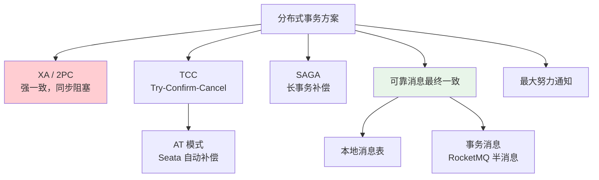
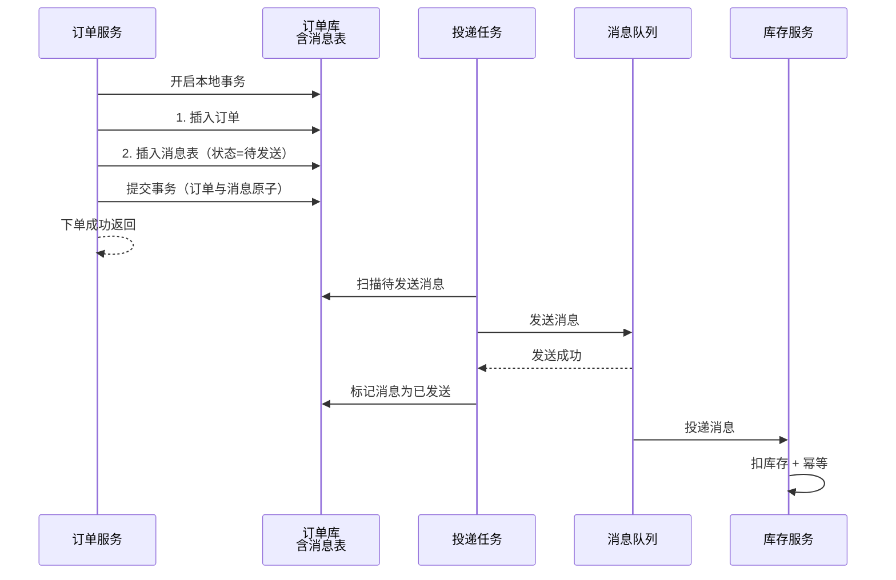
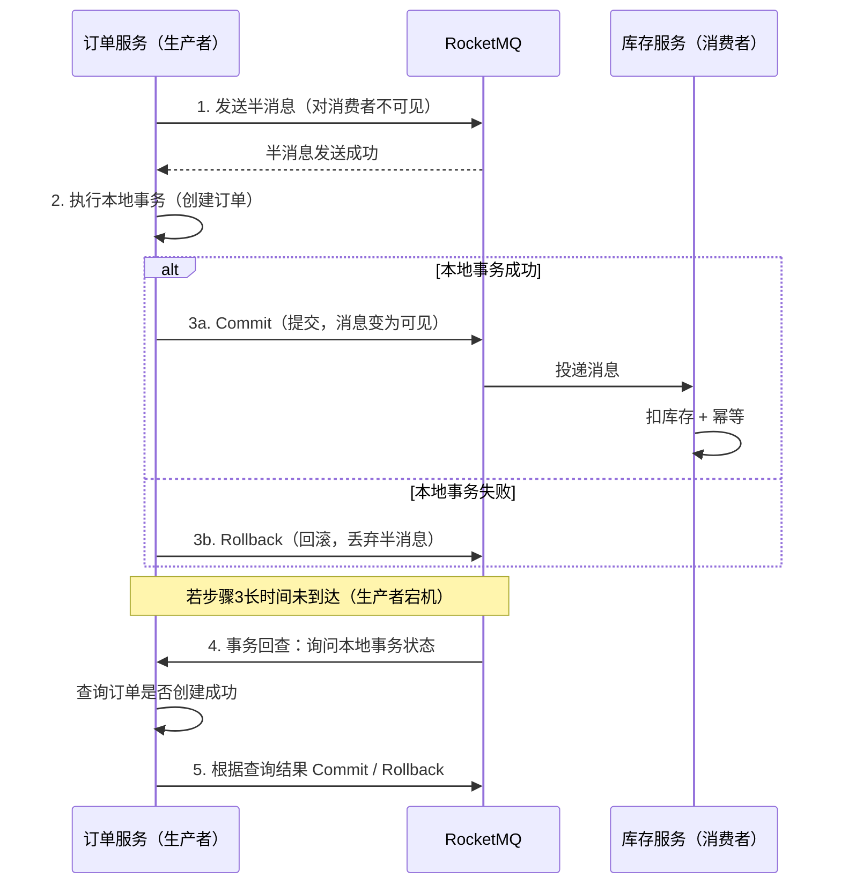
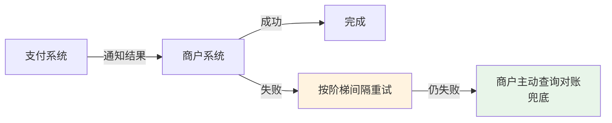
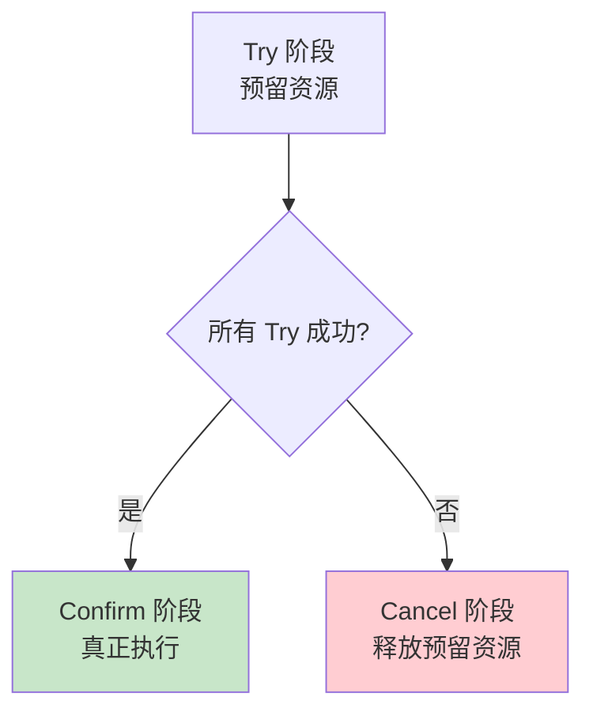

# 可靠消息与分布式事务

> 定位：分布式事务的本质是「跨多个独立数据源的操作，要么都成功要么都回滚」——而本地事务的 ACID 在跨服务后失效。这篇讲清问题本质，以及本地消息表、事务消息（RocketMQ 半消息）、最大努力通知、TCC/SAGA/AT 这几条主流路径的原理、一致性强度与复杂度取舍。

## 一、为什么需要它

一个最常见的业务场景：用户下单。

1. 订单服务：创建订单（写订单库）；
2. 库存服务：扣减库存（写库存库）。

两个服务、两个数据库。本地事务只能保证各自库内的 ACID，保证不了「订单创建成功的同时库存一定扣减」。于是会出现这些致命场景：

- **订单创建成功，扣库存失败**：用户付了钱却没货，超卖；
- **订单创建失败，但库存扣了**：货少了，订单没生成；
- 更隐蔽的：**订单库提交成功，但发消息告诉库存服务时宕机了**，库存永远不知道要扣。

这就是分布式事务要解决的问题：**让跨多个服务的写操作，在某个一致性级别上达成「要么都成，要么都不成」的效果。**

先建立一个重要认知：**没有银弹**。CAP/BASE 告诉我们，跨网络无法保证严格的 ACID，所有分布式事务方案都是在「一致性强度」和「性能/复杂度/可用性」之间取舍。选方案前，先问自己：这个场景真的需要强一致吗？很多情况下「最终一致 + 对账」就够了。

## 二、问题本质与方案全景

分布式事务的难点根源有三：

- **网络不可靠**：服务间调用可能超时、失败，调用方无法知道对方到底成功没有；
- **没有全局时钟和全局事务管理器**（在微服务架构下）；
- **CAP 约束**：分区时无法同时保证 C 和 A。

主流解决方案分成几大类：



| 方案 | 一致性 | 性能 | 复杂度 | 业务侵入 |
|---|---|---|---|---|
| XA / 2PC | 强一致 | 低（同步阻塞） | 中 | 低 |
| TCC | 最终一致 | 中高 | 高 | 高（每个操作写 3 个方法） |
| SAGA | 最终一致 | 中高 | 中高 | 中（写补偿逻辑） |
| AT（Seata） | 最终一致 | 中 | 中（框架代理） | 低 |
| 本地消息表 | 最终一致 | 中 | 中 | 中 |
| 事务消息 | 最终一致 | 中高 | 中 | 中 |
| 最大努力通知 | 弱（最终一致） | 高 | 低 | 低 |

这一篇重点讲「可靠消息」这条线（本地消息表、事务消息、最大努力通知），以及它们和 TCC/SAGA/AT 的配合。

## 三、本地消息表

这是最经典、最容易理解的可靠消息方案，由 ebay 提出。核心思想：**把「要发送的消息」和「业务数据」放在同一个本地事务里写入数据库**，保证二者原子性，再通过异步任务可靠地把消息投递出去。

### 3.1 流程



### 3.2 关键设计

- **消息表和业务表同库、同事务**：这是「可靠」的根基——订单成功则消息一定在库里，不会丢。
- **投递任务**：可以是一个独立线程定时扫描 `status=待发送` 的消息，投递成功后改状态；或订阅数据库的 binlog（如 Canal）来捕获消息。
- **重试机制**：投递失败的消息保持「待发送」，下次继续重试；设置最大重试次数和告警。
- **消费端幂等**：消息可能重复投递，消费端必须幂等（见「幂等设计」篇）。

### 3.3 优缺点

**优点**：实现简单、可靠（消息不丢）、不依赖特殊 MQ 特性。

**缺点**：
- 消息表耦合在业务库里，侵入业务；
- 需要额外的扫描任务（有轮询延迟）；
- 消息表会持续增长，需要归档/清理；
- 本地事务里多写一张表，有额外开销。

## 四、事务消息（RocketMQ 半消息）

本地消息表要自己维护消息表和投递任务。RocketMQ 提供了**事务消息**特性，把这部分能力下沉到 MQ，业务不用自己建消息表。

### 4.1 半消息（Half Message）机制

事务消息的核心概念是「半消息」——消息已经发到 MQ，但**对消费者不可见**（消费者收不到），直到生产者确认提交。

完整流程：



### 4.2 事务回查 —— 可靠性的关键

如果生产者在发送半消息后、提交/回滚前**宕机了**，MQ 不知道该提交还是丢弃。RocketMQ 的解决方案是**事务回查**：MQ 定时扫描长时间处于「半消息」状态的消息，主动回调生产者的回查接口，生产者查询本地事务的实际结果（如查订单表有没有这条订单），再决定 Commit 还是 Rollback。

这就是事务消息可靠的根本：**即使生产者宕机，MQ 也能通过回查把悬而未决的消息确定下来**，不会出现「订单没创建但库存扣了」或「订单创建了但库存没扣且消息永远丢失」。

### 4.3 本地事务与回查的对应

生产者需要实现两个回调：

- `executeLocalTransaction`：发送半消息后执行本地事务，返回 `COMMIT` / `ROLLBACK` / `UNKNOWN`；
- `checkLocalTransaction`：MQ 回查时调用，查询本地事务真实状态。

> 注意边界：如果本地事务成功但返回了 `UNKNOWN`，MQ 会回查；回查时一定要能准确查出本地事务的最终结果，否则可能误判。通常回查逻辑就是查订单表的状态。

### 4.4 优缺点

**优点**：不用自建消息表，可靠性由 MQ 保证，性能和易用性比本地消息表好。

**缺点**：依赖 RocketMQ 的事务消息能力（不是所有 MQ 都支持，Kafka 的事务语义不同）；要实现回查接口；半消息对业务有一定侵入。

## 五、最大努力通知

这是一致性最弱、但实现最简单的方案。典型场景：支付完成后通知商户。

流程：

1. 支付系统调用商户接口通知结果；
2. 失败则按一定策略重试（如 1s、5s、10s、30s、1min、5min……逐步拉长间隔）；
3. 重试到最大次数仍失败就放弃，或转入人工处理；
4. 商户可以**主动查询**支付系统的结果来对账（兜底）。



**特点**：不保证「一定通知到」，只保证「尽最大努力通知」，靠**重试 + 商户主动查询对账**来收敛。

**适用**：对一致性要求不高、下游可主动查询的场景（支付结果通知、短信发送结果回调）。**不适合**核心交易链路。

## 六、TCC、SAGA、AT 与事务消息的配合

前面讲的可靠消息解决的是「通过消息让多个服务最终一致」。还有另一大类方案——**补偿型事务**，它们和消息机制常常配合使用。

### 6.1 TCC（Try-Confirm-Cancel）

TCC 要求每个业务操作拆成三个方法：

| 阶段 | 作用 |
|---|---|
| **Try** | 预留资源（冻结库存、冻结余额），做一致性检查和准备 |
| **Confirm** | 真正执行操作（扣减冻结的库存/余额），要求幂等 |
| **Cancel** | 失败时释放预留资源（解冻），要求幂等 |



**优点**：一致性较好，性能比 XA 高（无全局锁）。

**缺点**：**业务侵入极大**——每个操作都要写 Try/Confirm/Cancel 三个方法，还要处理幂等、空回滚、悬挂等问题。开发和维护成本高。

**与消息的配合**：TCC 的 Confirm/Cancel 阶段可以用消息来异步驱动，提高性能；但核心的 Try 通常是同步的。

### 6.2 SAGA

SAGA 把一个长事务拆成多个本地事务，每个本地事务配一个**补偿事务**（反向操作）。执行时按顺序执行各本地事务，如果某一步失败，则**逆序执行补偿事务**回滚。

- 正向：`T1 → T2 → T3`
- 失败回滚：`T3失败 → C2 → C1`

**优点**：不用预留资源，适合长流程（如跨多个系统的订单履约）。

**缺点**：一致性是最终一致，中间状态对外部可见（没有隔离性）；补偿逻辑要自己写，且必须幂等。

### 6.3 AT 模式（Seata）

AT 是 Seata 框架提供的**自动补偿**模式，可以理解为「TCC 的自动化版本」：

- 业务只需写普通 SQL，Seata 框架通过代理数据源自动解析 SQL；
- 在业务数据更新前，自动记录「回滚日志（undo log）」；
- 失败时框架自动根据 undo log 生成反向 SQL 补偿。

**优点**：对业务代码几乎零侵入（加个 `@GlobalTransactional` 注解），比 TCC 好用很多。

**缺点**：依赖 Seata 框架和 TC（事务协调器）集群；全局锁有一定性能开销；适合短事务，长事务不友好。

### 6.4 各方案一致性强度对比

```
强一致 ←——————————————————→ 弱一致
XA/2PC   TCC   AT/SAGA   事务消息  本地消息表  最大努力通知
  性能低    业务侵入高    补偿机制   最终一致    自建表      最弱
```

**选型直觉**：
- 要强一致、能接受低性能 → XA；
- 核心交易、要较好一致性、能接受高开发成本 → TCC；
- 长流程、跨多系统 → SAGA；
- 想低侵入、用 Seata 技术栈 → AT；
- 大部分「下单→扣库存→发优惠券」这类最终一致场景 → **事务消息 / 本地消息表**（最常用、性价比最高）；
- 通知类、可查询兜底 → 最大努力通知。

## 七、生产坑点与排查

### 坑点 1：只发消息不保证可靠，消息丢了数据不一致

**现象**：订单创建成功，但库存没扣——发消息那一步网络抖动失败了，消息根本没发出去。
**原因**：在「写业务数据」之后单独「发消息」，两步不在同一事务，发消息失败导致消息丢失。
**解法**：用本地消息表或 RocketMQ 事务消息，把「业务成功」和「消息必达」绑定。绝不要「业务提交后再单独发消息」。

### 坑点 2：消费端不幂等，重复消息造成重复扣减

**现象**：MQ 重试投递或消费者重放，导致库存被扣两次、优惠券发两张。
**原因**：MQ 默认 at-least-once，消息会重复，消费端没做幂等。
**解法**：消费端用业务唯一键（订单号/流水号）+ 唯一索引或 Redis SETNX 幂等（详见「幂等设计」篇）。这是刚需，不是可选项。

### 坑点 3：事务消息回查接口不准确导致误判

**现象**：本地事务其实失败了，但回查接口查到「订单存在」（其实是脏数据或查错表），返回 Commit，导致消息被投递，库存被扣但订单无效。
**原因**：回查逻辑没有准确反映本地事务的最终状态，或查询逻辑有 bug。
**解法**：回查必须查询**权威的业务状态字段**（如订单的 `status=已创建`），而不是简单判断记录是否存在；回查逻辑要简单可靠，并有监控告警。

### 坑点 4：消息堆积导致一致性延迟被投诉

**现象**：事务成功了，但库存/优惠券过了几分钟才到账，用户投诉。
**原因**：消费者处理慢或消息堆积，收敛延迟大。虽然「最终一致」，但最终得太慢。
**解法**：① 监控消费延迟（MQ 堆积量）；② 消费者扩容、优化处理逻辑；③ 设置延迟告警阈值；④ 对用户体验敏感的场景做「写后即查主库」的即时反馈，异步流程后台收敛。

## 八、调优与选型决策

### 8.1 落地清单

1. **先问要不要强一致**：大部分场景最终一致 + 对账就够，别上来就 TCC/XA。
2. **可靠消息优先事务消息**：有 RocketMQ 就用事务消息，没特殊 MQ 就用本地消息表，别自己「提交后发消息」。
3. **消费端幂等是底线**：MQ 必重复，幂等必做。
4. **回查要准**：事务消息的回查接口查权威状态。
5. **对账兜底**：无论哪种方案，都要有定时任务对账，发现不一致人工/自动修复。
6. **监控收敛延迟**：消息堆积量、消费延迟、悬挂事务数，都要监控告警。

### 8.2 一句话选型

- 下单→扣库存→发券这类**主流场景**：事务消息（RocketMQ）或本地消息表；
- 核心资金、要**较好一致性**：TCC（接受高开发成本）；
- 已用 **Seata**：AT 模式（低侵入）；
- 长流程跨系统：SAGA；
- **通知类**、可查询：最大努力通知；
- 金融级**强一致**：XA/2PC（接受性能损失）。

## 九、面试高频问法

> 这一节的答案按「面试时能讲透」的标准写：先给一句话结论，再展开机制、原因和坑点。

**Q1：什么是分布式事务？有哪几种解决方案？**

**一句话结论**：分布式事务是"跨多个服务/数据库的操作要保证原子性"；方案有 2PC/XA、TCC、SAGA、AT、可靠消息（最终一致）。

展开：

| 方案 | 一致性 | 侵入 | 性能 | 场景 |
|---|---|---|---|---|
| 2PC/XA | 强 | 无 | 低 | 强一致、低并发 |
| TCC | 最终 | 强 | 高 | 高并发 |
| SAGA | 最终 | 中 | 高 | 长流程 |
| AT | 最终 | 无 | 中 | 通用 |
| 可靠消息 | 最终 | 中 | 高 | 异步、可接受延迟 |

加分点：说"选型的核心是'业务能不能接受最终一致'——能就优先可靠消息（最简单），不能才上 XA/TCC"。

**Q2：本地消息表方案是怎么工作的？**

**一句话结论**：业务操作和"写消息"在同一个本地事务里，然后异步发消息，发送失败就重试——用本地事务保证"业务和消息"的原子。

展开：

1. 业务操作 + 插入一条"待发送消息"到本地消息表，**同一本地事务**。
2. 定时任务扫描待发送消息，投递到 MQ。
3. 投递成功标记"已发送"；失败重试。
4. 下游消费，做幂等。

**关键**：业务和消息在同一数据库事务，保证"要么都成功，要么都失败"，不会出现"业务成功但消息没发"。

加分点：说"本地消息表是最经典的最终一致方案——不依赖 MQ 的事务能力，只用本地事务，简单可靠，很多公司都在用"。

**Q3：RocketMQ 的事务消息是怎么实现的？**

**一句话结论**：用"半消息（Half Message）+ 本地事务 + 回查"——先发半消息（对消费者不可见），执行本地事务，成功则提交消息，失败则回滚；MQ 会回查不确定的状态。

展开：

1. Producer 发送**半消息**到 Broker（存起来但对 Consumer 不可见）。
2. Broker 返回成功，Producer 执行本地事务。
3. 本地事务成功 → 发送 Commit，消息可见；失败 → 发送 Rollback，删除消息。
4. 如果 Producer 没返回（宕机/网络），Broker 定时**回查** Producer 的本地事务状态。

加分点：说"事务消息和本地消息表的区别是——事务消息把'消息表'交给 MQ 管，业务代码更干净；但依赖 MQ 支持事务消息（RocketMQ 支持，Kafka 不原生支持）"。

**Q4：最大努力通知方案是什么？**

**一句话结论**：发起方尽力通知接收方（多次重试），但不保证一定成功；接收方主动查询兜底——适合"通知类"场景。

展开：

- **做法**：业务完成后，通过 MQ 或 HTTP 通知对方，失败就按策略重试（如 1min、5min、10min...）。
- **兜底**：接收方提供查询接口，发起方或接收方定时对账。
- **适用**：支付结果通知、订单状态通知——"通知到了最好，没通知到对方能查"。

加分点：说"最大努力通知的'最大努力'意味着'不保证'——所以必须有'查询兜底'，否则通知丢了就永远不一致了"。

**Q5：消息可靠投递怎么保证"不丢"？**

**一句话结论**：三个环节都要保证——生产不丢（确认机制）、存储不丢（持久化+副本）、消费不丢（手动 ACK）。

展开：

- **生产端**：同步发送 + 确认（RocketMQ 的 SendResult、Kafka 的 acks=all），失败重试。
- **存储端**：刷盘（同步刷盘）、多副本（主从同步）。
- **消费端**：处理成功后再 ACK（手动确认），不要自动 ACK。

加分点：说"消息丢失的三个环节要逐个排查——生产端看发送结果、Broker 看刷盘配置、消费端看 ACK 时机，任何一环疏忽都会丢消息"。

**Q6：消息重复消费怎么解决？**

**一句话结论**：MQ 保证"至少一次"投递，重复不可避免，消费端必须**幂等**——用业务唯一键去重。

展开：

- **为什么会重复**：消费成功但 ACK 丢失，MQ 重投；或 MQ 本身是 at-least-once。
- **解决**：消费端幂等——唯一索引、去重表、状态机、Redis 记录 messageId。
- **不要指望 MQ 去重**：绝大多数 MQ 不保证"恰好一次"（exactly-once），要靠消费端。

加分点：说"'MQ 保证不重复'是伪命题——Kafka/RocketMQ 都是 at-least-once，想 exactly-once 要么靠事务消息 + 幂等，要么接受重复 + 消费端去重"。

**Q7：事务消息和本地消息表怎么选？**

**一句话结论**：能用事务消息就用（代码干净），MQ 不支持时用本地消息表；两者本质都是"保证业务和消息的原子"。

| 维度 | 事务消息 | 本地消息表 |
|---|---|---|
| 依赖 | MQ 支持事务消息 | 只需本地数据库 |
| 代码 | 干净（MQ 管消息） | 要写消息表、定时任务 |
| 可靠性 | 高 | 高 |
| 适用 | RocketMQ | 任意 MQ |

加分点：说"事务消息是'把本地消息表的复杂度转移到 MQ'——但 MQ 回查也有超时、失败的情况，本质上没有银弹"。

**Q8：分布式事务的"空补偿"和"悬挂"是什么？**

**一句话结论**：空补偿=补偿先于业务执行（没有可补偿的）；悬挂=补偿后业务才执行，留下无人处理的数据——都是消息乱序导致。

展开：

- **空补偿**：Cancel 先到，但 Try 还没执行，没东西可补偿。
- **悬挂**：空补偿后，延迟的 Try 到了，执行了但永远等不到 Confirm/Cancel。
- **解决**：状态机记录"已取消"，Try 执行前检查；补偿时检查"是否执行过"。

加分点：说"这是分布式事务的通用问题——不只 TCC，任何'正向 + 补偿'的方案都要防乱序，核心是'用状态记录保证任何顺序都正确'"。

**Q9：为什么要用"最终一致"而不是"强一致"？**

**一句话结论**：强一致要同步等待所有参与者，性能和可用性差；最终一致允许异步，性能高、可用性好，大部分业务能接受。

展开：

- **强一致的代价**：同步复制、多数派确认、锁持有时间长 → 延迟高、吞吐低。
- **最终一致的优势**：异步处理、快速响应、故障隔离。
- **适用判断**：钱/库存/唯一性要强一致；通知/统计/推荐可以最终一致。

加分点：说"互联网业务 90% 的场景能接受最终一致——用户不会在意'点赞数晚 1 秒更新'，但会在意'页面卡 3 秒'"。

**Q10：分布式事务的消息怎么保证"不重不漏"？**

**一句话结论**：不重靠**消费端幂等**，不漏靠**可靠投递 + 对账兜底**——两者结合才能既不多也不少。

展开：

- **不重**：消费端用业务唯一键去重（幂等）。
- **不漏**：生产端确认 + 重试、Broker 持久化 + 副本、消费端手动 ACK + 重试。
- **兜底**：定时对账，比对"应该处理"和"实际处理"的记录，补漏。

加分点：说"'不重不漏'是分布式消息的终极目标，但严格做到很难——工程上常用'至少一次 + 幂等'近似，再加对账兜底极端情况"。

## 小结

- 分布式事务本质：跨服务写操作无法用本地 ACID，所有方案都是一致性强度与复杂度的取舍。
- 可靠消息两主流：本地消息表（同库同事务，自建投递任务）、RocketMQ 事务消息（半消息 + 回查，可靠性由 MQ 保证）。
- 补偿型方案：TCC（三阶段、侵入大）、SAGA（补偿事务、适合长流程）、AT（Seata 自动补偿、低侵入）。
- 最大努力通知：重试 + 主动查询兜底，一致性最弱，适合通知类场景。
- 主流场景优先事务消息/本地消息表；消费端幂等是底线；无论哪种方案都要对账兜底 + 监控收敛延迟。
