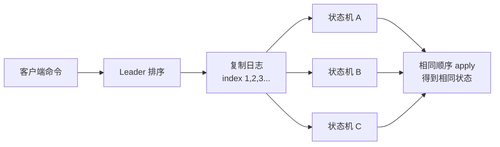
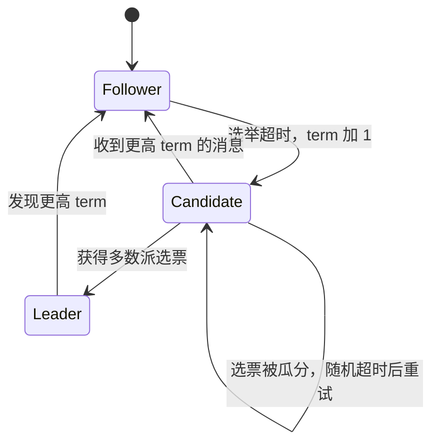
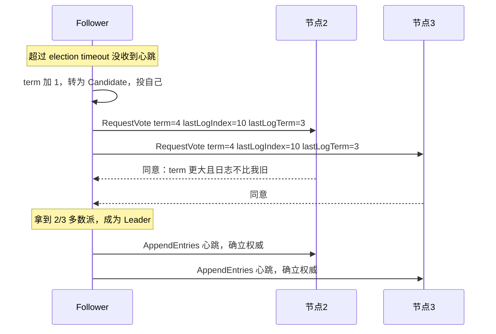
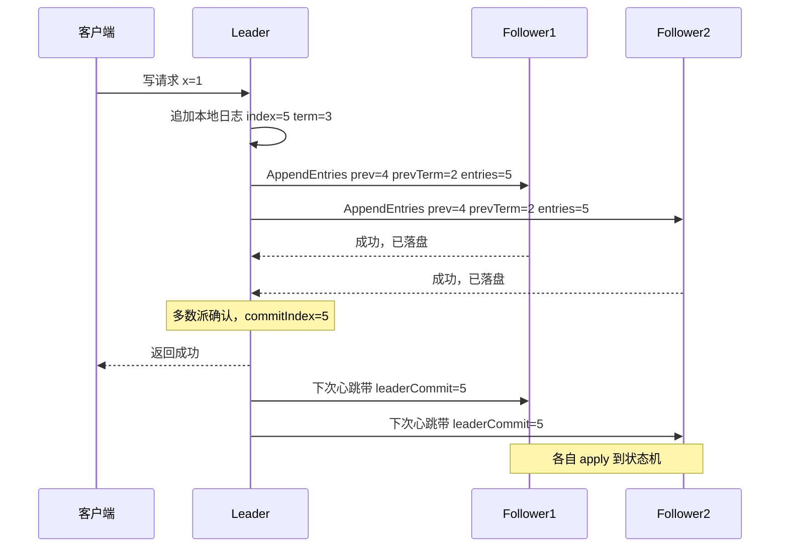
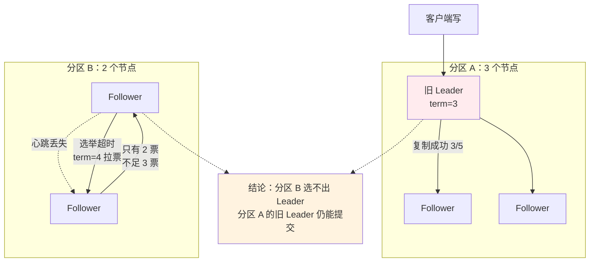

# 共识算法：Raft 与 Paxos

> 定位：多副本只解决「数据有几份」，不解决「以谁为准」。共识算法才是让多个节点对同一份日志达成一致的那套规则。这篇从脑裂和 FLP 讲起，把 Raft 的选举、日志复制、安全性三条主线拆开，再对照 Paxos 与 ZAB，最后落到 etcd、TiKV、Kafka KRaft 这些真实系统，以及「Raft 不保证读最新」这个最容易踩的坑。

## 一、为什么需要共识

### 1.1 多副本带来的新问题

为了保证不丢数据，我们把一份数据复制到三台机器。但复制立刻带来一个单机不存在的问题：**以谁为准**。

- 客户端把 `x=1` 发给节点 A，A 写成功，还没来得及同步给 B、C，A 挂了。B 当选新主，它手里是 `x=0`。这次写算不算成功？
- 网络抖动，A 和 B、C 失联，但 A 还活着。A 继续接受写，B、C 也选出了新主继续接受写。两边都认为自己合法——这就是**脑裂**，恢复后数据直接冲突。
- 客户端读请求打到 B，B 的数据比 A 旧 200ms。这个读返回旧值算不算错误？

这三个问题的共同点是：**「谁有资格做决定」本身也需要一个决定**。而这个决定不能靠「谁先超时谁当主」，因为每个节点只能看到局部信息，它不知道对面是不是也超时了；也不能靠「节点多的那一边」，因为分区两边互相看不见，都以为自己才是多数派。

### 1.2 共识要解决的就是这件事

共识算法（Consensus）的目标是：**在存在节点故障和网络分区的异步环境里，让一组节点对某个值（或某条日志的顺序）达成不可推翻的一致**。

关键词是「不可推翻」：一旦某个值被决定，后续无论谁当主、无论怎么重试，都不能改成别的值。这就是安全性（Safety）。至于「多久能决定」，那是活性（Liveness），共识算法允许它在故障期间暂时不满足。

### 1.3 FLP 不可能定理：为什么必须靠超时

1985 年的 FLP 定理给出了一个冷水般的结论：

> 在**完全异步**的网络模型中，只要有一个进程可能崩溃，就不存在**确定性**算法能同时保证共识的**安全性**和**活性**。

直觉解释：异步网络里你无法区分「节点挂了」和「节点只是很慢」。算法如果为了安全一直等，就可能永远等下去（失去活性）；如果不等就下结论，又可能把慢节点误判为死节点，做出错误决定（失去安全性）。

工程上的破解方式不是「推翻 FLP」，而是**换假设**：

- 引入**部分同步**假设：网络大部分时间是好，只是偶尔抖动；用**超时**来判断故障。
- 用**随机化**（Raft 的随机选举超时）打破对称，避免所有节点同时竞选导致的活锁。
- 用**多数派（quorum）**保证任意两个决策集合必然相交，从而不会出现两个互相矛盾的决定。

所以 Raft、Paxos、ZAB 全都是「安全性绝不妥协，活性靠超时和随机化争取」的算法。

## 二、共识到底要保证什么

一个共识算法通常要满足三条性质：

| 性质 | 含义 | 违反的后果 |
|---|---|---|
| **一致性（Agreement）** | 所有正确节点决定的值相同 | 两个节点认为日志第 5 条内容不同 |
| **有效性（Validity）** | 决定的值必须是某个节点提议过的 | 凭空造出一个没人提过的值 |
| **终止性（Termination）** | 所有正确节点最终都能做出决定 | 永远选不出主、永远提交不了 |

共识算法最常见的落地形态是**复制状态机（State Machine Replication）**：



这张图是理解所有共识算法的钥匙：**只要保证「每个节点拿到的日志内容和顺序完全一致」，再让状态机确定性地按序执行，所有副本的最终状态就一定一致**。所以共识算法真正要解决的，不是「值是什么」，而是「日志的下一条是什么，且顺序不能变」。

这也解释了一个常被忽略的成本：一次共识写入 = **一次多数派网络往返 + 一次持久化（fsync）**。所以 Raft 集群的写延迟下限，大约是「同机房 RTT + 磁盘刷盘时间」，跨地域部署必然慢。

## 三、Raft 的角色与任期

Raft 把共识拆成三个相对独立的子问题：**选主、日志复制、安全性**。先看角色。

| 角色 | 职责 |
|---|---|
| **Leader** | 唯一接受写请求、唯一决定日志顺序、向 Follower 发心跳 |
| **Follower** | 被动接收日志和心跳；选举超时后转为 Candidate |
| **Candidate** | 拉票阶段的临时角色，赢得多数派就转 Leader，发现更高任期就退回 Follower |

**任期（term）** 是 Raft 的逻辑时钟：一个单调递增的整数。每条消息都带 term，规则很简单：

- 收到比自己 term 小的消息，直接拒绝；
- 收到比自己 term 大的消息，立刻把 term 更新为对方的值，并退回 Follower；
- **每个 term 最多只能有一个 Leader**。

term 的作用是让节点能识别「过期信息」：一个被分区隔离的旧 Leader，term 是 3，而集群已经选出 term 4 的新 Leader，那么旧 Leader 发出的任何消息都会被拒绝——因为 term 小。



这张图要注意两个细节：Candidate 可能反复拉票失败（选票被瓜分），靠随机超时跳出循环；Leader 不会主动变成 Candidate，只有在发现更高 term 时才退位。

## 四、Leader 选举

### 4.1 一次成功的选举

Follower 启动一个**选举定时器**，如果在 `election timeout` 内没收到 Leader 的心跳，就认为 Leader 挂了，开始选举：

1. `term = term + 1`，角色转为 Candidate，**先投自己一票**。
2. 并行向所有节点发 `RequestVote`，带上自己的 term、最后一条日志的 index 和 term。
3. 收到多数派（N/2 + 1）的同意票，转为 Leader，立刻发心跳确立权威。
4. 如果收到更高 term 的消息，退回 Follower；如果一段时间没结果，随机等待后重试。



### 4.2 投票的三条规则

收到 `RequestVote(term, candidateId, lastLogIndex, lastLogTerm)` 时，Follower 按顺序判断：

```text
on RequestVote(term, candidateId, lastLogIndex, lastLogTerm):
    if term < currentTerm:
        return false                      # 过期请求，直接拒绝

    if term > currentTerm:
        currentTerm = term                # 更新逻辑时钟
        votedFor = null
        becomeFollower()

    if votedFor not in (null, candidateId):
        return false                      # 本任期已经投给别人，先到先得

    if not logIsUpToDate(lastLogIndex, lastLogTerm):
        return false                      # 日志没我新，没资格当主

    votedFor = candidateId
    resetElectionTimer()
    return true
```

三条规则各自解决一个问题：

| 规则 | 作用 |
|---|---|
| **一个 term 只投一票（先到先得）** | 防止同一 term 选出两个 Leader |
| **term 必须不小于自己** | 拒绝过期候选人 |
| **日志至少一样新** | 保证新 Leader 拥有所有已提交日志（下一节展开） |

「日志至少一样新」的比较方式：

```text
logIsUpToDate(candLastIndex, candLastTerm):
    if candLastTerm != myLastTerm:
        return candLastTerm > myLastTerm   # 先比最后一条日志的 term
    return candLastIndex >= myLastIndex    # term 相同再比长度
```

注意是**先比 term，再比 index**，不是简单比谁日志长。一条 term 更高的日志，哪怕更短，也代表更新的信息。

### 4.3 随机超时：为什么要「随机」

假设三个节点同时超时、同时把 term 加 1、同时投自己，那么每人只有 1 票，谁都不够 2 票，这一轮废掉；下一轮如果又同时超时，就无限循环——这叫**选票瓜分（split vote）**。

Raft 的解法是让每个节点的 `election timeout` 在一个区间内**随机**取值（论文建议 150~300ms）。这样通常会有一个节点先超时、先拉票，在别人还没醒之前就拿到多数派。

etcd 的默认值更保守：心跳 100ms，选举超时 1000ms。选举超时通常是心跳间隔的 10 倍以上，避免网络抖动一下就开始选主。

## 五、日志复制

### 5.1 AppendEntries 做了什么

Leader 收到写请求后，不会直接改状态机，而是：

1. 把命令追加到本地日志，分配一个 index。
2. 并行向所有 Follower 发 `AppendEntries`，带上 `prevLogIndex`、`prevLogTerm`、新日志条目、`leaderCommit`。
3. Follower 先做**一致性检查**：自己 index 为 `prevLogIndex` 的那条日志，term 是否等于 `prevLogTerm`。不匹配就拒绝，让 Leader 回退重试。
4. 匹配则追加日志、落盘（fsync）、返回成功。
5. Leader 收到**多数派**确认后，把 `commitIndex` 推进到该条日志，返回客户端成功。
6. 后续心跳携带 `leaderCommit`，Follower 据此更新自己的 `commitIndex`，再把日志 apply 到状态机。



### 5.2 commitIndex 与 applyIndex 是两件事

这是面试里最容易被追问的细节：

| 概念 | 含义 | 谁维护 |
|---|---|---|
| **commitIndex** | 已被多数派确认、可以认为「不会丢」的最大 index | Leader 推进，随心跳告诉 Follower |
| **lastApplied** | 已经真正应用到状态机的最大 index | 每个节点各自维护 |

**提交不等于生效**。一条日志 commit 之后，还要等 apply 才能被读到。这中间有一个很短的窗口，正是「Raft 提交成功但立刻读不到」的原因之一。读请求如果要严格最新，必须等 `lastApplied >= commitIndex`。

### 5.3 日志匹配性质

Raft 有一个非常强的不变式，叫 **Log Matching Property**：

> 如果两个日志在相同的 index 上拥有相同 term 的条目，那么它们从头到该 index 的所有条目都完全相同。

它由 `AppendEntries` 的一致性检查保证：每次追加都校验前一条的 index + term，相当于做了一次归纳。这条性质让「修复不一致」变得简单：Leader 只需要为每个 Follower 维护一个 `nextIndex`，失败就减一重试，直到找到最后一个匹配点，然后从那里开始覆盖。

```text
on AppendEntries(term, leaderId, prevLogIndex, prevLogTerm, entries, leaderCommit):
    if term < currentTerm:
        return false

    resetElectionTimer()

    if prevLogIndex > lastLogIndex:
        return false                       # 日志太短
    if log[prevLogIndex].term != prevLogTerm:
        return false                       # 前缀不匹配，让 leader 回退 nextIndex

    # 找到第一个冲突点，覆盖之后的全部日志
    for i, e in entries:
        if log[i].term != e.term:
            truncateLog(i)
            append(e)

    commitIndex = min(leaderCommit, lastLogIndex)
    return true
```

> 工程优化：`nextIndex` 每次减一太慢，落后几千条日志就要重试几千次。实际实现（etcd、TiKV）会返回冲突 term 的起始 index，让 Leader 一次跳过一整个 term，把重试次数从 O(日志条数) 降到 O(term 数)。

## 六、安全性：两条不能破的规则

选举和复制解决了「大部分时候能工作」，安全性解决「任何时刻都不出错」。Raft 有两条铁律。

### 6.1 选举限制：只有日志最新的节点能当选

规则在 4.2 已经写了：候选人必须「日志至少和投票者一样新」。它保证的是 **Leader Completeness**——新 Leader 一定包含所有已提交的日志。

证明思路很朴素：一条日志被提交，意味着它存在于某个多数派中；候选人要当选，必须拿到另一个多数派；**任意两个多数派必然有交集**，交集中的节点要么有这条日志、要么日志比候选人更旧（不会投给它）。所以候选人一定拥有所有已提交日志。

这就是为什么「日志落后的节点当主」在 Raft 里不可能发生——不是靠运维检查，是数学上堵死了。

### 6.2 提交规则：不能直接提交旧任期的日志

这是 Raft 最反直觉的一条规则：

> Leader **只能通过提交自己当前任期的日志**来间接提交之前任期的日志，不能仅凭「旧任期日志已被多数派复制」就认定它已提交。

为什么？因为「被多数派复制」不等于「不会被覆盖」。论文 Figure 8 展示了一个反例：一条来自旧任期的日志，即使已经存在于多数派节点上，仍可能被后续任期的 Leader 覆盖。

根本原因是旧 Leader 在崩溃前**并不知道**这条日志是否已经被多数派确认——它可能只复制了一部分就挂了。等它恢复并再次当选时，它看到的只是「本地有这条日志」，无法区分「已经提交」和「只是恰好被复制过」。如果它仅凭「多数派上有」就推进 `commitIndex`，后续更高任期的 Leader 就可能用同 index 的另一条日志把它替换掉，造成**已提交日志被推翻**。

所以正确做法是：

```text
# 错误：对任何日志都数多数派
if replicas(entry) > N/2:
    commitIndex = entry.index          # 旧任期日志可能被覆盖

# 正确：只有当前任期的日志，才能靠数多数派直接提交
if entry.term == currentTerm and replicas(entry) > N/2:
    commitIndex = entry.index          # 连带提交之前所有日志
```

这也解释了一个实现细节：**新 Leader 当选后通常立刻 append 一条空日志（no-op）**。etcd 就是这么做的——用这条本任期的空日志把 `commitIndex` 推上去，从而间接提交之前所有遗留日志，让集群尽快进入可读状态。

### 6.3 三条安全性结论

| 性质 | 内容 |
|---|---|
| **Election Safety** | 每个 term 最多一个 Leader |
| **Leader Completeness** | 已提交日志一定出现在后续所有 Leader 中 |
| **State Machine Safety** | 同一 index 不会被 apply 成不同的命令 |

这三条合起来，才让「复制状态机」真正成立。

## 七、脑裂与多数派



5 节点集群被切成 3 + 2：

- **分区 A（3 个）**：仍然构成多数派（3 > 5/2），旧 Leader 可以继续提交写。
- **分区 B（2 个）**：不够多数派，选不出新 Leader，也无法提交任何写。它不会「自认为主」——因为拉票拿不到 3 票。

这就是多数派防脑裂的本质：**两个分区不可能同时拥有多数派**（3 + 2 = 5，两个多数派至少需要 3 + 3 = 6）。所以任何时刻最多只有一个分区能做出决定。

| 集群规模 | 多数派 | 容忍故障 | 说明 |
|---|---|---|---|
| 3 | 2 | 1 | 最小生产规模 |
| 4 | 3 | 1 | 和 3 节点容错一样，浪费一台 |
| 5 | 3 | 2 | 推荐，能扛一个机房/机架故障 |
| 6 | 4 | 2 | 和 5 一样，浪费 |
| 7 | 4 | 3 | 成本高，跨三机房时可用 |

所以部署**奇数台**：偶数台的容错能力和它减一台一样，但多花机器、多一份复制开销。

> 注意一个细节：分区 B 的节点虽然不能写，但**它们可能还能读**。如果读不走共识，就会返回旧数据。这是「脑裂防住了写，但没防住脏读」——第八节的读一致性就是补这个洞。

## 八、Paxos：理论基础

### 8.1 Basic Paxos 只解决「一个值」

Paxos 把节点分成 Proposer、Acceptor、Learner 三种角色，用两阶段达成单个值的共识：

```text
Phase 1  Prepare(n)
  Proposer -> 多数派 Acceptor：提案编号 n
  Acceptor：若 n 大于自己见过的所有编号，承诺不再接受 < n 的提案，
            并返回自己已接受过的最大编号提案（如果有）

Phase 2  Accept(n, v)
  Proposer：如果所有回应里都没有已接受的值，就提自己的值；
            否则提「编号最大的那个已接受值」
  Acceptor：若没有违背承诺，接受 (n, v)
  多数派接受 -> 值被选定
```

两个关键点：

- **提案编号必须全局唯一且单调**，否则无法比较新旧。
- **第二阶段必须沿用「已接受值中编号最大的那个」**，不能固执己见。这是 Paxos 安全性的核心——一旦某个值被多数派接受，后续提案必须继承它。

### 8.2 Basic Paxos 的两个工程缺陷

1. **活锁**：两个 Proposer 交替提出更大的编号，互相打断，谁都进不了第二阶段。解决办法是选一个稳定的 Leader，只让它提案。
2. **只能定一个值**：真实系统要的是「一系列日志」，不是单个值。

### 8.3 Multi-Paxos：从单值到日志

Multi-Paxos 的思路是：**选一个稳定的 Leader，Phase 1 只做一次**，之后每个日志槽位（slot）只跑 Phase 2。这样一次共识从两个 RTT 降到大约一个 RTT。

但 Multi-Paxos 在论文里描述得很模糊：Leader 怎么选、日志空洞怎么填、成员怎么变，都没有严格规定。不同实现（Google Chubby、ZAB、Raft）各自补了不同的答案。

### 8.4 Raft 与 Paxos 的关系

一句话：**Paxos 是理论基础，Raft 是「可理解的 Multi-Paxos 工程化版本」**。

| 维度 | Basic Paxos | Multi-Paxos | Raft |
|---|---|---|---|
| 目标 | 单个值共识 | 日志/序列共识 | 日志/序列共识 |
| Leader | 无，每轮可不同 | 有稳定 Leader，但非强制 | **强 Leader，必须有** |
| 日志连续性 | 不涉及 | 允许空洞（slot 可空） | **严格连续，无空洞** |
| 选主 | 无规定 | 无严格规定 | term + 日志新旧，规则明确 |
| 顺序标识 | 提案编号 | instance + 提案编号 | **term + index** |
| 成员变更 | 无 | 无 | 联合共识 / 单步变更 |
| 设计目标 | 正确性 | 性能 | **可理解性** |

Raft 的核心简化是「**强 Leader + 连续日志**」：所有写都经过 Leader，Leader 决定顺序，日志不允许空洞。代价是 Leader 成为瓶颈（读可以靠 Follower Read 分担），收益是状态机极其简单，容易证明、容易实现、容易教学。

## 九、Raft 与 ZAB 的对比

ZK 的 ZAB 和 Raft 长得很像，都是「强 Leader + 多数派 + 顺序日志」，但细节不同：

| 维度 | ZAB | Raft |
|---|---|---|
| 顺序标识 | **ZXID**：高 32 位 epoch + 低 32 位计数器 | **term + index** 两个独立字段 |
| 阶段划分 | 崩溃恢复（选主 + 同步）+ 消息广播 | 统一为选举 + 复制，无独立恢复阶段 |
| 选主依据 | ZXID 最大者优先 | term 更大、或 term 相同但日志更长 |
| 日志连续性 | 保证前缀一致 | 保证前缀一致 + 日志匹配性质 |
| 读一致性 | Follower 本地读可能旧，`sync()` 后才线性一致 | 同样默认不保证，需要 ReadIndex / Lease Read |
| 成员变更 | 3.5+ 支持动态配置 | 联合共识 / 单步变更 |

**ZXID 和 term+index 的本质区别**：ZXID 把「纪元」和「序号」压进一个 64 位整数，比较大小就等于「先比纪元再比序号」；Raft 则拆成两个字段，比较时也要先比 term 再比 index。两者思路一致，只是编码方式不同。

## 十、工程落地

| 系统 | 共识实现 | 用途 | 关键特点 |
|---|---|---|---|
| **etcd** | Raft | K8s 元数据、配置中心、选主、服务发现 | WAL + boltdb；MVCC revision；Watch；Lease |
| **TiKV** | Multi-Raft | 分布式 KV（TiDB 存储层） | 每个 Region 一个 Raft group，PD 统一调度 |
| **Consul** | Raft | 服务发现、KV、健康检查 | Server 用 Raft，Client 用 gossip 传播成员与健康状态 |
| **Kafka KRaft** | Raft | 元数据管理，替代 ZooKeeper | Controller quorum，元数据写成事件日志 |
| **ZooKeeper** | ZAB | 分布式协调 | 独立协议，不是 Raft |

几个值得注意的落地细节：

- **etcd**：默认读是线性一致的（走 ReadIndex），显式用 `WithSerializable()` 才允许读旧值；数据有 MVCC revision（`main.sub`），Watch 可以按 revision 增量订阅；value 建议控制在 1MB 以内，默认请求上限约 1.5MiB。
- **TiKV**：一个 TiKV 节点上可能跑上千个 Raft group，共享 RocksDB 和网络连接，心跳做合并，否则光心跳就压垮集群。这是 Multi-Raft 和「一个集群一个 Raft」最大的工程差异。
- **Kafka KRaft**：Kafka 2.8 引入预览，3.3 生产可用，4.0 完全移除 ZooKeeper。元数据不再存 ZK 的 ZNode，而是写成 `__cluster_metadata` 这个内部 topic 的事件日志，由 controller quorum 用 Raft 复制。
- **Consul**：只有 Server 节点参与 Raft，Client 节点通过 gossip 协议传播成员和健康检查结果——gossip 负责「谁活着」，Raft 负责「配置是什么」，分工明确。

## 十一、生产坑点与排查

### 坑点 1：以为 Raft 提交成功，读就一定最新

**现象**：写入返回成功后立刻读，偶尔读到旧值；或者主库切走期间，读请求返回了过期数据。

**原因**：Raft 只保证**日志**在多数派上一致，读请求默认不走日志，所以没有排序保证。具体有三种情况：

1. Leader 的 `commitIndex` 已推进，但 `lastApplied` 还没追上，本地状态机还是旧的。
2. 旧 Leader 被分区后不知道已被替换，仍然接受读，返回自己视角的「最新值」。
3. Follower 本地读，天然落后于 Leader。

**解法**：

| 读模式 | 做法 | 一致性 |
|---|---|---|
| **ReadIndex** | 记录当前 commitIndex，向多数派发心跳确认自己仍是 Leader，等 `lastApplied >= readIndex` 再读 | 线性一致 |
| **Lease Read** | Leader 在租约期内直接读，不询问多数派 | 线性一致，但依赖时钟 |
| **Follower Read** | 向 Leader 要一个 readIndex，等本地 apply 到该位置再读 | 线性一致，读压力分散 |
| **Stale Read** | 直接读本地 | 可能旧，适合报表 |

加分理解：etcd 的默认读走 ReadIndex，所以是线性一致的；如果你为了低延迟开了 `WithSerializable()`，就要接受读到旧值。**「Raft = 强一致读」是一个常见的错误简化**。

### 坑点 2：选举风暴

**现象**：Leader 频繁切换，日志里 term 快速上涨，集群长时间不可用。

**原因**：选举超时设置得太接近心跳间隔；或者磁盘 fsync 太慢，Leader 发心跳被 IO 阻塞；或者 JVM/Go GC 停顿导致心跳延迟。Follower 误判 Leader 已死，反复发起选举。

**解法**：`election timeout` 至少是心跳间隔的 10 倍（etcd 默认 1000ms vs 100ms）；用 SSD，监控 WAL fsync 延迟；开启 **PreVote**（预投票），让刚恢复的节点先试探能否赢得多数派，避免它用虚高的 term 打断健康集群；开启 **CheckQuorum**，让失去多数派联系的 Leader 主动退位，而不是继续自欺欺人。

### 坑点 3：成员变更导致双主

**现象**：一次性扩容两个节点，集群短暂出现两个 Leader，日志分叉。

**原因**：成员变更期间，新旧配置的多数派可能不相交。比如从 3 节点扩到 5 节点，旧配置多数派是 2，新配置多数派是 3，理论上可能同时存在两个独立的决策集合。

**解法**：**一次只变更一个节点**（任意两个多数派必然相交），或者用**联合共识（joint consensus）**：先进入 `C_old,new` 状态，任何决定必须同时在旧配置和新配置里各拿多数派，等两边都同步后再切到 `C_new`。etcd 用 `ConfChangeV2` 实现了联合共识。

### 坑点 4：日志无限增长，重启回放几小时

**现象**：etcd/TiKV 数据目录越来越大，节点重启要回放很久 WAL，恢复时间不可控。

**原因**：没有做日志压缩（compaction）。Raft 的日志是只追加的，不压缩就永远增长。

**解法**：定期打快照并截断日志（etcd 的 `--snapshot-count`，TiKV 的 Region snapshot）；给快照传输限流，避免 snapshot 抢走正常复制的带宽；监控 WAL 目录大小和 `etcd_disk_wal_fsync_duration_seconds`。

### 坑点 5：跨地域部署，写延迟爆炸

**现象**：三地五中心部署后，写延迟从 2ms 变成 100ms+。

**原因**：一次写要等多数派确认，延迟取决于**最慢的那个多数派节点**的 RTT + fsync。跨城 RTT 几十毫秒，写延迟自然上去。

**解法**：Raft 集群尽量同城部署，跨 3 个可用区即可；异地多活用「多集群 + 异步复制」，不要把一个 Raft group 拉成跨洲；读可以用 Follower Read 就近服务，但写没有捷径。

### 坑点 6：把大对象塞进 etcd

**现象**：写入报 `etcdserver: request is too large`，或者集群内存/磁盘暴涨。

**原因**：etcd 默认请求上限约 1.5MiB，且 MVCC 会保留历史版本，大 value 会被放大很多倍。

**解法**：etcd 只存元数据和指针，大对象放对象存储/S3；定期 compaction + defrag；监控 `etcd_mvcc_db_total_size_in_bytes`。

## 十二、面试高频问法

**Q1：为什么需要共识算法？脑裂是什么？**

**一句话结论**：多副本必须回答「以谁为准」，共识算法保证多数派对日志顺序达成不可推翻的一致；脑裂是分区后两边都自认为主、同时接受写。

展开：没有共识时，旧主和新主可能同时服务，恢复后数据冲突；共识用「多数派 + 任期」保证同一时刻最多一个分区能做出决定。

加分点：说「脑裂防的是写，不是读」——少数派选不出主，但旧主或 Follower 仍可能返回旧读，读一致性要单独解决。

**Q2：FLP 定理说了什么？工程上怎么绕过？**

**一句话结论**：完全异步网络 + 一个崩溃故障 + 确定性算法，无法同时保证共识的安全性和活性；工程上用超时、随机化、部分同步假设绕过。

展开：异步网络无法区分「慢」和「死」，算法要么一直等（失去活性），要么误判（失去安全性）；Raft 用随机选举超时打破对称，用多数派保证安全。

加分点：强调「FLP 不是说不安全，而是说不能保证终止」——所有工业级共识算法都选择「安全绝不妥协，活性看运气」。

**Q3：Raft 的选举流程是怎样的？term 有什么用？**

**一句话结论**：Follower 超时后 term 加 1、转 Candidate、拉票，拿到多数派就当 Leader；term 是逻辑时钟，保证每个任期最多一个 Leader。

展开：RequestVote 带 term 和最后日志信息；投票方按「term 不小于自己、本任期没投过、日志至少一样新」三条判断；收到更高 term 立刻退位。

加分点：说「term 让节点能识别过期消息」，旧 Leader 的请求因为 term 小会被直接拒绝，这是防脑裂的基础。

**Q4：为什么要随机选举超时？**

**一句话结论**：避免所有节点同时超时、同时竞选，导致选票被瓜分、无限重试。

展开：三个节点同时投自己，每人 1 票，谁都不到 2 票；随机化让通常只有一个节点先醒，先拉票先赢。

加分点：补一句「etcd 默认选举超时 1000ms、心跳 100ms，选举超时至少是心跳的 10 倍」，说明工程上还要留出网络抖动的余量。

**Q5：投票时为什么要比较日志新旧？**

**一句话结论**：保证新 Leader 拥有所有已提交日志，即 Leader Completeness。

展开：比较规则是先比最后一条日志的 term，term 相同再比 index；因为任意两个多数派必然相交，候选人拿到多数派票，就说明它的日志不落后于交集中的节点，从而包含所有已提交日志。

加分点：说「这是数学保证，不是运维检查」——日志落后的节点在 Raft 里根本选不上。

**Q6：日志复制怎么保证一致？什么是日志匹配性质？**

**一句话结论**：AppendEntries 带 prevLogIndex/prevLogTerm 做前缀校验，匹配才追加；日志匹配性质保证相同 index + 相同 term 的日志，之前的所有日志都相同。

展开：不匹配时 Leader 回退 nextIndex 重试，直到找到共同前缀，再覆盖后续日志；多数派确认后推进 commitIndex，Follower 通过心跳里的 leaderCommit 跟进。

加分点：说「工程实现会按 term 回退，而不是逐条回退」，把重试从 O(日志条数) 降到 O(term 数)。

**Q7：为什么不能直接提交旧任期的日志？**

**一句话结论**：旧任期的日志即使被复制到多数派，也可能被后续 Leader 覆盖；只有提交当前任期的日志，才能安全地间接提交之前的日志。

展开：论文 Figure 8 的反例——旧日志复制到多数派但未提交，新 Leader 在相同 index 写了别的日志，旧 Leader 再当选后如果直接认定旧日志已提交，就会被后来的 Leader 推翻。

加分点：说「新 Leader 当选后 append 一条 no-op」，etcd 就是这么把 commitIndex 推上去、间接提交历史日志的。

**Q8：Raft 怎么防脑裂？为什么 5 节点容 2 个？**

**一句话结论**：靠多数派——两个分区不可能同时拥有多数派，所以最多一个分区能提交写。

展开：5 节点多数派是 3，切成 3+2 时只有 3 那边能工作；3 节点多数派是 2，容 1 个故障；偶数节点不提升容错，所以部署奇数。

加分点：说「少数派不是挂了，而是主动拒绝写」——这是 CP 的取舍，宁可不可用也不双写。

**Q9：Raft 和 Paxos 是什么关系？**

**一句话结论**：Paxos 是理论基础（单值共识），Multi-Paxos 扩展到日志，Raft 是「强 Leader + 连续日志」的可理解版本。

展开：Basic Paxos 两阶段、无 Leader、可能活锁；Multi-Paxos 选稳定 Leader、Phase 1 只做一次；Raft 强制 Leader、日志无空洞、成员变更和快照都有明确规则。

加分点：说「Raft 不是新算法，是把 Multi-Paxos 没规定清楚的地方全部规定死」，所以它容易实现、容易证明。

**Q10：Raft 和 ZAB 有什么区别？**

**一句话结论**：都是强 Leader + 多数派 + 顺序日志；ZAB 用单个 ZXID（epoch + counter），Raft 用 term + index 两个字段，且 Raft 没有独立的「崩溃恢复」阶段。

展开：ZAB 分崩溃恢复和消息广播两个模式，选主看 ZXID 最大；Raft 统一为选举 + 复制，选主看 term 和日志新旧；两者都保证前缀一致。

加分点：说「ZXID 比较大小等价于先比 epoch 再比 counter」，本质和 term+index 一样，只是编码不同。

**Q11：Raft 能保证读到的数据一定是最新的吗？**

**一句话结论**：不能。Raft 只保证日志一致，默认读可能读到旧值；线性一致读需要 ReadIndex、Lease Read 或 Follower Read。

展开：三种旧读场景——apply 落后于 commit、旧 Leader 不知道自己被替换、Follower 本地读落后；ReadIndex 通过「记录 commitIndex + 多数派心跳确认 + 等 apply 追上」实现线性一致。

加分点：说「etcd 默认读是线性一致的，但显式开 Serializable 就会读旧值」，说明这是可配置的取舍，不是绝对的。

**Q12：etcd 和 Kafka KRaft 分别怎么用 Raft？**

**一句话结论**：etcd 用 Raft 复制整个 KV 状态机，KRaft 用 Raft 复制集群元数据事件日志，替代 ZooKeeper。

展开：etcd 的每次写都是一条 Raft 日志，apply 到 boltdb，配 MVCC 和 Watch；KRaft 把元数据写成 `__cluster_metadata` topic，controller quorum 用 Raft 复制，broker 从日志里同步。

加分点：说「KRaft 的动机是去掉 ZK 这个外部依赖，让 Kafka 自己管元数据」，同时元数据变更的延迟和一致性都更好控制。

**Q13：成员变更为什么要一次只加一个节点？**

**一句话结论**：一次性变更多个节点，新旧配置的多数派可能不相交，出现两个独立的决策集合（双主）。

展开：3 节点扩 5 节点，旧多数派 2、新多数派 3，理论上可以同时成立；一次变一个，任意两个多数派必然相交，安全；严格做法是联合共识，同时满足新旧两边多数派。

加分点：说「etcd 用 ConfChangeV2 实现联合共识」，并补一句「变更期间要监控 leader 切换和 proposal 失败率」。

## 十三、小结

- 多副本不产生一致性，共识算法解决「以谁为准」；脑裂的本质是两个分区都自认为多数派。
- FLP 说明异步网络下安全性和活性不可兼得，工程上用超时、随机化、部分同步假设换活性。
- Raft 三个子问题：选举（term + 随机超时 + 日志新旧）、复制（AppendEntries + 多数派 commit）、安全性（选举限制 + 只提交当前任期日志）。
- 多数派防脑裂：5 节点容 2、3 节点容 1，部署奇数台；少数派不是死了，是主动拒绝写。
- Paxos 是理论，Multi-Paxos 是日志版，Raft 是「强 Leader + 连续日志」的可理解实现；ZAB 用 ZXID，Raft 用 term + index。
- 最大的认知坑：Raft 只保证日志一致，不保证读最新；线性一致读要靠 ReadIndex、Lease Read 或 Follower Read。
