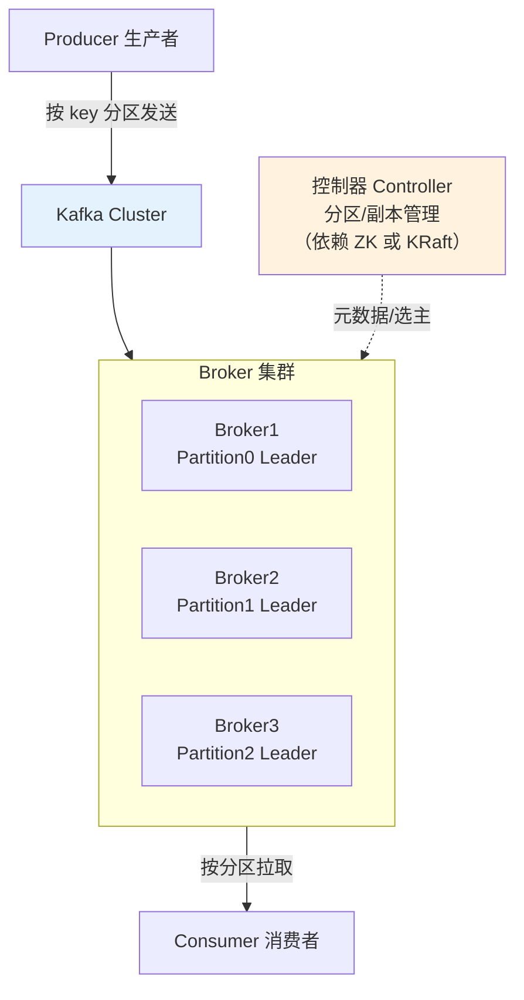
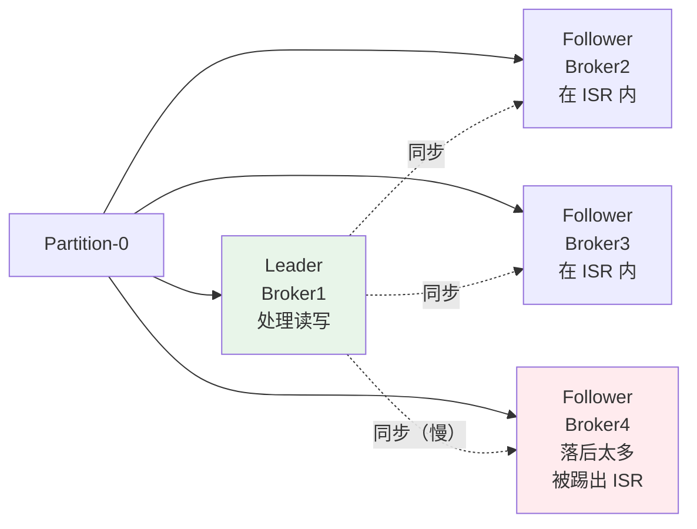
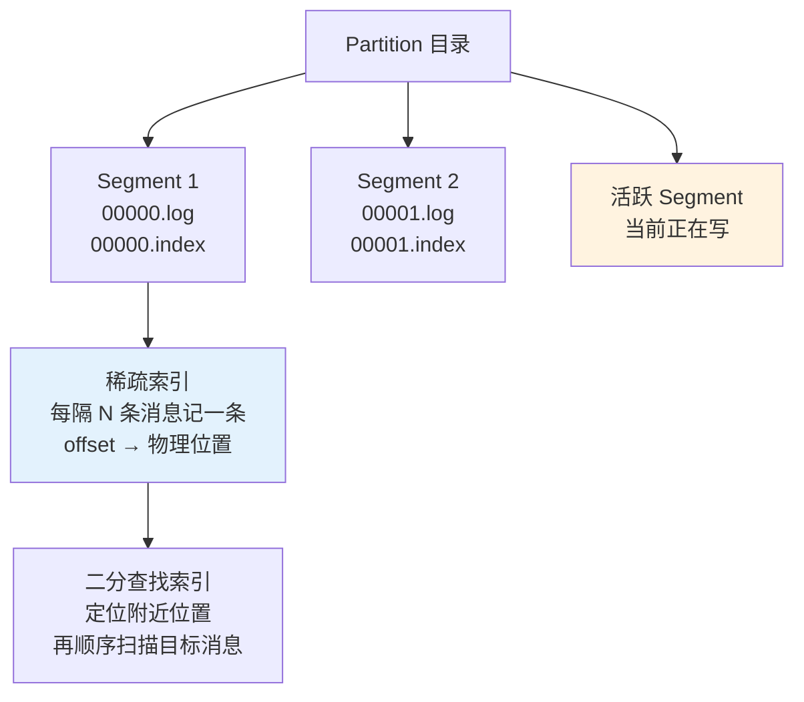

# Kafka架构与原理

> 定位：Kafka 是分布式流式数据平台，以超高吞吐和生态（流处理）著称。它「把一切做成分区 + 顺序写 + 批量 + 零拷贝」的设计，是理解现代高吞吐系统的范本。这篇讲清它的架构、副本与 ISR、存储索引、ACK、消费位移与 Rebalance，以及高吞吐背后的原理。

> **版本提示（2026-11）**：Kafka 4.0（2025-03）起完全移除 ZooKeeper、默认 KRaft，并引入 KIP-848 新消费组协议；4.2 起 Queues for Kafka 转正。本篇以 3.x 机制为主线，4.x 差异见文内标注。

## 一、为什么需要 Kafka

Kafka 的设计目标是**高吞吐的实时数据流**：日志收集、用户行为追踪、流式 ETL。它和 RocketMQ 的取舍不同：

- RocketMQ：功能丰富（事务/顺序/定时消息），偏业务
- Kafka：吞吐极高、生态完善（Kafka Streams/Connect），偏大数据/流处理

理解 Kafka 的关键是「**一切皆分区**」——Topic 分多个 Partition，Partition 内部有序，通过增加 Partition 水平扩展。

## 二、架构

核心概念：

| 概念 | 说明 |
|---|---|
| **Broker** | 一个 Kafka 服务节点，多个 Broker 组成集群 |
| **Topic** | 逻辑消息分类 |
| **Partition** | Topic 的物理分区，内部**有序、不可变、可追加**，是并行和复制的单位 |
| **Consumer Group** | 一组消费者共同消费一个 Topic，组内每个 Partition 只被一个 Consumer 消费 |
| **Controller** | 集群中一个被选出的 Broker，负责分区 Leader 选举和元数据管理 |
| **元数据** | 老版本依赖 ZooKeeper，新版本用 **KRaft**（内置共识，去掉 ZK 依赖）——以你使用的版本为准 |

> 分区是核心：**同一 Partition 内消息有序，跨 Partition 不保证全局有序**。要全局有序只能单分区（牺牲吞吐）。

## 三、分区与副本：Leader / Follower / ISR

每个 Partition 配置 `replication.factor`（副本因子，如 3），副本分布在不同 Broker。副本分两类：

- **Leader**：处理所有读写请求
- **Follower**：只从 Leader 拉取消息做备份，不对外服务

**ISR（In-Sync Replicas，同步副本集）** 是关键：指和 Leader **保持同步**的副本集合。判断标准是 Follower 在 `replica.lag.time.max.ms`（默认 30000ms）内追上过 Leader。

**为什么 ISR 重要？** Leader 故障后，**只从 ISR 中选新 Leader**（保证新 Leader 有全部已提交消息，不丢数据）。落后太多的 Follower 被踢出 ISR，不参与选举。这是 Kafka 在「可用性 vs 一致性」上的平衡。

> 相关参数：`min.insync.replicas`（最少同步副本数，配合 `acks=all` 使用）、`unclean.leader.election.enable`（是否允许从非 ISR 选主，默认 false，设为 true 可能丢数据但提升可用性）。

## 四、消息存储：分段与稀疏索引

Partition 物理上由多个 **Segment（段）** 组成，每个段包含：

- `.log` 文件：真正的消息数据，顺序追加
- `.index` 偏移量索引文件
- `.timeindex` 时间戳索引文件

**稀疏索引**：不是每条消息都建索引，而是每隔 `index.interval.bytes`（默认 4096）记一条。查找时先二分索引找到大致位置，再在小范围内顺序扫描。用少量索引空间换查找效率。

消息格式大致包含：`offset（8 字节）+ messageSize + CRC + key + value + 属性`，offset 是分区内单调递增的序号。

> 顺序写是 Kafka 快的核心之一：消息只追加到活跃 Segment 末尾，不修改已有数据，充分利用磁盘顺序 IO。

## 五、ACK 机制与可靠性

Producer 发送消息时，`acks` 参数决定「什么时候算发送成功」：

| acks | 行为 | 可靠性 | 吞吐 |
|---|---|---|---|
| `0` | 发出去就算成功，不等 Broker 确认 | 最低，可能丢 | 最高 |
| `1`（默认） | Leader 写入本地日志就返回 | 中，Leader 挂且 Follower 未同步会丢 | 中 |
| `all` / `-1` | **ISR 中所有副本**都确认才返回 | 最高（配合 `min.insync.replicas`） | 最低 |

`acks=all` 配合 `min.insync.replicas=2`（至少 2 个副本同步）是**不丢消息**的常用配置：ISR 不足 2 个时 Broker 拒绝写入，宁可不可用也不丢数据。

> 还有 `enable.idempotence`（幂等生产者）和事务（exactly-once 语义）——以版本为准，这里不展开。

## 六、消费位移 offset 与 Rebalance

### 6.1 offset

- 每个 Consumer Group 对每个 Partition 维护一个 `offset`（消费到哪了）
- 老版本存在 ZK，新版本存在 Kafka 内部 Topic **`__consumer_offsets`**
- `enable.auto.commit=true`（默认）会自动提交，可能重复消费；**手动提交**（`commitSync`/`commitAsync`）更可控

消费语义：

| 提交方式 | 语义 | 风险 |
|---|---|---|
| 先消费后提交（默认） | at-least-once | 崩溃时重复消费 |
| 先提交后消费 | at-most-once | 崩溃时丢消息 |
| 幂等 + 事务 | exactly-once | 复杂度高 |

### 6.2 Rebalance

当 Consumer Group 成员变化（加入/退出/崩溃）或订阅的 Partition 数变化时，会触发 **Rebalance**，重新分配 Partition 归属：

- 由 **Group Coordinator**（一个 Broker）协调
- 所有消费者暂停消费，加入组，Coordinator 选出 **Group Leader** 制定分配方案（如 Range / RoundRobin / Sticky）
- **Generation ID** 递增标识每一代 Rebalance

问题：Rebalance 期间**整个组暂停消费**（stop-the-world），频繁 Rebalance 会导致消费停顿。缓解：

- 调大 `session.timeout.ms` 和 `max.poll.interval.ms`，避免误判消费者掉线
- 控制 `max.poll.records`，避免单批处理太久超过 max.poll.interval
- 用 **Cooperative Rebalance**（增量协作式，KIP-429）替代 eager 模式，减少全量暂停

## 七、高吞吐的四大原因

1. **顺序写**：消息追加到 Segment 末尾，顺序 IO，充分利用磁盘预读和 PageCache
2. **批量发送/拉取**：`batch.size`、`linger.ms` 攒批，减少网络请求次数；Consumer 用 `max.poll.records` 批量拉
3. **压缩**：`compression.type` 支持 gzip/snappy/lz4/zstd，Batch 级压缩，压缩比高
4. **零拷贝（sendfile）**：数据从磁盘 → PageCache → 网卡，**不经过用户态**，减少 2 次上下文切换和内存拷贝。这是 Kafka 吞吐碾压传统 MQ 的关键

外加**分区并行**：多 Partition 分布多 Broker，天然水平扩展。

## 八、生产坑点与排查

### 坑点 1：频繁 Rebalance 导致消费停顿

**现象**：消费者日志频繁出现 `rebalance in progress`，消费速率周期性掉到 0。
**原因**：`max.poll.records` 设太大，单批处理时间超过 `max.poll.interval.ms`，被 Coordinator 判定掉线。
**解法**：减小 `max.poll.records` 或调大 `max.poll.interval.ms`；处理逻辑异步化；用 Cooperative Rebalance 协议。

### 坑点 2：acks 配置错误导致丢消息

**现象**：Leader 宕机切换后，部分已确认消息丢失。
**原因**：`acks=1` 时 Leader 写成功就返回，Follower 还没同步，Leader 挂了消息就没了。
**解法**：重要数据用 `acks=all` + `min.insync.replicas=2`；关闭 `unclean.leader.election.enable`。

### 坑点 3：消息 key 为 null 导致分区倾斜

**现象**：某几个 Partition 消息量远超其他，消费热点。
**原因**：key 为 null 时 Kafka 用轮询分区，Key 分布不均（如按用户 ID，个别大客户消息爆炸）导致分区倾斜。
**解法**：设计合理的 key 让分区均匀；对热点 key 加随机前缀二次打散（牺牲局部顺序）。

### 坑点 4：消费者重复消费

**现象**：重启消费者后，部分消息被重复处理。
**原因**：`enable.auto.commit=true`，自动提交在 poll 之后、处理完成之前，崩溃导致 offset 没提交，重放。
**解法**：改为手动提交，处理完再 `commitSync`；业务层做幂等（数据库唯一键/Redis 去重）。

## 九、调优与最佳实践

1. **分区数**：按目标吞吐估算，分区数决定消费者并行上限；分区过多会增加 Rebalance 和文件句柄开销。
2. **可靠性**：`acks=all` + `min.insync.replicas=2` + `replication.factor=3`；关非清洁选主。
3. **吞吐**：`batch.size` 16-64KB、`linger.ms` 5-100ms 攒批；按场景选压缩算法（lz4/zstd）。
4. **消费者**：手动提交 offset + 幂等；`max.poll.records` 与 `max.poll.interval.ms` 配合避免 Rebalance。
5. **监控**：`kafka-consumer-groups.sh --describe` 看 LAG（堆积）；关注 Under Replicated Partitions、ISR 收缩。

## 十、面试高频问法

> 这一节的答案按「面试时能讲透」的标准写：先给一句结论，再展开机制、原因和坑点。建议先自己答一遍，再对照补全。

**Q1：Kafka 的架构是怎样的？有哪些核心概念？**

**一句话结论**：Producer → Broker 集群 → Consumer 的架构，核心概念是 Topic / Partition / Consumer Group / Controller；一切围绕「分区」展开，Partition 是并行和复制的单位。

展开：

| 概念 | 说明 |
|---|---|
| **Broker** | 一个 Kafka 服务节点，多个组成集群 |
| **Topic** | 逻辑消息分类 |
| **Partition** | Topic 的物理分区，内部有序、不可变、可追加，是并行和复制单位 |
| **Consumer Group** | 一组消费者共同消费一个 Topic，组内每个 Partition 只被一个 Consumer 消费 |
| **Controller** | 被选出的一个 Broker，负责分区 Leader 选举和元数据管理 |

元数据管理：老版本依赖 ZooKeeper，新版本用 **KRaft**（内置共识，去掉 ZK 依赖）——以你使用的版本为准。

加分点：点出「**分区是理解 Kafka 的钥匙**——并行度、顺序性、复制、吞吐都围绕它展开」，把这个核心认知立住，后面所有问题都好答。

**Q2：Kafka 如何保证分区内有序？全局有序吗？**

**一句话结论**：Partition **内部**消息有序（offset 单调递增）；**跨 Partition 不保证全局有序**。要全局有序只能单分区，代价是牺牲吞吐和扩展性。

展开：

- **分区内有序**：消息追加到 Partition 末尾，offset 单调递增，Consumer 按 offset 顺序消费，所以分区内严格有序。
- **为什么不保证全局有序**：多个 Partition 之间并行写入和消费，无法保证跨分区的先后顺序。Producer 按 key 分区时，同一 key 会落到同一分区，所以**同一 key 有序**，不同 key 之间无序。
- **要全局有序**：只能把 Topic 设成 1 个 Partition。但这会丧失水平扩展能力、吞吐受限于单分区。

加分点：给出工程上的常见折中——「业务上通常只要『同一实体有序』（如同一订单的状态变更），用订单 ID 做 key 分区即可，不必追求全局有序」。这体现把技术约束翻译成业务方案的能力。

**Q3：什么是 ISR？为什么重要？**

**一句话结论**：ISR（In-Sync Replicas）是与 Leader **保持同步**的副本集合；Leader 故障只从 ISR 中选新 Leader，保证新 Leader 拥有全部已提交消息、不丢数据。

展开：

- **副本分类**：每个 Partition 配 `replication.factor`（副本因子，如 3），副本分 Leader（处理所有读写）和 Follower（只从 Leader 拉取备份，不对外服务）。
- **ISR 判定**：Follower 在 `replica.lag.time.max.ms`（默认 30000ms）内追上过 Leader，就在 ISR 内；落后太多被踢出。
- **为什么重要**：Leader 故障后**只从 ISR 中选新 Leader**，这样新 Leader 一定有全部已提交消息，不会丢数据。落后太多的 Follower 不参与选举。这是 Kafka 在可用性 vs 一致性上的平衡。

加分点：能补充「相关参数 `min.insync.replicas`（最少同步副本数，配合 `acks=all`）、`unclean.leader.election.enable`（是否允许从非 ISR 选主，默认 false，设 true 可能丢数据但提升可用性）」——把 ISR 串到可靠性配置上。

**Q4：acks=0/1/all 的区别？怎么保证不丢消息？**

**一句话结论**：`acks=0` 发出去就算成功（最易丢）；`acks=1` 等 Leader 写本地日志就返回（Leader 挂且 Follower 未同步会丢）；`acks=all` 等 ISR 中所有副本确认（最可靠）。**注意版本差异**：Kafka 3.0 起（KIP-679）生产者默认就是 `acks=all` + `enable.idempotence=true`，`acks=1` 是 2.x 及更早的旧默认；如果你看到「默认 acks=1」的说法，那是在讲 3.0 之前的版本。

| acks | 行为 | 可靠性 | 吞吐 |
|---|---|---|---|
| `0` | 不等 Broker 确认 | 最低，可能丢 | 最高 |
| `1`（默认） | Leader 写入本地日志就返回 | 中 | 中 |
| `all` / `-1` | ISR 中所有副本都确认才返回 | 最高 | 最低 |

**不丢消息的常用配置**：`acks=all` + `min.insync.replicas=2`（至少 2 个副本同步）+ 副本因子 ≥3。这样 ISR 不足 2 个时 Broker 拒绝写入，宁可不可用也不丢数据。

加分点：强调「`acks=all` 必须配合 `min.insync.replicas` 才有意义——否则 ISR 只剩 Leader 自己时，all 等价于 1」，这是很多人配置失效的根因。

**Q5：min.insync.replicas 和 unclean.leader.election.enable 分别管什么？**

**一句话结论**：前者规定「写入至少要几个 ISR 副本在线，否则拒绝写入」（守一致性）；后者规定「ISR 空了是否允许从非 ISR 副本选主」（守可用性），默认 false 防丢数据。

展开：

- **`min.insync.replicas=2`**：配合 `acks=all`，要求至少 2 个副本在 ISR 才接受写入。当 ISR 副本数不足时，Broker 返回 `NotEnoughReplicasException` 拒绝写入——这是「宁可不可用也不丢数据」。
- **`unclean.leader.election.enable=false`（默认）**：ISR 里全挂了，不允许从落后的非 ISR 副本选主。设为 true 虽然提升了可用性（总能选出 Leader），但新 Leader 缺数据，会造成丢失。

加分点：提炼「这是 CAP 在 Kafka 里的具体落地——前者偏 CP（一致性优先），后者开了偏 AP（可用性优先）」。能把参数上升到 CAP 层面，面试官很吃。

**Q6：Kafka 的消息是怎么存储的？稀疏索引怎么回事？**

**一句话结论**：Partition 物理上分成多个 Segment，每段含 `.log`（数据）+ `.index`（偏移量索引）+ `.timeindex`（时间索引）；索引用稀疏方式（每隔若干字节记一条），二分定位后再小范围顺序扫描。

展开：

- **分段 Segment**：Partition 由多个 Segment 组成，只往活跃 Segment 末尾追加，避免单文件过大，也便于过期清理（按段删除）。
- **稀疏索引**：不是每条消息都建索引，而是每隔 `index.interval.bytes`（默认 4096）记一条 offset → 物理位置的映射。查找时先二分索引找到大致位置，再在附近小范围顺序扫描目标消息——用少量索引空间换查找效率。
- **消息格式**：大致含 `offset（8 字节）+ messageSize + CRC + key + value + 属性`，offset 是分区内单调递增的序号。

加分点：把「顺序写」和「稀疏索引」串起来——「顺序写保证写入快，稀疏索引保证按 offset 查找快，两者共同支撑 Kafka 的高吞吐与可检索」。

**Q7：Kafka 为什么吞吐这么高？**

**一句话结论**：四大法宝——顺序写、批量发送/拉取、压缩、零拷贝（sendfile），外加分区并行和 PageCache 加持。

展开：

1. **顺序写**：消息只追加到 Segment 末尾，顺序 IO，充分利用磁盘预读和 PageCache。
2. **批量**：Producer 用 `batch.size`、`linger.ms` 攒批，Consumer 用 `max.poll.records` 批量拉，减少网络请求次数。
3. **压缩**：`compression.type` 支持 gzip/snappy/lz4/zstd，Batch 级压缩，压缩比高。
4. **零拷贝（sendfile）**：数据从磁盘 → PageCache → 网卡，不经过用户态，省掉 2 次上下文切换和内存拷贝——这是 Kafka 吞吐碾压传统 MQ 的关键。
5. **分区并行**：多 Partition 分布多 Broker，天然水平扩展。

加分点：强调「零拷贝是关键中的关键——传统 MQ 读消息要经过『磁盘→内核→用户态→内核→网卡』多次拷贝和切换，Kafka 用 sendfile 砍掉了中间环节」。能把零拷贝讲透的人不多，是强力加分项。

**Q8：offset 存在哪？有哪几种消费语义？**

**一句话结论**：offset 存在 Kafka 内部 Topic `__consumer_offsets`（老版本在 ZK）；提交时机决定语义——先消费后提交是 at-least-once（可能重复），先提交后消费是 at-most-once（可能丢）。

展开：

- **存储**：每个 Consumer Group 对每个 Partition 维护 offset，新版本存在内部 Topic `__consumer_offsets`。
- **提交方式**：`enable.auto.commit=true`（默认）会自动提交，可能重复消费；手动提交 `commitSync`/`commitAsync` 更可控。

| 提交方式 | 语义 | 风险 |
|---|---|---|
| 先消费后提交（默认） | at-least-once | 崩溃时重复消费 |
| 先提交后消费 | at-most-once | 崩溃时丢消息 |
| 幂等 + 事务 | exactly-once | 复杂度高 |

加分点：给出工程结论——「生产用 at-least-once（先处理后提交）+ 消费端幂等，这是性价比最高的组合；exactly-once 复杂度高，除非强需求否则不用」。

**Q9：什么是 Rebalance？为什么会频繁触发？怎么缓解？**

**一句话结论**：Rebalance 是 Consumer Group 成员或分区数变化时重新分配 Partition 归属的过程，期间**整组暂停消费**（stop-the-world）；频繁 Rebalance 会造成消费停顿。

展开：

- **触发条件**：Consumer 加入/退出/崩溃、订阅的 Partition 数变化。
- **过程**：由 Group Coordinator 协调，所有消费者暂停消费加入组，选出 Group Leader 制定分配方案（Range / RoundRobin / Sticky），Generation ID 递增标识每一代。
- **频繁触发的常见原因**：`max.poll.records` 设太大，单批处理时间超过 `max.poll.interval.ms`，被 Coordinator 误判掉线。
- **缓解**：调大 `session.timeout.ms` 和 `max.poll.interval.ms`；控制 `max.poll.records`；处理逻辑异步化；用 **Cooperative Rebalance**（增量协作式，KIP-429）替代 eager 模式，减少全量暂停。

加分点：点出「Generation ID 递增」这个细节——老 Generation 的 offset 提交会被拒绝，这是 Rebalance 期间的一种保护机制，能答到这个说明你研究过源码。

**Q10：消费者重启后部分消息被重复处理，怎么排查？**

**一句话结论**：`enable.auto.commit=true` 时自动提交发生在 poll 之后、业务处理完成之前，崩溃导致 offset 没提交、消息重放；解法是改手动提交 + 业务幂等。

展开：

- **成因**：自动提交按固定间隔（如 5 秒）提交，如果消费者在「poll 到消息」和「处理完成」之间崩溃，offset 还没提交，重启后从旧 offset 重读 → 重复消费。
- **解法**：
  - 关闭自动提交（`enable.auto.commit=false`），业务处理成功后手动 `commitSync`（同步，可靠）或 `commitAsync`（异步，性能好）。
  - 业务层做幂等兜底（数据库唯一键 / Redis 去重），因为 at-least-once 下重复无法根除。
- 注意：手动提交要放在业务处理**全部成功之后**，否则又变成丢消息。

加分点：说清「at-least-once 语义下『重复』和『丢失』是一体两面——想不丢就可能重复，所以幂等是必答题不是选择题」，把 Q8 的知识闭环。

**Q11：消息 key 为 null 或分布不均，导致分区倾斜怎么办？**

**一句话结论**：key 为 null 时 Kafka 用轮询分区；key 分布不均（如按用户 ID，个别大客户消息爆炸）会造成部分 Partition 消息量远超其他、消费热点。要用合理的 key 或随机前缀打散。

展开：

- **成因**：分区倾斜来自 key 分布不均——某些 key（如超级大客户、热门商品）消息量巨大，它们固定落在特定 Partition，导致该 Partition 成为热点，对应 Consumer 忙死、其他 Consumer 闲死。
- **解法**：
  - 设计更均匀的 key（如用更细粒度的业务 ID 组合）。
  - 对热点 key 加**随机前缀**做二次打散（如 `userId + "_" + random(0,9)`），把热点摊到多个分区——代价是牺牲该 key 的局部顺序性。
  - 扩容分区数（注意会改变 key 的分区映射，影响顺序）。

加分点：点出「打散和顺序是矛盾的——加随机前缀解决了倾斜，但同一 key 的消息不再保证落到同一分区、顺序被破坏」。能说出这个代价，说明你理解分布式设计的取舍本质。

**Q12：Kafka 消费 LAG 持续上涨怎么排查和处理？**

**一句话结论**：先看是哪种原因——生产突增、消费者挂了、消费慢、还是并行度不够；扩容消费者上限是分区数，光加机器没用时要扩分区。

展开排查路径：

1. 用 `kafka-consumer-groups.sh --describe --group xxx` 看各 Partition 的 LAG。
2. **生产端是否突增**：是则限流生产或扩容消费者。
3. **消费者是否存活**：挂了就重启并排查崩溃原因。
4. **消费速度是否慢**：看线程栈和耗时，优化处理逻辑（批量、异步、加缓存）。
5. **消费者数 < 分区数**：扩容消费者，**上限 = 分区数**。
6. **都不少**：分区数不够，需扩分区 + 再扩消费者。

加分点：给出应急狠招——「紧急情况下可临时写搬运程序把积压消息转到更多分区的临时 Topic，用更多消费者处理；对可丢消息可手动提交 offset 跳过」。这是生产救火的实战经验。

## 小结

- 核心是「分区」：Partition 内有序、可追加、可复制，是并行单位。
- 副本：Leader 读写、Follower 备份，ISR 是同步副本集，Leader 只从 ISR 选。
- 存储：Segment + 稀疏索引，顺序写 + 二分索引定位。
- 可靠性：`acks=all` + `min.insync.replicas`，消费位移存在 `__consumer_offsets`。
- 高吞吐四件套：顺序写、批量、压缩、零拷贝；Rebalance 停顿是常见坑，消费端必做幂等。
