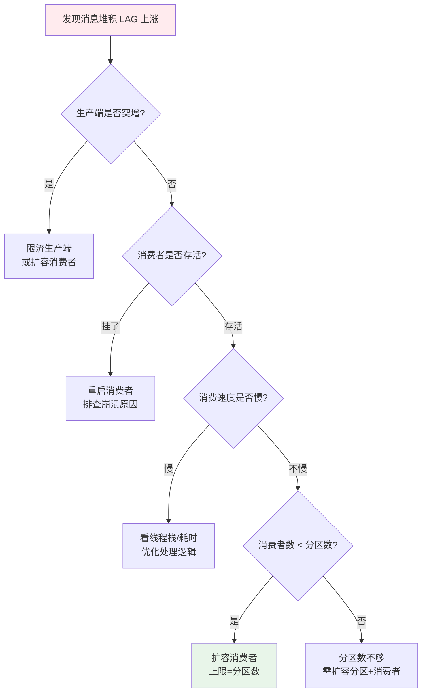
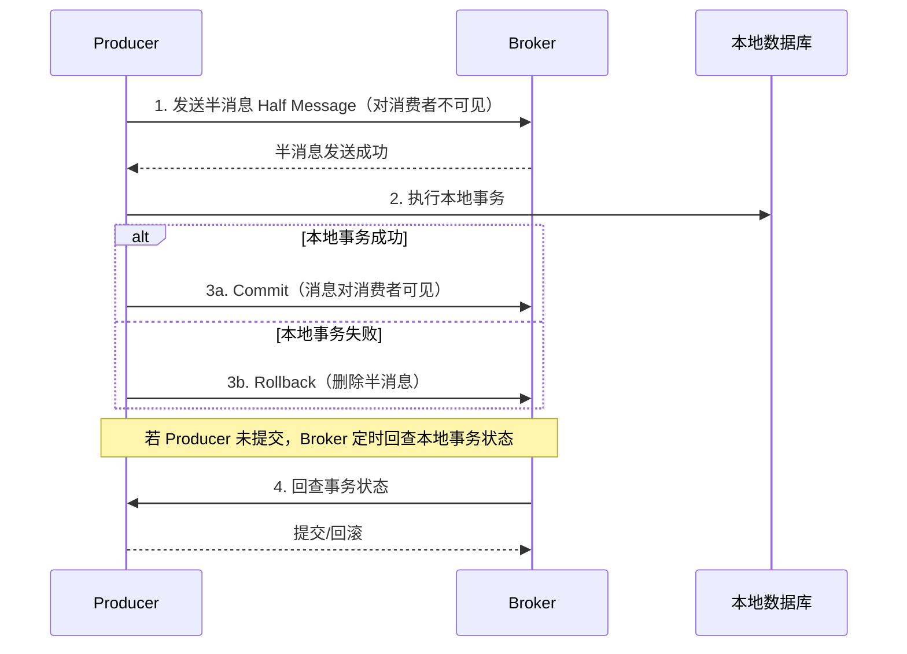

# MQ生产问题

> 定位：会用 MQ 发消息只是起点，真正考验人的是线上那些「消息丢了、重复了、堆积了、顺序乱了」的问题。这篇按「丢失 → 重复 → 堆积 → 高级特性（事务/顺序/延时）」梳理生产级 MQ 的常见故障与解法，核心思路是**全链路不丢 + 消费端幂等 + 可观测可应急**。

## 一、为什么 MQ 会在生产出事

消息从生产到消费经历 **Producer → Broker → Consumer** 三段，每段都可能出问题：

- 发送时网络抖动，消息没到 Broker
- Broker 落盘前宕机，消息丢了
- 消费端处理到一半崩溃，offset 却提交了

而 MQ 系统普遍只保证 **at-least-once（至少一次）**，天然会重复。**「不丢」和「不重」在分布式下不可兼得**，工程做法是「保证不丢 + 消费端幂等吸收重复」。

## 二、消息丢失：三段全链路排查


### 2.1 生产端丢失

**原因**：调用 send 后网络异常，Producer 误以为成功；或异步发送没处理回调。

**解法**：
- 用**同步发送 + 重试**（RocketMQ `send` 返回 `SendResult` 确认状态）
- 异步发送必须正确处理回调里的失败分支
- 关键消息用**事务消息**（见后文）或本地消息表，保证「业务成功 = 消息一定发出」

### 2.2 存储端丢失

**原因**：消息在 PageCache 未刷盘就断电，或主从未同步就切主。

**解法**：
- RocketMQ：`SYNC_FLUSH` + `SYNC_MASTER`（可靠组合）
- Kafka：`acks=all` + `min.insync.replicas=2` + 关非清洁选主
- 保证副本因子 ≥3，跨机架部署

### 2.3 消费端丢失

**原因**：**先提交 offset，后处理业务**。处理到一半崩溃，offset 已提交，消息再也不会被消费。

```
错误：poll 消息 → commit offset → 处理业务（崩溃，消息丢）
正确：poll 消息 → 处理业务成功 → commit offset
```

**解法**：改为**处理完成后再提交**（手动提交）；注意这会导致重复消费，所以必须幂等。

## 三、重复消费与幂等

### 3.1 为什么必然重复

at-least-once 语义下，任何「处理成功但 ACK/offset 提交失败」的场景都会导致重投：网络抖动、消费者重启、Rebalance。

### 3.2 幂等的四种实现

| 方案 | 做法 | 适用 |
|---|---|---|
| **唯一键 + DB 唯一索引** | 用业务 ID 做唯一键，插入冲突则说明已处理 | 最常用、最可靠 |
| **Redis SETNX** | `SETNX msg:{id} 1 EX 86400`，抢到才处理 | 高性能，需考虑 Redis 持久化和过期 |
| **状态机判断** | 更新时带状态条件，如 `UPDATE order SET status=2 WHERE id=? AND status=1` | 天然幂等的业务 |
| **去重表** | 单独记录已处理的 msgId，处理前先查 | 通用但多一次 IO |

> 设计原则：**优先让业务本身幂等**（如「设置为某值」天然幂等，「累加」不幂等）。加去重是兜底，不是首选。

## 四、消息堆积排查与处理

### 4.1 排查路径



排查命令：
- Kafka：`kafka-consumer-groups.sh --bootstrap-server ... --describe --group xxx` 看 LAG
- RocketMQ：`mqadmin consumerProgress` 看各队列堆积

### 4.2 应急手段

1. **扩容消费者**：水平加实例，**上限 = 分区/队列数**，超过无效
2. **扩容分区/队列**：临时增加分区数（Kafka 可增、RocketMQ 队列可增但不可减），再扩消费者
3. **临时 Topic 中转**：写个搬运程序把积压消息快速转到更多分区的临时 Topic，用更多消费者处理
4. **跳过非重要消息**：对可丢的消息，手动提交 offset 跳过，保主流程
5. **优化消费逻辑**：批量处理、异步化、加缓存，提升单条处理速度

> 关键认知：**消费者数 > 分区数没有意义**。堆积到一定程度，光加机器没用，必须扩分区。

## 五、死信队列与重试队列

消费失败不能无限重试（会卡住队列），也不能直接丢。标准做法：


- **重试队列**：按延迟等级递增重试（RocketMQ 有 `%RETRY%` 机制，默认 16 次；Kafka 常用重试 Topic + 独立消费者）
- **死信队列（DLQ）**：重试耗尽仍失败的消息进死信队列，供人工排查或补偿。必须**监控死信队列，有消息就告警**
- 重试要设**最大次数 + 间隔递增**，避免无限循环

## 六、高级特性：事务、顺序、延时

### 6.1 事务消息（RocketMQ）

解决「本地事务成功但消息没发出」的一致性问题。用**两阶段提交 + 回查**：



这套机制保证：**本地事务和消息发送要么都成功，要么都失败**，是分布式事务最终一致性的常用方案。

### 6.2 顺序消息

- **分区顺序**：同一业务 ID（订单 ID）的消息发到同一 Queue/Partition，消费端串行处理（详见 RocketMQ/Kafka 篇）
- 代价：牺牲并行度；某个业务卡住会影响同队列其他消息

### 6.3 延时消息

- **RocketMQ**：支持固定**延时等级**（以版本为准，经典 18 级：1s/5s/10s/30s/1m/2m/3m/4m/5m/6m/7m/8m/9m/10m/20m/30m/1h/2h），设置 `delayLevel`，不能自定义任意时间
- **Kafka**：**无原生延时消息**。常见方案：
  1. 延时 Topic + 定时任务扫描到期消息转发到目标 Topic
  2. 用外部定时系统（如 Redis ZSet 按时间戳排序 + 轮询，或时间轮 TimingWheel）
  3. 借助流处理平台的窗口能力

## 七、生产坑点与排查

### 坑点 1：先提交 offset 导致消息丢失

**现象**：消费者重启后，发现有些消息「处理过」但业务数据没变。
**原因**：自动提交 offset，消息还没处理完就提交了，崩溃后无法重放。
**解法**：关闭自动提交，改手动在处理成功后提交；业务做幂等兜底。

### 坑点 2：消费失败无限重试卡死队列

**现象**：某条「毒药消息」一直失败，后面消息全部积压。
**原因**：没有最大重试次数，消息反复重投，队列被卡住。
**解法**：配置最大重试次数 + 死信队列；失败消息记录日志并告警；死信队列单独处理。

### 坑点 3：扩容消费者后堆积没缓解

**现象**：消费者从 5 个加到 50 个，LAG 纹丝不动。
**原因**：Topic 只有 5 个分区，集群模式下多出的 45 个消费者闲置。
**解法**：先扩分区数再扩消费者；或临时 Topic 中转分流。记住消费者上限 = 分区数。

### 坑点 4：事务消息回查失败导致消息回滚

**现象**：本地事务成功了，但消息没投递给消费者。
**原因**：事务回查接口实现有问题（如本地事务状态没持久化，Producer 宕机后回查查不到）。
**解法**：本地事务状态**落库持久化**（如事务状态表），回查接口从库里查；保证回查接口幂等和可用。

## 八、最佳实践清单

1. **可靠性三件套**：生产端确认重试 + 存储端刷盘/复制 + 消费端处理后提交。
2. **消费端必幂等**：唯一键/状态机/去重表，这是 at-least-once 的前提。
3. **重试有界**：最大次数 + 死信队列 + 告警，毒药消息隔离。
4. **堆积可扩**：分区数是并行上限，应急扩容 + 临时 Topic 中转。
5. **事务消息**：本地事务状态必须落库，回查接口可靠。
6. **监控告警**：LAG、死信队列长度、消费失败率、重试次数、消息丢失率。

## 九、消息链路的可观测与压测

消息问题之所以难查，是因为「生产端说发了、消费端说没收到」。可观测的目标是**把「发—存—收」三段各自量化**。

### 10.1 必看指标

| 环节 | 指标 | 健康信号 | 异常含义 |
|---|---|---|---|
| 生产端 | 发送成功率、发送 P99、重试率 | 成功率 >99.9%，P99 稳定 | 重试率高说明 Broker 或网络抖动 |
| 存储端 | 写入延迟、ISR 同步、磁盘水位 | ISR 不掉队，水位 <70% | 副本滞后会增加丢失风险 |
| 消费端 | 堆积量、消费延迟、消费 TPS | 延迟稳定，堆积可回落 | 堆积持续涨 = 消费能力不足 |
| 业务 | 死信率、幂等拦截率、补偿成功率 | 死信率 <0.01% | 死信率升高说明逻辑或数据异常 |
| 端到端 | 生产到消费的 P99 延迟 | 满足业务 SLA | 分段都正常但端到端慢，查链路与批处理 |

**关键：用「消费延迟」而不是「堆积条数」判断严重性**。堆积 100 万条但消费 TPS 足够，可能半小时就追平；堆积 1 万条但消费停滞，才是真故障。

### 10.2 告警阈值怎么定

- 堆积：连续 3 个采样周期增长，且消费延迟 > 业务 SLA；
- 死信：5 分钟内超过 N 条，或单条消息重试超过上限；
- 副本：ISR 少于最小副本数持续 1 分钟；
- 磁盘：单节点 >75% 预警，>85% 阻断写入前处理。

### 10.3 压测方法

1. 用真实消息体大小与 key 分布，避免全均匀；
2. 压到目标峰值 1.5 倍，观察发送 P99、 Broker 磁盘 IO、消费延迟；
3. 同时验证「消费者扩容是否有效」——分区数不足时扩容无效；
4. 做一次「Broker 宕机」演练，确认副本切换与消息不丢。

## 十、一次堆积事故的完整处置

> 以下为典型时间线示例，数字为示意。

| 时间 | 现象 | 动作 | 判断 |
|---|---|---|---|
| 10:05 | 告警：订单消息堆积 80 万，消费延迟 12min | 值班确认，拉消费 TPS 曲线 | 消费 TPS 从 5k 掉到 800 |
| 10:10 | 查看消费者日志：大量 DB 连接超时 | 查 DB 监控 | DB 连接数打满，慢查询增多 |
| 10:15 | 定位到新上线 SQL 未走索引 | 回滚该 SQL/加索引 | 消费 TPS 回升到 2k |
| 10:30 | 堆积降到 40 万，但仍有延迟 | 临时扩消费者（分区足够） | 消费 TPS 到 6k |
| 11:20 | 堆积清空，延迟恢复正常 | 观察 30 分钟 | 稳定 |
| 次日 | 复盘 | 补 SQL 审核、慢查询告警、消费能力水位监控 | 防复发 |

**处置原则**：

1. **先止血再定位**：能回滚先回滚，能扩容先扩容，别在现场读代码；
2. **扩容前确认分区数**，否则白加机器；
3. **不要直接清空堆积**，除非确认消息可丢——先评估业务影响；
4. **保留现场**：消费日志、线程栈、DB 会话，事后复盘靠它们。

**复盘要回答三个问题**：为什么没提前发现（监控缺口）、为什么恢复慢（预案缺口）、怎么防复发（流程/技术改动）。

## 十一、一分钟定位表

| 现象 | 先看 | 常见根因 |
|---|---|---|
| 消息少了 | 生产成功率、Broker 落盘、消费位点 | 生产未确认、副本未同步、先提交 offset |
| 消息重复 | 消费位点回退、重试记录 | 至少一次语义、重试未幂等 |
| 堆积暴涨 | 消费 TPS、下游 RT、分区数 | 下游慢、分区不足、消费者卡住 |
| 消费卡死 | 线程栈、死信、重试次数 | 无限重试、毒消息、连接池耗尽 |
| 顺序错乱 | 分区 key、并发消费 | 多分区/多线程消费同一业务键 |

**月度治理清单**：Top10 堆积 Topic、死信率、重试次数分布、消费者版本一致性、Topic 保留策略、磁盘水位。这六项每月过一遍，比出事再救火便宜得多。

## 十二、面试高频问法

> 这一节的答案按「面试时能讲透」的标准写：先给一句话结论，再展开机制、原因和坑点。

**Q1：MQ 的消息可能在哪几个环节丢失？怎么防？**

**一句话结论**：三个环节——生产端、Broker 存储、消费端；分别用"确认+重试""持久化+副本""手动 ACK"防丢。

展开：

- **生产端丢**：消息发出但 Broker 没收到（网络问题）。防：同步发送 + 检查 SendResult，失败重试。
- **Broker 丢**：消息在内存没刷盘就宕机。防：同步刷盘（RocketMQ）、acks=all + 副本（Kafka）。
- **消费端丢**：消息拉到了但处理失败，却已 ACK。防：处理成功后再手动 ACK。

加分点：说"'消息不丢'要端到端保证——只做一端没用，三个环节任何一处疏忽都会丢；而且要权衡'可靠'和'性能'，同步刷盘会降低吞吐"。

**Q2：消息重复消费怎么解决？**

**一句话结论**：MQ 保证"至少一次"，重复不可避免，消费端必须**幂等**。

展开：

- **重复原因**：消费成功但 ACK 丢失，MQ 重投；或 MQ 本身就是 at-least-once。
- **幂等方案**：业务唯一键 + 唯一索引、去重表、状态机、Redis 记录 messageId。
- **关键**：去重逻辑要和业务处理原子（同一事务），否则仍可能重复。

加分点：说"不要追求 MQ 层的 exactly-once（成本极高），工程上'at-least-once + 消费端幂等'就够了"。

**Q3：消息堆积了怎么办？**

**一句话结论**：先定位原因（消费慢还是生产快），再应急（扩容消费者、临时提高并发），最后治本（优化消费逻辑、限流生产）。

展开：

- **排查**：看堆积量、消费 TPS、消费耗时，判断是"消费能力不足"还是"突发流量"。
- **应急**：
  1. 扩容消费者实例（注意分区/队列数限制）
  2. 提高消费并发（RocketMQ 加线程、Kafka 加分区）
  3. 临时跳过非核心消息
- **治本**：优化消费逻辑（批量、异步）、加限流。

加分点：说"Kafka 的消费并发受分区数限制——分区数不够，加消费者也没用；这是扩容前必须确认的"。

**Q4：什么是死信队列？怎么用？**

**一句话结论**：死信队列存放"多次重试仍失败"的消息，避免无限重试阻塞正常消息，人工介入处理。

展开：

- **产生**：消息消费失败重试超过最大次数，进入死信队列。
- **作用**：隔离问题消息，不阻塞队列；保留现场供排查。
- **处理**：监控死信队列告警，人工分析后修复或重投。

加分点：说"死信队列是'兜底'——没有它，一条坏消息会无限重试，拖垮整个消费者；但死信也要监控，否则消息悄悄进了死信没人知道"。

**Q5：怎么保证消息的顺序？**

**一句话结论**：全局有序代价高，通常只保证**局部有序**（同一业务键有序）——把相关消息发到同一分区/队列，单线程消费。

展开：

- **RocketMQ**：用 `MessageQueueSelector` 按业务键（如订单号）选同一个队列，消费者单线程消费该队列。
- **Kafka**：按 key 分区，同一 key 进同一分区，分区内有序。
- **代价**：局部有序限制了并发（一个队列只能一个消费者线程）。

加分点：说"全局有序几乎不可行（等于单线程），实际业务只需要'同一订单的消息有序'——用业务键分区就够了"。

**Q6：事务消息和普通消息有什么区别？**

**一句话结论**：事务消息保证"本地事务"和"发消息"的原子性——本地事务成功消息才可见，失败则消息回滚。

展开：

- **普通消息**：发了就发了，和本地事务无关，可能出现"业务成功但消息没发"或"消息发了但业务失败"。
- **事务消息**：半消息 → 本地事务 → 提交/回滚 → 回查。保证两者一致。
- **适用**：分布式事务的"最终一致"场景。

加分点：说"事务消息解决的是'业务和消息的一致性'——比如下单成功后要发'订单创建'消息，用事务消息保证不会'订单没建成但消息发了'"。

**Q7：延时消息怎么实现？**

**一句话结论**：RocketMQ 原生支持延时消息（固定等级），Kafka 需要自己实现（外部调度或时间轮）。

展开：

- **RocketMQ**：发消息时指定 delayLevel（1s/5s/10s...），Broker 到时间才投递。
- **Kafka**：不原生支持，常见方案——外部定时任务扫描、或把消息发到不同延时 topic。
- **场景**：订单超时取消、定时提醒。

加分点：说"延时消息是'定时任务'的轻量替代——不用起定时任务扫库，发个延时消息到点自动触发，更优雅"。

**Q8：MQ 怎么保证高可用？**

**一句话结论**：Broker 多副本 + 主从切换 + 生产端重试 + 消费端重连。

展开：

- **RocketMQ**：主从部署，主挂了从接管（4.5+ 支持自动切换）。
- **Kafka**：多副本 + ISR，Leader 挂了从 ISR 选新 Leader。
- **客户端**：生产端发送失败重试、切换 Broker；消费端断线重连。

加分点：说"MQ 是'基础设施'，它挂了会影响所有依赖它的业务——所以要高可用部署，且业务要有'MQ 不可用时的降级'"。

**Q9：怎么监控 MQ 的健康状态？**

**一句话结论**：监控四个维度——堆积量、生产/消费 TPS、消费延迟、死信数量。

展开：

- **堆积量**：最核心指标，持续增长说明消费跟不上。
- **TPS**：生产和消费速率对比。
- **消费延迟**：消息从生产到被消费的时间。
- **死信**：死信数量突增说明消费出问题。

加分点：说"堆积量要设告警阈值——等堆积到几百万再发现就晚了，通常几千条持续增长就该告警"。

**Q10：MQ 选型要考虑哪些因素？**

**一句话结论**：吞吐、延迟、可靠性、功能（事务/延时/顺序）、运维复杂度、生态。

展开：

- **吞吐**：Kafka 最高（日志、大数据），RocketMQ 中高，RabbitMQ 较低。
- **延迟**：RabbitMQ 最低（微秒级），Kafka/RocketMQ 毫秒级。
- **功能**：RocketMQ 功能最全（事务、延时、顺序），Kafka 偏流处理，RabbitMQ 路由灵活。
- **运维**：RabbitMQ 简单，Kafka/RocketMQ 需要一定运维能力。

加分点：说"没有最好的 MQ，只有最合适的——日志用 Kafka、业务消息用 RocketMQ、复杂路由用 RabbitMQ"。

## 小结

- MQ 只保证 at-least-once：不丢靠三段兜底，不重靠消费端幂等。
- 丢失三环节：生产（确认+事务消息）、存储（刷盘+复制+acks）、消费（处理后提交 offset）。
- 堆积排查看 LAG；扩容上限 = 分区数；应急用临时 Topic 中转。
- 重试有界 + 死信队列 + 告警，隔离毒药消息。
- 事务消息靠半消息 + 回查（本地事务状态落库）；延时消息 RocketMQ 有等级、Kafka 要自己实现。
