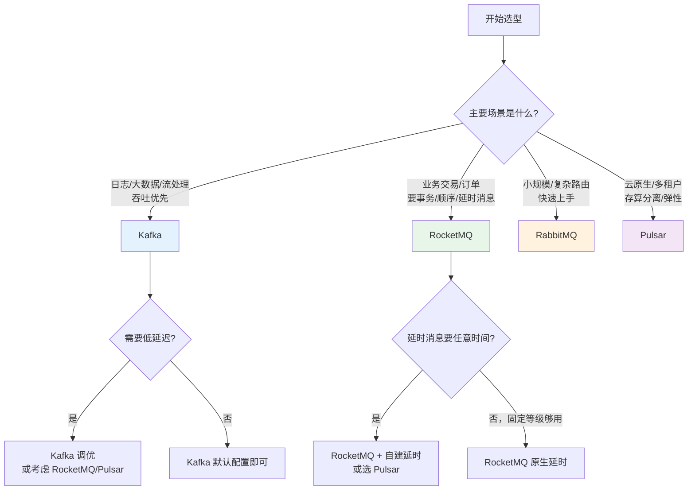

# 消息队列选型

> 定位：RocketMQ、Kafka、RabbitMQ、Pulsar 各有拥趸，选错了要么性能不够、要么运维失控。这篇用一张对比表和一棵决策树讲清四者的取舍，给出场景化建议和迁移成本考量——选型不是选「最强的」，而是选「最匹配业务 + 团队能 hold 住的」。

## 一、为什么需要认真选型

 MQ 一旦引入就是核心基础设施，迁移成本极高。**选型失误的代价**：

- 为了「功能全」选了 RocketMQ，结果团队没有 Java 运维能力，Broker 出问题没人排查
- 为了「吞吐高」选了 Kafka，结果业务需要事务消息和任意延时消息，硬编码一堆补丁
- 为了「轻量」选了 RabbitMQ，结果日志场景百万 TPS 直接把集群打爆

选型要先回答三个问题：**什么场景（吞吐/延迟/功能）？团队能运维什么？未来会不会变？**

## 二、四大 MQ 横向对比

| 维度 | **RocketMQ** | **Kafka** | **RabbitMQ** | **Pulsar** |
|---|---|---|---|---|
| 定位 | 业务消息中间件 | 分布式流平台 | 传统消息代理 | 云原生流平台 |
| 吞吐 | 高（十万级 TPS） | **极高（百万级）** | 中（万级） | 高（十万级+） |
| 延迟 | 毫秒级 | 毫秒级（低延迟需调优） | **微秒~毫秒级** | 毫秒级 |
| 可靠性 | 高（同步刷盘+复制） | 高（ISR+acks） | 高（镜像/仲裁队列） | 高（Quorum） |
| 顺序消息 | **分区顺序，原生支持好** | 分区内有序 | 单队列有序 | 分区内有序 |
| 事务消息 | **原生支持** | 支持（较新，以版本为准） | 有限支持 | 支持事务 |
| 延时消息 | **固定等级（18 级）** | 无原生（需自建） | 支持（TTL/插件） | 支持任意延时 |
| 消息查询 | 支持按 Key 查 | 弱 | 弱 | 弱 |
| 架构 | NameServer+Broker（Java） | Broker+ZK/KRaft（Scala/Java） | Erlang/AMQP | Broker+Bookiekeeper（存算分离） |
| 生态/流处理 | 一般 | **最完善（Streams/Connect）** | 一般 | 较好（Pulsar Functions） |
| 多租户 | 一般 | 一般 | 一般 | **原生支持（云原生）** |
| 运维复杂度 | 中 | 中（KRaft 后降低） | 低 | **高（组件多）** |
| 社区/中文资料 | 丰富（阿里背景） | 最活跃 | 成熟稳定 | 较新，增长中 |

> 数据为典型量级，实际受硬件、配置、消息大小影响很大，**以压测和官方基准为准**。

## 三、各组件适用场景与取舍

### 3.1 RocketMQ

**适合**：电商交易、订单、业务异步解耦——**需要事务消息、顺序消息、延时消息的业务场景**。

- 强项：事务消息（分布式事务最终一致）、顺序消息、按 Key 查询消息、中文社区活跃
- 弱项：流处理生态不如 Kafka；延时是固定等级（自定义时间要自己实现）；Java 技术栈运维
- 典型用户：阿里系、国内大量电商/金融业务

### 3.2 Kafka

**适合**：日志收集、用户行为追踪、大数据管道、流式计算——**吞吐优先、生态为王**的场景。

- 强项：吞吐最高、分区水平扩展、Kafka Streams/Connect 生态完善、与 Flink/Spark 集成好
- 弱项：无原生延时消息、事务消息较弱（新版本支持以版本为准）、单机分区过多时性能下降
- 典型用户：几乎所有大数据平台

### 3.3 RabbitMQ

**适合**：小规模、复杂路由、需要灵活交换机（Exchange）模式的业务——**轻量、易上手、路由灵活**。

- 强项：AMQP 协议标准、路由模式丰富（direct/topic/fanout/headers）、管理界面友好、运维简单
- 弱项：吞吐相对低（万级）、Erlang 语言栈小众、大规模集群能力弱
- 典型用户：中小型系统、需要复杂路由的业务

### 3.4 Pulsar

**适合**：云原生、多租户、存算分离、需要弹性扩缩容的大规模平台——**面向未来的架构**。

- 强项：存算分离（Broker 无状态 + BookKeeper 存储）、多租户原生、支持 Kafka 协议兼容、分段存储可无限扩展
- 弱项：组件多（Broker/Bookie/ZK）运维复杂、生态和社区较新、团队学习成本高
- 典型用户：云厂商、大规模消息平台

## 四、选型决策树



使用决策树时要结合实际：先看**场景**（业务消息 vs 日志流），再看**功能需求**（事务/顺序/延时），最后看**团队能力**（能否运维 Pulsar/Kafka）。

## 五、迁移成本考量

选型不只是「第一次选」，还要考虑「以后换」的成本。

### 5.1 迁移成本构成

| 成本项 | 说明 |
|---|---|
| **客户端改造** | API 不兼容，生产消费代码要重写 |
| **协议兼容层** | 如 Pulsar 提供 Kafka 协议兼容，可降低迁移成本 |
| **数据双写/双读** | 迁移期要同时写两个 MQ，保证不丢 |
| **offset/消费进度迁移** | 消费位点无法直接搬，要手动对齐 |
| **运维体系重建** | 监控、告警、部署、扩容脚本重做 |
| **团队学习成本** | 新组件的原理、坑点、排查方法 |

### 5.2 降低迁移成本的做法

1. **抽象消息层**：业务代码不直接依赖具体 MQ 的 API，封装一层统一接口（发送/消费/确认），底层可切换
2. **用兼容协议**：如 Pulsar 兼容 Kafka 协议，RocketMQ 有 Kafka 客户端模式（以版本为准）
3. **渐进迁移**：先迁非核心 Topic，验证稳定后再迁核心链路
4. **双写 + 对账**：迁移期双写，对比消息一致性，确认无误后切流

> 经验：**与其纠结「选最完美的」，不如做好「抽象层 + 可迁移」设计**，给未来留退路。

## 六、生产坑点与排查

### 坑点 1：盲目追新选 Pulsar，团队 hold 不住

**现象**：上了 Pulsar，出问题时团队不会排查，组件多（Broker/Bookie/ZK）故障定位困难，反而降低稳定性。
**原因**：选型只看架构先进性，忽略团队运维能力和生态成熟度。
**解法**：评估团队的 Java/Erlang/分布式运维经验；中小团队优先 RocketMQ/Kafka；上 Pulsar 前先小规模 PoC 和培训。

### 坑点 2：用 RabbitMQ 扛日志高并发

**现象**：日志场景用 RabbitMQ，TPS 上万后队列堆积、节点压力大。
**原因**：RabbitMQ 设计目标是灵活路由的低延迟消息，不是高吞吐日志管道。
**解法**：日志/大数据场景换 Kafka；RabbitMQ 专注业务消息和复杂路由。

### 坑点 3：Kafka 当业务队列用，缺事务和延时能力

**现象**：业务需要事务消息保证一致性、需要延时消息，用 Kafka 后硬编码一堆补偿逻辑。
**原因**：Kafka 偏流平台，业务消息特性弱。
**解法**：业务交易场景选 RocketMQ；若必须用 Kafka，事务用 outbox 模式 + 幂等，延时用定时 Topic 扫描。

### 坑点 4：分区/队列数评估不足，后期扩容受限

**现象**：线上 Topic 分区太少，消费并行度上不去，想加分区却发现顺序性被破坏或迁移复杂。
**原因**：选型和建 Topic 时没按峰值吞吐规划分区数。
**解法**：压测评估单分区能力，按峰值 ×2-3 倍预留分区；注意加分区会影响按 key 的顺序性。

## 七、选型清单与最佳实践

1. **先定场景**：业务消息（RocketMQ/RabbitMQ）vs 日志流（Kafka/Pulsar）。
2. **再列硬性需求**：事务消息、顺序消息、延时消息、消息查询——哪些是 must have。
3. **评估团队能力**：能运维什么组件，社区资料是否充足。
4. **压测验证**：用真实消息大小和速率压测，不看纸面数据。
5. **预留迁移性**：业务代码抽象消息层，避免深度绑定。
6. **分区/队列规划**：按峰值预留，注意对顺序性的影响。

## 八、选型之后：容量规格怎么定

选型决定「用哪个」，容量决定「会不会上线就崩」。四个参数必须在选型阶段一起定：分区/队列数、消息大小上限、保留时长、磁盘与带宽。

### 8.1 分区数估算

```
分区数 ≈ max(目标吞吐 / 单分区吞吐, 期望并行消费度)
```

- Kafka 单分区写入吞吐经验值：万级条/秒（视消息大小与磁盘）；
- 消费者并行度 ≤ 分区数，**分区数不足时加消费者无效**；
- 预留 2–3 倍增长空间，但别一次开到几百——分区过多会增加元数据与再平衡开销。

### 8.2 磁盘容量

```
日增数据 ≈ 日消息量 × (消息大小 + 副本开销) × 副本数
所需磁盘 ≈ 日增数据 × 保留天数 × (1 + 索引/压缩余量 20%)
```

示例：日 1 亿条、每条 1KB、3 副本、保留 7 天 → 约 **21TB**（未计压缩）。压缩后按 0.3–0.5 折算，仍要留 30% 水位。

### 8.3 保留与回放

| 场景 | 保留策略 | 原因 |
|---|---|---|
| 业务事件（订单/支付） | 7–30 天 | 支持故障回放与对账 |
| 日志/埋点 | 3–7 天 | 量大，价值衰减快 |
| 变更流（CDC） | 7 天 + 下游已消费确认 | 回放能重建下游 |
| 延时消息 | 覆盖最大延时 | 否则到期消息已丢 |
| 事务消息 | 至少覆盖回查窗口 | 回查失败需要可重放 |

**保留策略要写进申请单**：Topic 创建时就定保留时长与清理策略，不要等磁盘告警才改——改保留策略通常要重启或滚动操作。

**回放能力要在选型时验证**：能否按时间/offset 重置消费位点、是否影响在线消费者。

### 8.4 压测怎么做

1. 用真实消息大小与 key 分布（不要用 1KB 均匀 key）；
2. 压到「目标 1.5 倍」，观察 P99 发送延迟、堆积、ISR/副本同步；
3. 同时压消费端，测「消费能力上限」；
4. 记录瓶颈：磁盘 IOPS、网络带宽、页缓存、分区热点。

## 九、多 MQ 并存怎么治理

大公司常见「Kafka + RocketMQ + RabbitMQ 都在跑」，治理不好会变成三套运维、三套监控、三套 SDK。

| 问题 | 治理动作 |
|---|---|
| 选型随意 | 定「默认 MQ + 例外审批」：新业务默认 Kafka，事务/延时场景用 RocketMQ，轻量路由用 RabbitMQ |
| SDK 版本混乱 | 提供统一封装（生产/消费模板、幂等、重试、Trace 透传） |
| 监控割裂 | 统一指标口径：堆积、延迟、失败率、死信率进同一看板 |
| 权限与审计 | Topic 申请、读写权限、保留策略统一审批 |
| 成本不可见 | 按业务线统计存储与流量成本，季度复盘 |

**迁移的现实建议**：不要为了「统一」做大规模迁移。按「新业务用新栈、老业务自然淘汰」推进，迁移成本只有在「运维痛点明确」时才值得付。

> 面试加分点：能说出「选型不是选最强的，是选团队能运维、成本可承受、场景匹配的」，并给出容量测算与多栈治理方案。

## 十、一分钟选型速答

| 场景 | 首选 | 理由 |
|---|---|---|
| 日志/埋点/高吞吐流式 | Kafka | 分区顺序写、吞吐高、生态成熟 |
| 订单/支付等业务事件，需要事务消息 | RocketMQ | 事务消息、延时消息、重试与死信完善 |
| 轻量路由、复杂路由规则、低吞吐 | RabbitMQ | Exchange/Binding 路由灵活、易上手 |
| 多租户、分层存储、长保留 | Pulsar | 存算分离、分层存储、多租户 |
| 延时/定时任务为主 | RocketMQ 延时消息或调度平台 | 避免自建扫表 |

**一句话**：先看「吞吐、可靠性、延时、路由、运维」五个约束，再看团队能不能 hold 住。选最强的不如选能运维的。

**选型评审会三问**：团队有没有人能处理它的故障？监控和告警能不能接进现有体系？三年后的迁移成本谁承担？三问有一个答不上来，就先别定。

**容量估算的四个常见错误**：

- 只按「平均消息大小」算，忽略大促时的峰值消息；
- 忘记副本开销，磁盘按 1 份算；
- 保留天数按「最长一次故障」算，实际应按「回放需求 + 合规」；
- 分区数按当前流量定，没留扩容空间，后期扩容要搬迁。

> 最后一条经验：**选型方案里必须写「不选它的理由」**。只写优点的方案，评审时一定会被追问穿；写清代价，反而更容易一次通过。

> 补充：如果团队还没有「消息堆积告警、死信看板、消费延迟监控」，先补这三样再谈换 MQ。**没有可观测性的 MQ 迁移，是在把旧问题搬到新组件上。**

> 最后提醒：选型定稿后第一件事不是搭集群，而是**把监控、告警、死信、重放四件套先跑通**。没有这四样，任何 MQ 上线都等于蒙眼开车。

## 十一、面试高频问法

> 这一节的答案按「面试时能讲透」的标准写：先给一句话结论，再展开机制、原因和坑点。

**Q1：RocketMQ、Kafka、RabbitMQ 有什么区别？**

**一句话结论**：Kafka 吞吐最高（日志/流处理）、RocketMQ 功能最全（业务消息）、RabbitMQ 路由最灵活、延迟最低。

| 维度 | Kafka | RocketMQ | RabbitMQ |
|---|---|---|---|
| 吞吐 | 百万级 | 十万级 | 万级 |
| 延迟 | 毫秒 | 毫秒 | 微秒（最低） |
| 功能 | 流处理强 | 事务/延时/顺序全 | 路由灵活 |
| 语言 | Scala/Java | Java | Erlang |
| 场景 | 日志、大数据 | 电商业务 | 复杂路由、低延迟 |

加分点：说"选型先问'业务要什么'——要吞吐选 Kafka，要功能全选 RocketMQ，要低延迟和复杂路由选 RabbitMQ"。

**Q2：为什么 Kafka 吞吐这么高？**

**一句话结论**：顺序写磁盘 + 批量发送 + 零拷贝 + 分区并行 + 页缓存。

展开：

- **顺序写**：Kafka 只追加写日志文件，顺序写比随机写快几个数量级。
- **批量**：生产端攒一批再发，消费端批量拉，减少网络往返。
- **零拷贝**：用 sendfile 把数据从页缓存直接送到网卡，减少拷贝。
- **分区**：一个 Topic 分多个 Partition，并行读写。
- **页缓存**：利用 OS 页缓存，读写都在内存。

加分点：说"Kafka 的高吞吐不是单点优化，是'顺序写 + 批量 + 零拷贝 + 分区'的组合；它牺牲了'低延迟'（批量会引入延迟）换吞吐"。

**Q3：RocketMQ 为什么适合业务消息？**

**一句话结论**：功能全——事务消息、延时消息、顺序消息、消息重试、死信队列，这些业务场景需要的能力它都有。

展开：

- **事务消息**：解决"业务和消息一致性"。
- **延时消息**：订单超时取消等。
- **顺序消息**：同一订单的消息有序。
- **重试 + 死信**：消费失败的兜底。

加分点：说"Kafka 偏'数据管道'（日志、流处理），RocketMQ 偏'业务消息'（交易、通知）——功能定位不同，别拿 Kafka 硬做业务消息"。

**Q4：RabbitMQ 的优势是什么？**

**一句话结论**：路由灵活（Exchange 多种类型）、延迟最低（微秒级）、管理界面友好、协议成熟（AMQP）。

展开：

- **Exchange 类型**：direct（精确匹配）、topic（模式匹配）、fanout（广播）、headers——路由能力最强。
- **低延迟**：Erlang 的轻量进程模型，单条消息延迟极低。
- **适用**：复杂路由、对延迟敏感、消息量不是特别大的场景。

加分点：说"RabbitMQ 的 Exchange 路由是它的杀手锏——比如'按日志级别路由到不同队列'，Kafka/RocketMQ 做起来很别扭"。

**Q5：Pulsar 是什么？和 Kafka 有什么区别？**

**一句话结论**：Pulsar 是"计算存储分离"的新一代消息系统——Broker 无状态、存储用 BookKeeper，支持多租户、分层存储。

展开：

- **存算分离**：Broker 不存数据，存储交给 BookKeeper，扩容更灵活。
- **多租户**：原生支持多租户隔离。
- **分层存储**：冷数据可以下沉到对象存储（S3/HDFS），降低成本。
- **对比 Kafka**：Kafka 存算耦合（Broker 存数据），扩容要迁移数据；Pulsar 扩容更容易。

加分点：说"Pulsar 是'云原生时代的 Kafka'——存算分离解决了 Kafka 扩容难的问题，但生态和成熟度还不如 Kafka"。

**Q6：消息队列选型要考虑哪些维度？**

**一句话结论**：吞吐、延迟、可靠性、功能、运维成本、生态、团队熟悉度。

展开：

| 维度 | 要问的问题 |
|---|---|
| 吞吐 | 峰值多少？百万级还是万级？ |
| 延迟 | 能接受毫秒还是要求微秒？ |
| 可靠性 | 能丢消息吗？要事务吗？ |
| 功能 | 要延时/顺序/事务吗？ |
| 运维 | 团队有没有运维经验？ |
| 生态 | 和现有技术栈匹配吗？ |

加分点：说"选型最忌讳'唯性能论'——吞吐最高的不一定最合适，运维成本、团队熟悉度、功能匹配度同样重要"。

**Q7：什么时候不该用 MQ？**

**一句话结论**：不需要异步、不需要解耦、对一致性要求极高（不能接受最终一致）、消息量很小的场景，用 MQ 是过度设计。

展开：

- **不需要异步**：同步调用就能满足，引入 MQ 增加复杂度。
- **强一致**：MQ 是最终一致，金融核心交易可能不适合。
- **量很小**：一天几条消息，用数据库表 + 定时任务更简单。
- **团队不熟**：MQ 运维有门槛，不熟容易出事故。

加分点：说"MQ 解决的是'异步、解耦、削峰'——如果这三个都不需要，引入 MQ 只是增加故障点；技术选型要克制"。

**Q8：MQ 的消息模型有哪几种？**

**一句话结论**：点对点（Queue，一条消息一个消费者）和发布订阅（Topic，一条消息多个消费者）。

展开：

- **点对点**：消息进队列，多个消费者竞争，一条消息只被一个消费。用于"任务分发"。
- **发布订阅**：消息进 Topic，每个订阅者都收到一份。用于"事件广播"。
- **Kafka/RocketMQ**：用 Consumer Group 实现——同组内竞争（点对点），不同组各收一份（发布订阅）。

加分点：说"Kafka 的 Consumer Group 很巧妙——同一个组是'点对点'（负载均衡），不同组是'发布订阅'（各消费各的），一个模型覆盖两种语义"。

**Q9：怎么评估一个 MQ 的可靠性？**

**一句话结论**：看四个层面——生产确认、存储持久化、副本机制、消费确认。

展开：

- **生产确认**：发送是否有 ACK？失败是否重试？
- **存储持久化**：是否刷盘？同步还是异步？
- **副本**：是否多副本？主挂了能否切换？
- **消费确认**：是否手动 ACK？失败是否重投？

加分点：说"可靠性是'端到端'的——任何一个环节弱，整体就不可靠；评估时要看'最弱的一环'"。

**Q10：如果让你从零选一个 MQ，你怎么决策？**

**一句话结论**：先明确业务需求（吞吐/延迟/功能/一致性），再对比候选（Kafka/RocketMQ/RabbitMQ/Pulsar），最后考虑运维和团队。

展开（决策步骤）：

1. **定需求**：峰值 QPS、延迟要求、是否需要事务/延时/顺序、能否接受丢消息。
2. **初筛**：高吞吐 → Kafka/Pulsar；业务消息 → RocketMQ；低延迟/复杂路由 → RabbitMQ。
3. **验证**：小规模压测，验证吞吐和延迟是否达标。
4. **评估运维**：团队能否 hold 住？有没有现成的运维体系？
5. **决策记录**：写下"为什么选它、放弃了什么"，方便后人追溯。

加分点：说"好的选型不是'选最强的'，是'选最合适的'——并且要把'为什么这么选'记录下来（ADR），否则半年后没人记得当初的权衡"。

## 小结

- Kafka：吞吐最高、生态最全，日志/大数据/流处理首选。
- RocketMQ：事务/顺序/延时消息原生支持好，业务交易场景首选。
- RabbitMQ：轻量、路由灵活、易运维，适合小规模业务消息。
- Pulsar：存算分离、多租户、云原生，架构先进但运维复杂。
- 选型看场景 + 功能 + 团队能力，做好消息层抽象给迁移留退路。
