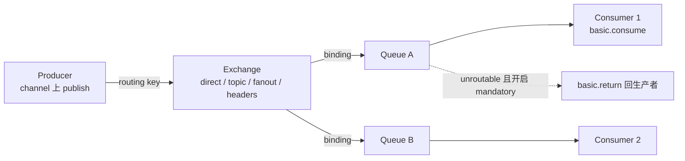
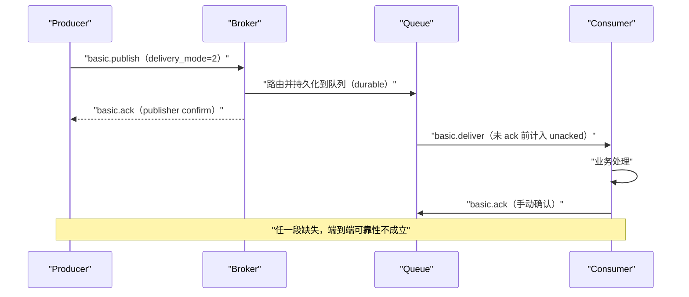
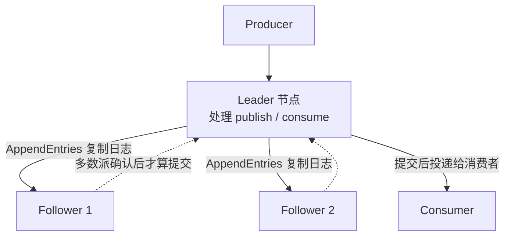
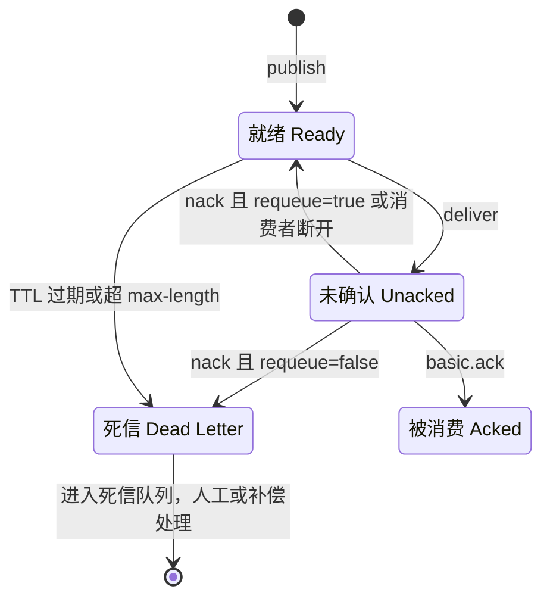

# RabbitMQ 架构与可靠性

> 定位：RabbitMQ 上手很快，`rabbitTemplate.convertAndSend` 一行就能发消息，但线上真正出事的是另一批问题：消息发出去了却没到队列、消费者挂了 unacked 越堆越多、队列涨到内存告警把生产者全阻塞、集群网络分区后两边各认为自己是主。这篇把 AMQP 模型、四种 Exchange、publisher confirm、消费 ack、Quorum Queue 的 Raft 复制、死信与延迟插件、流控告警一次讲透，并给出 Spring AMQP 的可靠投递配置和选型边界。

## 一、为什么需要它

三个真实故障：

1. **消息静默丢失**：生产端 `convertAndSend` 没抛异常，消费端却一条没收到。原因是路由键打错，消息被 broker 丢弃，而代码既没开 `mandatory` 也没开 confirm。
2. **unacked 堆积**：某消费者消费变慢（下游接口超时），broker 一直等它 ack，unacked 消息占满内存，触发内存告警，**所有生产者连接被阻塞**，整条业务链停摆。
3. **网络分区后双主**：机房之间网络抖动，集群分裂成两半，两边都接受写入，恢复后消息互相冲突或丢失。

这些都不是「API 用错」，而是**对「消息在哪个环节可能丢、哪个环节会阻塞」没有建立模型**。RabbitMQ 的可靠性由三段拼成：生产端确认、broker 持久化与复制、消费端确认。缺任何一段，端到端就不成立。

## 二、核心原理

### 2.1 AMQP 0-9-1 模型

AMQP 不是「生产者直接发队列」，中间隔着 **Exchange（交换机）** 做路由。核心对象：

| 对象 | 作用 |
|---|---|
| **Connection** | 一条 TCP 连接，进程级 |
| **Channel** | 连接上的逻辑通道，**绝大多数操作在 channel 上**，可复用连接、隔离错误 |
| **Virtual Host** | 逻辑隔离单元，权限、队列、Exchange 都归属某个 vhost |
| **Exchange** | 接收消息并按规则路由，不存储消息（除非绑定失败且配置了备用交换机） |
| **Queue** | 真正存储消息的地方 |
| **Binding** | Exchange 与 Queue 之间的绑定规则，携带 binding key |
| **Routing Key** | 生产者发送时携带的路由键，Exchange 按类型与 binding key 匹配 |



读图要点：**Exchange 只做路由、不存消息**；绑定不匹配且未开 `mandatory` 时消息会被直接丢弃。`channel` 是复用连接的关键——但 channel 不是线程安全的，多线程共享一个 channel 会串帧。

### 2.2 四种 Exchange

| 类型 | 路由规则 | 典型场景 | 注意 |
|---|---|---|---|
| **direct** | routing key 与 binding key **完全相等** | 按业务类型/级别精确分发 | 最常用、性能最好 |
| **fanout** | **忽略 routing key，广播给所有绑定队列** | 配置刷新、缓存失效广播 | 队列多时复制开销线性增长 |
| **topic** | 按 `*`（一个词）和 `#`（零或多个词）**模式匹配** | `order.created.cn`、日志按级别+来源路由 | 匹配有 CPU 成本，绑定不宜过多 |
| **headers** | 按消息 headers 键值匹配（`x-match: all/any`） | 多维度属性路由 | 性能最差，生产很少用 |

另有两个补充：

- **默认 Exchange**：每个 vhost 有个无名 direct exchange，`routing key` 直接等于队列名，`convertAndSend("", "queueName", msg)` 走的就是它。
- **Alternate Exchange（AE）**：给 Exchange 配置备用交换机，路由失败的消息转投这里，比单开 `mandatory` 更适合做「兜底队列」。

### 2.3 可靠投递三段



读图要点：**confirm 只证明 broker 收下了，不证明消费者处理成功**；`ack` 只证明这条消息被消费，不证明业务幂等。三段各自独立，必须分别配置。

**① 生产端：publisher confirm**

- 开启 `confirm.select` 后，broker 为每条消息返回 `basic.ack`（落盘/入队成功）或 `basic.nack`（失败）。
- 支持**同步等待**（`waitForConfirms`，吞吐差）、**异步回调**（推荐）、**批量确认**（`multiple=true`，一次确认多条）。
- 一定要配合 **`mandatory=true`**：只开 confirm 时，**路由失败的消息 broker 也会 ack**（因为它「成功接收」了），消息照样丢。`mandatory` 让不可路由消息通过 `basic.return` 退回。

**② broker 端：持久化三要素**

| 要素 | 配置 |
|---|---|
| Exchange 持久化 | `durable=true` |
| Queue 持久化 | `durable=true` |
| 消息持久化 | `delivery_mode=2`（Spring 里 `MessageDeliveryMode.PERSISTENT`） |

三者缺一，重启后消息就可能没了。注意：**持久化不等于同步刷盘**——RabbitMQ 对持久消息的 confirm 通常在写入磁盘后返回，但具体行为与队列类型（classic/quorum）有关，强一致场景优先用 Quorum Queue。

**③ 消费端：手动 ack + prefetch**

| 确认方式 | 行为 | 风险 |
|---|---|---|
| `autoAck=true` | 投递即删除，不等业务结果 | 消费失败/进程崩溃 = 丢消息 |
| `autoAck=false` + `basic.ack` | 业务成功后确认 | 忘记 ack 会 unacked 堆积 |
| `basic.nack` / `basic.reject` + `requeue` | 失败重回队列 | `requeue=true` 可能死循环 |

`basic.qos(prefetchCount)` 控制**每个消费者最多未确认的消息数**。默认 0 表示不限制，消费者会被瞬间打满；建议从 20-50 起步，按处理耗时调整。

### 2.4 队列类型：镜像队列与 Quorum Queue

**经典队列（classic）**：单节点存储，性能最好，但节点宕机后队列不可用。

**镜像队列（mirrored）**：3.x 通过 policy `ha-mode=all/exactly/nodes` 把队列复制到多个节点，**主节点处理读写，镜像节点同步复制**。问题是：同步复制是阻塞的、网络分区时容易脑裂、恢复慢。**RabbitMQ 4.0 已移除经典镜像队列**，新集群不要再依赖它。

**Quorum Queue（3.8 引入，后续版本逐步成熟）**：基于 **Raft** 的复制队列。



读图要点：**写入需要多数派（quorum）确认**，少数派分区自动拒绝写入，从根上避免双主；代价是写延迟高于经典队列，且**队列数不能太多**（每个 Quorum Queue 有 Raft 日志与内存开销，官方建议单节点队列数量控制在几千以内，以版本为准）。

| 维度 | 经典队列 | 镜像队列（3.x） | Quorum Queue |
|---|---|---|---|
| 复制 | 无 | 主从同步/异步 | Raft 多数派 |
| 脑裂安全 | 不涉及 | 弱 | 强（少数派拒写） |
| 吞吐 | 最高 | 中 | 中低 |
| 内存占用 | 低 | 中 | 较高 |
| 4.0 支持 | 支持 | **已移除** | 推荐 |
| 适用 | 非关键、可丢 | 遗留集群 | 关键业务、要求不丢 |

**Stream 队列（3.9+）**：面向大吞吐、可重复消费的日志型队列，定位接近 Kafka，适合「同一份数据多个消费组各读一遍」的场景，不适合传统任务分发。

### 2.5 死信、TTL 与延迟

**死信（DLX）**：消息满足以下任一条件时，会被投递到队列参数 `x-dead-letter-exchange` 指定的交换机：

- 被 `basic.reject`/`basic.nack` 且 `requeue=false`；
- 消息 TTL 过期；
- 队列达到 `x-max-length` 被挤出。



读图要点：**死信不是「删除」，是「转投」**；`requeue=true` 的失败消息会回到 Ready，若一直失败就是无限循环，必须配合重试次数或直接进死信。

**TTL** 有两种：队列级 `x-message-ttl`（整个队列统一）和消息级 `expiration`（每条不同）。注意消息级 TTL **只在队头检查**，前面有长 TTL 消息会阻塞后面的短 TTL 消息——这就是「延迟消息不准」的经典原因。

**延迟插件 `rabbitmq_delayed_message_exchange`**：声明 `x-delayed-message` 类型 Exchange，消息带 `x-delay` 头，到期后投递。它避免了 TTL+DLX 的队头阻塞，但消息要先落盘再由插件调度，**吞吐有限，且集群下依赖元数据存储，可靠性需按版本实测**。订单超时这类「量大、精度要求秒级」的场景，更稳的做法是时间轮 + 定时任务或专门延迟队列。

### 2.6 流控与内存/磁盘告警

RabbitMQ 的流控分两层：

1. **连接级阻塞（connection blocking）**：当内存或磁盘超过阈值，broker 会**阻塞所有发布连接**（`blocked` 状态），消费者不受影响。这是保护 broker 不 OOM 的最后手段，但表现为「生产端全部卡住」。
2. **channel 级 credit flow**：队列进程处理不过来时，通过 credit 机制让 channel 暂停发送，属于细粒度背压。

关键参数（3.x/4.x 默认值有差异，以所用版本为准）：

| 参数 | 默认值 | 说明 |
|---|---|---|
| `vm_memory_high_watermark` | 0.6（3.x，4.x 有调整） | 超过即触发内存告警 |
| `vm_memory_high_watermark_paging_ratio` | 0.5 | 达到阈值一半开始换页到磁盘 |
| `disk_free_limit` | 50MB（绝对） | 磁盘剩余低于此值触发告警，生产建议按数据量调到 GB 级 |
| `x-max-length` | 无 | 队列最大消息数 |
| `x-max-length-bytes` | 无 | 队列最大字节数 |
| `x-overflow` | `drop-head` | 超限策略：`drop-head` / `reject-publish` / `reject-publish-dlx` |

> 生产上更推荐 `reject-publish`：超限时拒绝新消息并让生产者感知（配合 confirm 的 nack），而不是默默丢掉队头。`drop-head` 会**静默丢老消息**，非常危险。

## 三、Spring AMQP 可靠投递配置

```yaml
spring:
  rabbitmq:
    host: 10.0.0.21
    port: 5672
    virtual-host: /shop
    publisher-confirm-type: correlated   # 异步 confirm 回调
    publisher-returns: true              # 不可路由消息退回
    template:
      mandatory: true
    listener:
      simple:
        acknowledge-mode: manual         # 手动 ack
        prefetch: 20                     # 每个消费者最多 20 条未确认
        concurrency: 4
        max-concurrency: 16
        default-requeue-rejected: false  # 失败不重回队列，直接进死信
```

```java
@Configuration
public class RabbitReliabilityConfig {

    @Bean
    public RabbitTemplate rabbitTemplate(ConnectionFactory cf) {
        RabbitTemplate template = new RabbitTemplate(cf);
        template.setMandatory(true);
        // broker 确认：成功/失败都要有日志与补偿
        template.setConfirmCallback((correlation, ack, cause) -> {
            if (!ack) {
                log.error("publish nacked, correlation={}, cause={}", correlation, cause);
                compensationQueue.offer(correlation);
            }
        });
        // 路由失败退回
        template.setReturnsCallback(returned ->
            log.error("message returned: exchange={}, routingKey={}, reply={}",
                returned.getExchange(), returned.getRoutingKey(), returned.getReplyText()));
        return template;
    }

    @Bean
    public SimpleRabbitListenerContainerFactory listenerFactory(
            ConnectionFactory cf, SimpleRabbitListenerContainerFactoryConfigurer configurer) {
        SimpleRabbitListenerContainerFactory factory = new SimpleRabbitListenerContainerFactory();
        configurer.configure(factory, cf);
        factory.setAcknowledgeMode(AcknowledgeMode.MANUAL);
        factory.setPrefetchCount(20);
        return factory;
    }
}
```

```java
@RabbitListener(queues = "order.pay.notify")
public void onMessage(OrderPayMessage msg, Channel channel,
                      @Header(AmqpHeaders.DELIVERY_TAG) long tag) throws IOException {
    try {
        orderService.handlePayNotify(msg);          // 业务必须幂等
        channel.basicAck(tag, false);
    } catch (BusinessIgnoreException e) {
        channel.basicAck(tag, false);               // 明确可忽略，ack 掉避免卡队列
    } catch (Exception e) {
        channel.basicNack(tag, false, false);       // 不重回队列，进死信
    }
}
```

声明死信与长度限制：

```java
@Bean
public Queue orderQueue() {
    return QueueBuilder.durable("order.pay.notify")
        .deadLetterExchange("dlx.order")
        .deadLetterRoutingKey("order.pay.dead")
        .maxLength(1_000_000)
        .overflow(QueueBuilder.Overflow.rejectPublish)
        .build();
}
```

## 四、生产坑点与排查

### 坑点 1：只开 confirm 不开 mandatory，路由失败静默丢消息

**现象**：发送无异常，confirm 全是 ack，但消费端没收到。
**原因**：routing key 拼错或队列未绑定，broker「成功接收」后找不到队列直接丢弃，confirm 依然 ack。
**解法**：`mandatory=true` + `setReturnsCallback`；或配置 Alternate Exchange 兜底；上线前用 `rabbitmqctl list_bindings` 核对绑定。

### 坑点 2：unacked 堆积触发内存告警，生产者全阻塞

**现象**：`rabbitmqctl list_queues` 显示 ready 不多，但 unacked 几十万；生产端连接状态 `blocked`，业务全面超时。
**原因**：消费者处理慢或卡死（下游超时、死锁），broker 一直等 ack；prefetch 过大放大堆积。
**解法**：`prefetch` 调小（20 左右）；消费端加处理超时与线程池隔离；监控 `messages_unacknowledged` 并告警；必要时重启消费者让消息 requeue。

### 坑点 3：队列无限增长打爆磁盘/内存

**现象**：某队列消息数持续上涨，最终触发磁盘告警，全集群发布阻塞。
**原因**：消费能力不足或消费端全部掉线，且队列没有长度上限。
**解法**：设置 `x-max-length` + `x-overflow=reject-publish`；对堆积告警设阈值；消费端扩容（注意单队列的消费并行度上限）；确认是「消费慢」还是「没消费者」。

### 坑点 4：网络分区后脑裂，两边都接受写入

**现象**：机房网络抖动恢复后，发现部分消息丢失或队列状态异常。
**原因**：镜像队列在分区期间两边都认为自己是主；`cluster_partition_handling` 配置不当。
**解法**：新集群用 **Quorum Queue**（Raft 多数派天然防脑裂）；3.x 遗留集群设置 `pause_minority` 让少数派暂停；机架感知与跨机房部署要评估延迟。

### 坑点 5：TTL + DLX 做延迟消息，到期时间不准

**现象**：设置 30 分钟延迟的消息，有的 2 小时才投递。
**原因**：消息级 TTL 只在**队头**检查，前面有更长 TTL 的消息就会阻塞后面。
**解法**：不同延迟时长用不同队列（每队列统一 TTL）；或用延迟插件；量大且要求精确时改用时间轮/定时任务方案。

### 坑点 6：消费者 `requeue=true` 死循环

**现象**：一条坏消息被反复投递，日志刷屏，CPU 飙高，队列消费停滞。
**原因**：消费异常后 `basicNack(requeue=true)`，消息立刻回到队头再次投递。
**解法**：`default-requeue-rejected=false`；业务异常区分「可重试」和「不可重试」，不可重试直接进死信；重试加延迟（用重试队列而非立即 requeue）。

## 五、选型对比与最佳实践

### 5.1 RabbitMQ vs Kafka vs RocketMQ

| 维度 | RabbitMQ | Kafka | RocketMQ |
|---|---|---|---|
| 模型 | AMQP，Exchange 路由 | 分区日志，拉模式 | Topic/Queue，推拉结合 |
| 吞吐 | 万级 | 百万级 | 十万级 |
| 延迟 | 微秒~毫秒，最低 | 毫秒（批量换吞吐） | 毫秒 |
| 路由能力 | **最强（4 种 Exchange）** | 弱（按 key 分区） | 中（Tag 过滤） |
| 顺序 | 单队列有序 | 分区内有序 | 队列内有序 |
| 延时消息 | TTL/插件，精度一般 | 无原生 | 固定等级 |
| 事务消息 | 无 | 较新版本支持 | 原生 |
| 运维 | 简单（Erlang 需熟悉） | 中 | 中 |
| 典型场景 | 复杂路由、低延迟、任务分发 | 日志、流处理 | 电商交易 |

更完整的横向对比见 [消息队列选型](09-消息队列选型.md)，RocketMQ 与 Kafka 的机制细节见 [RocketMQ 架构](04-RocketMQ架构与原理.md)、[Kafka 架构](05-Kafka架构与原理.md)。

### 5.2 什么时候不该用 RabbitMQ

- **日志/埋点百万级吞吐**：RabbitMQ 设计目标是灵活路由的低延迟消息，不是高吞吐管道，换 Kafka。
- **需要严格顺序 + 海量堆积**：单队列并行度有限，堆积后性能下降明显。
- **需要事务消息**：RabbitMQ 没有原生事务消息，只能靠本地消息表 + confirm 模拟。
- **超大延迟消息（天级）+ 千万级数量**：TTL/插件都不擅长，考虑专门调度系统。

### 5.3 生产清单

1. 关键队列用 **Quorum Queue**，不要用已移除的镜像队列。
2. 生产端 confirm + mandatory + returns 三件套齐全。
3. 消费端手动 ack + prefetch 20-50 + `default-requeue-rejected=false`。
4. 每个队列设置 `x-max-length` 与 `reject-publish`，防止无限堆积。
5. 死信队列必须有人消费或至少告警，否则等于黑洞。
6. 监控四项：队列深度、unacked 数、连接 blocked 状态、内存/磁盘水位。

## 六、面试高频问法

**Q1：RabbitMQ 怎么保证消息不丢？**

**一句话结论**：三段都要做——生产端 **confirm + mandatory**，broker 端 **Exchange/Queue/消息三要素持久化（关键队列用 Quorum）**，消费端 **手动 ack**。

展开：confirm 只保证 broker 收到，不代表路由成功，所以必须配 mandatory/returns；持久化保证重启不丢；手动 ack 保证消费失败可重投。

加分点：说「端到端可靠性取最弱一环」，并指出 `autoAck=true` 是最常见的丢消息来源。

**Q2：publisher confirm 和 mandatory 有什么区别？**

**一句话结论**：confirm 回答「broker 有没有收下」，mandatory 解决「收下后有没有队列可投」——只开 confirm，路由失败的消息依然会被 ack 然后丢弃。

展开：confirm 有同步/异步/批量三种模式；mandatory 触发 `basic.return` 把不可路由消息退回；也可以配 Alternate Exchange 转投兜底队列。

加分点：说「confirm 的 ack 语义是『broker 承担责任』，不是『消息已送达消费者』」，纠正常见误解。

**Q3：消息堆积了怎么排查和处理？**

**一句话结论**：先分清**没人消费**、**消费太慢**、**unacked 卡住**三类，再分别扩容消费者、优化消费逻辑、处理卡死连接。

展开：`rabbitmqctl list_queues name messages messages_unacknowledged consumers` 看三个数字；消费者数为 0 查注册/连接；unacked 高查 prefetch 与处理耗时；堆积期间先限流生产端。

加分点：说「加消费者有上限——单队列的并行度受队列进程限制，扩到一定程度不再提升」，体现对模型的理解。

**Q4：镜像队列和 Quorum Queue 怎么选？**

**一句话结论**：新集群一律 **Quorum Queue**；镜像队列在 4.0 已被移除，且分区时容易脑裂。

展开：Quorum 基于 Raft，写入需多数派确认，少数派分区拒写；代价是吞吐低于经典队列、内存占用更高、队列数量不宜过多。

加分点：说「Quorum 的代价要用在关键业务上，非关键的大吞吐场景可以考虑 Stream 队列」。

**Q5：RabbitMQ 怎么实现延迟消息？各有什么坑？**

**一句话结论**：三条路——**TTL + 死信**（简单但队头阻塞）、**延迟插件**（精度好但吞吐与可靠性受限）、**业务侧时间轮/定时任务**（最可控）。

展开：消息级 TTL 只在队头检查，长 TTL 会阻塞短 TTL；不同延迟时长应分队列；延迟插件消息先落盘再调度，量大时压力明显。

加分点：说「订单超时这类场景，我更倾向定时任务扫表或时间轮，MQ 延迟只做兜底」。

**Q6：消费者 ack 机制和 prefetch 有什么关系？**

**一句话结论**：ack 决定「消息何时算消费完成」，prefetch 决定「一个消费者最多压多少条未确认」——prefetch 太小浪费吞吐，太大在消费慢时放大 unacked 与内存。

展开：`autoAck=true` 投递即删，最危险；手动 ack 配合业务幂等；prefetch 从 20 起调，按处理耗时和并发度压测。

加分点：说「prefetch 本质是消费端的背压阀门，不是越大越好」。

**Q7：RabbitMQ 集群网络分区会怎样？怎么防？**

**一句话结论**：经典/镜像队列分区可能双主写入导致数据冲突；**Quorum Queue 靠 Raft 多数派让少数派拒写**，从机制上避免。

展开：3.x 用 `cluster_partition_handling`（`pause_minority`/`autoheal`/`ignore`）做取舍；分区恢复后要检查队列状态与消息一致性。

加分点：说「防脑裂不能只靠配置，队列类型选对才是根本」。

**Q8：RabbitMQ 和 Kafka 的本质区别是什么？**

**一句话结论**：RabbitMQ 是**智能 broker + 灵活路由**的消息代理，消息消费后删除；Kafka 是**分区日志**，消息按 offset 保留、可重复消费、靠顺序写换吞吐。

展开：RabbitMQ 强在 Exchange 路由与低延迟，弱在吞吐；Kafka 强在吞吐与流处理生态，弱在路由与延时消息。

加分点：说「选型看『消息是任务还是数据流』——任务是 RabbitMQ，数据流是 Kafka」。

**Q9：如何保证消息消费的幂等？**

**一句话结论**：MQ 只能保证 at-least-once，重复不可避免，必须由消费端做幂等——**唯一键去重表、状态机、Redis SETNX、数据库乐观锁**。

展开：用消息 `messageId` 或业务唯一键落去重表；状态流转用「只允许从 A 到 B」的条件更新；消费失败进死信人工补偿。相关方案见 [幂等设计](../09-分布式理论与共识/04-幂等设计.md)。

加分点：说「ack 时机很关键——先处理业务再 ack，宁可重复不可丢失，重复由幂等兜底」。

## 小结

- AMQP 模型的核心是 **Exchange 路由、Queue 存储**；channel 复用连接但不是线程安全的。
- 可靠投递三段：**confirm + mandatory、持久化三要素、手动 ack + prefetch**，缺一段就不成立。
- 新集群用 **Quorum Queue（Raft）**；镜像队列在 4.0 已移除，且分区时有脑裂风险。
- 延迟消息三条路各有坑，TTL 的队头阻塞最容易被忽略。
- 内存/磁盘告警会**阻塞所有发布连接**，队列必须设长度上限与 `reject-publish`。
- RabbitMQ 胜在路由与低延迟，输在吞吐；日志与流处理场景应选 Kafka。
