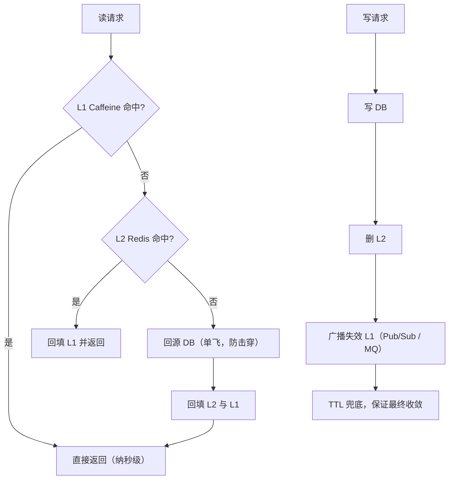
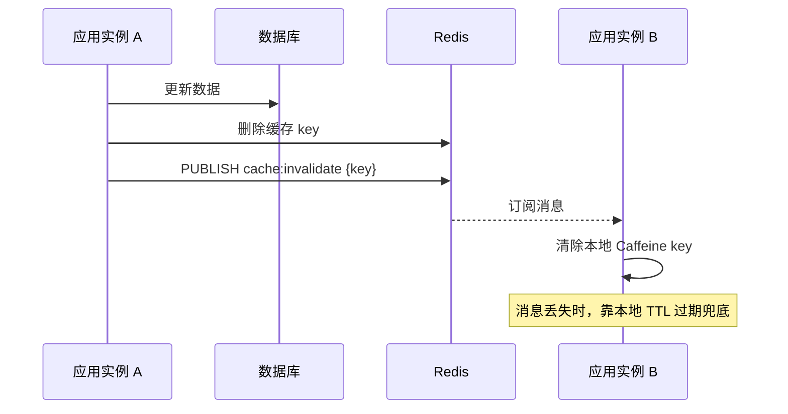

# 多级缓存体系：Caffeine、本地缓存与一致性

> 定位：很多团队一说缓存就是 Redis，结果每次读还要过一次网络、序列化和反序列化，热点 key 还把单个分片打满。真正的高并发读要靠 **L1 本地缓存 + L2 Redis + L3 DB** 三层，而本地缓存带来的新问题是「多个实例各有一份，怎么保证不读到旧值」。这篇讲 Caffeine 的 W-TinyLFU 淘汰模型、多级缓存的一致性方案，以及堆内缓存最容易踩的 OOM 与冷启动坑。

## 一、为什么需要本地缓存

一次访问的成本量级：

| 层 | 典型耗时 | 容量 | 一致性 |
|---|---|---|---|
| L1 本地（Caffeine） | 几十纳秒 | 受堆限制（MB-GB） | 多实例最终一致 |
| L2 Redis | 0.5-1ms（网络+序列化） | GB-TB | 单点强/最终一致 |
| L3 DB | 5-50ms | 磁盘 | 强一致 |

三个现实问题让本地缓存不可替代：

1. **热点读放大**：一个爆款商品被 10 万 QPS 读，全打到 Redis，单分片网络先满。
2. **元数据类高频读**：字典、配置、权限、费率表——变化少、读极频繁，放 Redis 纯属浪费一次网络往返。
3. **降级能力**：Redis 挂了，本地缓存还能顶一段时间读流量（这是「缓存雪崩」的缓冲垫）。

## 二、核心原理

### 2.1 Caffeine 的 W-TinyLFU：为什么要「准入」

传统 LRU 的问题是**扫描污染**：一次全表遍历把热数据全挤出去，命中率断崖下跌。LFU 能抗扫描，但新数据要「熬时间」才能积累频率，突发热点进不来，还要维护巨大的频率表。

Caffeine 用 **W-TinyLFU** 折中：

```
       新写入
         │
   ┌─────▼─────┐   晋升    ┌──────────────┐
   │ Window    │ ────────► │ Main (SLRU)  │
   │ (1% 容量) │           │ probation 80%│
   └───────────┘           │ protected 20%│
                           └──────┬───────┘
                                  │ 淘汰候选
                           ┌──────▼───────┐
                           │ Frequency    │  比频率，赢的留下
                           │ Sketch(CM4)  │
                           └──────────────┘
```

三个部件：

- **Window（约 1% 容量）**：新数据先进这里，保证「突发热点」能立刻被缓存，不被老数据挡住。
- **Main（SLRU）**：分 probation（试用区，80%）与 protected（保护区，20%）；被再次访问的条目从 probation 升到 protected。
- **Frequency Sketch（Count-Min Sketch，4 bit 计数）**：用极小内存近似记录访问频率，淘汰时比较「候选 vs 受害者」，频率低的先出局。

**为什么准入策略重要**：它让缓存只保留「真正会被再次访问」的条目。对「一次性扫描 + 少量热点」的读模式，命中率比 LRU 高一个档次。

### 2.2 三种淘汰策略的适用面

| 策略 | 命中率特征 | 适合 | 不适合 |
|---|---|---|---|
| LRU | 时间局部性好时高 | 会话、最近访问 | 周期性全量扫描 |
| LFU | 稳定热点高 | 字典、配置 | 热点快速迁移、新数据饥饿 |
| W-TinyLFU | 混合负载更稳 | 通用读缓存（Caffeine 默认） | 极短生命周期、超大对象 |

### 2.3 本地缓存的根本矛盾：多实例

本地缓存天然是「每个 JVM 一份」。一致性有三种强度：

- **强一致（不可能）**：所有实例同一瞬间看到同一值——除非每次读都回源。
- **最终一致（默认目标）**：写后广播失效，秒级收敛。
- **可接受陈旧（业务妥协）**：给 TTL，接受 N 秒旧值（如商品标题、榜单）。

多级缓存的读路径：`L1 命中 → 返回`；`L1 未命中 → 读 L2 → 回填 L1`；`L2 未命中 → 读 DB → 回填 L2 与 L1`。


写路径：`写 DB → 删 L2 → 广播删 L1`。

## 三、关键机制与参数

### 3.1 Caffeine 的核心配置

```java
Cache<String, ProductVO> cache = Caffeine.newBuilder()
    .maximumSize(100_000)                     // 按条数限容（最常用）
    .weigher((k, v) -> v.estimatedBytes())     // 或按权重大小限容
    .maximumWeight(256 * 1024 * 1024)          // 256MB 上限
    .expireAfterWrite(Duration.ofMinutes(5))   // 写后过期（一致性优先）
    .refreshAfterWrite(Duration.ofMinutes(1))  // 到期后异步刷新，读不阻塞
    .recordStats()                             // 开命中率统计
    .removalListener((k, v, cause) -> log.debug("evict {} {}", k, cause))
    .build(key -> loadFromRedisOrDb(key));     // 未命中自动回源
```

关键区别：

- `expireAfterWrite`：到点就失效，下次读回源（一致性好，回源压力大）。
- `refreshAfterWrite`：到点后**返回旧值 + 异步刷新**（低延迟，但会短暂读到旧值）。两者可以叠加：`expireAfterWrite=5m` + `refreshAfterWrite=1m`。
- `build(loader)`：单飞（single-flight），同一 key 并发未命中只有一个线程回源，避免击穿。

### 3.2 失效广播的四种做法

| 方案 | 收敛速度 | 复杂度 | 适用 |
|---|---|---|---|
| Redis Pub/Sub 广播 key | 毫秒级 | 低 | 绝大多数场景 |
| MQ（RocketMQ/Kafka）广播 | 毫秒-秒级 | 中 | 已有 MQ、需要可靠投递 |
| 版本号轮询（每 N 秒查一次版本） | 秒级 | 低 | 配置类、容忍延迟 |
| 双层 key（值 key + 版本 key） | 读时校验 | 中 | 强一点的一致性 |

实践：**写 DB 后发一条「失效事件」，本地缓存监听并 `invalidate(key)`**；广播丢失要有兜底——TTL 上限（比如 10 分钟）保证最坏情况也会收敛。

### 3.3 容量估算

```
本地缓存内存 ≈ 条数 × 单条大小（含对象头、引用、字符串开销）
```

经验值：一个 `ProductVO` 带 10 个字段约 1-2KB；10 万条约 100-200MB。**堆内缓存一般不超过堆的 20%-30%**，否则 GC 压力会反噬吞吐。

## 四、生产坑点与排查

### 坑点 1：本地缓存把堆撑爆

**现象**：Full GC 频繁，堆 dump 里 `productCache` 占了 60%。

**原因**：`maximumSize` 按条数限制，但单条对象很大（大字段、嵌套集合），条数没超、字节数超了。

**解法**：用 `weigher + maximumWeight` 按字节限容；对返回值做裁剪（只缓存渲染需要的字段）；监控缓存占用与 GC。

### 坑点 2：多实例读到旧值，且窗口不可控

**现象**：A 机器改了配置，B 机器 10 分钟后才生效；用户刷新几次看到不同价格。

**原因**：只有 TTL，没有失效广播；或广播通道不可靠。

**解法**：TTL 收敛到秒级 + 失效广播 + 版本号兜底；对价格、库存这类敏感数据，读时带版本校验，版本不一致强制回源。

### 坑点 3：发布重启后冷启动打爆 DB

**现象**：每次发布后 1 分钟，DB QPS 涨 5 倍，慢查询告警。

**原因**：本地缓存清空，全部回源。

**解法**：启动预热（发布前把热 key 灌进本地缓存）；用 Redis 作为二级缓冲；`refreshAfterWrite` 让回源平滑；分批滚动发布，别同时重启全部实例。

### 坑点 4：`refreshAfterWrite` 阻塞读线程

**现象**：配置了异步刷新，但偶尔出现 RT 尖刺。

**原因**：刷新线程池被占满（默认 `ForkJoinPool.commonPool`），或 loader 里有同步阻塞调用。

**解法**：给 `Caffeine.executor(...)` 指定独立线程池；loader 里只做纯 IO + 超时；避免在 loader 中调用下游多次。

### 坑点 5：缓存穿透（空值不打缓存）

**现象**：大量不存在的 ID 请求，全部打到 DB。

**解法**：空值也缓存（短 TTL，如 30s）+ 布隆过滤器前置；注意空值缓存要能被失效广播覆盖。

### 坑点 6：热 key 在本地缓存里「永远不淘汰」

**现象**：内存里长期驻留少数超大对象，GC 老年代压力大。

**解法**：给热 key 设 `expireAfterWrite` 强制轮换；大对象不进本地缓存（只进 Redis）；按 key 维度做容量上限。

## 五、调优与最佳实践

### 5.1 分层原则

- **L1 只放「读多写少、能容忍秒级旧值、对象小」的数据**：字典、配置、权限、商品基础信息。
- **L2 放「需要共享、数据量大、要求较新」的数据**：库存、价格、用户画像。
- **L3 永远以 DB 为准**，缓存只是读优化。

### 5.2 一致性分级

| 数据 | 目标 | 方案 |
|---|---|---|
| 商品标题/图片 | 分钟级旧值可接受 | L1 TTL 60s + 广播 |
| 价格/库存 | 秒级 + 强校验 | L1 短 TTL + 版本号校验 + 回源 |
| 权限/配置 | 秒级 | 广播失效 + 版本号 |
| 账户余额 | 不缓存或强一致 | 直读 DB / 分布式锁 |

### 5.3 可观测

- 命中率（`cache.stats().hitRate()`）按 key 前缀打点；
- 回源 QPS、回源耗时；
- 本地缓存占用（条数/字节）、淘汰数（`evictionCount`）；
- 失效广播的发送/接收/丢失计数。

> 命中率低于 80% 的本地缓存，基本是在浪费内存——先查 key 设计，再查容量。

### 5.4 落地清单

- [ ] L1 用 Caffeine，按 `maximumWeight` 限容而不是只按条数
- [ ] 一致性走「写 DB → 删 Redis → 广播删 L1」+ TTL 兜底
- [ ] loader 单飞、独立线程池、超时可控
- [ ] 启动预热 + 滚动发布，避免冷启动打爆 DB
- [ ] 空值缓存 + 布隆过滤器防穿透
- [ ] 命中率/回源/内存三项指标进监控

## 六、一致性：本地缓存的失效路径怎么设计

本地缓存最大的风险不是「慢」，是**各实例数据不一致**。Redis 可以统一删，但每台 JVM 的 Caffeine 各自为政，必须设计失效通道。

| 模式 | 做法 | 一致性 | 延迟 | 复杂度 |
|---|---|---|---|---|
| 短 TTL 兜底 | 本地 5–30s 过期，不做主动失效 | 最终一致，窗口 = TTL | 最低 | 低 |
| 广播失效 | 更新后发 Redis Pub/Sub，各实例清本地 key | 秒级最终一致 | 低 | 中（消息丢失需 TTL 兜底） |
| 版本号比对 | 本地缓存带版本，读时比对 Redis 版本 | 准实时 | 多一次 Redis 读 | 中 |
| 只读配置 | 本地缓存只放「极少变」的配置/字典 | 强一致可接受 | 最低 | 低（变更走发布） |

**推荐组合**：**广播失效 + 短 TTL 兜底**。广播负责「尽快」，TTL 负责「广播丢了也能自愈」。



三个必须注意的点：

1. **先更库再删缓存**，不要「先删缓存再更库」——后者在并发读下会把旧值回填；
2. **广播消息要带 key 与版本**，避免乱序导致「旧失效覆盖新写入」；
3. **本地缓存不存强一致数据**（余额、库存），这类数据只走 Redis + DB，别为了省几毫秒引入一致性风险。

## 七、命中率与容量：该给本地缓存多少内存

本地缓存不是「越大越好」：给太多会挤压堆、拉长 GC；给太少命中率上不去。

### 8.1 工作集估算

```
所需内存 ≈ 热点 key 数 × 平均 value 大小 × 冗余系数(1.2~1.5)
```

示例：热点商品 20 万个，平均对象 2KB（含字段与对象头），冗余 1.3 → 约 **520MB**。这已经接近很多服务堆的 1/4，必须评估 GC 影响。

### 8.2 关键指标

| 指标 | 含义 | 健康区间 | 异常时先查 |
|---|---|---|---|
| hitRate | 命中率 | 热点场景 >90% | key 设计、TTL、容量是否够 |
| evictionCount | 淘汰数量 | 稳定、无持续大量淘汰 | 容量不足或 TTL 太短 |
| loadPenalty | 回源耗时 | P99 可接受 | 回源是否打爆下游 |
| 堆占用 | 本地缓存占比 | <25% 堆 | 是否该改用 Redis |

### 8.3 容量与淘汰策略

- Caffeine 用 **W-TinyLFU**：窗口 LRU 抗突发，频率草图保长期热点；`maximumSize` 按「条数」限制，`weigher` 可按「字节」限制；
- 大 value（>10KB）不适合本地缓存，容易造成单条占满；
- **容量按「最热 20% key」设计**，剩下 80% 走 Redis，避免本地缓存变成「全量镜像」。

> 面试追问「本地缓存和 Redis 怎么分工」时，答「本地只放最热、可短时不一致的数据，容量按热点工作集算，用广播 + TTL 兜底」比「一级二级三级缓存」这种口号得分高。

## 八、三个常见误用

| 误用 | 表现 | 后果 | 正确做法 |
|---|---|---|---|
| 把本地缓存当 Redis 用 | 缓存全量商品、用户数据 | 堆被占满、GC 飙升、实例间不一致 | 只缓存最热 20%，其余走 Redis |
| TTL 设成 0 或极长 | 「反正会淘汰」 | 数据长期不更新，故障后难自愈 | 必须有 TTL，按变更频率设上限 |
| 用本地缓存做分布式锁/计数 | 多实例各算各的 | 超卖、计数不准 | 锁与计数走 Redis/DB，本地只读 |

补充两个判断信号：

- **GC 后老年代仍高、且本地缓存占比 >30%**：缓存太大，先降 `maximumSize`；
- **实例间数据差异持续超过 TTL**：失效广播没生效，检查订阅连接与消息乱序。

## 九、接入步骤清单

- [ ] 明确缓存对象：只放「读多写少、可短时不一致」的数据
- [ ] 估算工作集：热点 key 数 × value 大小 × 1.3，确认 <25% 堆
- [ ] 设上限：maximumSize 或 weigher，避免无界增长
- [ ] 设 TTL：按变更频率定上限，必须有兜底过期
- [ ] 接失效通道：更新后广播清本地，消息丢失靠 TTL 自愈
- [ ] 加指标：hitRate、eviction、loadPenalty、堆占比
- [ ] 做压测：缓存全失效时的回源洪峰能否承受
- [ ] 写回滚：开关可一键关闭本地缓存

**降级开关**：本地缓存必须能一键关闭（配置中心热生效）。当出现「实例间数据不一致」告警时，先关本地缓存回到 Redis，再排查失效通道——这比回滚整个服务快得多。

**两个反直觉结论**：

1. **本地缓存命中率越高，不一定越好**——如果缓存的是「本不该缓存的数据」，高命中率只是把不一致藏得更深；
2. **淘汰策略比容量更重要**——W-TinyLFU 在「突发流量 + 长尾 key」下明显优于纯 LRU，但前提是 key 分布真的长尾；分布均匀时差别很小。

> 判断要不要上本地缓存的简单方法：**把 Redis 的 P99 和 QPS 乘一下**——如果 Redis 的耗时×调用次数已经占接口预算的 30% 以上，且数据允许秒级不一致，本地缓存才值得引入。

> 补充：本地缓存的收益要扣掉「失效广播 + 额外内存 + GC 影响」三项成本。只算「省了多少 Redis 调用」的账，通常会高估收益。

## 十、面试高频问法

**Q1：为什么要多级缓存？只用 Redis 不够吗？**
一句话结论：Redis 有一次网络往返与序列化成本，热点读用本地缓存能把延迟从毫秒降到纳秒，还能在 Redis 故障时顶一阵。
展开：L1 本地（几十纳秒）→ L2 Redis（~1ms）→ L3 DB（~10ms）；本地缓存解决「热点读放大」和「元数据高频读」。
加分点：能说出「本地缓存是降级缓冲垫」，以及堆内缓存不能超过堆的 20%-30%。

**Q2：Caffeine 为什么比 LRU 命中率高？**
一句话结论：W-TinyLFU 用「窗口 + SLRU + 频率草图」做准入，抗扫描污染且能让突发热点进来。
展开：新数据进 window（1%），二次访问晋升 protected；淘汰时用 Count-Min Sketch 比频率，低频先出局。
加分点：能说清「准入策略」与「淘汰策略」是两件事，LRU 只管淘汰不管准入。

**Q3：本地缓存多实例怎么保证一致？**
一句话结论：做不到强一致，只能最终一致：写后广播失效 + TTL 兜底 + 敏感数据版本校验。
展开：Redis Pub/Sub、MQ、版本号轮询；广播可能丢，所以必须有 TTL 上限。
加分点：能给出「价格用短 TTL + 版本校验，标题用 60s TTL + 广播」的分级方案。

**Q4：`expireAfterWrite` 和 `refreshAfterWrite` 有什么区别？**
一句话结论：前者到点失效、下次读回源；后者到点返回旧值并异步刷新。
展开：一致性优先用 expire，延迟优先用 refresh；可以叠加使用。refresh 需要独立线程池，否则会和业务抢 `commonPool`。
加分点：提到「refresh 期间读到旧值」是有意为之，不是 bug。

**Q5：本地缓存导致 OOM，怎么排查和预防？**
一句话结论：先看是不是按条数限容遇到大对象，再用 `weigher + maximumWeight` 按字节限容。
展开：堆 dump 看缓存对象占比；裁剪缓存值字段；大对象只放 Redis。
加分点：能说出「条数上限 ≠ 内存上限」。

**Q6：发布重启后缓存冷启动打爆 DB，怎么办？**
一句话结论：预热 + 二级缓冲 + 滚动发布 + 异步刷新，四件事一起做。
展开：发布前灌热 key；Redis 兜住回源；分批重启；`refreshAfterWrite` 平滑。
加分点：提到「预热要按真实热 key 分布，不是全量灌」。

**Q7：缓存穿透、击穿、雪崩在多级缓存下有什么新变化？**
一句话结论：本地缓存放大了「击穿」风险（回源集中），但也能缓冲「雪崩」。
展开：击穿用单飞 loader + 分布式锁；穿透用空值缓存 + 布隆过滤器；雪崩用 TTL 抖动 + 本地缓存兜底读。
加分点：能指出「L1 未命中会同时打 L2」，所以 L1 的 loader 必须单飞。

**Q8：本地缓存该放哪些数据？**
一句话结论：小对象、读多写少、能容忍秒级旧值的数据。
展开：字典、配置、权限、商品基础信息；不放库存、余额、大对象、强一致数据。
加分点：能给出「按一致性分级决定 TTL 与校验方式」的表格。

## 小结

- 多级缓存的价值：纳秒级读、削掉热点放大、Redis 故障时的缓冲垫。
- Caffeine 的 W-TinyLFU = 窗口（接突发）+ SLRU（分冷热）+ 频率草图（做准入）。
- 本地缓存的一致性只能做到最终一致：广播失效 + TTL 兜底 + 版本校验。
- 容量要按字节限，堆内缓存别超过堆的 20%-30%。
- 冷启动、穿透、热 key 是本地缓存的三大生产坑。
- 命中率低于 80% 就该怀疑 key 设计与容量，而不是继续加内存。
