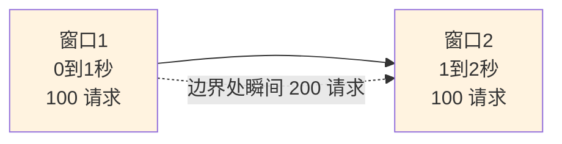
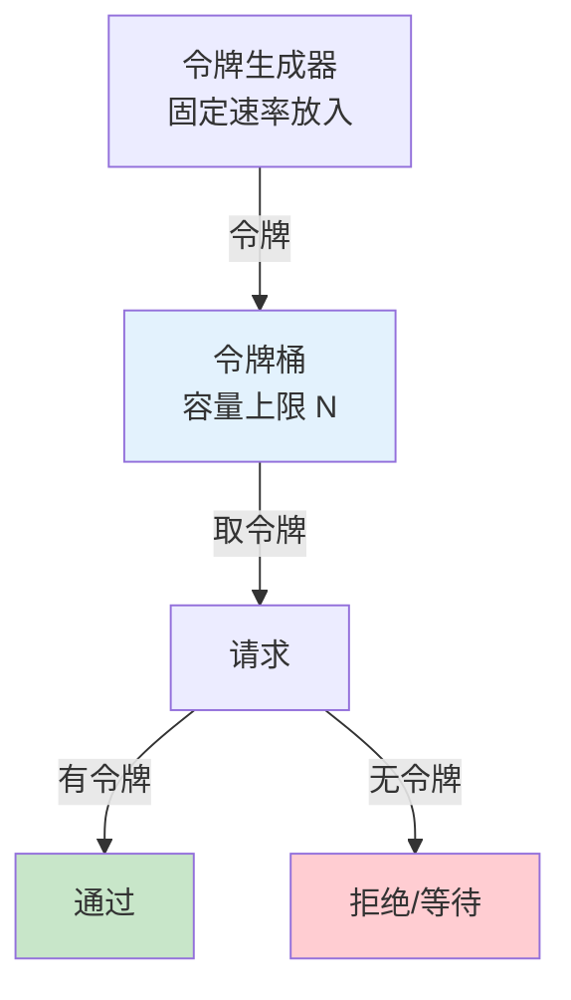
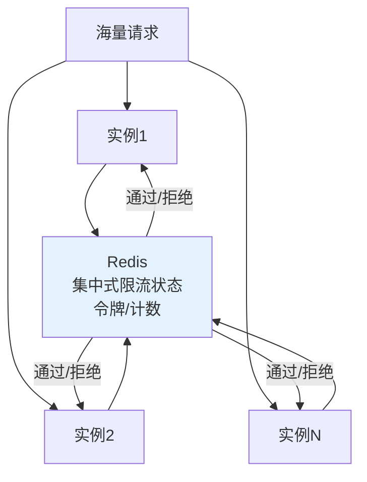
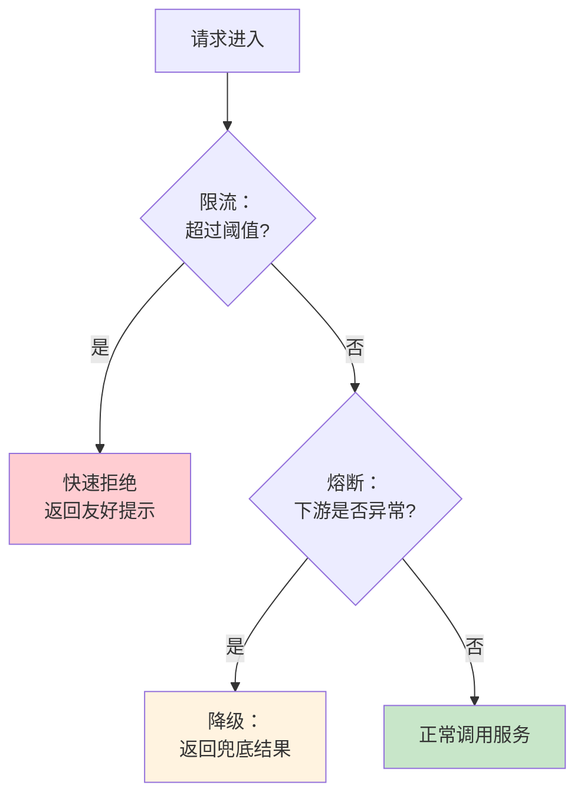

# 分布式限流

> 定位：限流是系统的「保险丝」——当流量超过系统承载能力时，有选择地拒绝一部分请求，保住整体不被打垮。这篇讲透四大限流算法的原理与对比、单机与分布式的区别、Redis 分布式令牌桶、网关与应用层落地，以及限流与降级的配合。

## 一、为什么需要它

线上系统的承载能力是有上限的：CPU、内存、线程池、数据库连接、下游接口 QPS 都有天花板。一旦流量超过天花板：

- **秒杀开始瞬间**，请求量是平时的几百倍，数据库被打挂，整个站点不可用；
- **突发爬虫/恶意刷接口**，耗尽连接和线程，正常用户也访问不了；
- **下游服务变慢**，上游重试叠加，形成**雪崩**，一波请求把整条链路拖垮。

限流的思路很简单：**提前设定一个阈值，超过阈值就拒绝/排队/降级**，用「牺牲一部分请求」换取「系统整体存活」。它和熔断、降级共同构成高可用防护体系：

- **限流**：限制入口流量，防「量太大」压垮系统；
- **熔断**：下游出问题时快速失败，防「被拖垮」和雪崩；
- **降级**：关掉非核心功能，保核心功能可用。

> 一个关键认知：**限流的阈值应该来自压测得出的系统容量，而不是拍脑袋**。设高了不起作用，设低了误伤正常流量。

## 二、四大限流算法

理解算法是限流的基础。四种经典算法各有特点，从粗到细。

### 2.1 固定窗口（Fixed Window）

把时间切成固定长度的窗口（如 1 秒），每个窗口内维护一个计数器，请求进来计数 +1，超过阈值就拒绝，窗口结束清零。

```
窗口1 [0s, 1s): 计数 100，达到阈值，拒绝后续
窗口2 [1s, 2s): 计数清零，重新开始
```

**优点**：实现极简单，Redis `INCR` + `EXPIRE` 就能做。

**缺点**：**临界问题**——如果在窗口1的最后一毫秒和窗口2的第一毫秒各涌入 100 个请求，虽然两个窗口都没超阈值，但**这 1 毫秒内实际通过了 200 个请求**，可能瞬间压垮系统。



### 2.2 滑动窗口（Sliding Window）

为解决固定窗口的临界问题，滑动窗口不按固定格子切分，而是维护一个**滚动的时间区间**。常见实现是「滑动窗口计数」：把大窗口切成多个小格，每小格独立计数，请求到来时统计**当前时间往前推一个大窗口**内的总数。

例如 1 秒窗口切成 10 个 100ms 的小格，每次统计最近 10 格的总和。

**优点**：消除了固定窗口的临界突变，限流更平滑。

**缺点**：要维护多个小格的状态，实现和存储的复杂度更高。

### 2.3 漏桶（Leaky Bucket）

把请求比作水流：请求先进入一个「桶」（队列），桶以**固定速率**向外漏水（处理请求）。桶满了就拒绝新请求。

**特点**：**出口速率恒定**，无论入口多猛，流出都是均匀的。

**优点**：能**强行平滑突发流量**，对下游保护最好。

**缺点**：无法应对合理的突发——即使系统此刻有空闲，突发流量也只能按固定速率慢慢处理，请求延迟高。不够灵活。

### 2.4 令牌桶（Token Bucket）

桶里以固定速率放入令牌（如每秒 100 个），桶有容量上限（如 200 个）。请求进来时**必须先拿到一个令牌**才能通过，拿不到就拒绝或等待。

**特点**：**允许一定程度的突发**——桶里攒了令牌时，瞬间可以放行多个请求（最多等于桶容量），之后按令牌生成速率补充。



**优点**：既限制平均速率，又允许合理突发，是**最常用、最灵活**的算法。Guava 的 `RateLimiter`、Redis 分布式限流大多基于令牌桶。

### 2.5 四种算法对比

| 算法 | 核心思想 | 平滑度 | 允许突发 | 实现复杂度 | 典型场景 |
|---|---|---|---|---|---|
| 固定窗口 | 单位时间计数 | 差（临界突变） | 否 | 极低 | 简单粗粒度限流 |
| 滑动窗口 | 滚动区间计数 | 中 | 否 | 中 | 需精确控制速率 |
| 漏桶 | 固定速率流出 | 好（绝对均匀） | **否** | 中 | 严格保护下游 |
| 令牌桶 | 按速率发令牌 | 较好 | **是** | 中 | 通用，推荐 |

**选型直觉**：需要绝对平滑用漏桶；需要兼顾突发和性能用令牌桶（主流）；只是想简单挡一下用固定窗口。

> Guava `RateLimiter` 用的是令牌桶思想，但做了优化——它平滑突发（SmoothBursty）或平滑预热（SmoothWarmingUp），避免桶里攒太多令牌导致瞬时冲击。具体行为以你使用的版本为准。

## 三、单机限流 vs 分布式限流

### 3.1 单机限流

在单个 JVM 进程内做限流，用 `AtomicInteger`、`Semaphore`，或 Guava `RateLimiter`。

```java
// Guava 单机限流：每秒 100 个许可
RateLimiter limiter = RateLimiter.create(100.0);
if (limiter.tryAcquire()) {
    handleRequest();
} else {
    return "系统繁忙";
}
```

**优点**：无网络开销、性能极高、实现简单。

**缺点**：**只对单个实例生效**。如果服务部署了 10 个实例，每个限流 100 QPS，总 QPS 就是 1000——限流阈值随实例数线性放大，无法控制全局总量。而且实例数动态伸缩时，总量更难控制。

### 3.2 分布式限流

当服务多实例部署，需要**全局统一计数**——所有实例共享同一个限流状态。做法是**把计数/令牌放到一个集中式的存储**（通常是 Redis），所有实例读写它。



**代价**：每次请求都要访问 Redis，多了网络开销，Redis 本身可能成为瓶颈和单点。优化手段：

- **批量申请令牌**：实例一次从 Redis 申请一批令牌到本地，用完再申请，减少 Redis 访问次数；
- **本地限流 + 全局限流两级**：本地先粗筛，再通过 Redis 做全局精确控制。

## 四、基于 Redis 的分布式令牌桶

Redis 实现令牌桶的经典方式是用 **Lua 脚本**保证原子性（取令牌 + 更新状态必须原子，否则并发下会超发）。

### 4.1 核心思路

在 Redis 里为每个限流对象存两个值：

- `last_time`：上次补充令牌的时间；
- `tokens`：当前令牌数。

每次请求执行 Lua 脚本：

1. 计算距上次补充经过了多久，按速率补充令牌（不超过桶容量）；
2. 如果 `tokens >= 1`，消耗 1 个令牌，允许通过；
3. 否则拒绝。

整个逻辑在 Lua 里原子执行，避免并发问题。

```lua
-- 简化示意， KEYS[1]=限流key, ARGV=容量/速率/当前时间
local key = KEYS[1]
local capacity = tonumber(ARGV[1])   -- 桶容量
local rate = tonumber(ARGV[2])       -- 每秒产生令牌数
local now = tonumber(ARGV[3])        -- 当前时间戳（毫秒）

local data = redis.call('HMGET', key, 'tokens', 'last_time')
local tokens = tonumber(data[1]) or capacity
local last = tonumber(data[2]) or now

-- 按经过时间补充令牌，上限为 capacity
local elapsed = math.max(0, now - last) / 1000
tokens = math.min(capacity, tokens + elapsed * rate)

local allowed = 0
if tokens >= 1 then
    tokens = tokens - 1
    allowed = 1
end

redis.call('HMSET', key, 'tokens', tokens, 'last_time', now)
redis.call('PEXPIRE', key, math.ceil(capacity / rate * 1000) + 1000)
return allowed
```

> 生产实现要处理更多边界（时钟、精度、并发），且不同团队的实现细节各异。上面是原理示意，落地时建议用经过验证的成熟库或框架（如 Spring Cloud Gateway 的 Redis 限流、Sentinel 集群模式），以你使用的版本为准。

### 4.2 为什么必须用 Lua

如果不用 Lua，而是「先 GET 令牌数，判断，再 SET 回去」三步分开执行，并发请求之间会互相覆盖——多个请求都读到「还有令牌」，都放行，导致**实际流量远超阈值**。Lua 脚本在 Redis 中原子执行，杜绝了这种竞态。这和分布式锁里释放锁要用 Lua 是同一个道理。

### 4.3 批量令牌优化

每次请求都访问 Redis 开销大。一种优化：实例**一次申请一批令牌**（比如一次取 100 个），本地慢慢用，用完再取。这样把 Redis QPS 降到原来的 1/100。代价是令牌在实例本地，分配不够精确（实例申请多了用不完会浪费），需要在「性能」和「精度」之间权衡。

## 五、网关层与应用层限流

### 5.1 网关层限流

在流量入口（Nginx、Spring Cloud Gateway、Kong）做限流，好处是**在到达业务服务之前就拦截**，保护整个后端集群。

- **Nginx**：用 `limit_req` 模块（漏桶思想）和 `limit_conn` 模块（连接数限制）：

```nginx
http {
    limit_req_zone $binary_remote_addr zone=perip:10m rate=10r/s;
    server {
        location /api/ {
            limit_req zone=perip burst=20 nodelay;
        }
    }
}
```

- **Spring Cloud Gateway**：用 `RequestRateLimiter` 过滤器，配合 Redis 和令牌桶（`RedisRateLimiter`），支持按用户、IP、路径等维度限流。

- **Sentinel**：阿里开源，功能全面（限流、熔断、降级、系统保护），支持集群限流（需部署 Sentinel Token Server），有控制台可动态调整规则。Spring Cloud Alibaba 生态常用。

### 5.2 应用层限流

在业务服务内部用代码限流（Guava RateLimiter、Sentinel 注解、`@RateLimit` 自定义注解 + Redis）。适合**保护特定的核心方法或接口**，粒度更细，可以结合业务参数（如按用户 ID、按租户）限流。

**网关 vs 应用层**：

| 维度 | 网关层限流 | 应用层限流 |
|---|---|---|
| 位置 | 流量入口 | 业务方法内部 |
| 保护范围 | 整个后端集群 | 单个服务/方法 |
| 粒度 | 较粗（IP/路径/用户） | 细（可结合业务参数） |
| 性能开销 | 集中处理，不占业务资源 | 占业务服务资源 |
| 动态调整 | 部分支持 | 灵活（如 Sentinel 控制台） |

**最佳实践**：**两层结合**——网关层做全局粗粒度限流（防总流量冲垮集群），应用层做细粒度限流（保护核心接口、按业务维度），形成纵深防御。

## 六、限流维度

限流Key 的选择决定限流的精准度，常见维度：

| 维度 | 说明 | 场景 |
|---|---|---|
| **IP** | 按来源 IP 限制 | 防爬虫、防 CC 攻击 |
| **用户** | 按用户 ID / Token 限制 | 防单用户刷接口 |
| **接口** | 按 URL / API 路径限制 | 保护特定重接口 |
| **集群/全局** | 整个服务总量限制 | 保护系统整体容量 |
| **业务维度** | 按租户、商品 ID、商家等 | 精细化业务保护 |

**思路**：维度越细，控制越精准，但状态越多、成本越高。通常**多个维度组合**——比如「单用户每分钟 100 次」+「全局每秒 1 万次」同时生效。

## 七、限流与降级、熔断的配合

三者是高可用防护的组合拳，各管一段：



- **限流**：控制**入口流量**，量太大直接拒绝一部分；
- **熔断**：监测**下游健康度**，下游失败率高就断开调用，避免雪崩；
- **降级**：关掉非核心功能或返回兜底数据（如商品详情降级掉「推荐」模块），保核心可用。

**配合逻辑**：先限流挡住超量流量 → 进入系统后，若下游异常则熔断 → 熔断期间走降级兜底。三者配合，系统才能在高负载和部分故障下「优雅降级」而非「直接崩溃」。

## 八、生产坑点与排查

### 坑点 1：固定窗口临界问题，限流被「绕过」

**现象**：设置了「每秒 100 次」限流，但监控发现某些秒的边界时刻，瞬时 QPS 冲到 200，数据库压力骤增。
**原因**：固定窗口在窗口边界处计数清零，前后两个窗口的边界瞬间各放行一批，形成双倍流量。
**解法**：改用滑动窗口或令牌桶算法（令牌桶出口平滑且允许合理突发，更优）。

### 坑点 2：多实例部署，单机限流形同虚设

**现象**：每个实例都配了「每秒 100 次」限流，压测发现系统总 QPS 轻松突破 1000，限流没起作用。
**原因**：单机限流只在各自 JVM 生效，实例数放大了总阈值。
**解法**：用分布式限流（Redis 集中计数/令牌），或在网关层统一限流。单机限流只作为辅助的第一道粗筛。

### 坑点 3：限流逻辑非原子，并发下超发

**现象**：用了 Redis 限流，但高并发下实际通过的请求数远超阈值。
**原因**：「读取计数 → 判断 → 更新计数」分步执行，并发请求互相覆盖，都通过了判断。
**解法**：用 Lua 脚本把「读 + 判断 + 写」封装为原子操作；或依赖 Redis 的原子命令（如 `INCR`）。这是分布式限流的铁律。

### 坑点 4：阈值拍脑袋，误伤正常流量或不起作用

**现象**：限流阈值设成 1000 QPS，结果系统早就在 300 QPS 时变慢；或者设成 50 QPS，正常高峰被大量拒绝。
**原因**：阈值没有基于压测数据，凭感觉设定。
**解法**：① 通过压测得出系统的容量拐点（响应时间/错误率开始恶化的 QPS）；② 阈值设为容量的 70%-80%，留余量；③ 灰度观察，逐步调整；④ 用 Sentinel 等支持动态调整，不停机改规则。

## 九、调优与选型决策

### 9.1 落地清单

1. **算法选令牌桶**：通用性最好，兼顾平均速率和突发；要绝对平滑选漏桶，要简单选固定窗口。
2. **多实例必须分布式限流**：Redis + Lua 原子操作是标配。
3. **网关 + 应用双层**：网关挡总量，应用护核心接口。
4. **阈值来自压测**：容量拐点的 70%-80%，动态可调。
5. **多维组合**：IP + 用户 + 接口 + 全局，多重限流同时生效。
6. **配合熔断降级**：限流拒绝时要返回友好提示（如「系统繁忙，请稍后」），配合前端重试退避。
7. **可观测**：监控拒绝率、限流触发次数、各维度流量，阈值告警。

### 9.2 一句话选型

- 简单粗粒度、单实例：固定窗口 / Guava RateLimiter；
- 要精确控速：滑动窗口；
- 严格保护下游、要绝对平滑：漏桶；
- 通用、允许合理突发（**最常用**）：令牌桶；
- 多实例全局限流：Redis + Lua 令牌桶，或 Sentinel 集群模式；
- 入口统一防护：Nginx / 网关层限流。

## 十、面试高频问法

> 这一节的答案按「面试时能讲透」的标准写：先给一句话结论，再展开机制、原因和坑点。

**Q1：常见的限流算法有哪几种？**

**一句话结论**：固定窗口、滑动窗口、漏桶、令牌桶——前两个是计数类，后两个是"桶"类。

| 算法 | 原理 | 特点 |
|---|---|---|
| 固定窗口 | 每个时间窗口计数，超阈值拒绝 | 简单，但有临界问题 |
| 滑动窗口 | 把窗口切小，滚动统计 | 平滑，实现稍复杂 |
| 漏桶 | 请求进桶，匀速流出 | 恒定速率，不允许突发 |
| 令牌桶 | 匀速生成令牌，请求拿令牌 | 允许突发（桶里攒的令牌） |

加分点：说"最常用的是令牌桶——它允许一定突发（比如桶容量 100，平时不用就攒着），比漏桶更贴合真实流量"。

**Q2：固定窗口限流有什么问题？**

**一句话结论**：有"临界问题"——窗口边界附近可能通过 2 倍流量。

展开：

- **问题**：假设限制"每秒 100 个"。第 1 秒的最后 100ms 来了 100 个（通过），第 2 秒的前 100ms 又来了 100 个（也通过）——跨窗口的 200ms 内通过了 200 个，超过限制。
- **解法**：用滑动窗口，把 1 秒切成多个小格，滚动统计最近 1 秒的总数。

加分点：说"固定窗口的临界问题在高并发下很致命——攻击者可以精确地在窗口边界发双倍请求，绕过限流"。

**Q3：滑动窗口限流怎么实现？**

**一句话结论**：把时间窗口切成多个小格（如 1 秒切 10 格），每次请求统计"最近一个窗口内所有格子的总数"。

展开：

- **实现**：用环形数组或 Redis 的 ZSet，记录每个请求的时间戳，统计"当前时间 - 窗口大小"内的请求数。
- **优点**：平滑，没有临界问题。
- **代价**：要存储每个请求的时间戳，内存开销比固定窗口大。

加分点：说"Redis 实现滑动窗口用 ZSet：`ZADD` 加时间戳，`ZREMRANGEBYSCORE` 删过期，`ZCARD` 统计——但高并发下 ZSet 会很大，要考虑用'分格计数'近似"。

**Q4：漏桶和令牌桶有什么区别？**

**一句话结论**：漏桶是"请求匀速流出"（不允许突发），令牌桶是"令牌匀速生成，请求拿令牌"（允许突发）。

展开：

- **漏桶**：请求先进桶，桶以恒定速率流出——不管进来多快，出去都是匀速。适合"保护下游，严格限速"。
- **令牌桶**：系统匀速生成令牌放桶里，请求要拿令牌才能通过——桶里攒了令牌时，可以一次性通过多个（突发）。适合"允许一定突发"。

**关键区别**：漏桶限制的是"流出速率"，令牌桶限制的是"平均速率 + 允许突发"。

加分点：说"实际业务更适合令牌桶——用户请求本来就是突发的（比如整点抢购），漏桶会把突发削平，令牌桶能吸收突发"。

**Q5：单机限流和分布式限流有什么区别？**

**一句话结论**：单机限流每个实例独立计数（简单但不准，流量不均时有的实例被限、有的空闲）；分布式限流用共享存储（Redis）统一计数（准确但有性能开销）。

展开：

- **单机**：`Guava RateLimiter`、Sentinel 单机模式。阈值是"单实例"的，总阈值 = 单机 × 实例数。
- **分布式**：用 Redis 存计数，所有实例共享。准确，但每次限流判断要访问 Redis。
- **折中**：单机限流 + 定期同步总配额（如每个实例分总配额的 1/N）。

加分点：说"流量均匀时单机限流就够（如负载均衡轮询）；流量不均（如按用户哈希路由）时单机限流会误伤，要用分布式限流"。

**Q6：基于 Redis 的分布式限流怎么实现？**

**一句话结论**：用 Redis 的 `INCR` + `EXPIRE`（固定窗口），或 Lua 脚本实现令牌桶/滑动窗口，保证原子性。

展开：

- **固定窗口**：`INCR key`，第一次设置过期时间，超过阈值拒绝。
- **令牌桶**：Lua 脚本原子地"计算应生成的令牌数 + 扣减"，避免并发问题。
- **注意**：`INCR` 和 `EXPIRE` 要原子（用 Lua 或 `SET ... EX`），否则可能永不过期。

加分点：说"Redis 限流的坑是'原子性'——`INCR` 后再 `EXPIRE`，如果中间宕机，key 就永不过期，导致一直限流；必须用 Lua 保证原子"。

**Q7：网关层限流和应用层限流有什么区别？**

**一句话结论**：网关限流挡在入口（保护整个系统），应用层限流在服务内部（保护具体接口/资源）。

展开：

- **网关层**：在流量入口限流，按 IP、用户、接口维度，挡住恶意流量和超量请求。**优点**：统一、不影响业务代码。
- **应用层**：在服务内部限流，能按"业务方法""资源"精细控制，还能做热点参数限流。**优点**：精细、能感知业务。
- **配合**：网关做粗粒度（总量），应用做细粒度（单接口/热点）。

加分点：说"两层限流不冲突——网关是'大门'，应用是'房间门'；大门挡住洪水，房间门保护具体资源"。

**Q8：限流阈值怎么确定？**

**一句话结论**：压测找系统容量拐点，阈值设为容量的 70%-80%，留余量应对突发和下游波动。

展开：

- **压测**：逐步加压，观察 QPS、RT、错误率，找到"RT 开始飙升"的拐点，那就是容量上限。
- **阈值**：容量 × 0.7-0.8（安全系数），给下游抖动和突发留空间。
- **动态调整**：业务增长、大促前重新评估；结合系统保护（CPU/Load）自适应。

加分点：说"阈值不是拍脑袋——没有压测数据的限流阈值都是猜的，要么太松（没保护作用）要么太紧（误伤正常用户）"。

**Q9：限流和熔断、降级有什么区别？**

**一句话结论**：限流控制"进入的流量"（保护自己），熔断在"下游故障时快速失败"（保护调用方），降级是"牺牲非核心功能"（保核心）。

展开：

- **限流**：主动限制请求速率，超了就拒绝/排队。
- **熔断**：下游错误率高时，直接不调用（快速失败），避免拖垮自己。
- **降级**：系统压力大时，关闭非核心功能（如推荐、评论），保核心（如下单）。

加分点：说"三者是'稳定性三板斧'——限流防'被打死'、熔断防'被拖死'、降级防'资源不够'；要配合用，单用一个不够"。

**Q10：限流被触发后，应该怎么处理请求？**

**一句话结论**：不能直接返回 500——要返回友好提示、或排队等待、或降级到兜底逻辑，保证用户体验。

展开：

- **快速失败**：返回"系统繁忙，请稍后重试"（HTTP 429），带 Retry-After。
- **排队等待**：让请求排队（如 Sentinel 的排队模式），匀速处理。
- **降级**：返回缓存数据或默认值。
- **前端配合**：按钮置灰、倒计时提示。

加分点：说"限流是'保护系统'，但不能让用户觉得'系统坏了'——好的限流是'用户感知不到'，或者'友好地告诉他稍等'"。

## 小结

- 限流是系统保险丝，用「拒绝部分请求」换「整体存活」，阈值来自压测容量。
- 四算法：固定窗口（临界问题）、滑动窗口（精确）、漏桶（绝对平滑无突发）、令牌桶（主流、允许突发）。
- 单机限流多实例会放大阈值，全局限流要靠 Redis + Lua 原子令牌桶。
- 网关层挡总量 + 应用层护核心，双层纵深；限流维度可组合 IP/用户/接口/全局。
- 限流 + 熔断 + 降级组合防护；阈值压测定、动态可调、可观测。
