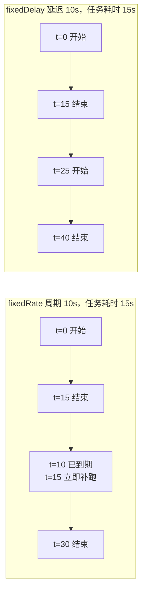
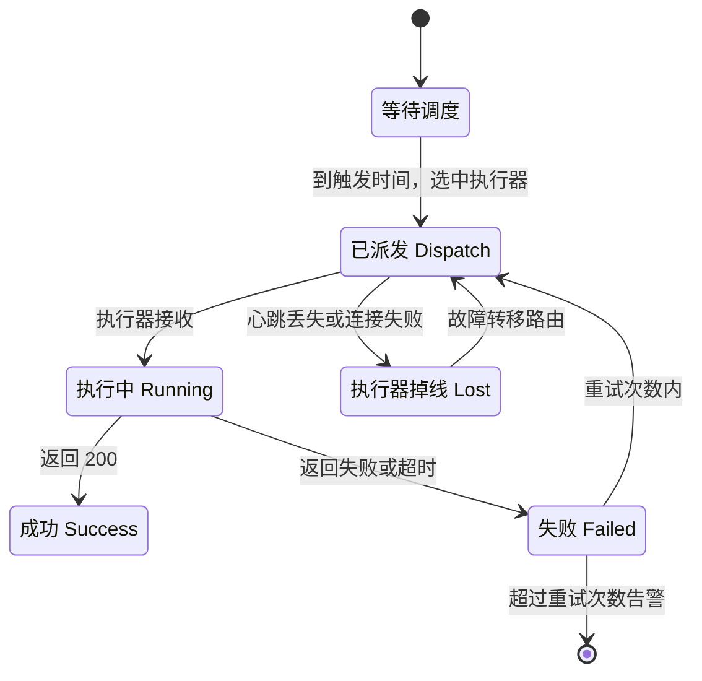
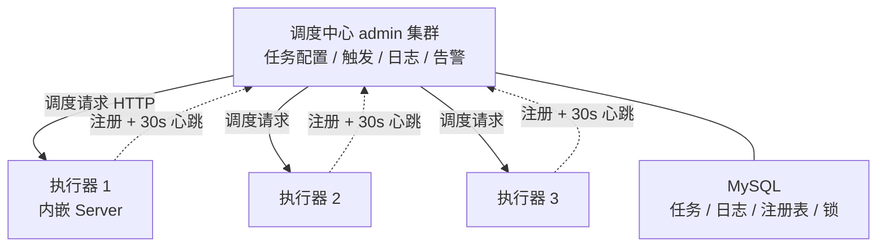
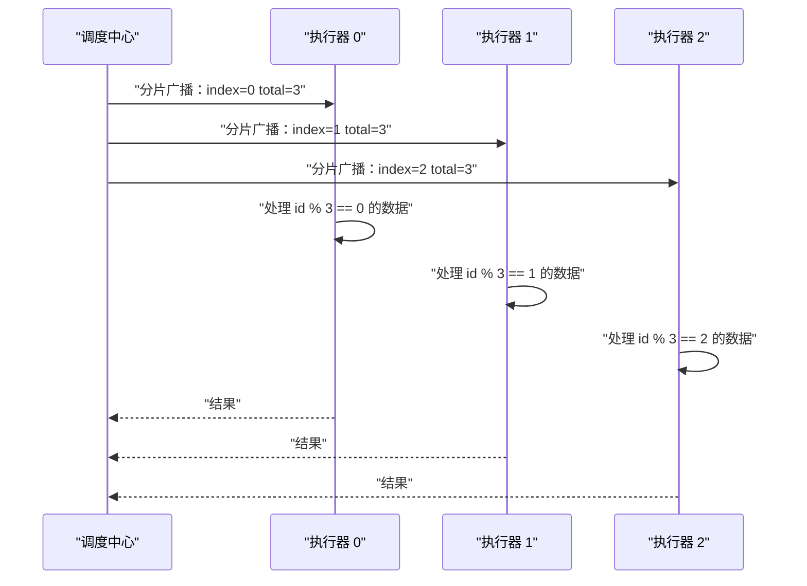

# 分布式任务调度

> 定位：单机 `@Scheduled` 在单体时代很好用，一上多副本就变成「同一个任务被 8 个实例各跑一遍」；等到要做数据对账、批量推送、报表生成，又需要分片、失败重试、可视化运维和故障转移。这篇从 cron/fixedRate/fixedDelay 的语义差异讲到 XXL-JOB 的调度中心与执行器架构、分片广播、路由与阻塞策略，再对比 Elastic-Job 与 PowerJob，最后给出「什么时候用调度、什么时候该用延迟消息」的判断标准。

## 一、为什么需要它

三个典型现场：

1. **重复执行**：服务从 1 个副本扩到 8 个，每天凌晨的对账任务被跑了 8 遍，账单被重复结算。
2. **任务消失**：某实例正好在触发时刻滚动发布，任务没跑，当天报表缺失，没人发现。
3. **单机扛不住**：一张千万级表要逐条推送，单机跑 6 小时，早就超过业务要求的 30 分钟窗口。

`@Scheduled` 解决的是「进程内定时」，不解决「集群内只跑一次」「多机分片」「失败自动转移」「看得见摸得着」。分布式调度要补的正是这四件事。

## 二、核心原理

### 2.1 四种调度模型：语义差别比想象中大

| 模型 | 语义 | 是否重叠 | 典型用途 |
|---|---|---|---|
| **cron** | 按日历表达式在固定时刻触发 | 可能（上次没跑完就到下一次） | 每天 2 点对账、每周报表 |
| **固定频率（fixedRate）** | 按**上次开始时间** + 周期触发 | 可能（单线程下不并发，但会延迟堆积） | 每 5 秒拉一次配置 |
| **固定延迟（fixedDelay）** | 按**上次结束时间** + 延迟触发 | 不会（必然等上次完成） | 每轮处理完再等 1 秒继续 |
| **一次性（one-shot）** | 延时多久后执行一次 | 不涉及 | 订单 30 分钟未支付关单 |



读图要点：`fixedRate` 按**开始时间**排期，任务超时会导致「补跑」，在单线程调度器里表现为连续执行；`fixedDelay` 按**结束时间**排期，永远留出固定间隔。选错了会得到完全不同的执行频率。

Java 里的三个易错点：

- `scheduleAtFixedRate` 的任务**抛异常后，后续执行会被取消**（不会自动恢复），必须自己 `try-catch` 兜住。
- `@Scheduled` 默认使用**单线程调度器**（`spring.task.scheduling.pool.size=1`），所有定时任务互相阻塞，一个慢任务会拖垮其他任务。
- `fixedRate` 在单线程下不会并发执行，但会「排队补跑」；多线程池下则可能并发执行同一个任务，需要业务自己保证幂等。

### 2.2 单机方案的能力边界

| 方案 | 能力 | 局限 |
|---|---|---|
| `ScheduledExecutorService` | JDK 自带，轻量 | 无集群、无持久化、异常终止后续、无运维界面 |
| Spring `@Scheduled` | 注解即用，支持 cron | 默认单线程、无集群、无分片、无失败重试 |
| Quartz | 支持持久化、集群、misfire 策略 | 依赖数据库行锁抢 trigger，集群规模大时锁竞争明显；无分片广播；无内置管理界面 |
| 自研 DB 锁 + 定时扫表 | 简单可控 | 重复造轮子，锁超时/时钟/故障转移都要自己处理 |

Quartz 集群的原理值得知道：触发器存在数据库 `QRTZ_TRIGGERS` 等表里，各节点用 `SELECT ... FOR UPDATE` 抢 `QRTZ_LOCKS` 的行锁，抢到的节点执行、其余跳过。**它保证了「不重复」，但没有解决「一个任务拆到多台机器并行」**——这正是 Elastic-Job/XXL-JOB 分片能力要补的。

### 2.3 分布式调度要解决的四个问题

| 问题 | 含义 | 常见手段 |
|---|---|---|
| **选主/互斥** | 同一时刻只有一个节点触发同一任务 | DB 行锁、Redis 分布式锁、ZK 临时节点 |
| **分片** | 一个大任务拆给多台执行器并行 | 分片广播 + 分片参数（index/total） |
| **故障转移** | 执行器掉线后任务重派给其他节点 | 心跳检测 + 失败重试 + 路由策略 |
| **避免重复执行** | 重试/转移/网络抖动导致的重复 | 业务幂等 + 执行记录唯一键 |



读图要点：**「至少执行一次」是这类系统的默认语义**——失败重试、掉线转移都会导致重复，所以任务必须幂等。状态机里没有「恰好一次」的路径，这是设计前提而不是缺陷。

### 2.4 XXL-JOB 架构

XXL-JOB 2.4.x 由两部分组成：**调度中心（admin）** 和 **执行器（executor）**，中间靠 HTTP + 注册表通信。



读图要点：**调度与执行分离**——admin 只负责「什么时候、让谁跑」，执行器负责「真正跑」。执行器主动注册并心跳，admin 据此维护在线列表；admin 集群通过数据库锁保证同一任务同一时刻只被一个 admin 触发（以 2.4.x 实现为准）。

**路由策略**（选中哪台执行器）：

| 策略 | 行为 | 适用 |
|---|---|---|
| 第一个 / 最后一个 | 固定选第一个或最后一个 | 单机任务、调试 |
| 轮询 | 依次轮转 | 均匀分摊 |
| 随机 | 随机选 | 简单分摊 |
| 一致性 HASH | 按任务参数哈希选节点 | 需要「同一参数落到同一台」 |
| 最不经常使用 / 最近最久未使用 | 按调用频率/时间选 | 长任务、负载均衡 |
| 故障转移 | 按顺序探测，选第一个健康的 | 高可用要求高 |
| 忙碌转移 | 跳过正在忙的执行器 | 避免排队 |
| **分片广播** | **向所有执行器各发一次，带分片序号** | 大数据量并行处理 |

**阻塞策略**（同一执行器上同一任务重叠时）：

- **单机串行**：排队，前一个跑完再跑下一个。
- **丢弃后续调度**：本次触发直接跳过。
- **覆盖之前调度**：终止正在跑的，启动新的（慎用，可能留下半成品数据）。

**其他关键机制**：

- **失败重试**：配置重试次数，失败后立即重派（无退避），所以幂等是硬要求。
- **超时中断**：配置任务超时时间，超时后 admin 标记失败并尝试中断执行线程（Java 线程中断是协作式的，未必能真正停下）。
- **调度过期策略**：错过触发时间时，`DO_NOTHING`（忽略）或 `FIRE_ONCE_NOW`（立即补一次）。
- **分片参数**：执行器通过 `XxlJobHelper.getShardIndex()` / `getShardTotal()` 拿到自己的分片序号与总数。



读图要点：**分片广播是「每个执行器都收到一次调度」，分片逻辑由业务代码按 index/total 自己切**。扩容执行器后分片数自动变化，所以切片规则必须能随 total 动态调整（如 `id % total == index`），不能写死区间。

### 2.5 Elastic-Job 与 PowerJob 的差异

| 维度 | XXL-JOB | Elastic-Job-Lite | PowerJob |
|---|---|---|---|
| 注册中心 | 自研注册表（DB） | ZooKeeper / etcd | 自研 Server（DB 存储） |
| 调度触发 | 调度中心统一触发 | 各节点基于 ZK 选主 + 本地时间轮 | Server 统一触发 |
| 分片 | 分片广播（静态 index/total） | **动态分片 + 自动再均衡** | 支持广播、MapReduce、Map 分片 |
| 故障转移 | 路由策略 + 重试 | **失效转移（failover）** | 失败重试 + Worker 摘除 |
| 错过触发 | 忽略 / 立即补一次 | misfire 重触发 | 支持 |
| 工作流 | 无（需自己串） | 无 | **DAG 工作流** |
| 运维界面 | 自带，轻量好用 | 无（需自建） | 自带，功能全 |
| 部署复杂度 | 低 | 中（依赖 ZK） | 中高（Server + Worker + 存储） |
| 社区活跃度 | 高 | 低（Lite 维护放缓） | 中高 |

一句话取舍：**要轻、要快、要界面，选 XXL-JOB；要动态分片与自动再均衡、且已有 ZK，选 Elastic-Job；要工作流、MapReduce、容器化执行，选 PowerJob。**

### 2.6 调度与消息队列、延迟消息的边界

| 能力 | 分布式调度 | MQ 延迟消息 |
|---|---|---|
| 触发语义 | 按时间表周期性/一次性触发 | 单条消息延迟投递 |
| 任务编排 | 分片、重试、依赖、可视化 | 无 |
| 海量单条延迟 | 不适合（调度记录会爆炸） | 适合（百万级延迟消息） |
| 周期任务 | 原生支持 | 不支持（要自己循环投递） |
| 精确到秒 | 支持（受调度线程与时钟影响） | 取决于实现（时间轮/定时扫描） |
| 失败重试 | 内置 | 依赖消费端重试 |

判断标准：**「按时间表批量跑一件事」用调度；「每条业务数据在某个时刻触发一次」用延迟消息**。订单 30 分钟关单是「每笔订单一条延迟消息」，用调度扫表会变成「每分钟扫全表找超时订单」，量一大就撑不住。反过来，「每天凌晨 2 点生成全量报表」用延迟消息就得自己维护循环投递，纯属自找麻烦。

## 三、关键配置与代码

### 3.1 XXL-JOB 执行器配置

```yaml
xxl:
  job:
    admin:
      addresses: http://10.0.0.31:8080/xxl-job-admin
    accessToken: ${XXL_JOB_TOKEN}
    executor:
      appname: order-job-executor
      address: ""
      ip: ""
      port: 9999
      logpath: /data/logs/xxl-job
      logretentiondays: 30
```

```java
@Component
public class OrderReconcileJob {

    @XxlJob("orderReconcileJob")
    public void execute() {
        int index = XxlJobHelper.getShardIndex();   // 当前分片序号，从 0 开始
        int total = XxlJobHelper.getShardTotal();   // 分片总数
        try {
            orderReconcileService.reconcile(index, total);
            XxlJobHelper.handleSuccess("shard " + index + " done");
        } catch (Exception e) {
            XxlJobHelper.log("reconcile failed, shard={}", index);
            XxlJobHelper.handleFail(e.getMessage());  // 触发失败重试
        }
    }
}
```

分片 SQL 必须能随 `total` 变化，避免扩容后切片错乱：

```sql
-- 按主键取模分片，total 变化后自动重分布
SELECT id, order_no, amount FROM orders
WHERE id % #{total} = #{index}
  AND status = 'PAID' AND reconcile_flag = 0
LIMIT 1000;
```

### 3.2 Spring `@Scheduled` 的正确姿势

```java
@Configuration
@EnableScheduling
public class SchedulingConfig implements SchedulingConfigurer {

    @Override
    public void configureTasks(ScheduledTaskRegistrar registrar) {
        ThreadPoolTaskScheduler scheduler = new ThreadPoolTaskScheduler();
        scheduler.setPoolSize(8);                      // 默认 1，慢任务会互相阻塞
        scheduler.setThreadNamePrefix("sched-");
        scheduler.setWaitForTasksToCompleteOnShutdown(true);
        scheduler.initialize();
        registrar.setTaskScheduler(scheduler);
    }
}
```

```java
@Scheduled(cron = "0 0 2 * * ?", zone = "Asia/Shanghai")
public void dailyReconcile() {
    try {
        reconcileService.run();
    } catch (Exception e) {
        log.error("daily reconcile failed", e);   // 必须兜住，否则后续触发被取消
    }
}
```

### 3.3 任务幂等：调度层无法替代

```java
// 以「业务唯一键 + 执行日期」做幂等，防止重试/转移/重复调度
public void reconcile(int shardIndex, int shardTotal) {
    String bizKey = "reconcile:" + LocalDate.now() + ":" + shardIndex;
    Boolean first = redisTemplate.opsForValue()
        .setIfAbsent(bizKey, "1", Duration.ofHours(6));
    if (!Boolean.TRUE.equals(first)) {
        log.info("duplicate execution skipped, key={}", bizKey);
        return;
    }
    try {
        doReconcile(shardIndex, shardTotal);
    } catch (Exception e) {
        redisTemplate.delete(bizKey);   // 失败释放，允许重试
        throw e;
    }
}
```

更严谨的做法是**数据库唯一键兜底**（Redis 可能丢），并让业务写操作本身幂等，参考 [幂等设计](04-幂等设计.md)。

## 四、生产坑点与排查

### 坑点 1：多副本部署，`@Scheduled` 任务被重复执行

**现象**：日志显示同一时刻多个实例都在跑对账，数据被重复处理。
**原因**：`@Scheduled` 是进程内调度，每个副本都会独立触发。
**解法**：短期用分布式锁（Redis/ZK）抢占，参考 [分布式锁](02-分布式锁.md)；长期迁到调度平台，由调度中心统一触发、指定单机路由。

### 坑点 2：长任务阻塞调度线程，其他任务全部延迟

**现象**：一个导出任务跑了 40 分钟，同实例上其他每分钟任务全部「迟到」。
**原因**：`@Scheduled` 默认单线程调度器，或 XXL-JOB 执行器线程池过小。
**解法**：Spring 配置 `ThreadPoolTaskScheduler` 池大小；XXL-JOB 调大执行器线程池并按任务耗时拆分执行器；长任务改成分片/异步子任务。

### 坑点 3：执行器掉线，任务既没成功也没重试

**现象**：某天报表缺失，调度日志显示「执行器不存在」，但没有重试记录。
**原因**：执行器在触发瞬间正好下线，admin 心跳尚未刷新；或路由策略选了「第一个」固定节点。
**解法**：路由改「故障转移」或「忙碌转移」；开启失败重试；执行器优雅停机（先摘流量再退出）；监控执行器在线数与心跳。

### 坑点 4：分片不均，一台跑 80% 数据

**现象**：分片广播后，index=0 的执行器处理 80% 数据，其余很快跑完空等。
**原因**：分片键分布倾斜（如按 `id % total` 但 id 段集中），或按时间区间静态切分。
**解法**：用分布均匀的键（雪花 ID 取模、哈希）；按数据量动态划分区间；必要时二次分片（index/total 再按子范围拆分）。

### 坑点 5：时钟回拨/时区不一致导致触发错乱

**现象**：任务在凌晨 2 点没跑，或一天跑了两次。
**原因**：多节点时钟不同步、NTP 回拨；容器默认 UTC，cron 按 UTC 解释。
**解法**：所有节点强制 NTP 同步；cron 显式指定 `zone="Asia/Shanghai"`（Spring）或时区（Quartz）；调度中心统一时区；避免用本地时间做业务判断。

### 坑点 6：任务超时被「中断」但实际没停，产生并发写

**现象**：超时任务被标记失败并重试，但旧线程还在跑，两份任务同时写同一批数据。
**原因**：Java 线程中断是协作式的，代码里没有检查中断标志，`Thread.interrupt()` 停不下来。
**解法**：任务内定期检查 `Thread.currentThread().isInterrupted()`；用可取消的批处理；业务写加幂等与版本号；超时时间设置要留足余量。

## 五、选型与最佳实践

### 5.1 选型对比

| 场景 | 推荐 | 理由 |
|---|---|---|
| 少量定时任务、已有 Spring 生态 | `@Scheduled` + 分布式锁 | 零引入成本，任务少时够用 |
| 需要界面、分片、重试、报警 | **XXL-JOB** | 轻量、部署简单、中文文档全 |
| 动态分片、自动再均衡、已有 ZK | Elastic-Job | 分片能力强，但社区维护放缓 |
| 工作流 DAG、MapReduce、容器化执行 | PowerJob | 功能最全，部署也更重 |
| 海量单条延迟触发 | 延迟消息 / 时间轮 | 调度表会被单条记录撑爆 |

### 5.2 什么时候不该用分布式调度

- **只有一个实例且任务简单**：引入调度中心是纯负担，`@Scheduled` 足够。
- **本质是「每条数据的延迟动作」**：用延迟消息，不要用「每分钟扫表」。
- **实时性要求毫秒级**：调度器的触发精度受线程池与时钟影响，不适合做实时链路。
- **任务之间有强依赖且要求严格顺序**：调度平台不保证跨任务顺序，用工作流引擎或消息串行。

### 5.3 上线清单

1. 所有任务默认**幂等**（唯一键/状态机/分布式锁），不假设「只跑一次」。
2. 调度失败必须**有告警**，不能只写日志。
3. 执行器**优雅停机**：先下线注册、等在跑任务结束。
4. 分片逻辑随 `total` 动态变化，禁止写死区间。
5. 监控四项：任务成功率、执行耗时 P99、执行器在线数、失败重试次数。
6. 时钟统一 NTP，cron 显式指定时区。

## 六、面试高频问法

**Q1：`fixedRate` 和 `fixedDelay` 有什么区别？**

**一句话结论**：`fixedRate` 按**上次开始时间** + 周期排期，任务超时会补跑；`fixedDelay` 按**上次结束时间** + 间隔排期，永远不会重叠。

展开：单线程下 `fixedRate` 不会并发但会连续补跑；多线程池下可能并发执行同一任务。`scheduleAtFixedRate` 抛异常会取消后续执行，必须 try-catch。

加分点：说「选型看语义——要『每 5 秒一次』用 fixedRate，要『处理完歇 1 秒』用 fixedDelay」。

**Q2：单机定时任务在多副本下有什么问题？怎么解决？**

**一句话结论**：每个副本都会独立触发，导致**重复执行**；此外没有分片、故障转移和可视化运维。解法是分布式锁做互斥，或迁到 XXL-JOB 这类调度平台统一触发。

展开：锁方案要注意锁续期与释放（参考分布式锁篇）；调度平台方案由调度中心选一台执行器触发，天然避免重复。

加分点：说「锁只能解决重复，解决不了分片和故障转移——规模上来必须上调度平台」。

**Q3：分布式调度要解决哪些核心问题？**

**一句话结论**：**选主互斥、任务分片、故障转移、重复执行兜底**四件事，分别对应「谁来触发」「怎么并行」「挂了怎么办」「重复了怎么办」。

展开：互斥靠 DB 锁/Redis/ZK；分片靠「广播 + index/total」；转移靠心跳检测 + 重试路由；重复靠业务幂等。

加分点：强调「这四件事没有银弹，调度平台只保证 at-least-once，幂等必须业务自己做」。

**Q4：XXL-JOB 的架构是怎样的？**

**一句话结论**：**调度中心 + 执行器**分离：admin 负责配置、触发、日志、告警；executor 内嵌 Server，主动注册并 30 秒心跳；admin 通过 HTTP 调度，路由策略决定发给哪台。

展开：admin 可集群，靠数据库锁避免重复触发；执行器支持分片广播、失败重试、阻塞策略、超时中断；任务日志回传 admin 展示。

加分点：说「调度与执行分离的好处是执行器可以按业务独立部署、独立扩容，不会因为一个慢任务拖垮整个调度中心」。

**Q5：分片广播是怎么工作的？扩容后要注意什么？**

**一句话结论**：调度中心给**每个在线执行器各发一次**，携带 `index` 和 `total`；业务按 `id % total == index` 之类规则切数据。扩容后 `total` 变化，切片规则必须能自动重分布。

展开：分片是「逻辑并行」，不是数据搬迁；分片不均要用更均匀的键或二次拆分；执行器掉线后该分片没人处理，需要重试/转移策略配合。

加分点：说「分片广播 + 幂等 + 重试，才能同时解决并行和故障」。

**Q6：XXL-JOB 的路由策略和阻塞策略分别解决什么问题？**

**一句话结论**：路由策略决定**这次调度发给哪台执行器**（轮询/随机/一致性 HASH/故障转移/分片广播等）；阻塞策略决定**同一执行器上同一任务重叠时怎么办**（串行/丢弃/覆盖）。

展开：故障转移适合高可用，忙碌转移避免排队，一致性 HASH 保证同参数同节点；阻塞策略选错会导致任务堆积或数据被覆盖。

加分点：说「两者是不同维度——一个选机器，一个处理重叠，面试时别混为一谈」。

**Q7：Elastic-Job 和 XXL-JOB 的主要区别？**

**一句话结论**：Elastic-Job 基于注册中心（ZK）做**动态分片与自动再均衡**，分片能力强但依赖 ZK、无自带界面；XXL-JOB 是**调度中心统一触发 + 分片广播**，轻量、有界面、上手快。

展开：Elastic-Job 的失效转移和 misfire 重触发更完善；XXL-JOB 的运维体验更好、社区更活跃。

加分点：说「选型看团队——没有 ZK 运维能力时，Elastic-Job 的架构优势会被运维成本抵消」。

**Q8：什么时候用分布式调度，什么时候用延迟消息？**

**一句话结论**：**按时间表批量跑任务用调度，每条业务数据在某个时刻触发一次用延迟消息**。

展开：订单 30 分钟关单是海量单条延迟，用 MQ/时间轮；每天凌晨全量对账是周期任务，用调度。用调度扫表做单条延迟，表越大越慢；用 MQ 做周期任务，要自己维护循环投递。

加分点：说「两者的失败语义也不同——调度重试是整任务重跑，MQ 重试是单条消息重投，幂等粒度不一样」。

**Q9：任务重复执行怎么保证不出问题？**

**一句话结论**：调度层只能做到 at-least-once，**幂等必须业务兜底**——唯一键去重、状态机条件更新、分布式锁、版本号。

展开：重试、故障转移、网络抖动、人工补跑都会重复；用「业务唯一键 + 执行日期」去重表最可靠，Redis 锁只能减少重复不能根除。

加分点：说「先处理业务再标记完成，失败可重试；不要先标记成功再处理，否则失败就永久丢任务」。

## 小结

- 调度模型语义不同：cron 按日历、fixedRate 按开始时间、fixedDelay 按结束时间，选错会得到不同频率。
- 单机方案没有集群互斥、分片、故障转移和运维界面，多副本下必然重复执行。
- 分布式调度四件事：**选主互斥、任务分片、故障转移、重复兜底**。
- XXL-JOB = 调度中心 + 执行器，靠注册心跳、路由策略、分片广播、阻塞策略和失败重试协同工作。
- 分片规则必须随 `total` 动态变化，扩容后才不会切错数据。
- 调度保证 at-least-once，幂等是业务责任；「按时间表跑任务」用调度，「单条数据定时触发」用延迟消息。
