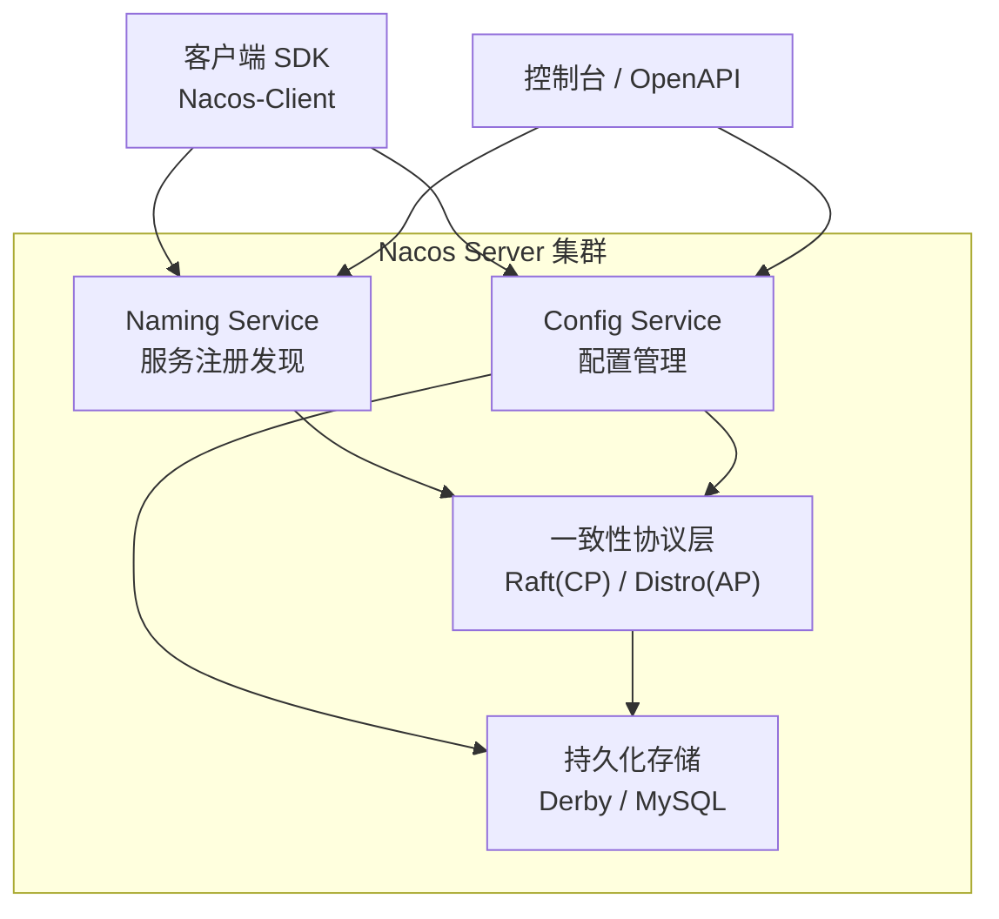
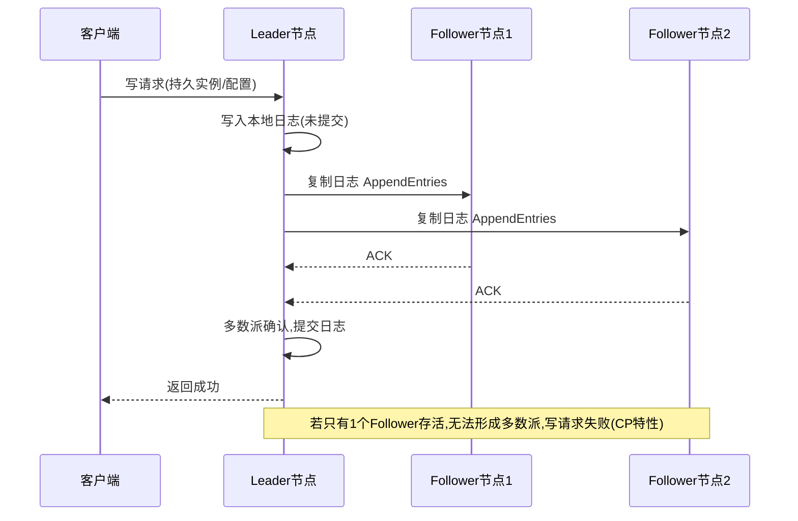
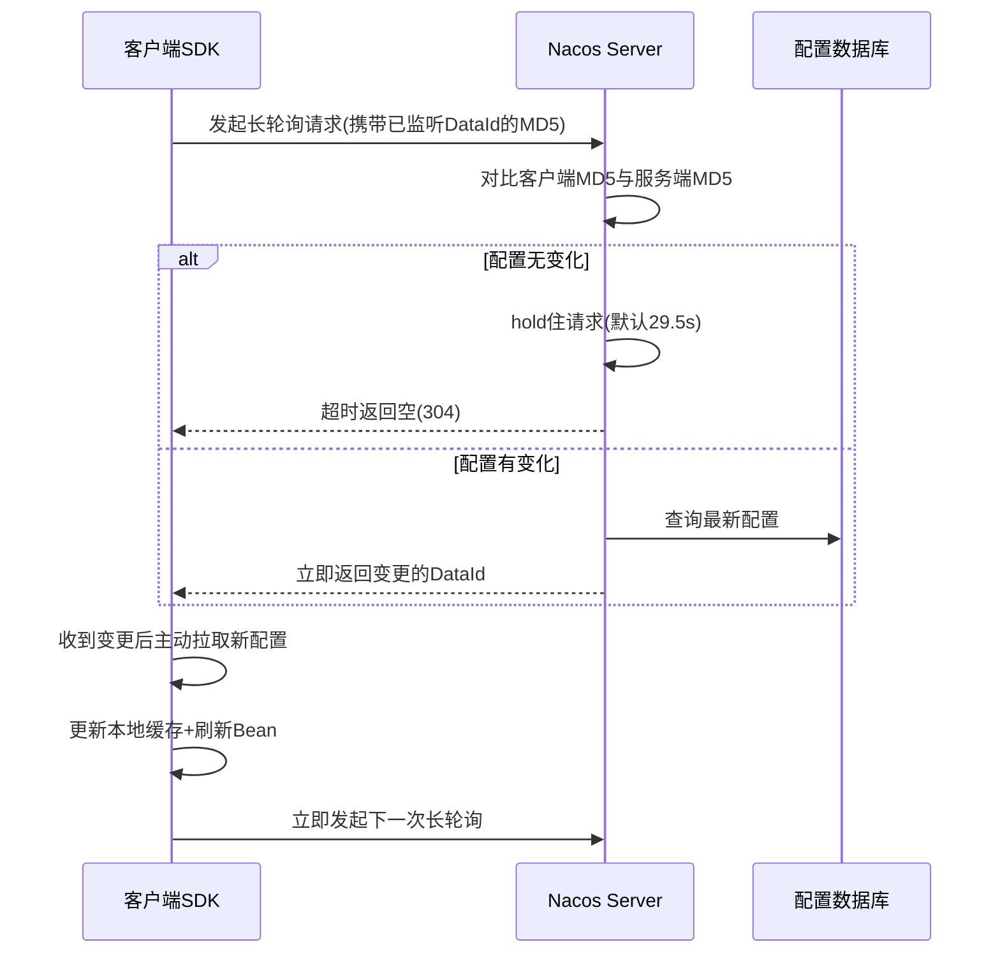

# Nacos 原理

> 定位：Nacos 是服务注册发现 + 配置管理二合一的基础设施，把它讲透，就抓住了两件事——**实例健康状态如何在集群中达成一致（AP/CP）**，以及**配置变更如何秒级推送到成千上万客户端而不压垮服务端**。这篇解决"Nacos 到底怎么工作、什么场景选 AP 什么场景选 CP、长轮询和推送风暴是怎么回事"。

## 一、为什么需要 Nacos

单体拆成微服务后，服务间调用面临两个最基础的问题：

1. **服务在哪**：实例 IP 动态变化（容器重启、扩缩容），硬编码地址行不通，需要一个"电话本"——服务注册中心。
2. **配置怎么改**：数据库连接串、开关、限流阈值，改一次不想重新打包发布，需要一个"远程配置中心"。

早期团队往往用 Eureka + Config，或者 Consul + 自研配置，两套系统维护成本高。Nacos 把两者合一，一个组件搞定，这也是它在国内 Java 生态快速普及的原因。

但"能用"和"用好"之间差着一条鸿沟。生产上常见的困惑：

- 服务实例挂了，为什么有的场景几秒就摘除，有的要等 15 秒甚至更久？
- 注册中心自己重启/脑裂时，服务列表为什么有时会被清空？
- 改一个配置，几百个实例同时来拉，Nacos 会不会被打爆？
- 临时实例和持久实例到底该怎么选？

这些问题都指向 Nacos 的两套灵魂机制：**一致性协议（Raft/Distro）** 和 **配置推送模型（长轮询）**。

## 二、核心原理

### 2.1 Nacos 的整体架构

Nacos  Server 内部按功能拆成几个核心模块，理解它们的关系是后面所有内容的基础。



这张图讲什么：客户端通过 SDK 或 OpenAPI 访问 Nacos，Naming 模块负责服务发现，Config 模块负责配置。**关键在中间的一致性协议层**——它决定了数据在集群节点间怎么同步，是 AP 还是 CP 的分水岭。

### 2.2 数据模型：命名空间 / 分组 / 服务

Nacos 用三层结构隔离数据，理解它才能搞清配置项和服务名怎么组织：

| 层级 | 说明 | 典型用途 |
|---|---|---|
| Namespace（命名空间） | 最外层隔离，对应 `namespaceId` | 区分环境：dev / test / prod |
| Group（分组） | 中间层，默认 `DEFAULT_GROUP` | 区分业务线或应用 |
| Service / DataId | 最内层，服务名或配置 ID | 具体服务 / 具体配置文件 |

配置的标准命名：`DataId` 通常形如 `${spring.application.name}-${profile}.${文件扩展名}`，例如 `order-service-prod.yaml`。这套三层模型是做环境隔离、权限控制的基础。

### 2.3 注册发现的核心流程

服务实例启动后，SDK 做三件事：

1. **注册**：向 Nacos Server 发送实例信息（IP、端口、权重、集群名、临时/持久标记）
2. **心跳**：临时实例每隔 5 秒上报一次心跳，证明自己还活着
3. **拉取 + 订阅**：首次全量拉取服务列表，之后通过 UDP / 长连接接收变更推送，同时定时（默认 30 秒）增量拉取兜底

客户端还会维护一个**本地缓存**（failover 目录 + 快照文件），即使 Nacos 全挂了，也能用本地缓存继续调用——这是 Nacos 高可用设计的重要一环。

## 三、关键机制 / 参数

### 3.1 AP 还是 CP：临时实例 vs 持久实例

这是 Nacos 最核心也最容易被误解的设计。**Nacos 同时支持 AP 和 CP，但切换的开关不是全局配置，而是实例类型。**

| 对比维度 | 临时实例（ephemeral=true） | 持久实例（ephemeral=false） |
|---|---|---|
| 一致性协议 | **Distro（AP）** | **Raft（CP）** |
| 健康检查 | 客户端心跳（5s 上报） | 服务端主动探测（TCP/HTTP/MySQL） |
| 故障处理 | 心跳超时（默认 15s）踢除实例 | **不踢除**，只标记为不健康 |
| 数据存储 | 仅内存，不持久化到数据库 | 持久化到数据库 |
| 适用场景 | 微服务实例（Spring Cloud 默认） | DNS 服务、数据库地址等需强一致 |

**结论**：绝大多数的 Spring Cloud 服务注册都是临时实例（AP）——追求的是可用性，注册中心短暂不一致无所谓，实例挂了能被摘除更重要。持久实例用 Raft 保证 CP，适合那些"即使节点挂了数据也不能丢、且不能被误删"的场景。

配置方式（Spring Cloud Alibaba）：

```yaml
spring:
  cloud:
    nacos:
      discovery:
        ephemeral: false   # 改成持久实例，走 Raft(CP)，默认 true
```

### 3.2 Distro 协议（AP）怎么工作

Distro 是阿里自研的 AP 协议，设计目标：**即使部分节点宕机，注册中心整体依然可用**。它的核心思想：

- **每个节点负责一部分数据**：按实例 IP 做哈希分片，每个节点是某些实例的主节点
- **写操作本地优先**：实例注册到任意节点，该节点先写入本地，再异步同步给其他节点
- **定期全量同步 + 增量同步**：新节点加入或其他节点失联后，通过全量同步补齐数据

它遵循的是 CAP 中的 AP：各节点数据可能短暂不一致，但服务永不拒绝注册。代价是脑裂、分区恢复时可能出现数据冲突——但微服务场景下这个代价可接受。

### 3.3 Raft 协议（CP）怎么工作

Raft 是标准的强一致共识算法，Nacos 用它管理持久实例和配置数据。核心机制：

- **Leader 选举**：节点有 Follower / Candidate / Leader 三种角色，心跳超时（默认 5s 左右，可配）后发起选举，获得多数派选票者成为 Leader
- **日志复制**：所有写操作必须经过 Leader，Leader 写本地日志后复制给 Follower，**多数派（N/2+1）确认后才提交**
- **选举安全**：日志term（任期号）保证只有包含全部已提交日志的节点才能当选

关键数字：**3 节点的 Raft 集群能容忍 1 个节点故障（多数派=2）；5 节点能容忍 2 个。所以生产上 Nacos 集群节点数一律用奇数（3 或 5）**，偶数不会提升容错能力还浪费资源。



这张图讲什么：Raft 的写流程必须拿到多数派 ACK 才返回成功。这解释了 CP 的代价——**宁可拒绝写入，也不返回不一致的数据**。当 3 节点挂了 2 个，写操作会直接失败。

### 3.4 心跳与健康检查机制

临时实例的健康检测是"客户端心跳 + 服务端超时剔除"：

| 参数 | 默认值 | 含义 |
|---|---|---|
| 心跳上报间隔 | 5s | 客户端定期发心跳 |
| 心跳超时阈值 | 15s | 超过此时间没收到心跳，标记实例不健康 |
| 实例删除阈值 | 30s | 不健康持续到 30s，直接删除实例 |

**这里的 15s 就是很多人的困惑来源**：实例挂了，最快也要 15s 才被标记为不健康，30s 才被摘除。在极端敏感的场景，这个感知延迟需要纳入设计考量（配合客户端的熔断、快速失败，不能只依赖注册中心摘除）。

服务端主动探测（持久实例）：Nacos Server 主动发 TCP/HTTP 探测包，探测失败只标记为不健康，**永不删除持久实例**。

### 3.5 配置管理与长轮询推送

配置中心最关键的指标是：**改了配置，客户端多久能感知？** Nacos 用的是**长轮询（Long Polling）+ 本地定时拉取**的组合，而不是纯推送。



这张图讲什么：客户端带着自己已知配置的 MD5 去问服务端"变了没"。没变就挂起约 30 秒（避免频繁空轮询），变了立即返回。**这本质是"推拉结合"**——服务端不直接推配置内容，只推"哪个配置变了"的通知，客户端再主动拉。这样既接近实时，又避免了维护大量长连接的复杂度。

关键参数：

| 参数 | 默认值 | 说明 |
|---|---|---|
| 长轮询超时 | 约 30s | 服务端 hold 请求的最长时间 |
| 配置拉取失败重试 | 指数退避 | 拉取失败后重试间隔递增 |
| 本地缓存目录 | `~/nacos/config/` | 断网时从本地快照恢复 |

`@NacosValue` + `@RefreshScope` 配合实现配置热更新。**注意 `@RefreshScope` 的 Bean 在配置刷新时会被销毁重建**，有状态 Bean 要小心状态丢失。

### 3.6 集群与推送风暴问题

**推送风暴**是 Nacos 配置的经典生产事故。场景：一个核心配置（如日志级别、限流阈值）被上千个实例监听，运维改一次配置，瞬间上千个长轮询请求同时返回，客户端同时来拉配置，Nacos Server 和数据库压力陡增，严重时打满连接池、拖垮整个集群。

Nacos 的应对：

- **长轮询聚合**：同一 DataId 的多个监听请求在服务端合并，MD5 只算一次
- **变更通知去重**：返回给客户端的是 DataId 列表而非完整内容，客户端按需拉取
- **客户端错峰**：SDK 收到通知后有轻微随机抖动，打散拉取时间

但根本的治理手段在使用方：

- 高频变动的配置不要放在 Nacos（如 QPS 级别的动态开关，改用专门的配置下发通道）
- 敏感配置变更走灰度，分批发布
- 大集群下 Nacos Server 必须集群化 + 前面挂 LB，并监控长连接数、QPS

## 四、生产坑点与排查

### 坑点 1：实例挂了很久才被摘除，流量打到死实例

**现象**：某个服务实例进程崩了，但消费者仍然调用它，持续报错几十秒。

**原因**：临时实例默认 15s 标记不健康、30s 才删除。这段窗口期内注册中心仍返回该实例。加上消费者本地缓存、Ribbon 的服务器列表刷新也有间隔。

**解法**：
- 客户端侧必须配熔断/快速失败（如 Sentinel），不把全部希望寄托在注册中心摘除速度上
- 调小心跳超时阈值（Nacos 1.x 支持调整，2.x 用 gRPC 连接断开感知更快，具体参数以版本为准）
- 实例优雅下线时主动调用 deregister，而不是等进程被 kill

### 坑点 2：Nacos 集群脑裂后服务列表被清空

**现象**：网络分区后恢复，部分服务实例全部消失。

**原因**：临时实例数据只在内存不持久化。如果注册到了分区中的少数派节点，该节点的数据在恢复后可能被多数派覆盖。或者误用了持久实例 + Raft 多数派丢失导致数据回滚。

**解法**：
- 临时实例场景接受这种最终一致性，客户端要有服务列表为空时的保护（不轻易清空本地缓存）
- Nacos 集群部署在稳定网络环境，节点数用 3/5 奇数
- 持久实例数据务必持久化到 MySQL，且定期备份

### 坑点 3：配置改了但部分实例没生效

**现象**：改了 Nacos 配置，大部分实例刷新了，个别实例还是旧值。

**原因**：
- 该实例的 `@RefreshScope` 没加，Bean 没被重建
- 长轮询请求因网络问题掉线，且定时兜底拉取间隔较长
- 配置值被 `@Value` 注入后缓存在静态变量里，无法刷新

**解法**：
- 确认需要刷新的 Bean 加了 `@RefreshScope`
- 用 `NacosConfigManager` / `ConfigService` 主动监听回调处理复杂刷新逻辑
- 关键配置变更后用 OpenAPI 查询客户端监听状态，确认全部收到
- 对接 Nacos 2.x 的 gRPC 长连接，推送更可靠

### 坑点 4：开启鉴权后客户端连不上

**现象**：Nacos 开启 `nacos.core.auth.enabled=true` 后，应用启动报 403。

**原因**：Nacos 1.4+ / 2.x 默认关闭鉴权，生产开启后客户端必须配置用户名密码；且新版本引入了 `identity.key` / `identity.value` 服务端身份识别配置。

**解法**：客户端 `spring.cloud.nacos.discovery.username/password` 与 `config.username/password` 都要配；服务端配置 `nacos.core.auth.server.identity.key/value`（以你使用的版本为准）。注意配置中心和服务发现的账号权限要分开授予。

## 五、调优 / 选型 / 最佳实践

**部署与选型清单**：

| 项目 | 建议 |
|---|---|
| 集群节点数 | 3 或 5（奇数），满足 Raft 多数派 |
| 数据库 | 生产用 MySQL 主从，不用内置 Derby（Derby 仅单机测试） |
| 实例类型 | 普通微服务用临时实例（AP）；需强一致用持久实例（CP） |
| JVM | 堆 2-4G，配置中心场景关注长轮询连接内存占用 |
| 客户端 | Nacos 2.x 优先用 gRPC 长连接，比 1.x HTTP 长轮询更稳 |
| 环境隔离 | 用 Namespace 分 dev/test/prod，避免配置串环境 |

**配置管理最佳实践**：

- 配置变更走审批 + 灰度，先改少量实例观察
- 敏感配置（密码）加密存储，Nacos 支持配置加密插件
- 本地缓存兜底不能少，`spring.cloud.nacos.config.local-cache` 相关配置别乱关
- 监控长轮询连接数、配置推送延迟、注册实例数，接入 Prometheus

## 九、面试高频问法

> 这一节的答案按「面试时能讲透」的标准写：先给一句话结论，再展开机制、原因和坑点。

**Q1：Nacos 的 AP 和 CP 模式有什么区别？怎么切换？**

**一句话结论**：AP 模式用 Distro 协议（各节点独立处理、最终一致），CP 模式用 Raft 协议（多数派写入、强一致）；临时实例走 AP、持久实例走 CP。

展开：

- **AP（Distro）**：每个节点负责一部分数据，写请求直接处理，异步同步给其他节点。可用性高，但短暂不一致。
- **CP（Raft）**：写请求必须多数派确认，保证强一致。少数派节点不可用。
- **怎么选**：注册中心通常用 AP（服务发现短暂不一致可接受，可用性更重要）；配置中心可以用 CP（配置必须一致）。

**切换方式**：`curl -X PUT 'nacos/v1/ns/operator/switches?entry=serverMode&value=CP'`（1.x）；2.x 用 `nacos.core.protocol` 配置。

加分点：说"临时实例（ephemeral=true）走 AP + 心跳保活，服务挂了会被自动剔除；持久实例（ephemeral=false）走 CP，不会自动剔除，适合需要人工介入的场景"。

**Q2：Nacos 的临时实例和持久实例有什么区别？**

**一句话结论**：临时实例靠心跳保活、挂了自动删除、走 AP；持久实例不靠心跳、挂了保留、走 CP。

| 维度 | 临时实例 | 持久实例 |
|---|---|---|
| 健康检查 | 客户端心跳（默认 5s） | 服务端主动探测 |
| 下线 | 心跳超时自动删除 | 不会自动删除 |
| 一致性 | AP（Distro） | CP（Raft） |
| 存储 | 内存 | 磁盘 |
| 适用 | 微服务注册（默认） | DNS、需要稳定记录的场景 |

**为什么默认临时**：微服务实例是动态的，挂了就该立刻摘除，不需要保留历史。

加分点：说"临时实例心跳超时 15s 标记不健康、30s 删除——这个时间可以配，但别调太小，网络抖动会误删"。

**Q3：Nacos 的配置是怎么推送到客户端的？长轮询原理？**

**一句话结论**：Nacos 用**长轮询（long polling）**实现配置的准实时推送——客户端发起请求，服务端 hold 住 30 秒，期间有变更立即返回，没变更就超时后客户端再发起。

展开：

- **为什么不用短轮询**：短轮询频繁请求浪费资源；长轮询在无变更时 hold 住连接，有变更立即响应，兼顾实时性和开销。
- **流程**：客户端带 md5 请求 → 服务端比对，不一致立即返回新配置；一致则挂起（hold 29.5s）→ 超时返回 304 → 客户端再发起。
- **变更通知**：服务端配置变更时，唤醒所有 hold 住的请求，立即返回。

加分点：说"长轮询是'客户端主动拉 + 服务端 hold'的折中，比 push 简单（不用维护长连接），比短轮询省资源"。

**Q4：Nacos 集群怎么保证数据一致性？**

**一句话结论**：分两种数据——临时实例用 Distro（AP，异步复制、最终一致），持久实例和配置用 Raft（CP，多数派同步）。

展开：

- **Distro 协议**：每个节点负责一部分服务，写请求由负责节点处理，异步同步给其他节点。节点间定时校验数据（对账），修复不一致。
- **Raft 协议**：写请求发给 Leader，Leader 同步给 Follower，多数派确认后提交。保证强一致。
- **配置数据**：存在 Derby（内置）或 MySQL，集群共享同一个数据库，天然一致。

加分点：说"Nacos 的巧妙在于'按数据类型选一致性'——服务发现要 AP（可用性优先），配置要 CP（一致性优先），一个组件两种模式"。

**Q5：什么是 Nacos 的推送风暴？怎么解决？**

**一句话结论**：大量服务实例同时变更时，Nacos 要推送大量通知，导致 CPU/网络飙升；通过**合并推送、批量通知、限制频率**缓解。

展开：

- **成因**：大促扩容、批量发布时，几百上千个实例同时上下线，每个变更都要通知所有订阅者。
- **缓解**：
  1. **合并推送**：短时间内的多次变更合并成一次推送
  2. **批量通知**：按服务维度聚合，不逐个实例推
  3. **推空保护**：防止误推空列表导致客户端清空服务列表
  4. **限流**：对推送频率做限制

加分点：说"推送风暴的极端后果是'服务列表被推空'，客户端以为所有实例都挂了——所以要开推空保护，宁可暂时用旧数据"。

**Q6：Nacos 和 Eureka、ZooKeeper 有什么区别？**

**一句话结论**：Nacos = 注册中心 + 配置中心，支持 AP/CP 切换；Eureka 只做注册、纯 AP；ZK 是 CP、偏底层协调。

| 维度 | Nacos | Eureka | ZooKeeper |
|---|---|---|---|
| 功能 | 注册+配置 | 仅注册 | 分布式协调 |
| 一致性 | AP/CP 可切 | AP | CP |
| 健康检查 | 心跳+主动探测 | 客户端心跳 | 临时节点+会话 |
| 配置管理 | 内置 | 无 | 需自己实现 |
| 适用 | 微服务全家桶 | 纯服务发现 | 分布式锁/选主 |

加分点：说"Eureka 2.x 已停止开源维护，Spring Cloud 现在主推 Nacos/Consul；ZK 做注册中心的问题是 CP 模式下网络分区会导致整个注册中心不可用"。

**Q7：Nacos 的心跳机制是怎样的？**

**一句话结论**：客户端每 5 秒发一次心跳，服务端 15 秒没收到标记不健康，30 秒没收到删除实例。

展开：

- **客户端**：定时（默认 5s）向服务端发送心跳，携带服务名、IP、端口。
- **服务端**：维护一个"最后心跳时间"，超过 15s 标记为不健康（不下线），超过 30s 从列表删除。
- **为什么分两档**：15s 标记不健康（负载均衡可以避开），30s 才删除（给网络抖动留缓冲）。

加分点：说"心跳间隔和超时时间要匹配网络状况——公网环境要适当放大，否则网络抖动会误删实例，导致服务列表震荡"。

**Q8：Nacos 2.x 相比 1.x 有什么改进？**

**一句话结论**：2.x 用 **gRPC 长连接**替代 1.x 的 HTTP 短连接 + UDP 推送，性能和实时性大幅提升。

展开：

- **1.x**：客户端用 HTTP 注册/心跳，服务端用 UDP 推送变更（UDP 不可靠，可能丢）。
- **2.x**：客户端和服务端建立 gRPC 长连接，注册、心跳、推送都走这条连接，可靠且低延迟。
- **性能**：2.x 的连接数、内存占用、推送延迟都明显优于 1.x。

加分点：说"2.x 的 gRPC 长连接还有个好处——服务端能感知连接断开，比心跳超时更及时地发现实例下线"。

**Q9：Nacos 的命名空间（Namespace）、分组（Group）、服务（Service）是什么关系？**

**一句话结论**：三层隔离——Namespace（环境隔离，如 dev/test/prod）> Group（业务隔离）> Service（具体服务）。

展开：

- **Namespace**：最顶层隔离，不同环境用不同命名空间，配置和服务互不可见。**注意**：Namespace 的 id 不是名字，用名字会出错。
- **Group**：命名空间内的分组，默认 DEFAULT_GROUP，可按业务线划分。
- **Service**：具体服务，下面挂多个实例（Instance）。

**最佳实践**：用 Namespace 隔离环境，用 Group 隔离业务线，Service 名用应用名。

加分点：说"Namespace 一定要用 id（一串 UUID）而不是名称，用名称在某些版本会静默失败——这是很坑的一个细节"。

**Q10：Nacos 配置中心的配置怎么做到灰度发布？**

**一句话结论**：Nacos 支持**Beta 发布**和**标签发布**——先推给指定 IP 或指定标签的客户端，验证没问题再全量。

展开：

- **Beta 发布**：指定几个 IP，配置只推给这些 IP 的客户端，观察没问题再全量。
- **标签发布**：给客户端打标签（如 env=gray），按标签推送。
- **回滚**：Nacos 有配置历史版本，可以一键回滚。

加分点：说"灰度配置是降低变更风险的关键——配置改错比代码 bug 影响更快更广，因为它是'热生效'的，必须灰度"。

## 小结

- Nacos = 服务发现 + 配置中心，一致性层是核心，AP/CP 由实例类型决定。
- 临时实例（Distro/AP）+ 心跳（5s/15s/30s）；持久实例（Raft/CP）+ 服务端探测、不剔除。
- Raft 写必须多数派确认，集群用奇数节点（3/5）。
- 配置靠长轮询（约 30s hold）+ 客户端主动拉，推拉结合；`@RefreshScope` 热更新有状态 Bean 要小心。
- 推送风暴靠服务端聚合 + 客户端错峰/灰度治理；本地缓存是高可用兜底。
