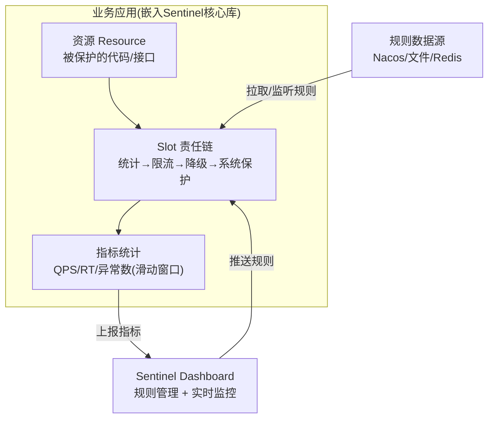
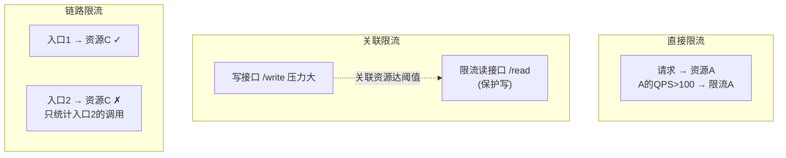
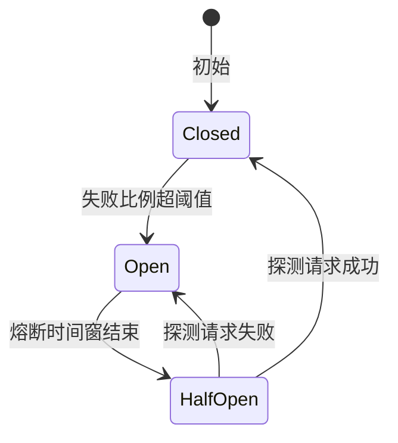

# Sentinel 限流熔断

> 定位：Sentinel 是微服务的"流量防卫兵"，管的是系统不被流量冲垮这件生死攸关的事。理解它的 **Slot 责任链** 就理解了所有功能（限流/降级/系统保护）怎么串起来；理解它的 **熔断与流控算法** 才知道参数该怎么调。这篇解决"限流熔断到底怎么生效、规则怎么配、规则持久化怎么落地"。

## 一、为什么需要 Sentinel

微服务拆开后，一个请求往往串起多条调用链。任何一个环节抖动，都可能沿着调用链传导，把整个系统拖垮——这就是**雪崩**。典型场景：

- 下游服务响应变慢，上游线程被大量阻塞耗尽
- 突然的流量洪峰（秒杀、爬虫）打满数据库
- 某个接口异常率飙升，调用方反复重试加剧压力

防御手段就几类：**限流**（控制入口流量）、**熔断**（下游出问题时快速失败）、**降级**（返回兜底）、**系统自适应保护**（根据整体负载动态调节）。

Hystrix 是老牌方案，但已停止维护。Sentinel 是阿里开源、Spring Cloud Alibaba 生态的主力组件，优势是：轻量级（核心库无依赖）、多维度流量控制、完善的控制台、实时指标统计。这篇讲透它的工作原理和落地细节。

## 二、核心原理

### 2.1 Sentinel 的整体架构

Sentinel 分两部分：

- **核心库（Java 客户端）**：嵌入应用，负责资源埋点、规则校验、指标统计、Block 异常抛出
- **控制台（Dashboard）**：独立部署，负责规则管理、实时监控、机器发现。规则推送到客户端



这张图讲什么：请求进入被保护的资源前，会经过一条 **Slot 责任链**，每个 Slot 做一件事（统计、限流、熔断、系统保护）。任何一个 Slot 判定要拦截，就抛 `BlockException`，请求快速失败。Dashboard 只管规则和展示，真正的防护逻辑在应用内的核心库——**所以 Dashboard 挂了不影响防护，规则还在客户端内存里**。

### 2.2 Slot 责任链（核心）

Sentinel 的所有功能通过责任链串联，默认顺序：

| Slot | 职责 |
|---|---|
| `NodeSelectorSlot` | 构建资源调用树（节点） |
| `ClusterBuilderSlot` | 构建 ClusterNode（资源维度统计节点） |
| `LogSlot` | 记录限流/降级日志 |
| `StatisticSlot` | **统计指标**（QPS、RT、异常数）——必须在校验 Slot 之前，才能统计所有请求 |
| `AuthoritySlot` | 黑白名单校验 |
| `SystemSlot` | 系统级保护（load、线程数、QPS） |
| `FlowSlot` | **限流**校验 |
| `DegradeSlot` | **熔断降级**校验 |

**顺序很关键**：`StatisticSlot` 排在限流/熔断 Slot 前面，这样被拦截的请求也会被统计；限流在熔断之前判断。

每个 Slot 通过 `check` 方法校验，失败就抛异常中断链条。这条链就是 Sentinel 的骨架，理解它就能把各种功能串起来。

### 2.3 滑动窗口统计原理

Sentinel 的 QPS/RT 统计基于**滑动窗口**。核心类 `LeapArray` 把 1 秒切成若干格子（默认 10 个，每个 100ms），请求落在对应格子里，统计时把窗口内的格子数据累加。

```
时间轴：  [100ms][100ms][100ms]...共10格 = 1秒窗口
请求A(150ms) → 落在第2格
统计最近1秒QPS = 累加当前窗口内所有格子的请求数
```

这样既保证统计精度，又避免每次都遍历全部历史。**限流规则里的"统计窗口时长"就是这个原理**，比如"1 秒内超过 100 次限流"，窗口就是 1 秒。

### 2.4 资源埋点方式

Sentinel 通过"资源"保护代码，常见三种埋点：

```java
// 方式1：注解（最常用）
@SentinelResource(value = "getUser",
    blockHandler = "handleBlock",     // 处理 BlockException(限流/熔断)
    fallback = "handleFallback")      // 处理业务异常
public User getUser(Long id) { ... }

// 处理被限流/熔断的情况
public User handleBlock(Long id, BlockException e) {
    return User.defaultUser();        // 限流时返回兜底
}

// 方式2：SphU 显式埋点
try (Entry entry = SphU.entry("getUser")) {
    return doGetUser(id);
} catch (BlockException e) {
    return fallback();
}

// 方式3：Spring Cloud 自动埋点（Web/Dubbo/Feign 调用自动成为资源）
// 引入 spring-cloud-starter-alibaba-sentinel 后，Controller 接口自动是资源
```

**`blockHandler` vs `fallback` 的区别**（高频考点）：`blockHandler` 处理 Sentinel 的 `BlockException`（限流/熔断/系统保护触发）；`fallback` 处理业务方法自己抛的异常。两者签名都要和原方法匹配（可多一个异常参数）。

## 三、关键机制 / 参数

### 3.1 限流规则（FlowRule）

一条限流规则由几个字段定义：

| 字段 | 含义 | 示例 |
|---|---|---|
| `resource` | 资源名 | `getUser` |
| `count` | 限流阈值 | `100` |
| `grade` | 阈值类型：0=QPS，1=线程数 | `0` |
| `limitApp` | 针对哪个调用方 | `default`（所有） |
| `strategy` | 限流模式：直接/关联/链路 | `0`（直接） |
| `controlBehavior` | 流控效果：快速失败/WarmUp/排队 | `0` |

### 3.2 三种限流模式（strategy）

| 模式 | 值 | 含义 | 场景 |
|---|---|---|---|
| **直接** | 0 | 对本资源直接限流 | 最常用的接口限流 |
| **关联** | 1 | 当关联资源达到阈值时，限流本资源 | 读写隔离：写接口压力大时限流读接口 |
| **链路** | 2 | 只统计指定入口链路上的流量 | 针对不同调用来源精细控制 |



这张图讲什么：直接限流看自己；关联限流看别人（关联资源）；链路限流只统计特定调用链。关联模式常用于**读写隔离**——写操作是核心，当写压力上来时主动限流读，把资源让给写。

### 3.3 三种流控效果（controlBehavior）

| 效果 | 值 | 原理 | 场景 |
|---|---|---|---|
| **快速失败** | 0 | 超限直接抛 `FlowException` | 通用，简单粗暴 |
| **Warm Up（预热）** | 1 | 阈值从 `count/coldFactor` 缓慢升到 count（默认 coldFactor=3） | 冷启动，防瞬时流量打垮系统 |
| **排队等待** | 2 | 匀速通过（漏桶），超时的请求丢弃，配 `maxQueueingTimeMs` | 削峰填谷，如消息消费 |

**Warm Up 的数学**：假设 `count=100`、`coldFactor=3`，预热期阈值从约 33（100/3）开始，在预热时长（如 10s）内线性增长到 100。**这解决了"服务刚启动 JVM 未预热、缓存未加载，突然大流量直接打死"的问题**。

**排队等待**：请求以固定间隔（1000/count ms）通过，类似漏桶。适合处理突发流量，让下游匀速消化。配置如 `maxQueueingTimeMs=500`，排队超过 500ms 的请求直接拒绝。

### 3.4 熔断降级规则（DegradeRule）

熔断解决的是"下游出问题时的连锁反应"。三种熔断策略：

| 策略 | 值 | 触发条件 | 适用 |
|---|---|---|---|
| **慢调用比例** | 0 | 慢调用（RT > `maxRt`）占比超阈值 | 下游响应变慢 |
| **异常比例** | 1 | 异常数/总请求数 超阈值 | 异常率飙升 |
| **异常数** | 2 | 单位统计窗内异常数超 `count` | 异常明确且稀少 |

配置示例（慢调用比例）：

```java
DegradeRule rule = new DegradeRule("getUser")
    .setGrade(CircuitBreakerStrategy.SLOW_REQUEST_RATIO.getType())
    .setCount(0.5)              // 慢调用比例阈值 50%
    .setTimeWindow(10)          // 熔断持续时间 10s
    .setRt(200)                 // 慢调用界定：RT > 200ms
    .setMinRequestAmount(5)     // 最少请求数，样本太小不熔断
    .setStatIntervalMs(10000);  // 统计窗口 10s
```

**熔断状态机**（这是面试常考）：



- **Closed（关闭）**：正常放行，统计失败率
- **Open（打开）**：熔断期（如 10s）内所有请求直接失败/走降级，不放行
- **Half-Open（半开）**：熔断时间到，放一个探测请求过去。成功则回到 Closed，失败则继续 Open

**`minRequestAmount`（最小请求数）很重要**：如果只有 1 个请求且失败，比例 100%，不该熔断。设一个最小样本数（如 5）避免误判。

### 3.5 热点参数限流

普通限流对整个资源限流，热点参数限流能针对**具体参数值**限流。场景："商品 ID 123 特别热门，单独限制它的 QPS"。

```java
ParamFlowRule rule = new ParamFlowRule("getProduct")
    .setParamIdx(0)             // 第0个参数
    .setCount(10);              // 每个参数值每秒10次
// 特例：商品ID 123 单独限到 100
ParamFlowItem item = new ParamFlowItem()
    .setObject("123")
    .setCount(100)
    .setClassType(int.class.getName());
rule.setParamFlowItemList(Collections.singletonList(item));
```

底层用 **令牌桶 + LRU 缓存**（`ParametersStatistics` 只保留热点参数，冷门参数淘汰），避免无限参数撑爆内存。

### 3.6 系统自适应保护（SystemRule）

系统级保护从全局维度守护应用，而不是单个接口：

| 指标 | 含义 |
|---|---|
| `highestSystemLoad` | 系统 load（不超过 CPU 核数比较合理） |
| `avgRt` | 所有入口流量的平均 RT |
| `maxThread` | 并发线程数 |
| `qps` | 全局 QPS |
| `highestCpuUsage` | CPU 使用率 |

它的核心算法是**基于系统负载的自适应**：只有当系统负载超过阈值（说明系统吃不住了）才限流，并且用**BBR 思路**动态探测系统容量，而不是一刀切。适合作为最后一道防线。

### 3.7 规则持久化（Nacos）

默认情况下 Sentinel 规则存在内存里，**应用重启规则就没了**。生产必须用数据源持久化。以 Nacos 为例：

```yaml
spring:
  cloud:
    sentinel:
      datasource:
        flow:    # 限流规则
          nacos:
            server-addr: localhost:8848
            data-id: sentinel-flow-rules
            group-id: DEFAULT_GROUP
            data-type: json
            rule-type: flow
        degrade: # 熔断规则
          nacos:
            server-addr: localhost:8848
            data-id: sentinel-degrade-rules
            data-type: json
            rule-type: degrade
```

**Push vs Pull 模式**：Sentinel 对 Nacos 用的是 **Push 模式**——Dashboard 把规则推到 Nacos，Nacos 推送给客户端，客户端实时生效。Pull 模式是客户端定时拉取，实时性差。**生产推荐 Push 模式**。

注意：Dashboard 本身改规则默认只推到客户端内存，要让它写回 Nacos，需要给 Dashboard 配置 Nacos 数据源并做相应改造（新版已有集成，以版本为准）。

### 3.8 网关流控

Sentinel 支持对 Spring Cloud Gateway 做网关级限流，能按 API 分组、路由维度限流。核心是 `SentinelGatewayFilter` + `ApiDefinition` 自定义 API 分组。适合在网关层做粗粒度全局限流。

## 四、生产坑点与排查

### 坑点 1：规则配了不生效

**现象**：Dashboard 上配了限流规则，压测时发现根本没限流。

**原因**：
- 资源名对不上：Dashboard 里的资源名和代码埋点的不一致（Controller 自动埋点的资源名可能是完整路径，如 `GET:/user/get`）
- `@SentinelResource` 的方法被同类内部调用，AOP 没生效（Spring AOP 自调用问题）
- 规则没真正推送到客户端（客户端没连上 Dashboard）

**解法**：
- 用 `/actuator/sentinel` 或看客户端日志确认规则已加载
- 资源名严格一致，先访问一次接口让资源出现在 Dashboard
- 避免同类自调用；必要时用 `SphU.entry()` 显式埋点
- 确认客户端配了 `spring.cloud.sentinel.transport.dashboard` 且网络连通

### 坑点 2：应用重启后规则全丢

**现象**：重启服务，之前配的限流熔断规则没了。

**原因**：规则默认在内存，未做持久化。

**解法**：接 Nacos 数据源（Push 模式），规则写 Nacos；Dashboard 改规则时同步写回数据源。上线前验证：重启后规则自动加载。

### 坑点 3：熔断过于敏感，正常流量被切

**现象**：下游偶尔慢几次，就触发熔断，大量请求被快速失败，业务受损。

**原因**：`minRequestAmount` 太小或没设，样本量不足时比例失真；`timeWindow` 太长，熔断后恢复慢；`rt` 阈值设太严。

**解法**：
- 设 `minRequestAmount >= 5`，样本不足不熔断
- 合理设置 `rt`（略高于 P99 响应时间）和统计窗口
- 熔断降级方法返回合理兜底（如读缓存），而不是直接抛异常
- 熔断时间窗不宜过长，配合 Half-Open 快速探测恢复

### 坑点 4：限流后返回 500，调用方重试放大压力

**现象**：触发限流抛 `BlockException`，Feign 调用方收到 500 后重试，流量反而更大。

**原因**：没给限流配降级逻辑，BlockException 冒泡成 500；调用方配了盲目重试。

**解法**：
- 配 `blockHandler` 返回友好降级结果（HTTP 429 或业务兜底）
- 限流异常不走重试（Feign 重试策略排除 429 类异常）
- 网关层统一处理 `BlockException` 返回标准限流响应

## 五、调优 / 选型 / 最佳实践

**参数调优清单**：

| 项目 | 建议 |
|---|---|
| 限流阈值 | 基于压测的容量水位，一般设单机容量的 70%-80% |
| 慢调用 RT 阈值 | 设为接口 P99 响应时间的 1.2 倍左右 |
| 熔断最小请求数 | ≥5，避免小样本误熔断 |
| 熔断时间窗 | 5-10s，配合 Half-Open 快速恢复 |
| 规则持久化 | 必须接 Nacos/Apollo，Push 模式 |
| 热点参数 | 只对真正的热点 key 配，避免 LRU 缓存膨胀 |

**Sentinel vs Hystrix**：

| 维度 | Sentinel | Hystrix |
|---|---|---|
| 维护状态 | 阿里持续维护 | 已停止维护 |
| 限流维度 | QPS/线程数/调用关系/参数 | 主要线程池/信号量 |
| 流控效果 | 快速失败/WarmUp/排队 | 快速失败 |
| 熔断策略 | 慢调用/异常比例/异常数 | 异常比例 |
| 控制台 | 完善，实时配置 | 简单 |
| 系统保护 | 有（自适应） | 无 |

**落地路径**：先网关层全局限流兜底 → 核心接口配 QPS 限流 → 下游不稳定调用配熔断 → 全量接规则持久化 + 监控告警。

## 九、面试高频问法

> 这一节的答案按「面试时能讲透」的标准写：先给一句话结论，再展开机制、原因和坑点。

**Q1：Sentinel 的核心架构是什么？Slot 责任链是什么？**

**一句话结论**：Sentinel 用**责任链（ProcessorSlotChain）**处理每个请求，链上依次是统计、限流、熔断、系统保护等 Slot，各司其职。

展开：

- **SlotChain**：每个资源（接口）对应一条处理链，请求进来依次经过各个 Slot。
- **核心 Slot**：
  - `NodeSelectorSlot`：构建调用树
  - `ClusterBuilderSlot`：统计簇点
  - `StatisticSlot`：实时统计（QPS、RT、线程数）
  - `FlowSlot`：限流
  - `DegradeSlot`：熔断
  - `SystemSlot`：系统保护

加分点：说"责任链的好处是每个 Slot 只做一件事、可插拔，Sentinel 能灵活扩展（比如加自定义 Slot 做业务校验），这是它比 Hystrix 灵活的地方"。

**Q2：Sentinel 的限流模式有哪几种？**

**一句话结论**：三种——直接（对资源本身限流）、关联（关联资源达到阈值时限流自己）、链路（只限某个入口的流量）。

展开：

- **直接**：QPS 超过阈值就限流自己。
- **关联**：当关联资源（如支付接口）达到阈值，限流当前资源（如查询接口）——用于保护关联资源。典型场景：写接口忙时，限制读接口。
- **链路**：只限制从某个入口进来的流量，其他入口不受影响。

加分点：说"关联模式很实用——比如下单接口压力大时，限流商品查询接口，把资源让给下单；这是业务级的流量调度"。

**Q3：Sentinel 的流控效果有哪几种？**

**一句话结论**：三种——快速失败（直接拒绝）、Warm Up（预热，逐渐放量）、排队等待（匀速通过）。

| 效果 | 行为 | 场景 |
|---|---|---|
| 快速失败 | 超阈值直接抛异常 | 默认，明确拒绝 |
| Warm Up | 冷启动时阈值从低逐渐升到设定值 | 防止冷启动被打垮 |
| 排队等待 | 请求匀速通过（漏桶） | 削峰、保护下游 |

**Warm Up 的原理**：基于令牌桶 + 冷加载因子（默认 3），启动时阈值是设定值的 1/3，随时间线性增长到设定值。

加分点：说"Warm Up 解决的是'冷启动时缓存没热、连接没建，突然大流量打过来扛不住'的问题——很多系统重启后第一波流量就挂了"。

**Q4：Sentinel 的熔断策略有哪几种？**

**一句话结论**：三种——慢调用比例、异常比例、异常数。

展开：

- **慢调用比例**：统计窗口内，RT 超过阈值的请求占比超过设定值就熔断。适合"变慢但没报错"的场景。
- **异常比例**：异常请求占比超过阈值就熔断。
- **异常数**：异常数超过阈值就熔断。

**熔断状态机**：关闭（正常）→ 打开（熔断，拒绝请求）→ 半开（放一个请求试探）→ 成功则关闭，失败则继续打开。

加分点：说"慢调用比例是最容易被忽略的——服务没报错但变慢，会拖垮调用方线程池，比直接报错更危险；熔断慢调用能及时止损"。

**Q5：Sentinel 的热点参数限流是什么？**

**一句话结论**：对**某个参数的具体值**单独限流，比如对"商品 ID=123"单独限 QPS，而不是对整个接口限流。

展开：

- **场景**：秒杀时某个热门商品被疯狂请求，需要对它单独限流，而不影响其他商品。
- **配置**：指定参数索引、阈值，还可以给参数值设例外（如 VIP 用户放宽）。
- **原理**：用 LRU 缓存统计每个参数值的 QPS。

加分点：说"热点参数限流是'精细化限流'的典型——普通限流是接口级，热点参数是'某个值'级，粒度细得多"。

**Q6：Sentinel 的规则怎么持久化？**

**一句话结论**：默认规则存在内存，重启丢失；生产要持久化到 **Nacos**（或 Apollo、ZK），用 `DataSource` 扩展。

展开：

- **问题**：Sentinel Dashboard 配的规则默认只在内存，应用重启就没了。
- **方案**：配置 `NacosDataSource`，规则存 Nacos，应用启动时拉取，Dashboard 改规则写回 Nacos。
- **双向**：Dashboard ↔ Nacos ↔ 应用，保证一致。

加分点：说"规则持久化是 Sentinel 上生产的前提——不持久化，每次重启规则全丢，等于没配"。

**Q7：Sentinel 和 Hystrix 有什么区别？**

**一句话结论**：Sentinel 更轻量、功能更全（限流+熔断+系统保护+热点）、有控制台、规则动态；Hystrix 已停止维护。

| 维度 | Sentinel | Hystrix |
|---|---|---|
| 隔离 | 信号量（默认）/线程池 | 线程池/信号量 |
| 限流 | 支持（QPS、并发、热点） | 弱 |
| 熔断 | 慢调用/异常比例/异常数 | 异常比例 |
| 控制台 | 有 | 有（已停更） |
| 维护 | 活跃（阿里） | 停止维护 |

加分点：说"Hystrix 的线程池隔离更彻底但开销大，Sentinel 默认信号量隔离更轻；Spring Cloud Alibaba 已经用 Sentinel 替代 Hystrix"。

**Q8：Sentinel 的线程数限流和 QPS 限流有什么区别？**

**一句话结论**：QPS 限流控制"每秒请求数"，线程数限流控制"同时处理的请求数"——前者防突发，后者防慢调用堆积。

展开：

- **QPS 限流**：每秒通过多少请求，适合"保护下游不被高频调用"。
- **线程数限流**：同时有多少线程在处理，适合"防止慢调用把线程池占满"。
- **区别**：QPS 是速率，线程数是并发量。一个接口 QPS 不高但每个请求很慢，QPS 限流拦不住，要靠线程数限流。

加分点：说"慢接口要用线程数限流——QPS 只有 10 但每个请求 10 秒，10 个线程就占满了；QPS 限流看不出问题，线程数限流能拦住"。

**Q9：Sentinel 的系统保护规则是什么？**

**一句话结论**：从**整体系统负载**维度限流——当系统 Load、CPU、RT、线程数、入口 QPS 达到阈值时，自动限流入口流量，防止系统被压垮。

展开：

- **五个指标**：Load1（系统负载）、CPU 使用率、平均 RT、并发线程数、入口 QPS。
- **触发**：任一指标超阈值，拒绝新的入口请求（已有请求继续）。
- **目的**：不是保护某个接口，是保护**整个应用**不被压垮。

加分点：说"系统保护是'最后一道防线'——前面接口级限流都失效时，系统保护能保证应用不死；但它比较粗暴，会拒绝所有新请求"。

**Q10：Sentinel 的规则是怎么生效的？改规则要重启吗？**

**一句话结论**：规则通过 `FlowRuleManager.loadRules()` 加载，配合动态数据源（Nacos）可以**实时生效**，不用重启。

展开：

- **内存规则**：`FlowRuleManager.loadRules(rules)` 加载到内存，立即生效。
- **动态规则**：`NacosDataSource` 监听 Nacos 变更，变更时自动调 `loadRules` 刷新。
- **Dashboard**：在控制台改规则 → 推送到 Nacos → 应用监听到 → 生效。

加分点：说"动态规则是 Sentinel 的核心优势——大促时临时调阈值、发现异常立即限流，都不用重启应用"。

## 小结

- Sentinel = 核心库（应用内）+ Dashboard（规则/监控）；防护逻辑在客户端，Dashboard 挂了不影响防护。
- Slot 责任链是骨架：StatisticSlot 在前统计，FlowSlot/DegradeSlot 在后拦截。
- 限流：3 模式（直接/关联/链路）× 3 效果（快速失败/WarmUp/排队）。
- 熔断：3 策略（慢调用比例/异常比例/异常数）+ Closed/Open/Half-Open 状态机；`minRequestAmount` 防误判。
- 规则必须持久化（Nacos Push 模式）；热点参数用令牌桶 + LRU；系统保护是最后防线。
