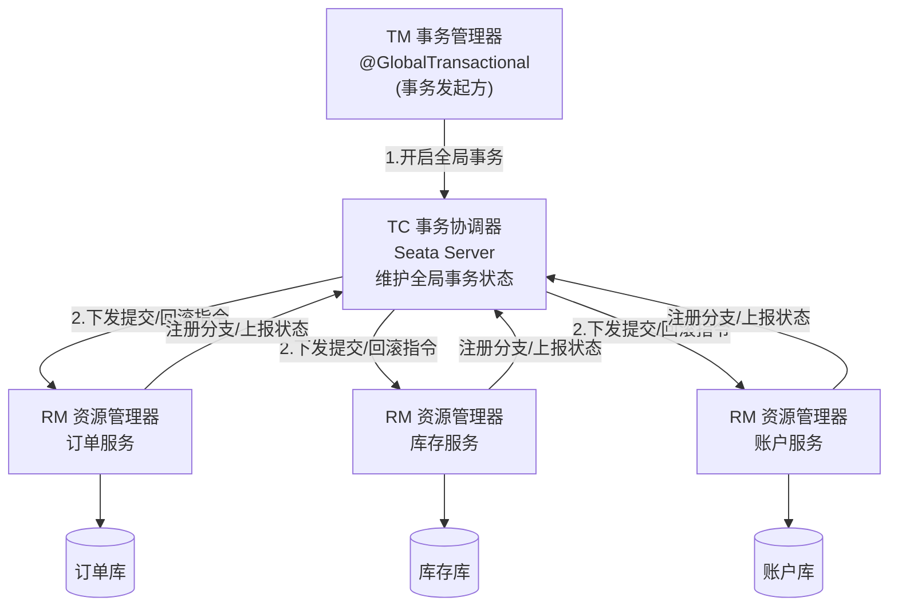
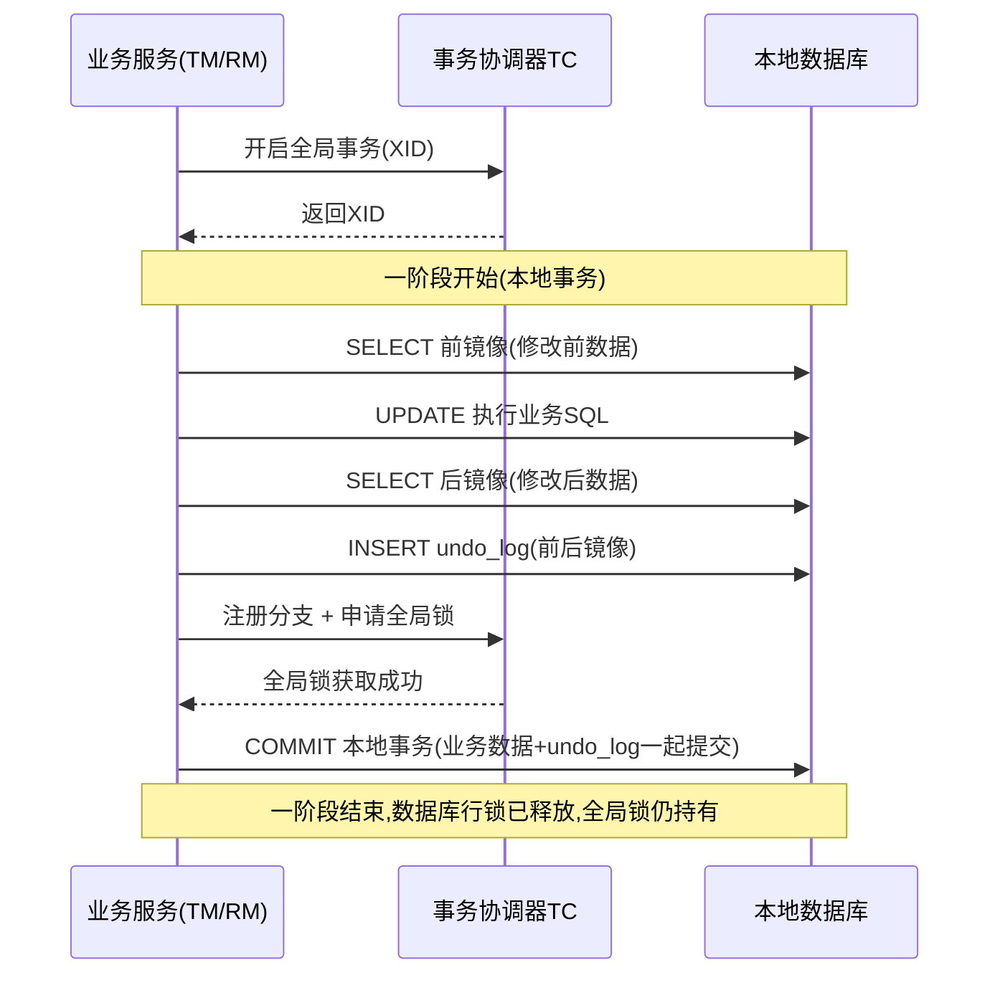
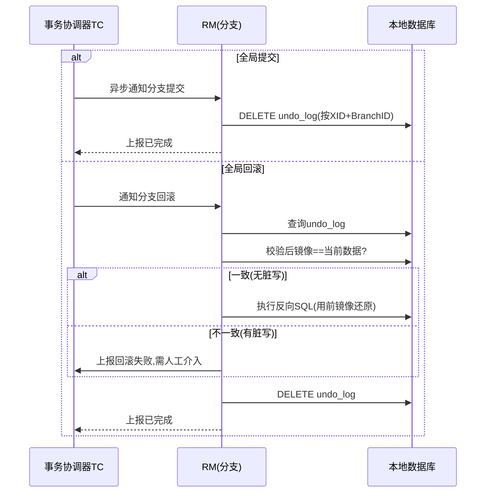
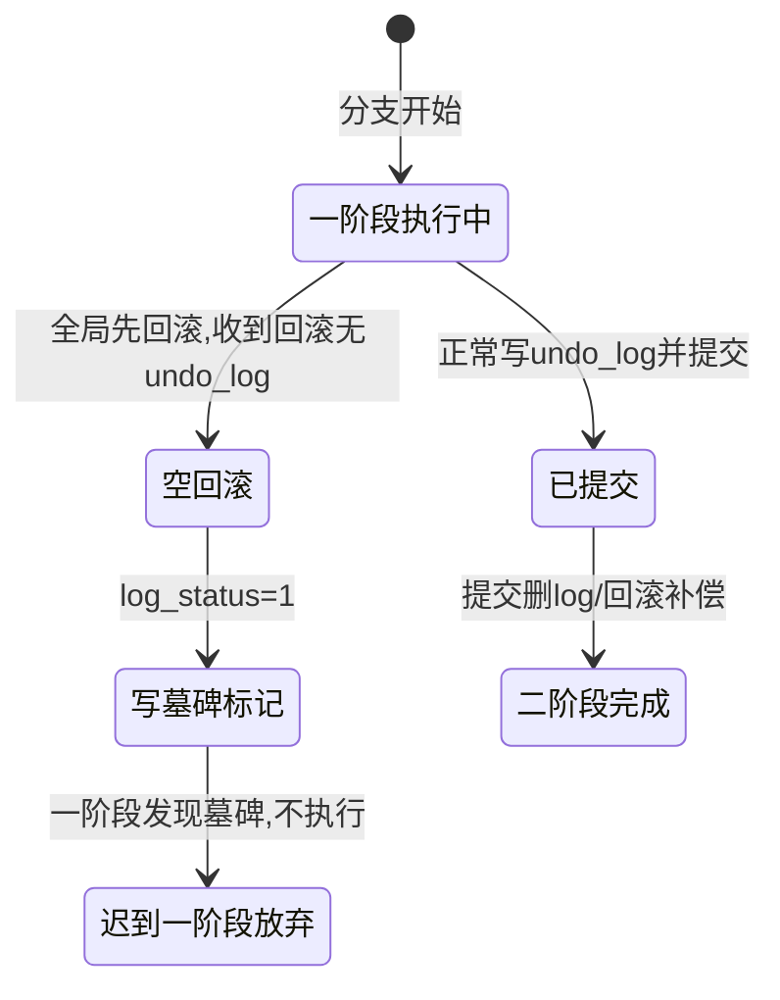

# Seata AT 模式

> 定位：Seata AT 是 Java 生态使用最广的分布式事务方案，核心是"**本地事务 + undo_log 反向补偿**"，对业务代码几乎零侵入。这篇把 AT 的两阶段提交讲透——尤其是一阶段如何自动记录前镜像、二阶段回滚如何用 undo_log 还原数据，以及全局锁、脏写、空回滚、幂等、悬挂这些"只有在生产上才会踩到"的坑。

## 一、为什么需要 AT 模式

单体应用里一个 `@Transactional` 就能保证订单创建、库存扣减、账户扣款要么全成要么全败。拆成微服务后，这三件事分属三个服务、三个数据库，本地事务管不到别家——这就是**分布式事务**问题。

业界的方案大致分两类：

- **强一致（XA）**：数据库层面两阶段提交，一致性强但性能差、资源锁定久
- **最终一致（TCC/SAGA/MQ）**：业务层面补偿，性能好但侵入强、要写大量补偿代码

Seata AT 走的是一条折中路线：**在 XA 的基础上做了改进，把对资源的锁从"数据库事务层面"提到"Seata 全局锁"，一阶段就提交本地事务释放数据库资源，二阶段再异步补偿**。这样既保证最终一致性，又避免长时间占用数据库连接。而且 AT 通过代理数据源自动生成 undo_log，**业务代码只需要加一个 `@GlobalTransactional` 注解**，侵入极低。

## 二、核心原理

### 2.1 Seata 的三大角色

Seata 的架构有三个核心角色：

| 角色 | 全称 | 职责 |
|---|---|---|
| **TC** | Transaction Coordinator | 事务协调器，维护全局事务状态，驱动提交/回滚（独立部署的服务端） |
| **TM** | Transaction Manager | 事务管理器，开启/提交/回滚全局事务（在事务发起方应用内） |
| **RM** | Resource Manager | 资源管理器，管理分支事务、注册分支、执行 undo_log 补偿（在每个参与事务的应用内） |



这张图讲什么：TM 向 TC 开启全局事务，各 RM 在本地操作自己的数据库并向 TC 注册分支事务，**TC 根据全局事务的最终结果统一指挥所有 RM 提交或回滚**。Seata Server（TC）是独立部署的中心节点，所以它的高可用很关键（后一篇讲）。

### 2.2 AT 模式的核心思想

AT 模式是对 XA 的改良。先看 XA 的问题：

- XA 在一阶段**不提交**，一直持有数据库行锁直到二阶段，锁持有时间长，并发差
- 数据库 XA 实现复杂，部分中间件不支持

AT 的改良：

- **一阶段就直接提交本地事务**，立即释放数据库锁
- 提交前把数据的"前镜像"（修改前的样子）记到 `undo_log` 表
- 二阶段如果要回滚，用 undo_log 里的前镜像**反向补偿**（把数据改回去）；如果要提交，只需删除 undo_log

用类比理解：XA 像是"先把货扣下，等总部通知再决定卖不卖"，仓库一直占着；AT 像是"先卖出去，同时偷偷记下原来的库存数，如果总部说取消，就按记录改回去"。

### 2.3 一阶段：本地事务 + undo_log

一阶段的完整流程（以更新操作为例）：

1. **解析 SQL**：RM 的 SQL 代理拦截业务 SQL，解析出要更新哪张表、哪些行
2. **查前镜像**：执行 `SELECT` 查出这些行修改前的数据
3. **执行业务 SQL**：真正执行 `UPDATE`
4. **查后镜像**：再查一次，得到修改后的数据
5. **写 undo_log**：把前镜像 + 后镜像 + SQL 信息插入 `undo_log` 表
6. **注册分支 + 申请全局锁**：向 TC 注册分支事务，申请这些行的全局锁
7. **本地提交**：`undo_log` 和业务 SQL **在同一个本地事务里提交**

关键点：**第 2、3、4、5 步在同一个本地事务内**，保证业务数据和 undo_log 的原子性。全局锁在提交前拿到，防止其他全局事务同时改同一行。



这张图讲什么：一阶段在一次本地事务里完成了"记录镜像 → 执行业务 → 写 undo_log → 提交"。注意两个锁的区别：**数据库行锁在本地提交后释放，但 Seata 全局锁要持有到二阶段结束**——这正是 AT 相比 XA 提升并发的关键。

### 2.4 二阶段：提交与回滚

**二阶段提交**：TC 判断全局事务成功，异步通知各 RM 提交。RM 只需**删除对应的 undo_log 记录**即可（业务数据已经提交了）。因为是异步的，所以速度快。

**二阶段回滚**：TC 判断失败（某个分支抛异常），通知各 RM 回滚。RM 的处理：

1. 根据 XID + Branch ID 找到 undo_log
2. 校验后镜像与当前数据是否一致（防止脏写）
3. 一致则用前镜像生成反向 SQL 执行，把数据改回去
4. 删除 undo_log



这张图讲什么：提交只是删日志，很轻；回滚要"校验 + 反向补偿"，很重。**校验后镜像是关键**——如果当前数据已经被别的非 Seata 事务改过（后镜像对不上），就不能盲目覆盖，否则会引发更严重的数据错误，这时要报警人工处理。

### 2.5 undo_log 表设计

每个参与 AT 事务的业务库都要建这张表：

```sql
CREATE TABLE `undo_log` (
  `id` BIGINT NOT NULL AUTO_INCREMENT,
  `branch_id` BIGINT NOT NULL       COMMENT '分支事务ID',
  `xid` VARCHAR(128) NOT NULL       COMMENT '全局事务XID',
  `context` VARCHAR(128) NOT NULL   COMMENT '上下文,序列化方式',
  `rollback_info` LONGBLOB NOT NULL COMMENT '前后镜像JSON',
  `log_status` INT NOT NULL         COMMENT '0=正常 1=全局完成标记',
  `log_created` DATETIME NOT NULL,
  `log_modified` DATETIME NOT NULL,
  PRIMARY KEY (`id`),
  UNIQUE KEY `ux_undo_log` (`xid`, `branch_id`)
) ENGINE=InnoDB DEFAULT CHARSET=utf8mb4;
```

关键字段：`xid` + `branch_id` 唯一确定一条分支的 undo_log；`rollback_info` 存前后镜像（其中 `image` 字段记录每列的前后值）；`log_status` 配合 `log_created` 用来**清理长时间未完成的悬垂日志**（Seata Server 有 undo_log 清理机制）。

## 三、关键机制 / 参数

### 3.1 全局锁与隔离性

Seata AT 依赖**全局锁**保证写隔离。规则：

- 写操作必须先拿到全局锁，拿不到就不能提交一阶段
- 全局锁由 TC 统一管理，记录"哪个全局事务锁了哪张表的哪几行"

**读隔离**：AT 的默认全局隔离级别是**读未提交（Read Uncommitted）**——一阶段已提交本地事务，别的全局事务能看到未最终提交的数据。如果需要读已提交，可以用 `@GlobalLock` + 本地 `SELECT ... FOR UPDATE`，让本地查询也受全局锁约束。

### 3.2 脏写问题

**脏写**：两个全局事务同时改同一行。AT 通过全局锁避免——第二个事务一阶段申请全局锁失败会自旋等待（有超时），拿不到就回滚。

但如果修改数据的不是 Seata 事务（比如运维手动改库、其他系统直连数据库），绕过全局锁，二阶段回滚时校验后镜像就会发现对不上，回滚失败。**这就是为什么 AT 要求所有写操作都走 Seata 代理的数据源**。

### 3.3 空回滚与防悬挂（两个经典坑）

**空回滚**：分支事务还没执行一阶段（没拿到全局锁、没写 undo_log），全局事务就因为其他分支失败要回滚了。这时 RM 收到回滚请求，却找不到 undo_log——这就是空回滚。RM 要能识别这种情况并**直接记录一条"空回滚"标记返回成功**，而不是报错。

**事务悬挂**：空回滚发生后，那个"迟到"的一阶段才真正执行，写了 undo_log 并提交。此时全局事务已经结束了，这条 undo_log 永远不会被处理——数据被改了却没人补偿，这就是悬挂。

**Seata 的解法**：RM 收到回滚但查不到 undo_log 时，插入一条 `log_status=1`（全局完成标记）的 undo_log 作为"墓碑"。等迟到的一阶段执行时，发现已经有这条标记，就**放弃执行本地事务**，从而避免悬挂。



这张图讲什么：空回滚用"墓碑"标记防止后续悬挂。这是 AT 模式最容易出问题的边界场景，理解它对排查"数据莫名被改"类问题很关键。

### 3.4 幂等

二阶段提交/回滚可能因为网络原因被 TC **重复通知**。RM 必须保证幂等：处理前先查 undo_log，处理完删除。**已经删掉 undo_log 的重复请求直接忽略**。Seata 内部通过 `branch_id` + `xid` 唯一键和状态判断实现幂等。

### 3.5 常用参数

| 参数 | 默认值 | 含义 |
|---|---|---|
| `seata.tx-service-group` | - | 事务服务组名，需和 TC 配置对应 |
| `seata.service.grouplist` | - | TC 服务地址列表 |
| `seata.client.rm.async-commit-buffer-limit` | 10000 | 异步提交缓冲区大小 |
| `seata.client.rm.lock.retry` | 30 | 全局锁获取重试次数 |
| `seata.client.rm.lock.retry-interval` | 10ms | 全局锁重试间隔 |
| `seata.client.tm.default-global-transaction-timeout` | 60000ms | 全局事务超时时间 |
| `seata.server.max-global-session` | - | TC 最大全局会话数（服务端配置） |

全局事务超时（默认 60s）很重要：**超时后 TC 会主动回滚整个全局事务**，防止事务长期悬挂占用资源。

## 四、生产坑点与排查

### 坑点 1：全局锁冲突导致大量回滚

**现象**：高并发下频繁出现 `GlobalLockWaitTimeoutException` 或分支注册失败，事务大量回滚。

**原因**：多个全局事务争抢同一批热点数据的全局锁（如秒杀扣库存），锁等待超时（默认重试 30 次 × 10ms，加上其他开销）。

**解法**：
- 缩小事务粒度，缩短一阶段持有全局锁的时间
- 热点数据（如库存）用 Redis 预扣 + 异步落库，不进 AT 全局事务
- 调大锁重试次数/间隔（权衡吞吐与延迟）
- 避免大事务，把不必要的操作移出 `@GlobalTransactional`

### 坑点 2：二阶段回滚失败，数据不一致

**现象**：TC 日志显示回滚失败，`rollback_info` 校验不通过，数据停在中间状态。

**原因**：后镜像与当前数据不一致——有非 Seata 事务（手动改库、其他系统）修改了同一行，产生了脏写。

**解法**：
- 排查是否有绕过数据源代理的写操作，全部纳入 Seata 管理
- 核对 undo_log 中的前后镜像和当前库数据，人工补偿
- 所有写库操作统一走 Seata 代理数据源，禁止直连改核心业务数据
- 接入告警，回滚失败立即通知

### 坑点 3：undo_log 持续堆积不清理

**现象**：业务库的 undo_log 表越来越大，影响性能。

**原因**：二阶段提交/回滚失败，undo_log 没被删除；Seata Server 的 undo_log 清理任务未开启或间隔太长。

**解法**：
- 检查 TC 日志，处理失败的二阶段
- 确认 Seata Server 开启了 undo_log 定期清理（配置相关参数，以版本为准）
- 定期归档删除 `log_created` 很早且状态异常的日志（谨慎，先确认全局事务已结束）
- 监控 undo_log 表行数，设告警

### 坑点 4：加了 @GlobalTransactional 但事务没生效

**现象**：异常抛出后，前面的分支没有回滚。

**原因**：
- 同类内部调用导致 AOP 自调用失效
- 异常被方法内部 catch 吃掉了，没抛给 TM
- 数据源没被 Seata 代理（用了原生 DataSource）

**解法**：
- 避免同类自调用；异常要正确抛出（`@GlobalTransactional(rollbackFor = Exception.class)`）
- 确认用了 `DataSourceProxy` 包装数据源
- 检查 XID 是否正确传递到下游（Feign 调用要带 XID header）
- 看 TM/RM 日志确认分支是否注册成功

## 五、调优 / 选型 / 最佳实践

**AT 适用场景**：

- 基于关系型数据库（MySQL/PostgreSQL/Oracle），且支持本地事务
- 对业务侵入要求低（不想写补偿代码）
- 一致性要求是最终一致，能接受短暂中间态

**AT 不适用场景**：

- Redis/MongoDB 等非关系型（无 undo_log 机制）
- 超长事务（全局锁持有久，并发差）
- 热点数据高频争抢（改 TCC 或异步化）

**调优清单**：

| 项目 | 建议 |
|---|---|
| 全局事务超时 | 默认 60s，按业务调整，别过长 |
| 事务粒度 | 尽量小，减少全局锁争抢 |
| 热点数据 | 移出 AT，用缓存/异步削峰 |
| 数据源 | 所有写操作必须走 Seata 代理 |
| undo_log 清理 | 开启 TC 定期清理，监控表大小 |
| TC 高可用 | 集群部署 + 注册中心（后一篇详述） |

## 九、面试高频问法

> 这一节的答案按「面试时能讲透」的标准写：先给一句话结论，再展开机制、原因和坑点。

**Q1：Seata 的 AT 模式一阶段和二阶段分别做了什么？**

**一句话结论**：一阶段执行业务 SQL 并写 undo_log、申请全局锁、本地提交；二阶段提交只删 undo_log（异步），回滚则用 undo_log 反向补偿。

展开：

- **一阶段**：
  1. 解析 SQL，查询修改前镜像（before image）
  2. 执行业务 SQL
  3. 查询修改后镜像（after image）
  4. 把前后镜像写入 undo_log
  5. 申请全局锁
  6. 本地事务提交（业务数据 + undo_log 在同一事务）
- **二阶段提交**：全局事务成功，异步删除 undo_log（很快）。
- **二阶段回滚**：用 before image 反向生成补偿 SQL，校验 after image 一致后执行回滚。

加分点：说"AT 的关键是'一阶段就提交本地事务'——这释放了数据库行锁，把锁提到了 Seata 全局锁层面，所以并发比 XA 高"。

**Q2：AT 模式为什么需要 undo_log？它的表结构是怎样的？**

**一句话结论**：undo_log 记录数据修改前后的镜像，回滚时用它生成反向 SQL 恢复数据。

展开：

- **作用**：一阶段记录"改之前是什么、改之后是什么"，二阶段回滚时用 before image 反向补偿。
- **表结构**（关键字段）：`branch_id`（分支事务 ID）、`xid`（全局事务 ID）、`before_image`、`after_image`、`rollback_info`（JSON 序列化的前后镜像）、`log_status`。
- **为什么用 JSON**：灵活，能存任意表的镜像。

加分点：说"undo_log 必须定期清理——全局事务结束后二阶段提交会删，但如果二阶段一直没来（比如 TC 挂了），日志会堆积，要配定时清理"。

**Q3：AT 模式的全局锁是什么？和数据库行锁有什么区别？**

**一句话结论**：全局锁由 Seata 的 TC 管理，持有到二阶段结束；数据库行锁在一阶段本地提交后就释放了。

展开：

- **为什么需要全局锁**：一阶段本地提交后行锁释放了，如果不加全局锁，其他全局事务可能修改同一行，导致脏写。
- **生命周期**：一阶段申请全局锁 → 二阶段结束才释放。比数据库行锁持有时间长。
- **影响**：全局锁是 AT 的主要性能瓶颈——热点数据会在这里串行化。

加分点：说"全局锁是为了防'脏写'——如果两个全局事务改同一行，一个回滚了，另一个已经基于修改后的值操作，就会出错；全局锁把它们串行化"。

**Q4：什么是脏写？AT 模式怎么防脏写？**

**一句话结论**：脏写是"一个事务覆盖了另一个未提交事务的修改"；AT 用全局锁 + 后镜像校验双重防护。

展开：

- **场景**：事务 A 改了某行（本地已提交但全局未提交），事务 B 又改同一行并提交，A 回滚时会把 B 的修改也回滚掉。
- **防护一：全局锁**——B 要改同一行，得先拿到全局锁，A 没释放就等着。
- **防护二：后镜像校验**——回滚时检查当前数据是否和 after image 一致，不一致说明被别的事务改过，回滚失败（报错人工介入）。

加分点：说"后镜像是最后一道保险——即使全局锁因为某些原因失效（如超时），回滚时发现数据被改过会拒绝盲目覆盖，避免数据错乱"。

**Q5：什么是空回滚和事务悬挂？怎么解决？**

**一句话结论**：空回滚=分支没执行一阶段就收到回滚（无 undo_log）；悬挂=空回滚后，迟到的一阶段才执行，留下无人处理的 undo_log。用 `log_status` 墓碑标记解决。

展开：

- **空回滚**：TM 通知 RM 回滚，但 RM 的一阶段根本没执行（可能网络延迟），没有 undo_log 可回滚。
- **悬挂**：空回滚发生后，之前延迟的一阶段请求到了，执行并写了 undo_log，但这个分支已经被回滚过了，undo_log 永远没人处理。
- **解决**：空回滚时在 undo_log 插一条 `log_status=1` 的"墓碑"记录；一阶段执行时先检查有没有墓碑，有就拒绝执行。

加分点：说"空回滚和悬挂是一对孪生问题，本质是分布式下'消息乱序'——回滚通知比一阶段请求先到，所以要用墓碑标记状态"。

**Q6：AT 模式的隔离级别是什么？有什么问题？**

**一句话结论**：AT 默认是**读未提交**（Read Uncommitted）——一阶段本地提交后，其他事务能读到未全局提交的数据。

展开：

- **问题**：事务 A 改了数据并本地提交（全局未提交），事务 B 能读到 A 的修改；如果 A 后来回滚了，B 读到的就是"脏数据"。
- **为什么这样设计**：为了性能——如果等全局提交才释放，就和 XA 一样慢了。
- **增强**：可以用 `@GlobalLock + SELECT ... FOR UPDATE` 实现"读已提交"，但会加全局锁，性能下降。

加分点：说"AT 适合'能接受最终一致、读未提交'的场景（如电商下单）；金融转账这种强一致场景，要么用 TCC，要么用 `@GlobalLock` 增强隔离"。

**Q7：AT 模式和 XA 模式有什么区别？**

**一句话结论**：XA 一阶段不提交、持有数据库锁到二阶段；AT 一阶段就提交、用全局锁 + undo_log 补偿，并发更高但隔离弱。

| 维度 | XA | AT |
|---|---|---|
| 一阶段 | 准备（不提交），持锁 | 提交，释放行锁 |
| 锁 | 数据库行锁（长） | Seata 全局锁 |
| 回滚 | 数据库原生回滚 | undo_log 反向补偿 |
| 隔离 | 强（读已提交） | 弱（读未提交） |
| 性能 | 低 | 高 |
| 侵入 | 无 | 无（代理数据源） |

加分点：说"XA 是数据库层面的两阶段提交，AT 是应用层面的补偿——AT 用'先提交后补偿'换来了性能，代价是隔离性弱"。

**Q8：AT 模式对 SQL 有什么限制？**

**一句话结论**：只支持**能解析出前后镜像的 SQL**——主要是 INSERT/UPDATE/DELETE；复杂 SQL（如多表关联更新、子查询）可能解析失败。

展开：

- **支持**：单表 INSERT、UPDATE、DELETE。
- **不支持/受限**：多表 JOIN 更新、复杂的子查询、部分数据库方言。
- **原因**：AT 要解析 SQL 生成前后镜像，SQL 越复杂越难解析。

加分点：说"AT 的 SQL 解析是基于 Druid 的，遇到不支持的 SQL 会报错——生产要提前测，别等上线才发现某条 SQL 不支持"。

**Q9：AT 模式怎么保证幂等？**

**一句话结论**：二阶段回滚可能重试，用 `xid + branch_id` 做唯一约束，保证同一分支的回滚只执行一次。

展开：

- **场景**：TC 通知 RM 回滚，RM 执行成功但响应丢失，TC 重试，RM 又执行一次。
- **幂等**：undo_log 表用 `(xid, branch_id)` 唯一索引，回滚前检查是否已回滚过。
- **实现**：Seata 内部维护分支状态，重复回滚直接返回成功。

加分点：说"幂等是分布式事务的通用要求——网络不可靠，任何操作都可能重试，不做幂等就会重复扣款/重复回滚"。

**Q10：AT 模式的生产瓶颈在哪？怎么优化？**

**一句话结论**：瓶颈在**全局锁竞争**和 **undo_log 的读写**；优化靠减少事务范围、避免热点、异步化、合理分库分表。

展开：

- **全局锁竞争**：热点行（如库存）大量事务争抢全局锁，串行化。优化：库存分片、减少事务粒度。
- **undo_log 膨胀**：大事务产生大量 undo_log，影响性能。优化：拆小事务。
- **TC 压力**：所有事务都要和 TC 通信。优化：TC 集群部署、就近访问。

加分点：说"AT 不适合'长事务'和'热点数据高并发'——长事务锁持有久、热点数据全局锁打架；这种场景要么拆事务，要么换 TCC/消息最终一致"。

## 小结

- 三角色：TC（协调器，独立部署）、TM（发起方开启全局事务）、RM（各服务管理分支 + undo_log 补偿）。
- 一阶段：本地事务内完成前后镜像 + 业务 SQL + undo_log，提交后释放数据库锁但持全局锁。
- 二阶段：提交只删日志（异步）；回滚校验后镜像 + 前镜像反向补偿。
- 全局锁防写隔离；空回滚用墓碑（`log_status=1`）防悬挂；幂等靠 xid+branch_id 唯一键。
- undo_log 必须清理、所有写操作走代理数据源；热点数据和高并发锁冲突是 AT 主要瓶颈。
