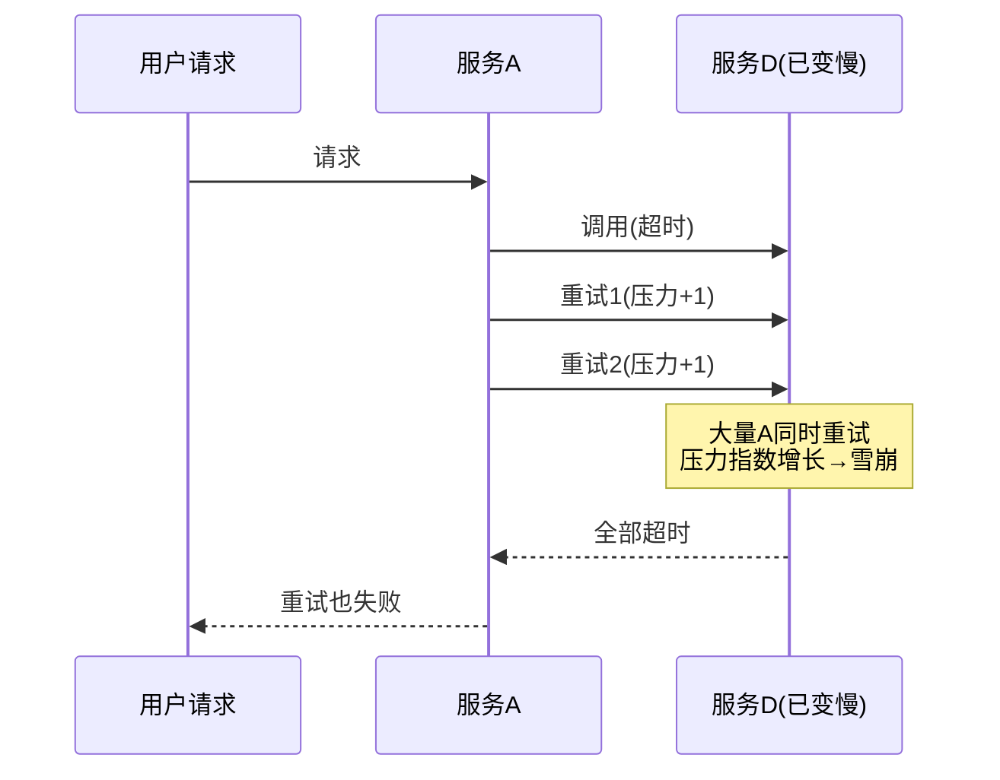
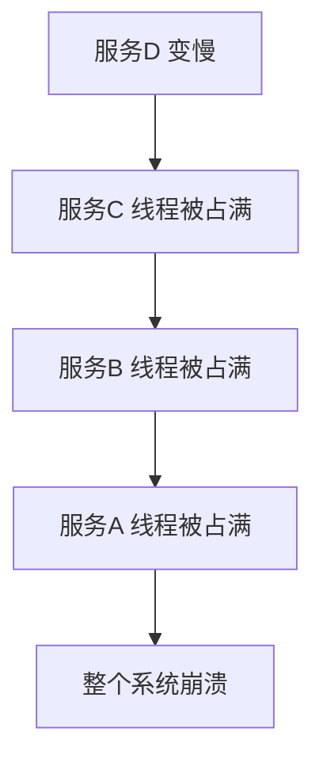

# 微服务痛点治理

> 定位：前面几篇讲的是单个组件（Nacos/Gateway/Sentinel/Seata/Dubbo），这篇讲把它们串成一条调用链后暴露的"系统性痛点"——超时、重试风暴、雪崩、幂等、灰度、兼容。这些坑往往不是某个组件的问题，而是**多个环节叠加**的结果。这篇解决"一次用户请求跨了 8 个服务，为什么这么容易出问题、怎么系统性治理"。

## 一、为什么微服务容易出系统性问题

单体应用里，一次请求在一个进程内完成，失败链路短、可控。微服务把一次请求拆成一条**调用链**（可能跨 5-10 个服务），复杂度的增长不是线性的，而是接近指数：

- 每个环节都可能失败，任一环节失败拖垮整条链
- 一个服务的抖动会沿调用链**向上游传导、放大**
- 超时设置、重试策略、线程池配置散落各处，互相影响

一个典型雪崩过程：


这张图讲什么：**一个下游变慢，逐级向上耗尽线程资源，最终整体崩溃**。这就是雪崩。治理这类问题，不能只盯着单个服务，要有系统性的手段：超时、熔断、降级、隔离、限流、重试治理、幂等。

## 二、核心原理：调用链的治理体系

### 2.1 治理手段全景

微服务的稳定性治理可以分成几层：

| 层次 | 手段 | 解决什么 |
|---|---|---|
| **入口层** | 网关限流、鉴权 | 挡住异常流量 |
| **调用层** | 超时、重试、熔断、降级 | 单点故障不扩散 |
| **资源层** | 线程池隔离、信号量隔离 | 防止资源耗尽 |
| **数据层** | 幂等、分布式事务 | 保证数据正确 |
| **发布层** | 灰度、版本兼容 | 变更不引发故障 |

这些手段不是孤立的——**超时是熔断的前提，隔离是降级的基础，幂等是重试的安全网**。理解它们的关系，才能组合出有效的防御体系。

### 2.2 超时治理（最基础也最容易出错）

超时是防止"无限等待"的第一道防线。但**超时设置不当比不设还可怕**。

**核心原则：超时时间必须沿调用链递减。**

```
用户请求总超时：3s
  网关 → 服务A：2.8s
    服务A → 服务B：2s
      服务B → 服务C：1s
        服务C → 数据库：0.5s
```

为什么递减？如果上游超时 3s、下游超时 5s，那么下游还在傻等的时候上游已经放弃并重试了——**重试请求叠加到还没释放的下游线程上，压力翻倍**。让上游超时 > 下游超时，上游才能先于下游超时放弃，避免叠加。

**超时要考虑重试**：如果调用超时 1s、重试 2 次，最坏耗时是 3s（还不算重试间隔）。所以总超时预算要把重试算进去。

| 参数 | 建议 |
|---|---|
| 连接超时 | 100-500ms（内网） |
| 读/调用超时 | 按 P99 响应时间 × 1.5，通常 500ms-3s |
| 总超时 | 沿链路递减，上游 > 下游 |
| 超时 + 重试 | 总预算 = 单次超时 × (1+重试次数) |

### 2.3 重试治理与重试风暴

重试本是为了应对**瞬时故障**（网络抖动、短暂 GC），但用不好会变成灾难。

**重试风暴**：一个下游变慢 → 大量请求超时 → 上游集体重试 → 下游压力瞬间翻倍 → 更慢 → 更多重试……**自我强化的正反馈，直接打垮下游**。



这张图讲什么：重试让原本已经吃力的下游承受数倍流量。**关键认知：重试只适合幂等的瞬时故障场景，且必须有节制。**

**重试最佳实践**：

1. **只对幂等操作重试**：读操作、幂等写（带唯一 ID）
2. **限制次数**：通常 1-2 次，不要多
3. **指数退避 + 随机抖动（Jitter）**：重试间隔 `base × 2^n` 再加随机值，避免所有客户端同时重试
4. **重试预算（Retry Budget）**：限制重试流量占比（如不超过 10%），超过就不再重试
5. **只重试网络错误/特定状态码**：不要对 4xx（业务错误）、429（限流）、明确的失败重试
6. **配合熔断**：下游熔断时不要重试

```java
// 指数退避 + 抖动示例
long delay = baseDelayMs * (1L << retryCount) + random.nextLong() % jitterMs;
// 第1次: base + 随机  第2次: 2*base + 随机  第3次: 4*base + 随机
```

### 2.4 幂等设计

**幂等**：同一个操作执行多次，结果和执行一次一样。这是重试、消息重复、分布式事务的安全网。

需要幂等的场景：

- 接口重试（网络不确定结果时）
- MQ 消息重复投递（至少一次投递语义必然重复）
- 支付、扣款、下单等金钱相关操作

**幂等实现方案**：

| 方案 | 原理 | 适用 |
|---|---|---|
| **唯一业务 ID + 去重表** | 请求带唯一 ID，处理前查去重表，存在则跳过 | 通用，最可靠 |
| **数据库唯一索引** | 用唯一键约束防止重复插入 | 创建类操作 |
| **状态机** | 只有特定状态才允许流转，重复请求状态不符直接返回 | 订单、流程类 |
| **Token 机制** | 先取 token，提交时校验并删除 token | 防重复提交 |
| **乐观锁** | 带版本号更新，版本不符不更新 | 更新类操作 |

```java
// 唯一ID + Redis 去重（注意 SETNX + 过期时间的原子性）
public Result pay(PayRequest req) {
    String key = "idempotent:pay:" + req.getBizId();
    // SETNX：只有第一次能成功
    Boolean first = redis.setIfAbsent(key, "1", 24, TimeUnit.HOURS);
    if (!first) {
        return Result.success("已处理");  // 重复请求,直接返回成功
    }
    try {
        return doPay(req);
    } catch (Exception e) {
        redis.delete(key);  // 失败则删除,允许重试
        throw e;
    }
}
```

**注意**：分布式幂等要保证"查重 + 标记"的**原子性**，否则并发下两个请求都查到"未处理"然后都执行。用 Redis 的 `SETNX`、数据库唯一索引等原子操作。

### 2.5 防雪崩四件套

| 手段 | 作用 | 实现 |
|---|---|---|
| **限流** | 控制进入系统的流量，超过就拒绝 | Sentinel / 网关限流 |
| **熔断** | 下游故障时快速失败，不再调用 | Sentinel / Resilience4j |
| **降级** | 返回兜底结果，保核心功能 | fallback / mock |
| **隔离** | 资源隔离，一个功能耗尽不影响其他 | 线程池隔离 / 信号量隔离 |

**隔离**的细节：线程池隔离给每个下游服务分配独立线程池，一个下游卡死只耗尽自己的线程池，不影响其他；信号量隔离用计数器控制并发数，更轻量但不隔离线程。**Hystrix 用线程池隔离，Sentinel 用信号量隔离**。

**降级要有兜底策略**：

- 读操作：返回缓存、默认值、空列表
- 写操作：返回"处理中"、转异步 MQ、提示稍后重试
- 核心 vs 非核心：非核心功能（如推荐、评论数）可直接降级掉，保核心交易链路

## 三、关键机制：发布与兼容

### 3.1 服务编排

复杂业务的一次请求常涉及多个服务的**编排（Orchestration）**，两种模式：

| 模式 | 说明 | 适用 |
|---|---|---|
| **编排（Orchestration）** | 一个中心协调者按序调用各服务，知道全流程 | 流程明确、需事务控制 |
| **协同（Choreography）** | 各服务通过事件/消息自发协作，无中心 | 松耦合、事件驱动 |

编排的优点是流程清晰、易监控；缺点是协调者可能成为瓶颈和单点。协同的优点是松耦合；缺点是流程分散、难追踪。**实战中复杂交易用编排，简单通知用协同。**

### 3.2 版本灰度

灰度发布是降低变更风险的核心手段：新版本先小流量验证，没问题再全量。

| 灰度方式 | 原理 |
|---|---|
| **按权重** | 新版本分配 5% → 20% → 100% 流量 |
| **按用户** | 指定用户/用户群（如内部员工）先用新版本 |
| **按 Header/参数** | 带特定标记的请求走新版本 |
| **按 IP/地域** | 特定区域用户先灰度 |

实现依赖：网关/Nacos 的权重路由（Dubbo `Weight` 断言/权重、Gateway `Weight` predicate）、服务多版本共存（`version` 号）。

**灰度要注意"全链路灰度"**：只灰度入口服务没用，调用链下游也要配套灰度，否则新旧版本混调可能不兼容。常用做法是全链路打标（请求 header 传灰度标记），每一层根据标记路由到灰度实例。

### 3.3 接口向后兼容

灰度的前提是**接口兼容**——新旧版本能共存。兼容性原则：

- **只加字段，不删字段、不改字段语义**
- 新增字段要有默认值，老客户端不传也能工作
- 不改接口路径和方法签名
- 枚举值只增不减
- 用版本号区分不兼容变更（`/api/v1/`、`/api/v2/`）

一个经典不兼容案例：把 `status` 字段从 `0/1` 的含义对调，老客户端完全错乱。**改语义比改结构更危险**。

## 四、生产坑点与排查

### 坑点 1：重试风暴打垮下游

**现象**：某个下游变慢后，短时间内请求量暴涨数倍，服务直接被压垮、大面积超时。

**原因**：上游集体重试 + 没有退避 + 没有重试预算，形成正反馈。

**解法**：
- 重试加指数退避 + 随机抖动
- 设重试预算（重试流量 < 10%）
- 配熔断器，下游熔断时直接失败不重试
- 只对幂等操作重试，限制次数 ≤2

### 坑点 2：超时链式放大

**现象**：底层一个慢查询，导致整条调用链全线超时，用户端大面积失败。

**原因**：超时时间没沿链路递减，上游放弃后重试叠加到下游，下游线程耗尽。

**解法**：
- 超时沿链路递减配置，上游 > 下游
- 数据库慢查询治理（索引、SQL 优化）
- 下游配熔断，快速失败而非堆积
- 监控调用链耗时分布（SkyWalking/Zipkin），定位慢节点

### 坑点 3：非幂等接口重复执行

**现象**：MQ 消息重试或接口重试后，订单重复创建、余额重复扣减。

**原因**：接口没做幂等，重复请求被当成新请求处理。

**解法**：
- 所有写接口带唯一业务 ID，服务端做幂等校验
- MQ 消费者必须幂等（消息可能重复投递）
- 用状态机约束操作流转
- 核心操作落去重表或数据库唯一索引

### 坑点 4：灰度发布引发新旧版本不兼容

**现象**：灰度 5% 后，部分请求报错或数据异常。

**原因**：新版本改了接口结构/字段语义，旧客户端或旧下游无法处理；全链路灰度标记没传到底。

**解法**：
- 接口遵循向后兼容原则（只加不改）
- 全链路打标，确保灰度标记贯穿调用链
- 先灰度读接口，写接口谨慎
- 灰度期间密切监控错误率和业务指标，异常立即回滚

## 五、调优 / 选型 / 最佳实践

**稳定性治理清单**：

- [ ] 全链路超时沿链路递减配置，计入重试预算
- [ ] 重试限次 + 指数退避 + 抖动 + 重试预算
- [ ] 所有写接口 + MQ 消费幂等
- [ ] 核心接口配限流、熔断、降级
- [ ] 线程池/信号量隔离，防资源耗尽
- [ ] 接口向后兼容，灰度全链路打标
- [ ] 接入链路追踪（SkyWalking/Zipkin）定位慢节点
- [ ] 监控告警：错误率、P99 延迟、线程池水位、熔断次数

**工具选型**：

| 需求 | 工具 |
|---|---|
| 限流熔断 | Sentinel / Resilience4j |
| 重试 | Resilience4j Retry / Spring Retry |
| 链路追踪 | SkyWalking / Zipkin / Jaeger |
| 灰度路由 | Gateway / Nacos / Dubbo 权重 |
| 高可用 | 注册中心集群 + 网关集群 |

**排查问题的顺序**：先看监控（错误率、延迟、QPS）→ 再用链路追踪定位慢/错节点 → 看日志和线程栈 → 确认超时/重试/熔断配置 → 复现验证。

## 九、面试高频问法

> 这一节的答案按「面试时能讲透」的标准写：先给一句话结论，再展开机制、原因和坑点。

**Q1：微服务架构有哪些痛点？**

**一句话结论**：服务拆多了带来——分布式事务、服务雪崩、链路复杂难排查、数据一致性、运维成本、接口兼容六大痛点。

展开：

| 痛点 | 表现 |
|---|---|
| 分布式事务 | 跨服务操作无法用一个数据库事务保证 |
| 服务雪崩 | 一个下游挂了，上游线程耗尽，连锁崩溃 |
| 排查困难 | 一个请求跨多个服务，出问题不知道卡在哪 |
| 数据一致性 | 各服务独立数据库，数据可能不一致 |
| 运维复杂 | 服务数量多，部署、监控、配置成本高 |
| 接口兼容 | 服务独立演进，接口变更容易破坏调用方 |

加分点：说"微服务不是银弹——它用'分布式复杂性'换'团队自治和独立部署'；服务拆得越细，这些痛点越突出，所以要权衡拆的粒度"。

**Q2：什么是服务雪崩？怎么防止？**

**一句话结论**：服务雪崩是一个下游服务变慢/挂掉，导致调用方线程被占满，进而拖垮整个调用链；用**超时、熔断、限流、隔离**四件套防止。

展开：



- **超时**：调用下游必须设超时，不能无限等。
- **熔断**：下游错误率超阈值，直接快速失败，不再调用。
- **限流**：控制入口流量，不超过系统容量。
- **隔离**：不同依赖用不同线程池，一个依赖挂了不影响其他。

加分点：说"这四件套是有顺序的——先超时（最基本）、再隔离（防扩散）、再熔断（快速失败）、最后限流（保容量）；很多人只做限流，不做超时，一样会雪崩"。

**Q3：超时时间怎么设置？为什么不能太长也不能太短？**

**一句话结论**：超时要**小于上游的超时**，形成"逐层递减"；太长会拖垮调用方，太短会误杀正常请求。

展开：

- **逐层递减**：A 调 B 的超时要小于 A 自己的超时（比如 A 总超时 3s，调 B 设 2s），否则 A 都超时了还在等 B。
- **太长**：下游慢时，调用方线程被长时间占用，最终线程池耗尽。
- **太短**：正常但稍慢的请求被误判超时，导致重试、雪崩。

**经验**：基于 P99 响应时间设置，留一定余量；不同接口不同超时，不要全局一个值。

加分点：说"超时时间要算总预算——一个请求调 3 个下游，每个 2s，那总超时至少 6s；如果入口只有 3s，就得让下游更短或并行调用"。

**Q4：重试有什么坑？怎么正确重试？**

**一句话结论**：重试会放大流量（重试风暴），且只对幂等操作安全；正确做法是**限制次数、加退避、只重试幂等操作**。

展开：

- **重试风暴**：下游变慢时，大量请求超时重试，流量翻倍甚至几倍，把下游彻底压垮。
- **幂等**：非幂等的写操作重试会导致重复插入/重复扣款。
- **正确做法**：
  1. 限制重试次数（1-2 次）
  2. 指数退避（1s、2s、4s），避免同时重试
  3. 只重试幂等的读操作或已做幂等的写操作
  4. 配合熔断，下游不健康时直接不重试

加分点：说"重试是把双刃剑——它能提高成功率，但也会放大故障；下游已经扛不住时，重试是'火上浇油'"。

**Q5：微服务怎么做灰度发布？**

**一句话结论**：按流量比例或标签把部分请求路由到新版本，验证没问题再逐步放量，出问题快速回滚。

展开：

- **灰度维度**：按用户 ID（如尾号）、按 IP、按比例、按标签（内部用户先试）。
- **实现**：网关/注册中心打标签，路由到不同版本实例；或 Service Mesh（Istio）按权重分流。
- **回滚**：发现问题立即把流量切回旧版本。

加分点：说"灰度发布的关键是'可观测'——新版本要能对比错误率、延迟，否则放量了也不知道有没有问题；灰度必须配监控"。

**Q6：接口怎么做版本管理和向后兼容？**

**一句话结论**：新增字段向后兼容（老客户端忽略新字段），删除/修改字段不兼容；用版本号隔离，新老版本并行一段时间。

展开：

- **兼容的变更**：加字段（可选）、加接口。
- **不兼容的变更**：删字段、改字段类型、改语义、改必填。
- **策略**：
  1. URL 版本（`/v1/`、`/v2/`）
  2. Header 版本
  3. 字段级兼容（新字段给默认值）
  4. 新老并行，等老客户端下线再删旧版

加分点：说"向后兼容是微服务的生命线——服务独立部署，你改了接口，调用方可能还是老版本；破坏兼容就是'上线即事故'"。

**Q7：微服务怎么保证数据一致性？**

**一句话结论**：不能像单体那样用数据库事务，要用**分布式事务**（AT/TCC/SAGA）或**最终一致**（消息、补偿、对账）。

展开：

- **强一致**：XA、Seata AT（较弱），适合金融等。
- **最终一致**：
  - 本地消息表 / 事务消息（RocketMQ）
  - 最大努力通知
  - 定时对账 + 补偿
- **选择**：大部分业务能接受最终一致，用消息 + 对账；只有核心资金操作才上强一致。

加分点：说"微服务的'数据一致性'要分层看——同一服务内用本地事务，跨服务用分布式事务或最终一致，别一上来就上 Seata，很多时候消息 + 对账就够了"。

**Q8：微服务怎么排查问题？一个请求跨了 5 个服务。**

**一句话结论**：靠**链路追踪**（TraceId 贯穿全链路）+ 日志聚合 + 指标监控，快速定位卡在哪个服务。

展开：

- **链路追踪**：每个请求生成 TraceId，跨服务传递，每个服务记录 Span，形成完整调用链。
- **日志**：日志里带 TraceId，用 ELK 按 TraceId 聚合查看。
- **指标**：每个服务的 QPS、RT、错误率，快速看哪个服务异常。

加分点：说"没有链路追踪的微服务就是'黑盒'——出了问题只能一个个服务翻日志；TraceId 是微服务可观测的地基"。

**Q9：服务拆分的粒度怎么定？拆太细有什么问题？**

**一句话结论**：按**业务边界**（DDD 限界上下文）拆，不是按技术层拆；拆太细会导致调用链长、事务复杂、运维成本高。

展开：

- **正确拆法**：按业务能力/领域边界（如订单、库存、支付），每个服务高内聚。
- **错误拆法**：按技术层（Controller 服务、Service 服务）——这是分布式单体，最糟。
- **太细的问题**：一个业务操作要调十几个服务，延迟高、事务难、排查难。

加分点：说"拆分粒度没有标准答案，但有个原则——'两个东西是否总是一起变'，总是一起改的就别拆开；拆分的目的是'独立演进'，不是为了拆而拆"。

**Q10：微服务的配置怎么管理？**

**一句话结论**：用**配置中心**（Nacos/Apollo）集中管理，支持动态刷新、环境隔离、灰度发布。

展开：

- **问题**：服务多，配置散落在各服务的配置文件里，改一个配置要重启所有服务。
- **方案**：配置集中到配置中心，服务启动时拉取，变更时推送刷新。
- **能力**：环境隔离（dev/test/prod）、版本管理、灰度、回滚、权限。

加分点：说"配置中心不只是'存配置'——它要解决'改了配置怎么安全生效'：动态刷新、灰度、回滚，缺一个都不敢在生产用"。

## 小结

- 微服务系统性痛点源于调用链放大：一个下游抖动能拖垮整条链。
- 超时沿链路递减（上游 > 下游），并计入重试预算，是防止重试叠加的基础。
- 重试只针对幂等瞬时故障：限次 + 指数退避 + 抖动 + 重试预算 + 熔断联动。
- 幂等是重试/MQ 重复的安全网：唯一 ID + 去重表/唯一索引/状态机，保证原子性。
- 防雪崩四件套：限流、熔断、降级、隔离；发布靠灰度 + 接口向后兼容，全链路打标。
