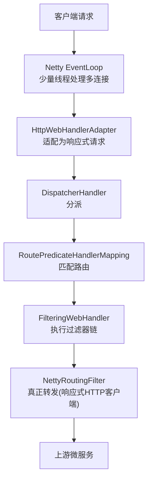
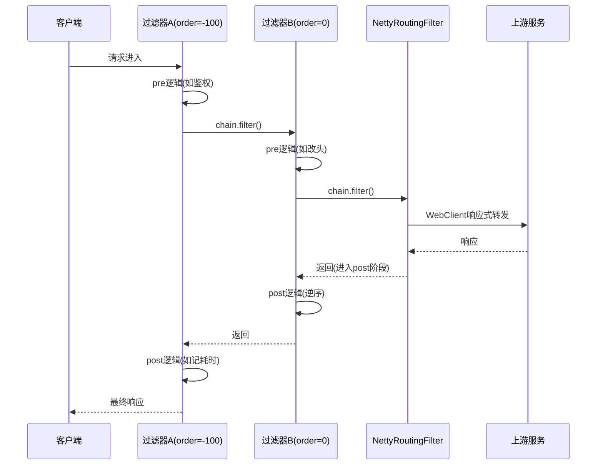

# Gateway 原理

> 定位：Spring Cloud Gateway 是微服务的统一入口，负责路由、鉴权、限流、日志。它和 Zuul 1.x 最大的不同是完全基于 **WebFlux + Reactor + Netty 的非阻塞模型**——理解这一点，就理解了它为什么吞吐高、也理解了为什么在里面写一行阻塞代码就可能拖垮整个网关。

## 一、为什么需要 Gateway

微服务拆分后，如果每个服务都直接暴露给前端，会有一堆问题：

- 客户端要知道几十个服务的地址和端口
- 鉴权、日志、限流要在每个服务重复实现
- 跨域、HTTPS、路径前缀处理散落各处

于是需要一个**统一入口（API 网关）**，把横切关注点集中处理。Netflix Zuul 1.x 是早期方案，但它基于 Servlet 2.5 的阻塞模型，每个请求占用一个线程，高并发下线程数暴涨、性能差。Spring Cloud Gateway 采用非阻塞模型重新设计，成为现在的主流选择。

但很多团队踩过同一个坑：**在 Gateway 里用了阻塞的 API（如 JDBC 查询、RestTemplate 同步调用、Thread.sleep），吞吐不升反降，甚至请求超时**。根因就是没理解它的响应式内核。这篇把这套内核讲清楚。

## 二、核心原理

### 2.1 三大核心概念

Gateway 的所有功能都围绕三个概念展开：

| 概念 | 作用 | 类比 |
|---|---|---|
| **Route（路由）** | 一个路由规则：ID + 目标 URI + 断言集合 + 过滤器集合 | 一条"如果匹配 X，就转发到 Y"的规则 |
| **Predicate（断言）** | 判断请求是否匹配某个 Route，匹配才走该路由 | if 条件 |
| **Filter（过滤器）** | 在请求转发前后做处理（改头、鉴权、限流等） | 拦截器 |

一个 Route 可以配置多个 Predicate，**全部满足**才匹配。Filter 分两类：**GatewayFilter**（针对单个路由）和 **GlobalFilter**（全局，对所有路由生效）。

### 2.2 WebFlux / Reactor / Netty 的关系

这是理解 Gateway 的地基：

- **Netty**：底层网络框架，基于 NIO，少量事件循环线程（EventLoop）处理大量连接
- **Reactor**：响应式编程库，核心是两个类型——`Mono`（0 或 1 个元素）、`Flux`（0 到 N 个元素）
- **WebFlux**：Spring 的响应式 Web 框架，基于 Reactor + Netty，提供注解式/WebFlux Fn 两种编程模型
- **Gateway**：构建在 WebFlux 之上，请求处理链全是响应式的



这张图讲什么：请求进入 Netty 的 EventLoop，经过 WebFlux 的处理器分派，**由 RoutePredicateHandlerMapping 匹配路由，FilteringWebHandler 执行过滤器链，最后由 NettyRoutingFilter 用响应式 HTTP 客户端转发**。整条链路是非阻塞的：一个 EventLoop 线程可以处理成百上千个请求，线程不会因为等 IO 而挂起。

### 2.3 请求执行流程

完整流程：

1. **Gateway 客户端** 发送请求到 Gateway
2. **Handler Mapping** 根据 Predicate 匹配 Route，找到第一个匹配的
3. **Web Handler** 把该 Route 的 GatewayFilter + 所有 GlobalFilter 组装成**过滤链**
4. 过滤器链按顺序执行：pre 逻辑 → 转发到上游 → post 逻辑
5. 转发由 NettyRoutingFilter 用 `WebClient`（响应式）完成

过滤器的执行顺序由 `Ordered` 接口的 `getOrder()` 决定，**数字越小越先执行**。pre 阶段小的在前，post 阶段小的在后（因为 post 是逆序返回）。



这张图讲什么：过滤器链是一个"洋葱模型"——请求从外向内依次执行各过滤器的 pre 逻辑，到达 NettyRoutingFilter 转发到上游；响应回来后从内向外**逆序**执行 post 逻辑。所以 `order` 小的过滤器 pre 最先、post 最后。理解这一点，才知道鉴权过滤器（order 很小）的 post 逻辑会最后执行。

### 2.4 Mono / Flux 基础

响应式编程的核心是**数据流 + 背压 + 声明式组合**：

| 类型 | 含义 | 典型场景 |
|---|---|---|
| `Mono<T>` | 0 或 1 个结果 | 单次查询、单个对象返回 |
| `Flux<T>` | 0 到 N 个结果 | 流式数据、集合 |

关键：定义 `Mono`/`Flux` 时**什么都不会发生**，只有被**订阅（subscribe）**时才执行。这就是"冷流"的概念。常见的操作符：

```java
// 声明式组合：每一步都是对流的变换，不会立即执行
Mono<User> userMono = userService.findById(id)      // 查用户
    .filter(u -> u.getAge() >= 18)                   // 过滤
    .map(u -> u.getName())                           // 转换
    .flatMap(name -> configService.load(name));      // 异步扁平化

// 在 Filter 中返回 Mono，框架负责订阅
public Mono<Void> filter(ServerWebExchange exchange, GatewayFilterChain chain) {
    return chain.filter(exchange).then(Mono.fromRunnable(() -> {
        // post 逻辑：记录耗时
    }));
}
```

`flatMap` vs `map`：`map` 是同步转换，`flatMap` 接受返回 `Mono`/`Flux` 的异步操作并扁平化。**在 Gateway 里要做异步调用（查 Redis、调鉴权服务），必须用 flatMap 链式组合，不能用阻塞调用。**

## 三、关键机制 / 参数

### 3.1 Route 配置（三种写法）

**方式一：配置文件（最常用）**

```yaml
spring:
  cloud:
    gateway:
      routes:
        - id: order-service          # 路由唯一ID
          uri: lb://order-service    # lb=从注册中心负载均衡
          predicates:
            - Path=/order/**         # 路径断言
            - Method=GET,POST        # 方法断言
            - Header=X-Token, \d+    # 请求头断言(正则)
          filters:
            - StripPrefix=1          # 去掉第1段路径前缀
            - AddRequestHeader=X-Source, gateway
```

**方式二：Java DSL（RouteLocator Bean）**

```java
@Bean
public RouteLocator customRoutes(RouteLocatorBuilder builder) {
    return builder.routes()
        .route("user_service", r -> r.path("/user/**")
            .filters(f -> f.stripPrefix(1).addRequestHeader("X-Source", "gw"))
            .uri("lb://user-service"))
        .build();
}
```

**方式三：动态路由**：自定义 RouteDefinitionRepository，把路由存数据库/Nacos，通过事件机制刷新。**生产推荐**，改路由无需重启网关。

### 3.2 常用 Predicate 工厂

| 断言工厂 | 作用 | 示例 |
|---|---|---|
| `Path` | 路径匹配（Ant 风格） | `Path=/api/**` |
| `Method` | HTTP 方法 | `Method=GET,POST` |
| `Header` | 请求头匹配（支持正则） | `Header=X-Token, \d+` |
| `Query` | 查询参数 | `Query=type, vip` |
| `Cookie` | Cookie 匹配 | `Cookie=session, .*` |
| `Host` | 主机名匹配 | `Host=**.example.com` |
| `After`/`Before`/`Between` | 时间窗口 | `After=2026-01-01T00:00:00+08:00[Asia/Shanghai]` |
| `RemoteAddr` | 客户端 IP 段 | `RemoteAddr=192.168.1.0/24` |
| `Weight` | 权重路由（灰度） | `Weight=group1, 8` |

### 3.3 常用 GatewayFilter 工厂

| 过滤器工厂 | 作用 |
|---|---|
| `AddRequestHeader` / `AddResponseHeader` | 加请求/响应头 |
| `StripPrefix` | 去掉 N 段路径前缀 |
| `PrefixPath` | 加路径前缀 |
| `RewritePath` | 正则重写路径 |
| `RequestRateLimiter` | 限流（配合 Redis + KeyResolver） |
| `Retry` | 重试（可配次数、状态码） |
| `Hystrix` / `CircuitBreaker` | 熔断降级 |
| `RequestSize` | 限制请求体大小 |
| `ModifyResponseBody` | 改响应体 |

**自定义 GlobalFilter**（鉴权场景）：

```java
@Component
public class AuthGlobalFilter implements GlobalFilter, Ordered {
    @Override
    public Mono<Void> filter(ServerWebExchange exchange, GatewayFilterChain chain) {
        String token = exchange.getRequest().getHeaders().getFirst("Authorization");
        if (token == null) {
            exchange.getResponse().setStatusCode(HttpStatus.UNAUTHORIZED);
            return exchange.getResponse().setComplete();
        }
        // 异步校验，用 flatMap 链式，不阻塞
        return authClient.verify(token)
            .flatMap(valid -> valid ? chain.filter(exchange)
                                    : unauthorized(exchange));
    }
    @Override
    public int getOrder() { return -100; }  // 越小越先执行
}
```

### 3.4 跨域（CORS）配置

```yaml
spring:
  cloud:
    gateway:
      globalcors:
        cors-configurations:
          '[/**]':
            allowedOrigins: "https://www.example.com"
            allowedMethods: [GET, POST, PUT, DELETE]
            allowedHeaders: "*"
            allowCredentials: true
            maxAge: 3600
```

也可以用 `CorsWebFilter` Bean 编程式配置。**注意**：如果 Gateway 和上游服务都配了 CORS，响应里可能出现重复的 `Access-Control-Allow-Origin` 头导致浏览器报错——通常只在网关层配，上游关掉。

### 3.5 限流与超时

**限流**（基于 Redis + 令牌桶）：

```yaml
spring:
  cloud:
    gateway:
      routes:
        - id: limit_route
          uri: lb://order-service
          filters:
            - name: RequestRateLimiter
              args:
                redis-rate-limiter.replenishRate: 10   # 每秒补充令牌数
                redis-rate-limiter.burstCapacity: 20   # 令牌桶容量
                key-resolver: "#{@userKeyResolver}"    # 自定义限流key
```

`KeyResolver` 决定按什么维度限流（用户、IP、路径）：

```java
@Bean
public KeyResolver userKeyResolver() {
    return exchange -> Mono.justOrEmpty(
        exchange.getRequest().getQueryParams().getFirst("userId"));
}
```

**超时配置**：

```yaml
spring:
  cloud:
    gateway:
      httpclient:
        connect-timeout: 1000    # 连接超时 ms
        response-timeout: 5s     # 响应超时，支持 Duration 格式
```

### 3.6 与 Spring MVC 的隔离（重点坑）

**Spring Cloud Gateway 不能和 spring-boot-starter-web 共存于同一个应用。** 因为 `spring-boot-starter-web` 会引入 Tomcat + Spring MVC（Servlet 容器），而 Gateway 需要 Netty + WebFlux（响应式容器）。两者冲突，Gateway 将无法启动或退化为 Servlet 模型失去非阻塞特性。

解决办法：

- Gateway 项目**只引入** `spring-cloud-starter-gateway`，排除 `spring-boot-starter-web`
- 如果必须用 MVC（如引入某些依赖传递带进来），加 `spring.main.web-application-type=reactive` 强制响应式
- 校验方法：启动日志看是 `NettyWebServer` 还是 `TomcatWebServer`

## 四、生产坑点与排查

### 坑点 1：在 Gateway 过滤器里用了阻塞 API，吞吐暴跌

**现象**：网关加了鉴权过滤器（里面用 RestTemplate 同步调鉴权服务），压测时 QPS 上不去，线程数暴涨，甚至请求超时。

**原因**：Netty 的 EventLoop 线程数量约等于 CPU 核数。阻塞调用会把 EventLoop 线程挂起等待 IO，线程被占满后所有请求都排队。一个阻塞调用能拖垮整个网关。

**解法**：
- 用 `WebClient`（响应式）替代 `RestTemplate`
- 用 `ReactiveRedisTemplate` 替代 `RedisTemplate`
- 数据库用 R2DBC 而非 JDBC
- 实在无法改造的阻塞逻辑，扔到专门的线程池 `Mono.fromCallable(() -> blockingCall()).subscribeOn(Schedulers.boundedElastic())`，隔离阻塞影响

### 坑点 2：误引入 spring-boot-starter-web 导致网关变慢

**现象**：网关运行正常但性能不如预期，日志显示用 Tomcat 启动。

**原因**：某个 starter 传递依赖了 `spring-boot-starter-web`，导致 Gateway 退化成 Servlet 模型。

**解法**：用 `mvn dependency:tree` 排查，排除 web starter；配置 `spring.main.web-application-type=reactive`；检查启动日志确认是 Netty。

### 坑点 3：路由匹配顺序不符合预期

**现象**：配置了 `/api/**` 和 `/api/user/**` 两个路由，结果 `/api/user/1` 被第一个路由匹配走了。

**原因**：Gateway 按 Route 定义的顺序从上到下匹配，**第一个匹配的生效**。如果宽泛路由在前，精确路由永远匹配不到。

**解法**：把精确路由放在宽泛路由前面；用 `RouteDefinition` 的 `order` 字段显式控制顺序（值越小越优先）；用更精确的 Predicate 组合。

### 坑点 4：配置动态刷新后立即失效

**现象**：基于 Nacos 做动态路由，更新路由后短暂生效，随后又变回旧路由。

**原因**：Nacos 配置监听回调里直接替换了路由，但没有发布 `RefreshRoutesEvent`，或者本地缓存和事件竞争导致回滚。

**解法**：动态路由变更后必须 `applicationEventPublisher.publishEvent(new RefreshRoutesEvent(this))`；用 Spring Cloud Alibaba 的 Nacos 集成而非自己轮询；刷新后查询 `/actuator/gateway/routes` 确认。

## 五、调优 / 选型 / 最佳实践

**调优清单**：

| 项目 | 建议 |
|---|---|
| EventLoop 线程数 | 默认 CPU 核数，一般不动；特殊场景调 `reactor.netty.ioWorkerCount` |
| 连接超时 / 响应超时 | 按上游 SLA 设，如 connect 1s / response 5s，必须有 |
| 限流 | 网关层做全局限流 + 业务服务做精细化限流，双层防护 |
| 连接池 | 调 `spring.cloud.gateway.httpclient.pool` 的 maxConnections / maxIdleTime |
| 动态路由 | 路由存 Nacos/DB，避免改路由重启 |
| JVM | 堆 2-4G；Netty 直接内存关注 `MaxDirectMemorySize` |

**Gateway vs Zuul 1.x**：

| 维度 | Spring Cloud Gateway | Zuul 1.x |
|---|---|---|
| 模型 | 非阻塞（WebFlux/Netty） | 阻塞（Servlet） |
| 吞吐 | 高，少量线程扛高并发 | 低，线程数随并发涨 |
| 长连接/WebSocket | 原生支持 | 支持差 |
| 生态 | Spring 官方，持续维护 | 已停止演进 |

**选型建议**：新项目一律 Gateway。如果团队对响应式编程不熟悉，要先把 Reactor 基础补齐，否则容易写出阻塞代码。

## 六、面试高频问法

> 这一节的答案按「面试时能讲透」的标准写：先给一句话结论，再展开机制、原因和坑点。

**Q1：Spring Cloud Gateway 的底层架构是什么？为什么不用 Spring MVC？**

**一句话结论**：Gateway 基于 **WebFlux + Reactor + Netty** 的异步非阻塞模型，而 Spring MVC 是同步阻塞的 Servlet 模型，扛不住高并发。

展开：

- **为什么不用 MVC**：MVC 每个请求占一个线程，高并发下线程耗尽；Gateway 用事件循环，少量线程处理大量请求。
- **核心**：`RoutePredicateHandlerMapping` 匹配路由 → `FilteringWebHandler` 执行过滤器链 → `NettyRoutingFilter` 转发。
- **代价**：全链路异步，业务代码不能有阻塞调用，否则会拖垮事件循环。

加分点：说"Gateway 里调用了阻塞的 JDBC 或同步 HTTP，会让整个 EventLoop 卡住——这是最常见的性能事故，必须用响应式客户端"。

**Q2：Gateway 的 Route、Predicate、Filter 是什么关系？**

**一句话结论**：Route 是路由单元，包含目标 URI + 一组 Predicate（匹配条件）+ 一组 Filter（处理逻辑）。

展开：

- **Route**：`id`（标识）、`uri`（转发目标）、`predicates`（匹配）、`filters`（处理）。
- **Predicate**：判断请求是否匹配，如 Path、Method、Header、Query、时间等。多个 Predicate 是**与**关系。
- **Filter**：匹配后执行，分 GatewayFilter（单个路由）和 GlobalFilter（全局）。

```yaml
spring:
  cloud:
    gateway:
      routes:
        - id: user-service
          uri: lb://user-service
          predicates:
            - Path=/api/user/**
          filters:
            - StripPrefix=1
```

加分点：说"Predicate 是'路由匹配'，Filter 是'路由处理'——先匹配再处理，这是理解 Gateway 的主线"。

**Q3：Gateway 的过滤器执行顺序是怎样的？**

**一句话结论**：请求进来时 Filter 按 order 从小到大执行 pre 逻辑，响应回来时按 order 从大到小执行 post 逻辑——像洋葱一样。

展开：

- **pre（前置）**：请求转发前执行，order 越小越先执行。
- **post（后置）**：响应返回后执行，order 越大越先执行。
- **组合**：GlobalFilter + GatewayFilter 按 order 合并排序。

**典型顺序**：鉴权（order 小）→ 限流 → 日志 → 转发 → 日志 → 限流 → 鉴权。

加分点：说"这个'洋葱模型'和 Servlet Filter、Spring Interceptor 一致；order 设计错了会导致鉴权在限流之后执行，安全漏洞"。

**Q4：Gateway 怎么实现限流？**

**一句话结论**：用 `RequestRateLimiter` 过滤器 + Redis + 令牌桶算法（RedisRateLimiter）。

展开：

- **原理**：基于 Redis 的 Lua 脚本实现令牌桶，集群共享限流状态。
- **配置**：指定 `redis-rate-limiter.replenishRate`（每秒补充令牌数）、`burstCapacity`（桶容量）、`requestedTokens`（每次请求消耗）。
- **Key**：按用户、IP、接口维度限流。

```yaml
filters:
  - name: RequestRateLimiter
    args:
      redis-rate-limiter.replenishRate: 10
      redis-rate-limiter.burstCapacity: 20
      key-resolver: "#{@userKeyResolver}"
```

加分点：说"令牌桶允许突发（桶里攒的令牌），漏桶是恒定速率；Gateway 默认用令牌桶，适合有突发流量的场景"。

**Q5：Gateway 怎么处理跨域？**

**一句话结论**：用 `CorsWebFilter` 或配置 `globalcors`，**不要在业务服务里配**——跨域应该统一在网关处理。

展开：

- **配置方式**：`spring.cloud.gateway.globalcors` 全局配置，或自定义 `CorsWebFilter`。
- **为什么在网关**：所有请求都经过网关，统一处理跨域，业务服务不用关心。
- **坑**：如果网关和服务都配了跨域，会出现"重复的 Access-Control-Allow-Origin 头"，浏览器报错。

加分点：说"预检请求（OPTIONS）要放行，不能被鉴权拦截——很多跨域失败是因为 OPTIONS 请求被 401 了"。

**Q6：Gateway 的超时怎么配置？**

**一句话结论**：用 `HttpClient` 的 `connect-timeout` 和 `response-timeout` 配置，全局或按路由设置。

展开：

- **连接超时**：建立 TCP 连接的时间。
- **响应超时**：等待后端响应的时间（**这个最重要**，防止慢服务拖垮网关）。
- **配置**：`spring.cloud.gateway.httpclient.connect-timeout` 和 `response-timeout`（注意单位）。

加分点：说"response-timeout 必须配，否则后端服务卡住，网关的连接和线程会一直被占用，最终网关也挂——超时是防雪崩的第一道防线"。

**Q7：Gateway 和 Nginx 有什么区别？怎么选？**

**一句话结论**：Nginx 是 C 语言的高性能反向代理（流量入口、静态资源、SSL 卸载），Gateway 是 Java 的微服务网关（业务鉴权、限流、路由到服务）。

| 维度 | Nginx | Spring Cloud Gateway |
|---|---|---|
| 语言 | C | Java |
| 定位 | 流量入口、静态资源、负载均衡 | 微服务网关、业务路由 |
| 性能 | 极高 | 较高（异步） |
| 动态路由 | 需 reload | 支持动态配置 |
| 业务集成 | 弱 | 强（能写 Java 逻辑） |

**典型架构**：Nginx 在最外层做入口和 SSL，Gateway 在内层做微服务路由和业务网关——两者配合，不是二选一。

加分点：说"Nginx 做不了复杂的业务鉴权（要写 Lua），Gateway 能直接调 Java 服务验证 token——分层各司其职"。

**Q8：Gateway 的全局过滤器和路由过滤器有什么区别？**

**一句话结论**：GlobalFilter 对所有路由生效，GatewayFilter 只对配置了它的路由生效。

展开：

- **GlobalFilter**：实现 `GlobalFilter` 接口，自动应用到所有路由，适合鉴权、日志、链路追踪。
- **GatewayFilter**：在路由配置里指定，只对该路由生效，适合特定路由的定制（如某接口加解密）。
- **执行**：两者合并成一个过滤器链，按 order 排序执行。

加分点：说"鉴权、限流、日志这种'每个请求都要做'的用 GlobalFilter；某个接口特有的处理用 GatewayFilter——别把所有逻辑都塞 GlobalFilter"。

**Q9：Gateway 怎么实现动态路由？**

**一句话结论**：默认路由配置在配置文件里，要动态路由需自定义 `RouteDefinitionRepository`（如从 Nacos/数据库读），配合刷新机制。

展开：

- **默认**：`application.yml` 里的 routes，改配置要重启。
- **动态**：实现 `RouteDefinitionRepository`，从配置中心/数据库读取路由定义，监听变更刷新。
- **刷新**：调用 `RefreshRoutesEvent` 触发路由重新加载。

加分点：说"动态路由是网关的核心能力——服务扩缩容、灰度发布都依赖它；写死配置文件的网关在生产环境基本不可用"。

**Q10：Gateway 转发时怎么传递用户身份？**

**一句话结论**：在 GlobalFilter 里解析 token，把用户信息放进请求头传给下游，下游服务从请求头取——避免每个服务都解析 token。

展开：

- **流程**：网关鉴权 → 解析 JWT → 把 userId 等放进 Header（如 `X-User-Id`）→ 转发给下游。
- **下游**：从 Header 取用户信息，不再重复解析 token。
- **安全**：网关要**清除客户端伪造的 Header**（防止客户端自己塞 X-User-Id 冒充别人）。

加分点：说"必须在下游服务里也校验来源——只信任网关转发的请求，否则绕过网关直连服务就能伪造身份，这是常见的安全漏洞"。

## 小结

- Gateway = Route + Predicate + Filter，构建在 WebFlux/Reactor/Netty 非阻塞模型之上。
- 请求链路：Netty → DispatcherHandler → 路由匹配 → 过滤链 → NettyRoutingFilter 转发。
- `Mono`（0-1）/ `Flux`（0-N）是冷流，订阅才执行；异步组合用 flatMap。
- 禁用一切阻塞 API（RestTemplate/JDBC），用 WebClient/R2DBC；否则 EventLoop 被占满拖垮网关。
- 不能和 spring-boot-starter-web 共存；路由按顺序匹配，精确路由放前面；超时与限流必配。
