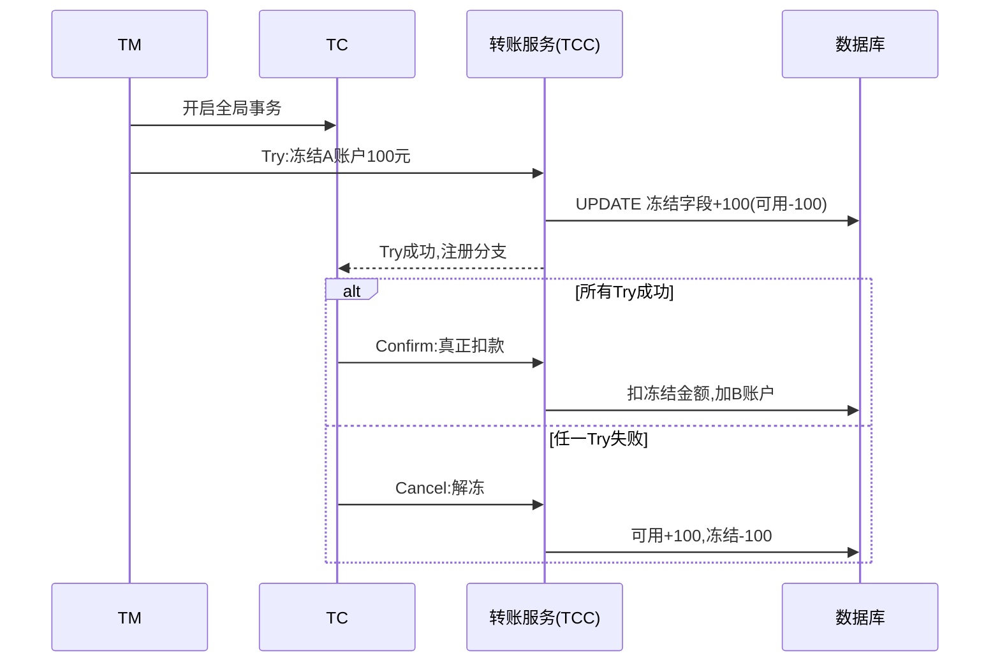
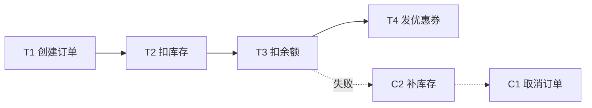
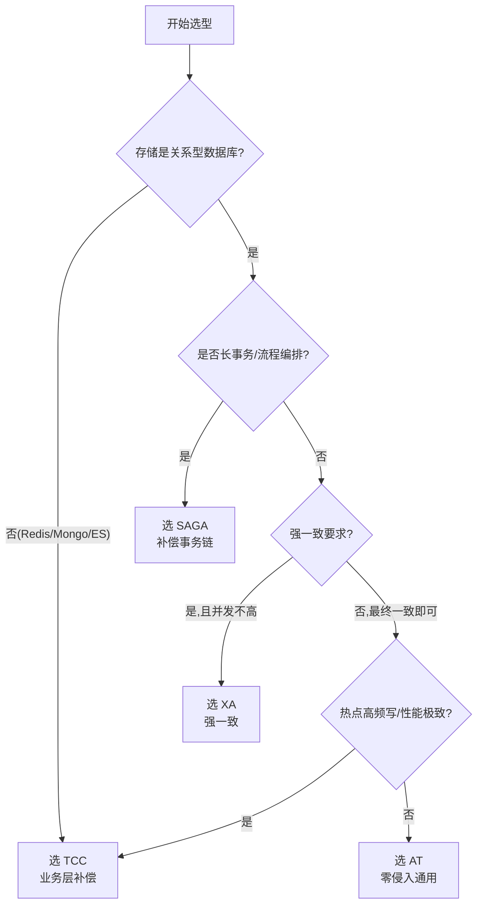

# Seata 其他模式与生产问题

> 定位：AT 模式虽好用，但不是银弹——非关系型存储、长事务、强性能场景它都扛不住。这篇把 Seata 的 TCC / SAGA / XA 模式讲清，给出**模式选型决策表**，再补上生产落地绕不开的 XID 传递、TC 高可用、锁冲突/超时/性能治理。看完你应该能回答"这个场景该用哪种模式、TC 怎么部署才不会单点"。

## 一、为什么需要多种模式

上一篇的 AT 模式对业务代码几乎零侵入，但它有明确的边界：

- **依赖关系型数据库 + undo_log**：Redis、MongoDB、ES 上没有这套机制
- **长事务不友好**：全局锁持有到二阶段，长事务并发极差
- **热点数据争抢**：秒杀扣库存这类高频写同一行，全局锁冲突严重

当 AT 不适用时，需要别的武器。Seata 提供了四种模式，各有取舍：

| 模式 | 一致性 | 侵入性 | 性能 | 适用 |
|---|---|---|---|---|
| **AT** | 最终一致 | 极低（注解） | 中 | 关系型数据库通用场景 |
| **TCC** | 最终一致 | 高（写三阶段代码） | 高 | 强性能、跨存储、需精细控制 |
| **SAGA** | 最终一致 | 中（写补偿） | 高 | 长事务、流程编排 |
| **XA** | 强一致 | 低 | 低 | 强一致要求、能接受锁久 |

## 二、核心原理：三种模式对比

### 2.1 TCC 模式

TCC 是 Try / Confirm / Cancel 三个阶段的缩写，本质是**业务层面的两阶段提交**。

| 阶段 | 作用 | 类比 |
|---|---|---|
| **Try** | 预留资源、做检查，不真正提交 | 下单时先"冻结"库存，不真扣 |
| **Confirm** | 真正执行业务操作（所有 Try 成功后） | 冻结的库存真正扣掉 |
| **Cancel** | 释放预留资源（任一 Try 失败） | 解冻库存 |

用转账例子：Try 阶段冻结 A 账户 100 元（不真扣），Try 成功后 Confirm 阶段真正扣 A、加 B；任一失败则 Cancel 解冻。



这张图讲什么：TCC 把"预留"和"真正执行"拆成两个业务动作，Confirm/Cancel 由业务代码自己实现。**它不依赖数据库事务，所以可以跨 Redis、MQ、任何存储**——这是它相对 AT 的最大优势。

**TCC 的三个硬要求**：

1. **幂等**：Confirm/Cancel 会被重复调用（网络重试），必须保证多次执行结果一致
2. **空回滚**：Try 没执行就收到 Cancel，要正确处理（记录标记）
3. **悬挂**：Cancel 先到、Try 后到，Try 要拒绝执行（防资源永久预留）

**TCC 的代价**：侵入极强——每个业务操作要写 Try/Confirm/Cancel 三个方法，还要处理幂等/空回滚/悬挂，代码量和复杂度远高于 AT。所以**只在 AT 不满足时才用 TCC**。

### 2.2 SAGA 模式

SAGA 是**长事务解决方案**，把一个大事务拆成多个本地事务，每个本地事务配一个**补偿事务（Compensating Transaction）**。

- 正向：`T1 → T2 → T3 → ...`
- 失败补偿：`T3 失败 → C2 → C1`（逆序执行补偿）



这张图讲什么：SAGA 不做资源预留，每个步骤直接提交本地事务，失败时逆序执行补偿把数据改回去。**它适合步骤多、链路长的业务流程**（如电商下单：订单→库存→支付→优惠券→物流），因为长事务占用资源太久，AT/TCC 都不合适。

SAGA 的补偿是"反向操作"而非"回滚到快照"，所以补偿逻辑要业务自己写（如"扣库存"的补偿是"加回库存"）。如果业务上无法补偿（如已发短信），SAGA 就不适用。

### 2.3 XA 模式

XA 是数据库层面的标准两阶段提交协议，Seata 的 XA 模式是对 XA 的封装：

- **一阶段**：执行业务 SQL，但不提交（数据库持有行锁）
- **二阶段**：TC 通知提交或回滚，各分支统一提交/回滚

XA 的优缺点很分明：

- **优点**：强一致（数据库保证），对业务侵入低（类似 AT）
- **缺点**：一阶段不释放行锁，锁持有到二阶段，**并发性能最差**；依赖数据库 XA 实现

XA 适合**一致性要求极高、并发不高**的场景（如金融核心账务）。

### 2.4 模式选型决策



这张图给出决策路径：先看存储类型，再看事务长度，再看一致性要求，最后看性能。**记住一条经验法则：默认用 AT，AT 不满足再依次考虑 TCC（性能/跨存储）、SAGA（长流程）、XA（强一致）。**

## 三、关键机制 / 参数

### 3.1 XID 传递机制

**XID（全局事务 ID）** 是贯穿整个分布式事务的标识，格式类似 `ip:port:transactionId`。TM 开启全局事务时由 TC 生成，之后必须随每次远程调用传递给下游 RM，下游才能把分支事务挂到同一个全局事务下。

传递方式：

- **同线程**：Seata 用 `ThreadLocal` 保存 XID，RPC Context 自动透传
- **跨服务（Feign/Dubbo）**：通过请求头传递。Seata 提供了 `RequestInterceptor`（Feign）和 Filter（Dubbo）自动把 XID 塞进 header，下游拦截器取出放入 ThreadLocal
- **异步线程/线程池**：ThreadLocal 不会自动传递，要手动用 `RootContext` 的 `bind/unbind` 或 Seata 提供的线程池包装

```java
// Feign 拦截器自动传 XID（Seata 已提供，理解原理即可）
// 异步场景手动传递：
String xid = RootContext.getXID();
executor.submit(() -> {
    RootContext.bind(xid);        // 绑定
    try { doBusiness(); }
    finally { RootContext.unbind(); }  // 解绑,防止污染线程池线程
});
```

**XID 丢失是"事务没生效"的头号原因**：一旦下游没收到 XID，就会当普通本地事务处理，全局回滚时它不会参与——数据不一致就这么来的。

### 3.2 TC 高可用部署

TC（Seata Server）是中心节点，**必须集群化避免单点**。Seata 支持两种高可用模式：

| 模式 | 说明 | 适用 |
|---|---|---|
| **HA（注册中心 + 共享存储）** | TC 注册到 Nacos/Eureka，多个 TC 节点共享数据库存储事务日志 | 主流推荐 |
| **Raft 集群** | TC 节点间用 Raft 保证一致，内置存储 | 无需外部存储 |

关键是**事务日志存储模式（store.mode）**：

- `file`：本地文件，单机测试用，不能集群
- `db`：共享数据库（MySQL），多个 TC 节点连同一个库，生产推荐
- `raft`：Seata 内置 Raft（新版本支持）

```yaml
# TC 服务端配置 store.mode=db（生产推荐）
seata:
  store:
    mode: db
    db:
      datasource: druid
      db-type: mysql
      url: jdbc:mysql://mysql-host:3306/seata
      user: xxx
      password: xxx
  registry:
    type: nacos
    nacos:
      server-addr: localhost:8848
  config:
    type: nacos    # 配置中心也用 Nacos,集中管理
```

TC 集群部署要点：

1. 至少 2 个 TC 节点，注册到同一个 Nacos
2. 所有 TC 连同一个 MySQL （`global_table`、`branch_table`、`lock_table` 三张表）
3. 客户端配置 `seata.service.grouplist` 指向 TC 集群（或走注册中心自动发现）
4. TC 无状态，前面可挂 SLB 做负载均衡

### 3.3 生产常见问题

**问题 1：性能下降**

分布式事务天然比本地事务慢（多轮 RPC + 锁协调）。常见原因和优化：

| 原因 | 优化 |
|---|---|
| 全局锁争抢 | 缩小事务粒度、热点数据移出事务、缩短一阶段 |
| 事务日志落库慢 | TC 用高性能 MySQL、合理索引、SSD |
| 大事务 | 拆分事务，只把必须一致的操作纳入 |
| 不必要的分支 | 纯读操作不注册分支事务 |

**问题 2：锁冲突（lock conflict）**

现象：`LockConflictException`、分支注册失败。原因：多个全局事务改同一行，或全局锁和本地锁顺序不一致导致死锁。

解法：
- 统一各服务的加锁顺序，避免交叉
- 调大 `lock.retry` 和 `lock.retry-interval`
- 业务层面对热点数据串行化（如按业务 ID 分片加锁）
- 缩短事务执行时间

**问题 3：超时**

| 超时类型 | 参数 | 处理 |
|---|---|---|
| 全局事务超时 | `default-global-transaction-timeout`（60s） | 超时自动回滚，别设太长 |
| 分支注册超时 | TC 端相关配置 | 检查 TC 负载和网络 |
| 锁等待超时 | `lock.retry` × interval | 分析冲突根因，别单纯调大 |

**问题 4：TC 宕机恢复**

TC 重启后，从数据库恢复全局事务状态，继续驱动二阶段。但如果 TC 在二阶段通知途中宕机，可能在途事务悬而未决——Seata 有事务恢复任务定期扫描超时事务重新处理。**所以 TC 必须高可用 + 事务日志持久化到 db**。

## 四、生产坑点与排查

### 坑点 1：XID 在异步线程中丢失导致不回滚

**现象**：主流程回滚正常，但 `@Async` 方法里的数据库操作没回滚。

**原因**：XID 存在 ThreadLocal，异步线程拿不到。

**解法**：主线程取 XID，在异步线程 `RootContext.bind(xid)`，finally 里 `unbind`。或用 Seata 提供的线程池/任务装饰器自动传递。

### 坑点 2：TC 单点故障，整个分布式事务瘫痪

**现象**：TC 重启期间，所有全局事务卡住或失败。

**原因**：TC 单机部署，store.mode=file。

**解法**：TC 集群（≥2 节点）+ store.mode=db + 注册到 Nacos。客户端通过注册中心发现 TC，自动故障转移。

### 坑点 3：TCC 的 Confirm/Cancel 不幂等导致数据错乱

**现象**：网络抖动引发重试，Confirm 执行两次，库存被扣两次。

**原因**：TCC 的 Confirm/Cancel 会被 TC 重复调用，业务没做幂等。

**解法**：每个分支用唯一业务 ID 做幂等键，Confirm/Cancel 执行前先查"是否已处理"（状态机或去重表），处理过直接返回成功。

### 坑点 4：SAGA 补偿失败无法回滚

**现象**：长事务中途失败，补偿事务执行也失败，数据停在中间态。

**原因**：补偿逻辑不健壮，或业务上有不可补偿操作（已发消息）。

**解法**：补偿要做成幂等且可重试；关键步骤失败要告警人工介入；避免把不可撤销操作（短信、支付）放进 SAGA 正向流程，改为最后一步或异步。

## 五、调优 / 选型 / 最佳实践

**落地清单**：

- 默认 AT；AT 不满足再按需切 TCC / SAGA / XA
- TC 生产必须集群 + db 存储 + 注册中心发现
- 全链路保证 XID 传递，异步场景手动 bind/unbind
- TCC/SAGA 的补偿逻辑必须幂等 + 可重试 + 监控告警
- 事务粒度尽量小，热点数据移出分布式事务
- 全局事务超时合理设置，配合告警及时发现悬挂事务

**四种模式再对比**：

| 维度 | AT | TCC | SAGA | XA |
|---|---|---|---|---|
| 侵入 | 极低 | 高 | 中 | 低 |
| 性能 | 中 | 高 | 高 | 低 |
| 一致性 | 最终 | 最终 | 最终 | 强 |
| 跨存储 | 否 | 是 | 是 | 否 |
| 长事务 | 差 | 中 | 优 | 差 |
| 补偿代码 | 自动 | 手写 Try/Confirm/Cancel | 手写补偿 | 无 |

## 六、面试高频问法

> 这一节的答案按「面试时能讲透」的标准写：先给一句话结论，再展开机制、原因和坑点。

**Q1：Seata 的四种事务模式有什么区别？怎么选？**

**一句话结论**：AT（无侵入、主流）、TCC（侵入强、性能高）、SAGA（长流程、补偿）、XA（强一致、性能低）。

| 模式 | 侵入 | 一致性 | 性能 | 场景 |
|---|---|---|---|---|
| AT | 无（代理数据源） | 最终一致 | 较高 | 大部分业务，默认首选 |
| TCC | 强（写三个方法） | 最终一致 | 高 | 高并发、需要资源预留 |
| SAGA | 中（写补偿） | 最终一致 | 高 | 长流程、跨多系统 |
| XA | 无 | 强一致 | 低 | 强一致、低并发 |

**选择思路**：能用 AT 就用 AT；高并发/需要预留资源用 TCC；长流程（如订单履约跨多系统）用 SAGA；必须强一致且并发不高用 XA。

加分点：说"AT 是'默认最优解'，但遇到热点数据或长事务要换 TCC——没有银弹，看场景"。

**Q2：TCC 的三个阶段分别做什么？**

**一句话结论**：Try（预留资源）、Confirm（确认执行）、Cancel（取消释放），业务自己实现这三个方法。

展开：

- **Try**：检查并预留资源（如冻结库存、预扣余额），不真正扣减。
- **Confirm**：真正执行业务（扣减冻结的库存），要求幂等。
- **Cancel**：释放预留的资源（解冻库存），要求幂等。

**关键**：Try 必须能"预留"，如果业务无法预留（如没有冻结概念），TCC 就不适用。

加分点：说"TCC 的核心是'资源预留'——Try 阶段就把资源占住，避免 Confirm 时资源不够；这要求业务模型支持'冻结'状态"。

**Q3：TCC 的空回滚、幂等、悬挂怎么解决？**

**一句话结论**：三个都是分布式事务的经典问题，靠状态机 + 唯一键 + 防悬挂标记解决。

展开：

- **空回滚**：Cancel 先于 Try 到达。解决：Cancel 时检查有没有 Try 记录，没有就插入一条"已取消"记录，直接返回。
- **幂等**：Confirm/Cancel 可能重试。解决：用事务 ID + 分支 ID 做唯一键，记录执行状态，重复请求直接返回。
- **悬挂**：空回滚后 Try 才到。解决：Try 执行前检查有没有"已取消"记录，有就拒绝执行。

加分点：说"这三个问题本质是'网络乱序'——Try/Confirm/Cancel 三个请求可能乱序到达，必须用状态机保证任何顺序都正确"。

**Q4：SAGA 模式是什么？适合什么场景？**

**一句话结论**：SAGA 把长事务拆成一串本地事务，每个配一个补偿操作，失败时逆序执行补偿。

展开：

- **正向**：T1 → T2 → T3，每步都是本地事务。
- **补偿**：某步失败，逆序执行 C2、C1 补偿（C3 不需要，因为 T3 没成功）。
- **两种恢复**：向后恢复（补偿已完成的）、向前恢复（重试失败步骤）。

**适合**：长流程、跨多个系统、无法用 AT/TCC 的场景（如订单 → 支付 → 履约 → 物流）。

加分点：说"SAGA 没有隔离性——中间状态对外可见，要配合'业务上的语义锁'（如订单状态机）防止脏读"。

**Q5：XA 模式是什么？为什么性能差？**

**一句话结论**：XA 是数据库层面的两阶段提交（prepare + commit），一阶段不提交、持有锁到二阶段，所以性能差。

展开：

- **一阶段**：所有参与者在本地执行但不提交（prepare），持有行锁。
- **二阶段**：协调者决定 commit 或 rollback，参与者执行。
- **为什么慢**：锁持有时间长（从 prepare 到 commit），并发度低；还要额外的日志和通信。

加分点：说"XA 是'强一致'的代价——锁不释放，其他事务全等着；所以高并发场景基本不用 XA"。

**Q6：全局事务 ID（XID）是怎么传递的？**

**一句话结论**：XID 存在 ThreadLocal 里，通过 RPC 调用（如 Feign/Dubbo 的拦截器）传递到下游服务，下游从请求头/上下文中取出并绑定。

展开：

- **根上下文**：TM 开启全局事务时生成 XID，存进 RootContext（ThreadLocal）。
- **传递**：服务间调用时，拦截器把 XID 放进请求头，下游拦截器取出，绑定到自己的 RootContext。
- **绑定**：下游的数据库操作被 Seata 代理，自动带上 XID，注册分支事务。

加分点：说"XID 传递是分布式事务的'血脉'——断了就变成多个独立本地事务；异步线程、MQ 场景要手动传递，这是常见坑"。

**Q7：Seata 的 TC、TM、RM 分别是什么？**

**一句话结论**：TC 是事务协调器（独立部署，管理全局事务状态）、TM 是事务管理器（发起全局事务，在应用侧）、RM 是资源管理器（管理分支事务，在应用侧）。

展开：

- **TC（Transaction Coordinator）**：Seata Server，维护全局事务和分支事务状态，驱动提交/回滚。
- **TM（Transaction Manager）**：应用里 `@GlobalTransactional` 标注的地方，负责开启/提交/回滚全局事务。
- **RM（Resource Manager）**：管理数据库等资源，注册分支事务、上报状态、执行二阶段。

加分点：说"TC 是'总指挥'，TM 是'发起者'，RM 是'执行者'——三者通过 XID 串联，构成 Seata 的核心三角"。

**Q8：Seata 的 TC 高可用怎么做？**

**一句话结论**：TC 无状态（状态存 DB/Redis），可以集群部署，通过注册中心（Nacos）做服务发现和负载均衡。

展开：

- **无状态**：全局事务状态持久化到数据库（如 MySQL），TC 实例本身不存状态，可以水平扩展。
- **集群**：多个 TC 实例注册到 Nacos，TM/RM 从注册中心发现 TC。
- **容灾**：TC 挂了，TM/RM 重连其他 TC，从 DB 恢复事务状态继续。

加分点：说"TC 必须集群——它是分布式事务的单点，挂了整个事务链路就卡住；生产至少部署 3 个实例"。

**Q9：Seata 的事务悬挂是什么？和 TCC 的悬挂一样吗？**

**一句话结论**：概念一样——都是"回滚先于提交到达，导致后续提交的请求无人处理"；AT 用 `log_status` 墓碑解决，TCC 用状态记录解决。

展开：

- **AT 的悬挂**：一阶段延迟到达，此时全局事务已经回滚，undo_log 写入后无人处理。
- **解决**：空回滚时写墓碑（`log_status=1`），一阶段检查到墓碑就拒绝。

加分点：说"悬挂的本质是'分布式消息乱序'——只要事务有'先回滚后提交'的可能，就要防悬挂；这是分布式事务的通用问题，不只 Seata"。

**Q10：Seata 怎么和 Spring Cloud 集成？**

**一句话结论**：引入 `seata-spring-boot-starter`，配好 TC 地址和事务分组，在需要全局事务的方法上加 `@GlobalTransactional`。

展开：

- **依赖**：`seata-spring-boot-starter`。
- **配置**：`seata.tx-service-group`、`seata.service.vgroup-mapping`、注册中心。
- **使用**：`@GlobalTransactional` 标注在入口方法，Seata 自动代理数据源、传递 XID。

加分点：说"`@GlobalTransactional` 只能加在'入口方法'，内部调用不会开启新事务；而且它和 `@Transactional` 可以共存，但要注意传播行为"。

## 小结

- 四种模式：AT（默认零侵入）、TCC（高性能跨存储，侵入高）、SAGA（长流程）、XA（强一致，性能低）。
- 选型：默认 AT → 跨存储/性能用 TCC → 长流程用 SAGA → 强一致用 XA。
- XID 靠 header 跨服务传递、ThreadLocal 同线程传递；异步线程要 bind/unbind。
- TC 高可用 = 集群 + db 存储（global/branch/lock 三表）+ 注册中心发现。
- TCC/SAGA 补偿必须幂等、防空回滚与悬挂；全局事务超时别设太长，配合告警。
