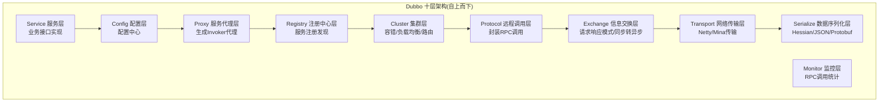
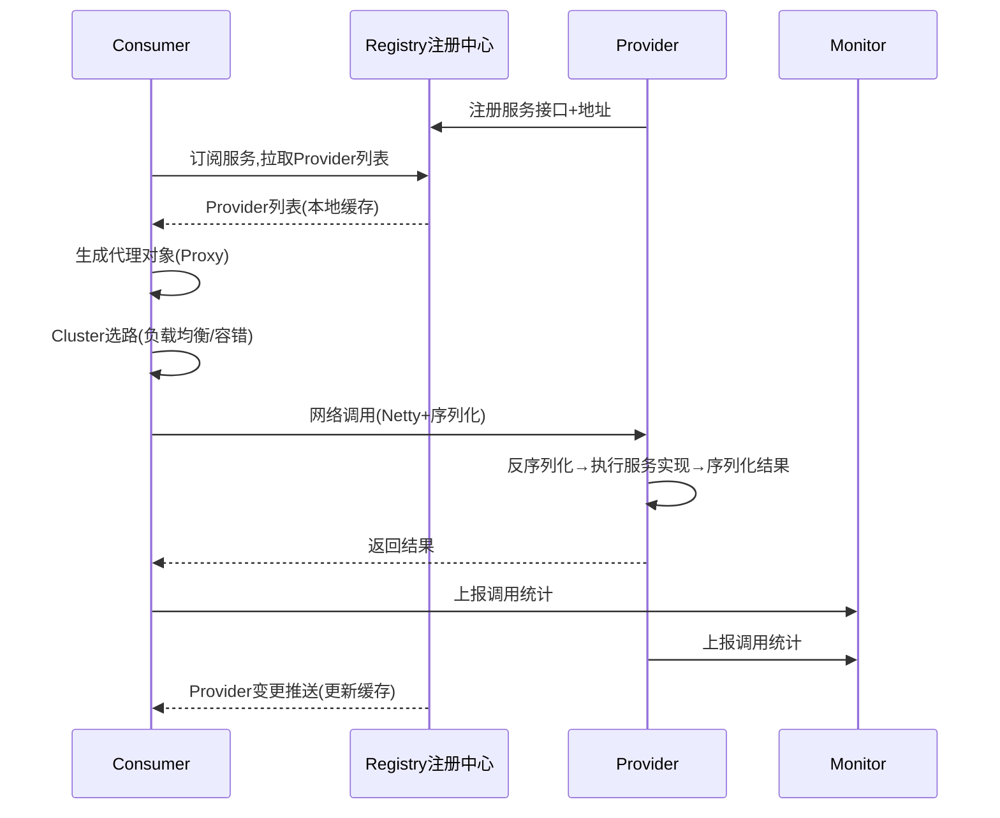

# Dubbo 原理

> 定位：Dubbo 是阿里开源的高性能 RPC 框架，代表"服务治理"这条路线；Spring Cloud 代表"微服务全家桶"路线。理解 Dubbo 的关键是 **分层架构 + SPI 扩展 + 服务暴露/引用过程**——它几乎每个环节都可插拔替换。这篇解决"Dubbo 调用到底怎么走、SPI 和 Java SPI 差在哪、十种集群容错和负载均衡怎么选、和 Spring Cloud 到底该怎么取舍"。

## 一、为什么需要 Dubbo

微服务间通信有两条路线：

- **HTTP REST（Spring Cloud）**：基于 HTTP，跨语言友好，生态全家桶（注册中心/网关/配置/熔断都有）
- **RPC（Dubbo）**：基于 TCP 私有协议，性能更高，服务治理能力更强（负载均衡/容错/路由/权重）

Dubbo 解决的核心问题：

- 服务间高效调用（二进制协议、长连接、序列化优化）
- 服务治理（注册发现、负载均衡、容错、限流、路由、灰度）
- 可扩展（SPI 让每个组件都能替换）

很多公司选型时纠结 Dubbo 还是 Spring Cloud，其实两者不是非此即彼——**Dubbo 偏"服务治理与调用性能"，Spring Cloud 偏"微服务基础设施生态"**，现在很多方案是两者结合（Dubbo 做 RPC，Spring Cloud Alibaba 做注册配置）。

## 二、核心原理

### 2.1 Dubbo 分层架构

Dubbo 采用清晰的分层设计，每一层职责单一、可独立扩展：



这张图讲什么：Dubbo 把一次 RPC 从"业务接口"到"网络字节"拆成十层。**服务消费者和提供者都遵循这套分层**，底层传输默认用 Netty，序列化默认 Hessian2。理解分层的关键是——**几乎每一层都通过 SPI 可替换**（换注册中心、换协议、换序列化都只改配置）。

### 2.2 核心角色与调用链路

Dubbo 的四个核心角色：

| 角色 | 说明 |
|---|---|
| **Provider** | 服务提供者，暴露服务 |
| **Consumer** | 服务消费者，调用服务 |
| **Registry** | 注册中心（Nacos/Zookeeper），服务注册发现 |
| **Monitor** | 监控中心，统计调用次数/耗时 |

一次完整调用的链路：

1. Provider 启动时向 Registry 注册自己的服务地址
2. Consumer 启动时向 Registry 订阅服务，拉取 Provider 列表并缓存
3. Consumer 通过**代理对象**发起调用 → `Invoker` → Cluster（负载均衡选一个 Provider）→ Protocol → Exchange → Transport（Netty 发网络请求）
4. Provider 收到请求 → 反序列化 → 找到对应服务实现 → 执行 → 结果原路返回
5. Registry 变更时推送给 Consumer，更新本地缓存



这张图讲什么：Consumer 不是每次都问注册中心——**服务列表会缓存在本地**，注册中心挂了不影响已有调用（和 Nacos 类似）。真正的调用经过代理 → 集群选路 → 网络传输。Monitor 是旁路统计，不参与调用主链路。

### 2.3 SPI 扩展机制（重点）

SPI（Service Provider Interface）是 Dubbo 可扩展性的基石。它的作用是：**接口定义好，实现类通过配置文件声明，运行时动态加载**——想换实现只改配置不改代码。

**Dubbo SPI vs Java SPI**：

| 维度 | Java SPI | Dubbo SPI |
|---|---|---|
| 配置位置 | `META-INF/services/接口全名` | `META-INF/dubbo/接口全名` |
| 配置方式 | 只写实现类全名（无名称） | `key=实现类全名`（有名称，按需取） |
| 加载方式 | 一次性加载所有实现 | **按 key 懒加载单个实现** |
|  IOC / AOP | 不支持 | **支持依赖注入（setter）和包装增强** |
| 默认实现 | 不支持 | 支持 `@SPI("默认值")` 指定默认 |

Java SPI 的痛点：遍历所有实现才能找到要的那个，且无法按需取某个。Dubbo SPI 用 `key=value` 的方式解决：

```properties
# META-INF/dubbo/org.apache.dubbo.rpc.Protocol
dubbo=org.apache.dubbo.rpc.protocol.dubbo.DubboProtocol
http=org.apache.dubbo.rpc.protocol.http.HttpProtocol
injvm=org.apache.dubbo.rpc.protocol.injvm.InjvmProtocol
```

使用时按 key 获取：`ExtensionLoader.getExtensionLoader(Protocol.class).getExtension("dubbo")`。

Dubbo SPI 还支持：

- **自动注入（IOC）**：扩展类里有个 setter，Dubbo 会自动注入其他扩展实例
- **自动包装（AOP）**：有构造参数是接口类型的类会被当作 Wrapper，对目标实现做增强
- **自适应扩展（@Adaptive）**：根据 URL 参数动态决定用哪个实现，如 `protocol=dubbo`

**这是 Dubbo 最核心的设计**：Protocol、Cluster、LoadBalance、Registry、Serialization、Transport 等所有组件都通过 SPI 加载，所以你可以自定义负载均衡、自定义协议、自定义序列化，只需加个配置文件。

## 三、关键机制 / 参数

### 3.1 服务暴露与引用过程

**服务暴露（Provider 侧）**：

1. Spring 容器启动时，Dubbo 扫描 `@DubboService` 注解的 Bean
2. 把服务实现包装成 `Invoker`（可执行体）
3. 通过 Proxy 层生成代理
4. **Protocol.export()** 把 Invoker 暴露为远程服务（启动 Netty Server 监听端口）
5. 向 Registry 注册服务地址

**服务引用（Consumer 侧）**：

1. 解析 `@DubboReference` 注解
2. 向 Registry 订阅 Provider 列表
3. 通过 Cluster 把多个 Provider 包装成一个集群 Invoker
4. **Protocol.refer()** 创建远程调用代理
5. Proxy 层生成代理对象注入到业务 Bean

核心抽象是 **Invoker**——Dubbo 里"可执行体"的统一抽象，Provider 和 Consumer 两侧都围绕它做包装。理解 Invoker 就理解了 Dubbo 的执行模型。

### 3.2 集群容错（Cluster）

当 Consumer 调用有多个 Provider 时，Cluster 层负责"出错怎么办"。Dubbo 提供多种容错策略：

| 策略 | 名称 | 行为 | 场景 |
|---|---|---|---|
| **Failover** | 失败重试（默认） | 失败后重试其他服务器（默认重试 2 次） | 读操作，幂等 |
| **Failfast** | 快速失败 | 失败立即报错，不重试 | 非幂等写操作 |
| **Failsafe** | 失败安全 | 失败忽略，返回空 | 日志、审计等非关键调用 |
| **Failback** | 失败自动恢复 | 失败后台记录，定时重发 | 消息通知 |
| **Forking** | 并行调用 | 同时调用多个，取第一个成功 | 实时性要求高，浪费资源 |
| **Broadcast** | 广播调用 | 逐个调用所有，任一失败则失败 | 通知所有节点刷新缓存 |

配置：`@DubboReference(cluster = "failfast", retries = 2)`。

**重要**：Failover 默认重试 2 次（共 3 次调用），**只对幂等操作安全**。写操作用 Failover 可能导致重复扣款——这是高频坑点。

### 3.3 负载均衡（LoadBalance）

| 策略 | 名称 | 原理 | 特点 |
|---|---|---|---|
| **Random** | 随机（默认） | 按权重随机 | 简单，常用 |
| **RoundRobin** | 轮询 | 按权重轮询 | 均匀 |
| **LeastActive** | 最少活跃调用 | 选当前活跃请求数最少的 | 慢 Provider 分到更少流量 |
| **ConsistentHash** | 一致性哈希 | 相同参数路由到同一 Provider | 有状态调用、缓存场景 |

配置：`@DubboReference(loadbalance = "leastactive")`。

**LeastActive** 是个好选择：它天然把慢节点降权——一个 Provider 处理慢，活跃请求数堆积，就分不到新请求，避免雪崩。

### 3.4 协议与序列化

Dubbo 默认用 **Dubbo 协议**（单一长连接 + NIO 异步 + Hessian2 序列化）：

- **单一长连接**：Consumer 和每个 Provider 保持一条长连接，避免频繁建连
- **NIO 异步**：基于 Netty，非阻塞
- **Hessian2 序列化**：二进制、紧凑、跨语言

序列化对比：

| 序列化 | 特点 |
|---|---|
| Hessian2 | Dubbo 默认，二进制，性能中上 |
| JSON | 可读性好，性能一般 |
| Protobuf | 高性能、跨语言，需定义 schema |
| Fastjson | 性能好，但有安全历史问题 |

**协议选择**：默认 Dubbo 协议即可；需要跨语言用 gRPC/HTTP；大文件/流式用其他。

### 3.5 泛化调用

泛化调用让 Consumer **不需要 Provider 的接口 JAR 包**就能调用服务。场景：网关、测试平台、通用调用服务。

```java
// 泛化引用
ReferenceConfig<GenericService> reference = new ReferenceConfig<>();
reference.setInterface("com.example.UserService");  // 只传接口全名字符串
reference.setGeneric(true);                          // 开启泛化
GenericService genericService = reference.get();

// 用方法名 + 参数类型 + 参数值调用
Object result = genericService.$invoke(
    "getUser",
    new String[]{"java.lang.Long"},
    new Object[]{1001L}
);
```

底层用 `GenericService` 接口 + Map 表示复杂对象，绕过强类型接口。代价是失去编译期类型检查和 IDE 提示。

### 3.6 常用配置参数

| 参数 | 默认值 | 含义 |
|---|---|---|
| `timeout` | 1000ms | 调用超时时间 |
| `retries` | 2 | 失败重试次数（不含首次） |
| `cluster` | failover | 集群容错策略 |
| `loadbalance` | random | 负载均衡策略 |
| `version` | - | 服务版本，用于灰度 |
| `group` | - | 服务分组 |
| `check` | true | 启动时检查 Provider 是否存在 |
| `mock` | - | 服务降级 mock 配置 |

## 四、生产坑点与排查

### 坑点 1：写操作用了 Failover 导致重复执行

**现象**：网络抖动时，扣款接口被调用了多次，用户余额被多扣。

**原因**：默认 Failover + retries=2，写操作失败后自动重试其他 Provider，但第一次可能已经执行成功只是响应超时。

**解法**：
- 非幂等写操作设 `cluster="failfast"` 或 `retries=0`
- 业务层做幂等（唯一业务 ID + 去重表/状态机）
- 区分读写接口配不同容错策略

### 坑点 2：服务多版本共存调用错乱

**现象**：新版本服务上线后，部分流量调用到旧版本，结果不兼容。

**原因**：Consumer 和 Provider 的版本号没对齐，或灰度规则没配好。

**解法**：用 `version` 区分版本，Provider 暴露 `version=2.0.0`，Consumer 显式引用对应版本；灰度时按 Consumer 分组逐步切流；接口变更遵循"加字段不改语义"的兼容原则。

### 坑点 3：启动时报"No provider available"

**现象**：Consumer 启动报错，找不到 Provider。

**原因**：
- `check=true`（默认）启动时强校验，Provider 还没注册上来
- 注册中心地址配错或网络不通
- 服务名/版本/分组对不上

**解法**：
- 开发环境把 `check=false` 关闭启动检查
- 核对注册中心地址、服务接口名、version、group 完全一致
- 用 Dubbo Admin 或 `telnet` 查看注册的服务列表

### 坑点 4：超时设置不合理导致雪崩

**现象**：下游变慢，上游大量线程阻塞等待超时，最终整个调用链崩溃。

**原因**：`timeout` 设得太大（如 10s），下游抖动时上游线程被长时间占用耗尽；加上 Failover 重试放大流量。

**解法**：
- timeout 按 P99 响应时间设置，通常 1-3s，别过大
- 配合熔断降级（Sentinel），下游异常时快速失败
- 重试次数克制，避免重试风暴
- 用 LeastActive 负载均衡自动降权慢节点

## 五、调优 / 选型 / 最佳实践

**调优清单**：

| 项目 | 建议 |
|---|---|
| 协议 | 默认 Dubbo 协议；跨语言用 gRPC |
| 序列化 | 默认 Hessian2；极致性能用 Protobuf |
| 超时 | 1-3s，按 P99 设 |
| 重试 | 读操作 ≤2，写操作 0（failfast） |
| 负载均衡 | LeastActive 优先（自动降权慢节点） |
| 长连接 | 默认单连接；高并发可调连接数 |
| 版本 | 用 version/group 做灰度 |
| 治理 | 接 Dubbo Admin 做可视化治理 |

**Dubbo vs Spring Cloud**：

| 维度 | Dubbo | Spring Cloud |
|---|---|---|
| 通信 | RPC（TCP 私有协议），性能高 | HTTP REST，跨语言友好 |
| 服务治理 | 强（负载均衡/容错/路由/权重） | 依赖组件（Ribbon/Feign） |
| 生态 | 偏调用与治理 | 全家桶（网关/配置/总线等） |
| 扩展性 | SPI 全链路可插拔 | 基于 Spring Boot 自动装配 |
| 学习成本 | 概念多（Invoker/SPI/分层） | 上手快 |
| 适用 | 内部高性能服务治理 | 需要完整微服务生态 |

**选型建议**：追求内部调用性能和精细治理选 Dubbo；需要完整生态和跨语言选 Spring Cloud；两者也可结合（Dubbo 做 RPC + Nacos 做注册配置）。

## 六、面试高频问法

> 这一节的答案按「面试时能讲透」的标准写：先给一句话结论，再展开机制、原因和坑点。

**Q1：Dubbo 的整体架构是怎样的？**

**一句话结论**：Dubbo 分十层，核心是**服务暴露**（Provider 把服务注册到注册中心）和**服务引用**（Consumer 从注册中心订阅、发起调用），中间通过代理、集群容错、负载均衡、协议、网络传输串起来。

展开：

- **核心角色**：Provider（提供者）、Consumer（消费者）、Registry（注册中心，如 ZK/Nacos）、Monitor（监控）。
- **分层**：Service（业务）、Config（配置）、Proxy（代理）、Registry（注册）、Cluster（集群容错）、Monitor、Protocol（协议）、Exchange（信息交换）、Transport（网络传输）、Serialize（序列化）。
- **调用链**：Consumer 的代理 → 集群容错 → 负载均衡 → 协议 → 网络 → Provider。

加分点：说"Dubbo 的分层设计很经典——每层只依赖下一层，可以替换（如换序列化方式、换注册中心），这是它比 Spring Cloud 更'可插拔'的地方"。

**Q2：Dubbo 的 SPI 和 Java 的 SPI 有什么区别？**

**一句话结论**：Java SPI 是"全量加载、无法按名获取"；Dubbo SPI 是"按需加载、支持扩展点名称、支持 AOP/IOC"。

| 维度 | Java SPI | Dubbo SPI |
|---|---|---|
| 加载 | 全量加载所有实现 | 按需加载指定实现 |
| 获取 | 只能遍历 | 按名称 `getExtension("name")` 获取 |
| 配置 | META-INF/services | META-INF/dubbo + key=value |
| 增强 | 无 | 支持 Wrapper（AOP）、Inject（IOC） |
| 适用 | 简单扩展 | 框架级扩展 |

**为什么 Dubbo 要自己实现**：Java SPI 全量加载性能差（加载所有实现，即使不用），且无法按名获取——Dubbo 需要"只加载用到的扩展"，所以要重写。

加分点：说"Dubbo SPI 的 `@Adaptive` 是精髓——它能根据 URL 参数动态选择扩展实现，这是 Dubbo 灵活性的核心机制"。

**Q3：Dubbo 的服务暴露过程是怎样的？**

**一句话结论**：Provider 启动时，把服务实现包装成 Invoker，通过 Protocol 暴露成 Exporter，注册到注册中心，等待 Consumer 调用。

展开：

1. **本地暴露**：`injvm` 协议，同一 JVM 内调用不走网络。
2. **远程暴露**：把服务包装成 Invoker，用 Protocol（如 dubbo 协议）暴露成 Exporter，启动 Netty 监听端口。
3. **注册**：把服务地址（IP:端口）注册到注册中心。

加分点：说"服务暴露的核心是'把接口调用转成网络调用'——Invoker 是 Dubbo 的核心抽象，所有调用最终都变成 Invoker.invoke()"。

**Q4：Dubbo 的服务引用和调用过程是怎样的？**

**一句话结论**：Consumer 从注册中心订阅服务地址，创建代理对象，调用时经过集群容错、负载均衡、协议编码，通过网络发到 Provider。

展开：

1. **订阅**：从注册中心拿到 Provider 地址列表，订阅变更。
2. **创建代理**：为接口生成代理（JDK 动态代理），调用代理方法时触发远程调用。
3. **调用链**：代理 → Cluster（容错）→ Directory（地址列表）→ Router（路由）→ LoadBalance（选一个）→ Protocol → 网络。
4. **结果**：Provider 执行后返回，Consumer 反序列化。

加分点：说"调用链上每一层都可扩展——这就是 Dubbo 分层 + SPI 的威力，能定制路由、负载均衡、容错策略"。

**Q5：Dubbo 的集群容错策略有哪些？**

**一句话结论**：Failover（失败重试，默认）、Failfast（快速失败）、Failsafe（忽略失败）、Failback（失败重试后台）、Forking（并行调用）、Broadcast（广播）。

| 策略 | 行为 | 场景 |
|---|---|---|
| Failover | 失败换一个节点重试（默认 2 次） | 幂等读操作 |
| Failfast | 失败立即报错 | 非幂等写操作 |
| Failsafe | 失败忽略，记日志 | 日志、监控等非核心 |
| Failback | 失败记录，定时重试 | 消息通知 |
| Forking | 并行调用多个，取第一个成功 | 对延迟敏感、可接受资源浪费 |
| Broadcast | 广播所有节点 | 通知所有节点更新缓存 |

加分点：说"Failover 默认重试 2 次，但**写操作不能用**——重试可能导致重复插入；写操作用 Failfast 或自己做幂等"。

**Q6：Dubbo 的负载均衡策略有哪些？**

**一句话结论**：Random（加权随机，默认）、RoundRobin（加权轮询）、LeastActive（最少活跃调用）、ConsistentHash（一致性哈希）。

| 策略 | 原理 | 场景 |
|---|---|---|
| Random | 按权重随机 | 默认，均匀 |
| RoundRobin | 按权重轮询 | 请求均匀、性能相近 |
| LeastActive | 选活跃调用最少的 | 机器性能不均 |
| ConsistentHash | 相同参数打到同一节点 | 有状态服务、缓存亲和 |

加分点：说"LeastActive 能自动'避开慢节点'——活跃调用少的节点通常处理快，这是自适应的；ConsistentHash 适合需要'同一用户打到同一台'的场景"。

**Q7：Dubbo 的泛化调用是什么？什么场景用？**

**一句话结论**：泛化调用是"不依赖接口 API，用 `GenericService` 直接调用"——Consumer 不需要引入 Provider 的接口 jar。

展开：

- **普通调用**：Consumer 依赖接口 jar，编译期就知道方法签名。
- **泛化调用**：只传"接口名、方法名、参数类型、参数值"，通过 `GenericService.$invoke()` 调用。
- **场景**：网关（要调各种服务但不想依赖所有接口）、测试平台、跨语言调用。

加分点：说"API 网关用泛化调用是典型场景——网关不可能依赖几百个服务的接口 jar，泛化调用让它能动态调任意服务"。

**Q8：Dubbo 和 Spring Cloud 有什么区别？怎么选？**

**一句话结论**：Dubbo 是 RPC 框架（性能高、强契约），Spring Cloud 是微服务全家桶（生态全、HTTP 通用）。

| 维度 | Dubbo | Spring Cloud |
|---|---|---|
| 协议 | 自定义 RPC（dubbo 协议） | HTTP（REST） |
| 性能 | 高（二进制、长连接） | 较低（文本、短连接） |
| 生态 | 需自己集成 | 全家桶齐全 |
| 语言 | Java 为主 | 跨语言友好（HTTP） |
| 服务治理 | 内置丰富 | 依赖组件 |

**怎么选**：内部高性能 RPC 用 Dubbo；需要完整微服务生态、跨语言用 Spring Cloud；现在两者可以融合（Dubbo + Nacos + Spring Cloud Alibaba）。

加分点：说"性能和生态是主要权衡——Dubbo 快但生态要自己搭，Spring Cloud 全但 HTTP 有开销；大厂内部多用 Dubbo，互联网公司常用 Spring Cloud"。

**Q9：Dubbo 的服务降级和 Mock 怎么做？**

**一句话结论**：Dubbo 支持 `mock` 配置——调用失败时返回 mock 数据，或直接降级到本地实现。

展开：

- **mock 类型**：`mock="true"`（返回空）、`mock="return null"`（返回指定值）、`mock="throw"`（抛异常）、`mock="自定义类"`（走自定义逻辑）。
- **降级**：配合 Sentinel 或自己实现，在下游不可用时返回兜底数据。
- **配置**：可以在 Consumer 端配置，也可以在配置中心动态改。

加分点：说"mock 是'优雅降级'的体现——非核心依赖挂了，返回兜底数据比直接报错体验好；但要监控 mock 触发率，长期 mock 说明下游有问题"。

**Q10：Dubbo 的服务上线/下线是怎么感知的？**

**一句话结论**：通过注册中心的**订阅通知**——Provider 上下线时更新注册中心，Consumer 订阅到变更后刷新本地地址列表。

展开：

- **注册**：Provider 启动时注册地址，关闭时注销。
- **订阅**：Consumer 订阅服务，注册中心推送变更（ZK 用 Watcher，Nacos 用长轮询）。
- **刷新**：Consumer 收到通知后更新本地 Invoker 列表，新请求按新列表路由。

加分点：说"注册中心的推送延迟会导致'调用到已下线节点'——所以要有'下线前先摘流量'的优雅停机：先注销、等待一段时间让 Consumer 刷新，再真正关闭"。

## 小结

- 十层架构，每层可 SPI 扩展；核心抽象 Invoker 贯穿暴露与引用。
- Dubbo SPI：`key=value` 配置、懒加载、IOC/AOP、@Adaptive，优于 Java SPI。
- 调用链：注册中心订阅 → 本地缓存 → 代理 → Cluster 选路 → Netty + Hessian2 传输。
- 容错 Failover（默认重试2次，仅幂等安全）/Failfast（写操作）；负载均衡 Random/LeastActive（慢节点降权）。
- 泛化调用无需接口 JAR；超时 1-3s + 重试克制 + 熔断降雪崩；Dubbo vs Spring Cloud 按性能/生态取舍。
