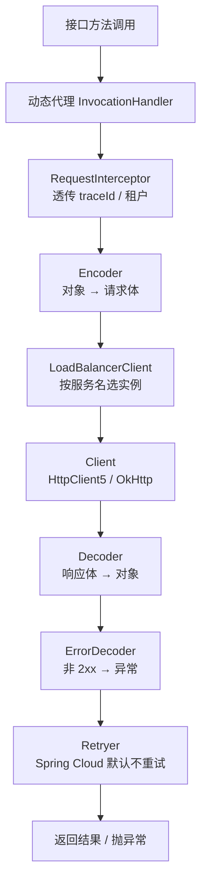

# OpenFeign 与 Spring Cloud 组件全景

> 定位：微服务里最日常的动作就是「调另一个服务」，而 OpenFeign 把这件事变成了一个接口注解。方便的背后藏着三个高频事故：超时用的是默认值、重试把非幂等请求打了两遍、线程池被慢调用拖满。这篇先拆 OpenFeign 的执行链路与参数，再把 Spring Cloud 各组件摆成一张全景图，最后说清 Boot 4 时代「HTTP Service Client」这条新路该怎么选。

> **版本提示（2026-11）**：Spring Cloud 2025.1.0（Oakwood）基于 Spring Boot 4 / Framework 7，OpenFeign 随之进入 5.x；Boot 4 原生提供 HTTP Service Clients（`@HttpServiceClient`），与 OpenFeign 是两条并行路线。

## 一、为什么需要它

没有 Feign 的时候，调用下游长这样：拼 URL、设 header、序列化、处理超时、判断状态码、反序列化、异常转换——每个下游复制一遍，还各写各的。

OpenFeign 的价值是把这些收敛成：

```java
@FeignClient(name = "inventory-service", fallbackFactory = InventoryFallback.class)
public interface InventoryClient {
    @GetMapping("/api/stock/{skuId}")
    StockVO query(@PathVariable("skuId") Long skuId);
}
```

但它只解决了「怎么写」，没解决「怎么调得稳」。真正决定稳定性的，是**超时、重试、线程隔离、错误语义**这四件事——它们都在注解之外。

## 二、核心原理：一次 Feign 调用经过什么

### 2.1 启动期：接口 → 代理 → 元数据

1. `@EnableFeignClients` 触发扫描，`FeignClientsRegistrar` 把每个 `@FeignClient` 注册成一个 `FactoryBean`。
2. `FeignClientFactoryBean.getObject()` 调 `Feign.Builder`，用 `Contract`（默认 `SpringMvcContract`）解析接口上的 Spring MVC 注解，生成 `MethodMetadata`（URL 模板、参数索引、返回类型、header）。
3. `Builder.target()` 最终产出 **JDK 动态代理**（`FeignInvocationHandler` / `HystrixInvocationHandler`）。所以 Feign 接口没有实现类，调用时进的是 `InvocationHandler`。

### 2.2 调用期：八个组件串成一条链

```
方法调用
  → RequestInterceptor（改 header、透传 traceId/租户）
  → Encoder（对象 → 请求体，默认 SpringEncoder）
  → Client（真正发 HTTP：默认 HttpURLConnection，生产一般换 HttpClient5/OkHttp）
  → Decoder（响应体 → 对象，默认 ResponseEntityDecoder + SpringDecoder）
  → ErrorDecoder（非 2xx 转异常，默认把 404 也当异常）
  → Retryer（Spring Cloud 默认 NEVER_RETRY，即**不重试**；显式配置后才重试）
```



**关键点（容易被记反）**：Feign 原生（`feign-core`）的默认 `Retryer.Default` 确实会重试（默认 5 次、100ms 起、指数退避）；但 **Spring Cloud OpenFeign 在 `FeignClientsConfiguration` 里默认注册的是 `Retryer.NEVER_RETRY`，也就是默认不重试**。官方文档写得很明确：这一行为与 Feign 原生默认不同，后者的默认重试是 Feign 自带的能力。

所以「一个下单请求被发两遍」的根因通常不是 Spring Cloud 默认重试，而是：显式注册了 `Retryer`、网关/负载均衡层重试、业务代码自己重试，或者直接用 `feign-core` 没走 Spring Cloud 的默认配置。排查时先看 `FeignClientsConfiguration` 是否被自定义配置覆盖，再看上游网关和业务层，别一上来就怀疑框架默认值。

### 2.3 负载均衡怎么进来

OpenFeign 本身不认识「服务名」。`name = "inventory-service"` 被 `FeignBlockingLoadBalancerClient`（Spring Cloud LoadBalancer）接管：先去注册中心（Nacos/Eureka/Consul）拿实例列表，再按策略（轮询/随机/权重/同集群优先）选一个真实 IP 发请求。

所以链路是：**Feign 代理 → LoadBalancerClient → 具体实例**。注册中心挂了但本地有缓存实例列表时，仍能调用——这也是「注册中心全挂，系统还能不能互调」的答案：能，只要客户端缓存未过期且服务地址没变。

## 三、关键机制与参数

### 3.1 超时：必须显式配，别用默认值

Feign 默认 `connectTimeout=10s`、`readTimeout=60s`。对核心链路来说 60 秒等于「线程池被判死刑」——下游只是慢 3 秒，你的线程要等 60 秒才释放。

```yaml
feign:
  client:
    config:
      default:                 # 全局默认
        connectTimeout: 1000
        readTimeout: 3000
      inventory-service:       # 单服务覆盖
        connectTimeout: 500
        readTimeout: 1500
        loggerLevel: basic
```

原则：**读超时要小于上游给你的超时预算**（上游 3s，你的下游最多 2.5s），否则超时会被层层放大。

### 3.2 重试：只给幂等请求开

- **Spring Cloud OpenFeign 默认就是 `Retryer.NEVER_RETRY`**，所以「不重试」是默认态；真正要防的是有人为了「提高成功率」把它打开，却没区分幂等性。
- `GET` 天然幂等，可重试；`POST` 创建订单、扣库存**不能无脑重试**。
- 非幂等接口要么在业务层用幂等键（请求号/Token）兜住；如果使用原生 `feign-core`（默认 `Retryer.Default`），必须显式设为 `Retryer.NEVER_RETRY`。
- 重试要配「总预算」：重试 3 次 × 每次 1.5s = 4.5s，可能已经超过上游容忍度，反而放大故障。

### 3.3 线程隔离：Feign 是阻塞的

Feign 默认同步阻塞，慢下游会占满 Tomcat/Servlet 线程。三道防线：

1. **超时**（第一道，最有效）；
2. **舱壁隔离（bulkhead）**：给每个下游独立线程池，某个下游挂了不拖垮全局；
3. **熔断**：连续失败到阈值直接快速失败（Sentinel/Resilience4j），别再让请求排队。

### 3.4 连接池：别用默认的 HttpURLConnection

默认 `Client.Default` 每次请求新建连接，没池化、没 keep-alive。生产换：

```xml
<dependency>
  <groupId>io.github.openfeign</groupId>
  <artifactId>feign-httpclient</artifactId>
</dependency>
```

并配 `maxConnections`、`maxConnectionsPerRoute`、`timeToLive`。连接池打满的表现是「请求卡在 `getConnection`」，线程 dump 一眼可见。

### 3.5 header 透传与错误语义

- **透传**：用 `RequestInterceptor` 把 `traceId`、租户 ID、灰度标记带下去；注意别把 `Content-Length`、`Host` 这类传输层 header 也复制过去。
- **404 也是异常**：默认 `ErrorDecoder` 把非 2xx 全部抛 `FeignException`。如果下游用 404 表达「不存在」，要自定义 `ErrorDecoder` 映射成业务异常或空值，否则日志里全是噪音。
- **文件上传**：要引入 `feign-form` + `SpringFormEncoder`，否则 `MultipartFile` 序列化不出来。

## 四、生产坑点与排查

### 坑点 1：默认 60 秒读超时把线程池拖满

**现象**：下游只是抖动，本服务 RT 从 50ms 涨到 30s，线程池满，健康检查失败，整条链路雪崩。

**原因**：没配 `readTimeout`，请求一直挂着。

**解法**：按「上游预算」配超时；用 `feign.client.config.default` 兜底，单服务覆盖；上线前用 Chaos/延迟注入验证。

### 坑点 2：重试导致重复下单/重复扣款

**现象**：用户只点了一次，订单表出现两条。

**原因**：有人在自定义配置里显式注册了 `Retryer.Default`（或直接用 `feign-core` 的默认），对 POST 也重试；同时下游没有幂等控制。注意 Spring Cloud 的默认是 `NEVER_RETRY`，**出现重试一定是被显式打开的**，要顺着配置查，而不是假设框架默认会重试。

**解法**：非幂等接口 `Retryer.NEVER_RETRY`；下游用「业务唯一键 + 唯一索引」兜底；重试只在网络层错误（连接超时）时做，读到响应就别重试。

### 坑点 3：404 被当成故障，告警噪音

**现象**：明明只是「商品不存在」，日志里一堆 `FeignException$NotFound`，告警天天响。

**解法**：自定义 `ErrorDecoder`，把 404 转成 `Optional.empty()` 或业务异常；2xx 之外的语义要和下游约定清楚。

### 坑点 4：GET 请求传对象变成 POST

**现象**：`@GetMapping` 方法里放了个对象参数，结果发出去是 POST。

**原因**：Feign 的 GET 不能带请求体，`SpringMvcContract` 遇到未注解的对象参数会退化成 POST/表单。

**解法**：GET 用 `@RequestParam`/`@PathVariable` 逐个展开，或改用 `@SpringQueryMap`（Feign 10+）。

### 坑点 5：版本错配导致启动失败

**现象**：`NoSuchMethodError: org.springframework.cloud.openfeign.FeignClient...` 或 `@FeignClient` 不生效。

**原因**：Spring Cloud 版本与 Boot 版本不对齐（Boot 3 配 2022.x，Boot 4 配 2025.1.x），或 `spring-cloud-starter-openfeign` 与 `spring-cloud-dependencies` 版本不一致。

**解法**：只用 BOM 管理版本，子模块不写版本号；升级时整列一起升。

### 坑点 6：`@FeignClient` 的 `fallback` 掩盖了真实错误

**现象**：下游一直失败，但业务看起来「正常」，直到数据对不上。

**原因**：`fallbackFactory` 返回了默认值，异常被吞。

**解法**：fallback 里必须打日志 + 打点（成功降级次数），并区分「可降级」与「不可降级」；核心写操作不要配 fallback。

## 五、Spring Cloud 组件全景与选型

### 5.1 一张图看清各组件职责

| 层 | 组件 | 解决什么 | 什么时候别用 |
|---|---|---|---|
| 入口 | Gateway | 统一路由、鉴权、限流、灰度 | 单体/内网小系统，Nginx 就够 |
| 调用 | OpenFeign / HTTP Service Client | 声明式 HTTP 客户端 | 需要极致性能/流式，直接用 WebClient |
| 负载 | LoadBalancer | 客户端侧选实例、同集群优先 | 只有单实例 |
| 注册配置 | Nacos / Eureka / Consul / Config | 服务发现、配置中心 | 团队没有多环境配置痛点 |
| 容错 | CircuitBreaker（Resilience4j）/ Sentinel | 熔断、隔离、限流 | 没有下游依赖的纯计算服务 |
| 消息 | Stream（Kafka/RocketMQ Binder） | 事件驱动、解耦 | 需要强一致同步返回 |
| 事务 | Seata | 跨服务一致性 | 能用「本地消息表+对账」就别上 |
| 任务 | Task | 短时任务编排 | 长流程用工作流引擎 |
| 观测 | Micrometer + OTel | 指标/链路 | 无 |

### 5.2 Boot 4 的新选择：HTTP Service Client

Spring Framework 7 / Boot 4 原生支持 `@HttpServiceClient`：接口 + 注解直接生成客户端，底层是可配置的 `ClientHttpRequestFactory`，不再依赖 OpenFeign 的动态代理与 Contract。

**怎么选**：

- 已经在用 OpenFeign、生态里有 Sentinel/自定义拦截器 → **继续用**，迁移收益低。
- 新项目、只用 Boot 原生能力、想要更轻的依赖 → 试 `@HttpServiceClient`。
- 需要 Feign 的 `ErrorDecoder`/`Retryer`/`RequestInterceptor` 这套成熟扩展点 → 仍选 OpenFeign。

> 关键判断：**它们解决的是同一个问题（声明式调用），差别在扩展生态**。别为了「新」而迁，先看有没有现成的拦截器/降级逻辑要搬。

## 六、超时、重试、熔断的叠加：把三个数算清

三个机制单独看都合理，叠在一起经常把「一次慢」放大成「雪崩」。

### 7.1 三个时间参数的关系

| 参数 | 作用 | 典型值 | 配错的后果 |
|---|---|---|---|
| connectTimeout | 建连上限 | 1–3s | 太长会拖住线程，太短会误判 |
| readTimeout | 等响应上限 | 按接口 P99 的 1.5–2 倍 | 默认 60s 会把线程池拖满 |
| 重试次数 | 失败重发 | 幂等接口 1–2 次，非幂等 0 | 非幂等重试导致重复扣款 |
| 熔断窗口 | 失败率超阈值后快速失败 | 10s 窗口、50% 失败率 | 窗口太长会持续打挂下游 |

**总耗时上限 ≈ (connect + read) × (重试次数 + 1)**。例如 2s + 5s、重试 2 次 → 最坏 21s，远超上游 3s 的 SLA。**上游超时必须小于「下游总耗时上限」，否则线程全卡在下游。**

### 7.2 正确的叠加顺序

```text
上游 SLA 3s
  └─ Feign readTimeout 1.5s（给上游留余量）
      └─ 重试 1 次（仅幂等）
          └─ 熔断：10s 内失败率 >50% 直接失败
              └─ fallback：返回缓存/默认值/排队稍后
```

关键原则：**超时是从上游往下游逐层变小的**，不是每层都设 3s。重试只加在「最内层、幂等」的调用上；熔断要在重试之外，避免重试把失败率放大。

### 7.3 线程池与并发的联动

Feign 是阻塞调用，默认跑在 Tomcat 线程上。若下游 P99 从 100ms 涨到 1s：

- 单机 200 线程，理论 QPS 从 2000 掉到 200；
- 线程池满后请求排队，上游超时，重试又回来打一遍 → **流量放大 2–3 倍**。

解法不是「加线程」，而是：调小 readTimeout + 熔断快速失败 + 对非核心依赖降级。**线程数只应该跟着「能承受的并发」走，不该跟着「下游有多慢」走。**

## 七、一次 504 的排障路径

**现象**：网关 504 增多，订单服务本身 CPU/GC 正常。

| 步骤 | 看什么 | 判断 |
|---|---|---|
| 1 | 网关侧 upstream response time | 是「连接失败」还是「等响应超时」 |
| 2 | 订单服务 Tomcat 线程池活跃数 | 是否打满、排队队列是否增长 |
| 3 | Feign 下游调用 P99（库存/优惠券） | 哪个依赖变慢 |
| 4 | 下游服务自身指标 | 是下游慢，还是网络/连接池问题 |
| 5 | 重试与熔断配置 | 是否非幂等重试放大流量 |

常见结论：

- 线程池满 + 下游 P99 升高 → 调超时 + 熔断 + 降级，而不是加机器；
- 连接池耗尽（`pending` 高） → 扩池并查下游是否 keep-alive 被断；
- 只有特定实例 504 → 查该实例的网络/宿主机，不是全局配置。

> 面试表达：把 504 拆成「连接超时 / 读超时 / 线程池排队 / 下游熔断」四类，逐类给判据，比「加机器/扩线程」有说服力。

**一个常被忽略的点**：只有显式配置了重试（`Retryer` 不是 `NEVER_RETRY`）时，重试才会在「连接失败/读超时」时触发；**HTTP 500 默认不会重试**，因为默认 `ErrorDecoder` 抛的是 `FeignException` 而不是 `RetryableException`。如果你希望 500 也重试，必须自定义 `Retryer` 与 `ErrorDecoder`，同时确认接口幂等——很多「重试没生效」和「怎么重试了」的困惑都来自这里。

## 八、一份可复制的 Feign 配置

`yaml
feign:
  client:
    config:
      default:
        connectTimeout: 2000        # 建连 2s
        readTimeout: 3000           # 读 3s，按下游 P99 的 1.5 倍
        loggerLevel: basic          # 生产别开 full
  httpclient:
    enabled: true                   # 用连接池，不用 HttpURLConnection
    maxConnections: 200
    maxConnectionsPerRoute: 50
    timeToLive: 60                  # 连接复用时长
`

`yaml
# 只对幂等接口开重试；非幂等接口 retryer 设为 NEVER
resilience4j:
  retry:
    instances:
      idempotentQuery:
        maxAttempts: 2
        waitDuration: 200ms
`

**检查点**：超时是否小于上游 SLA？重试是否只给幂等？连接池是否按并发量配？日志级别是否会在生产打出报文？

## 九、面试高频问法

**Q1：OpenFeign 是怎么把接口变成 HTTP 调用的？**
一句话结论：启动期用 Contract 解析注解生成元数据，运行期用 JDK 动态代理 + Encoder/Client/Decoder 发请求。
展开：`FeignClientsRegistrar` 注册 FactoryBean → `SpringMvcContract` 解析 `@GetMapping` → `ReflectiveFeign` 生成代理 → `InvocationHandler` 组装请求。
加分点：能说出「Feign 接口没有实现类」，以及 `MethodMetadata` 缓存解析结果。

**Q2：Feign 的默认超时是多少？为什么必须改？**
一句话结论：默认连接 10s、读 60s，对核心链路等于没有超时。
展开：60 秒读超时会让线程长时间占用，下游抖动直接升级为线程池耗尽；要按上游预算倒推。
加分点：提到「超时预算逐层递减」，以及用 `feign.client.config.<name>` 做单服务覆盖。

**Q3：Feign 默认会重试吗？会带来什么问题？**
一句话结论：**Spring Cloud OpenFeign 默认不重试**（`Retryer.NEVER_RETRY`）；Feign 原生默认会（`Retryer.Default`，最多 5 次）。事故来自「显式打开重试」+「接口不幂等」。
展开：重试只应发生在连接失败/网络错误；POST 创建类接口要么禁重试，要么下游用幂等键 + 唯一索引兜底。
加分点：能区分「Feign 原生默认」与「Spring Cloud 覆盖后的默认」，能算出「重试次数 × 超时」的总预算，并指出重试会放大下游故障。

**Q4：Feign 是阻塞的，怎么防止慢下游拖垮自己？**
一句话结论：超时 + 舱壁隔离 + 熔断，三层防。
展开：超时是第一道；独立线程池做 bulkhead；熔断快速失败。Feign 本身不提供隔离，要靠 Sentinel/Resilience4j 或自建线程池。
加分点：能说出「线程池打满时线程 dump 里大量线程卡在 SocketInputStream.read」。

**Q5：注册中心全挂了，服务间还能调用吗？**
一句话结论：能，只要客户端缓存了实例列表且地址没变。
展开：LoadBalancer 有本地缓存；注册中心只影响「新实例发现」与「配置推送」，不影响已缓存地址的调用。
加分点：提到缓存刷新策略、推空保护（Nacos 的 `namingLoadCacheAtStart`），以及「不要在下线时先摘实例再停服务」的顺序。

**Q6：`@FeignClient` 的 fallback 有什么风险？**
一句话结论：会把故障变成「静默降级」，数据不一致比报错更难查。
展开：fallback 应只用于读、且必须打点；写操作不要降级；要区分「熔断降级」与「业务兜底」。
加分点：能说出「降级要可观测」，并给出降级率告警阈值。

**Q7：Boot 4 的 HTTP Service Client 和 OpenFeign 怎么选？**
一句话结论：看扩展生态，不看新旧。
展开：已有 Feign 拦截器/错误解码/降级逻辑，迁移成本高、收益低；新项目且只用原生能力可以试 HTTP Service Client。
加分点：能说出两者都是「接口 → 客户端」，差别在 Contract、Encoder 与拦截器生态。

**Q8：Feign 调用链怎么排查慢在哪一跳？**
一句话结论：先看客户端指标（按下游维度的 RT/错误率），再看 trace，最后看连接池与线程池。
展开：Micrometer 的 `feign.Client` 指标 + 链路追踪能看到下游耗时；连接池耗尽表现为等待连接；线程池满表现为排队。
加分点：提到「区分网络耗时与服务端耗时」，以及开 `loggerLevel: full` 只在排障时短时开启（日志量极大）。

## 小结

- Feign 的核心是「Contract 解析 + 动态代理 + Encoder/Client/Decoder」，接口没有实现类。
- 默认超时 10s/60s；Spring Cloud 默认**不重试**（`NEVER_RETRY`），但一旦被显式打开又没做幂等，就是重复下单的源头。
- 稳定性四件事：超时预算、幂等重试、线程隔离、错误语义。
- 负载均衡由 Spring Cloud LoadBalancer 接管，注册中心挂了但缓存还在时仍可调用。
- Spring Cloud 组件按「入口/调用/负载/注册/容错/消息/事务」分层选，别为了全而全。
- Boot 4 的 HTTP Service Client 是并行路线，选型看扩展生态而非新旧。
