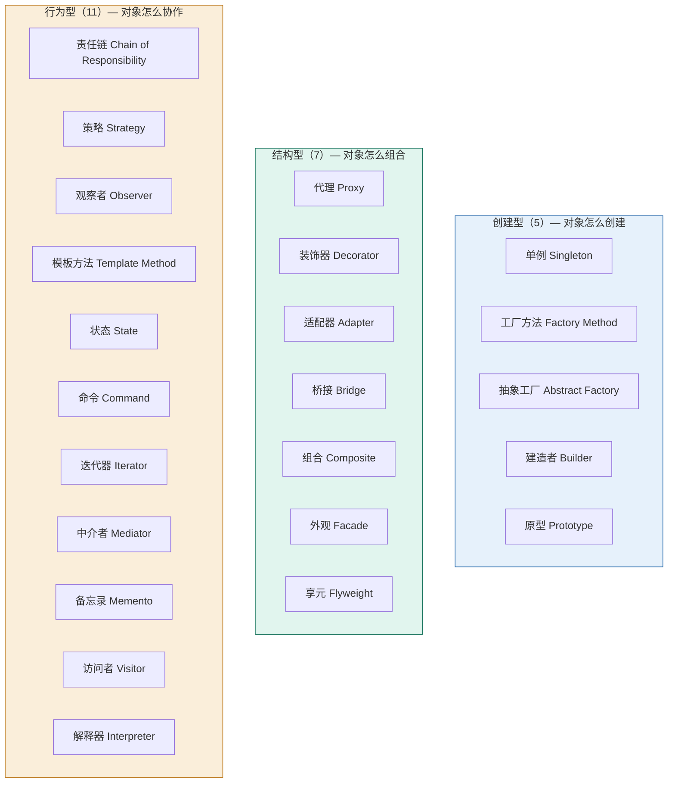
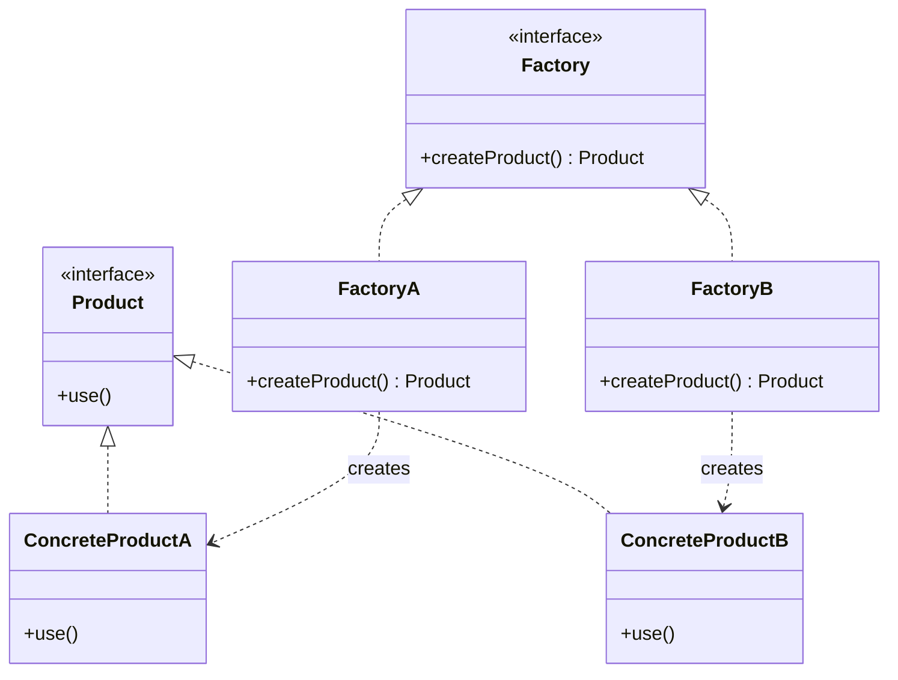
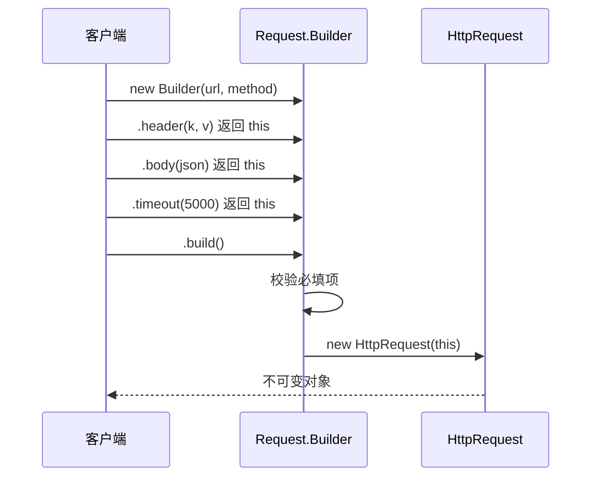
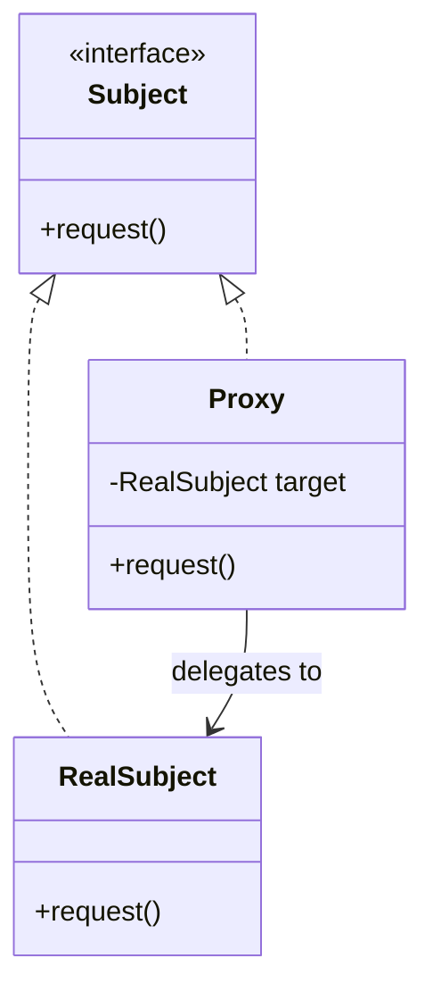
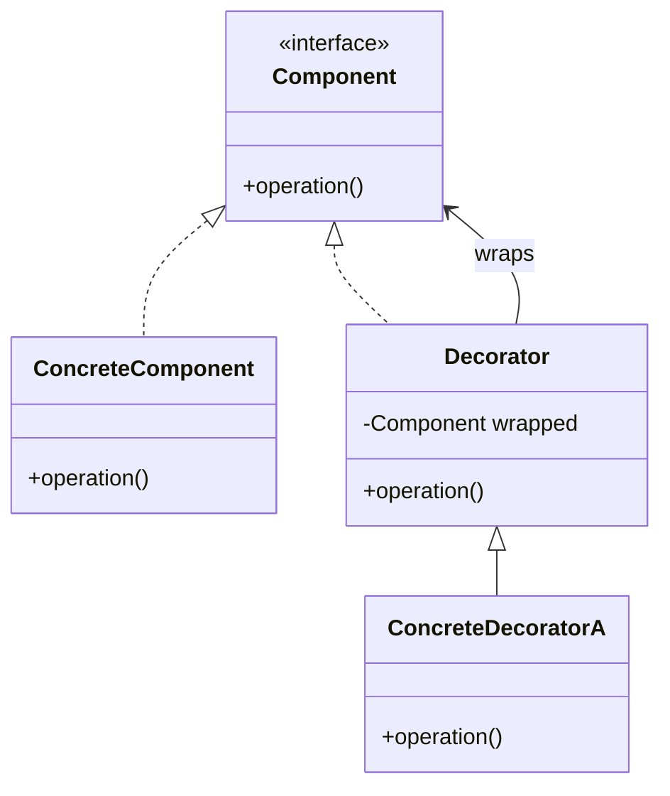
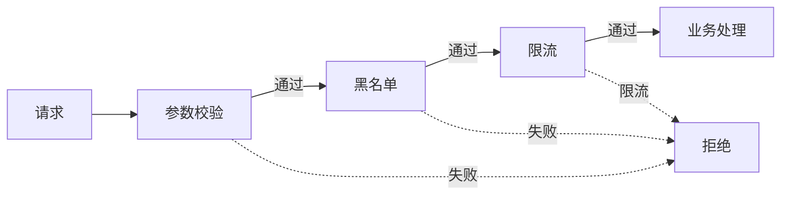
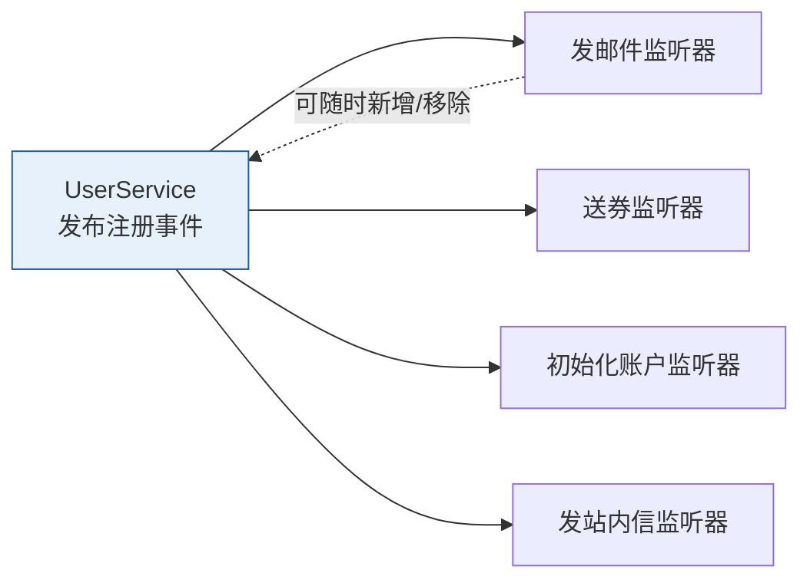
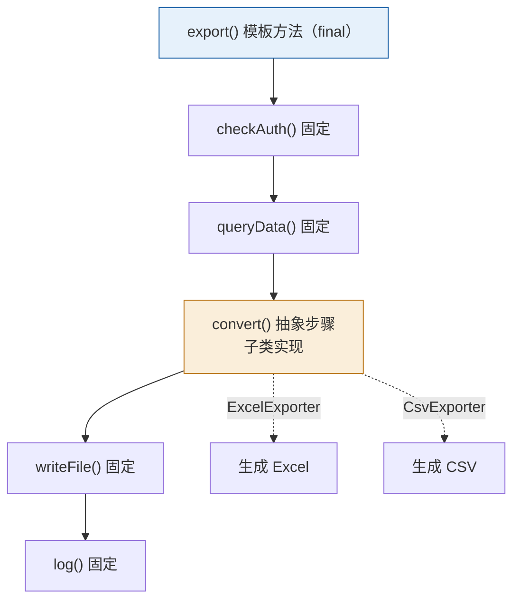
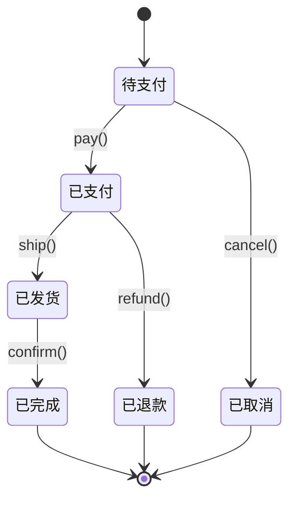

# 设计模式落地：23 种模式的原理、源码与实战

> 定位：这不是一篇「背定义」的设计模式文章。它把 GoF 23 种模式逐个拆开——每种都讲清「解决什么真实痛点、结构长什么样、代码怎么写、在 Spring/MyBatis/JDK/Netty 里具体体现在哪个类」，最后落到「你的业务里什么时候该用」。读完你不仅能认出框架里的模式，还能在自己项目里用得对、用得值。

## 一、为什么大多数人学了设计模式还是不会用

先说一个扎心的现象：面试时能背出「装饰器模式：动态地给一个对象添加一些额外的职责」，但真让你设计一个「给接口加鉴权 + 日志 + 限流」的功能，写出来还是一坨 if-else。

问题不在记忆力，在于三个断层：

1. **只会定义，不会识别**：不知道「什么样的代码味道」对应「哪个模式」。模式是「药」，得先会「诊断」。
2. **没见过真实用例**：教材的例子（鸭子、披萨）离生产太远，导致「学了不知道用在哪」。而最好的老师其实是框架源码——Spring、MyBatis 里到处是模式，只是没人指给你看。
3. **分不清相似模式**：代理和装饰器结构几乎一样，策略和状态也像，工厂和建造者都管创建——分不清就选错，选错还不如不用。

这篇文章就是来补这三个断层的。**每种模式都按同一个模板讲**：

- **一句话本质**：一句话说清它是什么
- **解决什么痛点**：从真实场景切入，不是抽象定义
- **结构**：用图画出角色关系
- **代码**：能跑的最小实现
- **框架实证**：Spring / MyBatis / JDK / Netty 里具体是哪个类、哪个方法
- **业务落地**：你的项目里什么场景该用它
- **坑点**：用错了会怎样

> 先立个规矩：**模式是工具，不是 KPI**。「这个类用了 5 种模式」不是荣耀，可能是灾难。判断标准永远只有一个——用了它，代码是不是更好懂、更好改？如果更复杂，就别用。这条会贯穿全文。

## 二、23 种模式全景

GoF 把 23 种模式按「意图」分三类：**创建型**管「对象怎么造」，**结构型**管「对象怎么组合」，**行为型**管「对象怎么协作」。



**先给一张「高频度」地图**，帮你分配精力——不是 23 种都同等重要：

| 频率 | 模式 | 说明 |
|---|---|---|
| 极高（必须吃透） | 代理、装饰器、责任链、策略、模板方法、观察者、单例、工厂 | 框架里到处都是，面试必问 |
| 高（要会用） | 建造者、适配器、外观、享元、状态、命令、迭代器 | 常见于框架和中间件 |
| 中（知道即可） | 抽象工厂、原型、桥接、组合、中介者、备忘录 | 特定场景用，认识就行 |
| 低（了解） | 访问者、解释器 | 编译器/DSL 领域，平时少用 |

下面按「创建型 → 结构型 → 行为型」逐个讲。

---

## 三、创建型模式（5 种）

创建型模式解决的是「对象怎么造」——把「创建逻辑」和「使用逻辑」分开，让调用方不关心对象怎么 new 出来、依赖什么。

### 3.1 单例模式（Singleton）

**一句话本质**：保证一个类全局只有一个实例，并提供一个访问它的全局入口。

**解决什么痛点**：有些对象「造多个会出问题」或「造多个太浪费」——比如全局配置、连接池、缓存客户端。如果每次用都 new 一个，要么资源浪费（多个连接池），要么状态不一致（多份配置）。

**结构**：私有构造器（禁止外部 new）+ 静态私有实例 + 静态获取方法。

**代码：五种实现，逐个说清**

```java
// ① 饿汉式：类加载时就创建，简单但无法懒加载
public class Singleton1 {
    private static final Singleton1 INSTANCE = new Singleton1();
    private Singleton1() {}
    public static Singleton1 getInstance() { return INSTANCE; }
}

// ② 懒汉式（加锁）：第一次用才创建，但每次都要抢锁，性能差
public class Singleton2 {
    private static Singleton2 instance;
    private Singleton2() {}
    public static synchronized Singleton2 getInstance() {
        if (instance == null) instance = new Singleton2();
        return instance;
    }
}

// ③ 双重检查锁（DCL）：只在第一次创建时加锁，但必须加 volatile
public class Singleton3 {
    private static volatile Singleton3 instance; // volatile 禁止指令重排序
    private Singleton3() {}
    public static Singleton3 getInstance() {
        if (instance == null) {                  // 第一次检查：避免每次都抢锁
            synchronized (Singleton3.class) {
                if (instance == null) {          // 第二次检查：防止并发重复创建
                    instance = new Singleton3();
                }
            }
        }
        return instance;
    }
}

// ④ 静态内部类：利用类加载机制保证线程安全，且懒加载（推荐）
public class Singleton4 {
    private Singleton4() {}
    private static class Holder {
        private static final Singleton4 INSTANCE = new Singleton4();
    }
    public static Singleton4 getInstance() { return Holder.INSTANCE; }
}

// ⑤ 枚举：最简洁，天然防反射和反序列化破坏（《Effective Java》推荐）
public enum Singleton5 {
    INSTANCE;
    public void doSomething() {}
}
```

**为什么 DCL 必须加 volatile**？`instance = new Singleton3()` 在字节码层面分三步：分配内存 → 初始化对象 → 把引用指向内存。如果没有 volatile，CPU/编译器可能把「2 和 3」重排序——先让引用指向内存，再初始化。这时另一个线程在第一次检查时看到 `instance != null`，直接返回一个「初始化了一半」的对象，用起来就崩了。volatile 禁止这个重排序。

**框架实证**：

- **Spring 的 Bean 默认就是单例**：`@Scope("singleton")` 是默认作用域。Spring 用 `DefaultSingletonBeanRegistry` 的 `singletonObjects`（一个 `ConcurrentHashMap`）缓存单例 Bean，`getSingleton()` 时先查缓存，没有才创建。这就是「单例 + 注册表」的实现。
- **JDK 的 `Runtime.getRuntime()`**：每个 JVM 只有一个 Runtime 实例，用饿汉式实现。
- **`Desktop.getDesktop()`**：同理。

**业务落地**：全局配置管理器、ID 生成器、连接池管理、本地缓存客户端。**但注意**：在 Spring 项目里，你几乎不需要自己写单例——把类声明成 `@Component`（默认单例）就行，别重复造轮子。

**坑点**：

1. **DCL 忘加 volatile** → 拿到半初始化对象（上面讲过）。
2. **反射破坏单例**：`Constructor.setAccessible(true)` 能绕过私有构造器。解法：枚举单例，或在构造器里判断「已存在就抛异常」。
3. **反序列化破坏单例**：反序列化会创建新对象。解法：实现 `readResolve()` 返回单例，或用枚举。
4. **单例 + 有状态 = 线程安全问题**：单例对象被多线程共享，如果它有可变成员变量，必须自己保证线程安全。这是最常见的生产 bug。

### 3.2 工厂方法模式（Factory Method）

**一句话本质**：定义一个「创建对象的接口」，让子类决定实例化哪个类——把「造什么」延迟到子类。

**解决什么痛点**：调用方需要创建对象，但「具体创建哪个类」会随场景变化。如果直接 `new`，每加一种类型就要改调用方代码（违反开闭原则）。

**结构**：抽象工厂（定义 `createProduct()`）+ 具体工厂（每个产品一个工厂）+ 抽象产品 + 具体产品。



**代码**：

```java
// 产品
public interface Logger { void log(String msg); }
public class FileLogger implements Logger {
    public void log(String msg) { /* 写文件 */ }
}
public class ConsoleLogger implements Logger {
    public void log(String msg) { /* 打印控制台 */ }
}

// 工厂方法：每个产品一个工厂
public interface LoggerFactory { Logger createLogger(); }
public class FileLoggerFactory implements LoggerFactory {
    public Logger createLogger() { return new FileLogger(); }
}
public class ConsoleLoggerFactory implements LoggerFactory {
    public Logger createLogger() { return new ConsoleLogger(); }
}

// 使用：调用方只依赖抽象
LoggerFactory factory = new FileLoggerFactory();
Logger logger = factory.createLogger();
logger.log("hello");
```

**框架实证**：

- **Spring 的 `FactoryBean`**：`FactoryBean.getObject()` 就是工厂方法——你实现它，Spring 通过它创建复杂对象（如 `SqlSessionFactoryBean` 创建 `SqlSessionFactory`）。
- **MyBatis 的 `SqlSessionFactoryBuilder`**：用建造者 + 工厂创建 `SqlSessionFactory`。
- **JDK 的 `Calendar.getInstance()`**：根据时区/语言返回不同的 Calendar 子类（`GregorianCalendar` 等）——这是「简单工厂」的经典。
- **`Executors.newFixedThreadPool()` / `newCachedThreadPool()`**：静态工厂方法，返回不同配置的 `ThreadPoolExecutor`。

**业务落地**：根据配置创建不同实现（不同消息客户端、不同存储后端）、框架的扩展点（让用户提供工厂来创建对象）。

**简单工厂 vs 工厂方法 vs 抽象工厂**（高频辨析）：

| | 简单工厂 | 工厂方法 | 抽象工厂 |
|---|---|---|---|
| 结构 | 一个工厂类，switch 创建 | 每个产品一个工厂子类 | 一个工厂创建「一族」产品 |
| 加新产品 | 改工厂（违反开闭） | 加工厂类（符合开闭） | 加一族（符合开闭） |
| 复杂度 | 低 | 中 | 高 |
| 场景 | 产品少、不常变 | 产品会扩展 | 多系列产品（如跨平台 UI） |

**日常最常用的是简单工厂**——别为了「纯正」硬套抽象工厂。只有当你要「创建一族相关产品」（比如同时创建 Button + TextBox，且要保证是同一风格）时才用抽象工厂。

### 3.3 抽象工厂模式（Abstract Factory）

**一句话本质**：提供一个「创建一系列相关或相互依赖对象」的接口，而不指定具体类——工厂方法管「一个产品」，抽象工厂管「一族产品」。

**解决什么痛点**：当系统要创建「多个相关产品」且必须配套使用（如同一主题的按钮 + 输入框 + 滚动条），用抽象工厂保证「不会混搭」。

**结构**：抽象工厂定义多个 `createXxx()`，每个具体工厂实现一族产品。

```java
// 一族产品：按钮 + 输入框
public interface Button { void render(); }
public interface TextBox { void render(); }

// 一族工厂
public interface UIFactory {
    Button createButton();
    TextBox createTextBox();
}

// 暗色主题工厂（创建暗色系按钮和输入框）
public class DarkFactory implements UIFactory {
    public Button createButton() { return new DarkButton(); }
    public TextBox createTextBox() { return new DarkTextBox(); }
}
// 亮色主题工厂同理...
```

**框架实证**：

- **Spring 的 `BeanFactory`** 某种意义上就是抽象工厂——它能创建各种类型的 Bean。更典型的是 **`DataSource` 抽象**：不同的 `DataSource` 实现（HikariCP、Druid）创建配套的 Connection、Statement。
- **JDK 的 `DocumentBuilderFactory`**：创建一族 XML 解析相关对象（`DocumentBuilder`、`XPathFactory` 等），不同实现（Xerces）提供一族。

**业务落地**：多主题 UI、多数据库适配（一套 DAO 工厂创建配套的 Connection/Statement）、多协议客户端（一套工厂创建配套的请求/响应/序列化器）。

**坑点**：抽象工厂的「加一族产品容易，加一个新种类产品难」——比如要在 UIFactory 里加 `createCheckbox()`，所有具体工厂都要改。这是它的固有缺陷，所以只在「产品族稳定、但会有多套实现」时用。

### 3.4 建造者模式（Builder）

**一句话本质**：把「复杂对象的构建」和「表示」分离，用链式调用一步步组装，最后 `build()` 出成品。

**解决什么痛点**：对象参数多、可选参数多时，构造方法会爆炸（要么一堆重载，要么一个巨长的参数列表，调用方根本记不住顺序）。

**结构**：Builder（定义构建步骤）+ ConcreteBuilder（实现）+ Director（可选，指挥构建流程）+ Product。



关键在「每个 setter 返回 `this`」——这让调用能一路链下去；最后 `build()` 集中做校验、一次性构造出不可变对象。链式不是炫技，是为了「可选参数一目了然 + 必填校验集中在一处」。

**代码：手写一个完整 Builder**

```java
public class HttpRequest {
    private final String url;        // 必填
    private final String method;     // 必填
    private final Map<String, String> headers;
    private final String body;
    private final int timeout;

    private HttpRequest(Builder b) {
        this.url = b.url; this.method = b.method;
        this.headers = b.headers; this.body = b.body; this.timeout = b.timeout;
    }

    public static class Builder {
        private final String url;     // 必填项放构造器
        private final String method;
        private Map<String, String> headers = new HashMap<>();
        private String body;
        private int timeout = 3000;

        public Builder(String url, String method) {
            this.url = url; this.method = method;
        }
        public Builder header(String k, String v) { headers.put(k, v); return this; }
        public Builder body(String body) { this.body = body; return this; }
        public Builder timeout(int timeout) { this.timeout = timeout; return this; }

        public HttpRequest build() {
            // 集中校验，保证对象一致性
            if (url == null || url.isEmpty()) throw new IllegalArgumentException("url 必填");
            return new HttpRequest(this);
        }
    }
}

// 使用：链式、可读、可选参数一目了然
HttpRequest req = new HttpRequest.Builder("https://api.example.com", "POST")
        .header("Authorization", "Bearer xxx")
        .body("{\"name\":\"tom\"}")
        .timeout(5000)
        .build();
```

**框架实证**：

- **OkHttp 的 `Request.Builder`**：`new Request.Builder().url(...).header(...).build()`，几乎是 Builder 的教科书。
- **Spring 的 `UriComponentsBuilder`**：`UriComponentsBuilder.fromHttpUrl(...).queryParam(...).build().toUriString()`。
- **Spring 的 `BeanDefinitionBuilder`**：构建 `BeanDefinition`（Bean 的元数据），因为 BeanDefinition 属性极多。
- **MyBatis 的 `SqlSessionFactoryBuilder`**：`new SqlSessionFactoryBuilder().build(inputStream)`，构建复杂的 `SqlSessionFactory`。
- **Lombok `@Builder`**：编译期生成 Builder，最省事。

**业务落地**：复杂配置对象、HTTP 请求、查询条件（MyBatis-Plus 的 `QueryWrapper` 也是链式，虽严格说不是 GoF Builder）、测试数据构造（Test Data Builder）。

**坑点**：

1. **Builder 不是线程安全的**（内部有可变状态），别跨线程复用同一个 Builder。
2. **`build()` 里一定要做校验**——这是 Builder 相比 setter 的最大优势：能把「对象必须满足的约束」集中在一处，而不是散落在各处 setter。
3. **别给「只有 2-3 个参数」的类硬套 Builder**——那是过度设计，直接构造器就好。

### 3.5 原型模式（Prototype）

**一句话本质**：用「克隆现有对象」来创建新对象，而不是 `new`——适合「创建成本高」或「需要保留某个状态快照」的场景。

**解决什么痛点**：如果一个对象的创建很昂贵（如要查数据库、读大文件、复杂计算），而你又需要多个「相似」的实例，逐个 new 太慢。克隆一个现成的更快。

**结构**：Prototype（声明 `clone()`）+ ConcretePrototype（实现克隆）。

```java
public class Sheep implements Cloneable {
    private String name;
    private List<String> tags;   // 引用类型

    // 浅克隆：只复制基本类型和引用（引用指向同一对象）
    @Override
    public Sheep clone() {
        try {
            return (Sheep) super.clone();
        } catch (CloneNotSupportedException e) {
            throw new RuntimeException(e);
        }
    }

    // 深克隆：引用类型也要复制一份
    public Sheep deepClone() {
        try {
            Sheep copy = (Sheep) super.clone();
            copy.tags = new ArrayList<>(this.tags); // 引用类型重新创建
            return copy;
        } catch (CloneNotSupportedException e) {
            throw new RuntimeException(e);
        }
    }
}
```

**框架实证**：

- **JDK 的 `Object.clone()` + `Cloneable`**：最原始的原型实现。
- **Spring 的 Bean 作用域 `prototype`**：每次 `getBean()` 创建一个新实例（虽然内部是 new，不是 clone，但「原型」语义一致）。
- **MyBatis 的 `CacheKey`**：用 `clone()` 复制缓存键。

**业务落地**：对象创建成本高且差异小（如大对象的微调）、需要保存对象快照（撤销功能）、避免构造函数的副作用。

**坑点**：**浅克隆 vs 深克隆**是最容易踩的坑——浅克隆只复制引用，改克隆对象的引用类型字段会影响原对象。要深克隆得手动处理每个引用字段，或用序列化（`ObjectOutputStream`）实现深拷贝。生产里如果对象结构复杂，序列化深拷贝更省心（但性能差些）。

---

## 四、结构型模式（7 种）

结构型模式解决「对象怎么组合成更大的结构」——通过组合（而非继承）来获得新能力。

### 4.1 代理模式（Proxy）—— 最重要的结构型模式

**一句话本质**：给目标对象提供一个「替身」，客户端访问替身，替身在转发给目标前后插入额外逻辑（访问控制、日志、事务、延迟加载）。

**解决什么痛点**：你想给一批方法统一加「日志 + 事务 + 权限」，逐个改方法太蠢、侵入太强。代理让你在「不修改原对象」的前提下，把横切逻辑织入。

**结构**：抽象主题（接口）+ 真实主题（目标对象）+ 代理（持有目标引用，控制访问）。



**代码：静态代理 + 动态代理**

```java
// ① 静态代理：手写代理类，编译期就确定
public interface UserService { void save(String name); }

public class UserServiceImpl implements UserService {
    public void save(String name) { System.out.println("保存用户: " + name); }
}

public class UserServiceProxy implements UserService {
    private final UserService target;
    public UserServiceProxy(UserService target) { this.target = target; }

    public void save(String name) {
        System.out.println("[日志] 开始 save");       // 前置增强
        long start = System.currentTimeMillis();
        try {
            target.save(name);                        // 调用目标
        } finally {
            System.out.println("[日志] 耗时 " + (System.currentTimeMillis() - start) + "ms");
        }
    }
}

// ② JDK 动态代理：运行时生成代理，不需要为每个接口手写代理类
UserService proxy = (UserService) Proxy.newProxyInstance(
    UserServiceImpl.class.getClassLoader(),
    new Class[]{UserService.class},
    (p, method, args) -> {
        System.out.println("[日志] 调用 " + method.getName());
        return method.invoke(target, args);
    });
```

**JDK 动态代理 vs CGLIB**（高频辨析）：

| | JDK 动态代理 | CGLIB |
|---|---|---|
| 原理 | 基于接口，生成实现同一接口的代理类 | 基于继承，生成目标类的子类 |
| 前提 | 目标必须实现接口 | 目标类不能是 final，方法不能 final |
| 性能 | 创建快、调用稍慢 | 创建慢、调用快 |
| 依赖 | JDK 自带 | 第三方（Spring 已内置） |

**框架实证（这是重点）**：

- **Spring AOP**：默认「有接口用 JDK 代理，没接口用 CGLIB」（Spring Boot 2.x 起默认强制 CGLIB）。你注入的 `@Service` 如果被切面代理，实际是代理对象。核心类：`JdkDynamicAopProxy`、`CglibAopProxy`。
- **Spring `@Transactional`**：事务的开启/提交/回滚，就是 `TransactionInterceptor` 通过代理在方法前后织入的。**这也解释了为什么「同类自调用事务失效」**——自调用走的是 `this`，绕过了代理。
- **MyBatis Mapper**：你只写了 `UserMapper` 接口，没有实现类，为什么能注入？因为 MyBatis 用 `MapperProxy`（JDK 动态代理）给它生成了代理，方法调用被转成 SQL 执行。核心类：`MapperProxy`、`MapperProxyFactory`。
- **Dubbo**：消费者端注入的接口也是代理（`JdkProxyFactory`），调用被转成远程 RPC。
- **JDK 的 `java.lang.reflect.Proxy` + `InvocationHandler`**：动态代理的底层。

**业务落地**：接口日志、权限校验、分布式锁注解、幂等校验、数据源动态切换、远程调用、延迟加载（Hibernate 的懒加载代理）——凡是「横切关注点」几乎都是代理。

**坑点（生产事故高发区）**：

1. **自调用失效**：同一个类里 `this.methodB()` 调用被 `@Transactional`/`@Cacheable` 标注的方法 B，增强不生效。因为 `this` 是原对象，不是代理。解法：拆到另一个 Bean、注入自身代理（`@Lazy` 注入自己）、或 `AopContext.currentProxy()`（需开 `exposeProxy`）。
2. **final 方法/类无法被 CGLIB 代理**：CGLIB 靠继承，final 类不能继承、final 方法不能重写，代理会失败或增强失效。
3. **代理对象类型判断错误**：`instanceof` 原类可能失败（JDK 代理只实现接口）；用 `AopUtils.getTargetClass()` 取真实类型。

### 4.2 装饰器模式（Decorator）

**一句话本质**：通过「包装」给对象动态叠加功能，可以一层层套，比继承灵活（继承是静态的、编译期确定）。

**解决什么痛点**：一个对象需要「可选地」叠加多种功能（如 IO 的缓冲、加密、压缩），用继承要写 2^n 个子类组合，用装饰器可以按需层层包装。

**结构**：抽象组件（接口）+ 具体组件（被装饰对象）+ 抽象装饰器（持有组件引用，实现同一接口）+ 具体装饰器。



**代码：给数据源叠加「重试 + 监控」**

```java
public interface DataSource { Connection getConnection(); }

// 基础实现
public class MysqlDataSource implements DataSource {
    public Connection getConnection() { return DriverManager.getConnection(...); }
}

// 装饰器：加重试
public class RetryDataSource implements DataSource {
    private final DataSource delegate;
    public RetryDataSource(DataSource delegate) { this.delegate = delegate; }

    public Connection getConnection() {
        for (int i = 0; i < 3; i++) {
            try { return delegate.getConnection(); }
            catch (Exception e) {
                if (i == 2) throw new RuntimeException("重试3次仍失败", e);
            }
        }
        return null;
    }
}

// 装饰器：加监控
public class MonitorDataSource implements DataSource {
    private final DataSource delegate;
    public MonitorDataSource(DataSource delegate) { this.delegate = delegate; }

    public Connection getConnection() {
        long start = System.nanoTime();
        try { return delegate.getConnection(); }
        finally { metrics.record("getConnection", System.nanoTime() - start); }
    }
}

// 使用：层层包装，功能叠加
DataSource ds = new MonitorDataSource(new RetryDataSource(new MysqlDataSource()));
```

**框架实证（重点）**：

- **Java IO 是最经典的装饰器**：`new BufferedReader(new InputStreamReader(new FileInputStream("a.txt")))`——`FileInputStream` 是基础组件，`InputStreamReader` 装饰它（字节→字符），`BufferedReader` 再装饰（加缓冲）。每一层都是装饰器，功能叠加。
- **Spring 的 `HttpServletRequestWrapper`**：包装 request，修改参数/header（如 XSS 过滤、参数解密）。`ContentCachingRequestWrapper` 同理。
- **Spring 的 `TransactionAwareCacheDecorator`**：包装 Cache，让缓存操作与事务同步（事务提交后才真正写缓存）。
- **MyBatis 的二级缓存**：`Cache` 接口有一堆装饰器——`LoggingCache`（加日志）、`LruCache`（加 LRU 淘汰）、`FifoCache`（FIFO 淘汰）、`ScheduledCache`（定时清理）、`SerializedCache`（序列化）、`SynchronizedCache`（加锁）、`TransactionalCache`（事务）。MyBatis 用它们层层包装基础缓存，按需组合。这是装饰器在框架里最典型的应用之一。

**业务落地**：给接口响应加签/脱敏/压缩、给消息发送叠加「重试 + 熔断 + 日志」、给缓存客户端叠加「本地缓存 + 统计 + 降级」、给数据源叠加「重试 + 监控 + 加密」。

**代理 vs 装饰器（最高频辨析）**：

| | 代理 | 装饰器 |
|---|---|---|
| 意图 | **控制访问**（不让客户端直接碰目标） | **增强功能**（给目标加能力） |
| 关系 | 代理通常「一对一」，客户端不知道目标 | 装饰器可「层层套」，客户端主动组合 |
| 典型 | Spring AOP、MyBatis Mapper | Java IO、MyBatis 缓存 |
| 结构 | 几乎一样（都持有目标引用、实现同一接口） | 几乎一样 |

**一句话区分**：代理是「替身」（你见不到本人），装饰器是「衣服」（你穿着，可以一件件加）。

### 4.3 适配器模式（Adapter）

**一句话本质**：把一个类的接口转换成客户端期望的另一个接口——让「原本不兼容」的两个东西能一起工作。

**解决什么痛点**：你要用某个现成的类，但它的接口和你的系统对不上（方法名不同、参数不同、协议不同）。重写它成本高，适配器做「翻译层」。

**结构**：目标接口（客户端期望的）+ 被适配者（现成的类）+ 适配器（实现目标接口，内部调用被适配者）。

```java
// 目标接口：系统统一使用的日志接口
public interface Logger { void log(String level, String msg); }

// 被适配者：第三方日志库（接口不同）
public class ThirdPartyLogger {
    public void write(int level, String message) { /* ... */ }
}

// 适配器：把第三方接口翻译成系统接口
public class ThirdPartyLoggerAdapter implements Logger {
    private final ThirdPartyLogger adaptee = new ThirdPartyLogger();

    public void log(String level, String msg) {
        int lv = "ERROR".equals(level) ? 3 : 1;
        adaptee.write(lv, msg);   // 翻译：参数转换 + 调用
    }
}
```

**框架实证**：

- **Spring MVC 的 `HandlerAdapter`**：`DispatcherServlet` 不直接调用 Controller，而是通过 `HandlerAdapter` 适配——因为 Handler 可能是 `@Controller` 方法、`HttpRequestHandler`、`Servlet` 等多种类型，每种对应一个 Adapter（`RequestMappingHandlerAdapter`、`HttpRequestHandlerAdapter`、`SimpleControllerHandlerAdapter`）。这是适配器在框架里最精妙的用法。
- **Spring AOP 的 `AdvisorAdapter`**：把不同类型的 Advice（Before/After/Throws）适配成统一的拦截器。
- **MyBatis 的 `Log` 接口**：`Slf4jImpl`、`Log4jImpl`、`Jdk14LoggingImpl` 等适配不同的日志框架——MyBatis 用统一的 `Log` 接口，底层适配各家日志。
- **JDK 的 `InputStreamReader`**：把字节流适配成字符流（虽然也可看作装饰器，但「转换接口」的语义更偏适配器）。
- **JDK 的 `Arrays.asList()`**：把数组适配成 List。

**业务落地**：对接第三方 SDK（支付、短信、物流）、老系统接口兼容、多协议适配（HTTP/gRPC/WebService）、统一日志/监控接口。

**坑点**：**别把适配器写成「大杂烩」**——适配器只做「接口翻译」，不该塞业务逻辑。翻译逻辑越复杂，说明「被适配者」和「你的系统」差异越大，要重新评估是不是该换方案。

### 4.4 桥接模式（Bridge）

**一句话本质**：把「抽象」和「实现」分离，让它们可以独立变化——用组合代替继承，避免「类爆炸」。

**解决什么痛点**：当一个类有「两个维度的变化」（如「形状」和「颜色」、「消息类型」和「发送渠道」），用继承会产生 M×N 个子类。桥接把两个维度拆开，用组合连接，变成 M+N。

**结构**：抽象（Abstraction，持有实现引用）+ 扩展抽象（RefinedAbstraction）+ 实现接口（Implementor）+ 具体实现（ConcreteImplementor）。

```java
// 实现维度：消息发送渠道
public interface MessageSender { void send(String msg); }
public class SmsSender implements MessageSender {
    public void send(String msg) { System.out.println("短信: " + msg); }
}
public class EmailSender implements MessageSender {
    public void send(String msg) { System.out.println("邮件: " + msg); }
}

// 抽象维度：消息类型（持有发送渠道的引用 = 桥）
public abstract class Message {
    protected MessageSender sender;           // 桥：组合而非继承
    public Message(MessageSender sender) { this.sender = sender; }
    public abstract void send(String content);
}
public class UrgentMessage extends Message {
    public UrgentMessage(MessageSender sender) { super(sender); }
    public void send(String content) { sender.send("【紧急】" + content); }
}
public class NormalMessage extends Message {
    public NormalMessage(MessageSender sender) { super(sender); }
    public void send(String content) { sender.send(content); }
}

// 使用：两个维度自由组合（2 类型 × 2 渠道 = 4 种组合，只需 2+2 个类）
Message m = new UrgentMessage(new SmsSender());
m.send("服务器宕机");
```

**框架实证**：

- **JDBC**：`DriverManager`（抽象）和 `Driver`（实现）分离——不同数据库提供不同 Driver，JDBC API 不变。
- **SLF4J**：日志门面（抽象）和具体日志实现（Logback/Log4j2）分离，切换实现不影响业务代码。
- **Spring 的 `DataSource`**：`JdbcTemplate`（抽象操作）和 `DataSource`（具体连接）分离。

**业务落地**：多维度变化的场景（消息类型 × 发送渠道、图形 × 渲染引擎、支付方式 × 结算币种）、需要「运行时切换实现」的场景。

**坑点**：桥接的「抽象」和「实现」划分要清晰——分错了会比继承更乱。判断标准：两个维度是否「独立变化」？如果是，才拆。

### 4.5 组合模式（Composite）

**一句话本质**：把对象组织成「树形结构」，让「单个对象」和「组合对象」被一致对待——客户端不用区分「叶子」和「树枝」。

**解决什么痛点**：处理「部分-整体」的层次结构（如文件系统、组织架构、菜单树），如果用 if 判断「是文件夹还是文件」，代码会很乱。组合模式让它们实现同一接口。

**结构**：Component（统一接口）+ Leaf（叶子，无子节点）+ Composite（容器，持有子节点列表）。

```java
public interface FileNode {
    void print(int indent);
}

// 叶子：文件
public class FileLeaf implements FileNode {
    private final String name;
    public FileLeaf(String name) { this.name = name; }
    public void print(int indent) {
        System.out.println(" ".repeat(indent) + "- " + name);
    }
}

// 容器：文件夹（可以包含文件或其他文件夹）
public class Folder implements FileNode {
    private final String name;
    private final List<FileNode> children = new ArrayList<>();
    public Folder(String name) { this.name = name; }
    public void add(FileNode node) { children.add(node); }
    public void print(int indent) {
        System.out.println(" ".repeat(indent) + "+ " + name);
        for (FileNode child : children) child.print(indent + 2); // 递归
    }
}

// 使用：客户端统一处理，不用判断类型
Folder root = new Folder("root");
root.add(new FileLeaf("a.txt"));
Folder sub = new Folder("sub");
sub.add(new FileLeaf("b.txt"));
root.add(sub);
root.print(0);
```

**框架实证**：

- **JDK 的 `java.awt.Container`**：Container 可以包含 Component，也可以包含 Container（嵌套）。
- **MyBatis 动态 SQL 的 `SqlNode`**：`MixedSqlNode` 组合多个 `SqlNode`（`IfSqlNode`、`ForEachSqlNode`、`TextSqlNode`），形成树，解析时递归处理。
- **Spring 的 `CompositeCacheManager`**：组合多个 CacheManager，查找时依次询问。
- **文件系统 `java.io.File`**：目录可以包含文件或目录。

**业务落地**：菜单树、组织架构、文件系统、评论树、规则引擎的条件树。

### 4.6 外观模式（Facade）

**一句话本质**：为「一组复杂的子系统」提供一个统一的高层接口，让客户端不用关心内部细节。

**解决什么痛点**：一个功能要调用多个子系统（如「下单」要调库存、订单、支付、物流），客户端直接调会很复杂、耦合高。外观模式提供一个「一键下单」的门面。

**结构**：Facade（门面，持有子系统引用）+ 多个子系统。

```java
// 门面：封装下单的复杂流程
public class OrderFacade {
    private final InventoryService inventory;
    private final OrderService order;
    private final PaymentService payment;

    public OrderFacade() {
        this.inventory = new InventoryService();
        this.order = new OrderService();
        this.payment = new PaymentService();
    }

    // 客户端只调这一个方法，不用知道内部有几步
    public void placeOrder(Order o) {
        inventory.deduct(o);
        order.create(o);
        payment.pay(o);
    }
}
```

**框架实证**：

- **`JdbcTemplate`**：封装了「获取连接 → 创建 Statement → 执行 → 处理结果 → 释放资源」的复杂流程，对外只暴露 `query()`/`update()` 这样的简单方法。这是外观模式的典范。
- **`ApplicationContext`**：Spring 的门面，封装了 Bean 的创建、依赖注入、生命周期管理等复杂逻辑。
- **`SqlSession`（MyBatis）**：门面，封装 Executor、StatementHandler、ParameterHandler、ResultSetHandler 的协作。
- **SLF4J 的 `LoggerFactory`**：门面，封装底层日志框架的选择和初始化。

**业务落地**：封装复杂的三方对接、统一入口（API 网关）、简化老系统的调用。

**坑点**：外观模式容易变成「上帝类」——什么都往门面里塞，最后门面巨大无比。门面只做「协调」，业务逻辑要留在子系统里。

### 4.7 享元模式（Flyweight）

**一句话本质**：共享「大量细粒度对象」中「不变的部分」（内部状态），把「变化的部分」（外部状态）抽出来由客户端传入——用共享减少内存。

**解决什么痛点**：系统里有大量相似对象，如果每个都独立创建，内存扛不住。比如文本编辑器里每个字符都是一个对象、游戏里成千上万的子弹。

**结构**：Flyweight（享元，含内部状态）+ FlyweightFactory（享元工厂，缓存共享对象）+ 外部状态（客户端传入）。

```java
// 享元：棋子（颜色是内部状态，位置是外部状态）
public class ChessPiece {
    private final String color;   // 内部状态：不变，可共享
    public ChessPiece(String color) { this.color = color; }
    public void draw(int x, int y) {  // 外部状态：位置，由客户端传入
        System.out.println(color + " 棋子落在 (" + x + "," + y + ")");
    }
}

// 工厂：缓存享元对象
public class ChessFactory {
    private static final Map<String, ChessPiece> pool = new HashMap<>();
    public static ChessPiece get(String color) {
        return pool.computeIfAbsent(color, ChessPiece::new);
    }
}

// 使用：黑棋和白棋各只有一个实例，位置作为外部状态传入
ChessPiece black = ChessFactory.get("黑");
black.draw(1, 1);
black.draw(2, 3);   // 同一个对象，不同位置
```

**框架实证**：

- **JDK 的 `Integer` 缓存**：`Integer.valueOf(int)` 对 -128~127 的值返回缓存对象（`IntegerCache`），超出范围才 new。这就是享元——小整数共享。
- **`String` 常量池**：相同的字面量字符串共享同一个对象。
- **`Boolean.valueOf()`**：只返回 `TRUE`/`FALSE` 两个共享实例。
- **Netty 的 `ByteBuf` 内存池**：`PooledByteBufAllocator` 复用内存块，避免频繁分配/GC。
- **数据库连接池、线程池**：本质也是「对象复用」，思想接近享元。

**业务落地**：大量相似对象的场景（游戏子弹、文本字符、地图瓦片）、对象池（连接池、线程池）、缓存。

**坑点**：享元的「内部状态」必须**不可变**——如果共享对象的内部状态被改了，所有引用它的地方都受影响。另外，享元增加复杂度（要分离内外部状态、管理工厂），只有「对象数量巨大且内存是瓶颈」时才值得用。

---
## 五、行为型模式（11 种）

行为型模式解决「对象之间怎么协作、职责怎么分配」——这是 23 种里数量最多、也最贴近业务的一类。

### 5.1 责任链模式（Chain of Responsibility）

**一句话本质**：把「多个处理者」串成一条链，请求沿链传递，每个处理者决定「处理」还是「传给下一个」——请求的发送者和处理者解耦。

**解决什么痛点**：一个请求要经过多道处理（校验、风控、限流、鉴权），如果写成一长串 if-else，每加一个规则就要改主流程。责任链让「加规则 = 加节点」。

**结构**：Handler（抽象处理者，持有下一个的引用）+ ConcreteHandler（具体处理者）+ Client（发起请求）。



**代码：一个可组装的校验链**

```java
public abstract class Handler {
    protected Handler next;
    public Handler setNext(Handler next) { this.next = next; return next; }
    public abstract boolean handle(Order order);

    // 模板：处理自己的逻辑，通过则传给下一个
    protected boolean proceed(Order order) {
        return next == null || next.handle(order);
    }
}

public class ParamCheckHandler extends Handler {
    public boolean handle(Order order) {
        if (order.getAmount() == null) return false;  // 拦截
        return proceed(order);                        // 通过，传下去
    }
}
public class BlacklistHandler extends Handler {
    public boolean handle(Order order) {
        if (blacklist.contains(order.getUserId())) return false;
        return proceed(order);
    }
}

// 组装
Handler chain = new ParamCheckHandler();
chain.setNext(new BlacklistHandler()).setNext(new RateLimitHandler());
boolean ok = chain.handle(order);
```

**框架实证（重点）**：

- **Sentinel 的 Slot 责任链**：`ProcessorSlotChain` 把 `NodeSelectorSlot → ClusterBuilderSlot → StatisticSlot → FlowSlot → DegradeSlot → AuthoritySlot → SystemSlot` 串起来，每个 Slot 负责一类检查，请求依次流过。加一个新能力（如新的限流规则）= 加一个 Slot。
- **Servlet 的 `FilterChain`**：`Filter.doFilter(req, res, chain)` 里调 `chain.doFilter()` 传给下一个 Filter。这是 Java Web 最经典的责任链。
- **Spring MVC 的 `HandlerExecutionChain`**：把多个 `HandlerInterceptor` 串成链，`preHandle` 正序、`postHandle` 逆序、`afterCompletion` 逆序。
- **Spring Security 的 `FilterChainProxy`**：一长串 Security Filter（认证、授权、CSRF…）组成责任链。
- **Netty 的 `ChannelPipeline`**：入站/出站 Handler 组成双向责任链，`ctx.fireChannelRead()` 传给下一个。
- **Tomcat 的 `Pipeline`/`Valve`**：Engine→Host→Context→Wrapper 四层 Valve 链。
- **Dubbo 的 `Filter` 链**：`ProtocolFilterWrapper` 把 Filter 串成链。

**业务落地**：风控规则链、审批流（多级审批）、网关过滤器（鉴权→限流→路由→日志）、异常处理链、参数校验链。

**坑点**：

1. **顺序敏感**：限流放在参数校验前面，非法请求也消耗了限流配额。解法：用 `@Order` 显式定义顺序，启动时打印链结构自检。
2. **请求可能「无人处理」**：链走完没有节点处理，请求静默丢失。解法：链尾加一个「兜底处理器」。
3. **节点有状态**：责任链节点被多线程共享，如果有可变成员变量，会并发错乱。解法：节点设计成无状态。

### 5.2 策略模式（Strategy）

**一句话本质**：把「一族可互换的算法」各自封装成类，让它们可以互相替换——运行时根据场景选一个。

**解决什么痛点**：一个功能有多种实现（支付方式、优惠计算、限流算法），用 if-else 会有长分支，加一种就要改核心代码。

**结构**：Strategy（策略接口）+ ConcreteStrategy（具体策略）+ Context（持有策略，委托执行）。

```java
public interface PayStrategy { void pay(BigDecimal amount); }
public class AlipayStrategy implements PayStrategy {
    public void pay(BigDecimal amount) { /* 支付宝支付 */ }
}
public class WechatStrategy implements PayStrategy {
    public void pay(BigDecimal amount) { /* 微信支付 */ }
}

// 策略 + Spring Map 注入：消灭 if-else 的最佳实践
@Service
public class PayService {
    // Spring 自动把所有 PayStrategy 实现注入成 Map，key 是 bean 名
    private final Map<String, PayStrategy> strategies;

    public PayService(Map<String, PayStrategy> strategies) {
        this.strategies = strategies;
    }

    public void pay(String type, BigDecimal amount) {
        PayStrategy strategy = strategies.get(type + "Strategy");
        if (strategy == null) throw new IllegalArgumentException("不支持的支付方式: " + type);
        strategy.pay(amount);   // 一行搞定，加新支付只需加实现类
    }
}
```

**框架实证**：

- **JDK 的 `Comparator`**：排序时传入不同比较器 = 不同策略，`Collections.sort(list, comparator)`。
- **`ThreadPoolExecutor` 的 `RejectedExecutionHandler`**：`AbortPolicy`/`CallerRunsPolicy`/`DiscardPolicy`/`DiscardOldestPolicy` 是四种拒绝策略。
- **Spring 的 `InstantiationStrategy`**：`SimpleInstantiationStrategy`（反射）/`CglibSubclassingInstantiationStrategy`（CGLIB），创建 Bean 时选不同策略。
- **Spring 的 `Resource`**：`ClassPathResource`/`FileSystemResource`/`UrlResource`，加载资源的不同策略。
- **Spring Cloud LoadBalancer**：`RoundRobinLoadBalancer`/`RandomLoadBalancer`，负载均衡策略。
- **Dubbo 的 `LoadBalance`**：Random/RoundRobin/LeastActive/ConsistentHash，四种负载均衡策略。

**业务落地**：支付方式、优惠券计算、运费计算、文件存储（本地/OSS/S3）、消息推送渠道、限流算法、压缩算法。

**策略 vs 状态**（高频辨析）：结构几乎一样（都持有「某个实现」的引用、委托执行），区别在**意图**——策略是「客户端主动选算法」（策略之间平等、可互换），状态是「对象内部状态变化时自动切换行为」（状态之间有流转关系）。

**坑点**：策略的「选择逻辑」别散落在业务里——用一个 Map 或工厂集中管理，否则还是 if-else 地狱。上面的 Spring `Map` 注入是最优雅的落地方式。

### 5.3 观察者模式（Observer）

**一句话本质**：当「被观察者」状态变化时，自动通知所有「观察者」——一对多的依赖关系。

**解决什么痛点**：用户注册成功后要发邮件、送券、初始化账户、发站内信。如果都写在注册方法里，方法越来越臃肿，加一个动作就要改注册代码。

**结构**：Subject（被观察者，维护观察者列表）+ Observer（观察者接口）+ ConcreteObserver。



关键在「一对多 + 动态增减」：注册方法只管「发布事件」，不关心「谁来处理」；新增一个「发优惠券」的动作，只需加一个监听器，不用改注册代码——这就是开闭原则。

```java
// 观察者
public interface UserRegisteredListener { void onRegistered(User user); }

// 被观察者：维护监听器列表
public class UserService {
    private final List<UserRegisteredListener> listeners = new ArrayList<>();

    public void addListener(UserRegisteredListener l) { listeners.add(l); }

    public void register(User user) {
        // ... 保存用户 ...
        for (UserRegisteredListener l : listeners) l.onRegistered(user); // 通知
    }
}
```

**框架实证**：

- **Spring 事件机制**：`ApplicationEvent`（事件）+ `ApplicationListener`（监听器）+ `ApplicationEventPublisher.publishEvent()`（发布）。注解版：`@EventListener`。核心：`ApplicationEventMulticaster`（事件广播器）。
- **Guava `EventBus`**：`@Subscribe` 注解标记监听方法，`eventBus.post(event)` 发布。
- **JDK 的 `java.util.Observer`/`Observable`**：老版观察者（已废弃，被事件机制取代）。
- **Netty 的 `ChannelFutureListener`**：Future 完成时通知监听器（Future-Listener 模式）。
- **Spring Boot 的 `ApplicationRunner`/`CommandLineRunner`**：启动时的回调。

**业务落地**：领域事件（DDD 的 `OrderPaidEvent`）、缓存失效通知、配置变更推送、用户行为埋点、消息订阅。

**观察者 vs 发布订阅（高频辨析）**：

| | 观察者 | 发布订阅 |
|---|---|---|
| 耦合 | 被观察者知道观察者（持有列表） | 发布者不知道订阅者（通过 broker） |
| 范围 | 通常进程内 | 通常跨进程 |
| 同步性 | 通常同步 | 通常异步 |
| 典型 | Spring `ApplicationEvent` | MQ（Kafka/RocketMQ） |

**一句话**：本地解耦用 Spring 事件（观察者），跨服务解耦用 MQ（发布订阅）。

**坑点**：

1. **同步阻塞**：默认 `ApplicationEvent` 是同步的，监听器慢会拖慢发布者。解法：`@Async` 异步、或配 `ApplicationEventMulticaster` 用线程池。
2. **监听器异常影响主流程**：默认监听器抛异常会传播到发布者。解法：监听器内部 try-catch，或用 `@TransactionalEventListener` 控制时机。
3. **事务边界**：在事务里发事件，监听器可能在事务提交前执行（读到未提交数据）。解法：`@TransactionalEventListener(phase = AFTER_COMMIT)`。

### 5.4 模板方法模式（Template Method）

**一句话本质**：父类定义「算法骨架」（固定流程），把某些步骤延迟到子类实现——「流程固定，步骤可变」。

**解决什么痛点**：多个功能的流程一样，只有个别步骤不同（如各种导出都是「校验→查数据→转换→写文件→记日志」，只有「转换」因格式而异）。用模板方法复用流程。

**结构**：AbstractClass（定义 `templateMethod()`，调用抽象步骤）+ ConcreteClass（实现抽象步骤）。



蓝色是模板方法（`final` 锁死流程，子类改不了），橙色是「可变步骤」（子类实现）。流程骨架由父类掌控，子类只填「转换格式」这一格——这就是「复用流程、只变细节」。

```java
public abstract class DataExporter {
    // 模板方法：final 防止子类改流程
    public final void export() {
        checkAuth();
        List<Data> data = queryData();
        String content = convert(data);   // 抽象步骤，子类实现
        writeFile(content);
        log();
    }
    protected abstract String convert(List<Data> data);  // 子类填这个

    private void checkAuth() { /* 固定 */ }
    private List<Data> queryData() { /* 固定 */ }
    private void writeFile(String c) { /* 固定 */ }
    private void log() { /* 固定 */ }
}

public class ExcelExporter extends DataExporter {
    protected String convert(List<Data> data) { return "excel内容..."; }
}
public class CsvExporter extends DataExporter {
    protected String convert(List<Data> data) { return "csv内容..."; }
}
```

**框架实证（重点）**：

- **`JdbcTemplate`**：`execute()` 定义了「获取连接→创建 Statement→执行→处理结果→释放」的完整流程，用户通过 `StatementCallback` 回调提供「具体怎么执行 SQL」——这是**模板方法 + 回调**的经典组合。
- **`AbstractApplicationContext.refresh()`**：定义了 Spring 容器启动的 12 个步骤（`prepareRefresh`→`obtainFreshBeanFactory`→…→`finishRefresh`），子类可以覆盖某些步骤。
- **Servlet 的 `HttpServlet.service()`**：根据请求方法分派到 `doGet`/`doPost`，流程固定，具体行为子类实现。
- **`AbstractList`/`AbstractMap`**：定义了集合的骨架，子类实现 `get()`/`size()` 等少数方法。
- **AQS 的 `acquire()`/`release()`**：定义了「入队→阻塞→唤醒」的骨架，子类实现 `tryAcquire()`/`tryRelease()`。
- **MyBatis 的 `BaseExecutor`**：`query()`/`update()` 定义流程，`doQuery()`/`doUpdate()` 子类实现。

**业务落地**：数据导入导出、工作流节点、统一接口对接（鉴权→组装报文→发送→解析，各家协议不同）、批处理、支付流程。

**模板方法 vs 策略**（高频辨析）：模板方法用**继承**（子类覆盖步骤），策略用**组合**（注入不同策略对象）。模板方法「流程固定」，策略「算法可换」。

**坑点**：模板方法依赖继承，耦合较紧——父类改流程会影响所有子类。能用组合（策略）解决的，优先用组合（「组合优于继承」）。

### 5.5 状态模式（State）

**一句话本质**：把「对象的不同状态」封装成独立的类，状态变化时对象「切换」到另一个状态类——行为随状态改变。

**解决什么痛点**：一个对象在不同状态下行为不同（如订单：待支付→已支付→已发货→已完成），用 if-else 判断状态会有大量分支，且状态流转逻辑散落。

**结构**：Context（持有当前状态）+ State（状态接口）+ ConcreteState（具体状态）。



这张图就是订单状态机。每个状态是一个类，`pay()`/`ship()` 等方法在不同状态下行为不同：待支付时 `ship()` 会抛异常，已支付时 `ship()` 才真正发货并流转到下一状态。状态流转由对象自己控制，而不是外部一堆 `if (status == ...)` 判断。

```java
public interface OrderState {
    void pay(OrderContext ctx);
    void ship(OrderContext ctx);
}

public class UnpaidState implements OrderState {
    public void pay(OrderContext ctx) {
        System.out.println("支付成功");
        ctx.setState(new PaidState());   // 状态流转
    }
    public void ship(OrderContext ctx) {
        throw new IllegalStateException("未支付不能发货");
    }
}

public class PaidState implements OrderState {
    public void pay(OrderContext ctx) { throw new IllegalStateException("已支付"); }
    public void ship(OrderContext ctx) {
        System.out.println("发货");
        ctx.setState(new ShippedState());
    }
}

public class OrderContext {
    private OrderState state = new UnpaidState();
    public void setState(OrderState s) { this.state = s; }
    public void pay() { state.pay(this); }
    public void ship() { state.ship(this); }
}
```

**框架实证**：

- **Spring StateMachine**：专门的状态机框架，用配置定义状态和流转。
- **线程的 `Thread.State`**：NEW/RUNNABLE/BLOCKED/WAITING/TIMED_WAITING/TERMINATED，状态驱动行为。
- **Spring 的 `Lifecycle`**：Bean 的生命周期状态（未启动/运行中/停止）。
- **工作流引擎**（Activiti/Flowable）：节点状态驱动流转。

**业务落地**：订单状态机、审批流、游戏角色状态、连接状态（TCP 连接状态机）。

**坑点**：状态多了会「类爆炸」（每个状态一个类）。如果状态很少（2-3 个）且流转简单，用枚举 + switch 更简单；状态多、流转复杂才用状态模式。

### 5.6 命令模式（Command）

**一句话本质**：把「请求」封装成对象，从而可以「参数化客户端、排队请求、记录日志、支持撤销」。

**解决什么痛点**：需要「把操作当成对象来传递」（如任务队列、撤销重做、宏命令），直接调用方法做不到。

**结构**：Command（命令接口）+ ConcreteCommand（持有接收者）+ Invoker（调用者，持有命令）+ Receiver（真正执行者）。

```java
public interface Command { void execute(); void undo(); }

// 具体命令：持有接收者
public class LightOnCommand implements Command {
    private final Light light;
    public LightOnCommand(Light light) { this.light = light; }
    public void execute() { light.on(); }
    public void undo() { light.off(); }
}

// 调用者：持有命令，可以排队、记录、撤销
public class RemoteControl {
    private final Deque<Command> history = new ArrayDeque<>();
    public void press(Command cmd) {
        cmd.execute();
        history.push(cmd);
    }
    public void undo() {
        if (!history.isEmpty()) history.pop().undo();
    }
}
```

**框架实证**：

- **JDK 的 `Runnable`/`Callable`**：把「任务」封装成对象，丢给线程池执行——这是命令模式最朴素的形态。
- **Spring 的 `TransactionCallback`**：把「事务里的操作」封装成回调。
- **`JdbcTemplate` 的 `StatementCallback`**：把「SQL 执行逻辑」封装成对象。
- **Guava 的 `Command`**？不，Guava 没有，但**工作流引擎的「任务节点」**、**MQ 的「消息」**本质都是命令。

**业务落地**：任务队列、撤销/重做（编辑器）、宏命令（批量操作）、事务日志（WAL）、请求排队。

**命令 vs 策略**：策略是「同一件事的不同做法」，命令是「把一件事封装起来，可以延迟/排队/撤销」。

### 5.7 迭代器模式（Iterator）

**一句话本质**：提供一种方法「顺序访问」聚合对象的元素，而不暴露其内部表示。

**解决什么痛点**：不同集合（List/Set/Map/树）的内部结构不同，如果让客户端自己遍历，要了解每种集合的实现。迭代器提供统一遍历接口。

**结构**：Iterator（遍历接口）+ Aggregate（聚合接口，返回迭代器）+ ConcreteIterator。

```java
public interface Iterator<T> {
    boolean hasNext();
    T next();
}

public class ArrayListIterator<T> implements Iterator<T> {
    private final List<T> list;
    private int cursor = 0;
    public ArrayListIterator(List<T> list) { this.list = list; }
    public boolean hasNext() { return cursor < list.size(); }
    public T next() { return list.get(cursor++); }
}
```

**框架实证**：

- **JDK 的 `java.util.Iterator`**：所有集合都实现它，`for-each` 语法糖底层就是迭代器。
- **MyBatis 的 `Cursor`**：游标，逐条读取大结果集（避免一次性加载到内存）。
- **`ResultSet`**：JDBC 的迭代器，逐行遍历查询结果。
- **Spring 的 `ResourcePatternResolver`**：返回 `Resource[]`，也是遍历。

**业务落地**：自定义集合、树遍历（深度/广度优先）、大结果集游标读取、分页遍历。

**坑点**：**遍历时修改集合**会抛 `ConcurrentModificationException`（fail-fast）。解法：用 `Iterator.remove()`、或用 `CopyOnWriteArrayList`、或先收集再改。

### 5.8 中介者模式（Mediator）

**一句话本质**：用一个「中介者」封装多个对象之间的复杂交互，让对象之间不直接通信，降低耦合（从「网状」变「星型」）。

**解决什么痛点**：多个对象互相引用、互相调用，关系错综复杂（N 个对象两两交互 = N² 条关系）。中介者把它们解耦，都只和中介者打交道。

**结构**：Mediator（中介者接口）+ ConcreteMediator（协调各同事）+ Colleague（同事，持有中介者引用）。

```java
// 中介者：协调多个同事
public class ChatRoom {
    private final List<User> users = new ArrayList<>();
    public void join(User u) { users.add(u); }
    public void broadcast(User from, String msg) {
        for (User u : users) {
            if (u != from) u.receive(from.getName() + ": " + msg);
        }
    }
}

public class User {
    private final String name;
    private final ChatRoom room;
    public User(String name, ChatRoom room) { this.name = name; this.room = room; }
    public void send(String msg) { room.broadcast(this, msg); } // 通过中介者
    public void receive(String msg) { System.out.println(name + " 收到 " + msg); }
}
```

**框架实证**：

- **Spring MVC 的 `DispatcherServlet`**：本质是中介者——前端请求不直接找 Controller，而是经过 DispatcherServlet 分派给合适的 Handler，Handler 也不直接调 View。
- **`ApplicationEventMulticaster`**：事件发布者和监听者之间的中介。
- **MQ**：广义上是「服务间的中介者」。
- **MVC 的 Controller**：Model 和 View 之间的中介。

**业务落地**：聊天室、GUI 对话框（多个控件联动）、微服务网关（服务间的中介）、事件总线。

**坑点**：中介者容易变成「上帝对象」——所有交互逻辑都堆在中介者里，最后它巨大无比。要控制中介者的职责边界。

### 5.9 备忘录模式（Memento）

**一句话本质**：在不破坏封装的前提下，捕获对象的内部状态并保存，以便之后恢复（撤销）。

**解决什么痛点**：需要「撤销」功能（编辑器撤销、游戏存档、事务回滚），但不能暴露对象的内部细节。

**结构**：Originator（原发器，创建/恢复备忘录）+ Memento（备忘录，存状态）+ Caretaker（管理者，保管备忘录）。

```java
// 备忘录：只存状态，不暴露给外部修改
public class Memento {
    private final String content;
    public Memento(String content) { this.content = content; }
    public String getContent() { return content; }
}

// 原发器：能创建和恢复自己的状态
public class Editor {
    private String content;
    public void type(String s) { content = (content == null ? "" : content) + s; }
    public Memento save() { return new Memento(content); }
    public void restore(Memento m) { this.content = m.getContent(); }
    public String getContent() { return content; }
}

// 管理者：保管历史
public class History {
    private final Deque<Memento> stack = new ArrayDeque<>();
    public void push(Memento m) { stack.push(m); }
    public Memento pop() { return stack.pop(); }
}
```

**框架实证**：

- **事务的 savepoint**：数据库事务可以设保存点，回滚到某个点——本质是备忘录。
- **Spring 的 `BeanDefinition`** 快照？不太典型。
- **序列化**：把对象状态序列化保存，之后反序列化恢复。
- **编辑器/IDE 的 undo**：最经典的备忘录。

**业务落地**：撤销/重做、游戏存档、事务回滚、配置快照、状态回滚。

**坑点**：备忘录会「占内存」——保存太多历史快照，内存吃不消。要限制历史数量或定期清理。

### 5.10 访问者模式（Visitor）

**一句话本质**：把「作用于某对象结构中各元素的操作」分离出来，封装成独立的访问者——在不改变元素类的前提下，定义新操作。

**解决什么痛点**：一个对象结构（如 AST、文档树）有很多种元素，要对它们做多种操作（如「导出」「统计」「格式化」）。如果每个操作都写在元素类里，元素类会越来越臃肿。访问者把操作抽出来。

**结构**：Visitor（访问者接口，每种元素一个 `visit` 方法）+ ConcreteVisitor + Element（元素，有 `accept(visitor)`）+ ObjectStructure（元素集合）。

```java
// 元素
public interface Shape { void accept(Visitor v); }
public class Circle implements Shape {
    public double radius = 5;
    public void accept(Visitor v) { v.visit(this); }
}
public class Rectangle implements Shape {
    public double w = 3, h = 4;
    public void accept(Visitor v) { v.visit(this); }
}

// 访问者：定义「作用于元素的操作」
public interface Visitor {
    void visit(Circle c);
    void visit(Rectangle r);
}
public class AreaCalculator implements Visitor {
    public void visit(Circle c) { System.out.println("圆面积 " + Math.PI * c.radius * c.radius); }
    public void visit(Rectangle r) { System.out.println("矩形面积 " + r.w * r.h); }
}

// 使用：加新操作只需加新 Visitor，不用改元素类
for (Shape s : shapes) s.accept(new AreaCalculator());
```

**框架实证**：

- **JDK 的 `java.nio.file.FileVisitor`**：遍历文件树时，对不同文件类型做不同处理。
- **Spring 的 `BeanDefinitionVisitor`**：遍历 BeanDefinition，替换属性占位符（如 `${...}`）。
- **ASM 的 `ClassVisitor`**：字节码操作框架，访问类的各个部分（字段、方法、注解）。
- **注解处理器（APT）**：访问 AST 节点。

**业务落地**：编译器/AST 处理、文档导出（不同格式）、报表统计、代码分析工具。

**坑点**：访问者的「加新元素难」——每加一种元素，所有 Visitor 都要加对应的 `visit` 方法。所以只在「元素稳定、操作多变」时用（和抽象工厂正好相反）。

### 5.11 解释器模式（Interpreter）

**一句话本质**：给定一个语言，定义它的文法表示，并定义一个解释器来解释语言中的句子——用于「DSL、表达式求值」。

**解决什么痛点**：需要解析和执行「自定义的简单语言」（如规则表达式、查询 DSL、计算表达式）。如果文法简单、变化不频繁，用解释器模式比引入完整编译器简单。

**结构**：AbstractExpression（表达式接口，`interpret(context)`）+ TerminalExpression（终结符）+ NonterminalExpression（非终结符，组合其他表达式）+ Context。

```java
// 表达式接口
public interface Expression { int interpret(Map<String, Integer> vars); }

// 终结符：变量
public class Variable implements Expression {
    private final String name;
    public Variable(String name) { this.name = name; }
    public int interpret(Map<String, Integer> vars) { return vars.getOrDefault(name, 0); }
}

// 非终结符：加法
public class Add implements Expression {
    private final Expression left, right;
    public Add(Expression l, Expression r) { left = l; right = r; }
    public int interpret(Map<String, Integer> vars) {
        return left.interpret(vars) + right.interpret(vars);
    }
}

// 使用：a + b
Expression expr = new Add(new Variable("a"), new Variable("b"));
int result = expr.interpret(Map.of("a", 1, "b", 2)); // 3
```

**框架实证**：

- **Spring EL（SpEL）**：`SpelExpressionParser` 解析 `#{...}` 表达式，本质是解释器。
- **JDK 的 `java.util.regex.Pattern`**：正则表达式引擎。
- **`javax.script.ScriptEngine`**（Nashorn）：执行 JavaScript 等脚本。
- **MyBatis 的动态 SQL**：`SqlNode` 树本质是解释器（解释 SQL 片段）。
- **规则引擎**（Drools）：解释规则。

**业务落地**：规则引擎、表达式求值（如促销规则 `满100减20`）、查询 DSL、简单脚本、公式计算。

**坑点**：解释器模式「文法复杂时会爆炸」——每条文法一个类，复杂表达式会产生大量类。复杂场景应该用成熟的解析器（ANTLR）或脚本引擎，别自己造。

---

## 六、框架里的模式全景（重点：源码级实证）

前面每个模式都给了框架例子，这里汇总成一张「模式 → 框架 → 具体类」的对照表，方便你按图索骥去读源码。

### 6.1 Spring 体系

| 模式 | Spring 中的体现 | 关键类/方法 |
|---|---|---|
| 工厂 | Bean 的创建 | `BeanFactory.getBean()`、`FactoryBean.getObject()` |
| 单例 | Bean 默认作用域 | `DefaultSingletonBeanRegistry.singletonObjects` |
| 原型 | prototype 作用域 | `@Scope("prototype")`、`AbstractBeanFactory.doGetBean()` |
| 建造者 | 构建 BeanDefinition | `BeanDefinitionBuilder` |
| 代理 | AOP | `JdkDynamicAopProxy`、`CglibAopProxy` |
| 装饰器 | 请求包装 | `HttpServletRequestWrapper`、`TransactionAwareCacheDecorator` |
| 适配器 | MVC Handler 适配 | `HandlerAdapter`、`RequestMappingHandlerAdapter` |
| 模板方法 | 容器启动、JDBC | `AbstractApplicationContext.refresh()`、`JdbcTemplate.execute()` |
| 观察者 | 事件机制 | `ApplicationEvent`、`ApplicationListener`、`ApplicationEventMulticaster` |
| 策略 | 实例化、资源加载 | `InstantiationStrategy`、`Resource` |
| 责任链 | 过滤器、拦截器 | `FilterChain`、`HandlerExecutionChain` |
| 外观 | 容器、JDBC | `ApplicationContext`、`JdbcTemplate` |
| 桥接 | 数据源抽象 | `JdbcTemplate` + `DataSource` |

**读源码建议**：想理解代理，看 `JdkDynamicAopProxy.invoke()`；想理解模板方法，看 `JdbcTemplate.execute()` 和 `AbstractApplicationContext.refresh()`；想理解观察者，看 `AbstractApplicationEventMulticaster`。

### 6.2 MyBatis

| 模式 | 体现 | 关键类 |
|---|---|---|
| 工厂 | 创建 SqlSession | `SqlSessionFactory`、`SqlSessionFactoryBuilder` |
| 建造者 | 解析配置 | `XMLConfigBuilder`、`XMLMapperBuilder`、`SqlSourceBuilder` |
| 代理 | Mapper 接口 | `MapperProxy`、`MapperProxyFactory` |
| 装饰器 | 二级缓存 | `LoggingCache`、`LruCache`、`FifoCache`、`SynchronizedCache` |
| 模板方法 | Executor | `BaseExecutor.query()`/`update()` |
| 策略 | Executor 类型 | `ExecutorType.SIMPLE/REUSE/BATCH` |
| 责任链 | 插件 | `InterceptorChain`、`Plugin.wrap()` |
| 外观 | SqlSession | `SqlSession`（封装 Executor 等） |
| 组合 | 动态 SQL | `MixedSqlNode` 组合 `SqlNode` |
| 适配器 | 日志 | `Log` 接口 + `Slf4jImpl`/`Log4jImpl` |

**MyBatis 的 `MapperProxy` 值得细读**：它用 JDK 动态代理，把「接口方法调用」转成「SQL 执行」。`invoke()` 里判断方法类型（是 `Object` 方法？是默认方法？是 SQL 方法？），SQL 方法走 `MapperMethod.execute()`。这是「代理模式 + 命令模式」的结合。

### 6.3 JDK

| 模式 | 体现 |
|---|---|
| 单例 | `Runtime.getRuntime()` |
| 工厂 | `Calendar.getInstance()`、`Executors.newXxx()`、`Integer.valueOf()` |
| 建造者 | `StringBuilder`、`ProcessBuilder` |
| 原型 | `Object.clone()`、`Cloneable` |
| 代理 | `java.lang.reflect.Proxy`、`InvocationHandler` |
| 装饰器 | `BufferedInputStream`、`DataInputStream` |
| 适配器 | `InputStreamReader`、`Arrays.asList()` |
| 桥接 | JDBC（`DriverManager` + `Driver`） |
| 组合 | `java.awt.Container`、`File` |
| 享元 | `Integer` 缓存（-128~127）、`String` 常量池 |
| 责任链 | `java.util.logging.Logger`（父 Logger 链） |
| 策略 | `Comparator`、`RejectedExecutionHandler` |
| 观察者 | `java.util.Observer`（已废弃） |
| 模板方法 | `AbstractList`、`InputStream.read()` |
| 状态 | `Thread.State` |
| 命令 | `Runnable`、`Callable` |
| 迭代器 | `Iterator` |
| 访问者 | `FileVisitor` |

### 6.4 Netty / Dubbo / Tomcat

| 框架 | 模式 | 体现 |
|---|---|---|
| Netty | 责任链 | `ChannelPipeline`、`ChannelHandlerContext` |
| Netty | 建造者 | `ServerBootstrap`、`Bootstrap` |
| Netty | 享元 | `PooledByteBufAllocator`（内存池） |
| Netty | 观察者 | `ChannelFutureListener` |
| Netty | 适配器 | `ChannelHandlerAdapter` |
| Dubbo | 责任链 | `ProtocolFilterWrapper`（Filter 链） |
| Dubbo | 代理 | `JdkProxyFactory`、`InvokerInvocationHandler` |
| Dubbo | 策略 | `LoadBalance`（Random/RoundRobin/LeastActive） |
| Dubbo | 工厂 | `ProxyFactory`、`Protocol` |
| Tomcat | 责任链 | `Pipeline`、`Valve` |

---

## 七、模式怎么选：决策表

学完 23 种，最难的不是「记」，是「遇到问题时想到对的模式」。这张表按「你的问题」反查「该用哪个模式」。

| 你遇到的问题 | 该想到的模式 | 关键信号 |
|---|---|---|
| 给一批方法统一加日志/事务/权限 | 代理 | 横切逻辑、不想改原方法 |
| 动态叠加多层功能，可自由组合 | 装饰器 | 功能可选、要层层叠加 |
| 请求要被多个处理器依次处理 | 责任链 | 多道校验/过滤、可增删节点 |
| 多种算法/方式运行时选一个 | 策略 | 长 if-else、算法可互换 |
| 复杂对象的创建逻辑要集中 | 工厂 | new 逻辑复杂、要解耦 |
| 创建一族相关对象 | 抽象工厂 | 产品要配套、多套实现 |
| 流程固定，个别步骤不同 | 模板方法 | 骨架一样、细节不同 |
| 一个变化要通知多个订阅者 | 观察者 | 一对多、事件驱动 |
| 对象状态变化驱动行为 | 状态 | 状态多、有流转 |
| 全局只要一个实例 | 单例 | 配置、连接池、缓存 |
| 对象参数多、可选参数多 | 建造者 | 构造器爆炸、链式更清晰 |
| 两个不兼容的接口要协作 | 适配器 | 对接三方、老系统兼容 |
| 两个维度独立变化 | 桥接 | 类爆炸（M×N） |
| 树形结构，部分-整体一致对待 | 组合 | 树、递归 |
| 封装复杂子系统，提供简单入口 | 外观 | 多子系统协作 |
| 大量相似对象，内存吃紧 | 享元 | 对象多、可共享 |
| 请求要排队/撤销/记录 | 命令 | 任务对象化 |
| 统一遍历不同集合 | 迭代器 | 遍历、不暴露内部 |
| 多对象复杂交互，要解耦 | 中介者 | 网状关系、星型化 |
| 需要保存/恢复状态 | 备忘录 | 撤销、快照 |
| 元素稳定、操作多变 | 访问者 | 多种操作作用于同一结构 |
| 解析简单语言/表达式 | 解释器 | DSL、规则、公式 |

**一个重要的提醒**：这张表是「事后反查」，不是「事前套用」。正确的顺序永远是——**先有痛点，再看哪个模式能解决**，而不是「我今天想用个策略模式」。

---

## 八、生产坑点与排查（真实事故级）

### 坑点 1：Spring 自调用导致代理增强失效（最高频）

**现象**：同一个类里，方法 A 调用加了 `@Transactional`/`@Cacheable` 的方法 B，增强不生效。
**原因**：Spring AOP 基于代理，`this.B()` 走的是原对象，不是代理对象，切面没织入。
**解法**：
1. 把 B 拆到另一个 Bean（最干净）
2. 注入自身代理：`@Autowired @Lazy private XxxService self;` 然后 `self.B()`
3. `AopContext.currentProxy()`（需 `@EnableAspectJAutoProxy(exposeProxy = true)`）

### 坑点 2：策略/工厂用 if-else 实现，加类型要改核心代码

**现象**：`if (type.equals("ALIPAY")) {...} else if (type.equals("WECHAT")) {...}`，加一种支付就要改这个方法。
**原因**：没抽象策略，创建和选择耦合在使用方。
**解法**：策略接口 + Spring `Map<String, Strategy>` 注入，新增只加实现类。这是「开闭原则」最典型的落地。

### 坑点 3：单例被反射/序列化破坏

**现象**：号称单例，反射或反序列化造出了第二个实例。
**原因**：构造器可被反射访问；反序列化不走构造器。
**解法**：枚举单例（天然防）；或构造器防重 + `readResolve()`。

### 坑点 4：责任链顺序错乱或漏配

**现象**：限流在参数校验前面，非法请求也消耗配额；或新增节点忘加进链。
**原因**：顺序硬编码、人工维护易错。
**解法**：`@Order` 显式排序 + Spring 自动注入成链 + 启动时打印链结构自检。

### 坑点 5：装饰器「浅拷贝」导致共享状态被改

**现象**：装饰器包装对象时，如果内部持有可变集合且没深拷贝，多个装饰器实例共享同一集合，互相污染。
**原因**：装饰器持有的是引用。
**解法**：装饰器设计成无状态（只加行为，不加可变状态）；必须持有状态时，确保每个实例独立。

### 坑点 6：观察者同步阻塞拖垮主流程

**现象**：用户注册接口变慢，排查发现是某个监听器（发邮件）同步执行卡住了。
**原因**：Spring 事件默认同步，监听器慢就拖慢发布者。
**解法**：监听器 `@Async` 异步、或用线程池的 `ApplicationEventMulticaster`；同时监听器内部必须 try-catch，别让异常影响主流程。

### 坑点 7：模板方法里调用抽象方法引发的「构造器陷阱」

**现象**：父类构造器里调用了抽象方法，子类字段还没初始化，行为异常。
**原因**：构造器执行时子类字段未初始化，但抽象方法已被调用。
**解法**：**永远不要在构造器里调用可被子类覆盖的方法**（包括抽象方法、非 final 的 public 方法）。这是 Effective Java 的经典建议。

### 坑点 8：享元共享了「可变状态」

**现象**：享元对象被多个地方共享，某处改了它的状态，所有地方都受影响。
**原因**：享元的「内部状态」必须是不可变的，但实现时没保证。
**解法**：享元的内部状态全部 `final`，外部状态通过方法参数传入，不在享元对象里存。

---

## 九、面试高频问法

> 这一节的答案按「面试时能讲透」的标准写：先给一句话结论，再展开机制、原因和坑点。

**Q1：设计模式分哪几类？分别有哪些？**

**一句话结论**：三大类——创建型（怎么创建对象，5 种）、结构型（怎么组合对象，7 种）、行为型（对象怎么交互，11 种）。

| 类型 | 模式 |
|---|---|
| 创建型 | 单例、工厂方法、抽象工厂、建造者、原型 |
| 结构型 | 代理、装饰器、适配器、桥接、组合、外观、享元 |
| 行为型 | 责任链、策略、观察者、模板方法、状态、命令、迭代器、中介者、备忘录、访问者、解释器 |

加分点：说"面试不会让你背 23 种，重点掌握 8 种高频的：单例、工厂、代理、装饰器、责任链、策略、观察者、模板方法——这 8 种在框架里到处都是"。

**Q2：单例模式有哪几种实现？哪种最好？**

**一句话结论**：饿汉、懒汉、双重检查锁、静态内部类、枚举——推荐静态内部类（兼顾懒加载和安全）或枚举（最安全）。

| 实现 | 线程安全 | 懒加载 | 防反射 |
|---|---|---|---|
| 饿汉 | 是 | 否 | 否 |
| 懒汉（加锁） | 是 | 是 | 否 |
| 双重检查锁 | 是（需 volatile） | 是 | 否 |
| 静态内部类 | 是 | 是 | 否 |
| 枚举 | 是 | 否 | 是 |

加分点：讲清"DCL 为什么必须 volatile——防止「分配内存→初始化→赋值引用」重排序导致拿到半初始化对象"；"枚举为什么最安全——JVM 保证枚举实例唯一，反射和反序列化都破坏不了"。

**Q3：代理模式和装饰器模式有什么区别？**

**一句话结论**：结构几乎一样（都持有目标引用、实现同一接口），区别在**意图**——代理是「控制访问」（替身），装饰器是「增强功能」（衣服）。

展开：

| | 代理 | 装饰器 |
|---|---|---|
| 意图 | 控制访问 | 增强功能 |
| 关系 | 一对一，客户端不知道目标 | 层层叠加，客户端主动组合 |
| 典型 | Spring AOP、MyBatis Mapper | Java IO、MyBatis 缓存 |

加分点：说"Spring AOP 是代理，Java IO 是装饰器——一个控访问，一个加功能；这是最高频的辨析题"。

**Q4：Spring AOP 用的是 JDK 动态代理还是 CGLIB？为什么事务会失效？**

**一句话结论**：有接口用 JDK 动态代理，没接口用 CGLIB（Spring Boot 2.x 起默认强制 CGLIB）；事务失效最常见原因是「同类自调用」绕过了代理。

展开：

- **JDK 代理**：基于接口，生成实现同一接口的代理类，核心 `JdkDynamicAopProxy`。
- **CGLIB**：基于继承，生成子类，核心 `CglibAopProxy`。
- **事务失效原因**：自调用 `this.B()` 走原对象不走代理；final 方法/类无法 CGLIB；异常被吞；非 public 方法。

加分点：说出「自调用失效」的三种解法（拆 Bean、注入自身代理、AopContext），体现你踩过坑。

**Q5：责任链模式在框架里有哪些应用？**

**一句话结论**：Sentinel 的 Slot 链、Servlet 的 FilterChain、Spring MVC 的 HandlerExecutionChain、Spring Security 的 FilterChainProxy、Netty 的 ChannelPipeline、Tomcat 的 Pipeline——几乎所有「多道处理」的框架都是责任链。

加分点：说"责任链是'框架级'模式——理解了它，Sentinel 的限流熔断、Netty 的编解码、Spring 的过滤器就都通了；它的价值是'加一个处理环节 = 加一个节点'，符合开闭原则"。

**Q6：策略模式和状态模式有什么区别？**

**一句话结论**：结构几乎一样（都委托给某个实现），区别在**意图**——策略是「客户端主动选算法」（算法平等、可互换），状态是「对象内部状态变化时自动切换行为」（状态有流转）。

加分点：说"策略的切换由客户端决定（传不同的策略），状态的切换由对象自己决定（状态流转）；订单状态机是状态模式，支付方式是策略模式"。

**Q7：模板方法模式和策略模式有什么区别？**

**一句话结论**：模板方法用**继承**（子类覆盖步骤，流程固定），策略用**组合**（注入不同算法，流程可变）。

加分点：说"模板方法适合'流程固定、步骤可变'（如 JdbcTemplate），策略适合'算法可换'（如支付方式）；现代设计更推崇'组合优于继承'，所以能策略就策略"。

**Q8：Spring 里用了哪些设计模式？**

**一句话结论**：工厂（BeanFactory）、单例（Bean 默认单例）、原型（prototype 作用域）、代理（AOP）、模板方法（JdbcTemplate、refresh）、观察者（事件）、策略（InstantiationStrategy）、适配器（HandlerAdapter）、责任链（Filter/Interceptor）、外观（ApplicationContext）、装饰器（HttpServletRequestWrapper）。

加分点：能具体到类名（如 `JdkDynamicAopProxy`、`AbstractApplicationContext.refresh()`、`HandlerAdapter`），比泛泛而谈强得多。

**Q9：MyBatis 里用了哪些设计模式？**

**一句话结论**：建造者（SqlSessionFactoryBuilder）、工厂（SqlSessionFactory）、代理（MapperProxy）、装饰器（Cache 系列）、模板方法（BaseExecutor）、策略（ExecutorType/TypeHandler）、责任链（InterceptorChain）、外观（SqlSession）、组合（MixedSqlNode）。

加分点：重点讲 MapperProxy——"你只写接口没有实现类，为什么能注入？因为 MyBatis 用 JDK 动态代理生成了 MapperProxy，方法调用被转成 SQL 执行"。

**Q10：怎么避免「为了用模式而用模式」？**

**一句话结论**：先有问题，再找模式——判断标准是「用了它，代码是不是更好懂、更好改」，如果更复杂就别用。

展开：

- **过度设计的表现**：简单 if-else 硬套策略、2 个参数的类硬套 Builder、明明能组合非要继承。
- **原则**：KISS（保持简单）、YAGNI（你不会需要它）、组合优于继承。
- **务实态度**：模式是「解决已知问题」的，不是「预防未知问题」的。

加分点：说"设计模式的最高境界是'忘了模式，但写出的代码自然符合模式'——它是内功不是招式；面试时讲'我在什么场景用什么模式解决了什么问题'，比背定义强一百倍"。

---

## 小结

- 23 种模式分三类：创建型 5、结构型 7、行为型 11；重点吃透 8 种高频的。
- **创建型**：单例（全局唯一）、工厂（集中创建）、建造者（复杂对象）、原型（克隆）、抽象工厂（一族产品）。
- **结构型**：代理（控访问，Spring AOP）、装饰器（加功能，Java IO）、适配器（接口转换，HandlerAdapter）、桥接（两维度分离）、组合（树形）、外观（简化入口）、享元（共享对象）。
- **行为型**：责任链（多道处理，Sentinel Slot）、策略（算法互换，支付）、观察者（事件通知，Spring Event）、模板方法（流程骨架，JdbcTemplate）、状态（状态流转，订单）、命令（请求对象化）、迭代器（统一遍历）、中介者（解耦交互）、备忘录（撤销）、访问者（操作分离）、解释器（DSL）。
- **框架是最好的老师**：Spring 的 AOP/事件/JdbcTemplate、MyBatis 的 MapperProxy/Cache、Netty 的 Pipeline、JDK 的 IO——每个模式都有真实落地。
- **选型靠「问题反查模式」**，不靠「背模式找问题」；判断标准永远是「用了是否更简单」。
- **高频坑**：Spring 自调用失效、策略硬编码 if-else、单例被反射破坏、责任链顺序错乱、观察者同步阻塞、模板方法构造器陷阱——这些是生产事故的来源，也是面试的加分点。
