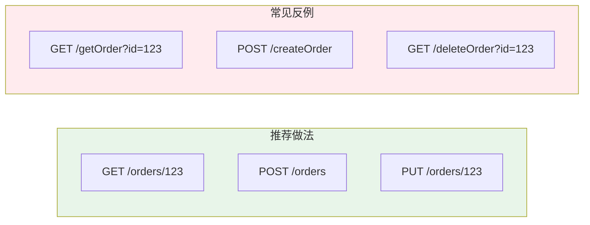
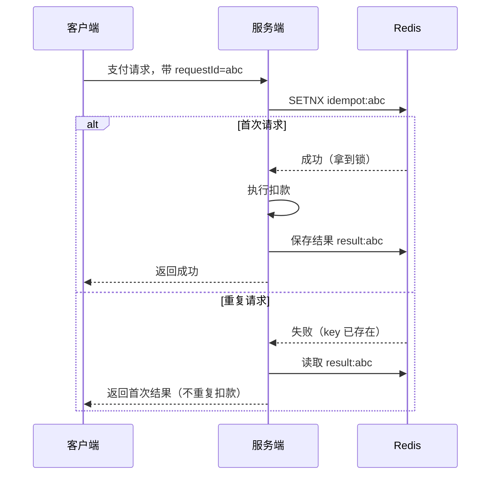
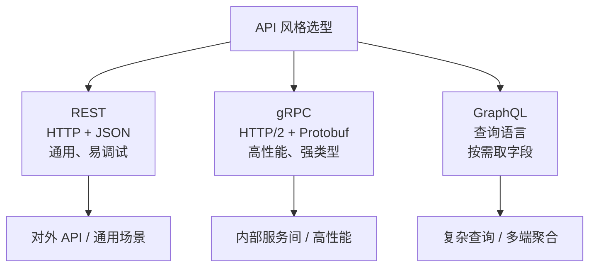

# API 设计

> 定位：API 是系统之间的契约，一旦发布就很难改。好的 API 让调用方「看一眼就会用」，坏的 API 让每个接入方都要问一遍「这个字段到底什么意思」。这篇讲 RESTful 规范与误区、版本管理、OpenAPI 契约、请求响应设计、错误码、分页/批量/幂等、向后兼容，以及 gRPC/REST/GraphQL 的取舍。

## 一、为什么需要好的 API 设计

API 设计一旦出问题，代价很高：

- **改不动**：接口上线后，有一堆调用方依赖它。你想改个字段名，发现十几个系统都要跟着改，最后只能将就。
- **理解成本高**：命名混乱、字段含义模糊、错误码随意，每个新接入方都要反复沟通。
- **兼容性事故**：改了返回结构没通知下游，导致对方解析失败、线上故障。

**API 是契约（Contract）**，设计时要像设计数据库 schema 一样谨慎——**优先考虑向后兼容，优先考虑调用方体验**。

好 API 的标准：

1. **一致**：命名、结构、错误处理方式全局统一。
2. **自描述**：看接口定义就能懂语义，不需要额外解释。
3. **稳定**：演进时不破坏已有调用方。
4. **易演进**：留有扩展空间，加字段、加能力不影响存量。

## 二、RESTful 规范与常见误区

REST（Representational State Transfer）是一种基于 HTTP 的架构风格，核心是**用 HTTP 语义表达资源操作**。

### 2.1 核心规范

| 原则 | 做法 | 例子 |
|---|---|---|
| 资源用名词 | URL 表示资源，不用动词 | `/orders` 而非 `/getOrder` |
| HTTP 方法表动作 | GET/POST/PUT/DELETE/PATCH | `GET /orders/{id}` |
| 状态码表结果 | 用 HTTP 状态码表达成功/失败 | 200/404/500 |
| 无状态 | 每个请求包含全部信息，服务端不存上下文 | token 放 Header |
| 层级关系清晰 | 用路径表达资源层级 | `/users/{id}/orders` |

常用 HTTP 方法语义：

- `GET`：查询资源（安全、幂等）
- `POST`：创建资源（非幂等）
- `PUT`：整体更新资源（幂等）
- `PATCH`：部分更新资源
- `DELETE`：删除资源（幂等）

**幂等性**（重要）：同样的请求执行一次和多次，效果相同。GET/PUT/DELETE 天然幂等，POST 通常不幂等（多次创建会产生多条数据）。幂等设计在「网络超时重试」场景至关重要（见后文）。

### 2.2 常见误区



这张图对比了 REST 推荐做法和常见反例。下面这些误区在生产中非常常见：

- **URL 里用动词**：`/getUser`、`/createOrder`。正确做法是用 HTTP 方法表达动作，URL 只用名词。
- **滥用 GET 做写操作**：`GET /delete?id=1`。GET 应该无副作用，否则被浏览器预取、缓存爬虫触发就出大事。
- **只用 POST 走天下**：所有接口都 POST，丢掉了 HTTP 语义和缓存能力。
- **状态码用错**：所有响应都返回 200，业务失败也在 body 里用 `code` 区分。这违反了 HTTP 语义，监控（按状态码统计错误率）也会失真。
- **忽略幂等**：支付接口没有幂等控制，网络超时重试导致重复扣款。

> 现实中的「务实做法」：纯 REST 很理想，但国内很多团队采用「**RESTful 风格 + 统一响应体 + 业务错误码**」的混合方案——HTTP 状态码表示传输层结果（200/4xx/5xx），body 里的 `code` 表示业务结果（如 1001 余额不足）。关键是**团队内统一**，别混用。

## 三、版本管理

API 一定会演进，版本管理是必须提前设计的。

### 3.1 三种版本管理方式

| 方式 | 例子 | 优点 | 缺点 |
|---|---|---|---|
| URL 路径 | `/api/v1/orders` | 直观、易调试、易路由 | URL 变长，资源语义被版本污染 |
| Header | `Accept: application/vnd.api.v1+json` | URL 干净、语义纯 | 不直观，调试麻烦 |
| 请求参数 | `/api/orders?version=1` | 简单 | 不够规范，易被忽略 |

**推荐 URL 路径版本**（`/api/v1/...`）——虽然不够「纯粹」，但直观、易路由、易灰度、易调试，是工程上最普遍的选择。

### 3.2 版本演进原则

- **加字段是兼容的，删字段/改语义是不兼容的**。新增字段要能向后兼容（老客户端忽略即可）。
- **需要破坏性变更时，升大版本**（v1 → v2），老版本保留一段时间下线。
- **通过网关做版本路由**，可以让 v1/v2 指向不同实现，平滑迁移。
- **弃用流程**：先标记 deprecated（响应头 `Deprecation`），观察调用量归零后再下线。

## 四、接口契约：OpenAPI

**OpenAPI（前身 Swagger）** 是描述 RESTful API 的规范文件（YAML/JSON），可作为**契约**驱动开发和测试。

**价值**：

- **文档自动化**：一份定义生成在线文档，不用手写 Wiki。
- **代码生成**：生成客户端 SDK、服务端骨架（OpenAPI Generator）。
- **契约测试**：基于契约校验请求响应，前后端并行开发（Mock Server）。
- **协作基线**：前后端先定契约，再各自开发，减少联调扯皮。

一个最小的 OpenAPI 片段：

```yaml
paths:
  /orders/{orderId}:
    get:
      summary: 查询订单
      parameters:
        - name: orderId
          in: path
          required: true
          schema:
            type: string
      responses:
        '200':
          description: 成功
          content:
            application/json:
              schema:
                $ref: '#/components/schemas/Order'
```

> Spring 生态用 `springdoc-openapi`（Spring Boot 3）或 `springfox`（旧版）自动生成 OpenAPI 文档。**以你使用的版本为准**——Spring Boot 3 因 jakarta 包名变化，老版 springfox 不再兼容，需换 springdoc。

## 五、请求与响应设计规范

### 5.1 请求设计

- **参数命名**：统一小驼峰（`userName`）或下划线（`user_name`），全场一致。
- **路径参数 vs Query vs Body**：资源标识用路径（`/orders/{id}`），过滤/分页用 Query（`?status=PAID&page=1`），复杂结构用 Body。
- **时间格式**：统一 ISO 8601（`2026-11-22T10:00:00Z`）或时间戳，**明确时区**。别用 `2026/11/22` 这种含糊格式。
- **金额**：用字符串或最小货币单位（分）传输，避免 JSON 浮点数精度丢失（`0.1+0.2` 问题）。
- **大整数**：超过 JS 安全整数（2^53-1）的 ID，用字符串传输，避免前端精度丢失。

### 5.2 响应设计

统一响应体结构（团队内统一）：

```json
{
  "code": 0,
  "message": "success",
  "data": { "orderId": "123", "status": "PAID" },
  "traceId": "abc-123"
}
```

要点：

- `code`：业务状态码（0 成功，非 0 失败）。
- `message`：可读信息，**面向用户或面向开发要分清**（生产别把堆栈暴露给用户）。
- `data`：业务数据，无数据时为 `null` 或空对象，结构保持固定（别有时是对象有时是数组）。
- `traceId`：链路追踪 ID，排障时「用户报的问题」和「服务端日志」能对上。

**响应设计原则**：

- **结构稳定**：字段类型固定，不要有时返回 `null` 有时返回对象。
- **不返回无关字段**：别把数据库字段一股脑返回（密码、内部状态），用 DTO 显式控制。
- **分页统一**：所有列表接口用同一套分页结构。

## 六、错误码设计

错误码是 API 的「通用语言」，设计不好就是一团乱麻。

### 6.1 错误码分层

推荐**分段编码**（用数字分段表达类别）：

| 范围 | 含义 | 例子 |
|---|---|---|
| 0 | 成功 | 0 |
| 1xxx | 通用参数错误 | 1001 参数缺失、1002 格式错误 |
| 2xxx | 用户/认证错误 | 2001 未登录、2002 无权限 |
| 4xxx | 业务错误 | 4001 余额不足、4002 库存不足 |
| 5xxx | 系统错误 | 5001 服务内部错误、5002 依赖超时 |

### 6.2 错误码设计原则

- **稳定**：错误码一旦发布不要改含义，废弃就新增。
- **可分类**：看错误码就知道是哪个模块、什么类型的问题。
- **带上下文**：`message` 给出具体信息（如「余额不足，当前余额 10 元」），但别泄露敏感信息。
- **区分「用户可感知」和「内部」**：面向用户的错误给友好提示，内部错误给排障信息。
- **配合 HTTP 状态码**：参数错误 400、未授权 401、无权限 403、不存在 404、限流 429、服务端错误 500。

> 坑点：错误码散落在代码各处（这里 1001，那里 20001），没有统一管理。解法是用枚举集中定义错误码，Code Review 时检查。

## 七、分页、批量与幂等设计

### 7.1 分页

两种主流方式：

| 方式 | 实现 | 优点 | 缺点 |
|---|---|---|---|
| 页码分页 | `?page=1&size=20` | 直观，支持跳页 | 深分页慢（`limit 1000000,20`） |
| 游标分页 | `?cursor=xxx&size=20` | 性能好，适合深翻 | 不能随意跳页 |

统一分页响应：

```json
{ "list": [...], "total": 1000, "page": 1, "size": 20, "hasMore": true }
```

> 深分页场景（数据量大）优先游标分页（基于上一页最大 ID：`where id > lastId limit 20`），避免 `limit` 大偏移量扫描。

### 7.2 批量接口

- **提供批量接口**减少网络往返：`POST /orders/batch` 一次创建多个订单。
- **限制批量大小**：如单次最多 100 条，超出拒绝，防止单次请求过大拖垮服务。
- **部分成功的语义**：批量操作要明确「全部成功才成功」还是「部分成功」，返回每条的结果。

### 7.3 幂等设计（重点）

**问题**：网络超时后客户端重试，服务端可能已处理成功，重复处理导致重复扣款、重复下单。

**幂等解决方案**：

1. **幂等键（Idempotency Key）**：客户端每次请求带唯一 `requestId`（或业务单号），服务端用 Redis/DB 记录已处理的 key，重复请求直接返回第一次的结果。



这张时序图展示了幂等键的工作原理：用 `SETNX`（只有 key 不存在才设置成功）抢占幂等键，抢到才执行业务，没抢到说明是重复请求，直接返回首次结果。

2. **数据库唯一索引**：用业务单号建唯一索引，重复插入会失败，天然防重复。
3. **状态机**：订单状态流转（待支付→已支付），重复请求发现状态已是「已支付」就直接返回。

> 关键：**幂等键的保存和业务处理要在逻辑上保证原子性**（或保存结果后再删锁），避免「业务成功但结果没保存」导致重试时又执行一遍。

## 八、向后兼容原则

API 演进的黄金法则——**不要破坏已有调用方**：

- **可以加字段，不要删字段/改类型**：新字段老客户端忽略即可；删字段会让老客户端解析失败。
- **可以加接口，不要改语义**：改接口行为（如原来返回 10 条现在返回 100 条）可能撑爆下游。
- **枚举值只增不改**：别把 `status=1` 的含义从「待支付」改成「已取消」。
- **默认值要稳定**：新字段给合理默认值，老客户端不传也能工作。
- **破坏性变更走新版本**：v1 不动，开 v2。

## 九、gRPC vs REST vs GraphQL



这张图给出了三种 API 风格的典型定位。详细对比：

| 维度 | REST | gRPC | GraphQL |
|---|---|---|---|
| 传输 | HTTP/1.1 + JSON | HTTP/2 + Protobuf | HTTP + JSON |
| 性能 | 中（JSON 体积大） | 高（二进制、多路复用） | 中 |
| 类型 | 弱（靠文档约束） | 强（Protobuf schema） | 强（schema） |
| 调试 | 易（浏览器/curl） | 难（需工具） | 中 |
| 接口定义 | OpenAPI | Proto 文件 | Schema |
| 适用场景 | 对外 API、通用 | 内部服务间、高性能 | 复杂查询、多端 |
| 浏览器支持 | 好 | 需 grpc-web | 好 |

**选型建议**：

- **对外 API**：REST 最通用，生态最好，调用方接入成本低。
- **内部服务间**：gRPC 性能好、强类型、代码生成，适合高频调用；但要考虑调试和运维成本。
- **复杂查询/多端（Web+App+小程序）数据聚合**：GraphQL 让客户端按需取字段，减少多次请求和冗余数据；但服务端实现复杂、有 N+1 和权限控制挑战。

> 不要为了「炫技」全上 gRPC 或 GraphQL。**按场景选择，对外 REST 是稳妥默认**。

## 十、生产坑点与排查

### 坑点 1：支付接口没有幂等导致重复扣款

**现象**：网络抖动，客户端重试支付请求，用户被扣了两次款。
**原因**：POST 接口非幂等，服务端对重复请求都执行了扣款。
**解法**：客户端带 `requestId`（幂等键），服务端用 `SETNX` + 保存结果实现幂等；或用业务订单号建唯一索引；配合状态机。确保幂等键保存和业务处理一致。

### 坑点 2：响应结构不一致导致下游解析失败

**现象**：某接口有数据时 `data` 是对象，无数据时 `data` 是 `null` 或空数组，下游代码没兼容，NPE。
**原因**：响应结构不固定，依赖「约定俗成」。
**解法**：统一响应体结构，字段类型固定；`data` 无数据用 `null` 或空集合但保持类型一致；用 OpenAPI 契约约束并做契约测试。

### 坑点 3：改字段破坏向后兼容

**现象**：把 `userName` 改成 `nickName`，没通知下游，所有调用方取不到用户名，线上故障。
**原因**：破坏性变更没走版本管理，也没遵循兼容原则。
**解法**：加字段不删字段；破坏性变更开 v2，v1 保留过渡期；发布前被调用方影响分析；用 OpenAPI diff 工具检测不兼容变更。

### 坑点 4：错误码混乱，排查靠猜

**现象**：错误码各处乱写（1001、20001、`E001` 混用），调用方不知道怎么处理，排查要翻代码。
**原因**：没有统一的错误码规范和枚举管理。
**解法**：分段编码 + 枚举集中定义 + 文档化；错误码带可读 message 和 traceId；区分用户可感知错误和内部错误。

## 九、面试高频问法

> 这一节的答案按「面试时能讲透」的标准写：先给一句话结论，再展开机制、原因和坑点。

**Q1：RESTful API 的设计原则是什么？**

**一句话结论**：用"资源"表达、用 HTTP 方法表达操作、用状态码表达结果、无状态。

展开：

- **资源**：URL 表示资源（名词），如 `/users/123`，不是 `/getUser?id=123`。
- **方法**：GET（查）、POST（增）、PUT（改）、DELETE（删）。
- **状态码**：200（成功）、201（创建）、400（参数错）、401（未认证）、403（无权限）、404（不存在）、500（服务端错）。
- **无状态**：每个请求包含完整信息，服务端不存会话。

加分点：说"RESTful 不是'用了 GET/POST 就是 REST'——核心是'资源 + 统一接口 + 无状态'；很多所谓 RESTful 其实是 RPC 风格套了个 URL"。

**Q2：API 版本管理有哪几种方式？**

**一句话结论**：URL 版本（`/v1/`）、Header 版本、Query 参数版本——URL 版本最直观，Header 版本最"干净"。

展开：

- **URL 版本**：`/api/v1/users`——直观、易调试，但 URL 会变。
- **Header 版本**：`Accept: application/vnd.api.v1+json`——URL 不变，但调试不便。
- **Query**：`?version=1`——简单但不够规范。

加分点：说"URL 版本最常用——虽然'不够 RESTful'，但直观、好排查、好做网关路由；务实比教条重要"。

**Q3：API 怎么做向后兼容？**

**一句话结论**：只做"加法"不做"减法"——加字段（可选）、加接口可以；删字段、改类型、改语义不行。

展开：

- **兼容变更**：加可选字段、加新接口、放宽校验。
- **不兼容变更**：删字段、改字段类型、改必填、改语义。
- **策略**：新老版本并行，等老客户端下线再删旧版。

加分点：说"向后兼容是'微服务的生命线'——服务独立部署，你改了接口，调用方可能还是老版本；破坏兼容就是'上线即事故'"。

**Q4：错误码怎么设计？**

**一句话结论**：分层设计——HTTP 状态码表达"类别"，业务错误码表达"具体原因"，响应体带可读信息。

展开：

- **HTTP 状态码**：400（客户端错）、500（服务端错）。
- **业务码**：如 `10001`（余额不足）、`10002`（订单不存在）。
- **响应体**：`{code, message, data}`。
- **原则**：错误码要稳定（不能随便改）、可查（有文档）、不泄露敏感信息。

加分点：说"错误码设计的坑是'把异常信息直接返回给用户'——既泄露内部细节（SQL、堆栈），又对用户不友好；要'对外友好、对内详细'"。

**Q5：分页接口怎么设计？**

**一句话结论**：用 `page + size` 或 `offset + limit`，返回"数据 + 总数 + 是否有下一页"。

展开：

- **参数**：`page`（页码，从 1 或 0 开始）、`size`（每页大小）。
- **返回**：`{list, total, page, size}` 或 `{list, hasNext, cursor}`。
- **深分页**：offset 大时性能差，用游标分页（cursor）。

加分点：说"分页要限制 size 上限（如最大 100）——不限制的话，有人传 size=100000 会把数据库打爆，这是常见的安全问题"。

**Q6：批量接口怎么设计？**

**一句话结论**：限制批量大小、返回每个元素的结果、支持部分成功。

展开：

- **限制**：一次最多 100/1000 条，防止过大请求。
- **返回**：每个元素的状态（成功/失败/原因），而不是"整体成功或失败"。
- **部分成功**：允许部分失败，返回失败明细。

加分点：说"批量接口的坑是'部分成功怎么处理'——全成功或全失败往往不现实，要设计'部分成功 + 失败明细'，让调用方能重试失败的"。

**Q7：幂等接口怎么设计？**

**一句话结论**：用"幂等键"（如请求 ID、业务唯一键）+ 服务端去重，保证重复调用结果一致。

展开：

- **幂等键**：客户端生成唯一 ID（如 UUID），或业务唯一键（订单号）。
- **服务端**：记录已处理的键，重复请求返回相同结果。
- **适用**：支付、下单等"不能重复"的操作。

加分点：说"幂等设计要在'接口契约'层面明确——哪些接口幂等、幂等键是什么，让调用方知道'可以安全重试'"。

**Q8：gRPC、REST、GraphQL 有什么区别？**

**一句话结论**：REST 简单通用（HTTP/JSON）、gRPC 高性能（HTTP/2/Protobuf）、GraphQL 灵活（客户端指定字段）。

| 维度 | REST | gRPC | GraphQL |
|---|---|---|---|
| 协议 | HTTP/1.1 + JSON | HTTP/2 + Protobuf | HTTP + JSON |
| 性能 | 中 | 高 | 中 |
| 灵活性 | 中 | 低（强契约） | 高（按需取字段） |
| 适用 | 通用 API | 内部高性能 RPC | 前端灵活查询 |

加分点：说"选型看场景——对外 API 用 REST（通用）、内部高性能用 gRPC（省带宽）、BFF 层用 GraphQL（减少多次请求）"。

**Q9：API 安全要考虑哪些？**

**一句话结论**：认证（你是谁）、授权（你能做什么）、传输加密（HTTPS）、防重放、限流、参数校验。

展开：

- **认证**：Token/JWT/OAuth2。
- **授权**：RBAC/ABAC。
- **加密**：HTTPS。
- **防重放**：时间戳 + nonce + 签名。
- **限流**：防刷。
- **校验**：防注入。

加分点：说"API 安全是'纵深防御'——每一层都要有，不能只靠'一个 Token'；尤其是'越权'（水平/垂直），是最常见的 API 漏洞"。

**Q10：怎么设计一个"好"的 API？**

**一句话结论**：一致（命名/风格统一）、清晰（语义明确）、健壮（校验/错误处理）、可演进（版本/兼容）、安全。

展开：

- **一致性**：所有接口用同样的命名、错误码、分页格式。
- **清晰**：URL 和字段名能自解释。
- **健壮**：参数校验、错误处理、超时。
- **可演进**：版本管理、向后兼容。
- **文档**：OpenAPI/Swagger。

加分点：说"好 API 的标准是'调用方不看文档也能猜对'——命名一致、语义清晰；糟糕的 API 是'每个接口风格都不一样'，调用方天天踩坑"。

## 小结

- API 是契约，设计要一致、自描述、稳定、易演进；优先向后兼容。
- RESTful：名词 URL + HTTP 方法 + 状态码 + 无状态；避开动词 URL、GET 写操作、只返 200 等误区。
- 版本管理推荐 URL 路径（/api/v1）；OpenAPI 做契约驱动（文档/代码生成/契约测试）。
- 响应结构要稳定，错误码分段+枚举集中管理，带 traceId 方便排障。
- 幂等靠幂等键+SETNX+结果保存/唯一索引/状态机；分页深翻用游标；对外 REST、内部可 gRPC、复杂查询 GraphQL。
