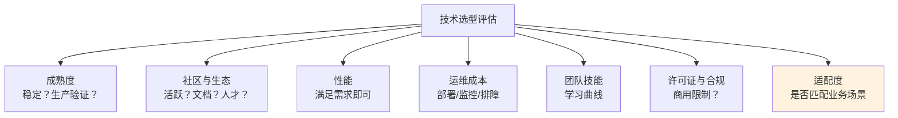
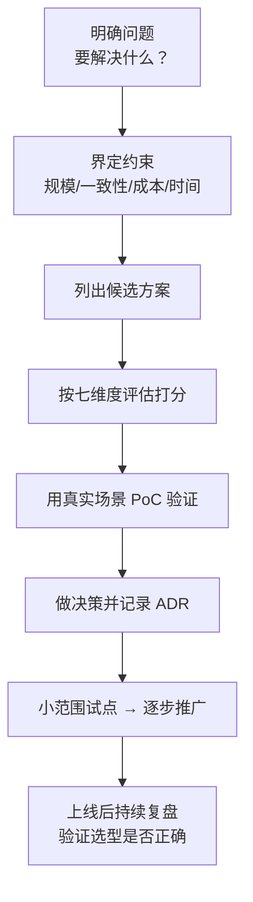
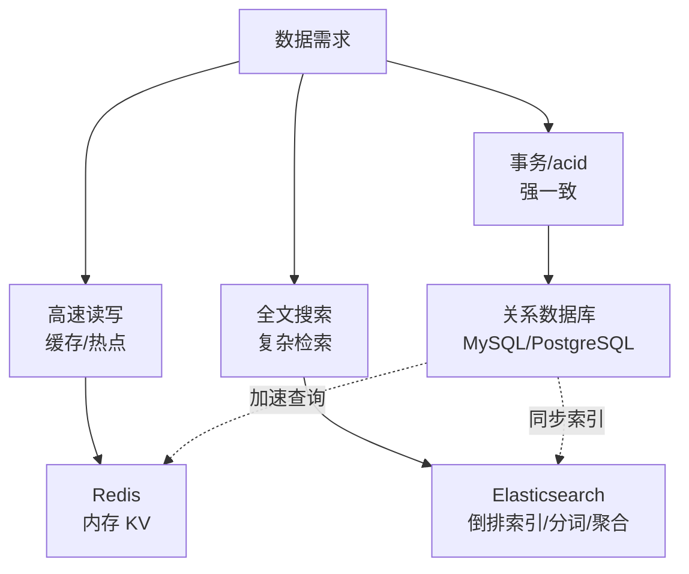

# 技术选型方法论

> 定位：技术选型不是「哪个火用哪个」，而是一套权衡决策——在成熟度、性能、成本、团队、生态之间找到适合当前场景的平衡点。这篇给你可复用的评估维度、几个高频的「什么时候用 A 什么时候用 B」决策框架、ADR 决策记录方法，以及如何避免过早优化和技术炫技。

## 一、为什么需要技术选型方法论

技术圈不缺「xx 吊打 yy」的文章，但现实中的选型往往没那么绝对：

- 团队跟风上了 Kubernetes，结果业务是简单 CRUD，运维复杂度翻倍，反而降低交付速度。
- 为了「高性能」引入 Redis，结果数据一致性问题不断，代码复杂度远超收益。
- 数据库还没用明白就想分库分表，最后引入一堆分布式问题，而瓶颈其实是没加索引。

**技术选型是一项需要方法论的决策，而不是追新或炫技。** 它的核心是**权衡（Trade-off）**——任何技术都有优点和代价，选型的本质是「在约束条件下，选代价可接受的那个」。

一个残酷的真相：**大多数项目的问题不是技术不够新，而是基础没做好**。索引没加、SQL 乱写、代码腐化，换什么新技术都救不了。选型之前先问：「当前的问题真的需要新技术解决吗？」

## 二、技术选型的评估维度

面对一个技术选项，系统性地从以下维度评估，而不是只看性能跑分。



这张图列出了七个评估维度。注意「适配度」被高亮——**它往往比单纯的性能更重要**。一个性能顶级但和你的场景不匹配的技术，是负担而非资产。

### 2.1 各维度详解

| 维度 | 关键问题 | 判断依据 |
|---|---|---|
| **成熟度** | 版本稳定吗？大厂生产验证过吗？ | 版本号（1.0+？）、生产案例、issue 响应 |
| **社区生态** | 文档全吗？遇到问题能搜到吗？招人好招吗？ | GitHub star/活跃度、Stack Overflow 问答、中文资料 |
| **性能** | 满足当前和近期需求吗？ | 官方 benchmark + **自己的场景压测** |
| **运维成本** | 部署、监控、扩容、排障复杂吗？ | 是否有成熟运维工具、团队能否 hold 住 |
| **团队技能** | 团队学得会吗？学习成本多久回本？ | 团队现有技术栈、学习曲线 |
| **许可证** | 商用允许吗？有无传染性？ | Apache/MIT/BSD vs GPL/AGPL，企业合规 |
| **场景适配** | 真的匹配当前问题吗？ | 业务特征、数据规模、一致性要求 |

> **性能陷阱**：别只看官方 benchmark。官方数据往往是最理想场景，你的数据特征、访问模式、配置都可能让结果差一个数量级。**一定要用自己的真实场景压测验证**（见「容量规划与压测」篇）。

### 2.2 选型决策流程



这张图是选型落地的完整流程。强调两点：**先明确问题和约束**（不是为了选型而选型），**PoC 验证**（用真实数据说话），**记录 ADR**（留下决策依据，便于日后复盘）。

## 三、高频决策一：单体 vs 微服务

这是最经典的架构选型。没有标准答案，看阶段和团队。

| 维度 | 单体 | 微服务 |
|---|---|---|
| 开发效率 | 高（简单直接） | 低（分布式复杂度） |
| 部署 | 简单（一个包） | 复杂（多服务编排） |
| 扩展 | 整体扩容 | 按需单独扩容 |
| 故障隔离 | 差（一个模块拖垮全体） | 好 |
| 团队协作 | 适合小团队 | 适合多团队自治 |
| 技术异构 | 难 | 易 |
| 运维要求 | 低 | 高（需 DevOps/监控/治理） |

**决策框架**：

- **默认从单体开始**。除非有明确证据证明单体扛不住（团队大到协作困难、不同模块扩展需求差异极大、故障隔离要求高）。
- **单体要「模块化」**——即使不拆服务，也要把边界划清楚（模块、包、DDD 限界上下文）。这样将来需要时才能顺利拆出微服务。
- **拆微服务的前提**：有 DevOps 基础（CI/CD、容器、监控、链路追踪）、有服务治理能力、团队规模足够大。
- **信号**：当「一个模块发布要协调所有团队」「一个模块故障拖垮全站」「不同模块扩展需求差异大」时，才是拆的时机。

>  Martin Fowler 的观点：**不要一上来就微服务，先做好模块化单体**。很多微服务失败案例，根源是边界没想清楚就拆，得到了「分布式单体」——比单体更难维护。

## 四、高频决策二：ES vs 数据库 vs Redis

三者常被拿来比较，但它们**不是替代关系，而是解决不同问题**。



这张图揭示了三者的定位：**数据库是「事实源」（强一致、事务），ES 是「搜索引擎」（复杂检索），Redis 是「加速器」（高速缓存）**。它们常配合使用，而非三选一。

### 4.1 各自适用场景

| 技术 | 擅长 | 不擅长 | 典型场景 |
|---|---|---|---|
| 关系数据库 | 事务、强一致、复杂关联查询、结构化数据 | 全文搜索、超大规模分析、高并发热点 | 订单、账户、核心业务数据 |
| Elasticsearch | 全文搜索、分词、模糊匹配、聚合分析、海量数据检索 | 事务、强一致、复杂关联 | 商品搜索、日志检索、内容搜索 |
| Redis | 超高速读写、缓存、计数、分布式锁、限流 | 海量数据存储、复杂查询、强一致持久化（虽有但非主业） | 缓存、Session、排行榜、限流 |

**什么时候用 ES**：

- 需要全文搜索（关键词高亮、分词、相关性排序）——数据库的 `LIKE '%xx%'` 无法走索引，性能差。
- 需要多条件组合筛选 + 聚合分析（如电商筛选：品牌+价格区间+评价，并统计各品牌数量）。
- 数据量巨大（亿级）且查询复杂。

**什么时候用 Redis（而非直接查数据库）**：

- 热点数据高频读（缓存，降低数据库压力）。
- 需要极致低延迟（内存访问）。
- 计数器、排行榜、分布式锁、限流、去重等数据结构场景。

**关键原则**：

- **数据库是事实源**，Redis/ES 的数据通常来自数据库同步，要接受最终一致。
- **别用 Redis 当主存储存核心数据**（除非你很清楚风险）——它的数据持久化不如数据库可靠。
- **别用 ES 替代数据库做事务性写入**——ES 不是数据库，没有事务。

> 常见误区：为了「高性能」把所有数据都塞进 Redis。结果内存成本高、一致性问题多、数据丢失风险大。**缓存只缓存热点，不是全量复制数据库**。

## 五、高频决策三：中间件取舍

选型中间件时，除了七维度，还要看几个工程现实：

### 5.1 消息队列选型（Kafka / RocketMQ / RabbitMQ）

| 维度 | Kafka | RocketMQ | RabbitMQ |
|---|---|---|---|
| 吞吐 | 极高（日志级） | 高 | 中 |
| 延迟 | 毫秒级 | 毫秒级 | 微秒-毫秒 |
| 事务消息 | 不支持（需自己实现） | 支持 | 不支持 |
| 顺序消息 | 分区有序 | 支持严格有序 | 队列有序 |
| 生态 | 大数据生态完善 | 阿里系、Java 友好 | AMQP 生态、多语言 |
| 运维 | 较重（依赖 ZooKeeper，新版可去掉） | 中 | 较轻 |

**决策**：

- 大数据/日志采集/高吞吐管道 → **Kafka**
- 电商交易、需要事务消息/顺序消息 → **RocketMQ**
- 企业级复杂路由、多语言、轻量 → **RabbitMQ**

### 5.2 引入中间件的标准

在引入任何中间件前，先问：

1. **是否真的必要**？能不能用更简单的方案（数据库表 + 定时任务）解决？
2. **团队能否 hold 住**？部署、监控、排障、扩容的技能是否具备？
3. **运维成本是否可接受**？多一个中间件就多一份运维负担和故障点。
4. **是否有成熟的退出方案**？万一不合适，迁移成本高吗？

> 原则：**能用简单方案解决的，别引入中间件**。很多场景用「数据库 + 本地事务 + 定时任务」就能搞定，上 MQ 反而增加复杂度和一致性问题。

## 六、ADR：架构决策记录

技术选型最重要的产出不是「选了什么」，而是**「为什么选」**。半年后有人问「当初为什么用 RocketMQ 不用 Kafka」，如果没有记录，没人说得清，最后可能又争论一遍。

**ADR（Architecture Decision Record）** 是记录架构决策的轻量文档，每份 ADR 记录一个决策：

```markdown
# ADR-001: 订单系统使用 RocketMQ 作为消息队列

- 状态：已采纳
- 日期：2026-11-22
- 决策者：架构组

## 背景
订单系统需要异步解耦库存、积分、通知，且支付场景需要事务消息保证一致性。

## 决策
选用 RocketMQ，放弃 Kafka 和 RabbitMQ。

## 备选方案与权衡
- Kafka：吞吐高，但不支持事务消息，需自己实现，一致性保障复杂。
- RabbitMQ：轻量，但事务/顺序支持不如 RocketMQ。
- RocketMQ：支持事务消息和顺序消息，Java 生态好，运维可控。

## 后果
- 正面：事务消息保证支付与消息一致，顺序消息保证库存扣减顺序。
- 负面：引入新的运维组件，团队需要学习成本。
```

**ADR 的价值**：

- **留存决策依据**：日后可追溯「为什么」，避免重复争论。
- **对齐团队认知**：所有人理解决策背景和权衡。
- **便于复盘**：决策错了能快速回溯当时的假设，看看是假设错了还是执行错了。

> ADR 不用很重，一两页即可。关键是**记录「背景 + 决策 + 备选方案权衡 + 后果」**，而不是只写结论。

## 七、避免两个极端：过早优化与技术炫技

### 7.1 过早优化

>  Donald Knuth：「过早优化是万恶之源（Premature optimization is the root of all evil）。」

**过早优化的表现**：

- 数据量还很小就分库分表。
- 功能是内部工具就上多级缓存、微服务。
- 还没 profiling 就手工「优化」代码，把清晰的代码改得晦涩。

**正确做法**：

1. **先让功能正确工作**。
2. **用数据驱动优化**——通过监控/压测找到真实瓶颈（见「性能优化分层」篇）。
3. **只在瓶颈处优化**，一次改一个变量并验证。

> 记住：**你猜测的瓶颈，90% 不是真瓶颈**。优化前先测量。

### 7.2 技术炫技

**技术炫技的表现**：

- 为了用而用新技术（「我们上 Service Mesh 吧」，但只有 3 个服务）。
- 追求「技术栈的先进性」而非「问题的解决」。
- 简历驱动开发（RDD，Resume-Driven Development）——选技术是为了简历好看。

**正确做法**：

- **以问题为导向**：技术是为业务和团队服务的，能简单解决就别复杂化。
- **考虑团队整体**：你一个人爽了，团队其他人要维护，运维要兜底。
- **算总账**：新技术的收益（性能/效率）要大于它的成本（学习/运维/故障风险）。

## 八、生产坑点与排查

### 坑点 1：跟风选型，忽略团队能力

**现象**：团队跟风上了 K8s + 微服务 + Service Mesh，结果没人能 hold 住，故障频发，交付速度反而下降。
**原因**：选型只看「先进」，没评估团队技能和运维成本。
**解法**：选型前诚实评估团队能力；优先选团队熟悉、社区成熟的技术；新技术先在非核心项目试点，积累经验再推广。

### 坑点 2：用 Elasticsearch 替代数据库

**现象**：把核心业务数据只写进 ES，结果 ES 集群故障导致数据丢失/不可用，且没有事务保证。
**原因**：混淆了搜索引擎和数据库的职责。
**解法**：**数据库作为事实源**，ES 只做搜索/分析，数据由数据库同步（Canal/MQ）。接受 ES 与数据库的最终一致，关键数据以数据库为准。

### 坑点 3：过早分库分表

**现象**：数据量才几十万就上分库分表，引入分布式事务、跨库 JOIN、全局 ID 等问题，开发效率暴跌。
**原因**：被「高并发大数据」叙事吓到，提前过度设计。
**解法**：单表千万级以下、索引优化后性能达标，就不必分库分表。先优化索引、读写分离、加缓存。真到瓶颈（单表数据量大到索引也救不了）再分，且优先垂直拆分。

### 坑点 4：选型没有记录，反复争论

**现象**：半年后没人记得为什么选这个技术，新人质疑、老人说不清，又重新调研一遍。
**原因**：决策只停留在口头/会议，没形成文档。
**解法**：每个重要选型都写 ADR，记录背景、决策、权衡、后果。放在代码仓库或 Wiki，方便追溯。

## 九、选型决策速查表

| 场景 | 推荐 | 避免 |
|---|---|---|
| 小团队、业务简单 | 模块化单体 | 一上来微服务/K8s |
| 需要全文搜索/复杂检索 | Elasticsearch | 数据库 `LIKE` 硬扛 |
| 热点数据高速读 | Redis 缓存 | 全量数据塞 Redis |
| 事务性核心数据 | 关系数据库 | 用 ES/Redis 当主存储 |
| 高吞吐日志管道 | Kafka | 用 RabbitMQ 扛海量日志 |
| 电商事务/顺序消息 | RocketMQ | 自己实现事务消息 |
| 不确定的选型 | 七维度评估 + PoC | 拍脑袋/跟风 |
| 重要架构决策 | 写 ADR | 只口头约定 |

## 九、面试高频问法

> 这一节的答案按「面试时能讲透」的标准写：先给一句话结论，再展开机制、原因和坑点。

**Q1：技术选型应该考虑哪些维度？**

**一句话结论**：功能匹配、性能、成熟度、社区活跃度、运维成本、团队技能、许可证——综合权衡，不是只看性能。

展开：

| 维度 | 关注点 |
|---|---|
| 功能 | 是否满足需求 |
| 性能 | 能否支撑业务量 |
| 成熟度 | 是否经过生产验证 |
| 社区 | 是否活跃、有问题能否找到答案 |
| 运维 | 团队能否 hold 住 |
| 许可证 | 是否合规、有无法律风险 |

加分点：说"选型最忌讳'唯性能论'——吞吐最高的不一定最合适，运维成本、团队熟悉度、生态匹配同样重要；技术选型是'综合最优'不是'单点最优'"。

**Q2：什么时候用单体，什么时候用微服务？**

**一句话结论**：早期/简单/小团队用单体；业务复杂/多团队/需独立部署用微服务。

展开：

- **单体适合**：业务简单、团队小、快速迭代、流量不大。
- **微服务适合**：业务复杂、多团队协作、需要独立部署和扩展、流量大。
- **演进**：先单体，业务复杂了再拆（绞杀者模式）。

加分点：说"'单体优先'是很多大厂的共识——微服务的分布式复杂性（事务、链路、运维）会拖慢早期团队；等业务真的复杂了再拆不迟"。

**Q3：什么时候用 Redis，什么时候用数据库？**

**一句话结论**：Redis 用于"高频读、可接受短暂不一致、需要极低延迟"；数据库用于"强一致、复杂查询、持久化"。

展开：

- **Redis 适合**：缓存、会话、计数器、排行榜、分布式锁。
- **数据库适合**：事务、复杂查询、关联、强一致。
- **不要**：把 Redis 当"主数据库"（它持久化弱、无事务、内存贵）。

加分点：说"Redis 是'加速层'不是'存储层'——它的价值是'快'，但'可靠持久'要靠数据库；用 Redis 当主存储是常见的架构错误"。

**Q4：什么时候用 ES，什么时候用数据库 LIKE？**

**一句话结论**：全文检索、复杂查询、大数据量搜索用 ES；简单前缀匹配、数据量小用数据库。

展开：

- **ES 适合**：全文检索、多条件组合查询、聚合统计、日志搜索。
- **数据库适合**：精确查询、小数据量、强一致。
- **LIKE 的问题**：`LIKE '%关键词%'` 不走索引，全表扫描，数据量大就慢。

加分点：说"ES 不是'数据库的替代'——它没有事务、近实时、可能丢数据；正确姿势是'数据库存数据、ES 做检索'，两者配合"。

**Q5：消息队列怎么选？**

**一句话结论**：高吞吐选 Kafka、业务消息选 RocketMQ、低延迟/复杂路由选 RabbitMQ——按业务需求选。

展开：

- **Kafka**：日志、大数据、流处理（吞吐最高）。
- **RocketMQ**：电商、交易（功能全：事务/延时/顺序）。
- **RabbitMQ**：复杂路由、低延迟（Exchange 灵活）。
- **Pulsar**：云原生、多租户（存算分离）。

加分点：说"选型先问'业务要什么'——要吞吐、要功能、要延迟，答案不同；没有'最好的 MQ'，只有'最合适的'"。

**Q6：注册中心怎么选？**

**一句话结论**：Nacos（功能全、AP/CP 可切）、Eureka（纯 AP、已停更）、ZK（CP、传统）、Consul（多数据中心）。

展开：

- **Nacos**：注册 + 配置，国内主流。
- **Eureka**：纯服务发现，2.x 停更。
- **ZK**：CP，Dubbo 传统选择。
- **Consul**：多数据中心、健康检查强。

加分点：说"注册中心选 AP 还是 CP 是核心——服务发现要'永远能查到'，所以 AP 更合适；ZK 的 CP 在网络分区时不可用，这是它做注册中心的短板"。

**Q7：什么时候不该引入新技术？**

**一句话结论**：团队不熟、问题不明确、收益不明显、运维跟不上时，不该引入——技术选型要克制。

展开：

- **团队不熟**：学了半年还用不好，不如用熟悉的。
- **问题不明确**：不知道要解决什么，引入新技术只是增加复杂度。
- **收益不明显**：为了"先进"而用，没有实际收益。
- **运维跟不上**：出了问题没人能修。

加分点：说"引入新技术的成本被严重低估——学习、踩坑、运维、招聘都是成本；'能不用就不用'是成熟的选型态度"。

**Q8：什么是 ADR（架构决策记录）？为什么重要？**

**一句话结论**：ADR 是"记录架构决策的背景、选项、决策和后果"的文档——让后人知道"为什么这么选"。

展开：

- **内容**：背景（什么问题）、选项（考虑过哪些）、决策（选了哪个）、后果（代价是什么）。
- **价值**：避免"后人推翻重来"、便于追溯、知识沉淀。
- **格式**：Markdown，放在代码库。

加分点：说"ADR 解决的是'半年后没人记得为什么这么设计'的问题——架构决策的'为什么'比'是什么'更重要，ADR 就是记录'为什么'"。

**Q9：怎么避免'过度设计'？**

**一句话结论**：按需设计、YAGNI（你不会需要它）、KISS（保持简单）——只为"当前确定的需求"设计，不为"可能的需求"设计。

展开：

- **过度设计的表现**：为了"未来可能的高并发"提前分库分表、为了"可能的扩展"搞一堆抽象。
- **代价**：复杂度上升、开发变慢、bug 变多。
- **原则**：先简单实现，等真的需要了再演进。

加分点：说"过度设计是'架构师最容易犯的错'——总想'设计一个完美的、能应对一切的架构'，结果复杂到没人能维护；好的架构是'刚好够用，且容易演进'"。

**Q10：技术选型怎么说服团队和业务方？**

**一句话结论**：用"业务语言"讲收益、用"数据"讲可行性、用"风险"讲兜底——不是讲技术多先进。

展开：

- **业务语言**：不说"用了 Kafka"，说"能支撑双 11 的流量，不丢订单"。
- **数据**：压测数据、成本对比。
- **风险**：如果失败，怎么回滚、代价多大。
- **共识**：让团队参与决策，而不是"通知"。

加分点：说"技术选型不是'技术人的自嗨'——业务方关心'能不能支撑业务、成本多少、风险多大'；用他们听得懂的语言讲，才能推动落地"。

## 小结

- 技术选型是权衡决策，七维度评估：成熟度/社区/性能/运维/团队/许可证/适配度；适配度和真实场景压测最容易被忽略。
- 选型流程：明确问题→界定约束→列候选→评估→PoC→决策写 ADR→试点推广→复盘。
- 单体 vs 微服务：默认单体、模块化、被问题驱动再拆；ES/DB/Redis 是配合关系（事实源/搜索/加速）。
- 中间件取舍看工程现实；引入前问「是否必要、团队能否 hold、成本是否可接受」。
- 用 ADR 记录「为什么」；避免过度优化（数据驱动）和技术炫技（问题导向、算总账）。
