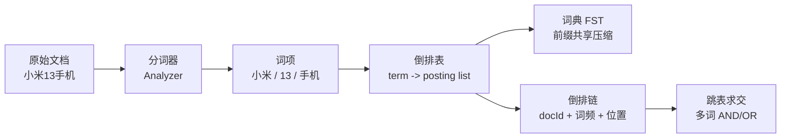
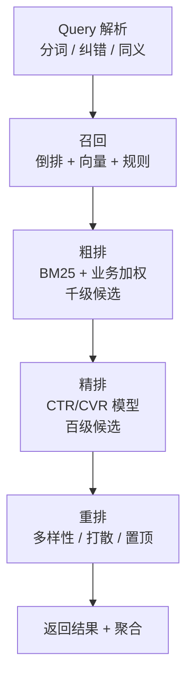
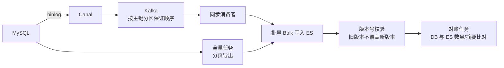

# 搜索系统设计

> 定位：搜索是「用户不知道自己要什么」时唯一的入口，也是最容易被低估的系统：一个 `LIKE '%关键词%'` 能撑到十万商品，但撑不住千万级数据和相关性排序。这篇按「需求 → 挑战 → 架构 → 细节 → 坑点」讲清倒排索引、分词、BM25、召回排序漏斗、Elasticsearch 分片、索引同步、深翻页、降级，以及在 RAG 时代怎么把关键词检索和向量检索拼起来。

## 一、为什么需要它

商品搜索的需求听起来很简单：输入关键词，返回相关商品，支持筛选、排序、分页。用 MySQL 实现只要一句 `WHERE title LIKE '%手机%'`。上线后依次遇到四个问题：

1. **性能**：前置通配符用不上索引，千万行表全表扫，一次查询几秒。
2. **相关性**：`LIKE` 只能判断「有没有」，不能判断「有多相关」。搜「苹果手机」，标题里出现「苹果」和「手机」的商品排在一起，实际是苹果水果的商品也混进来。
3. **分词**：中文没有空格，`LIKE '%手机%'` 搜不到「小米 13 智能终端」这种不含连续「手机」二字的标题。
4. **组合条件**：品牌、价格区间、类目、是否有货、销量排序、聚合统计，SQL 拼到最后既慢又难维护。

搜索系统和业务查询的区别：

| 维度 | 业务查询 | 搜索 |
|---|---|---|
| 输入 | 精确条件（ID、状态） | 自然语言、拼写错误、同义词 |
| 结果 | 精确匹配 | 按相关性排序 |
| 数据源 | 单一主库 | 多表聚合、异构同步 |
| 一致性 | 强一致 | 允许秒级延迟 |
| 查询形态 | 点查、范围查 | 全文、过滤、聚合、分页 |

三条本质约束：

1. **搜索是「读多写少」的异构副本**，主数据在 MySQL，搜索库只是为查询重建的一份索引，必须接受延迟。
2. **相关性是排序问题，不是匹配问题**。匹配决定「进不进候选」，排序决定「谁在前」，两者要分开设计。
3. **搜索必须能降级**。搜索挂了不能把整个 App 拖垮，要有兜底策略。

## 二、核心原理

### 2.1 倒排索引与分词

正排索引是「文档 → 词」，倒排索引是「词 → 文档列表」。搜索快，本质是倒排把「遍历所有文档找词」变成了「直接查词表拿文档」。



读图要点：词典（term dictionary）常驻内存并用 FST 压缩前缀，倒排链（postings）存 docId、词频和位置。位置信息决定了短语查询「小米 13」能不能按顺序匹配，也决定了高亮能不能标对位置。

中文分词是搜索效果的第一道分水岭。三种粒度：

- 粗粒度（如 ik_smart）：切分少、召回低、精度高，适合标题短文本。
- 细粒度（如 ik_max_word）：切分多、召回高、噪声多，适合长文本或需要高召回的字段。
- 自定义词典：品牌名、型号、行业术语必须进词典，否则「红米K70」会被切碎。

工程上的常见做法是「索引时细粒度、查询时粗粒度」：索引用 `ik_max_word` 尽量多切，查询用 `ik_smart` 减少无用词项，兼顾召回和精度。

### 2.2 相关性：TF-IDF 与 BM25

TF-IDF 的直觉是：一个词在本篇出现越多越相关（TF），但在所有文档中出现越普遍越不值钱（IDF）。BM25 在此基础上加了两条修正：

- **词频饱和**：一个词出现 100 次不应该比出现 10 次相关 10 倍，用 `k1` 控制饱和速度。
- **文档长度归一化**：长文档天然更容易命中词，用 `b` 控制长度惩罚。

BM25 的打分公式可以简写为：

```text
score(q, d) = Σ IDF(qi) * (f(qi,d) * (k1 + 1)) / (f(qi,d) + k1 * (1 - b + b * |d| / avgdl))
```

`k1` 通常取 1.2 左右，`b` 取 0.75 左右，具体以 Elasticsearch 版本文档的默认值为准。参数不是玄学，`b` 调大对长文本更公平，`k1` 调大让词频的影响更持久。

但纯 BM25 不够。电商搜索里「销量」「是否下架」「店铺评分」「是否有货」都比文本相关性更重要。所以真实系统会在 BM25 之上叠加业务权重，用 `function_score` 或 `script_score` 做加权，或者干脆把 BM25 只当召回阶段的粗排分。

### 2.3 排序漏斗：召回、粗排、精排、重排

搜索引擎的排序不是一次算完，而是逐层收窄：



读图要点：召回追求「不漏」，把可能相关的都拿进来；粗排追求「快」，用轻量特征砍到几百条；精排追求「准」，用模型算细粒度分数；重排处理业务规则，比如同店铺打散、广告位插入、屏蔽词过滤。小系统可以只有「召回 + 粗排」两层，不要为了架构完整硬上模型。

**什么规模不该这么做**：日活几万、商品几十万的系统，ES 的 BM25 加几个业务权重字段就够了，不需要精排模型。模型需要样本、特征平台和线上实验，投入远大于收益。

### 2.4 Elasticsearch 集群与分片设计

ES 是 Lucene 的分布式封装。三个概念必须分清：

- **倒排索引（Index）**：逻辑上的数据集合，类似数据库的表。
- **主分片（Primary Shard）**：索引的水平切分，决定并行度和单分片容量，**创建后不能改**（除非 reindex）。
- **副本（Replica）**：主分片的拷贝，提供高可用和读吞吐。

分片设计的三条经验：

1. 单分片大小控制在几十 GB 量级（常见经验值是 30GB 上下，不是硬标准），分片过多会让集群元数据和查询协调开销变大。
2. 主分片数一旦确定就不能原地改，预估容量时要留 2~3 倍增长空间，或者一开始就用别名 + reindex 支持平滑扩容。
3. 副本至少 1，保证节点故障时查询不中断；写多读少的索引可以临时把副本设为 0 加速写入，写完再恢复。

查询时的两阶段：协调节点把请求广播到每个分片，各分片本地查询返回 `from + size` 条，协调节点归并排序后取全局前 N 条。这解释了两个现象：分片越多，单次查询的扇出越大；深翻页时每个分片都要返回大量数据，协调节点内存暴涨。

### 2.5 索引同步：binlog、双写与全量增量

搜索库的数据来自业务库，同步方案有三种：

| 方案 | 原理 | 优点 | 缺点 |
|---|---|---|---|
| 双写 | 写库同时写 ES | 实时、简单 | 一致性难保证，写失败就丢 |
| binlog 订阅 | Canal/Debezium 解析 binlog 投递 MQ | 解耦、可回放 | 有秒级延迟，需处理表结构 |
| 定时全量 | 定时扫表重建 | 简单、能修复历史 | 延迟大、压力大 |

生产上的标准组合是「**全量初始化 + binlog 增量 + 定时对账**」：



读图要点：binlog 到 Kafka 要按「文档主键」分区，保证同一个商品的增删改有序；消费端用 `version` 字段做乐观并发，旧版本消息不能覆盖新版本；全量任务和增量任务可能并发，必须靠版本号或时间戳兜底。对账任务只比对数量和摘要，发现差异再触发单条重建。

双写不是完全不能用，但它只适合「允许丢、能补偿」的场景。只要业务写库成功、写 ES 失败，就会出现「库里有、搜不到」。所以双写必须配本地消息表或事务消息，本质上还是异步补偿。

### 2.6 搜索建议、纠错与查询理解

用户输入往往不完整、有错别字、带口语。查询理解做四件事：

- **补全（suggest）**：前缀联想，用 completion suggester 或 edge n-gram。completion 类型常驻内存，适合前缀匹配，但不支持复杂的中间匹配。
- **纠错（spell check）**：基于编辑距离的 term suggester，或维护「错词 → 正确词」的词典。品牌名、型号不要轻易纠错，否则「红米」会被纠成「红米」以外的词。
- **同义词**：手机 = 移动电话 = smartphone，用 synonym filter 在索引或查询时展开。
- **意图识别**：区分「搜商品」「搜店铺」「搜内容」，决定走哪个索引、哪套排序。

建议和纠错要独立于主搜索链路：它们延迟要求更低、可用性要求更高，通常单独部署或本地缓存，主搜索挂了建议还能用。

### 2.7 过滤、聚合与深翻页

**过滤（filter）** 不走打分，结果可缓存，应该和全文查询分开：`bool.must` 放全文条件，`bool.filter` 放类目、价格、库存这些精确条件。filter 的 bitset 缓存能显著降低重复查询的开销。

**聚合（aggregation）** 用于筛选面板：品牌分布、价格区间、类目计数。聚合很吃内存，尤其是嵌套聚合和高基数字段。原则是：只对 `keyword` 字段聚合，不要在 `text` 上开 fielddata；聚合字段用 doc_values；限制桶数量，避免一次返回上万个品牌。

**深翻页** 是搜索最经典的坑。`from + size` 超过 `index.max_result_window`（默认 10000）会直接报错；即使不报错，每页都要把前 N 条全部取出再丢弃，越翻越慢。

| 方案 | 原理 | 适用 | 限制 |
|---|---|---|---|
| from + size | 全局排序后截取 | 前几十页 | 深翻页内存爆炸 |
| search_after | 用上一页最后一条的排序值做游标 | 无限下拉、导出 | 不能跳页 |
| scroll | 快照上下文 | 离线导出、重建 | 占用资源，已不推荐实时查询 |
| PIT + search_after | 时间点快照 + 游标 | 实时深翻页 | 要管理 PIT 生命周期 |

产品上「只能翻 100 页」不是技术偷懒，而是深翻页对用户本来就没价值，且能被爬虫利用。正确做法是限制页数 + `search_after` 做无限滚动。

### 2.8 冷热分离、降级与一致性

**冷热分离**：热索引只放最近活跃数据，用 SSD；冷数据进温/冷层，用大容量磁盘，通过 ILM（Index Lifecycle Management）自动滚动和迁移。电商搜索通常只保留在售商品，下架商品进冷索引或直接删除。

**降级**：搜索是典型的「可以降级但不能挂」的系统。降级顺序是：先关聚合和个性化排序，再关纠错和建议，再缩短超时，最后降级为「按销量/更新时间返回兜底列表」。绝不能把搜索流量直接打到 MySQL 上做 `LIKE`，那会把主库打死。

**一致性**：ES 是近实时（near real-time），默认 `refresh_interval` 是 1 秒，写入后最多 1 秒才能搜到。用户改完商品立刻搜不到是正常的，但「下单后库存变了、搜索结果还显示有货」需要业务侧兜底——详情页和下单校验以数据库为准，搜索结果只做展示。

### 2.9 向量检索与混合搜索

关键词检索擅长精确匹配，向量检索擅长语义匹配（「适合送女友的礼物」这种没有明确关键词的查询）。混合搜索把两者结合：

- **召回阶段并行**：BM25 召回 top K，kNN 召回 top K。
- **融合**：用 RRF（Reciprocal Rank Fusion）按排名融合，不依赖两路分数量纲；或者训练一个融合模型。
- **重排**：用 Cross-Encoder 对候选做精排。

ES 8.x 支持 `dense_vector` 字段和 kNN 查询，也支持 RRF 融合。向量检索的原理、embedding 模型选择和 RAG 的完整链路，见 [RAG 检索增强生成](../18-AI与LLM工程化/01-RAG检索增强生成.md)。

**什么规模不该用向量检索**：商品结构化程度高、用户查询以品牌型号为主时，BM25 加规则就够了。向量检索的召回质量高度依赖 embedding 模型，模型不适配业务语料时，效果可能不如关键词。

## 三、关键机制与关键代码

### 3.1 索引 mapping 示例

```json
{
  "settings": {
    "number_of_shards": 6,
    "number_of_replicas": 1,
    "refresh_interval": "1s",
    "analysis": {
      "analyzer": {
        "idx_analyzer": { "type": "custom", "tokenizer": "ik_max_word" },
        "search_analyzer": { "type": "custom", "tokenizer": "ik_smart" }
      }
    }
  },
  "mappings": {
    "properties": {
      "product_id":  { "type": "long" },
      "title":       { "type": "text", "analyzer": "idx_analyzer", "search_analyzer": "search_analyzer" },
      "brand":       { "type": "keyword" },
      "category_id": { "type": "keyword" },
      "price":       { "type": "scaled_float", "scaling_factor": 100 },
      "stock":       { "type": "integer" },
      "sales":       { "type": "long" },
      "status":      { "type": "byte" },
      "updated_at":  { "type": "date" },
      "embedding":   { "type": "dense_vector", "dims": 768, "index": true, "similarity": "cosine" }
    }
  }
}
```

几个关键选择：`title` 用双 analyzer 兼顾索引召回和查询精度；`brand`、`category_id` 用 `keyword` 才能聚合和精确过滤；价格用 `scaled_float` 避免浮点误差；`embedding` 开启 `index` 才能做 kNN。**不要开自动动态映射**，否则一个脏字段就能把 mapping 撑爆。

### 3.2 Java 查询示例（Elasticsearch Java API Client 8.x）

```java
BoolQuery.Builder bool = new BoolQuery.Builder()
    .must(m -> m.match(mm -> mm.field("title").query(keyword)))
    .filter(f -> f.term(t -> t.field("status").value(1)))
    .filter(f -> f.range(r -> r.field("price").gte(JsonData.of(minPrice)).lte(JsonData.of(maxPrice))));

SearchResponse<Product> resp = client.search(s -> s
        .index("product")
        .query(q -> q.bool(bool.build()))
        .sort(so -> so.field(f -> f.field("sales").order(SortOrder.Desc)))
        .size(20),
    Product.class);
```

要点：全文条件放 `must` 参与打分，精确条件放 `filter` 走缓存；排序字段必须是 `keyword`/数值/日期，不能是 `text`；返回对象用 `Product.class` 做映射，字段名要和 mapping 对齐。以 Elasticsearch 8.x 的 Java API Client 为准。

### 3.3 同步消费端的幂等写入

```java
public void onMessage(ProductChange msg) {
    // 1. 先查主库最新版本，过滤掉乱序的旧消息
    Product p = productMapper.selectById(msg.getProductId());
    if (p == null || p.getVersion() > msg.getVersion()) {
        return;
    }
    // 2. 下架商品直接删除文档，而不是把 status 改成 0 留在索引里
    if (p.getStatus() == 0) {
        client.delete(d -> d.index("product").id(String.valueOf(p.getId())));
        return;
    }
    // 3. 用主键 upsert，天然幂等；失败交给 MQ 重试
    client.index(i -> i.index("product")
        .id(String.valueOf(p.getId()))
        .document(ProductDoc.from(p))
        .refresh(Refresh.False));
}
```

`refresh=false` 是写入侧的默认选择，靠 1 秒的定时 refresh 让数据可见，避免每条写入都触发段合并。批量同步时用 Bulk API，单批控制在几千条，遇到 `es_rejected_execution_exception` 要退避重试而不是丢弃。

## 四、生产坑点与排查

### 坑点 1：动态映射把 mapping 撑爆

**现象**：某天索引突然变成几千个字段，集群元数据膨胀，写入变慢，甚至触发字段数上限。
**原因**：开启了动态映射，上游某个商品的扩展属性带了一个随机 key（比如 `attr_8f3a`），每条数据都新增字段。
**解法**：mapping 设为 `dynamic: strict` 或 `false`；扩展属性统一放 `flattened` 类型或 `nested` 的固定结构；上线前用样本数据跑 mapping 校验。

### 坑点 2：深翻页导致协调节点 OOM

**现象**：用户翻到第 200 页时查询超时，ES 协调节点堆内存告警。
**原因**：`from = 4000, size = 20` 时，每个分片都要返回前 4020 条，6 个分片就是 2.4 万条，协调节点要归并排序后再丢弃 4000 条。
**解法**：限制最大页数；改用 `search_after` 做无限滚动；导出场景用 PIT + `search_after`；监控 `search` 线程池的 rejected 数。

### 坑点 3：索引同步延迟导致「改了搜不到」

**现象**：运营改了商品标题，搜索页半小时后还是旧标题。
**原因**：binlog 消费积压；或者消费端异常被吞，消息进了死信没人处理；或者全量任务覆盖了增量结果。
**解法**：监控 Kafka lag 和死信队列；写入带版本号，旧版本不覆盖；全量任务和增量任务用同一套版本规则；提供「强制重建单条」的运维接口。

### 坑点 4：分片过多，集群「小文件」拖垮查询

**现象**：数据量只有几百 GB，却建了上百个分片，查询 P99 持续升高。
**原因**：按「一天一个索引、每个索引 5 分片」建表，几个月后分片数失控，每次查询扇出到几百个分片。
**解法**：按数据量和保留周期规划索引，用 ILM 滚动和删除；单分片控制在几十 GB；查询时用别名指向少量索引，避免通配多个索引。

### 坑点 5：在 text 字段上排序或聚合

**现象**：按品牌聚合时报 `Fielddata is disabled on text fields`，或者排序结果不符合预期。
**原因**：品牌字段被动态映射成 `text`，ES 需要 fielddata 才能聚合，而 fielddata 会把词项加载到堆内存。
**解法**：字符串字段明确区分 `text`（全文检索）和 `keyword`（精确值、排序、聚合）；需要两者兼得时用 `fields` 多字段；不要为了省事打开 `fielddata: true`。

### 坑点 6：大聚合把内存打满

**现象**：筛选面板加载时 ES 节点 GC 飙升，其他查询一起超时。
**原因**：对高基数字段做 terms 聚合，`size` 设成 10000，或者嵌套聚合层层展开。
**解法**：聚合 `size` 控制在几十到几百；高基数场景用 `composite` 聚合分页；开启 `search.max_buckets` 限制；把重聚合放到独立协调节点或离线跑。

## 五、调优、选型与最佳实践

### 5.1 存储与查询参数

| 参数 | 建议 | 说明 |
|---|---|---|
| `refresh_interval` | 1s，批量导入时调大 | 越小越实时，写入压力越大 |
| `number_of_replicas` | 生产至少 1 | 高可用与读吞吐 |
| `index.max_result_window` | 保持默认或更小 | 配合 search_after 使用 |
| `search.max_buckets` | 按内存设定 | 防止聚合打爆堆 |
| `indices.memory.index_buffer_size` | 按堆比例调 | 影响写入吞吐 |

### 5.2 选型对比

| 方案 | 适用 | 不适用 |
|---|---|---|
| Elasticsearch | 全文、过滤、聚合、日志检索 | 强事务、频繁更新的小数据 |
| OpenSearch | 同 ES，偏好开源治理 | 需要 ES 专有功能 |
| 向量数据库（Milvus 等） | 大规模向量检索 | 需要复杂过滤和聚合 |
| pgvector | 数据量中等、想少一个组件 | 亿级向量、高并发 |
| MySQL 全文索引 | 数据量小、查询简单 | 中文分词、相关性排序 |

### 5.3 什么规模不该用 ES

- 数据量低于几十万、查询只有精确条件：用 MySQL 索引，别引入一个需要运维的集群。
- 强事务场景（库存扣减、订单状态）：ES 不是事实源，只能做查询副本。
- 写入极其频繁且要求立即可查：ES 的近实时特性决定了它不适合做「写后立刻读」的主存储。
- 团队没有运维能力：托管的云搜索服务优先于自建集群。

## 六、面试高频问法

**Q1：倒排索引是什么？为什么搜索比 LIKE 快？**

**一句话结论**：倒排索引把「文档找词」变成「词找文档」，用词典定位 term 再拿倒排链求交，避免全表扫描。

展开：词典用 FST 压缩常驻内存，倒排链存 docId、词频、位置；多词查询对倒排链做跳表求交；位置信息支持短语和高亮。

加分点：说「LIKE 前置通配符用不上 B+ 树索引，只能全表扫；倒排是另一套数据结构，解决的是完全不同的问题」。

**Q2：中文分词怎么做？索引和查询为什么可以用不同分词器？**

**一句话结论**：索引细粒度保召回，查询粗粒度保精度，词典要覆盖品牌和行业术语。

展开：ik_max_word 切得细、召回高；ik_smart 切得粗、噪声少；自定义词典解决型号和新词；同义词在查询或索引阶段展开。

加分点：说「分词器选错，后面的 BM25 和模型都救不回来」，并举例「红米K70」被切碎。

**Q3：BM25 比 TF-IDF 好在哪？**

**一句话结论**：BM25 加了词频饱和和文档长度归一化，避免长文档和重复词刷分。

展开：TF-IDF 的 TF 线性增长，长文档天然占优；BM25 用 k1 控制饱和、b 控制长度惩罚；参数要按语料调，不是固定值。

加分点：说「相关性不是纯算法问题，业务权重（销量、库存、评分）往往比 BM25 参数更重要」。

**Q4：搜索的排序链路为什么分召回、粗排、精排、重排？**

**一句话结论**：候选量太大不能一次算精细分，逐层用「便宜模型筛、贵模型精算」控制延迟。

展开：召回保不漏，粗排用 BM25 加轻量特征砍量，精排用模型算 CTR/CVR，重排做打散和业务规则。

加分点：说「小系统两层就够，别为了架构完整硬上模型」，并说明模型需要样本和特征平台。

**Q5：ES 的分片怎么设计？分片越多越好吗？**

**一句话结论**：单分片控制在几十 GB，分片数按数据量和增长预估，主分片创建后不能改。

展开：分片多并行度高但元数据和扇出开销大；副本保高可用和读吞吐；扩容用别名加 reindex。

加分点：说「主分片数是索引创建时定死的，这是 ES 设计里最不可逆的决策之一」。

**Q6：索引和数据库怎么同步？怎么保证不乱序？**

**一句话结论**：全量初始化 + binlog 增量 + 定时对账，按主键分区保序，版本号防覆盖。

展开：Canal 解析 binlog 投 Kafka，按文档 ID 分区；消费端查主库最新版本，旧消息丢弃；Bulk 写入失败退避重试；对账发现差异触发单条重建。

加分点：说「双写不可靠，库写成功、ES 写失败就丢数据；能回放的 binlog 才是正解」。

**Q7：深翻页怎么优化？**

**一句话结论**：限制页数，实时场景用 search_after，导出场景用 PIT + search_after。

展开：`from + size` 每个分片都要返回前 N 条，协调节点归并；`search_after` 用上一页最后一条的排序值做游标，不占内存但不能跳页；scroll 适合离线。

加分点：说「深翻页对用户没价值，还能被爬虫利用，产品上限制页数是合理设计」。

**Q8：搜索和数据库的一致性怎么保证？**

**一句话结论**：搜索只做查询副本，接受秒级延迟；涉及交易和库存的校验以数据库为准。

展开：ES 默认 1 秒 refresh；写后立即读可能读不到；详情页和下单走数据库；搜索结果只做展示，不参与扣减。

加分点：说「不要追求搜索强一致，那会牺牲写入吞吐；正确做法是划清事实源和副本的边界」。

**Q9：向量检索和关键词检索怎么结合？**

**一句话结论**：两路并行召回，用 RRF 融合排名，再统一重排。

展开：BM25 擅长精确词，向量擅长语义；RRF 只看排名不看分数量纲，工程上最稳；embedding 模型要按业务语料评估；融合后再做业务规则重排。

加分点：说「向量检索不是银弹，模型不适配时效果可能不如关键词」，并链接到 RAG 的完整链路。

## 小结

- 倒排索引是搜索的地基：词典定位词项，倒排链求交，位置信息支持短语和高亮。
- 分词决定召回上限，索引细粒度、查询粗粒度是通用折中，自定义词典不可省。
- 相关性是排序问题：BM25 打底，业务权重加权，候选量大时用漏斗分层。
- ES 分片数创建后不可改，单分片控制在几十 GB，扩容靠别名加 reindex。
- 数据同步走 binlog 增量加全量对账，按主键分区保序、版本号防覆盖；双写不可靠。
- 深翻页用 search_after，聚合限桶，冷热分离，降级时宁可返回兜底列表也不打主库。

## 参考资料

- Elasticsearch 官方文档：Inverted Index、BM25 Similarity、Scroll、search_after、Point in Time、ILM 章节
- Lucene 官方文档：IndexWriter、BM25Similarity、FST 相关类
- Apache Canal 官方文档：ClientAdapter、Binlog 解析与 MQ 投递
- Elasticsearch Java API Client 8.x 官方文档：BoolQuery、SearchRequest、BulkRequest
- 论文：Robertson, Zaragoza《The Probabilistic Relevance Framework: BM25 and Beyond》
- [Elasticsearch 原理与调优](../07-缓存与中间件/07-Elasticsearch原理与调优.md)、[RAG 检索增强生成](../18-AI与LLM工程化/01-RAG检索增强生成.md)、[缓存三大问题与一致性](../07-缓存与中间件/03-缓存三大问题与一致性.md)
