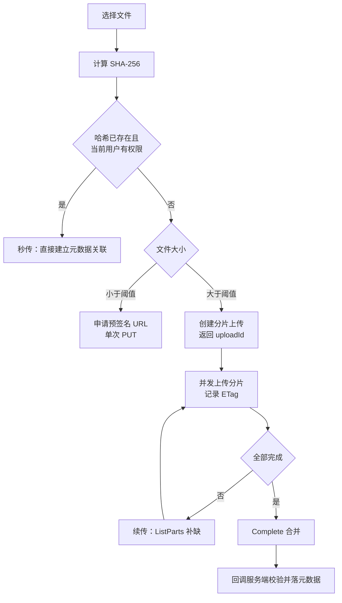
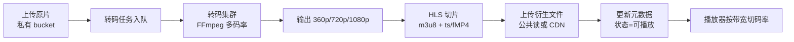
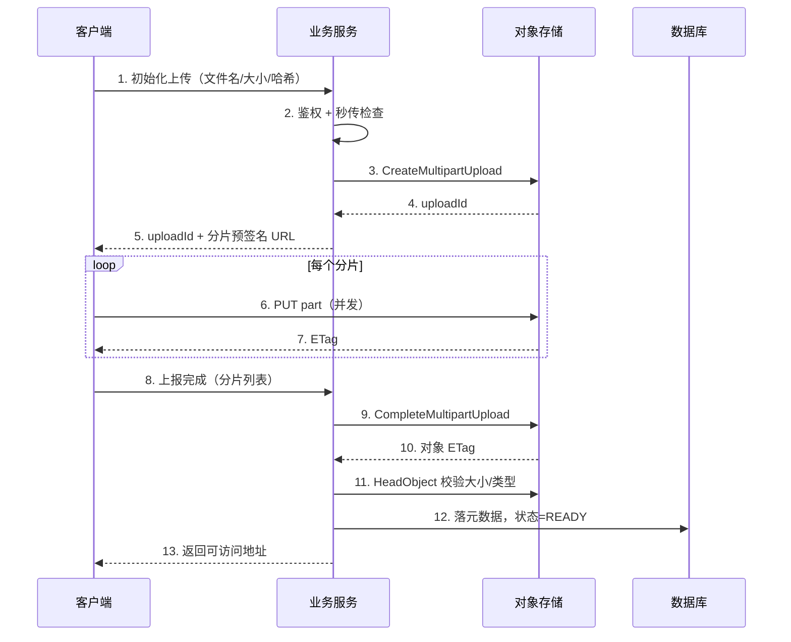

# 对象存储与音视频处理

> 定位：用户上传的图片、视频、附件看似只是「存个文件」，但它牵动容量、带宽、CDN、转码、鉴权和成本六件事。这篇讲清对象存储的模型与 S3 兼容接口、分片上传与断点续传、秒传与直传签名、CDN 回源、图片处理、FFmpeg 转码与 HLS 切片、播放鉴权、存储分层和安全，并给出可直接落地的上传时序与 Java 签名示例。

## 一、为什么需要它

第一版通常把文件存在应用服务器的本地磁盘，数据库里存一个路径。用户量上来后依次出问题：多实例部署后，A 实例上传的文件 B 实例读不到；磁盘写满导致应用挂掉；图片走应用服务器带宽，一张 5MB 的原图把出口带宽打满；没有鉴权，任何人猜到 URL 就能下载别人的合同。

对象存储解决的就是这些问题：容量近乎无限、多副本持久化、HTTP 直读、按量计费。它和文件系统、NAS 的差异：

| 维度 | 本地磁盘 | NAS | 对象存储 |
|---|---|---|---|
| 访问协议 | 文件系统调用 | NFS/SMB | HTTP + S3 API |
| 扩展 | 单机容量上限 | 纵向扩展为主 | 水平扩展，近乎无限 |
| 数据模型 | 目录树 | 目录树 | 扁平 key-value |
| 多副本 | 自己做 | 依赖阵列 | 服务端多副本/纠删码 |
| 公网访问 | 需自己做 | 需自己做 | 原生支持，配 CDN |
| 成本 | 硬件一次性 | 中等 | 按存储和流量计费 |

三条本质约束：

1. **对象是不可变的**。上传后想改内容，只能覆盖整个对象（或重新上传），没有「改文件的第 100 字节」这种操作。这决定了「先写临时对象、再提交」的设计。
2. **存储便宜，流量贵**。对象存储的存储费很低，但公网下行流量和 CDN 回源流量是主要成本，架构要围绕「少回源」设计。
3. **对象存储不是数据库**。它不做事务、不做条件查询，元数据（谁上传的、属于哪个业务、是否审核通过）必须放在数据库里。

## 二、核心原理

### 2.1 对象存储模型与 S3 兼容

三个概念：

- **Bucket**：命名空间，全局唯一，绑定地域和权限策略。
- **Object**：数据本体，由 key 唯一标识，附带元数据和内容类型。
- **Key**：扁平字符串，可以带 `/` 看起来像目录，但底层没有目录概念。`user/1/avatar.png` 只是一个普通 key。

S3 兼容意味着可以用同一套 SDK 和 API 访问 AWS S3、MinIO、阿里云 OSS、腾讯云 COS 等。核心操作只有几个：`PutObject`、`GetObject`、`DeleteObject`、`HeadObject`、`CreateMultipartUpload`、`UploadPart`、`CompleteMultipartUpload`、`AbortMultipartUpload`。

一致性要按「最终一致」设计：S3 自 2020 年起对新建对象的读写提供了强一致语义，但很多兼容实现的保证不同。工程上不要依赖「写完立刻能列出/能读到」的强假设，元数据以数据库为准，对象读取失败要能重试。

Key 的设计要避免两个坑：一是不要用用户输入直接拼 key（路径穿越、特殊字符），要用「业务前缀 + 哈希 + 扩展名」；二是不要用时间戳做前缀导致热点分区，高并发写入时加随机前缀打散。

### 2.2 上传：普通、分片、断点续传、秒传

小文件（几 MB 以内）直接 `PutObject`。大文件必须分片：

- `CreateMultipartUpload` 拿到 `uploadId`。
- 按固定大小切块，逐块 `UploadPart`，每块返回 ETag。
- 全部成功后 `CompleteMultipartUpload` 提交分片列表。
- 失败或放弃时 `AbortMultipartUpload` 清理。

S3 的通用约束是「分片号 1~10000、单分片最小 5MB（最后一片除外）、单对象最大 5TB」，具体以所用实现的文档为准。分片大小要按文件大小动态算，比如目标 1000~2000 片，太小会产生大量请求，太大则单片失败重传成本高。

**断点续传**的关键是「持久化 uploadId 和已完成分片列表」。客户端本地存，或服务端按 `(userId, fileHash)` 存。重连后先 `ListParts` 对比，只补缺失的分片。

**秒传**是「内容寻址」：客户端先算文件哈希（SHA-256），上传前问服务端「这个哈希存在吗」。存在就直接把已有对象关联到当前用户，不再上传。



读图要点：秒传必须先校验权限，不能「哈希存在就给」。分片上传的 `Complete` 只是对象存储侧完成，业务侧还要校验大小、类型、哈希，再落数据库，否则会出现「对象存在但无人认领」的孤儿文件。

### 2.3 直传与签名 URL

文件不要经过应用服务器中转，否则带宽和内存都会被占满。正确姿势是客户端直传对象存储：

1. 客户端向业务服务申请上传凭证。
2. 业务服务鉴权后，用服务端密钥生成**预签名 URL**（Presigned URL），带过期时间和受限的操作。
3. 客户端拿 URL 直接 `PUT` 到对象存储。
4. 完成后通知业务服务，服务端 `HeadObject` 校验大小和类型，再落元数据。

预签名 URL 的要点：

- 有效期尽量短（几分钟到十几分钟），不要签一天。
- 只签必要操作（PUT 单个 key），不要签通配权限。
- 限制 `Content-Type` 和 `Content-Length` 范围，防止上传可执行文件或超大文件。
- 服务端密钥绝不下发到客户端；客户端拿到的是「一次性通行证」，不是「钥匙」。

### 2.4 CDN 回源与缓存

图片和视频的读流量远大于写流量，必须走 CDN。链路是：客户端 → CDN 边缘节点 → 回源到对象存储。

缓存策略的核心是 **Cache Key**。默认用完整 URL 做 key，但带签名的 URL 每次参数不同，会导致缓存永远不命中。解决方式：

- 把鉴权参数放在 Cookie 或 Header，不参与 Cache Key。
- 或者用 CDN 的「忽略指定参数」功能，把签名参数排除在 key 之外。
- 图片处理参数（宽高、质量）要参与 key，否则不同尺寸会互相覆盖。

回源要防「缓存穿透」：不存在的 key 被大量请求时，CDN 每次都回源。可以配置「回源失败缓存」短时间缓存 404，或者在业务层对不存在的资源返回兜底图。

**什么规模不该上 CDN**：内网系统、日请求几千次的图片，直接走对象存储的公网地址即可，CDN 的配置和刷新成本不划算。

### 2.5 图片处理

常见操作：缩略图、裁剪、格式转换（WebP/AVIF）、水印、压缩。三种实现：

| 方式 | 做法 | 优点 | 缺点 |
|---|---|---|---|
| 上传时预生成 | 上传后异步生成多套尺寸 | 读取快、稳定 | 存储翻倍、尺寸固定 |
| 实时处理 | 通过 CDN 图片处理或自建服务按参数处理 | 灵活、省存储 | 首次慢、有 CPU 成本 |
| 客户端处理 | 上传前压缩 | 省带宽 | 不可信，仍需服务端校验 |

实时处理的参数必须白名单化：只允许 `w`、`h`、`q`、`format` 等有限参数，且限制范围（比如宽高不超过 4096）。否则攻击者可以用 `w=100000` 让图片服务分配巨大内存，或者传一个远程 URL 造成 SSRF。

水印和裁剪要考虑「原图保护」：原图放私有 bucket，只允许特定角色读取；对外只暴露处理后的衍生图。

### 2.6 视频转码与 HLS/DASH

视频不能直接播原文件：编码格式杂、码率高、不支持拖动。标准流程是「上传原片 → 转码 → 切片 → 生成播放列表」：



读图要点：转码是异步任务，上传成功不等于可播放，元数据要有 `TRANSCODING / READY / FAILED` 状态。多码率（ladder）让播放器根据带宽自适应，HLS 的 `m3u8` 是文本播放列表，`ts` 或 `fMP4` 是切片；DASH 用 `MPD` 描述，原理类似。

FFmpeg 的典型命令：

```bash
# 转 720p H.264，切片 4 秒，生成 HLS 播放列表
ffmpeg -i input.mp4 \
  -vf "scale=-2:720" -c:v libx264 -preset fast -crf 23 \
  -c:a aac -b:a 128k -hls_time 4 -hls_playlist_type vod \
  -hls_segment_filename "out/720p_%03d.ts" out/720p.m3u8
```

要点：`scale=-2:720` 保持宽高比且宽为偶数（H.264 要求）；`-hls_time` 是切片时长，太短请求多、太长起播慢；生产上多码率要并行转，用队列控制并发，单机不要同时跑太多 FFmpeg 进程，否则 CPU 和内存都会被打满。

### 2.7 播放与鉴权

私有视频不能直接给对象 URL，否则链接一传十、十传百。常见三级方案：

| 方案 | 做法 | 安全级别 | 适用 |
|---|---|---|---|
| 签名 URL | 带过期时间和签名的临时地址 | 中 | 点播、付费内容 |
| CDN 鉴权 | CDN 校验 token/cookie | 中高 | 大规模分发 |
| DRM | Widevine/FairPlay 加密 | 高 | 高价值版权内容 |

签名 URL 要绑定「资源 + 过期时间 + 客户端标识」，过期后即使链接泄露也无法播放。HLS 还可以对切片加密（AES-128），密钥通过独立接口鉴权下发。DRM 成本高，只有真正的高价值内容才值得。

### 2.8 存储分层与成本

对象存储通常分标准、低频、归档、深度归档几层，价格递减、取回时间和最小存储时长递增。策略：

- 热数据（最近 30 天访问过）放标准层。
- 冷数据（历史订单附件、旧视频）用生命周期规则自动转低频或归档。
- 临时文件（转码中间产物）设置 1~7 天自动删除。
- 未完成的分片上传设置 `AbortIncompleteMultipartUpload`，否则会一直计费。

成本优化的顺序是：先删无用数据和未完成分片，再上 CDN 降回源，再考虑压缩和转码降码率，最后才是分层。

### 2.9 元数据一致性与安全

对象存储和数据库是两套系统，必然出现不一致。设计原则是「**对象先落地，元数据后提交，失败可清理**」：

- 上传到临时 key（`tmp/{uploadId}`），校验通过后 `CopyObject` 到正式 key，再写数据库。
- 数据库记录 `object_key`、`size`、`content_type`、`sha256`、`status`、`owner_id`。
- 定时任务扫描「数据库无记录的对象」和「数据库有记录但对象不存在」两种情况，前者删除，后者告警。

安全清单：

- Bucket 默认私有，公读只给明确的 CDN 或衍生图目录。
- 最小权限：上传凭证只能写指定前缀，读凭证只能读指定对象。
- 文件类型校验不能只看扩展名，要读文件头（magic number）。
- 图片/文档做病毒扫描和内容审核，尤其是用户可公开访问的内容。
- 禁止用用户输入直接拼 key，防止路径穿越和覆盖他人文件。

## 三、关键机制与关键代码

### 3.1 分片直传完整时序



读图要点：第 5 步下发的是「每个分片的预签名 URL」，不是永久密钥；第 11 步的 `HeadObject` 是防篡改的关键，客户端上报的大小和类型不可信，必须以对象存储为准。

### 3.2 Java 预签名 URL（AWS SDK for Java v2）

```java
S3Presigner presigner = S3Presigner.builder()
        .region(Region.of(region))
        .credentialsProvider(DefaultCredentialsProvider.create())
        .build();

PutObjectRequest objectRequest = PutObjectRequest.builder()
        .bucket(bucket)
        .key("upload/" + userId + "/" + UUID.randomUUID() + ".jpg")
        .contentType("image/jpeg")
        .build();

PresignedPutObjectRequest presigned = presigner.presignPutObject(r -> r
        .signatureDuration(Duration.ofMinutes(10))
        .putObjectRequest(objectRequest));

String uploadUrl = presigned.url().toString(); // 返回给客户端直传
```

要点：`signatureDuration` 控制有效期；`contentType` 在签名里固定后，客户端 PUT 时必须带同样的头，否则签名不匹配；生产上再加 `contentLength` 上限和对象 key 前缀约束。以 AWS SDK for Java v2 为准，其他兼容实现的签名参数略有差异。

### 3.3 元数据表

```sql
CREATE TABLE media_file (
  id           bigint       NOT NULL AUTO_INCREMENT,
  file_key     varchar(255) NOT NULL COMMENT '对象 key',
  bucket       varchar(64)  NOT NULL,
  owner_id     bigint       NOT NULL,
  biz_type     varchar(32)  NOT NULL COMMENT 'avatar/contract/video',
  file_name    varchar(255) NOT NULL,
  content_type varchar(64)  NOT NULL,
  size_bytes   bigint       NOT NULL,
  sha256       char(64)     NOT NULL,
  status       tinyint      NOT NULL COMMENT '0上传中 1可用 2转码中 3失败',
  duration_ms  int          DEFAULT NULL COMMENT '视频时长',
  create_time  datetime     NOT NULL DEFAULT CURRENT_TIMESTAMP,
  PRIMARY KEY (`id`),
  UNIQUE KEY uk_file_key (file_key),
  KEY idx_owner_biz (owner_id, biz_type),
  KEY idx_sha256 (sha256)
) ENGINE=InnoDB DEFAULT CHARSET=utf8mb4;
```

`uk_file_key` 防重复登记；`idx_sha256` 支撑秒传查询；`status` 让「上传中」和「可播放」分开，避免用户看到半成品。

## 四、生产坑点与排查

### 坑点 1：秒传导致越权访问

**现象**：A 用户上传了一个文件，B 用户用同样的哈希「秒传」成功，然后通过自己的下载链接拿到了 A 的文件。
**原因**：秒传只判断「哈希存在」，没有判断「当前用户是否有权访问这个对象」；或者秒传后直接复用了原对象的 key。
**解法**：秒传必须做权限校验（原对象是否属于公开资源、当前用户是否有业务关联）；为每个用户生成独立的引用记录；高敏感文件不做跨用户秒传，宁可重新上传。

### 坑点 2：未完成的分片上传持续计费

**现象**：存储账单里有一部分「看不见」的费用，控制台显示大量未完成的分片上传。
**原因**：客户端上传中断、`Complete` 失败，但没有调用 `AbortMultipartUpload`；分片数据一直保留并计费。
**解法**：Bucket 配置「清理未完成分片」的生命周期规则（比如 7 天）；客户端失败重试要有上限，超限主动 abort；服务端记录 `uploadId` 并定期清理。

### 坑点 3：预签名 URL 泄露或权限过大

**现象**：有人拿到了上传 URL，往 bucket 里传了大量垃圾文件；或者 URL 被分享后长期可用。
**原因**：有效期设成 7 天；签名时没有限制 key 前缀和大小；URL 出现在日志或前端源码里。
**解法**：有效期控制在分钟级；签名绑定具体 key、Content-Type、大小范围；URL 不进日志；上传完成后立即失效（或依赖短过期）；Bucket 开启服务端加密和访问日志。

### 坑点 4：CDN 缓存了鉴权失败页或 302

**现象**：部分用户播放视频时一直 403，刷新也没用；或者私有图片被公开缓存。
**原因**：CDN 把带签名的 URL 或错误响应缓存了；Cache Key 包含签名参数，导致同一资源缓存多份，或者不包含签名导致越权内容被共享。
**解法**：鉴权参数不参与 Cache Key，改用 Cookie/Header 鉴权；错误响应设置短缓存或不缓存；私有资源用「回源鉴权 + 短 TTL」；变更后主动刷新 CDN。

### 坑点 5：转码任务堆积，CPU 和内存被打满

**现象**：上传高峰后视频长时间「处理中」，转码节点负载 100%，甚至 OOM。
**原因**：转码任务没有队列和并发控制，每个上传都立刻起一个 FFmpeg；大分辨率视频单进程内存占用很高。
**解法**：转码走独立队列和独立集群；按 CPU 核数限制并发；限制输入分辨率和时长；失败重试有上限并进死信；用 Kubernetes 的 ResourceQuota 隔离。

### 坑点 6：数据库有记录，对象却不存在

**现象**：用户点开历史附件提示 404，但数据库里明明有记录。
**原因**：对象被生命周期规则误删；或者上传时先写数据库、后传对象，对象上传失败但事务已提交。
**解法**：顺序改成「先传对象、校验后再写数据库」；生命周期规则排除业务对象前缀；每日对账扫描「DB 有、对象无」，告警并触发重建或标记失效。

## 五、调优、选型与最佳实践

### 5.1 自建还是云对象存储

| 方案 | 适用 | 代价 |
|---|---|---|
| 云对象存储（OSS/COS/S3） | 绝大多数业务 | 按量计费，出网流量贵 |
| MinIO 自建 | 私有化、内网、成本敏感 | 自己运维集群、扩容、容灾 |
| NAS/文件系统 | 小规模、需要文件锁 | 扩展性差，不适合公网直读 |

判断标准：**是否有公网分发需求、是否有合规要求、团队是否有存储运维能力**。没有特殊要求时，云对象存储几乎总是更划算——你省下的运维人力远大于流量费。

### 5.2 转码方案对比

| 方案 | 适用 | 优点 | 缺点 |
|---|---|---|---|
| 云转码服务 | 快速上线、格式多 | 免运维、弹性 | 按分钟计费，长期成本高 |
| 自建 FFmpeg 集群 | 量大、成本敏感 | 可控、可定制 | 运维和调度复杂 |
| 客户端转码 | 短视频、弱网 | 省服务端 | 不可靠、耗电、格式受限 |

### 5.3 什么规模不该这么做

- 日上传几十个文件：不要做秒传、分片和转码集群，直传加定时压缩就够。
- 内网系统：不需要 CDN 和防盗链，对象存储内网地址即可。
- 视频只是「附件下载」而非「在线播放」：不需要 HLS 和 DRM，转成 MP4 加签名 URL 即可。
- 不要自建对象存储来「省钱」：除非规模足够大或有合规要求，否则运维成本远高于云服务账单。

## 六、面试高频问法

**Q1：文件上传系统怎么设计？**

**一句话结论**：客户端直传对象存储，服务端只发预签名凭证和落元数据，大文件走分片和断点续传。

展开：申请凭证 → 直传 → 回调校验 → 落库；小文件单次 PUT，大文件 `CreateMultipartUpload` 加分片；元数据表和对象分离，状态管理上传中/可用/失败。

加分点：说「文件不经过应用服务器，是为了省带宽和内存，也避免应用成为单点」。

**Q2：秒传的原理是什么？有什么风险？**

**一句话结论**：内容哈希去重，命中已有对象就只建引用；风险是越权和哈希泄露。

展开：客户端算 SHA-256，服务端查 `idx_sha256`；命中后校验用户权限，再建立引用；跨用户秒传只对公开资源开放。

加分点：说「秒传不是安全功能，反而可能成为越权入口，权限校验不能省」。

**Q3：分片上传怎么实现断点续传？**

**一句话结论**：持久化 `uploadId` 和已完成分片列表，重连后 `ListParts` 对比补齐。

展开：创建上传拿 `uploadId`；每片上传拿 ETag 并本地记录；失败只重传缺失分片；全部完成后 `Complete`；放弃时 `Abort` 清理。

加分点：说「不 abort 的分片会一直计费」，并提到生命周期规则兜底。

**Q4：预签名 URL 怎么保证安全？**

**一句话结论**：短有效期、限定 key 和操作、绑定 Content-Type 和大小，密钥不下发。

展开：服务端用临时凭证或长期密钥签名；URL 只允许 PUT 单个 key；有效期分钟级；上传后校验 `HeadObject`。

加分点：说「预签名 URL 是通行证不是钥匙，泄露的影响要可控」。

**Q5：图片和视频怎么加速？**

**一句话结论**：CDN 边缘缓存加多码率 HLS，Cache Key 设计决定命中率。

展开：图片走 CDN，处理参数参与 Cache Key；视频转多码率并切片，播放器自适应；签名参数不参与 Cache Key，改用 Cookie/Header；回源加 origin shield。

加分点：说「CDN 的成本大头是回源流量，命中率比带宽峰值更重要」。

**Q6：视频转码为什么要异步？HLS 是什么？**

**一句话结论**：转码耗时分钟级，必须异步；HLS 是把视频切成小片段并用 m3u8 索引，支持自适应码率和拖动。

展开：上传后入队，转码集群并行处理多码率；输出 m3u8 + ts/fMP4；元数据状态从转码中变为可播放；播放器按带宽切换码率。

加分点：说「上传成功不等于可播放，状态机必须显式表达」。

**Q7：私有视频怎么防盗链？**

**一句话结论**：签名 URL 或 CDN 鉴权，必要时切片加密和 DRM。

展开：URL 带过期时间和签名；CDN 校验 token；HLS 切片 AES-128 加密，密钥接口鉴权；高价值内容上 DRM。

加分点：说「防盗链是提高成本，不是绝对防止，录屏永远防不住」。

**Q8：对象存储和数据库怎么保证一致？**

**一句话结论**：先对象后元数据，失败可清理，定时对账兜底。

展开：上传到临时 key，校验后转正式 key；数据库记录 key、大小、哈希、状态；定时扫描孤儿对象和丢失对象；删除走「先标记后异步删」。

加分点：说「两套系统不可能强一致，只能设计成可对账、可补偿」。

**Q9：存储成本怎么优化？**

**一句话结论**：先删无用数据和未完成分片，再降回源，再压缩转码，最后分层。

展开：生命周期清理临时文件和旧版本；CDN 提高命中率；图片转 WebP/AVIF，视频降码率；冷数据转低频/归档；监控存储和流量账单。

加分点：说「成本优化要按账单排序，先动占比最大的那一项」。

## 小结

- 对象存储是扁平 key-value，对象不可变、存储便宜流量贵、元数据必须放数据库。
- 大文件走分片上传，断点续传靠持久化 uploadId 和分片列表，秒传靠内容哈希且必须校验权限。
- 文件直传对象存储，服务端只发短有效期预签名 URL，并用 HeadObject 校验结果。
- CDN 的 Cache Key 决定命中率，鉴权参数不要参与 key；回源流量是主要成本。
- 视频必须异步转码，输出多码率 HLS/DASH，元数据用状态机表达「转码中/可播放」。
- 安全底线：私有 bucket、最小权限、类型校验、病毒扫描、防越权和路径穿越。

## 参考资料

- Amazon S3 User Guide：Multipart Upload Overview、Presigned URLs、Storage Classes、Lifecycle Configuration
- AWS SDK for Java v2 Developer Guide：S3Presigner、S3Client
- MinIO 官方文档：Distributed Mode、Bucket Policy、Object Lifecycle
- RFC 8216：HTTP Live Streaming
- FFmpeg 官方文档：scale filter、libx264、hls muxer
- [缓存三大问题与一致性](../07-缓存与中间件/03-缓存三大问题与一致性.md)、[接口安全](../15-安全设计/02-接口安全.md)、[Kubernetes核心](../14-容器与云原生/02-Kubernetes核心.md)
