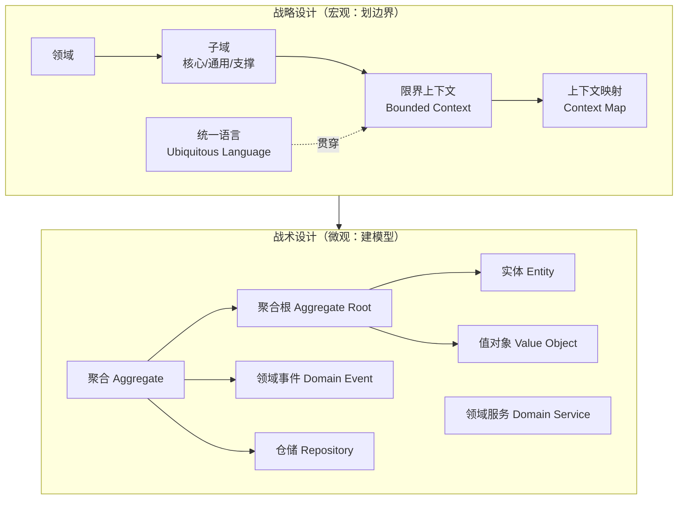
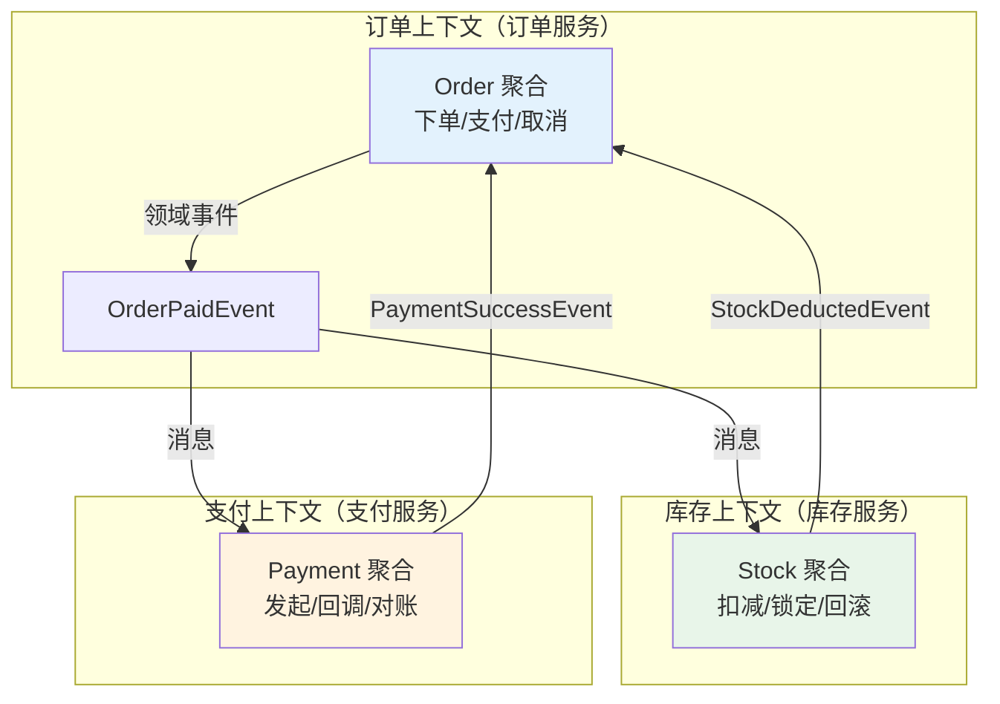

# DDD 领域驱动设计

> 定位：DDD 被吹得很玄，也被骂得很惨。这篇剥掉术语外壳，讲清它真正解决的两个问题——「复杂业务怎么拆分边界」和「代码怎么贴近业务」。从战略设计（限界上下文）到战术设计（聚合、实体、值对象、仓储），再到如何指导微服务拆分，以及落地难点与误区。

## 一、为什么需要 DDD

先说一个普遍痛点。很多 Java 项目的典型形态是：

- 一个 `Service` 类几千行，事务脚本一堆 `if-else`。
- 数据库表结构直接对应对象，所有对象只有 getter/setter（贫血模型），业务逻辑散落在 Service 里。
- 随着业务复杂，「订单」这个概念到处都是——订单中心有、促销系统有、物流系统也有，各自的字段和含义都不一样，但没人说得清区别。
- 想拆微服务，不知道按什么拆，最后按「数据库表」拆出一堆「数据搬运工」服务。

这些问题的本质是：**业务复杂度没有被有效地分解和表达，代码结构和业务认知脱节**。

DDD（Domain-Driven Design，领域驱动设计）由 Eric Evans 在 2003 年提出，核心主张是：

1. **围绕业务领域建模**，而不是围绕数据库表或技术框架建模。
2. **用统一语言**连接业务专家和开发人员，消除沟通鸿沟。
3. **显式划分边界**，把复杂系统拆成可理解、可独立演进的子域。

> DDD 不是一套框架，也不是银弹。它最适合**业务复杂、规则多变、生命周期长**的核心系统（如电商交易、金融、保险）。对于简单的 CRUD 系统，用 DDD 反而是过度设计。

## 二、DDD 的核心概念体系

DDD 概念很多，先建立一张全景图，再逐个拆解。



这张图把 DDD 分成两层：**战略设计**解决「系统该分成哪些块、边界在哪」，**战术设计**解决「每个块内部怎么建模」。面试和落地都要分清这两层——很多人只背了战术概念（实体、值对象），却忽略了更重要的战略设计。

### 2.1 战略设计概念

**领域（Domain）与子域（Subdomain）**

领域就是业务问题域本身。一个复杂领域会分成多个子域：

- **核心域（Core Domain）**：公司的核心竞争力所在，必须自己做好（如电商的交易、推荐算法）。
- **通用域（Generic Subdomain）**：行业通用能力，可采购或直接用现成方案（如认证、支付网关）。
- **支撑域（Supporting Subdomain）**：辅助核心业务，但不构成竞争力（如内部权限管理、报表）。

> 这个分类的指导意义：**把最好的资源投在核心域**，通用域买现成的，支撑域可以外包或用简单方案。不是所有模块都值得投入同样的精力。

**限界上下文（Bounded Context）**

这是 DDD 最重要的战略概念。它定义了一个模型**适用的边界**：在这个边界内，某个术语有确定的含义；出了边界，含义可能不同。

经典例子：「商品」在不同上下文里含义不同：

- 销售上下文：商品 = 名称、价格、详情（面向展示）
- 库存上下文：商品 = SKU、库存数量、仓库（面向发货）
- 物流上下文：商品 = 重量、体积、易碎标志（面向运输）

强行做一个「大而全的商品模型」让所有上下文共用，结果就是字段越来越多、语义混乱、谁都不敢改。**限界上下文说的是：每个上下文有自己专属的模型，不必强行统一。**

**统一语言（Ubiquitous Language）**

在同一个限界上下文内，业务专家和开发用**同一套术语**沟通，这套术语直接体现在代码里（类名、方法名）。比如业务说「订单已支付」，代码里就有 `Order.paid()`、`OrderPaidEvent`，而不是 `Order.setStatus(2)`。

统一语言的价值在于消除「业务说 A、代码写 B、文档记 C」的翻译损耗——翻译越多，需求偏差越大。

**上下文映射（Context Map）**

描述不同限界上下文之间的关系模式：

| 关系 | 含义 | 例子 |
|---|---|---|
| 合作关系 | 两个上下文共同演化 | 订单与库存团队紧密协作 |
| 共享内核 | 共享一部分模型 | 共享通用基础模型 |
| 客户-供应商 | 上游提供，下游消费 | 支付网关供订单调用 |
| 顺从者 | 下游完全按上游模型 | 接入第三方 API |
| 防腐层（ACL） | 下游用适配层隔离上游模型 | 订单系统用 ACL 隔离外部物流模型 |
| 开放主机服务 | 上游提供稳定公开接口 | 提供 REST/gRPC API |
| 发布语言 | 用标准格式交换 | 用 Protobuf/事件 |

**防腐层（Anti-Corruption Layer）** 是落地中最实用的模式：当你的系统调用一个模型很烂的外部系统时，不要让它污染你的领域模型，用一层适配器做转换。

### 2.2 战术设计概念

**实体（Entity）与值对象（Value Object）**

- **实体**：有唯一标识、有生命周期、状态会变化的对象。如订单（有订单号）、用户（有用户 ID）。相等性按 ID 判断。
- **值对象**：没有唯一标识，只用属性描述，不可变。如地址（省市区+详细地址）、金额（数值+币种）。相等性按所有属性判断。

区分的意义：**值对象可以随意创建、丢弃、替换，不用考虑身份**；实体要维护身份和状态变更。把该做值对象的东西做成实体（给地址加个 ID），会徒增复杂度。

```java
// 值对象：不可变，无 ID
public record Money(BigDecimal amount, String currency) {
    public Money add(Money other) {
        // 校验币种一致后再相加
        return new Money(amount.add(other.amount), currency);
    }
}
// 实体：有 ID，有状态
public class Order {
    private final OrderId id;        // 标识
    private OrderStatus status;      // 可变状态
    private Money total;
    public void paid() {
        // 领域规则：只有待支付才能支付
        if (status != OrderStatus.PENDING) throw new IllegalStateException();
        this.status = OrderStatus.PAID;
    }
}
```

**聚合（Aggregate）与聚合根（Aggregate Root）**

聚合是一组强相关的领域对象的集合，作为一个整体被修改和持久化。**聚合根**是聚合的唯一入口，外部只能通过聚合根访问内部对象。

经典例子：订单（聚合根）包含多个订单项（内部实体）。外部要改订单项，必须通过订单对象，不能直接操作订单项——这样可以在聚合根处统一维护业务规则（如「订单总额 = 各订单项之和」「已支付订单不能加商品」）。

聚合的设计原则：

- **聚合要小**：聚合越大，事务冲突越严重、加载越慢。一个聚合根 + 少量内部对象即可。
- **聚合间用 ID 引用，不直接持有对象**：订单里存 `productId` 而不是整个 Product 对象。
- **一个事务只修改一个聚合**：跨聚合的一致性用领域事件最终一致，而不是大事务。

**领域事件（Domain Event）**

表示领域中发生的重要业务事实，通常是过去式（OrderCreated、OrderPaid、StockDeducted）。它用来：

- **解耦**：订单支付后发布事件，库存、通知、积分各自订阅，订单不用知道它们。
- **表达业务时序**：事件是领域模型的「第一等公民」，明确记录了什么发生了。
- **实现最终一致**：跨聚合/跨上下文的一致性通过事件驱动达成。

**仓储（Repository）**

封装数据存取，让领域层不需要关心数据库细节。它的接口用领域语言表达（如 `orderRepo.findByOrderNo()`），屏蔽了 SQL/ORM。注意：仓储是针对**聚合根**的（只按聚合根加载/保存），不是每个实体一个仓储。

### 2.3 DDD 分层架构

DDD 经典的四层结构（后面「架构模式」篇会详细展开）：

| 层 | 职责 | 依赖方向 |
|---|---|---|
| 用户接口层 | Controller、DTO、接口适配 | 依赖应用层 |
| 应用层 | 编排用例，无业务规则 | 依赖领域层 |
| 领域层 | 核心业务逻辑（实体、值对象、聚合、领域服务、事件） | 不依赖任何层 |
| 基础设施层 | 数据库、MQ、外部接口实现 | 依赖领域层（实现接口） |

**关键原则：领域层是核心，不依赖任何技术细节**（依赖倒置——仓储接口在领域层，实现在基础设施层）。这样业务规则不受框架、数据库变化影响。

## 三、用 DDD 指导微服务拆分

这是 DDD 在架构落地中最有价值的应用。

**核心思路：限界上下文就是微服务的天然边界。**



这张图展示了按限界上下文拆分后的微服务：每个服务内部有自己的聚合，服务之间通过领域事件异步协作。订单支付后发事件，库存扣减、支付确认各自响应，而不是订单服务直接调用所有下游并维护分布式大事务。

**拆分的判断标准**：

- **按业务能力/限界上下文拆，不按技术层或数据库表拆**。错误做法：拆出「用户服务」「订单查询服务」「订单写服务」——这是按技术拆，不是按业务。
- **看「一起变化」的归到一起**：如果两个概念总是同时被修改、同一波人负责，它们可能属于同一个上下文。
- **看语言边界**：同一个词在不同场景含义不同，就该拆成不同上下文。
- **数据归属**：每个服务独占自己的数据，别的服务通过 API/事件访问，不直接连库。

**DDD + 微服务的收益**：边界清晰（一个上下文一个团队一个服务）、独立演进、技术异构、故障隔离。

> 提醒：**先有清晰的领域模型，再拆微服务**。如果你连业务边界都没弄清楚就拆，只会得到一堆边界错误的「分布式单体」，比单体更难维护。DDD 的价值恰恰是帮你把边界想清楚。

## 四、生产坑点与排查（落地难点与误区）

DDD 的「坑」更多是落地认知上的坑，这里按「现象 → 原因 → 解法」呈现。

### 坑点 1：贫血模型——领域对象只有 getter/setter

**现象**：用了 DDD 的分层，但实体只有字段和 getter/setter，所有业务逻辑还在 Service 里，领域层沦为数据传输对象。
**原因**：习惯了「数据库表驱动」开发，先把表设计好再生成 POJO，自然只有数据没有行为。
**解法**：把属于领域对象的业务规则**移进对象本身**——`Order.paid()` 封装状态流转规则，而不是 `Service.setOrderStatus(order, 1)`。从用例出发设计模型，而不是从表出发。值是「建模能力」的改变，需要刻意练习。

### 坑点 2：过度设计——简单 CRUD 也要 DDD

**现象**：一个后台管理系统，硬套聚合根、领域事件、CQRS、仓储，类爆炸，开发效率暴跌，团队怨声载道。
**原因**：把 DDD 当银弹，不分场景套用全部战术组件。
**解法**：DDD 最适合核心复杂域。简单 CRUD 系统用「事务脚本 + ActiveRecord」更高效。战术组件按需取用——很多项目只用限界上下文（战略）和聚合根（战术）就已受益，不必上全套。

### 坑点 3：聚合设计过大导致性能和冲突问题

**现象**：把「订单 + 订单项 + 商品 + 客户」都放进一个聚合，加载一个对象要查几张表，并发修改频繁冲突，乐观锁一直失败。
**原因**：误以为「相关的都放一起」，没理解聚合是**一致性边界和事务边界**，应该尽量小。
**解法**：聚合尽可能小，一个聚合根 + 少量内部实体/值对象。聚合之间用 ID 引用，跨聚合一致性用领域事件最终一致。判断标准：一次业务操作要改哪些对象，它们才属于同一聚合。

### 坑点 4：限界上下文拆得太碎/太粗

**现象**：拆出的微服务要么太多（几十个，调用链复杂），要么太少（还是一个大服务，没解决耦合）。
**原因**：没有基于业务边界和数据归属分析，凭感觉拆。
**解法**：用事件风暴（Event Storming）工作坊，和业务专家一起识别领域事件、聚合、上下文边界。参考指标：一个上下文一个团队能独立负责（康威定律）、数据独占、语言内聚。

### 坑点 5：领域事件发了但一致性没保证

**现象**：订单支付成功发了事件，但库存没扣减（消息丢了），数据不一致。
**原因**：直接发消息，没考虑「本地事务提交成功但消息发送失败」的问题。
**解法**：用**事务发件箱（Transactional Outbox）**——在同一个本地事务里写业务数据和事件表，再由异步任务可靠投递到 MQ（保证至少一次 + 消费端幂等）。

## 五、DDD vs 数据驱动设计

| 维度 | DDD（领域驱动） | 数据驱动设计 |
|---|---|---|
| 起点 | 业务行为和规则 | 数据库表结构 |
| 模型 | 富领域模型（有行为） | 贫血模型（只有数据） |
| 关注点 | 业务语义、边界、不变量 | 数据存储、查询效率 |
| 变更驱动 | 业务规则变化 | 需求/字段变化 |
| 适用 | 复杂、规则多变的核心域 | 简单 CRUD、报表类 |
| 优势 | 贴合业务、易维护复杂逻辑 | 上手快、简单直接 |
| 劣势 | 学习成本高、简单场景过度设计 | 复杂业务代码腐化快 |

> 两者不是非黑即白。实际项目常见做法：**核心域用 DDD 精心建模，外围的简单 CRUD 用数据驱动快速实现**。DDD 的战略思想（限界上下文、统一语言）几乎在任何项目都有价值，战术组件按需使用。

## 六、面试高频问法

> 这一节的答案按「面试时能讲透」的标准写：先给一句话结论，再展开机制、原因和坑点。

**Q1：DDD 是什么？它解决什么问题？**

**一句话结论**：DDD（领域驱动设计）是一套"围绕业务领域建模"的方法论——用统一语言、限界上下文、聚合等概念，把复杂业务拆解清楚、让代码贴近业务。

展开：

- **解决的问题**：业务复杂、代码和业务脱节（贫血模型、逻辑散落）、微服务不知道怎么拆。
- **两个层面**：战略设计（划边界：子域、限界上下文）+ 战术设计（建模型：实体、值对象、聚合、领域事件）。
- **核心价值**：让"业务复杂度"被有效分解和表达。

加分点：说"DDD 不是框架，是方法论——它最适合'业务复杂、规则多变、生命周期长'的核心系统；简单 CRUD 用 DDD 是过度设计"。

**Q2：什么是限界上下文（Bounded Context）？**

**一句话结论**：限界上下文是"一个模型适用的边界"——在边界内，某个概念有明确的含义；出了边界，同一个词可能是另一个意思。

展开：

- **为什么需要**：同一个词在不同业务里含义不同（如"商品"在销售、库存、物流里含义不同）。
- **作用**：划分边界，让每个上下文有自己的模型，避免"大泥球"。
- **和微服务**：一个限界上下文通常对应一个微服务（或几个）。

加分点：说"限界上下文是 DDD 战略设计的核心——它解决了'同一个词在不同场景含义不同'的问题，是微服务拆分的理论依据"。

**Q3：实体、值对象、聚合、聚合根是什么？**

**一句话结论**：实体有唯一标识、值对象靠值区分、聚合是一组相关对象的整体、聚合根是聚合的入口。

| 概念 | 特征 | 例子 |
|---|---|---|
| 实体 | 有 ID，可变化 | 用户（ID 不变，信息可变） |
| 值对象 | 无 ID，不可变，靠值相等 | 地址、金额、颜色 |
| 聚合 | 一组对象的边界 | 订单 + 订单明细 |
| 聚合根 | 聚合的唯一入口 | 订单（通过它操作明细） |

加分点：说"聚合的核心是'一致性边界'——聚合内的数据要强一致，聚合之间最终一致；这直接指导了'哪些数据放一个库、哪些分库'"。

**Q4：领域事件是什么？有什么用？**

**一句话结论**：领域事件是"领域中发生的、业务关心的事情"（如"订单已创建"），用于解耦和最终一致。

展开：

- **作用**：聚合之间通过事件通信，而不是直接调用——降低耦合。
- **实现**：领域事件 → 发到 MQ → 其他服务订阅处理。
- **场景**：订单创建后，通知库存、积分、物流。

加分点：说"领域事件是'微服务解耦'的利器——订单服务不用知道'谁关心订单创建'，只管发事件，谁需要谁订阅"。

**Q5：DDD 怎么指导微服务拆分？**

**一句话结论**：按"限界上下文"拆——每个上下文是一个业务边界，边界内高内聚，边界间低耦合。

展开：

- **步骤**：划分子域（核心/通用/支撑）→ 识别限界上下文 → 每个上下文对应一个服务。
- **原则**：高内聚（相关的一起）、低耦合（不相关的分开）。
- **反例**：按技术层拆（Controller 服务、Service 服务）——这是"分布式单体"。

加分点：说"DDD 拆分比'按表拆'高明在哪——按表拆会把'一个业务操作涉及的表'拆散，导致大量跨服务调用；按限界上下文拆，业务操作在一个服务内完成"。

**Q6：什么是统一语言（Ubiquitous Language）？**

**一句话结论**：统一语言是"业务和技术共同使用的一套术语"——代码里的类名、方法名、数据库字段都用业务术语，消除沟通鸿沟。

展开：

- **问题**：业务说"订单"，技术说"Order"，但理解不一致；或者业务叫"客户"，代码叫"User"。
- **做法**：和业务一起定义术语，代码、文档、沟通都用它。
- **好处**：减少误解，代码即文档。

加分点：说"统一语言看似'虚'，其实很实——代码里的命名混乱是'业务理解不一致'的体现；统一语言让'代码说话'和'业务说话'一致"。

**Q7：DDD 的贫血模型和充血模型有什么区别？**

**一句话结论**：贫血模型是"对象只有数据、逻辑在 Service"；充血模型是"对象既有数据又有行为"。

展开：

- **贫血**：`Order` 只有 getter/setter，业务逻辑在 `OrderService`——简单但逻辑散落。
- **充血**：`Order` 有 `pay()`、`cancel()` 等方法，业务逻辑在对象内部——贴近业务但需要设计。
- **DDD 倾向充血**：领域对象应该封装业务规则。

加分点：说"贫血不是'错'，简单 CRUD 用贫血挺好；但复杂业务用贫血会导致'Service 几千行、逻辑散落'，这时该用充血模型"。

**Q8：DDD 落地有哪些难点？**

**一句话结论**：难在"业务专家难找、统一语言难建、边界难划、团队难转变思维"——DDD 是"组织 + 技术"的双重挑战。

展开：

- **业务参与**：DDD 需要业务专家深度参与，但业务往往很忙。
- **边界划分**：限界上下文划错，后面全错。
- **思维转变**：团队习惯"数据驱动"，转向"领域驱动"需要时间。
- **过度设计**：简单业务硬套 DDD，复杂度爆炸。

加分点：说"DDD 失败最常见的原因是'只学战术、不学战略'——纠结实体值对象，却没划清限界上下文，最后还是大泥球"。

**Q9：事件风暴是什么？**

**一句话结论**：事件风暴是"用便利贴梳理业务事件"的工作坊方法——业务和技术一起，把领域事件、命令、聚合贴在墙上，快速建立领域模型。

展开：

- **流程**：识别领域事件（发生了什么）→ 找命令（谁触发的）→ 找聚合（谁处理的）→ 划限界上下文。
- **价值**：快速、可视化、业务技术对齐。

加分点：说"事件风暴是 DDD 落地的'最佳起点'——它把'建模'从'程序员闷头想'变成'业务技术一起贴墙'，效率和共识都高"。

**Q10：什么场景不适合 DDD？**

**一句话结论**：简单 CRUD、业务逻辑很少、生命周期短的项目，用 DDD 是过度设计。

展开：

- **不适合**：后台管理、简单报表、工具类系统。
- **适合**：核心业务（交易、金融、复杂流程）。
- **判断**：业务复杂度高、规则多变、长期演进——才值得 DDD。

加分点：说"DDD 的成本很高（建模、统一语言、团队学习）——它适合'复杂核心'，不适合'简单边缘'；务实做法是'核心域用 DDD，支撑域用简单架构'"。

## 小结

- DDD 解决两个核心问题：复杂业务怎么划边界（战略）、代码怎么贴近业务（战术）。适合复杂核心域，简单 CRUD 不必硬套。
- 战略设计：子域分核心/通用/支撑，资源向核心域倾斜；限界上下文定义语义边界，是微服务天然边界；统一语言消除沟通损耗。
- 战术设计：实体有 ID、值对象不可变；聚合是事务边界，聚合根是唯一入口，要小；领域事件解耦、仓储隔离数据层。
- DDD + 微服务：按限界上下文拆，数据独占，服务间用事件协作；先建模后拆分。
- 落地警惕：贫血模型、过度设计、聚合过大、边界乱拆、事件一致性——用事件风暴和事务发件箱等方法应对。
