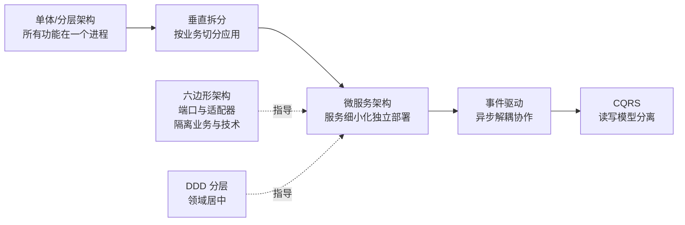
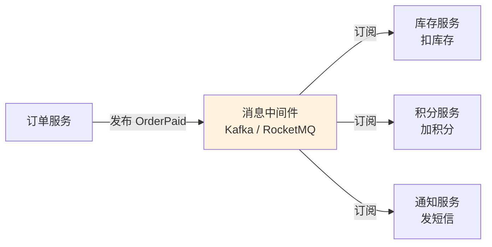
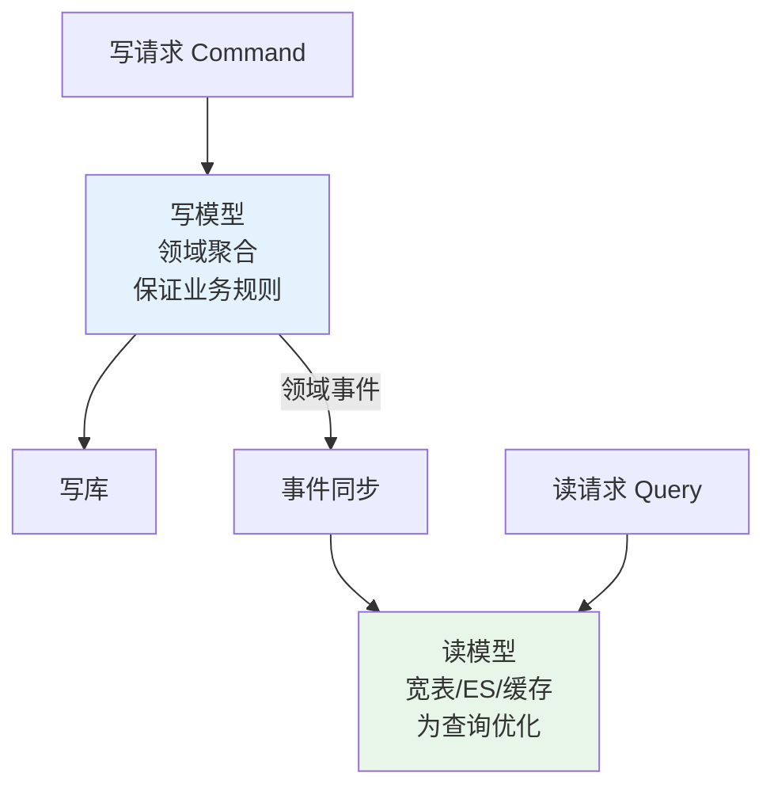
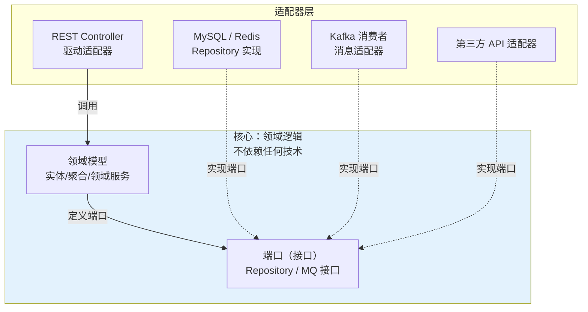

# 架构模式

> 定位：架构模式是「组织代码和组件的结构性套路」。分层、微服务、事件驱动、CQRS、六边形……每种都有它擅长解决的问题和代价。这篇讲清每种模式的结构、优缺点、适用场景，以及它们之间如何从简单到复杂逐步演进——让你在选型时不追新、不盲从，按问题选结构。

## 一、为什么需要架构模式

两个同样功能的系统，一个有清晰的结构：改一处不影响别处、新人能快速上手、能水平扩展；另一个是一团乱麻：改个字段要动五六个地方、加个功能处处踩坑、性能到顶也不知道扩哪里。差别往往就在于**有没有一个合适的架构模式在约束组织方式**。

架构模式的价值：

- **提供约束**：明确「代码该放哪、依赖该朝哪个方向」，防止腐化。
- **沉淀经验**：是前人解决同类问题的成熟方案，不用你重新踩坑。
- **便于沟通**：说「我们用的是六边形架构」，团队对结构就有共同预期。

但也要警惕：**没有最好的模式，只有适合当前问题的模式**。一个内部小工具上微服务+事件驱动+CQRS，是典型的「杀鸡用牛刀」，复杂度远超收益。

## 二、架构模式的演进脉络

先看一张演进图，理解这些模式是怎么一步步发展出来的——后面的每种模式都能在这条线上找到位置。



这张图揭示了主线：**从「集中」到「拆分」到「解耦」**，复杂度逐步上升，解决的问题也从「代码组织」升级到「系统扩展与团队协作」。六边形架构和 DDD 分层不是这条主线上的阶段，而是**贯穿始终的组织思想**——它们告诉你拆完之后每个服务内部应该怎么组织。

> 演进不是「越往后越先进」。单体在很多场景仍然是最优解（见「技术选型方法论」篇）。演进是被问题驱动的：单体扛不住了才拆，同步调用耦合太紧了才上事件。

## 三、分层架构（Layered Architecture）

**结构**：把系统按职责分成若干水平层，经典四层：

```
表现层（Controller） → 业务逻辑层（Service） → 数据访问层（DAO/Repository） → 数据库
```

**依赖规则**：上层依赖下层，**严格单向**。

| 优点 | 缺点 |
|---|---|
| 结构简单，上手快 | 容易退化为「分布式单体」，层间变得僵化 |
| 职责清晰，隔离关注点 | 业务复杂时 Service 层膨胀成上帝类 |
| 大多数团队熟悉 | 自顶向下逐层调用，性能有损耗 |

**适用场景**：绝大多数中小系统、CRUD 为主的业务、团队规模不大时。这是最默认、最安全的选择。

**常见坑**：分层变成「只是为了分层」——Controller 只做转发、Service 只做事务、DAO 只做 SQL，业务规则无处安放。解法是让领域模型承载业务逻辑（结合 DDD）。

## 四、微服务架构（Microservices）

**结构**：把单体按业务能力拆成一组小的、独立部署的服务，每个服务有自己的数据库，通过轻量级通信（HTTP/gRPC/消息）协作。

| 优点 | 缺点 |
|---|---|
| 独立开发、部署、扩展 | 分布式复杂度（网络、一致性、故障） |
| 技术异构（各服务可用不同语言） | 运维成本高（部署、监控、链路追踪） |
| 故障隔离、按需扩容 | 数据一致性难（分布式事务） |
| 团队自治（康威定律） | 服务拆分边界难定，拆错更痛苦 |

**适用场景**：业务复杂、团队规模大（多个小团队）、需要独立扩展不同模块、有 DevOps 基础。

**核心挑战**：

- **服务拆分**：按业务能力/限界上下文拆（见 DDD 篇），不按技术层拆。
- **数据一致性**：每个服务独占数据库，跨服务用最终一致 + Saga/TCC，别指望分布式事务银弹。
- **服务治理**：注册发现、配置中心、熔断限流、链路追踪、网关——这些是微服务的「基础设施税」。
- **拆分粒度**：太粗等于没拆，太细调用链复杂、运维爆炸。**没有固定标准，按团队和业务的实际情况来**。

>  Martin Fowler 的建议：**先从单体开始，把边界划清楚，等确实需要时再拆成微服务**。一上来就微服务，往往是因为「别人都在用」。

## 五、事件驱动架构（Event-Driven Architecture）

**结构**：组件之间通过**事件**异步协作。生产者发布事件，消费者订阅并处理，双方不需要知道对方的存在。



这张图展示了事件驱动的核心：订单服务只管发「OrderPaid」事件，不再同步调用库存/积分/通知。新增一个「优惠券服务」只需订阅事件，**不用改订单服务的代码**——这是解耦的威力。

| 优点 | 缺点 |
|---|---|
| 高度解耦，易扩展新消费者 | 异步带来最终一致性，不能立即看到结果 |
| 削峰填谷（流量缓冲） | 消息丢失/重复/顺序问题要处理 |
| 提高响应（主链路不用等） | 调试和追踪困难（调用链断了） |
| 天然支持审计（事件溯源） | 事件 schema 演化要管理 |

**适用场景**：跨系统集成、异步通知、需要削峰的场景、多个服务对同一业务事实感兴趣、审计/回溯需求。

**落地要点**：消息可靠性（事务发件箱保证发出、消费端幂等保证不重复、确认机制保证不丢）、顺序性（分区键保证局部有序）、事件 schema 演化（向后兼容）。

## 六、CQRS（命令查询职责分离）

**结构**：把「写操作（Command）」和「读操作（Query）」用**不同的模型**处理。写模型负责业务规则和状态变更，读模型为查询优化（可以是宽表、ES、缓存）。



这张图是 CQRS 的核心：写模型和读模型分离，通过事件同步。写库可以规范化保证一致性，读库可以反规范化（宽表）提升查询性能。

| 优点 | 缺点 |
|---|---|
| 读写各自优化，性能高 | 系统复杂度大幅上升 |
| 读模型可灵活定制（多视图） | 读写分离带来最终一致性 |
| 写模型专注业务规则 | 需要事件同步机制、数据延迟处理 |
| 便于独立扩展读写 | 过度设计风险高 |

**适用场景**：**读写负载差异大**（读远多于写）、查询复杂且多样、对读写性能都有高要求、配合事件溯源使用。

> 提醒：**CQRS 不等于「读写分离数据库」**。简单的一主多从读写分离不算 CQRS，CQRS 强调的是**读写使用不同的「模型」**（不仅是不同的库）。大多数系统用「主从复制 + 缓存」就够了，不必上 CQRS。

## 七、管道-过滤器模式（Pipe and Filter）

**结构**：把处理流程拆成一系列独立的处理单元（过滤器），数据像水流一样依次经过管道连接的过滤器，每个过滤器只做一件事。

**真实场景**：ETL 数据处理（抽取→清洗→转换→加载）、编译器（词法分析→语法分析→语义分析→代码生成）、日志处理流水线、图像处理。

| 优点 | 缺点 |
|---|---|
| 每个过滤器职责单一、可复用 | 数据流经多个过滤器有性能开销 |
| 可灵活组合、重排过滤器 | 不适合交互式、事务性系统 |
| 易并行、易扩展 | 状态共享困难 |

**适用场景**：数据流处理、批处理、编译/解析、需要灵活组合处理步骤的场景。Unix 的管道（`cat | grep | sort`）是这一模式的极致体现。

## 八、六边形架构（Hexagonal Architecture / 端口与适配器）

**结构**：也叫「端口与适配器（Ports and Adapters）」。**把业务逻辑放在中心，外部依赖（数据库、UI、MQ、第三方）通过「端口（接口）+ 适配器（实现）」围绕在四周**。核心思想是**依赖倒置**——业务不依赖技术，技术依赖业务。



这张图是六边形架构的精髓：**中间的领域逻辑是「六边形的核心」，只定义端口（接口），不关心具体实现；外层的适配器实现这些端口**。数据库从 MySQL 换成 PostgreSQL？只需换一个适配器实现，核心业务代码不动。

| 优点 | 缺点 |
|---|---|
| 业务与技术解耦，核心可测试 | 接口和适配器的层增加代码量 |
| 易替换外部依赖（换库/换 MQ） | 团队需要理解依赖倒置思想 |
| 核心逻辑可脱离框架单元测试 | 简单项目显得繁琐 |

**适用场景**：业务逻辑复杂且重要、需要长期维护、希望核心逻辑可独立测试、技术栈可能变化的系统。它和 DDD 天然契合——DDD 的仓储接口就是「端口」，仓储实现就是「适配器」。

## 九、DDD 分层架构

DDD 提出的分层是对传统三层的改进，强调**领域层居中、依赖倒置**：

| 层 | 职责 |
|---|---|
| 用户接口层 | 接口、DTO、适配（对外） |
| 应用层 | 用例编排，无业务规则 |
| 领域层 | 核心业务（实体、聚合、领域服务、事件）——系统的心脏 |
| 基础设施层 | 数据库、MQ、外部接口的实现（实现领域层定义的接口） |

**与传统分层的最大区别**：传统分层是「表现层→业务层→数据层」自上而下依赖，数据层在底部；DDD 分层里**领域层是核心，基础设施层依赖领域层**（通过依赖倒置），而不是反过来。这保证了业务规则不被数据库、框架绑架。

> 六边形架构、DDD 分层、洋葱架构（Onion Architecture）、整洁架构（Clean Architecture）本质上都是同一思想的不同表达：**以领域为核心，依赖指向内部，外部技术是可替换的细节**。面试时点出这一点，会显得理解透彻。

## 十、生产坑点与排查（选型与落地坑）

### 坑点 1：微服务拆得太碎，变成「分布式单体」

**现象**：拆了几十个服务，一个简单的下单要调用十几个服务，链路长、延迟高、一个服务挂了全链路失败，改个需求要多个团队协同发布。
**原因**：盲目追求「服务越小越好」，没按业务边界和数据归属拆，服务间还共享数据库。
**解法**：按限界上下文拆，服务独占数据；合并强耦合的小服务；用事件驱动减少同步调用链；先用模块化单体把边界划清楚，再决定是否拆服务。

### 坑点 2：事件驱动里消息丢失/重复导致数据不一致

**现象**：订单支付后，偶发库存没扣（消息丢了）或积分加了两次（消息重复消费）。
**原因**：「本地事务提交成功但消息发送失败」导致丢失；消费端没有幂等导致重复处理。
**解法**：用**事务发件箱**保证消息可靠发出（本地事务同时写业务数据和事件表，异步投递）；消费端做幂等（唯一键/状态机去重）；关键场景用事务消息（如 RocketMQ）。

### 坑点 3：上了 CQRS 但读写延迟导致用户看到旧数据

**现象**：用户下单后立即查订单，读模型还没同步，查不到，用户以为下单失败又下一单。
**原因**：CQRS 的读写分离是最终一致，写库到读库有延迟。
**解法**：对「写后即读」的场景，读自己的写（Read-Your-Writes）——写后短期内读主库；或前端做乐观展示（先显示「处理中」）；给用户明确的状态反馈。接受最终一致的场景要做好提示。

### 坑点 4：分层架构成「分布式单体」，层间僵化

**现象**：加一个字段要改 Controller、DTO、Service、DAO、Entity 五层，改一处牵一发动全身，层与层之间大量无意义的转换。
**原因**：机械分层，每层都做简单转发，没有真正的职责；DTO/Entity 过度细分。
**解法**：让领域模型承载业务逻辑；简单场景减少不必要的转换层；用 MapStruct 等工具减少手写转换代码；明确每层的真实职责而非「为了分层而分层」。

## 十一、模式对比与选型决策表

| 模式 | 解决问题 | 复杂度 | 适用场景 |
|---|---|---|---|
| 分层架构 | 代码职责组织 | 低 | 中小系统、CRUD |
| 微服务 | 团队自治、独立扩展 | 高 | 复杂业务、大团队 |
| 事件驱动 | 解耦、削峰、异步 | 中高 | 跨系统、多消费者 |
| CQRS | 读写性能与模型分离 | 高 | 读写差异大、复杂查询 |
| 管道-过滤器 | 数据处理流水线 | 中 | ETL、编译、批处理 |
| 六边形/DDD 分层 | 业务与技术解耦 | 中 | 复杂核心域、长期维护 |

**选型决策表**：

| 你的情况 | 推荐模式 |
|---|---|
| 小团队、业务简单、快速上线 | 单体 + 分层 |
| 业务复杂但团队小 | 模块化单体 + DDD 分层 |
| 多团队、需独立部署扩展 | 微服务 + 六边形（服务内组织） |
| 多个服务对同一事件感兴趣 | 加事件驱动 |
| 读写负载差异极大、查询复杂 | 局部 CQRS |
| 数据处理流水线 | 管道-过滤器 |

## 十二、架构模式选择速查

| 模式 | 适用 | 主要代价 |
|---|---|---|
| 分层架构 | 大多数业务系统 | 层间调用可能变成「贫血分层」 |
| 六边形/端口适配 | 领域逻辑需要隔离外部依赖 | 学习与维护成本 |
| 事件驱动 | 异步解耦、削峰 | 最终一致、排障复杂 |
| CQRS | 读写模型差异大 | 双模型同步、一致性 |
| 微服务 | 多团队、独立扩缩 | 分布式事务、运维成本 |
| 单体模块化 | 小团队、快速迭代 | 后期拆分成本 |

**选择原则**：先看「团队规模、变更频率、一致性要求」三个约束，再看模式；不要因为「大厂在用」就选。

## 十三、面试高频问法

> 这一节的答案按「面试时能讲透」的标准写：先给一句话结论，再展开机制、原因和坑点。

**Q1：常见的架构模式有哪些？**

**一句话结论**：分层架构、微服务、事件驱动、CQRS、管道过滤器、六边形架构——各有适用场景。

| 模式 | 核心思想 | 适用 |
|---|---|---|
| 分层 | 按职责分层（表现/业务/数据） | 大多数应用 |
| 微服务 | 按业务拆服务 | 大型、多团队 |
| 事件驱动 | 通过事件通信、异步 | 解耦、异步流程 |
| CQRS | 读写分离模型 | 读写差异大 |
| 管道过滤器 | 数据流经多个处理环节 | 数据处理、ETL |

加分点：说"架构模式不是'选一个'——一个系统可能同时是'分层 + 微服务 + 事件驱动'，模式是组合使用的"。

**Q2：分层架构的优缺点是什么？**

**一句话结论**：优点是职责清晰、易维护；缺点是层数多导致调用链长、可能"为了分层而分层"。

展开：

- **经典三层**：表现层（Controller）、业务层（Service）、数据层（DAO）。
- **优点**：职责分离、团队分工清晰、易于测试。
- **缺点**：简单业务被强制分层（过度设计）、跨层调用、性能损耗。

加分点：说"分层架构是'默认架构'——大部分项目都从它开始；但要注意'分层是为了解耦，不是为了形式'，简单业务别硬套"。

**Q3：什么是 CQRS？适合什么场景？**

**一句话结论**：CQRS（命令查询职责分离）把"写模型"和"读模型"分开——写用一套模型、读用另一套（可能是不同存储）。

展开：

- **写侧**：处理命令（增删改），保证一致性。
- **读侧**：优化查询，可以是物化视图、ES、缓存。
- **同步**：写侧通过事件同步到读侧。
- **场景**：读写差异大（读远多于写）、查询复杂。

加分点：说"CQRS 的价值是'读写各自优化'——写用关系型保证事务，读用 ES 保证查询性能；但代价是'最终一致'和'复杂度上升'"。

**Q4：事件驱动架构是什么？有什么优缺点？**

**一句话结论**：组件之间通过"事件"通信（发布/订阅），而不是直接调用——解耦、异步、可扩展。

展开：

- **优点**：解耦（发布者不知道订阅者）、异步（不阻塞）、可扩展（加订阅者不影响发布者）。
- **缺点**：最终一致（不是实时）、调试难（事件流难追踪）、事件顺序/重复问题。
- **应用**：订单 → 发事件 → 库存/积分/物流各自订阅。

加分点：说"事件驱动是'微服务解耦'的利器，但它把'同步调用'变成了'异步事件'——要处理'事件丢失、重复、顺序'，复杂度不低"。

**Q5：六边形架构（端口适配器）是什么？**

**一句话结论**：核心业务在中心（六边形内部），通过"端口"和"适配器"与外部（数据库、Web、MQ）交互——业务不依赖具体技术。

展开：

- **端口**：定义业务需要的外部能力（接口）。
- **适配器**：实现端口（如 MySQL 适配器、REST 适配器）。
- **好处**：业务核心与技术细节解耦，可以换数据库、换 Web 框架而不改业务。

加分点：说"六边形架构的本质是'依赖倒置'——业务定义接口，技术实现接口；这样业务是'纯洁'的，不被框架绑架"。

**Q6：管道过滤器模式是什么？**

**一句话结论**：数据像水流一样经过一系列"过滤器"（处理环节），每个过滤器做一件事，串起来完成复杂处理。

展开：

- **结构**：输入 → 过滤器1 → 过滤器2 → ... → 输出。
- **应用**：Unix 管道、编译器（词法→语法→语义）、ETL、日志处理。
- **优点**：每个过滤器独立、可复用、可组合。

加分点：说"管道过滤器适合'数据处理流水线'——比如日志采集：解析 → 过滤 → 脱敏 → 输出，每个环节独立，加环节不影响其他"。

**Q7：微服务架构和单体架构怎么选？**

**一句话结论**：单体简单、部署快、适合早期；微服务解耦、独立部署、适合大型多团队——不是"越新越好"。

| 维度 | 单体 | 微服务 |
|---|---|---|
| 复杂度 | 低 | 高（分布式） |
| 部署 | 简单 | 复杂 |
| 扩展 | 整体扩展 | 按服务扩展 |
| 团队 | 小团队 | 多团队 |
| 适用 | 早期、简单 | 大型、复杂 |

加分点：说"'单体优先'是很多大厂的共识——先单体快速验证，业务复杂了再拆；一上来就微服务，往往被分布式复杂性拖垮"。

**Q8：什么是'分布式单体'？怎么避免？**

**一句话结论**：分布式单体是"拆成了多个服务，但服务之间强耦合、必须一起部署"——有微服务的复杂度，没有微服务的好处。

展开：

- **特征**：服务间大量同步调用、共享数据库、必须同时发布。
- **原因**：拆分粒度错（按技术层拆）、边界没划清。
- **避免**：按业务边界拆（DDD）、服务独立数据、异步解耦。

加分点：说"分布式单体是'最糟糕的架构'——比单体复杂，比微服务脆弱；判断标准是'能不能独立部署'，不能就是假微服务"。

**Q9：架构演进应该遵循什么原则？**

**一句话结论**：按需演进、小步快跑、可回滚——不要为了"先进"而重构，要为"解决实际问题"而演进。

展开：

- **按需**：业务量到了瓶颈才拆、才分库，不要提前过度设计。
- **小步**：每次改一点，快速验证，避免大爆炸式重构。
- **可回滚**：每步都能退回去。
- **绞杀者模式**：新老系统并行，逐步把流量从老系统迁到新系统。

加分点：说"架构演进最大的坑是'大重构'——推倒重来风险极高；'绞杀者模式'（一点点替换）才是务实的演进方式"。

**Q10：怎么评估一个架构的好坏？**

**一句话结论**：看它是否"满足当前需求、能支撑未来演进、团队能驾驭"——不是看它"用了多少新技术"。

展开：

- **满足需求**：性能、可用性、一致性达标。
- **可演进**：能应对业务增长和变化。
- **可维护**：团队能理解、能改、能排查。
- **成本合理**：不过度设计。

加分点：说"好架构是'合适'不是'先进'——用一堆新技术但团队 hold 不住、天天出故障，不如用成熟技术稳定运行；架构要服务于业务，不是炫技"。

## 小结

- 架构模式是组织代码和组件的成熟套路，按问题选，不追新；单体在很多场景仍是最优解。
- 演进主线：分层单体 → 微服务 → 事件驱动 → CQRS，从集中到拆分到解耦，复杂度递增。
- 六边形/DDD 分层/洋葱/整洁架构是同一思想：领域居中、依赖倒置、外部技术可替换。
- 高频坑：微服务拆太碎、消息丢失重复、CQRS 读写延迟、分层僵化——都有对应的工程解法。
- 选型看团队规模、业务复杂度、读写特征；先用简单模式，被问题驱动再演进。
