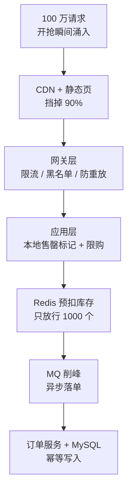
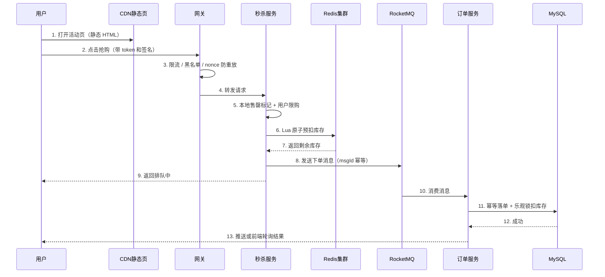
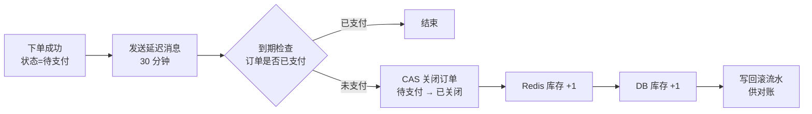

# 秒杀系统设计

> 定位：秒杀是系统设计题里最经典的「高并发 + 强一致 + 防刷」三合一场景。它考的不是你会不会用 Redis，而是你懂不懂**用分层过滤把流量挡在数据库之前**、懂不懂**在「超卖」和「少卖」之间怎么取舍**。这篇按「需求 → 挑战 → 方案 → 细节 → 坑点」讲透一套能落地的秒杀架构，并给出系统设计题的答题框架。

## 一、业务特征与挑战

秒杀的业务形态很极端：一台 5000 元的手机，1000 台库存，20:00:00 开抢，可能有 100 万人同时点「立即购买」。系统要在几百毫秒内判断出「谁抢到了、谁没抢到」，而且**不能多卖一台，也不能把能卖的漏掉**。

先看清它和普通下单的区别，否则设计一定跑偏。

| 维度 | 普通下单 | 秒杀下单 |
|---|---|---|
| 流量形态 | 平稳、可预测 | 瞬时脉冲，开抢 1 秒内打满 |
| 库存量 | 充足 | 极少（几十到几千） |
| 请求有效率 | 大部分有效 | 99% 以上是陪跑 |
| 核心风险 | 无 | 超卖（资损）、超时（体验）、被刷（黄牛） |
| 链路长度 | 完整（优惠、积分、发票、物流） | 极短，能砍则砍 |
| 一致性要求 | 强一致 | 允许最终一致 |

从这张表能提炼出秒杀设计的三个本质约束：

1. **流量远大于库存**：100 万请求抢 1000 件，意味着 99.9% 的请求注定失败。设计的核心不是「让每个请求都处理得快」，而是「**用最低成本把无效请求挡在外面**」。
2. **超卖是资损，少卖只是体验问题**：多卖一台要赔钱、要公关、可能上热搜；少卖一台只是少赚。所以所有方案在「一致性 vs 可用性」上，一律倒向「**绝不超卖，可以少卖**」。
3. **热点极其集中**：所有请求打同一个 sku、同一行库存记录、同一个 Redis key。这不是「分散压力」的问题，是「**单点必须扛住**」的问题。

### 挑战清单

- **瞬时高并发**：QPS 从几百飙到十万级，扩容来不及——云主机启动要分钟级，弹性伸缩追不上 1 秒的脉冲。
- **防超卖**：并发扣减同一行库存，`select` 再 `update` 必然超卖。
- **防刷**：脚本、黄牛、多账号，正常用户根本抢不到，活动口碑崩掉。
- **链路要短**：正常下单要算优惠券、积分、风控、发票，秒杀链路每多一个 RPC 就多一份超时风险。
- **不能影响主站**：秒杀打挂数据库，普通商品也卖不了，这是最严重的事故。

## 二、整体架构：分层过滤

秒杀架构的核心思想只有一句话：**把流量挡在越前面越好**。

每往前挡一层，成本就低一个数量级：CDN 挡掉一个请求的成本接近于零；数据库挡掉一个请求要占用连接、持有行锁、消耗 IO。所以正确的做法是设计一个「漏斗」，让 100 万请求逐层衰减到 1000。



这张图要看两个东西：**每一层的过滤比例**，以及**每层的单位成本**。

| 层级 | 手段 | 典型过滤效果 | 单次拦截成本 |
|---|---|---|---|
| 前端/CDN | 静态化、按钮置灰、答题、验证码 | 挡掉 80%~95% | 极低（边缘节点） |
| 网关 | 令牌桶限流、IP/设备黑名单、防重放 | 再挡 50%~90% | 低（内存计算） |
| 应用 | 本地售罄标记、用户限购 | 再挡 90% | 低（本地缓存） |
| Redis | Lua 原子预扣 | 只放行库存量 | 中（一次 RTT） |
| MQ | 异步排队 | 削峰，不减少总量 | 中 |
| DB | 乐观锁扣减 | 最终兜底 | 高（行锁 + IO） |

一个常见误区是「一上来就优化数据库」。数据库是漏斗最末端、最贵的一环，你在那里做再多优化，也扛不住 100 万 QPS。**真正的性能来自「不让请求走到数据库」**。

还有一条设计原则容易被忽略：**秒杀必须独立部署**。独立域名、独立集群、独立 Redis、独立库表。原因很简单——秒杀是「计划内的雪崩」，你不能让它把主站一起带走。

## 三、核心方案逐个讲

### 3.1 前端层：把用户按住

前端不是「锦上添花」，它是成本最低的一道闸。

**页面静态化**：活动页做成纯静态 HTML，推 CDN，不回源。库存数字、倒计时用 JS 异步拉接口，且允许 1~2 秒延迟——用户不需要知道精确到个位的库存。静态化的价值是把「打开页面」这个动作从你的服务器上彻底移走。

**按钮置灰 + 倒计时**：开抢前按钮不可点，倒计时结束才亮。这一条能挡掉大量「提前狂点」的无效请求。注意**倒计时必须以服务端时间为准**，客户端时间可以被改，也可以在接口里返回 `serverTime` 让前端校准。

**答题 / 验证码**：点击后先弹一道简单算术题或滑块。目的不是安全，而是**把并发的「点」拉平到几秒钟的窗口**，同时筛掉大部分脚本。真实用户多花 2 秒无所谓，脚本的 QPS 会被打散——100 万 QPS 的尖峰被摊成 5 秒的 20 万 QPS，系统压力天差地别。

**一次性 token**：活动开始才下发 `seckill_token`，存在 Redis 里，一次性使用。没有 token 或 token 已用的请求，网关直接拒绝。这能挡住「直接构造请求打接口」的脚本。

### 3.2 网关层：限流与防重放

网关是所有流量的必经之路，适合做「无状态、快判断」的拦截。

**令牌桶限流**：按集群总容量设置阈值（比如 5 万 QPS），超出直接返回「活动太火爆」。令牌桶允许一定突发，比固定窗口更平滑，不会出现「窗口边界双倍流量」。用 Redis + Lua 实现分布式令牌桶：

```lua
-- KEYS[1] = 限流 key，如 rate:seckill:{activityId}
-- ARGV[1] = 桶容量 capacity
-- ARGV[2] = 每秒补充速率 rate
-- ARGV[3] = 当前时间戳（毫秒）
-- ARGV[4] = 本次请求令牌数
local capacity = tonumber(ARGV[1])
local rate     = tonumber(ARGV[2])
local now      = tonumber(ARGV[3])
local need     = tonumber(ARGV[4])

local bucket = redis.call('HMGET', KEYS[1], 'tokens', 'ts')
local tokens = tonumber(bucket[1])
local ts     = tonumber(bucket[2])
if tokens == nil then
  tokens = capacity
  ts = now
end

-- 按时间差补充令牌
local delta = math.max(0, now - ts) / 1000.0 * rate
tokens = math.min(capacity, tokens + delta)

if tokens < need then
  redis.call('HMSET', KEYS[1], 'tokens', tokens, 'ts', now)
  redis.call('PEXPIRE', KEYS[1], math.ceil(capacity / rate * 1000))
  return 0
end

tokens = tokens - need
redis.call('HMSET', KEYS[1], 'tokens', tokens, 'ts', now)
redis.call('PEXPIRE', KEYS[1], math.ceil(capacity / rate * 1000))
return 1
```

要点：**读、算、写必须在同一个 Lua 脚本里**，否则并发下令牌会被超发。这是分布式限流最容易写错的地方——很多人写成「先 `GET` 再 `SET`」，看起来是原子 API，组合起来就不是了。

**防重放**：请求带 `timestamp + nonce + sign`。网关校验 `|now - timestamp| < 60s`，并把 nonce 用 `SET NX EX 300` 写入 Redis，重复的 nonce 直接拒绝。sign 用服务端下发的密钥对 `path + timestamp + nonce + body` 做 HMAC。三个要素缺一不可：时间戳防旧请求、nonce 防重复、签名防篡改。

**黑名单**：风控系统离线算出恶意 IP / 设备号，推到 Redis Set，网关 O(1) 判断。黑名单要设置过期时间，避免误杀永久生效。

### 3.3 应用层：Redis 预扣库存（核心）

这是整个秒杀系统的心脏。

**为什么是 Redis**：MySQL 单行更新的极限大约几千 TPS（同一行的行锁串行），而 Redis 单节点 10 万 QPS 起步。把「判断有没有库存 + 扣减」放到 Redis，用 Lua 保证原子性，就能用一台 Redis 扛住绝大部分流量。

**为什么必须用 Lua**：`GET` 再 `DECR` 是两次网络往返，中间可能被其他请求插入——两个请求都读到 `stock=1`，都执行 `DECR`，库存变成 -1，超卖。Lua 脚本在 Redis 单线程内原子执行，天然没有并发窗口。

```lua
-- KEYS[1] = seckill:stock:{skuId}
-- ARGV[1] = 购买数量
-- 返回 >=0：扣减后的剩余库存；-1：库存不足；-2：活动库存未初始化
local stock = redis.call('GET', KEYS[1])
if not stock then
  return -2
end
if tonumber(stock) < tonumber(ARGV[1]) then
  return -1
end
return redis.call('DECRBY', KEYS[1], tonumber(ARGV[1]))
```

Java 调用：

```java
private static final DefaultRedisScript<Long> SECKILL_SCRIPT =
    new DefaultRedisScript<>(
        "local stock = redis.call('GET', KEYS[1])\n" +
        "if not stock then return -2 end\n" +
        "if tonumber(stock) < tonumber(ARGV[1]) then return -1 end\n" +
        "return redis.call('DECRBY', KEYS[1], tonumber(ARGV[1]))",
        Long.class);

public boolean tryDeduct(Long skuId, int qty) {
    String key = "seckill:stock:{" + skuId + "}";
    Long remain = redisTemplate.execute(SECKILL_SCRIPT,
            Collections.singletonList(key), String.valueOf(qty));
    return remain != null && remain >= 0;
}
```

注意 key 里的 `{skuId}` 是 **hash tag**：Redis Cluster 只保证同一个 slot 的多个 key 能在脚本里一起操作，加大括号能让同一个 sku 的所有相关 key 落在同一节点，避免 `CROSSSLOT` 错误。如果你的脚本要同时操作库存 key 和限购 key，这一点是必须的。

**库存预热**：活动开始前 10 分钟，把库存写入 Redis：

```java
String key = "seckill:stock:{" + skuId + "}";
redisTemplate.opsForValue().set(key, String.valueOf(stock), 2, TimeUnit.HOURS);
```

预热要做**幂等**：用 `SET` 覆盖而不是 `INCR`，重跑不会把库存放大。同时预热脚本要能校验 DB 里的真实库存，避免「Redis 写 1000、DB 只有 800」这种一开抢就超卖的事故。

**本地售罄标记**：Redis 返回 -1 后，在本地 Caffeine 里记一个 `soldOut` 标记，后续请求直接拒绝，不再访问 Redis。这能挡掉大量「已经售罄还在轮询」的请求。注意多实例之间不一致，它只用于**快速失败**，不能作为扣减依据。

**限购**：同一用户只能买 1 件。用 `SADD seckill:buyers:{skuId} userId`，返回 1 才继续；返回 0 说明已买过。这个 Set 会随参与人数增长，活动结束后设过期时间清理，别让它常驻内存。

### 3.4 数据库层：乐观锁兜底

Redis 挡在前面，但数据库仍然是「最终事实」。落单时还要再扣一次库存，防止 Redis 数据错误、消息重复或人工误操作。

**错误写法**：

```sql
-- 先查再改，并发下必然超卖
SELECT stock FROM seckill_stock WHERE sku_id = 1;   -- 事务 A 查到 1
-- 事务 B 也查到 1
UPDATE seckill_stock SET stock = 0 WHERE sku_id = 1; -- 两个都执行，卖了 2 件
```

**正确写法：把判断和扣减合成一条 SQL**：

```sql
UPDATE seckill_stock
SET stock = stock - 1, version = version + 1
WHERE sku_id = #{skuId}
  AND stock >= 1;
```

然后判断影响行数：

```java
int affected = stockMapper.deduct(skuId);
if (affected == 0) {
    throw new BizException("库存不足");
}
```

`WHERE stock >= 1` 就是 CAS：InnoDB 对这行加排他锁，读到的必须是最新值，条件不满足就不更新。**影响行数为 0 就代表没扣到**，不需要再查一次——这一步省掉了一次往返，也避免了「查到有库存但更新时没了」的困惑。

如果想用版本号：

```sql
UPDATE seckill_stock
SET stock = stock - 1, version = version + 1
WHERE sku_id = #{skuId} AND version = #{version} AND stock > 0;
```

但库存扣减场景里，`stock >= 1` 本身就是最合适的「版本」，加 version 字段反而多一次查询。**version 更适合「读出来、算完、再写回」的场景**（比如修改商品描述），库存这种自减场景直接用 `stock >= 1` 即可。

**三种防超卖方案对比**：

| 方案 | 原理 | 优点 | 缺点 | 适用 |
|---|---|---|---|---|
| `SELECT ... FOR UPDATE` | 悲观锁，行锁串行 | 简单、绝对不超卖 | 并发低，容易锁等待超时 | 低并发、强一致 |
| `UPDATE ... WHERE stock >= n` | CAS，乐观锁 | 无额外查询、并发较好 | 热点行仍有行锁竞争 | 中低并发 |
| Redis Lua 预扣 | 内存原子操作 | 十万级 QPS | 需保证最终一致 | 高并发秒杀 |

**热点行问题**：即使是 `UPDATE ... WHERE stock >= 1`，1000 次更新也会在这一行上串行。1000 次没问题（毫秒级完成），但如果是 10 万次就会把连接池打满、把 CPU 打高。所以 **DB 扣减只应该发生在 Redis 放行之后**，量级已经被压到库存量级。这是「分层过滤」在数据库层的体现。

### 3.5 削峰：MQ 异步下单

Redis 扣减成功后，不要同步写订单——写订单要落库、要调优惠、要发通知，链路长、耗时不稳。正确做法是**发一条 MQ 消息就返回「排队中」**，由订单服务慢慢消费。

```java
// 1. Redis 预扣成功
if (!tryDeduct(skuId, 1)) {
    return Result.fail("已售罄");
}

// 2. 发消息（带全局唯一 msgId，用于消费端幂等）
SeckillMessage msg = new SeckillMessage();
msg.setMsgId(UUID.randomUUID().toString());
msg.setUserId(userId);
msg.setSkuId(skuId);
msg.setActivityId(activityId);
mqProducer.send("SECKILL_ORDER_TOPIC", msg);

// 3. 立即返回，不等待落单
return Result.ok("抢购成功，正在为您生成订单");
```

**顺序不能反**：必须「Redis 扣减成功 → 才发 MQ」。如果先发 MQ 再扣 Redis，消息消费时可能发现没库存，白跑一趟；更糟的是 MQ 堆积时全是无效消息。

**MQ 选型**：RocketMQ 支持事务消息和延迟消息，最适合秒杀；Kafka 吞吐高但延迟消息要自己实现；RabbitMQ 有延迟插件但吞吐一般。选型时优先看「延迟消息」和「事务消息」这两个能力，秒杀都要用。

**消息可靠性**：`send` 返回成功后仍可能丢（比如 Broker 落盘前宕机）。要开同步刷盘 + 主从同步复制，或者用**本地消息表**：先在本地事务里写一条 `status=待发送` 的消息记录，再异步投递，失败重试。这样「Redis 扣减」和「消息发出」之间即使断掉，也能靠定时任务扫表补发。

### 3.6 热点隔离

秒杀最大的次生灾害是**打挂主站**。所以要做到四个隔离：

| 隔离维度 | 做法 | 目的 |
|---|---|---|
| 域名 | 独立域名 `seckill.xxx.com`，独立 CDN 配置 | 流量入口隔离，便于限流和切换 |
| 集群 | 独立应用集群，不与其他业务混部 | 秒杀应用 CPU 打满不影响主站 |
| 缓存 | 独立 Redis 集群 | 大 key / 热点 key 不拖累主站缓存 |
| 数据库 | 独立库/实例，至少独立表 | 慢查询和行锁不阻塞主站事务 |

再加一层**降级开关**：秒杀入口可一键关闭，出问题时先切断流量，保住主站。开关要放在配置中心，能在 1 秒内生效。

### 3.7 防刷

防刷是「和人斗」，没有一劳永逸的方案，只能层层加码：

- **用户维度限购**：Redis Set / DB 唯一索引，一人一单。
- **设备指纹**：前端采集设备特征（UA、屏幕、字体、Canvas 指纹），同一设备多账号直接风控。
- **行为风控**：点击间隔、页面停留时长、鼠标轨迹。真人至少几百毫秒，脚本可能 10ms 一次。
- **手机号/实名**：高价值商品要求实名 + 短信验证，成本直接劝退批量账号。
- **黑名单**：事后把黄牛账号、IP 段、设备号加入黑名单，下次活动直接拒。

## 四、完整时序

把上面的方案串起来，一次成功的秒杀请求长这样：



这张图要理解三个「异步点」：

1. **网关到应用**是同步的，但很快（内存判断）。
2. **应用到 MQ**是异步的，用户拿到的是「排队中」，不是「下单成功」。
3. **MQ 到 DB**是异步的，最终一致。

用户看到的「抢购成功」其实是「你排上队了」，真正的订单要等消费完成。前端用轮询（每 1 秒查一次结果）或 WebSocket 推送来告知最终结果。这个「状态不确定性」必须在文案上讲清楚，否则用户会以为下单失败又点一次。

## 五、库存回滚：超时未支付

用户抢到资格但 30 分钟不付款，库存必须放回去，否则商品「卖不掉」。

方案是**延迟消息**：下单成功后发一条 30 分钟延迟的消息，到期检查订单状态，未支付就关单 + 回滚库存。



几个细节：

- **关单必须 CAS**：`UPDATE orders SET status=2 WHERE order_no=? AND status=0`，影响行数为 0 说明已被支付或已关闭，**不能回滚库存**，否则会超卖。这是整个回滚流程最关键的一行。
- **回滚顺序**：先关单（拿到「关单成功」的确定结果），再回滚 Redis 和 DB。顺序反了会出现「库存加了但订单还能支付」。
- **Redis 回滚用 `INCRBY`**，不要用 `SET`，否则会覆盖其他并发扣减的结果。
- **延迟消息可能重复**：回滚逻辑要幂等，靠「关单 CAS 成功」作为唯一触发条件。
- **兜底**：延迟消息不是 100% 可靠，再加一个每 5 分钟扫一次「待支付且超时」订单的定时任务。

## 六、生产坑点

### 坑点 1：Redis 扣了，MQ 没发出去 → 少卖

**现象**：活动结束，Redis 显示库存 0，但实际订单只有 800 单，200 件没卖出去。
**原因**：`tryDeduct` 成功后、`send` 之前，应用重启 / 网络抖动 / MQ 不可用，消息丢了。Redis 库存已经扣了，但没有对应订单。
**解法**：
- 本地消息表：Redis 扣减后先落一条消息记录（同一个本地事务），再异步投递，失败重试。
- 或者用 RocketMQ 事务消息：先发半消息，本地扣减成功后 commit。
- 对账兜底：活动结束后比对「Redis 扣减总量」与「订单总量」，差额人工/自动补。

**关键认知**：超卖是资损，少卖只是少赚。所以宁可设计成「极端情况下少卖」，也不要在扣减和发消息之间做「补偿性回滚」——那会引入更复杂的并发问题。这是一个主动的取舍，不是疏漏。

### 坑点 2：MQ 重复消费 → 重复下单

**现象**：同一用户生成了两笔订单，库存扣了两次。
**原因**：MQ 是「至少一次」投递，消费失败重试、Broker 重发都会导致重复消费。
**解法**：
- **唯一索引兜底**：`UNIQUE KEY uk_user_sku (user_id, sku_id, activity_id)`，重复插入直接抛 `DuplicateKeyException`，捕获后当作成功返回。
- **幂等表**：`msg_id` 唯一索引，消费前先插入，插入失败说明处理过。
- **状态机**：订单状态只能单向流转，重复消息无法把「已支付」改回「待支付」。

```java
try {
    orderMapper.insert(order);
} catch (DuplicateKeyException e) {
    log.warn("重复下单，忽略。userId={}, skuId={}", userId, skuId);
    return; // 幂等：当作成功
}
```

### 坑点 3：库存回滚把已支付订单的库存加了 → 超卖

**现象**：用户支付成功，但延迟消息到期时误判为未支付，回滚了库存，导致多卖。
**原因**：关单没有 CAS，或者「查状态」和「关单」之间有并发（用户在检查之后、关单之前完成支付）。
**解法**：关单用 `UPDATE ... WHERE status = 待支付`，**以影响行数为准**；只有关单成功才回滚库存。查状态只用于日志，不用于决策。这个坑的本质是「先查后改」的老问题，在回滚链路上又出现了一次。

### 坑点 4：热点 key 打爆单个 Redis 节点

**现象**：Redis 集群其他节点 CPU 20%，某个节点 100%，延迟从 1ms 飙到 50ms。
**原因**：所有请求打同一个 `seckill:stock:{skuId}`，即使集群有 10 个节点，这个 key 也只在 1 个节点上。Redis Cluster 按 key 分片，但单个 key 不能分片。
**解法**：
- **库存分桶**：把 1000 库存拆成 10 个桶 `stock:{skuId}:0..9`，请求按 `userId % 10` 选桶，桶空则顺延下一个。代价是复杂度和「部分桶空导致少卖」。
- **本地缓存 + 批量**：本地缓存剩余库存，批量向 Redis 扣减（如一次扣 10 个），减少 RTT。代价是可能多扣，要能回滚。
- **Redis 读写分离 / 代理层**：治标不治本，热点 key 还是单点。

分桶是最常用的方案，但要接受「桶粒度导致的少量少卖」。这是典型的「用一致性换吞吐」。

### 坑点 5：库存预热错误 → 一开抢就超卖

**现象**：活动开始 1 秒就卖出 2000 件，但库存只有 1000。
**原因**：预热脚本被重复执行，用了 `INCR` 而不是 `SET`；或者多个实例同时预热，各自加了一遍。
**解法**：预热用 `SET key value`（覆盖），并在写入前用 `SETNX` 抢锁，只允许一个实例执行；预热后校验 `GET` 的值是否等于 DB 库存，不等就告警。

### 坑点 6：限流阈值拍脑袋 → 要么误杀要么没挡住

**现象**：限流设 1 万 QPS，结果 Redis 先扛不住了；或者设 10 万，网关自己先 OOM。
**原因**：阈值没有按「链路最弱环节」估算。
**解法**：压测得出单机能承载的 QPS，乘以实例数，取**最弱环节的 80%** 作为阈值。秒杀链路的瓶颈通常在 Redis 单 key 和 DB 单行，不在网关。

## 七、面试怎么答：系统设计题框架

系统设计题最忌讳「上来就画架构图」。面试官想看的是你的**思考过程**，不是背过的图。推荐五步。

**第一步：澄清需求（1~2 分钟）**

不要假设，先问：

- 预估 QPS 多少？库存多少？活动持续多久？
- 是否允许少卖？超卖能不能接受？（答案通常是「绝不超卖，可以少卖」）
- 用户规模、是否已有登录态、是否已有风控？
- 部署环境：单机房还是多机房？预算？

这一步能立刻把你和「背题的人」区分开。很多候选人上来就讲 Redis，面试官心里已经在扣分了。

**第二步：估算容量（1 分钟）**

- 100 万请求 / 1 秒 = 100 万 QPS，单机扛不住，需要 CDN + 网关集群。
- 库存 1000，Redis 单 key 10 万 QPS，够用；如果是 1000 万 QPS 就要分桶。
- DB 只需承接 1000 次写入，单库足够，不需要分库分表。

**第三步：画分层架构（3~5 分钟）**

按漏斗画：CDN → 网关 → 应用 → Redis → MQ → DB。每层说一句「挡什么」，让面试官看到流量是怎么衰减的。

**第四步：讲核心链路（5 分钟）**

重点讲 Redis Lua 预扣 + MQ 异步下单 + DB 乐观锁兜底，给出关键代码 / SQL。**代码比形容词有说服力**，`UPDATE ... WHERE stock >= 1` 写出来，比说「用乐观锁」强十倍。

**第五步：讲异常与兜底（3 分钟）**

这是拉开差距的地方。主动说：

- 消息丢了怎么办（本地消息表）
- 重复消费怎么办（唯一索引）
- 超时未支付怎么办（延迟消息 + CAS 关单）
- Redis 挂了怎么办（降级为「直接返回失败」，绝不打 DB）
- 怎么保证最终一致（对账）

**最后主动提 trade-off**：「这个方案在极端情况下会少卖，但绝不超卖，因为超卖是资损。」这句话几乎必加分，因为它证明你在做「权衡」而不是「堆技术」。

## 八、小结

- 秒杀的本质是「海量请求抢少量库存」，核心思想是**分层过滤，把流量挡在数据库之前**。
- 超卖的根本解法是消除 check-then-act 竞态：DB 用 `UPDATE ... WHERE stock >= 1`，Redis 用 Lua 原子扣减。
- 削峰靠 MQ 异步下单，但「Redis 扣减成功才发消息」的顺序不能反。
- 三个必答的兜底：消息丢失（本地消息表）、重复消费（唯一索引）、超时回滚（延迟消息 + CAS）。
- 宁可少卖不可超卖；秒杀必须独立集群，不能影响主站；所有异步链路最后都要有对账。

## 九、面试高频问法

**Q1：秒杀系统怎么设计？**

**一句话结论**：分层过滤 + Redis 原子预扣 + MQ 异步下单 + DB 乐观锁兜底，核心是「把流量挡在数据库之前」。

**展开**：

- 前端静态化 + 按钮置灰 + 验证码，挡掉大部分无效点击。
- 网关限流 + 黑名单 + 防重放，挡住脚本和超量请求。
- 应用层 Redis Lua 原子扣减，只放行库存量级的请求。
- 扣减成功发 MQ，异步落单，削峰。
- DB 用 `UPDATE ... WHERE stock >= 1` 兜底，绝不多卖。

**加分点**：主动说「宁可少卖不可超卖」的取舍，以及「秒杀要独立集群，不能影响主站」。

**Q2：怎么防止超卖？**

**一句话结论**：把「判断库存」和「扣减库存」合成一个原子操作，数据库用 CAS，Redis 用 Lua。

**展开**：

- 错误做法：先 `SELECT` 再 `UPDATE`，两个事务都读到 1，都扣成 0，卖 2 件。
- 数据库：`UPDATE stock SET stock = stock - 1 WHERE sku_id = ? AND stock >= 1`，看影响行数。
- Redis：Lua 里 `GET` + 判断 + `DECRBY`，单线程原子执行。
- 最终兜底：DB 加 `CHECK (stock >= 0)`（MySQL 8 支持），或者库存字段用无符号整型，负数直接报错。

**加分点**：说「超卖的本质是 check-then-act 的竞态」，任何方案都是在消除这个窗口。

**Q3：为什么用 Redis 预扣？Redis 挂了怎么办？**

**一句话结论**：Redis 是为了扛住数据库扛不住的并发；挂了就**快速失败**，绝不把流量放给数据库。

**展开**：

- MySQL 单行更新约几千 TPS，Redis 单节点 10 万 QPS，差两个数量级。
- Redis 挂了，降级策略是「直接返回活动结束 / 系统繁忙」，而不是「查数据库」。
- 因为一旦放流量到 DB，会把 DB 打挂，连带主站一起崩，损失远大于少卖。

**加分点**：说「降级不是功能降级，是保护性拒绝」——这是稳定性设计的核心思想。可以补一句：主备切换期间（几十秒）也走这个逻辑。

**Q4：Redis 扣了库存但下单失败，怎么办？**

**一句话结论**：靠「本地消息表 + 重试」保证消息一定发出；实在发不出，靠对账补偿。

**展开**：

- Redis 扣减成功后，先在本地事务写一条消息记录，再异步投递 MQ。
- 投递失败由定时任务重试，直到成功或超过阈值告警。
- 活动结束后对账：Redis 扣减总量 vs 订单总量，差额补单或回滚。

**加分点**：说「这是最终一致，不是强一致；秒杀场景可以接受，因为窗口很短、有对账兜底」。

**Q5：怎么防止重复下单？**

**一句话结论**：唯一索引 + 幂等表 + 状态机，三道防线。

**展开**：

- DB 唯一索引 `(user_id, sku_id, activity_id)`，重复插入抛异常。
- 消费前用 `msg_id` 做幂等表，插入失败说明处理过。
- 订单状态单向流转，重复消息无法回退状态。

**加分点**：说「幂等不是『加个 if 判断』，是『让重复执行的结果和执行一次一样』，最终要靠数据库约束兜底」——应用层判断有并发窗口，数据库唯一索引没有。

**Q6：MQ 消息丢了怎么办？**

**一句话结论**：生产端用本地消息表 / 事务消息，消费端用「确认 + 重试 + 死信队列」，两头都保证。

**展开**：

- 生产端：本地事务写业务数据 + 消息记录，异步投递，失败重试。
- Broker：同步刷盘 + 主从同步复制，避免单点丢。
- 消费端：处理成功才 ACK，失败重试，超过次数进死信队列人工处理。

**加分点**：说「消息『不丢』是相对的，真正兜底的是对账——所有异步系统最后都要有对账」。

**Q7：怎么防刷 / 防黄牛？**

**一句话结论**：分层加成本，让刷单的收益低于成本。

**展开**：

- 账号维度：实名、限购、手机号验证。
- 设备维度：设备指纹、同设备多账号风控。
- 行为维度：点击间隔、停留时长、鼠标轨迹。
- 流量维度：IP 限流、黑名单、验证码。
- 事后：黄牛账号封禁、订单人工审核。

**加分点**：说「防刷是成本对抗，不是技术对抗；没有绝对安全，只有让黄牛不划算」。

**Q8：库存热点 key 打爆单个 Redis 节点怎么办？**

**一句话结论**：库存分桶，把单 key 压力分散到多个 key。

**展开**：

- 把 1000 库存拆成 10 个桶，请求按 `userId % 10` 路由。
- 桶空了顺延下一个桶，全部空才返回售罄。
- 代价：可能因为桶粒度导致少卖（比如 9 个桶空了，第 10 个桶还有 1 个但路由不到）。

**加分点**：说「分桶是『用一致性换吞吐』，秒杀场景可以接受，因为少卖比系统挂掉好」。还可以提「桶数量要大于节点数，且每个节点承担多个桶」。

**Q9：超时未支付怎么回滚库存？**

**一句话结论**：延迟消息 + CAS 关单，只有关单成功才回滚。

**展开**：

- 下单后发 30 分钟延迟消息。
- 到期 `UPDATE orders SET status = 已关闭 WHERE order_no = ? AND status = 待支付`。
- 影响行数为 1 才回滚 Redis 和 DB 库存。
- 定时任务扫表兜底，防止延迟消息丢失。

**加分点**：说「回滚和支付是并发关系，必须用 CAS 保证『回滚』和『支付』只有一个能成功」。

**Q10：怎么保证 Redis 和 DB 库存最终一致？**

**一句话结论**：Redis 是「预扣」，DB 是「事实」，用「流水 + 对账 + 补偿」保证最终一致。

**展开**：

- 每次 Redis 扣减记一条流水（用户、sku、时间）。
- 每次 DB 落单记一条订单。
- 定时对账：流水有、订单无 → 补单或回滚；订单有、流水无 → 告警排查。
- 活动结束后全量对账，人工处理差异。

**加分点**：说「不要追求强一致，那会牺牲性能；秒杀的正确姿势是『接受短暂不一致 + 对账兜底』」。

**Q11：如果不用 Redis，只用数据库能扛住秒杀吗？**

**一句话结论**：小规模可以，万级 QPS 以上不行。

**展开**：

- 单行 `UPDATE ... WHERE stock >= 1` 大约几千 TPS，受行锁限制。
- 加机器没用，因为热点在同一行。
- 分库分表也没用，同一个 sku 的库存只能在一行。
- 所以高并发秒杀必须把扣减前移到 Redis。

**加分点**：说「这不是『数据库性能不行』，是『热点行无法水平扩展』——这是架构约束，不是调优能解决的」。

**Q12：秒杀系统怎么压测？**

**一句话结论**：全链路压测，重点是「瓶颈定位」和「限流阈值校准」。

**展开**：

- 用 JMeter / wrk 模拟真实请求分布（不是均匀打，而是脉冲）。
- 逐层压：先压 Redis 单 key，再压应用，再压 DB。
- 观察 P99 延迟、错误率、连接池、GC。
- 按最弱环节的 80% 设限流阈值。
- 演练降级：手动关 Redis、关 MQ，看系统是否可控。

**加分点**：说「压测不是『压到挂』，是『找到拐点』——在拐点之前设限流，让系统永远工作在健康区」。
