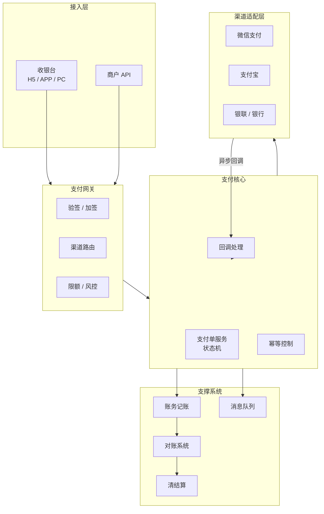
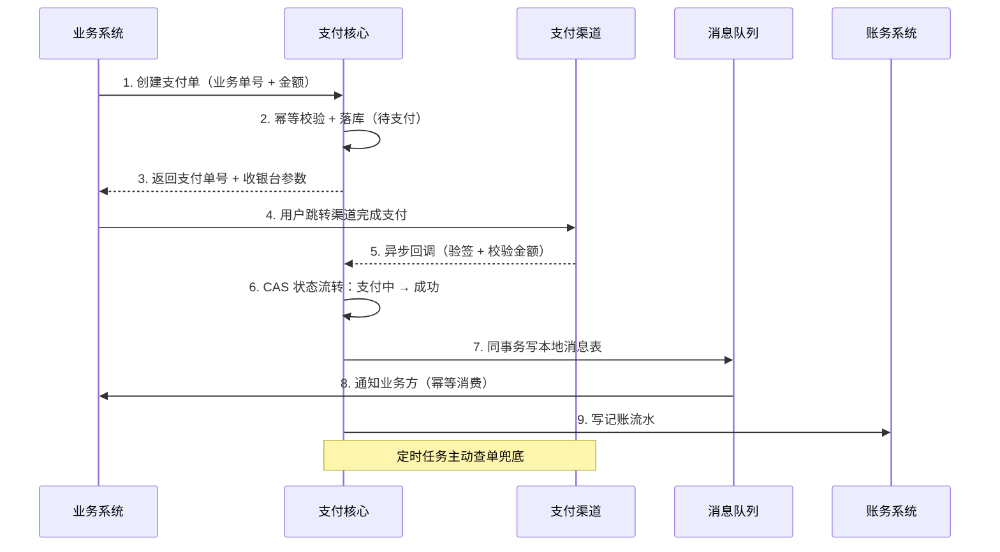
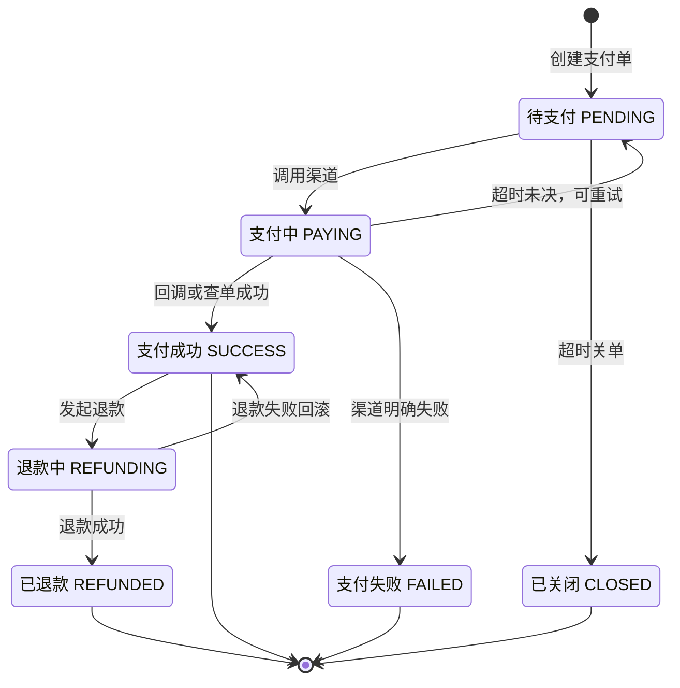
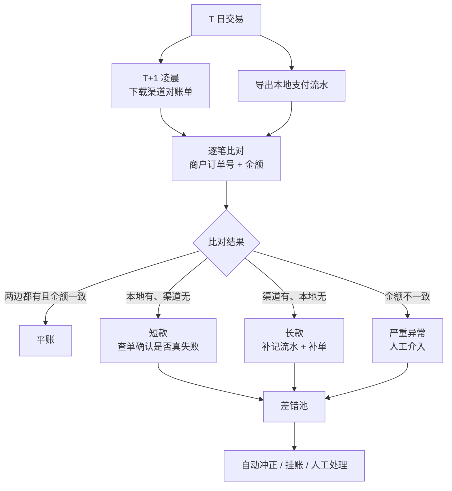

# 支付系统设计

> 定位：支付是「离钱最近」的系统，也是系统设计题里对「正确性」要求最高的一类。秒杀错了少卖一件，支付错了要赔钱、要审计、可能是法律责任。这篇讲透支付的四大支柱——**幂等、状态机、对账、分布式事务**，给出能落地的表结构、CAS 更新、本地消息表和 T+1 对账流程，以及一道支付系统设计题该怎么答。

## 一、核心诉求与业务特征

普通订单系统出 bug，最坏结果是「用户下不了单」；支付系统出 bug，最坏结果是「用户被扣了两次钱」「平台少收了 10 万」「账对不上被监管约谈」。这个差别决定了两套系统的设计取向完全不同。

| 维度 | 普通订单 | 支付订单 |
|---|---|---|
| 一致性 | 最终一致可接受 | 必须准确，错一分都是事故 |
| 幂等 | 尽量做 | **强制**，重复请求结果必须一致 |
| 状态 | 可以回退 | 单向流转，成功不可逆 |
| 审计 | 可选 | 必须，流水保留 5 年以上 |
| 失败处理 | 直接重试 | 必须**查单确认**，不能盲目重试 |
| 金额类型 | 无所谓 | 只能用整数分或 `BigDecimal` |

### 四大核心诉求

1. **资金安全**：不能多扣、不能少扣、不能重复扣。这三件事对应三种完全不同的技术手段：多扣/少扣靠金额校验，重复扣靠幂等。
2. **可追溯**：每一分钱的来龙去脉都要能查——谁在什么时间、通过什么渠道、用什么单号、扣了多少、状态怎么变的。出了问题要能「复盘到每一笔」。
3. **幂等**：网络超时、渠道重试、用户连点，同一个支付请求可能到达多次，结果必须和执行一次一样。
4. **对账**：支付系统和渠道是两个独立系统，任何一方都可能出错或丢数据。**只有对账能发现差异**，它是资金安全的最后一道防线。

### 支付的「三态」难题

这是支付区别于其他系统最关键的一点：调用渠道的结果不是「成功/失败」两态，而是**三态**：

- **成功**：渠道明确返回成功。
- **失败**：渠道明确返回失败。
- **未知**：超时、网络断、渠道返回「处理中」。

「未知」是最难处理的。你既不能当成功（可能没扣钱），也不能当失败（可能已扣钱）。唯一正确的做法是**主动查单**，直到拿到确定结果。这一点后面会反复提到。

## 二、整体架构

支付系统通常拆成几个职责清晰的模块，不要揉成一个「支付服务」：



这张图要看三个点：

- **支付核心只管「支付单的状态」**，不管业务订单。业务订单在业务系统里，支付核心通过消息通知它。
- **渠道适配层做统一抽象**：微信、支付宝、银联的接口、签名、报文格式都不一样，适配层把它们统一成 `pay / query / refund` 三个方法。换渠道不改核心。
- **对账和清结算是独立系统**，异步跑批，不阻塞实时支付。

### 核心表设计

支付单表是整个系统的主表，几个字段的设计直接决定了幂等和可追溯能力：

```sql
CREATE TABLE `pay_order` (
  `id`           bigint       NOT NULL AUTO_INCREMENT,
  `pay_no`       varchar(32)  NOT NULL COMMENT '支付单号，全局唯一',
  `biz_no`       varchar(64)  NOT NULL COMMENT '业务单号，来自订单系统',
  `biz_type`     varchar(16)  NOT NULL COMMENT '业务类型：ORDER/RECHARGE',
  `channel`      varchar(16)  NOT NULL COMMENT '渠道：WXPAY/ALIPAY/UNIONPAY',
  `channel_no`   varchar(64)  DEFAULT NULL COMMENT '渠道流水号，回调后回填',
  `amount`       bigint       NOT NULL COMMENT '金额，单位：分',
  `currency`     char(3)      NOT NULL DEFAULT 'CNY',
  `status`       tinyint      NOT NULL DEFAULT 0 COMMENT '0待支付 1支付中 2成功 3失败 4关闭',
  `subject`      varchar(128) NOT NULL COMMENT '商品描述',
  `expire_time`  datetime     NOT NULL COMMENT '支付单过期时间',
  `pay_time`     datetime     DEFAULT NULL COMMENT '支付成功时间',
  `version`      int          NOT NULL DEFAULT 0,
  `create_time`  datetime     NOT NULL DEFAULT CURRENT_TIMESTAMP,
  `update_time`  datetime     NOT NULL DEFAULT CURRENT_TIMESTAMP ON UPDATE CURRENT_TIMESTAMP,
  PRIMARY KEY (`id`),
  UNIQUE KEY `uk_pay_no` (`pay_no`),
  UNIQUE KEY `uk_biz_channel` (`biz_no`, `channel`),
  KEY `idx_channel_no` (`channel_no`),
  KEY `idx_status_time` (`status`, `create_time`)
) ENGINE=InnoDB DEFAULT CHARSET=utf8mb4;
```

两个唯一索引各有用途：

- `uk_pay_no`：支付单号唯一，回调按单号定位，天然防重。
- `uk_biz_channel`：同一个业务单在同一个渠道只能有一笔支付单。用户连点两次「去支付」，第二次插入直接冲突，返回已有支付单——这就是**创建阶段的幂等**。

`amount` 用 `bigint` 存「分」，不用 `decimal` 存「元」，更不用 `double`。原因在「资金安全」一节展开。

## 三、核心支付流程

一次完整的支付，正常路径是这样的：



这张图的核心是**第 5 步到第 7 步**：回调处理必须在「验签 → 校验金额 → CAS 更新状态 → 写消息表」这一条链路上完成，任何一步跳过都会出问题。

### 三种结果来源

| 来源 | 时机 | 可信度 | 用途 |
|---|---|---|---|
| 同步返回 | 调渠道后立即 | 中（可能超时） | 仅用于展示，不作为最终依据 |
| 异步回调 | 渠道主动推送 | 高（需验签） | 主要依据 |
| 主动查单 | 定时/超时触发 | 最高（权威） | 兜底，解决回调丢失 |

**关键原则：同步返回不能作为最终状态。** 用户看到「支付成功」页面，可能只是渠道前端跳转成功，后端还没确认。真正的状态必须以**回调或查单**为准。很多资损事故就是「同步返回成功就发货」，结果渠道侧实际失败了。

### 支付单过期

支付单要有 `expire_time`（通常 30 分钟到 2 小时）。过期后不允许再支付，避免「用户拿着三天前的收银台页面付款成功，但订单已取消」这种扯皮场景。过期关单同样要 CAS：`UPDATE ... SET status=4 WHERE pay_no=? AND status=0`。

## 四、幂等设计（重中之重）

支付的幂等要做在**三个层次**上，缺一层都可能漏。

### 4.1 第一层：唯一键防重复创建

用户连点两次「去支付」，或者前端重试，会发两次创建请求。靠 `uk_biz_channel` 拦住：

```java
public PayOrder create(CreatePayRequest req) {
    try {
        PayOrder order = buildOrder(req);
        payOrderMapper.insert(order);
        return order;
    } catch (DuplicateKeyException e) {
        // 已存在，返回已有支付单（幂等）
        return payOrderMapper.selectByBizNoAndChannel(req.getBizNo(), req.getChannel());
    }
}
```

注意这里**不要先查再插**：先查再插有并发窗口，两个线程都查不到，都插入，一个成功一个报错。直接插、捕获冲突，是唯一可靠的写法。

### 4.2 第二层：状态机单向流转

支付单的状态必须**只能往前走，不能回退**：



这张图最重要的两条边：

- **`SUCCESS` 没有出边回到 `PENDING`/`FAILED`**：支付成功是终态，任何「把成功改回失败」的逻辑都是 bug。
- **`PAYING → PENDING` 是唯一允许的「回退」**：渠道超时未决时，可以回到待支付重新发起，但前提是**没有拿到成功结果**。

状态机落地成代码就是一张「允许的迁移表」：

```java
private static final Map<PayStatus, Set<PayStatus>> ALLOWED = Map.of(
    PENDING,  EnumSet.of(PAYING, CLOSED),
    PAYING,   EnumSet.of(SUCCESS, FAILED, PENDING),
    SUCCESS,  EnumSet.of(REFUNDING),
    REFUNDING,EnumSet.of(REFUNDED, SUCCESS),
    FAILED,   EnumSet.noneOf(PayStatus.class),
    CLOSED,   EnumSet.noneOf(PayStatus.class),
    REFUNDED, EnumSet.noneOf(PayStatus.class)
);
```

每次变更前先校验 `ALLOWED.get(from).contains(to)`，不合法直接抛异常并告警。这层校验能挡住大部分「状态乱跳」的 bug。

### 4.3 第三层：CAS 更新兜底

即使状态机校验通过，两个并发回调仍可能同时读到 `PAYING`，都判断「可以转成功」，都执行更新。所以**最终必须靠数据库的 CAS**：

```sql
UPDATE pay_order
SET status = 2,
    channel_no = #{channelNo},
    pay_time = NOW(),
    version = version + 1
WHERE pay_no = #{payNo}
  AND status IN (0, 1);
```

```java
@Transactional
public boolean markSuccess(String payNo, String channelNo, long channelAmount) {
    PayOrder order = payOrderMapper.selectByPayNo(payNo);
    if (order == null) {
        throw new BizException("支付单不存在");
    }
    // 1. 金额校验：渠道回传金额必须与本地一致
    if (order.getAmount() != channelAmount) {
        log.error("金额不一致 payNo={} local={} channel={}",
                payNo, order.getAmount(), channelAmount);
        alertService.fire("PAY_AMOUNT_MISMATCH", payNo);
        return false;
    }
    // 2. CAS：只有 待支付/支付中 才能流转到成功
    int affected = payOrderMapper.casSuccess(payNo, channelNo);
    if (affected == 0) {
        // 已经处理过（状态已是成功），幂等返回
        log.info("重复回调，忽略 payNo={}", payNo);
        return true;
    }
    // 3. 同一事务内写本地消息表，保证「状态变更」和「通知」原子
    localMessageMapper.insert(LocalMessage.of(payNo, "PAY_SUCCESS", buildPayload(order)));
    return true;
}
```

**`affected == 0` 的处理是整个幂等的关键**：它不代表失败，而代表「已经处理过了」，所以要返回成功，让渠道停止重试。如果把 0 当失败返回给渠道，渠道会一直重推，日志爆炸。

## 五、分布式事务：支付成功与订单状态一致

支付核心改了 `pay_order.status = SUCCESS`，业务系统还要把 `order.status` 改成「已支付」。这是跨服务、跨库的操作，必须保证最终一致。

### 5.1 本地消息表（推荐）

思路：**把「改状态」和「写消息」放在同一个本地事务里**，然后异步投递消息，失败重试。

```sql
CREATE TABLE `local_message` (
  `id`              bigint      NOT NULL AUTO_INCREMENT,
  `msg_id`          varchar(64) NOT NULL COMMENT '消息唯一 ID',
  `topic`           varchar(64) NOT NULL,
  `payload`         text        NOT NULL,
  `status`          tinyint     NOT NULL DEFAULT 0 COMMENT '0待发送 1已发送',
  `retry_count`     int         NOT NULL DEFAULT 0,
  `next_retry_time` datetime    DEFAULT NULL,
  `create_time`     datetime    NOT NULL DEFAULT CURRENT_TIMESTAMP,
  PRIMARY KEY (`id`),
  UNIQUE KEY `uk_msg_id` (`msg_id`),
  KEY `idx_status_retry` (`status`, `next_retry_time`)
) ENGINE=InnoDB;
```

投递任务：

```java
@Scheduled(fixedDelay = 5000)
public void relay() {
    List<LocalMessage> list = localMessageMapper.selectPending(100);
    for (LocalMessage m : list) {
        try {
            mqProducer.send(m.getTopic(), m.getPayload());
            localMessageMapper.markSent(m.getId());
        } catch (Exception e) {
            // 指数退避：5s, 25s, 125s ... 上限 10 分钟
            long delay = Math.min(600, 5 * (long) Math.pow(5, m.getRetryCount()));
            localMessageMapper.incrRetry(m.getId(), LocalDateTime.now().plusSeconds(delay));
        }
    }
}
```

消费端必须幂等：业务系统收到 `PAY_SUCCESS` 后，用 `UPDATE orders SET status=已支付 WHERE order_no=? AND status=待支付`，影响行数为 0 就当成功。这样重复消息不会造成二次处理。

### 5.2 事务消息

RocketMQ 的事务消息把「本地事务」和「消息发送」封装成两阶段：

1. 发半消息（对消费者不可见）。
2. 执行本地事务（改支付单状态）。
3. 本地事务成功则 commit，失败则 rollback。
4. Broker 定期回查未决消息，问生产方「到底成没成」。

| 方案 | 优点 | 缺点 | 适用 |
|---|---|---|---|
| 本地消息表 | 不依赖 MQ 特性，任何 MQ 都能用 | 多一张表、需要定时任务 | 通用，最稳 |
| 事务消息 | 不用自己写投递逻辑 | 强绑定 RocketMQ，回查要幂等 | 已用 RocketMQ |
| 最大努力通知 | 简单 | 可能丢，靠对账兜底 | 非核心通知 |

**不要用 XA / 2PC**：性能差、协调者单点、跨渠道根本没法参与。支付系统的跨系统一致性，行业标准答案就是「本地消息表 / 事务消息 + 对账」。

## 六、对账：资金安全的最后一道防线

### 6.1 为什么必须对账

因为回调**一定会丢**。原因包括：渠道重试次数用尽、你的服务当时在发布、防火墙拦了、公网抖动、代码 bug 把回调吞了。任何「只靠回调」的系统，长期跑下来一定会有账不平。

对账的本质是：**拿渠道的权威账单，和本地流水逐笔比对**。渠道是「钱真正到账的地方」，它的账单是事实标准。

### 6.2 T+1 对账流程



这张图的关键是**匹配键的选择**：用「商户订单号（`pay_no` 或 `biz_no`）」做主键，渠道流水号做辅助。为什么不用渠道流水号？因为「渠道有、本地无」的情况下，本地根本没有这个流水号，没法匹配——只能用商户订单号去反查。

对账代码骨架：

```java
public void reconcile(LocalDate date, String channel) {
    // key: 商户订单号
    Map<String, ChannelBill> channelBills = loadChannelBill(channel, date);
    Map<String, PayFlow> localFlows = loadLocalFlow(channel, date);

    for (Map.Entry<String, PayFlow> e : localFlows.entrySet()) {
        ChannelBill bill = channelBills.remove(e.getKey());
        if (bill == null) {
            diffPool.add(Diff.localOnly(e.getValue()));          // 本地有、渠道无
        } else if (bill.getAmount() != e.getValue().getAmount()) {
            diffPool.add(Diff.amountMismatch(e.getValue(), bill)); // 金额不一致
        }
    }
    // 剩下的都是「渠道有、本地无」
    for (ChannelBill bill : channelBills.values()) {
        diffPool.add(Diff.channelOnly(bill));
    }
    diffPool.save();
}
```

### 6.3 差错类型与处理

| 类型 | 含义 | 资金影响 | 处理方式 |
|---|---|---|---|
| 平账 | 两边一致 | 无 | 无需处理 |
| 长款 | 渠道有、本地无 | 平台多收了钱 | 补记流水，补单或原路退款 |
| 短款 | 本地有、渠道无 | 账面多记了收入 | 查单确认，冲正本地流水 |
| 金额不一致 | 两边都有但金额不同 | 严重 | 立即告警，人工核查，通常是 bug 或篡改 |
| 状态不一致 | 本地成功、渠道失败 | 严重 | 以渠道为准，冲正并补偿用户 |

**长款必须处理**：用户付了钱但系统没记录，如果不补，用户投诉、监管处罚。**短款也必须处理**：账面虚增收入，财报会出错。

### 6.4 对账的层次

成熟系统会对三次：

- **日终对账（T+1）**：全量逐笔，最权威，但有延迟。
- **准实时对账（T+0，分钟级）**：拉渠道当日流水增量比对，尽早发现。
- **单笔查单**：用户反馈「我付了钱没到账」时，实时查这一笔。

## 七、资金安全

### 7.1 金额绝不用 double

```java
// 错误：0.1 + 0.2 = 0.30000000000000004
double price = 0.1 + 0.2;

// 正确：以「分」为单位，用 long
long amountFen = 1990L;   // 19.90 元

// 或者用 BigDecimal（必须用字符串构造）
BigDecimal amount = new BigDecimal("19.90");
BigDecimal total = amount.multiply(new BigDecimal("3"))
                         .setScale(2, RoundingMode.HALF_UP);
```

三个必须遵守的规则：

1. **存储用 `bigint` 存分**，数据库里不出现小数。
2. **计算用 `long` 或 `BigDecimal`**，`BigDecimal` 必须用 `String` 构造，`new BigDecimal(0.1)` 会把 double 的误差带进来。
3. **舍入方向全系统统一**，退款、手续费、分账都用同一个 `RoundingMode`，否则对账时会出现 1 分钱的差异，查起来极其痛苦。

### 7.2 验签不等于可信

很多事故的根因是「验签通过就入账」。验签只能证明**消息来自渠道**，不能证明**这笔钱是给你的**。回调处理必须做**四重校验**：

| 校验项 | 目的 |
|---|---|
| 签名 | 确认消息来自渠道，未被篡改 |
| 商户号 / AppID | 确认是打给你的，不是别的商户（防跨商户重放） |
| 金额 | 确认和本地支付单一致（防金额篡改） |
| 订单状态 | 确认渠道侧确实是「支付成功」，不是「已关闭」「已退款」 |

```java
public String handleCallback(String body, String sign, String timestamp) {
    // 1. 防重放：时间戳 5 分钟内
    if (Math.abs(System.currentTimeMillis() - Long.parseLong(timestamp)) > 5 * 60_000) {
        return "FAIL";
    }
    // 2. 验签
    if (!RSAUtil.verify(body, sign, channelPublicKey)) {
        log.warn("验签失败 body={}", body);
        return "FAIL";
    }
    CallbackMsg msg = JSON.parseObject(body, CallbackMsg.class);
    // 3. 商户号校验
    if (!MY_MCH_ID.equals(msg.getMchId())) {
        log.error("商户号不匹配 {}", msg.getMchId());
        return "FAIL";
    }
    // 4. 金额 + 状态校验（在 markSuccess 里做）
    boolean ok = payService.markSuccess(msg.getOutTradeNo(),
                                        msg.getTransactionId(),
                                        msg.getAmount());
    return ok ? "SUCCESS" : "FAIL";
}
```

### 7.3 敏感信息

- 卡号、CVV、身份证**绝不落库**，需要展示时用渠道返回的脱敏串。
- 日志里禁止打印完整卡号、密钥、签名原文。
- 密钥放 KMS / 配置中心加密存储，不打进代码仓库。
- 生产环境禁止 `SELECT *` 查支付表，避免敏感字段被带到不该去的地方。

## 八、清结算

支付完成只是「钱到了渠道」，还没到商户账上。清结算负责「算清楚该给谁多少，然后打款」。

### 8.1 三个概念

| 概念 | 含义 | 时点 |
|---|---|---|
| 清算 | 算出每笔交易的应收应付、手续费 | T 日终 |
| 结算 | 把净额打给商户 | T+1 |
| 分账 | 一笔钱拆给多个参与方 | 结算时 |

### 8.2 手续费计算

费率用**万分比整数**表示，避免浮点：

```java
/**
 * @param amountFen 交易金额（分）
 * @param rateBp    费率，万分比。0.6% = 60
 * @return 手续费（分），向上取整
 */
public static long fee(long amountFen, int rateBp) {
    // (amount * rateBp) / 10000，向上取整
    return Math.floorDiv(amountFen * rateBp + 9999, 10000);
}
```

`amountFen * rateBp` 在 `long` 范围内（1 亿元 = 10^10 分，乘 10000 还在 `long` 内），不会溢出。如果用 `int` 就会溢出——这是另一个常见坑。

### 8.3 分账

平台型业务（比如电商）一笔 100 元要分给商家 95、平台 5：

```java
// 分账必须满足：各分账方金额之和 == 交易金额
long merchantAmount = 9500L;
long platformFee    = fee(10000L, 50); // 0.5%
long platformAmount = 10000L - merchantAmount;
if (merchantAmount + platformAmount != 10000L) {
    throw new BizException("分账金额不平");
}
```

分账的坑在于**除不尽**：100 元按 3 个人均分，每人 33.33，剩 1 分给谁？必须有明确的规则（通常给平台或主商户），并且全系统一致。否则每天对账都会差几分钱。

## 九、生产坑点

### 坑点 1：回调验签被绕过

**现象**：账上多了一批「支付成功」的订单，但渠道侧查不到。
**原因**：验签代码写了但没生效——比如 `if (!verify(...)) { log.warn(...); }` 忘了 `return`；或者测试环境的「跳过验签」开关带到了生产；或者只验签没校验商户号和金额，被跨商户重放。
**解法**：验签失败必须**中断并返回失败**；把「跳过验签」做成编译期常量而不是配置项；补上商户号、金额、状态四重校验；回调入口加单测，覆盖「签名错误」「金额不符」「商户号不符」三种用例。

### 坑点 2：金额精度丢失

**现象**：对账每天差 1~2 分钱，找不到具体哪笔。
**原因**：有的地方用 `double` 算、有的地方用 `BigDecimal` 算；或者元/分混用（一个字段存元，另一个存分）；或者四舍五入方向不一致（一处 `HALF_UP`，一处 `DOWN`）。
**解法**：全链路统一用「分 + `long`」；数据库字段统一 `bigint`；对外接口明确文档「单位：分」；舍入规则封装成一个工具方法，禁止各处自己写。

### 坑点 3：并发回调导致重复入账

**现象**：同一笔支付，账务系统记了两条收入流水。
**原因**：渠道同时推了两次回调（重试机制），两个线程都读到 `status=PAYING`，都判断可以入账，都插入了流水。没有 CAS，也没有唯一约束。
**解法**：状态更新用 CAS（`WHERE status IN (0,1)`），只有 `affected=1` 的线程才继续入账；账务流水表加 `UNIQUE KEY (pay_no, entry_type)`，重复插入直接失败。

### 坑点 4：渠道超时但实际成功

**现象**：用户投诉「钱扣了但订单没生效」，查本地是「支付失败」。
**原因**：调渠道时网络超时，代码 `catch (TimeoutException)` 后直接把状态置为失败。但渠道侧其实已经扣款成功，只是响应没回来。
**解法**：**超时一律视为「未知」，不是失败**。置为 `PAYING`，然后启动查单：立即查一次、5 秒后查一次、30 秒后查一次、之后每分钟查一次，直到拿到确定结果。超过 24 小时仍未决的，进人工队列。

```java
try {
    ChannelResp resp = channel.pay(req);
    if (resp.isSuccess()) {
        markSuccess(...);
    } else {
        markFailed(...);   // 只有渠道明确返回失败才置失败
    }
} catch (TimeoutException e) {
    markPaying(...);        // 超时 = 未知，进入查单流程
    queryTask.schedule(payNo, 0);
}
```

### 坑点 5：回调丢失导致「用户付了钱，订单还是待支付」

**现象**：用户截图显示已付款，但订单一直显示待支付。
**原因**：回调在网络上丢了，或者你的服务当时在重启，或者渠道重试次数用尽。
**解法**：三层兜底——① 下单后启动定时查单（1 分钟、5 分钟、30 分钟）；② T+1 对账发现「渠道有本地无」自动补单；③ 用户主动点「我已支付」触发实时查单。

### 坑点 6：退款重复 / 超额退款

**现象**：同一笔订单退了两次，或者退款总额超过支付金额。
**原因**：退款接口没有幂等，用户连点或运营重复操作；退款金额没有校验累计值。
**解法**：退款单号用「原支付单号 + 退款序号」唯一约束；退款前 `SELECT SUM(refund_amount)` 校验不超过原金额；退款状态同样用 CAS 单向流转。

### 坑点 7：对账只对总额不对明细

**现象**：总额平了，但明细里有「A 笔多记、B 笔少记」，互相抵消。
**原因**：只比对了「渠道总额 vs 本地总额」，没做逐笔比对。
**解法**：必须逐笔比对，匹配键用商户订单号；总额比对只能作为「快速健康检查」，不能替代明细对账。

## 十、面试怎么答：支付系统设计题框架

支付系统设计题的答法和秒杀不同：秒杀考「吞吐」，支付考「正确性」。所以答题重心要放在**幂等、状态机、对账**上，而不是 QPS。

**第一步：澄清场景（1~2 分钟）**

- 是「平台收款」还是「平台付款」？前者对接微信/支付宝，后者要出款，风控要求更高。
- 支持哪些渠道？是否需要分账、退款、部分退款？
- 日均笔数、峰值 TPS？金额范围？
- 是否已有账务系统？是否需要对接财务？

**第二步：画模块（3 分钟）**

收银台 → 支付网关 → 支付核心（支付单 + 状态机）→ 渠道适配 → 账务 → 对账 → 清结算。说清每个模块的边界，特别是「支付核心不管业务订单」。

**第三步：讲主流程（3 分钟）**

创建支付单 → 调渠道 → 异步回调 → CAS 更新 → 发消息通知业务。强调「同步返回不作数，回调/查单才作数」。

**第四步：讲正确性（5 分钟，重点）**

- **幂等**：唯一键防重复创建、状态机防乱跳、CAS 防并发。
- **三态**：成功/失败/未知，未知要查单。
- **分布式事务**：本地消息表保证「支付成功」和「订单状态」一致。
- **对账**：T+1 逐笔比对，长款/短款/金额不一致分别怎么处理。

**第五步：讲安全（2 分钟）**

金额用分、四重校验、密钥管理、日志脱敏。

**最后主动说**：「支付系统不怕慢，怕错。所以我的设计里，所有异步链路都有对账兜底，宁可 T+1 发现，也不能悄悄错。」这句话体现的是「资金系统思维」，比任何技术细节都加分。

## 十一、小结

- 支付系统的核心不是性能，是**正确性**：不多扣、不少扣、不重复扣。
- 幂等三层：唯一键防重复创建、状态机防乱跳、CAS 防并发更新。
- 调用渠道有**三态**：成功、失败、未知；未知必须查单，绝不能当失败。
- 跨系统一致性用**本地消息表 / 事务消息**，不要用 XA；最终兜底靠**对账**。
- 金额只用「分 + `long`」或 `BigDecimal`；回调必须做验签 + 商户号 + 金额 + 状态四重校验。
- 支付不怕慢，怕错；所有异步链路都要有对账，宁可 T+1 发现，也不能悄悄错。

## 十二、面试高频问法

**Q1：支付系统怎么设计？**

**一句话结论**：支付单 + 状态机 + 幂等 + 对账，四件事做好就是合格的支付系统。

**展开**：

- 模块：收银台、支付网关、支付核心、渠道适配、账务、对账、清结算。
- 主流程：创建支付单 → 调渠道 → 异步回调 → CAS 更新 → 消息通知业务。
- 正确性：唯一键防重复创建，状态机单向流转，CAS 防并发回调。
- 兜底：回调可能丢，所以必须查单 + T+1 对账。

**加分点**：主动区分「同步返回 / 异步回调 / 主动查单」三种结果来源，并说明同步返回不能作为最终状态。

**Q2：如何保证支付幂等？**

**一句话结论**：唯一键 + 状态机 + CAS，三层缺一不可。

**展开**：

- 创建阶段：`UNIQUE (biz_no, channel)`，重复插入捕获异常返回已有单。
- 状态阶段：状态机只允许合法迁移，`SUCCESS` 是终态。
- 更新阶段：`UPDATE ... WHERE status IN (0,1)`，看影响行数，0 代表已处理。
- 通知阶段：消费端用业务单号做幂等，`UPDATE ... WHERE status=待支付`。

**加分点**：说「幂等的本质是『重复执行的结果和执行一次一样』，应用层判断有并发窗口，最终必须靠数据库约束兜底」。

**Q3：支付回调丢了怎么办？**

**一句话结论**：定时查单 + T+1 对账 + 用户主动触发，三层兜底。

**展开**：

- 下单后启动定时查单：1 分钟、5 分钟、30 分钟。
- T+1 对账发现「渠道有、本地无」，自动补记流水并补单。
- 用户点「我已支付」时实时查单。
- 查单接口本身要幂等，重复查不会重复入账。

**加分点**：说「回调是『通知』不是『保证』，任何依赖回调的系统都必须有查单兜底」。

**Q4：渠道返回超时，怎么判断成功还是失败？**

**一句话结论**：超时是「未知」，既不是成功也不是失败，必须查单确认。

**展开**：

- 超时后置为 `PAYING`，不置失败。
- 立即查一次，之后按 5s / 30s / 1min 退避查。
- 查单返回成功则入账，明确失败则关单，仍未知则继续。
- 超过 24 小时未决进人工队列。

**加分点**：说「把超时当失败是资损事故的常见根因——用户钱扣了，系统认为失败，用户投诉无门」。

**Q5：为什么必须对账？对账发现差错怎么处理？**

**一句话结论**：因为回调会丢、会重、会错，只有对账能发现两个系统之间的差异。

**展开**：

- T+1 下载渠道账单，按商户订单号逐笔比对。
- 长款（渠道有本地无）：补记流水、补单或退款。
- 短款（本地有渠道无）：查单确认，冲正本地流水。
- 金额不一致：立即告警，人工核查。
- 差错进「差错池」，自动能修的自动修，修不了的挂账人工。

**加分点**：说「对账不是『可选优化』，是资金系统的合规要求；不对账的系统，迟早会出大事」。

**Q6：怎么保证「支付成功」和「订单已支付」一致？**

**一句话结论**：本地消息表 / 事务消息，保证「改支付单状态」和「发通知」原子。

**展开**：

- 支付核心在同一个本地事务里：改 `pay_order.status` + 插入 `local_message`。
- 定时任务扫 `local_message` 投递 MQ，失败重试。
- 业务方消费消息，用 CAS 改订单状态，重复消息幂等。
- 极端情况下消息一直发不出，靠对账补偿。

**加分点**：说「不要用 XA，性能和可用性都不可接受；支付行业的标准答案是『本地消息表 + 对账』」。

**Q7：金额用什么类型？为什么？**

**一句话结论**：数据库用 `bigint` 存「分」，计算用 `long` 或 `BigDecimal`，绝不用 `double`。

**展开**：

- `double` 有二进制精度问题，`0.1 + 0.2 != 0.3`。
- 以分为单位，所有金额都是整数，加减不会丢精度。
- 必须用 `BigDecimal` 时，用 `String` 构造，指定 `RoundingMode`。
- 全系统统一单位，接口文档明确写「单位：分」。

**加分点**：说「金额精度问题不是『可能出错』，是『一定出错』——只是错误小到平时看不出来，对账时才暴露」。

**Q8：怎么防止重复支付 / 重复退款？**

**一句话结论**：唯一约束 + 状态 CAS + 累计金额校验。

**展开**：

- 重复支付：同一业务单同渠道只能有一个支付单，`UNIQUE (biz_no, channel)`。
- 重复退款：退款单号唯一（`pay_no + refund_seq`），状态 CAS 流转。
- 超额退款：退款前 `SUM(refund_amount) + 本次 <= 原金额`，在事务内校验。
- 渠道侧也要幂等：传 `out_refund_no`，渠道按它去重。

**加分点**：说「防重不能只靠前端按钮置灰，后端必须有唯一约束——前端能被绕过，数据库不会」。

**Q9：支付系统的状态机怎么设计？**

**一句话结论**：状态精简、单向流转、成功终态、每次变更都 CAS。

**展开**：

- 状态：待支付 → 支付中 → 成功/失败；成功 → 退款中 → 已退款。
- `SUCCESS` 是终态，不允许回到任何前置状态。
- 每次变更校验「允许的迁移表」，不合法直接告警。
- 数据库更新带 `WHERE status = 旧状态`，用影响行数判断是否成功。

**加分点**：说「状态机的价值是『把并发问题变成状态问题』——只要状态只能单向走，重复请求就自然不会重复处理」。

**Q10：验签就够了吗？还要校验什么？**

**一句话结论**：验签只证明「消息来自渠道」，还要校验商户号、金额、订单状态。

**展开**：

- 商户号：防止别的商户的回调被重放到你这里。
- 金额：防止金额被篡改（尤其渠道侧配置错误）。
- 订单状态：渠道返回的 `trade_state` 必须是成功，不是关闭/退款。
- 时间戳：防重放，超过 5 分钟拒绝。

**加分点**：说「安全校验要『全都要』，不能『有一个就行』——任何一个漏掉都可能被利用」。

**Q11：清结算怎么做？T+1 是什么？**

**一句话结论**：T 日交易，T 日终清算算净额，T+1 打款给商户。

**展开**：

- 清算：逐笔算手续费、分账，生成结算单。
- 结算：按商户汇总净额，T+1 打款。
- 分账：一笔钱拆给多方，必须满足「分账之和 = 交易金额」。
- 手续费：用万分比整数算，向上取整，全系统统一。

**加分点**：说「清结算的核心是『可复算』——同一批数据跑两次结果必须一样，否则没法审计」。

**Q12：支付系统怎么做高可用？**

**一句话结论**：多通道、多机房、异步化、降级保核心。

**展开**：

- 多通道：微信挂了切支付宝，渠道适配层做路由和熔断。
- 多机房：支付核心双活，数据同步，故障切换。
- 异步化：通知、记账、对账全部异步，主链路只做「收单 + 改状态」。
- 降级：查询类接口可降级，支付主链路必须保。
- 限流：按商户维度限流，防止单个商户打挂整体。

**加分点**：说「支付的高可用不是『不出故障』，是『故障时不丢单、不重复、可恢复』——所以对账和查单比多活更重要」。
