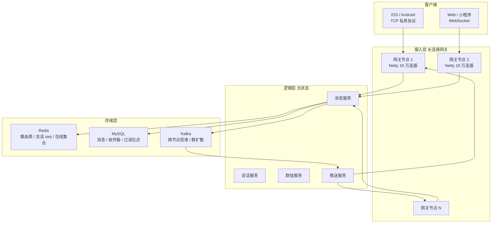
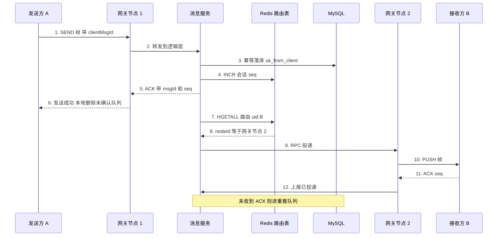
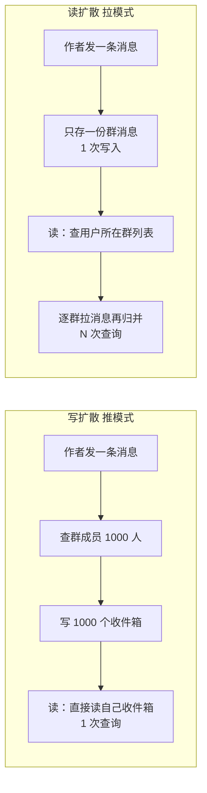

# IM系统设计

> 定位：IM 是系统设计题里唯一一个「必须自己维护长连接」的场景。秒杀考的是流量漏斗，支付考的是资金一致，IM 考的是**连接管理 + 消息状态机**。它难在：上百万个 TCP 连接同时在线，任何一条消息都不能丢、不能重、不能乱序，还要在用户断网三天后重新登录时，把他漏掉的 2000 条消息按顺序补齐。这篇按「连接 → 路由 → 可靠 → 扩散 → 多端」的顺序拆开讲，每个环节都给可落地的表结构和代码。

## 一、业务特征与挑战

IM 看起来只是「发个消息」，但它和普通 HTTP 服务的形态完全不同。先把差异摆出来，否则设计一定跑偏。

| 维度 | 普通 HTTP 服务 | IM 系统 |
|---|---|---|
| 通信方向 | 客户端发起，服务端响应 | **双向**，服务端要能主动推 |
| 连接生命周期 | 短连接，请求完就断 | 长连接，一次连接可能存活几小时到几天 |
| 连接数 | 与 QPS 成正比 | 与**在线用户数**成正比，百万级常驻 |
| 状态 | 无状态，随便扩容 | **有状态**，消息必须找到「用户在哪个节点」 |
| 消息语义 | 失败重试即可 | 不丢、不重、不乱序，三者都要 |
| 客户端环境 | 稳定机房网络 | 地铁、电梯、弱网、切后台、系统杀进程 |

从这张表能提炼出 IM 设计的三个本质约束：

1. **连接是稀缺资源**。100 万在线用户就是 100 万个 TCP 连接，每个连接占一个文件描述符、一块内核缓冲区、一个用户态对象。这不是「加机器」就能线性解决的问题——单机连接数有硬上限，超过就是 `Too many open files`。
2. **服务端必须知道「人在哪」**。HTTP 服务是无状态的，任何一台机器都能处理任何请求；IM 不行，消息要推给用户，就必须知道这个用户的连接挂在哪个节点上。这张「路由表」是 IM 区别于普通服务的最核心设计。
3. **消息是有状态的**。一条消息从发出到对方看到，中间要经过「客户端 → 服务端 → 对端」，任何一段断了都要能续上。所以每条消息都要有唯一 ID、有序号、有确认、有重推。

### 挑战清单

- **百万连接维持**：单机 10 万连接需要调内核参数、算内存账、防 fd 泄漏，一个都不能少。
- **消息不丢**：客户端发出后崩溃、服务端落库后推送失败、对端收到但没持久化，三个环节都可能丢。
- **消息不重**：网络超时重发、ACK 丢失重推，都会导致重复，必须靠幂等去重。
- **消息不乱序**：并发处理同一会话的消息，seq 小的可能后落库，展示就乱了。
- **离线消息**：用户三天不上线，2000 条消息怎么存、怎么按顺序补。
- **群聊扩散**：1 万人的群发一条消息，是写 1 万次还是写 1 次？
- **多端同步**：同一个人手机、平板、电脑同时在线，消息和已读状态怎么同步。
- **连接假死**：TCP 还连着，但对端进程已经卡死，消息推过去石沉大海。

## 二、整体架构

IM 的架构可以切成四层：**接入层（长连接网关）→ 逻辑层（消息/会话/群组）→ 存储层 → 推送层**。



这张图要看三个点：

**第一，接入层和逻辑层必须分开。** 接入层只做握手、鉴权、心跳、编解码、转发，不碰业务；逻辑层完全无状态，随便扩缩容。拆开的好处是：网关「有状态但逻辑极简」，重启一台只影响 10 万用户，重连即恢复；逻辑层「无状态但逻辑复杂」，滚动发布不断连接。混在一起的话，一次业务发布就要断掉全部连接，千万用户同时重连是灾难。

**第二，路由表在 Redis。** 这是整个系统的「电话簿」：`uid + deviceId → nodeId`。所有跨节点投递都靠它。

**第三，MQ 只用于「异步、可延迟」的路径**——群扩散、离线写收件箱、跨机房同步。在线单聊走 RPC 直连，延迟更低。

| 层 | 职责 | 单机指标 | 扩容方式 |
|---|---|---|---|
| 接入层 | 连接、鉴权、心跳、编解码 | 10 万连接 / 20 万 QPS 小包 | 按在线人数水平扩 |
| 逻辑层 | 消息落库、seq 发号、路由查询 | 无状态，5000 QPS/实例 | 按消息量水平扩 |
| Redis | 路由、seq、在线集合 | 单节点 10 万 QPS | 分片 + 读写分离 |
| MySQL | 消息、收件箱、位点 | 单库 5000 TPS 写 | 按 uid / sessionId 分库分表 |

## 三、核心方案逐个讲

### 3.1 连接层：为什么必须是长连接

IM 的消息是**服务端主动推**的。HTTP 是请求-响应模型，服务端没有「主动说话」的通道。三种替代方案都不可行：

| 方案 | 做法 | 问题 |
|---|---|---|
| 短轮询 | 客户端每 3 秒问一次「有新消息吗」 | 100 万用户 = 33 万 QPS 的空查询，99% 返回「没有」 |
| 长轮询 | 请求 hold 住 30 秒，有消息立即返回 | 连接频繁重建，服务端要维护大量挂起请求，本质还是 HTTP |
| SSE | 服务端单向推送 | 只能服务端→客户端，发消息还要另开通道 |

所以 IM 必须自己维护长连接。

**TCP 还是 WebSocket？** 这不是二选一的技术路线，而是「面向什么客户端」：

| 客户端 | 方案 | 原因 |
|---|---|---|
| 原生 App | TCP + 私有二进制协议 | 头部 10 字节 vs HTTP 几百字节；心跳、重连、弱网策略完全可控 |
| Web / 小程序 | WebSocket | 浏览器只能通过 HTTP Upgrade 建全双工通道，开不了裸 TCP |
| 极端弱网 / 老设备 | HTTP 长轮询兜底 | 兼容性最好，作为降级通道 |

WebSocket 本身跑在 TCP 上，握手是带 `Upgrade: websocket` 的 HTTP 请求，之后协议切换——它只多一次握手开销，长连接建立后差别不大。

**协议设计**：别用 JSON 裸文本。IM 的消息小而密，JSON 的 key 重复、解析开销、无长度边界，全是问题。用「长度字段 + 协议头 + Protobuf」：

```
+----------+---------+--------+--------+--------+--------+---------+
| len (4B) | ver(1B) | type(1B)| flags(2B)| seq(8B)| msgId(8B)| body(N) |
+----------+---------+--------+--------+--------+--------+---------+
```

长度字段放最前面，直接解决 TCP 的粘包/半包问题——Netty 用 `LengthFieldBasedFrameDecoder` 一次切出完整帧，业务代码永远拿到的是「一条完整消息」。

**握手与鉴权**：连接建立后不能立刻收发业务消息。必须 5 秒内发一帧 `AUTH`：

```java
public class AuthHandler extends SimpleChannelInboundHandler<ImProto.Frame> {
    @Override
    protected void channelRead0(ChannelHandlerContext ctx, ImProto.Frame frame) {
        if (frame.getType() != FrameType.AUTH) {
            ctx.close();               // 未认证就发业务帧，直接踢
            return;
        }
        AuthReq req = frame.getAuthReq();
        // 1. 校验 token 签名 + 过期时间
        Claims claims = jwtService.verify(req.getToken());
        long uid = claims.getUid();
        String deviceId = req.getDeviceId();

        // 2. 单端登录：踢掉同 deviceId 的旧连接
        String oldChannelId = routeService.getChannelId(uid, deviceId);
        if (oldChannelId != null) {
            channelRegistry.close(oldChannelId, CloseCode.KICKED);
        }

        // 3. 绑定连接 + 写路由表
        Session session = new Session(uid, deviceId, ctx.channel());
        channelRegistry.bind(ctx.channel(), session);
        routeService.register(uid, deviceId, localNodeId);

        // 4. 回 AUTH_OK，客户端开始拉离线消息
        ctx.writeAndFlush(Frame.authOk(uid, serverTime));
        ctx.pipeline().remove(this);   // 认证完就摘掉，后续不再校验
    }
}
```

三个细节：

- **token 不要放 URL query**。会进 Nginx access log、浏览器历史、Referer 头，等于把凭证明文写在日志里。WebSocket 可以放 `Sec-WebSocket-Protocol` 头，或者握手后第一帧发。
- **单端登录要踢旧连接**。同一 `deviceId` 只允许一个连接，否则消息会重复推两份。

**心跳保活**：这是 IM 最容易做错的地方。

先说为什么 TCP keepalive 不够：

- 默认 `tcp_keepalive_time = 7200` 秒，两小时才探测一次，太慢。
- 它只探测「TCP 层通不通」。如果服务端进程 Full GC 卡了 30 秒，内核还在正常回 ACK，TCP 层是通的，业务层已经死了。
- 客户端 App 被系统挂起到后台，socket 还在，但进程不处理数据——这也是「TCP 通、业务死」。

这两种情况叫**连接假死**：双方都以为连接正常，实际消息发过去没人处理。唯一的解法是**应用层心跳**。

```java
// 90 秒内没收到任何数据（含 PONG），判定连接假死
pipeline.addLast(new IdleStateHandler(90, 0, 0, TimeUnit.SECONDS));
pipeline.addLast(new HeartbeatHandler());

public class HeartbeatHandler extends ChannelInboundHandlerAdapter {
    @Override
    public void userEventTriggered(ChannelHandlerContext ctx, Object evt) {
        if (evt instanceof IdleStateEvent
                && ((IdleStateEvent) evt).state() == IdleState.READER_IDLE) {
            log.warn("连接假死，主动关闭。channel={}", ctx.channel().id());
            ctx.close();
        }
    }
}
```

为什么是 30 秒发一次、90 秒判定超时：

- 运营商 NAT 网关通常 5 分钟回收空闲映射，部分移动网络只有 1~2 分钟。30 秒留足余量。
- 100 万连接 × 每 30 秒一次 = 3.3 万 QPS 心跳。单机 10 万连接就是 3300 QPS，对网关不算压力。
- 判定 90 秒 = 连续丢 3 个 PING，既能容忍偶发丢包，又能及时发现假死。

心跳要**双向**：客户端也要检测服务端，60 秒没收到 PONG 就主动重连。只靠服务端单侧检测，客户端会一直以为自己在线。

**单机 10 万连接的调优**：

先算内存账。10 万连接，每个连接在内核有一对 socket 缓冲区，在用户态有一个 Channel、一个 ByteBuf、一个 Session 对象。粗算 10~50KB/连接，10 万连接就是 **1~5GB**。这是内存下限，不是上限。

| 项 | 默认值 | 调优值 | 原因 |
|---|---|---|---|
| `nofile` | 1024 | 1000000 | 每个连接 1 个 fd，还要留日志、管道 |
| `net.core.somaxconn` | 128~4096 | 65535 | accept 队列长度，满了会丢握手 |
| `net.ipv4.tcp_max_syn_backlog` | 1024 | 65535 | 半连接队列，防 SYN 洪水 |
| `net.ipv4.tcp_rmem` | 动态增长 | 4096 87380 1048576 | 上限压到 1MB，否则 10 万连接吃光内存 |
| `net.ipv4.tcp_wmem` | 动态增长 | 4096 16384 1048576 | 同上 |
| `SO_BACKLOG` | 128 | 4096 | Netty 层，与内核参数配套 |
| worker 线程数 | CPU × 2 | **CPU 核数** | 连接 IO 密集，但每连接事件少，不需要 2 倍 |
| 单连接内存 | — | 10~50KB | 读缓冲 + Channel + Session |

```bash
# /etc/security/limits.conf
*  soft  nofile  1000000
*  hard  nofile  1000000

# /etc/sysctl.conf
net.core.somaxconn = 65535
net.ipv4.tcp_max_syn_backlog = 65535
net.ipv4.tcp_fin_timeout = 15
net.ipv4.tcp_tw_reuse = 1
net.core.rmem_max = 16777216
net.core.wmem_max = 16777216
fs.file-max = 1000000
```

Netty 侧：

```java
EventLoopGroup boss   = new NioEventLoopGroup(1);                 // 只负责 accept
EventLoopGroup worker = new NioEventLoopGroup(Runtime.getRuntime().availableProcessors());

ServerBootstrap b = new ServerBootstrap();
b.group(boss, worker)
 .channel(NioServerSocketChannel.class)
 .option(ChannelOption.SO_BACKLOG, 4096)
 .childOption(ChannelOption.TCP_NODELAY, true)     // 关 Nagle，小包不能等 40ms
 .childOption(ChannelOption.SO_KEEPALIVE, true)    // 兜底，别依赖
 .childOption(ChannelOption.ALLOCATOR, PooledByteBufAllocator.DEFAULT)
 .childHandler(new ChannelInitializer<SocketChannel>() {
     @Override
     protected void initChannel(SocketChannel ch) {
         ch.pipeline()
           .addLast(new IdleStateHandler(90, 0, 0, TimeUnit.SECONDS))
           .addLast(new LengthFieldBasedFrameDecoder(64 * 1024, 0, 4, 0, 4))
           .addLast(new ProtobufDecoder(ImProto.Frame.getDefaultInstance()))
           .addLast(new ProtobufEncoder())
           .addLast(new AuthHandler())
           .addLast(new HeartbeatHandler())
           .addLast(new BizDispatcher());
     }
 });
```

几个容易忽略的点：

- **`boss` 只要 1 个线程**。它只做 `accept`，10 万连接建立完就没事了，开多了纯浪费。
- **`worker` 等于 CPU 核数，不是 2 倍**。Netty 的 IO 线程不该做业务，业务要扔到独立线程池。如果 worker 里做业务，2 倍也不够。
- **`PooledByteBufAllocator`** 是默认值，但显式写出来提醒自己别改成 `Unpooled`——10 万连接下频繁分配 ByteBuf 会让 GC 爆炸。
- **`AdaptiveRecvByteBufAllocator`** 默认从 1024 字节开始，按实际读取量自适应增长。别手动设成 64KB，那样 10 万连接光读缓冲就是 6.4GB。
- **堆外内存要留够**。Netty 默认用 DirectByteBuffer，`-XX:MaxDirectMemorySize` 要给到 4~8G，否则 `OutOfDirectMemoryError`。

### 3.2 路由层：用户在哪台机器上

这是 IM 最核心的设计。用户 A 的连接在节点 3，用户 B 在节点 7。A 发消息给 B，消息到了节点 3，怎么送到节点 7？

答案是一张全局路由表：`uid + deviceId → nodeId`。

```
HSET im:route:{1001} ios-9f3a node-3
HSET im:route:{1001} android-2b71 node-7
EXPIRE im:route:{1001} 300
```

三个设计决策：

**为什么用 Hash 而不是多个 String key？** 一个用户可能多端在线，Hash 一次 `HGETALL` 拿到所有设备，省一次 RTT。如果每个设备一个 String key，还要额外维护一个「设备列表」Set，多两次往返。

**为什么加 `{1001}` hash tag？** Redis Cluster 按 key 的 CRC16 分片。加大括号让 `im:route:{1001}` 和 `im:devices:{1001}` 落在同一个 slot，后续可以用 Lua 做「查路由 + 判在线」的原子操作，否则会报 `CROSSSLOT`。

**为什么 TTL 只有 300 秒？** 这是路由表的自我修复机制：节点宕机来不及 `HDEL`，脏路由指向死节点，300 秒后自动过期。续期由网关**批量**做：

```java
// 每 60 秒扫一次本地连接，按 nodeId 分组批量续期，而不是每条连接一次 EXPIRE
@Scheduled(fixedDelay = 60_000)
public void renewRoutes() {
    Map<Long, List<String>> byUid = channelRegistry.groupByUid();
    redisTemplate.executePipelined((RedisCallback<Object>) conn -> {
        byUid.forEach((uid, devices) -> {
            String key = "im:route:{" + uid + "}";
            conn.expire(key.getBytes(), 300);
        });
        return null;
    });
}
```

用 pipeline 而不是逐条 `EXPIRE`，10 万用户从 10 万次 RTT 压到几次网络往返。

**跨节点投递**有两种方式：

| 方式 | 延迟 | 优点 | 缺点 | 适用 |
|---|---|---|---|---|
| RPC 直连 | 1~3ms | 快、可同步拿结果 | 要维护节点地址、要处理节点挂 | 在线单聊 |
| MQ 定向 | 5~20ms | 解耦、天然削峰 | 有延迟、广播量大 | 群扩散、离线、跨机房 |

生产上通常是「在线单聊走 RPC，群扩散和离线走 MQ」。

```java
public void deliver(long toUid, ImMessage msg) {
    // 1. 拿该用户所有在线设备的路由
    Map<Object, Object> routes = redis.opsForHash().entries("im:route:{" + toUid + "}");
    if (routes.isEmpty()) {
        inboxService.append(toUid, msg);   // 全离线，写收件箱
        return;
    }
    for (Map.Entry<Object, Object> e : routes.entrySet()) {
        String deviceId = (String) e.getKey();
        String nodeId   = (String) e.getValue();

        if (deviceId.equals(msg.getFromDeviceId())) {
            continue;                       // 自己发的，不回推给自己这台设备
        }
        if (nodeId.equals(localNodeId)) {
            localPush(toUid, deviceId, msg);          // 本机，直接写 channel
        } else {
            try {
                gatewayRpc.push(nodeId, toUid, deviceId, msg);   // 跨节点
            } catch (RpcException ex) {
                // 节点挂了但路由还没过期：降级写收件箱，保证不丢
                log.warn("跨节点投递失败，降级离线。node={}, uid={}", nodeId, toUid);
                inboxService.append(toUid, msg);
            }
        }
    }
}
```

注意那个 `catch`——**RPC 失败必须降级写收件箱**。否则节点宕机后的 5 分钟窗口内，所有发往该节点的消息都会丢。这是「路由表 TTL 兜底」之外的第二道保险。



这张时序图要理解「两个独立的确认」：**第 5 步确认的是「服务端已经持久化」**，第 11 步确认的是「对端已经持久化」。这两个确认不能合并——服务端落库成功不代表对端收到，对端收到也不代表它写进了本地库。

### 3.3 消息可靠：不丢、不重、不乱

「不丢不重不乱」是三个独立问题，必须分开解。

#### 不丢：三段确认

| 环节 | 可能丢的原因 | 解法 |
|---|---|---|
| 客户端 → 服务端 | 发送后进程被杀、网络中断 | 本地未确认队列 + 超时重发（5s，最多 3 次） |
| 服务端落库 | 落库前进程崩溃 | 先落库再回 ACK，ACK 语义是「已持久化」 |
| 服务端 → 对端 | 对端离线、推送失败、节点宕机 | 重推队列 + 降级写收件箱 |

关键认知：**ACK 的语义是「我已经持久化了」，不是「我收到了」**。如果接收端收到就回 ACK 然后进程崩了，这条消息就永久丢了。

```java
// 接收端：先落本地库，再回 ACK
private void onPush(ImMessage msg) {
    try {
        localDb.saveIfAbsent(msg);      // 幂等写入，重复消息直接忽略
        sendAck(msg.getSeq());          // 落库成功才 ACK
    } catch (Exception e) {
        // 不 ACK，等服务端重推
        log.error("落库失败，等待重推。seq={}", msg.getSeq(), e);
    }
}
```

#### 不重：两层去重

- **发送端去重**：客户端生成 `clientMsgId`（UUID 或 `deviceId + 本地自增`），服务端靠唯一索引 `(from_uid, client_msg_id)` 拦截。重发时插入冲突，直接查出上次的 msgId 返回，不重复落库。
- **接收端去重**：按 `(sessionId, seq)` 去重。客户端本地维护每个会话的 `maxSeq`，收到 `seq <= maxSeq` 直接丢弃并回 ACK（必须回，否则服务端会一直重推）。

```java
// 发送端幂等落库
public ImMessage saveIdempotent(ImMessage msg) {
    try {
        messageMapper.insert(msg);
        return msg;
    } catch (DuplicateKeyException e) {
        // 唯一索引冲突：说明是重发，返回上次的结果
        return messageMapper.selectByFromAndClientId(
                msg.getFromUid(), msg.getClientMsgId());
    }
}
```

#### 不乱：会话内单调 seq

雪花 ID 只保证全局唯一，**不保证同一会话内连续**——同一毫秒内不同机器生成的 ID 大小是随机的。要保证顺序，必须有会话维度的递增序号：

```
INCR im:seq:{sessionId}
```

单聊的 `sessionId = min(uidA, uidB) * 10^10 + max(uidA, uidB)`（拼成一个 long，保证 A→B 和 B→A 是同一个会话）；群聊的 `sessionId = groupId`。

seq 只解决「编号有序」，投递有序要靠 3.4。

#### 表结构

```sql
CREATE TABLE im_message (
  id             BIGINT UNSIGNED NOT NULL AUTO_INCREMENT,
  msg_id         BIGINT UNSIGNED NOT NULL COMMENT '雪花ID，全局唯一，供跨系统引用',
  session_id     BIGINT UNSIGNED NOT NULL COMMENT '单聊=小uid*10^10+大uid，群聊=groupId',
  session_type   TINYINT NOT NULL COMMENT '1=单聊 2=群聊',
  from_uid       BIGINT UNSIGNED NOT NULL,
  seq            BIGINT UNSIGNED NOT NULL COMMENT '会话内单调递增',
  client_msg_id  VARCHAR(64) NOT NULL COMMENT '客户端幂等ID',
  msg_type       TINYINT NOT NULL COMMENT '1文本 2图片 3语音 4视频 5撤回',
  content        BLOB NOT NULL,
  status         TINYINT NOT NULL DEFAULT 0 COMMENT '0正常 1撤回 2删除',
  created_at     BIGINT NOT NULL COMMENT '毫秒时间戳',
  PRIMARY KEY (id),
  UNIQUE KEY uk_msg_id (msg_id),
  UNIQUE KEY uk_session_seq (session_id, seq),
  UNIQUE KEY uk_from_client (from_uid, client_msg_id),
  KEY idx_session_seq (session_id, seq)
) ENGINE=InnoDB DEFAULT CHARSET=utf8mb4;
```

三个唯一索引各管一件事，别合并：

- `uk_msg_id`：全局唯一，防止雪花重复（时钟回拨时可能发生）。
- `uk_session_seq`：同一会话不能有两个相同 seq，防止发号器异常。
- `uk_from_client`：客户端重发幂等。

`idx_session_seq` 是给「拉历史消息」用的：`WHERE session_id = ? AND seq < ? ORDER BY seq DESC LIMIT 20`。注意它是 `(session_id, seq)` 联合索引，`uk_session_seq` 其实已经覆盖了这个查询，`idx_session_seq` 是冗余的——这里保留是为了说明「如果唯一索引是 `(session_id, seq, from_uid)` 这种多列形式，范围查询就用不上了，要单独建」。实际建表时按 `EXPLAIN` 结果决定。

#### 重推队列

不能只靠内存定时器，重启就丢。用 Redis ZSet，score 是下次重试时间：

```java
// 推送后 5 秒内没收到 ACK，进重推队列
public void scheduleRetry(long msgId, long uid, String deviceId, int retryCount) {
    if (retryCount >= 3) {
        inboxService.append(uid, messageMapper.selectById(msgId));  // 放弃重推，转离线
        return;
    }
    long nextAt = System.currentTimeMillis() + 5000L * (1L << retryCount); // 5s/10s/20s
    String member = msgId + ":" + uid + ":" + deviceId + ":" + retryCount;
    redis.opsForZSet().add("im:retry", member, nextAt);
}

// 后台线程每 1 秒拉一次到期的
@Scheduled(fixedDelay = 1000)
public void scanRetry() {
    long now = System.currentTimeMillis();
    Set<String> due = redis.opsForZSet()
            .rangeByScore("im:retry", 0, now, 0, 500);
    for (String m : due) {
        if (redis.opsForZSet().remove("im:retry", m) > 0) {   // 抢占，防多实例重复处理
            doRetry(m);
        }
    }
}
```

指数退避（5s / 10s / 20s）而不是固定间隔，避免对端刚重连就被重推打满。

### 3.4 顺序性

**单聊必须有序**。同一会话的消息要按 seq 顺序到达客户端，三个前提缺一不可：

1. **seq 单调**：Redis `INCR` 保证。
2. **同一会话串行处理**：并发落库时，seq=3 可能比 seq=2 先提交。
3. **同一会话走同一条连接**：TCP 本身保证字节流有序，只要都推给同一个 channel，顺序天然正确。

第 2 点最容易漏。解法是按 sessionId 哈希到固定线程：

```java
private static final int SHARDS = 32;
private final ExecutorService[] shards = new ExecutorService[SHARDS];

public void handleAsync(long sessionId, ImMessage msg) {
    int idx = Math.floorMod(Long.hashCode(sessionId), SHARDS);
    shards[idx].execute(() -> doHandle(sessionId, msg));
}
```

注意用 `Math.floorMod` 而不是 `%`：如果哈希值是负数，`%` 会返回负数，直接数组越界。这是一个非常经典的线上事故——本地测试 sessionId 都是正数，上线后遇到负哈希就崩。

用 32 个单线程池：分片内串行、分片间并行。要保证「单分片 QPS × 处理耗时 < 1」，否则积压。5000 QPS / 32 ≈ 156 QPS 每分片，单条 2ms，利用率 31%，安全。

**群聊不保证全局有序**，只保证「同一发送者的消息有序」。原因很简单：500 个人同时说话，服务端收到的顺序本身就不确定，强行全局排序要么加分布式锁（性能不可接受），要么用单点序列化器（吞吐打不上去）。

用户能接受「张三的两条消息有先后，张三和李四的消息交错顺序不保证」。这是产品层面的合理妥协，不是技术缺陷。

群消息的 seq 仍然是群维度的（`INCR im:seq:group:{groupId}`），客户端按 seq 排序就能得到服务端认定的顺序。只是这个顺序是「服务端处理顺序」，不一定是「用户主观发送顺序」。

### 3.5 离线消息

两种模型：

| 模型 | 做法 | 优点 | 缺点 |
|---|---|---|---|
| 推（写扩散） | 离线时写入该用户的收件箱 | 上线直接读，快 | 写放大，存储成本高 |
| 拉（读扩散） | 只存一份，上线按 seq 拉 | 存储省，逻辑简单 | 上线要扫多个会话，首屏慢 |

实际生产是**混合**：在线实时推 + 离线写收件箱 + 上线拉增量。

```sql
CREATE TABLE im_inbox_0 (
  uid        BIGINT UNSIGNED NOT NULL,
  session_id BIGINT UNSIGNED NOT NULL,
  seq        BIGINT UNSIGNED NOT NULL,
  msg_id     BIGINT UNSIGNED NOT NULL,
  created_at BIGINT NOT NULL,
  PRIMARY KEY (uid, session_id, seq)
) ENGINE=InnoDB;
```

按 `uid % 64` 分 64 张表。主键 `(uid, session_id, seq)` 让同一个会话的离线消息在物理上连续，拉某个会话的增量是一条范围扫描，不是随机 IO。

**上线拉取流程**：

1. 客户端连上、认证通过后，带上每个会话的 `maxSeq`（本地已收到的最大序号）。
2. 服务端 `SELECT ... WHERE uid=? AND session_id=? AND seq > ? ORDER BY seq LIMIT 100`。
3. 返回后客户端更新 `maxSeq`，如果返回满 100 条，继续拉下一页。
4. 全部拉完后，服务端把该用户标记为「在线」，后续消息走实时推。

**为什么按 seq 拉而不是按时间拉？** 时间不可靠——客户端时钟不准、多节点有偏差、同一毫秒内多条消息无法区分。seq 单调，「seq > maxSeq」是精确的增量语义，不重不漏。

**离线消息堆积**是必须处理的问题。一个用户三个月不上线，可能堆积几十万条：

| 策略 | 做法 |
|---|---|
| 时间窗口 | 收件箱只保留最近 7 天，更早的合并成一条「你有 N 条历史消息」 |
| 单会话上限 | 单会话超过 1000 条未读，只保留最后 1000 条 |
| 冷用户清理 | 30 天未登录的用户，收件箱直接丢弃，上线时按「会话列表 + 每会话最后一条」重建 |
| 分级存储 | 7 天内 MySQL，7~90 天 HBase/对象存储，90 天以上归档 |

「冷用户重建」是关键：用户三个月后回来，只需看到「有哪些会话、每会话最后一句」，点进会话再按需拉 `im_message`。这样收件箱只服务「最近活跃」的用户，存储量可控。

### 3.6 群聊扩散

这是 IM 里最考验架构取舍的地方。



| 维度 | 写扩散（推） | 读扩散（拉） |
|---|---|---|
| 单条消息写入量 | N（群成员数） | 1 |
| 单次读取量 | 1（自己收件箱） | N（群数量） |
| 写放大 | N 倍 | 1 倍 |
| 读放大 | 1 倍 | N 倍 |
| 延迟 | 推送即时 | 读时聚合，稍慢 |
| 适合 | 小群、粉丝少的用户 | 大群、大 V |
| 典型问题 | 万人大群写风暴 | 读延迟高、聚合复杂 |

**万人大群的取舍**：微信/钉钉的普通群上限是 500~2000 人，超过就是「超大群」，走读扩散。核心思路是：

- 消息只存一份（群维度），不写每个成员的收件箱。
- **在线成员实时推**（在线人数通常只有 10%~20%）。
- 离线成员不写收件箱，上线时按群维度拉 `seq > maxSeq`。

这样一次发消息的写入量 = 在线人数，而不是群成员总数。1 万人的群、在线 2000 人，就是 2000 次推送 + 1 次落库，比写 1 万个收件箱少 5 倍，而且在线人数比例越低收益越大。

```java
private static final int WRITE_DIFFUSION_MAX = 500;

public void dispatchGroupMessage(GroupMessage msg) {
    int memberCount = groupCache.getMemberCount(msg.getGroupId());

    if (memberCount <= WRITE_DIFFUSION_MAX) {
        // 小群：写扩散，离线用户也能直接读收件箱，上线体验最好
        for (long uid : groupService.listMemberUids(msg.getGroupId())) {
            inboxService.append(uid, msg);
        }
        pushService.pushToOnline(msg.getGroupId(), msg);
    } else {
        // 大群：读扩散，只推在线，离线靠拉
        pushService.pushToOnline(msg.getGroupId(), msg);
        // 不写收件箱，上线时按群 seq 拉
    }
}
```

`pushToOnline` 从 Redis Set 拿在线成员：

```
SADD im:online:group:{groupId} 1001     # 进群/上线
SREM im:online:group:{groupId} 1001     # 退群/断连
SMEMBERS im:online:group:{groupId}      # 拿全量在线
```

这里有个坑：`SMEMBERS` 在 10 万人的群里会返回 10 万元素，单次阻塞 Redis 几十毫秒。要用 `SSCAN` 分批，或者维护一个本地缓存的在线列表（网关节点各自维护本地连接，推的时候只推本节点在线的，跨节点用 MQ 广播 `targetNodeId`）。

更好的做法是**按节点分组**：`SADD im:online:{groupId}:{nodeId} uid`，推送时只查本节点，跨节点走 MQ，单次 `SMEMBERS` 最多返回本节点连接数。

### 3.7 多端同步

**多设备路由**：路由表是 `uid + deviceId → nodeId`，一个用户 N 个设备就是 N 个 field。推送时遍历所有 field，全部推。唯一要排除的是「消息发送方自己的那台设备」——它已经在本地有这条消息了，再推一次就是重复。

**已读回执**：

```sql
CREATE TABLE im_read_cursor (
  uid          BIGINT UNSIGNED NOT NULL,
  session_id   BIGINT UNSIGNED NOT NULL,
  read_seq     BIGINT UNSIGNED NOT NULL COMMENT '已读到的最大 seq',
  updated_at   BIGINT NOT NULL,
  PRIMARY KEY (uid, session_id)
) ENGINE=InnoDB;
```

更新规则是**只能前进，不能后退**：

```sql
UPDATE im_read_cursor
SET read_seq = #{newSeq}, updated_at = #{now}
WHERE uid = #{uid} AND session_id = #{sessionId} AND read_seq < #{newSeq};
```

影响行数为 0 说明这是旧回执（多端乱序到达，比如手机上报了 seq=100，平板随后上报 seq=80），直接忽略。这个 `WHERE read_seq < ?` 就是 CAS，和秒杀库存的 `WHERE stock >= 1` 是同一个套路。

已读同步：一端更新成功后，给该用户**其他在线设备**推一条 `READ_SYNC` 帧（更新本端 UI），给消息发送者推一条 `READ_RECEIPT` 帧（显示「已读」）。

**多端消息同步**：同一用户多设备在线时，消息推给所有设备。这里有个细节——**「已读」是用户维度还是设备维度？** 答案是用户维度：手机上读了，电脑上也该显示已读。所以 `im_read_cursor` 主键是 `(uid, session_id)`，不带 deviceId；设备维度只用于「推没推到这台设备」，存在路由表 field 里。

## 四、生产坑点

### 坑点 1：连接假死，消息推过去石沉大海

**现象**：用户反馈「消息发出去对方没收到，但对方显示在线」。服务端日志显示推送成功，`channel.writeAndFlush` 没报错。

**原因**：`writeAndFlush` 成功只代表「写进了内核 socket 缓冲区」，不代表对方收到了。用户进地铁隧道、App 被系统挂起、对端进程 Full GC，这几种情况下 TCP 连接还在，内核缓冲区也能收，但对端应用层不处理。这就是**连接假死**。

**解法**：
- 应用层心跳（30 秒 PING，90 秒无数据断开），不依赖 TCP keepalive。
- 推送后必须等 ACK，超时进重推队列。
- 客户端检测：60 秒没收到 PONG 主动重连。
- 重连后带 `maxSeq` 拉增量，把断连期间的消息补齐。

**关键认知**：TCP 是「可靠传输」，不是「可靠送达」。它保证字节按序到达或报错，但保证不了「对端应用处理了」。业务层可靠性必须自己建。

### 坑点 2：消息重复，用户看到两条一样的

**现象**：弱网下同一条消息显示两次，或者对方收到两条。

**原因**：三个来源。
1. 客户端发送超时重发，服务端没有幂等，落了两条。
2. 服务端推送后没收到 ACK，重推了，接收端没有去重。
3. 用户多端在线，路由表有脏数据（旧连接的 nodeId 没删），同一条消息推了两个节点。

**解法**：
- 发送端：`UNIQUE KEY (from_uid, client_msg_id)`，冲突时返回上次结果。
- 接收端：按 `(sessionId, seq)` 去重，`seq <= maxSeq` 直接丢弃但必须回 ACK。
- 路由表：单端登录时踢旧连接 + `HDEL` 旧路由；连接 close 时立即 `HDEL`，不能只靠 TTL。

**关键认知**：去重不能只在客户端做。客户端去重只能解决「展示重复」，服务端的存储和未读数已经错了。必须在**落库这一层**用唯一索引兜底。

### 坑点 3：消息乱序，聊天记录前后颠倒

**现象**：用户看到「好的」在「明天见」前面，或者 seq=5 的消息比 seq=4 先出现。

**原因**：
1. 同一会话的消息被多个线程并发处理，seq 大的先提交。
2. 用时间戳排序而不是 seq，同一毫秒内多条消息顺序随机。
3. 客户端收到消息后异步写本地库，写库顺序和到达顺序不一致。

**解法**：
- 同一会话按 `sessionId` 哈希到固定单线程，串行处理（见 3.4）。
- 客户端展示按 `seq` 排序，不按时间。
- 客户端本地库写入也要串行，或者用 seq 做乐观锁（`INSERT ... ON DUPLICATE KEY UPDATE`）。

**关键认知**：分布式系统里「时间」是不可靠的排序依据。唯一可靠的顺序是「单点生成的单调递增序号」。

### 坑点 4：群聊扩散风暴，发一条消息打满 Redis

**现象**：一个 5000 人的群发消息，Redis CPU 瞬间 100%，其他业务的读写延迟从 1ms 飙到 100ms。

**原因**：写扩散模式下，一条消息写 5000 个收件箱，每个收件箱一次 `ZADD`，5000 次 Redis 写。如果这个群有 10 个人同时发言，就是 5 万次写。

**解法**：
- **设阈值**：成员数超过 500 走读扩散，不写收件箱。
- **异步化**：写扩散扔到 MQ，分片消费，不阻塞发送方。
- **批量写**：用 pipeline 一次写 100 个收件箱，把 5000 次 RTT 压到 50 次。
- **只推在线**：即使是小群，离线成员也可以不写收件箱，上线时按群 seq 拉。

**关键认知**：群聊扩散的本质是「写放大」，放大倍数 = 群成员数。控制放大倍数只有两个办法：降低倍数（读扩散）或把放大挪到异步（MQ）。

### 坑点 5：离线消息堆积，用户上线拉不动

**现象**：用户一周没登录，上线后客户端卡在「正在同步消息」，几分钟都进不去。

**原因**：收件箱堆积了几万条，客户端一次性拉全量，或者服务端一次返回太多。

**解法**：
- 分页拉取，每页 100 条，客户端显示进度。
- 收件箱只保留 7 天，更早的合并成「N 条历史消息」。
- 单会话未读上限 1000 条。
- 首屏只拉「会话列表 + 每会话最后一条」，点进会话再拉历史。
- 拉取接口做限流，防止客户端疯狂重试打挂服务端。

### 坑点 6：fd 泄漏，跑几天就 `Too many open files`

**现象**：服务运行 3~5 天后，新连接建立失败，日志刷 `Too many open files`。重启后恢复。

**原因**：连接关闭时资源没释放。常见于：`channelInactive` 没 `HDEL` 路由（导致错投，不直接泄漏 fd）；`close()` 后没等 `ChannelFuture` 完成；业务代码里的流没关；大量「半开连接」——客户端断网，服务端没检测到。

**解法**：
- `lsof -p <pid> | wc -l` 定时监控，画曲线。
- `channelInactive` 里做完整清理：`HDEL` 路由、`SREM` 在线集合、从本地 registry 移除。
- 心跳超时主动 close，不要等 TCP 自己超时（可能要几小时）。
- 用 `try-with-resources` 管所有流。
- 设连接数上限（如单机 12 万），超过直接拒绝新连接，保护自己。

### 坑点 7：Redis 路由表脏数据，消息投给死节点

**现象**：某个网关节点重启后，部分用户的消息延迟 5 分钟才收到（等路由 TTL 过期）。

**原因**：节点异常宕机（kill -9、OOM），来不及执行 `HDEL`，路由表里残留 `nodeId = 死节点`。消息服务按路由投递，RPC 报错。

**解法**：
- 路由 TTL 300 秒，自动过期（兜底，但有 5 分钟窗口）。
- 投递失败立即降级写收件箱（见 3.2 的 `catch`）。
- 节点优雅下线：先从路由表摘除（`HDEL` 所有本节点连接），等 30 秒让消息消化，再关进程。
- 节点健康检查：消息服务维护一个「存活节点列表」，投递前先判断 nodeId 是否存活，不存活直接走离线。

## 五、面试怎么答：IM 系统设计题框架

**第一步：澄清需求（1~2 分钟）**

- 日活多少？同时在线比例？峰值在线多少？
- 单聊为主还是群聊为主？群规模多大（500 人还是 10 万人）？
- 需要哪些消息类型（文本、图片、语音、视频）？
- 是否需要多端同步、已读回执、消息撤回？
- 消息要存多久？是否要支持历史消息搜索？

**第二步：估算容量（1 分钟）**

假设日活 1 亿、同时在线 10%（1000 万）：

- **连接数**：1000 万在线 ÷ 单机 10 万 = **100 台网关**。
- **消息量**：人均每天 100 条 → 100 亿条/天 → 平均 1.2 万 QPS，峰值按 5 倍算 **6 万 QPS**。
- **存储**：每条 500 字节 → 50GB/天 → 一年 **18TB**，必须分库分表 + 冷热分离。
- **心跳**：1000 万 ÷ 30 秒 = **33 万 QPS**，这是容易被忽略的大头。

**第三步：画分层架构（3~5 分钟）**

接入层（长连接网关）→ 逻辑层（无状态）→ 存储层（Redis + MySQL + MQ）。重点说清「为什么接入层和逻辑层要分开」。

**第四步：讲核心链路（5 分钟）**

按「A 发消息给 B」走一遍：
1. A 的连接在节点 3，发 SEND 帧带 `clientMsgId`。
2. 消息服务幂等落库（唯一索引）+ `INCR` 会话 seq。
3. 回 ACK 给 A（带 msgId + seq）。
4. 查路由表，B 在节点 7，RPC 投递。
5. B 落本地库后回 ACK，服务端标记已投递。
6. 没收到 ACK 进重推队列，3 次失败转离线收件箱。

**第五步：讲异常与取舍（3 分钟）**

- 消息丢了怎么办（三段确认 + 重推队列）
- 消息重复怎么办（唯一索引 + seq 去重）
- 消息乱序怎么办（会话串行 + seq 排序）
- 大群怎么办（读扩散 + 只推在线）
- 节点挂了怎么办（路由 TTL + 投递失败降级离线）

**最后主动提 trade-off**：「群聊我不保证全局有序，只保证发送者维度有序——因为全局有序要么加锁要么单点，代价太大，而用户感知不到。」这句话能证明你在做权衡，而不是堆技术。

## 六、小结

- IM 的本质是「有状态的长连接 + 消息状态机」，和无状态 HTTP 服务是两种物种。
- 接入层和逻辑层必须拆开：接入层有状态但逻辑极简，逻辑层无状态可随意扩缩容。
- 路由表（`uid + deviceId → nodeId`）是核心，靠 TTL 自愈 + 投递失败降级离线兜底。
- 消息可靠 = 三段确认（都要求「持久化后 ACK」）+ 两层去重（唯一索引 + seq）+ 一个重推队列。
- 顺序靠「会话内单调 seq + 同会话串行 + 同连接推送」，群聊只保证发送者维度有序。
- 群聊扩散按规模选：小群写扩散，大群读扩散 + 只推在线，阈值 500 人。
- 连接假死只能靠应用层心跳发现，`writeAndFlush` 成功不代表送达。

## 七、面试高频问法

**Q1：设计一个 IM 系统，你会怎么入手？**

**一句话结论**：先定连接模型（长连接网关），再定路由（uid → nodeId），最后解消息状态机（ID、seq、ACK、去重）。

**展开**：

- 接入层用 Netty 维护百万长连接，只做连接管理和转发，不做业务。
- 逻辑层无状态，负责落库、发号、查路由、投递。
- 路由表存 Redis，`uid + deviceId → nodeId`，TTL 续期 + 失败降级。
- 消息三段确认：客户端→服务端、服务端→对端、对端持久化。
- 群聊按规模分写扩散和读扩散。

**加分点**：主动说「接入层和逻辑层必须拆开，否则一次发布断百万连接」。

**Q2：百万连接怎么做到？单机能撑多少？**

**一句话结论**：单机 10 万连接是合理目标，靠内核参数 + Netty 调优 + 内存核算，百万连接靠水平扩 100 台。

**展开**：

- `nofile` 调到 100 万，`somaxconn` / `tcp_max_syn_backlog` 调到 65535。
- 单连接内存 10~50KB，10 万连接 1~5GB，堆外内存要单独预留。
- Netty：boss 1 线程、worker = CPU 核数、`TCP_NODELAY=true`、Pooled 分配器。
- `tcp_rmem/wmem` 上限压到 1MB，否则 10 万连接吃光内存。
- 心跳 30 秒一次，10 万连接 = 3300 QPS，可接受。

**加分点**：说「连接数的瓶颈通常不是 CPU，是内存和 fd；CPU 只在小包高频时才是瓶颈」。

**Q3：怎么保证消息不丢？**

**一句话结论**：三段确认，每一段都是「持久化后才 ACK」，加一个重推队列兜底。

**展开**：

- 客户端→服务端：本地未确认队列，5 秒超时重发，最多 3 次。
- 服务端：先落库再回 ACK，ACK 语义是「已持久化」。
- 服务端→对端：推送后等 ACK，超时进 Redis ZSet 重推队列，指数退避。
- 3 次失败转离线收件箱，保证「至少能拉到」。
- 节点宕机时 RPC 失败降级写收件箱。

**加分点**：说「`writeAndFlush` 成功不等于送达，它只写进了内核缓冲区——这是 IM 和 HTTP 最大的认知差异」。

**Q4：怎么保证消息不重复？**

**一句话结论**：发送端唯一索引，接收端 seq 去重，两道防线。

**展开**：

- 客户端生成 `clientMsgId`，服务端 `UNIQUE (from_uid, client_msg_id)`，冲突返回上次结果。
- 接收端维护 `maxSeq`，`seq <= maxSeq` 丢弃但必须回 ACK。
- 多端场景下，路由表要清理旧连接，否则同一条推两次。

**加分点**：说「去重必须在落库层做，客户端去重只能解决展示问题，存储和未读数已经错了」。

**Q5：怎么保证消息有序？**

**一句话结论**：单聊靠「会话内单调 seq + 同会话串行处理 + 同一连接推送」三件套；群聊只保证发送者维度有序。

**展开**：

- seq 用 Redis `INCR im:seq:{sessionId}` 生成，会话维度单调。
- 按 sessionId 哈希到固定单线程池，保证同会话串行落库。
- 同一会话的消息推给同一条连接，TCP 保证字节流有序。
- 群聊全局有序需要分布式锁或单点序列化，代价太大，产品上不需要。

**加分点**：说「不要用时间戳排序，分布式系统里时间不可靠，唯一可靠的顺序是单点生成的单调序号」。

**Q6：心跳为什么必须做？TCP keepalive 不够吗？**

**一句话结论**：不够。TCP keepalive 默认 2 小时，且只探测 TCP 层，检测不到「连接假死」。

**展开**：

- 默认 `tcp_keepalive_time = 7200`，太慢。
- 进程 Full GC 卡住时，内核还能回 ACK，TCP 层是通的，业务层已死。
- App 被系统挂起，socket 还在但不处理数据，也是假死。
- 应用层心跳 30 秒一次，90 秒无数据断开，客户端 60 秒无 PONG 主动重连。
- 心跳频率要平衡：太快浪费，太慢 NAT 会回收映射（通常 5 分钟）。

**加分点**：说「心跳不只是保活，更是『业务层存活检测』——这是它和 TCP keepalive 的本质区别」。

**Q7：用户 A 和 B 在不同节点，消息怎么投递？**

**一句话结论**：查 Redis 路由表拿到 B 的 nodeId，RPC 直连那个节点推送；失败降级写收件箱。

**展开**：

- 路由表 `HSET im:route:{uid} deviceId nodeId`，加 hash tag 保证同用户 key 同 slot。
- TTL 300 秒，网关每 60 秒批量 pipeline 续期。
- 在线单聊走 RPC（1~3ms），群扩散走 MQ（5~20ms）。
- RPC 失败说明节点挂了但路由还没过期，降级写离线收件箱。

**加分点**：说「路由表是 IM 区别于无状态服务的核心，它把『用户』和『机器』绑定了，所以必须有 TTL 自愈机制」。

**Q8：群聊怎么设计？万人大群怎么办？**

**一句话结论**：小群写扩散（写每个成员收件箱），大群读扩散（只存一份 + 只推在线），阈值 500 人左右。

**展开**：

- 写扩散：一条消息写 N 个收件箱，读快写慢，适合 500 人以下。
- 读扩散：只存群维度一份，在线成员推、离线成员上线拉，适合大群。
- 万人大群在线率通常 10%~20%，推在线比写全员少 5 倍以上。
- 在线集合按节点分组（`im:online:{groupId}:{nodeId}`），避免 `SMEMBERS` 返回 10 万元素。

**加分点**：说「扩散的本质是写放大，控制放大只有两条路：降低倍数（读扩散）或挪到异步（MQ）」。

**Q9：离线消息怎么存、怎么拉？**

**一句话结论**：收件箱表按 uid 分片，主键 `(uid, session_id, seq)`，上线带 `maxSeq` 拉增量。

**展开**：

- 收件箱表 `im_inbox_{uid%64}`，主键天然按会话聚簇，范围扫描快。
- 客户端带每个会话的 `maxSeq`，服务端返回 `seq > maxSeq` 的前 100 条。
- 堆积处理：7 天窗口 + 单会话 1000 条上限 + 冷用户重建。

**加分点**：说「离线消息的核心不是『存多少』，是『拉的时候怎么保证不重不漏』——seq 游标天然满足这两点」。

**Q10：多端同步怎么做？**

**一句话结论**：路由表按 `uid + deviceId` 存，消息推所有在线设备；已读按用户维度存，只能前进不能后退。

**展开**：

- 推送时遍历所有 deviceId，排除发送方那台设备。
- 已读位点表 `(uid, session_id) → read_seq`，不带 deviceId，因为已读是用户维度的。
- 更新用 `WHERE read_seq < ?` 做 CAS，旧回执影响行数为 0 直接忽略。
- 一端更新后给其他设备推 `READ_SYNC`，给发送者推 `READ_RECEIPT`。

**加分点**：说「多端同步的难点是『状态收敛』——多个设备并发上报，必须有一个单调的合并规则（max），否则状态会来回跳」。

**Q11：消息表怎么分库分表？**

**一句话结论**：按 `session_id` 分片（保证同会话消息在同一张表），按时间做冷热分离。

**展开**：

- 分片键选 `session_id` 而不是 `msg_id`——查询几乎都是「按会话拉历史」。
- 单聊 `session_id` 由两个 uid 拼成，群聊用 groupId，都天然均匀。
- 按时间分表（月表）+ 冷数据归档到 HBase/对象存储。
- 索引：`(session_id, seq)` 联合唯一索引，覆盖「拉历史」查询。

**加分点**：说「分片键要跟查询模式对齐，IM 90% 的查询是『某个会话的最近 N 条』，所以必须按会话分」。
