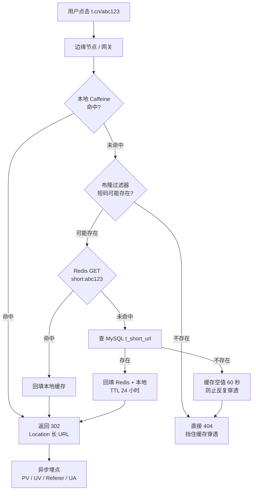
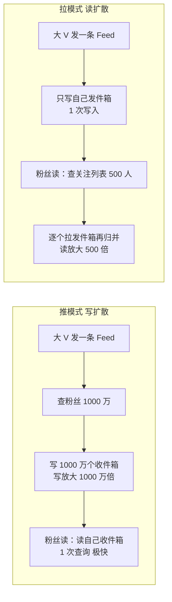
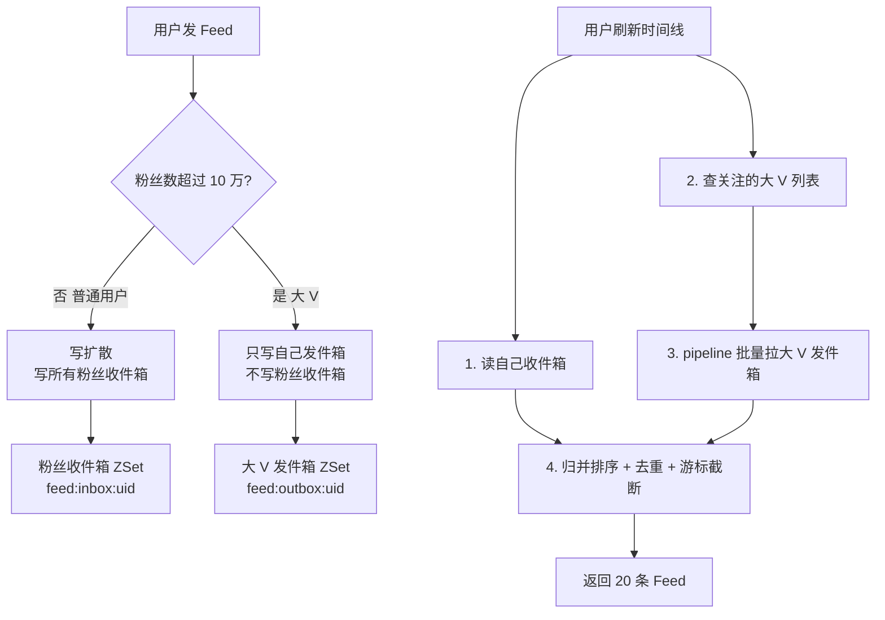

# 短链与Feed流设计

> 定位：这两道题经常被放在一起考，因为它们共享同一个思维内核——**「放大」到底该放在写侧还是读侧**。短链是典型的「读多写少 + 编码 + 跳转语义」，Feed 流是典型的「写扩散 vs 读扩散」。前者考你能不能在 10 万 QPS 下把一次 302 做到 3ms，后者考你能不能在「1000 万粉丝的大 V 发一条微博」时不把系统打挂。两题都不难，难在答得具体：62 进制怎么转、302 为什么不能用 301、推拉阈值定在哪。

## 一、短链：一个被低估的读多写少系统

### 1.1 需求拆解

短链要解决的是一个很具体的问题：微博只能发 140 字、短信按条计费、二维码容量有限，长 URL 塞不进去。所以需要一个服务，把

```
https://www.example.com/product/detail?skuId=10086&channel=weibo&utm_source=xxx&utm_campaign=yyy
```

变成

```
https://t.cn/A6x8kQ2
```

需求可以拆成四条：

1. **生成**：给定长 URL，返回一个短码，拼成短链。
2. **跳转**：访问短链，302 到原始 URL。
3. **永久有效**：短链一旦发出（印在包装上、贴在海报上），不能过期。
4. **可运营**：能统计点击量、能改目标地址、能封禁恶意链接。

第 4 条最容易被忽略，但它直接决定了 301 还是 302 的选择——后面细说。

### 1.2 业务特征

| 维度 | 数值（典型量级） | 设计含义 |
|---|---|---|
| 读写比 | 100:1 ~ 1000:1 | 读路径必须极致优化，写路径可以慢 |
| 跳转 QPS | 10 万+（峰值） | 必须多级缓存，DB 只做兜底 |
| 生成 QPS | 几百 | 可以走同步 DB，不需要削峰 |
| 短码长度 | 6~7 位 | 62^6 ≈ 568 亿，62^7 ≈ 3.5 万亿 |
| 数据量 | 每年几十亿条 | 必须分库分表 |
| 一致性 | 短码生成后不可变 | 缓存可以永久有效（除了删除/封禁） |

这张表最重要的一行是**读写比 1000:1**。它意味着：短链系统的性能瓶颈几乎永远在「跳转」而不是「生成」，所有优化都该往读路径上砸。

### 1.3 三个硬约束

1. **短码不能冲突**。两条不同的长 URL 映射到同一个短码，跳转就错了，这是数据错误，不是性能问题。
2. **短码要足够短**。7 位是上限，再长就失去意义（短信一条 70 字，短链占 20 字还能接受）。
3. **跳转要快**。用户点链接，超过 100ms 就开始感知卡顿。P99 要控制在 10ms 以内，这意味着 Redis 命中率必须 99% 以上。

## 二、短码生成：三种方案与选型

### 2.1 方案对比

| 方案 | 原理 | 冲突 | 长度 | 可枚举 | 适用 |
|---|---|---|---|---|---|
| 自增 ID + 62 进制 | 发号器发号，转 62 进制 | 无 | 6~7 位 | 是（需混淆） | **推荐** |
| 哈希取位 | MD5/SHA1 取前 N 位 | 有 | 固定 | 否 | 需要「同 URL 同码」 |
| 预生成码池 | 离线随机生成，入池待取 | 无 | 固定 | 否 | 超大规模、要求不可猜 |
| 数据库自增 | `auto_increment` 直接用 | 无 | 长（10 位+） | 是 | 单库小规模，不推荐 |

### 2.2 自增 ID + 62 进制（推荐）

这是工业界最主流的方案。核心就两步：**拿一个全局唯一的自增 ID，把它转成 62 进制字符串**。

为什么是 62 进制？因为 URL 里可以安全使用的字符是 `0-9a-zA-Z`，共 62 个。用满 62 个字符，信息密度最高。

容量表（务必记住，面试常问「6 位够不够」）：

| 位数 | 容量 | 能撑多久（按每天 1000 万条算） |
|---|---|---|
| 4 | 1477 万 | 1.5 天 |
| 5 | 9.16 亿 | 2.5 年 |
| 6 | 568 亿 | 155 年 |
| 7 | 3.5 万亿 | 9600 年 |

6 位够用 155 年，但考虑「ID 不连续、要留余量」，生产上一般用 **7 位**，或者用 6 位但做好扩容预案（前缀分流）。

实现代码：

```java
public final class Base62 {
    // 字母表顺序一旦上线就不能改，否则已发出的短码全部解析错误
    private static final char[] ALPHABET =
        "0123456789abcdefghijklmnopqrstuvwxyzABCDEFGHIJKLMNOPQRSTUVWXYZ".toCharArray();
    private static final int BASE = 62;
    private static final int[] INDEX = new int[128];

    static {
        Arrays.fill(INDEX, -1);
        for (int i = 0; i < BASE; i++) {
            INDEX[ALPHABET[i]] = i;
        }
    }

    public static String encode(long id) {
        if (id < 0) {
            throw new IllegalArgumentException("id must be non-negative");
        }
        if (id == 0) {
            return "0";
        }
        StringBuilder sb = new StringBuilder(7);
        while (id > 0) {
            sb.append(ALPHABET[(int) (id % BASE)]);
            id /= BASE;
        }
        return sb.reverse().toString();
    }

    public static long decode(String code) {
        long id = 0;
        for (int i = 0; i < code.length(); i++) {
            int v = INDEX[code.charAt(i)];
            if (v < 0) {
                throw new IllegalArgumentException("invalid code: " + code);
            }
            id = id * BASE + v;
        }
        return id;
    }
}
```

三个坑，一个都不能踩：

**坑一：不要用 `Long.toString(id, 36)`。** 它只有 36 进制，且大小写不敏感，容量小一半。更致命的是它用小写字母表，和你的自定义字母表不兼容。

**坑二：字母表顺序不能改。** 上线后如果调整了 `ALPHABET` 里 `a` 和 `A` 的位置，历史短码全部解析错误。这个表要当成「协议常量」对待，写进代码注释，加单元测试锁定。

**坑三：`encode` 出来的长度不一致。** ID=1 得到 `"1"`（1 位），ID=62 得到 `"10"`（2 位）。如果要固定 6 位，前面补 `0`（`"000001"`），或者用一个固定的起始偏移（比如 ID 从 `62^5` 开始发号，保证永远是 6 位）。补零更简单，但会让 `000001` 这类短码看起来很「假」，容易被猜。

### 2.3 发号器的四种实现

自增 ID 从哪来？这是决定系统上限的关键。

| 实现 | 性能 | 优点 | 缺点 |
|---|---|---|---|
| DB `auto_increment` | 几千 TPS | 简单、绝对递增 | 单点、要跨库改造、性能差 |
| Redis `INCR` | 10 万 QPS | 快、原子 | 重启可能丢号（未持久化）、集群要单独维护 |
| 号段模式（Leaf） | 10 万+ QPS | 批量取号、DB 压力小 | 重启会浪费一段号（可接受） |
| 雪花算法 | 单机 400 万/秒 | 无中心、趋势递增 | ID 长度不固定（转 62 进制后 11 位）、依赖时钟 |

**号段模式是最推荐的**。原理：服务启动时从 DB 取一段（比如 1000 个），在内存里慢慢发，用完再取下一段。

```sql
-- 号段表：每行代表一个业务的一条号段记录
CREATE TABLE t_id_segment (
  biz_tag     VARCHAR(64) NOT NULL COMMENT '业务标识，如 short_url',
  max_id      BIGINT NOT NULL DEFAULT 0 COMMENT '当前已分配到的最大ID',
  step        INT NOT NULL DEFAULT 1000 COMMENT '号段长度',
  update_time BIGINT NOT NULL,
  PRIMARY KEY (biz_tag)
) ENGINE=InnoDB;

-- 取号段：一条 UPDATE 原子完成「读+加」
UPDATE t_id_segment
SET max_id = max_id + step, update_time = UNIX_TIMESTAMP() * 1000
WHERE biz_tag = 'short_url';
-- 然后 SELECT max_id FROM t_id_segment WHERE biz_tag = 'short_url';
-- 得到 [max_id - step + 1, max_id] 这段
```

`UPDATE` 加行锁保证并发安全，`SELECT` 拿到的一定是刚加过的值（同一事务内）。DB 只在「号段用完」时才被访问，1000 个号一次，QPS 1000 时 DB 压力只有 1 TPS。

**双 buffer 优化**：当前号段用到 10% 时，异步去取下一段，避免「用完才取」导致的请求卡顿。这是 Leaf 的核心优化。

**雪花算法的问题**：转 62 进制后是 11 位（64 bit ≈ 62^11），太长了。除非你自己裁剪位数（比如只用 41 位时间戳的低 30 位 + 12 位序列），但那样又会重复。所以短链场景**不建议用雪花**，用号段模式更合适。

### 2.4 哈希方案与冲突

哈希的思路是：`code = MD5(longUrl).substring(0, 7)`，然后转成 62 进制字符集。

优点是「同一个长 URL 永远得到同一个短码」，不需要额外存映射关系（理论上）。缺点是**必然冲突**。

算一下冲突概率。7 位 62 进制空间 `N = 3.5 × 10^12`，存 `n = 10^9` 条时，期望冲突数约：

```
n² / (2N) = 10^18 / (7 × 10^12) ≈ 143,000
```

14 万次冲突。所以哈希方案必须处理冲突，不能「取前 7 位直接用」。

冲突处理的标准做法：

```java
public String generateByHash(String longUrl) {
    for (int salt = 0; salt < 5; salt++) {
        String input = salt == 0 ? longUrl : longUrl + "#" + salt;
        String code = md5ToBase62(input, 7);
        // 布隆过滤器先挡一层（省一次 DB 查询）
        if (!bloomFilter.mightContain(code)) {
            return code;
        }
        // 布隆说可能存在，再查 DB 确认
        String existUrl = shortUrlMapper.selectLongUrlByCode(code);
        if (existUrl == null) {
            return code;              // 假阳性，可用
        }
        if (existUrl.equals(longUrl)) {
            return code;              // 同一个 URL，复用
        }
        // 真冲突，加盐重试
    }
    throw new BizException("短码生成失败，请重试");
}
```

注意这里有个陷阱：`bloomFilter.mightContain` 返回 true 时**不能直接判定冲突**，因为布隆有假阳性。必须再查一次 DB。布隆的作用是「挡住 99% 的 false 查询」，不是「判定冲突」。

**哈希方案什么时候用？** 当业务要求「同一个 URL 返回同一个短码」（比如防止用户重复提交同一链接产生大量短码）时。这时需要加一个 `UNIQUE KEY (long_url_hash)`，插入冲突就说明已存在，直接返回已有短码。

但这里又有个问题：MD5 是 128 位，存全量要 32 字节。如果只存前 7 位做唯一索引，冲突时两个不同的 URL 会被判为同一个。所以要么存全量 MD5（`CHAR(32)`），要么接受「极低概率的错误复用」。生产上一般存全量，索引开销可接受。

### 2.5 预生成码池

思路：离线跑一个任务，随机生成 1 亿个 7 位短码，去重后灌进 Redis List 或 DB 表。用的时候 `LPOP` 一个。

| 优点 | 缺点 |
|---|---|
| 绝对无冲突（生成时已去重） | 要预先占用存储（1 亿条 × 20 字节 ≈ 2GB） |
| 短码随机，不可枚举 | 码池耗尽要补，补的时候要保证不和已用的重复 |
| 生成极快（一次 `LPOP`） | 无法反解出 ID（有时候是缺点） |

适合「短码绝对不能猜」的场景（比如分享链接、私密链接）。但绝大多数公开短链不需要，自增 + 混淆就够了。

### 2.6 防枚举：自增 ID 的副作用

自增 ID 转 62 进制有个致命问题：**可枚举**。竞争对手从 `t.cn/1` 开始递增，就能把你的所有短链爬一遍，既泄露业务量（每天新增多少条），也能拿到所有原始 URL（可能有内网地址、测试链接）。

解法是**可逆混淆**：在转 62 进制之前，先把 ID 打散。

```java
// 乘法混淆：乘一个大奇数再取模，可逆（需要模逆元）
private static final long MULTIPLIER = 2654435761L;   // 黄金比例素数
private static final long MASK = (1L << 32) - 1;      // 限制在 32 位

public static long obfuscate(long id) {
    return (id * MULTIPLIER) & MASK;
}

public static long deobfuscate(long code) {
    // MULTIPLIER 在 2^32 下的模逆元
    return (code * 2897963713L) & MASK;
}
```

这样 ID=1 → 混淆后是 `2654435761`，转 62 进制是 `"2T6QZ1"`，看起来完全随机，但能反解。32 位空间是 42 亿，够用。

更严谨的做法是 **Feistel 网络**（多轮置换），能保证「任意两个 ID 混淆后差异很大」，且严格双射。但对短链来说，乘法混淆已经足够——它只防「顺手爬」，不防「有心人」。

## 三、跳转：为什么必须是 302

### 3.1 301 vs 302

这是短链面试的必问题。

| 维度 | 301 Moved Permanently | 302 Found |
|---|---|---|
| 语义 | 永久重定向 | 临时重定向 |
| 浏览器行为 | **缓存**，第二次直接跳，不回源 | 默认不缓存，每次回源 |
| 能否统计 | **不能**（第二次开始不经过服务器） | 能，每次都有请求 |
| 能否改目标 | 不能（缓存里写死了） | 能 |
| 能否封禁 | 不能（用户浏览器还缓存着） | 能 |
| SEO | 权重转移给目标页 | 不转移 |
| 性能 | 极好（第二次零成本） | 差一些（每次一次 RTT） |

**短链必须用 302**，理由有四条，按重要性排序：

1. **统计是短链的核心价值**。短链服务卖的就是「点击数据」——哪个渠道来的、多少人点了、地域分布。用 301，用户第二次点击就不经过服务器了，数据直接丢失 90%。
2. **目标地址可能要改**。营销活动结束后要把链接指向新页面，用 301 改不了——用户的浏览器缓存里还是旧地址，缓存清不掉。
3. **恶意链接要能封禁**。发现短链指向钓鱼站，要立即拦截。301 做不到，已经缓存的用户还会继续跳。
4. **短链是「永久有效」，但不是「永久不变」**。短码永久有效，目标可以变，这两件事不矛盾。

**但 302 有个陷阱**：HTTP 规范里 302 是「不缓存」，但很多浏览器在没有 `Cache-Control` 头时会**启发式缓存**（尤其是 Chrome 对 302 有几分钟的缓存）。所以必须显式加头：

```
HTTP/1.1 302 Found
Location: https://www.example.com/xxx
Cache-Control: no-cache, no-store, must-revalidate
Pragma: no-cache
Expires: 0
```

少一个 `no-store`，统计就会丢一部分。

顺带说 307 和 308：307 是「临时 + 保持原方法」（POST 还是 POST），308 是「永久 + 保持原方法」。短链都是 GET 跳转，用 302 就够，不用纠结。

### 3.2 跳转链路



这张图的核心是**三级缓存 + 一道布隆**：

| 层 | 命中率 | 延迟 | 容量 |
|---|---|---|---|
| 本地 Caffeine | 60%~80% | 100ns | 单机 10 万条 |
| Redis | 15%~35% | 1ms | 集群，全量热点 |
| MySQL | 1% 以下 | 5ms | 全量，分库分表 |

本地缓存是第一道闸。短链的访问有极强的**热点聚集性**——一条爆款微博的链接，可能 1 分钟内被点 10 万次。本地缓存能挡掉 80%，Redis 只承接剩下的 20%。

本地缓存的过期时间要短（30~60 秒），否则「封禁一个链接」要等所有节点缓存过期才生效。这是一个典型的「一致性 vs 性能」取舍：**接受最长 60 秒的封禁延迟，换取 80% 的本地命中**。

### 3.3 存储设计

```sql
CREATE TABLE t_short_url (
  id             BIGINT UNSIGNED NOT NULL AUTO_INCREMENT,
  code           VARCHAR(8)  NOT NULL COMMENT '短码，不含域名',
  long_url       VARCHAR(2048) NOT NULL COMMENT '原始 URL',
  long_url_hash  CHAR(32)    NOT NULL COMMENT 'MD5(长URL)，用于查重和复用',
  domain         VARCHAR(128) NOT NULL COMMENT '目标域名，用于白名单校验',
  status         TINYINT     NOT NULL DEFAULT 1 COMMENT '1正常 0封禁',
  creator        BIGINT UNSIGNED NOT NULL DEFAULT 0 COMMENT '创建者，0=匿名',
  created_at     BIGINT      NOT NULL,
  expire_at      BIGINT      NOT NULL DEFAULT 0 COMMENT '0=永久有效',
  PRIMARY KEY (id),
  UNIQUE KEY uk_code (code),
  KEY idx_hash (long_url_hash),
  KEY idx_creator (creator, created_at)
) ENGINE=InnoDB DEFAULT CHARSET=utf8mb4;
```

几个设计点：

- **`code` 上加唯一索引**，这是防冲突的最终兜底。即使发号器出问题，DB 也会拒绝重复插入。
- **`long_url` 用 `VARCHAR(2048)`**。浏览器理论上支持更长，但 2048 覆盖 99.9% 的场景。超长的截断或拒绝。
- **`domain` 单独存**，用于白名单校验（防止短链被用来跳钓鱼站）。查询时按 domain 聚合也方便。
- **`expire_at = 0` 表示永久**。不要用 `NULL`，`NULL` 在索引里行为特殊，容易写出 `WHERE expire_at > now()` 漏掉永久链接的 bug。
- **按 `id` 范围分库分表**。短链的查询是「按 code 查」，所以分片键要么是 code 的哈希，要么是 id 取模。用 id 取模更均匀，但需要「先算出 code 再定位分片」——因为 code 是 id 转来的，可以反解出 id，再 `id % 64` 定位。这是一个很巧妙的设计：**用 code 反解 id 来路由**，避免全库扫描。

分片路由代码：

```java
public ShortUrl getByCode(String code) {
    long id = Base62.decode(code);              // 反解出原始 ID
    int shard = (int) (id % SHARD_COUNT);       // 用 ID 定位分片
    return shardRouter.get(shard).selectByCode(code);
}
```

如果用了混淆（2.6），要先 `deobfuscate` 再取模。

### 3.4 缓存穿透

短链是「被恶意刷」的重灾区。攻击者构造 `t.cn/AAAAAA`、`t.cn/AAAAAB`…… 批量请求不存在的短码，每次都穿透到 DB，几万 QPS 就能把 DB 打挂。

三层防护：

| 层 | 手段 | 效果 |
|---|---|---|
| 布隆过滤器 | 全量短码写入布隆，查询前先判断 | 挡住 99.9% 的不存在请求，内存 1 亿条约 120MB |
| 空值缓存 | 查不到也写 `short:xxx -> ""`，TTL 60 秒 | 挡住「同一个不存在的码」被反复刷 |
| 接口限流 | 按 IP / 设备限流，如 100 次/分钟 | 挡住单 IP 的暴力枚举 |

布隆过滤器的两个坑：

1. **不能删元素**。短链被删除后，布隆里还在，会误判「可能存在」，然后穿透到 DB。解法是用**计数布隆**（Counting Bloom）或者定期重建。短链很少删除，一般接受这个误差。
2. **假阳性率要算准**。1 亿条数据、120MB 内存（约 9.6 亿 bit）、7 个哈希函数，假阳性率约 0.8%。意味着 1000 次「不存在」的查询里有 8 次会穿透到 DB。如果攻击 QPS 是 10 万，就是 800 QPS 打到 DB——还能接受，但要配合空值缓存。

## 四、Feed 流：写扩散与读扩散

### 4.1 需求

Feed 流就是「时间线」：你关注了 500 个人，打开 App 看到他们最近发的 20 条内容，按时间倒序。

需求拆成三条：

1. **关注关系**：A 关注 B，B 发的内容要出现在 A 的时间线。
2. **时间线**：按发布时间倒序，支持分页（下拉加载更多）。
3. **实时性**：B 发完 1 秒内，A 刷新能看到。

### 4.2 三种模式



| 维度 | 推模式（写扩散） | 拉模式（读扩散） |
|---|---|---|
| 发 Feed 成本 | O(粉丝数) | O(1) |
| 读时间线成本 | O(1) | O(关注数) |
| 写放大 | 粉丝数倍 | 1 倍 |
| 读放大 | 1 倍 | 关注数倍 |
| 实时性 | 推送即时 | 读时聚合，稍慢 |
| 适合 | 粉丝少的普通用户 | 粉丝多的大 V |
| 存储成本 | 高（每条内容存 N 份索引） | 低（只存一份） |

**为什么不能纯拉模式？** 算一笔账：

- 日活 3 亿，人均每天刷 10 次 → 30 亿次读/天 → 平均 3.5 万 QPS，峰值 30 万 QPS。
- 平均关注 500 人 → 每次读要查 500 个发件箱。
- 30 万 × 500 = **1.5 亿 QPS**。这个量级任何存储都扛不住。

**为什么不能纯推模式？** 也算一笔账：

- 一个 1000 万粉丝的大 V 发一条微博，要写 1000 万个收件箱。
- 即使每个 `ZADD` 只要 0.1ms，串行也要 1000 秒（16 分钟）。
- 用 pipeline 批量，1000 个一批，也要 1 万次 RTT，几十秒。这期间系统基本瘫痪。

所以答案必然是**推拉结合**。

### 4.3 推模式实现

收件箱用 Redis ZSet，score 是发布时间戳，member 是 feedId：

```
ZADD feed:inbox:{uid} 1700000000000 10086
ZREVRANGE feed:inbox:{uid} 0 19        # 取最新 20 条
```

为什么用 ZSet 不用 List：

- ZSet 的 member 唯一，天然去重（同一条 Feed 推两次只算一次）。
- 支持按 score 范围查询（「取 3 天前的」）。
- `ZREMRANGEBYSCORE` 可以裁剪旧数据（只保留最近 1000 条）。

List 的 `LPUSH` + `LRANGE` 更快，但没法去重，也没法按时间范围操作。

发 Feed 的代码：

```java
public void publishFeed(Feed feed) {
    // 1. 内容落库（正文、图片等）
    feedRepository.save(feed);

    // 2. 写自己的发件箱（用于「我的主页」和拉模式的粉丝读取）
    String outboxKey = "feed:outbox:" + feed.getAuthorId();
    redis.opsForZSet().add(outboxKey, String.valueOf(feed.getId()), feed.getCreatedAt());
    redis.expire(outboxKey, 30, TimeUnit.DAYS);

    // 3. 写粉丝收件箱（写扩散）
    List<Long> followers = relationService.listFollowerIds(feed.getAuthorId());
    // 分批 pipeline，避免单次命令过大
    for (List<Long> batch : Lists.partition(followers, 500)) {
        redisTemplate.executePipelined((RedisCallback<Object>) conn -> {
            for (Long uid : batch) {
                String key = "feed:inbox:" + uid;
                conn.zAdd(key.getBytes(),
                        feed.getCreatedAt(),
                        String.valueOf(feed.getId()).getBytes());
                conn.expire(key.getBytes(), 7 * 24 * 3600);
            }
            return null;
        });
    }
}
```

读时间线：

```java
public List<Feed> timeline(long uid, long cursorScore, long cursorId, int size) {
    String key = "feed:inbox:" + uid;
    // 游标：从 cursorScore 往前取，排除 score 相同且 id >= cursorId 的
    Set<String> ids = redis.opsForZSet()
            .reverseRangeByScore(key, 0, cursorScore, 0, size + 10);
    // ... 过滤掉 (score == cursorScore && id >= cursorId) 的重复项
    return feedRepository.batchGet(ids);
}
```

### 4.4 拉模式实现

拉模式不发收件箱，读的时候实时聚合：

```java
public List<Feed> timelineByPull(long uid, long cursor, int size) {
    List<Long> followings = relationService.listFollowingIds(uid);  // 500 人
    PriorityQueue<Feed> heap = new PriorityQueue<>(
            Comparator.comparingLong(Feed::getCreatedAt).reversed());

    for (Long authorId : followings) {
        String outboxKey = "feed:outbox:" + authorId;
        Set<String> ids = redis.opsForZSet()
                .reverseRangeByScore(outboxKey, 0, cursor, 0, size);
        for (String id : ids) {
            heap.offer(feedRepository.get(Long.parseLong(id)));
        }
    }

    List<Feed> result = new ArrayList<>(size);
    while (result.size() < size && !heap.isEmpty()) {
        result.add(heap.poll());
    }
    return result;
}
```

问题很明显：500 次 Redis 查询，即使每次 1ms，也是 500ms。必须用 pipeline 批量，能把 500 次 RTT 压到 1 次，但服务端的 CPU 开销还在（500 个 `ZREVRANGEBYSCORE` 的结果要归并）。

**优化：只拉「大 V」**。如果用户关注了 500 人，其中 490 个是普通用户（走推模式，已在收件箱里），只有 10 个是大 V（走拉模式），那么读时只需要查 10 个发件箱。这就是推拉结合。

### 4.5 推拉结合



阈值定在哪？这是必须能说出理由的。

| 阈值 | 写扩散成本（单条 Feed） | 说明 |
|---|---|---|
| 1000 粉丝 | 1000 次 ZADD，pipeline 后约 2 次 RTT | 完全可接受 |
| 1 万粉丝 | 1 万次 ZADD，约 20 次 RTT | 可接受，但要异步 |
| 10 万粉丝 | 10 万次 ZADD，约 200 次 RTT | 开始影响其他业务 |
| 100 万粉丝 | 100 万次 ZADD | 必须拉模式 |

业界常用的阈值是 **10 万**。微博的实际做法更细：粉丝数 < 1000 同步推，1000~10 万异步推（MQ），> 10 万走拉模式。中间这段「异步推」是折中——发 Feed 的接口立即返回，后台慢慢推，用户感知不到延迟。

代码：

```java
private static final int SYNC_PUSH_MAX    = 1_000;
private static final int ASYNC_PUSH_MAX   = 100_000;

public void fanout(Feed feed, int followerCount) {
    if (followerCount <= SYNC_PUSH_MAX) {
        pushService.pushToFollowers(feed);                    // 同步，几十毫秒
    } else if (followerCount <= ASYNC_PUSH_MAX) {
        mqProducer.send("FEED_FANOUT", new FanoutMsg(feed.getId()));  // 异步，慢慢推
    } else {
        // 大 V：不推，只写发件箱，读时拉
        log.info("大V跳过写扩散，followerCount={}", followerCount);
    }
}
```

读的时候：

```java
public List<Feed> timeline(long uid, Cursor cursor, int size) {
    // 1. 收件箱（普通用户推过来的）
    Set<String> inboxIds = redis.opsForZSet()
            .reverseRangeByScore("feed:inbox:" + uid, 0, cursor.getScore(), 0, size);

    // 2. 关注的大 V（拉模式）
    List<Long> bigVs = relationService.listFollowedBigV(uid);
    List<Set<String>> outboxIds = redisTemplate.executePipelined((RedisCallback<Object>) conn -> {
        for (Long authorId : bigVs) {
            conn.zRevRangeByScore(("feed:outbox:" + authorId).getBytes(),
                    cursor.getScore(), 0, 0, size);
        }
        return null;
    });

    // 3. 归并 + 去重（用 feedId 做 key）
    Map<Long, Feed> merged = new TreeMap<>(Comparator.reverseOrder());
    for (Set<String> ids : outboxIds) { /* 填充 */ }
    for (String id : inboxIds)        { /* 填充 */ }

    // 4. 截断到 size
    return merged.values().stream().limit(size).collect(Collectors.toList());
}
```

注意第 3 步的**去重**。推拉结合会产生重复：一条 Feed 可能既在收件箱（历史推送残留），又在发件箱（作者后来变成了大 V）。用 `Map<feedId, Feed>` 天然去重。

### 4.6 收件箱存储与游标分页

**为什么不能用 offset 分页？**

`ZREVRANGE key 20 39` 这种 offset 分页有两个致命问题：

1. **深分页慢**。Redis 的 `ZREVRANGE` 带 offset 是 O(log N + offset)，翻到第 100 页要跳过 2000 个元素。
2. **新内容插入导致重复**。你正在看第 2 页，这时候有人发了新 Feed，所有内容往后挪一位，第 2 页的第一条就是第 1 页的最后一条。

**游标分页**用「上一页最后一条的位置」作为下一页的起点，天然免疫这两个问题。

短链/Feed 的游标通常是 `(score, id)` 二元组：

```
ZREVRANGEBYSCORE feed:inbox:{uid} (1700000000000 -inf WITHSCORES LIMIT 0 20
```

`(` 表示开区间，排除掉已经看过的那条。如果 score 有重复（同一毫秒发了多条），还要用 id 做二次排序。最稳妥的做法是**把 score 设计成唯一值**：

```
score = createdAt * 1000 + (feedId % 1000)
```

这样同一毫秒内的 1000 条 Feed 也有唯一 score，游标就退化成单个数字，简单可靠。代价是 score 会超出 `double` 的精确整数范围（`2^53 ≈ 9×10^15`），时间戳 1.7×10^12 乘以 1000 是 1.7×10^15，还在范围内，安全。但**不能乘 10000**，会溢出精度。

如果不想改 score，就用 `member` 做二级排序：`member = String.format("%013d:%010d", timestamp, feedId)`，然后用 `ZREVRANGEBYLEX`。这样 score 全是 0，纯字典序排序，天然支持游标。

### 4.7 新用户冷启动

新用户关注了 10 个人，收件箱是空的（因为这 10 个人最近没发内容）。打开 App 一片空白，体验极差。

三种处理：

| 方案 | 做法 | 问题 |
|---|---|---|
| 回填 | 用户注册时，把关注对象最近 100 条 Feed 灌进收件箱 | 关注时也要回填，逻辑复杂 |
| 实时拉 | 收件箱为空时，降级为拉模式，实时聚合 | 首屏慢（要查 10 个发件箱） |
| 推荐填充 | 混入热门内容 / 推荐内容 | 不是「关注流」，产品上要区分 |

生产上通常**组合使用**：首次关注某人时，异步把该人最近 50 条 Feed 写进收件箱（回填）；收件箱为空时降级拉模式；同时混入推荐内容做兜底。

回填要注意**幂等**：重复关注 / 取关再关注，不能重复写入。用 ZSet 的 member 唯一性天然解决。

## 五、生产坑点

### 坑点 1：短码冲突，两个 URL 跳到同一个地方

**现象**：用户反馈「我的短链打开是别人的页面」。

**原因**：用了哈希方案但没做冲突检测，或者自增发号器在多实例下重复发号（号段模式配置错误，两个实例拿到同一段）。

**解法**：
- `code` 加唯一索引，插入冲突时重试（自增方案重新取号，哈希方案加盐）。
- 号段模式的 `UPDATE ... SET max_id = max_id + step` 必须是**单条原子 SQL**，不能先 `SELECT` 再 `UPDATE`。
- 上线前用脚本校验：随机抽 10 万个 code，反解 ID，检查是否连续无重复。

### 坑点 2：缓存穿透，恶意刷不存在的短码

**现象**：DB QPS 从 500 飙到 5 万，全是 `SELECT ... WHERE code = 'zzzz9999'` 且查不到。

**原因**：攻击者用字典遍历短码空间，Redis 全部 miss，请求全打到 DB。

**解法**：
- 布隆过滤器前置，不存在的直接 404。
- 空值缓存（`SET short:xxx "" EX 60`），挡住重复刷同一个码。
- 按 IP 限流（100 次/分钟），超过返回 429。
- DB 层加 `LIMIT 1` + 覆盖索引，即使穿透也是索引查询，代价可控。

### 坑点 3：301 用了就回不去

**现象**：上线时为了「性能好」用了 301，后来要改目标地址，发现改不动——老用户浏览器缓存里还是旧地址，清了缓存也没用（有些浏览器把 301 缓存在磁盘上）。

**原因**：301 是永久重定向，浏览器有权无限期缓存，且没有标准方式主动失效。

**解法**：**短链一律用 302**，并显式加 `Cache-Control: no-store`。如果已经用了 301，只能换域名（新域名没被缓存过），这是唯一可靠的办法。

### 坑点 4：大 V 发一条微博，写扩散打满 Redis

**现象**：某明星发博，Redis 集群 CPU 从 30% 飙到 100%，其他业务读写超时，持续 30 秒。

**原因**：粉丝 5000 万，触发了写扩散（阈值配置错误，或者这个大 V 是「新晋大 V」，粉丝数刚过阈值但还在推模式）。5000 万次 `ZADD`。

**解法**：
- 阈值按「粉丝数」判断，不是按「是否认证」。每天定时任务重算大 V 列表。
- 大 V 发 Feed 时，先查粉丝数，超过阈值直接走拉模式。
- 推扩散必须走 MQ 异步，且限制消费速率（比如每秒 10 万次），避免瞬间打满。
- 降级开关：Redis 压力大时，自动把所有用户的写扩散降级为拉模式。

### 坑点 5：Feed 重复，同一条内容刷出两次

**现象**：用户下拉刷新，看到同一条 Feed 出现两次。

**原因**：
1. 推拉结合时，同一条 Feed 既在收件箱又在发件箱（作者粉丝数跨过阈值，历史推送残留）。
2. MQ 重复消费，同一条 Feed 写了两次收件箱。
3. 游标分页时，score 相同导致边界重复。

**解法**：
- 读取时用 `Map<feedId, Feed>` 去重（最后一道防线，必须有）。
- 写入时 ZSet 的 member 唯一性天然幂等。
- score 设计成唯一值（`createdAt * 1000 + feedId % 1000`），消除游标边界问题。

### 坑点 6：取关后收件箱残留

**现象**：取关了某人，但时间线里还能看到他的内容。

**原因**：取关只删了关注关系，没有清理收件箱里已经推过来的 Feed。这是写扩散的固有问题——数据已经「复制」到粉丝那里了。

**解法**：
- **读时过滤**（推荐）：拉取收件箱后，批量查关注关系，过滤掉已取关的作者。多一次批量查询，但逻辑简单、实时生效。
- **异步清理**：取关时发 MQ，后台慢慢 `ZREM`。有延迟，且如果粉丝量大，清理任务本身很重。
- **接受残留**：产品上允许「取关后还能看到几条历史内容」，7 天后收件箱 TTL 到期自然消失。

微博/朋友圈的实际做法是「读时过滤 + 7 天 TTL」，简单可靠。

### 坑点 7：明星发博导致缓存击穿

**现象**：某明星发博，1 秒内 100 万人同时刷新，Redis 里 `feed:outbox:{明星id}` 这个 key 被 100 万 QPS 打，单分片 CPU 100%。

**原因**：热点 key 无法分片。所有粉丝读的是同一个发件箱 key。

**解法**：
- **本地缓存**：网关/应用层缓存这个发件箱的前 20 条，TTL 1 秒。100 万 QPS 打到本地，Redis 只承接每秒几次的刷新。
- **读扩散 + 合并**：把大 V 的最近 N 条 Feed 提前「物化」成一个静态列表，放 CDN 或本地缓存，读时直接拿。
- **限流**：按用户维度限流，同一个用户 5 秒内只能刷一次。

本地缓存是性价比最高的方案，但要接受「1 秒延迟」——明星发博 1 秒后才出现在粉丝时间线，用户完全无感。

## 六、面试怎么答

### 短链部分（5 分钟）

**第一步：澄清**
- 每天生成多少条？跳转 QPS 多少？读写比？
- 短链要不要可统计、可改目标、可封禁？（决定 301/302）
- 短码要不要防枚举？（决定是否混淆）

**第二步：估算**
- 每天 1000 万条生成 → 116 QPS，单库够。
- 每天 10 亿次跳转 → 1.16 万 QPS，峰值 10 倍 = 11.6 万。
- 存储 36 亿条/年 → 必须分库分表。

**第三步：讲核心**
1. 短码：号段模式发号 + 62 进制转换，6~7 位。
2. 跳转：302 + `no-store`，三级缓存（本地 + Redis + DB），布隆防穿透。
3. 存储：按 id 分片，用 code 反解 id 定位分片。

**第四步：讲取舍**
- 为什么 302 不用 301（统计 + 可改 + 可封）。
- 为什么用号段不用雪花（长度固定 + 无时钟依赖）。
- 为什么本地缓存 TTL 只有 60 秒（封禁延迟 vs 命中率的平衡）。

### Feed 部分（5 分钟）

**第一步：澄清**
- 日活多少？人均关注多少？最大 V 有多少粉丝？
- 要不要实时（发完 1 秒内可见）？
- 时间线是「纯关注流」还是「关注 + 推荐混排」？

**第二步：估算**
- 日活 3 亿 × 每天刷 10 次 = 30 亿次读/天 → 峰值 30 万 QPS。
- 纯拉模式：30 万 × 500 关注 = 1.5 亿 QPS，不可行。
- 纯推模式：5000 万粉丝的大 V 发一条 = 5000 万次写，不可行。
- 结论：必须推拉结合。

**第三步：讲核心**
1. 普通用户（< 1000 粉丝）同步推，1000~10 万异步推，> 10 万拉模式。
2. 收件箱用 Redis ZSet，score 唯一，游标分页。
3. 读时「收件箱 + 大 V 发件箱」归并去重。

**第四步：讲坑**
- 大 V 写扩散爆炸（阈值 + 异步 + 降级）。
- Feed 重复（ZSet 幂等 + 读时 Map 去重）。
- 取关残留（读时过滤 + TTL）。
- 明星发博缓存击穿（本地缓存 + 限流）。

## 七、小结

- 短链的核心是「读多写少」，性能全在跳转路径：三级缓存 + 布隆过滤器 + 302。
- 短码用「号段模式发号 + 62 进制」，6 位 568 亿、7 位 3.5 万亿，字母表上线后不可改。
- 必须用 302：301 会被浏览器永久缓存，统计丢失、目标改不了、恶意链接封不掉。
- 分库分表用「code 反解 id 再取模」路由，避免全分片扫描。
- Feed 流必须推拉结合：普通用户写扩散，大 V 读扩散，阈值约 10 万粉丝。
- 收件箱用 Redis ZSet，score 唯一化后用游标分页，永不用 offset。
- 两道题共享同一个内核：**找到会被放大的维度，决定在写侧还是读侧承担它**。

## 八、面试高频问法

**Q1：短链系统怎么设计？**

**一句话结论**：发号器 + 62 进制编码 + 302 跳转 + 三级缓存，核心是「读多写少，把读路径压到极致」。

**展开**：

- 生成：号段模式从 DB 批量取号，内存里转 62 进制，6~7 位。
- 存储：`t_short_url` 表，`code` 唯一索引，按 id 分片。
- 跳转：302 + `Cache-Control: no-store`，本地 Caffeine → Redis → MySQL 三级。
- 防穿透：布隆过滤器 + 空值缓存 + IP 限流。

**加分点**：主动说「用 code 反解 id 来定位分片」，这是短链分库分表最巧妙的一点——避免为了查一条记录扫全部分片。

**Q2：短码怎么生成？为什么不用 MD5？**

**一句话结论**：推荐「自增 ID + 62 进制」，MD5 会冲突且长度不可控，只在需要「同 URL 同码」时用。

**展开**：

- 自增 + 62 进制：无冲突、长度固定（6~7 位）、可反解。
- MD5 取前 7 位：空间 3.5 万亿，存 10 亿条时期望冲突 14 万次，必须加盐重试。
- 预生成码池：无冲突、不可猜，但要预占存储。
- 雪花算法：转 62 进制后 11 位，太长。

**加分点**：说「62 进制的字母表一旦上线就不能改，否则历史短码全部解析错误」——这是真实踩过的坑。

**Q3：301 和 302 有什么区别？短链用哪个？**

**一句话结论**：短链必须用 302，因为 301 会被浏览器永久缓存，导致统计丢失、目标改不了、恶意链接封不掉。

**展开**：

- 301 永久：浏览器缓存，第二次不回源，零成本但失控。
- 302 临时：每次回源，可统计、可改、可封。
- 302 也要加 `Cache-Control: no-store`，否则部分浏览器会启发式缓存。
- 短链的商业价值就是「点击数据」，301 等于自断财路。

**加分点**：说「短链是『永久有效』，但不是『永久不变』——短码永久，目标可以改，这两件事不矛盾」。

**Q4：短码怎么防枚举？**

**一句话结论**：在转 62 进制之前做可逆混淆（乘法或 Feistel），把连续的 ID 打散成看起来随机的串。

**展开**：

- 纯自增转 62 进制，`t.cn/1`、`t.cn/2` 可以逐个爬。
- 乘法混淆：`(id * 大素数) & 0xFFFFFFFF`，可逆，需要模逆元。
- Feistel 网络：多轮置换，更严谨，但实现复杂。
- 预生成随机码池：天然不可枚举，代价是存储。

**加分点**：说「防枚举不是安全需求，是商业需求——防止竞对爬你的业务量和所有原始 URL」。

**Q5：短链的缓存怎么设计？**

**一句话结论**：本地 Caffeine（60s）+ Redis（24h）+ DB，布隆过滤器挡在最前面。

**展开**：

- 本地缓存挡 80%，因为短链访问热点极强（一条爆款链接 1 分钟 10 万次）。
- Redis 挡剩下的大部分，全量热点数据。
- DB 只做兜底，命中率 < 1%。
- 布隆过滤器 1 亿条约 120MB，假阳性 0.8%。
- 本地 TTL 短（60s），是为了「封禁能快速生效」。

**加分点**：说「本地缓存 TTL 是『一致性 vs 性能』的旋钮，短链接受 60 秒的封禁延迟，换 80% 的命中率」。

**Q6：Feed 流怎么设计？**

**一句话结论**：推拉结合——普通用户写扩散，大 V 读扩散，读时归并去重。

**展开**：

- 粉丝 < 1000：同步推，写所有粉丝收件箱。
- 1000~10 万：异步推（MQ），发 Feed 立即返回。
- > 10 万：不推，只写发件箱，读时拉。
- 收件箱用 Redis ZSet，score = 发布时间，member = feedId。
- 读时「收件箱 + 大 V 发件箱」归并，用 Map 去重。

**加分点**：主动算账——「纯拉模式 30 万 QPS × 500 关注 = 1.5 亿 QPS，纯推模式 5000 万粉丝要写 5000 万次，两头都不可行，所以只能结合」。

**Q7：为什么不能全用推模式？**

**一句话结论**：写放大会随粉丝数线性增长，大 V 发一条就是千万级写入，会打挂 Redis。

**展开**：

- 1000 万粉丝 → 1000 万次 `ZADD`，即使 pipeline 也要几十秒。
- 这期间 Redis 被这个任务占满，其他业务全部超时。
- 而且大部分粉丝不在线，推了也白推（收件箱 7 天过期，白写）。
- 所以大 V 走拉模式，只推在线粉丝。

**加分点**：说「写扩散的本质是『用存储换读性能』，粉丝数就是存储成本的乘数，乘数太大就亏了」。

**Q8：为什么不能全用拉模式？**

**一句话结论**：读放大会随关注数线性增长，每次刷新要查几百个发件箱，QPS 乘以关注数后不可承受。

**展开**：

- 平均关注 500 人，每次刷新 500 次查询。
- 30 万 QPS × 500 = 1.5 亿 QPS，任何存储都扛不住。
- 即使 pipeline 压到 1 次 RTT，服务端归并 500 个结果的 CPU 也扛不住。
- 所以普通用户走推模式，收件箱读一次就够。

**加分点**：说「推和拉是镜像关系：推把成本放在写侧（乘粉丝数），拉把成本放在读侧（乘关注数），选哪个取决于两个乘数哪个更小」。

**Q9：收件箱怎么存？怎么分页？**

**一句话结论**：Redis ZSet，score 唯一（时间戳 × 1000 + 序号），用游标分页不用 offset。

**展开**：

- ZSet 的 member 唯一，天然去重；List 做不到。
- score = `createdAt * 1000 + feedId % 1000`，保证同一毫秒内也唯一。
- 游标 = 上一页最后一条的 score，`ZREVRANGEBYSCORE key (cursor -inf LIMIT 0 20`。
- 不用 offset：深分页慢，且新内容插入会导致重复。

**加分点**：说「offset 分页在『有插入的时间线』里必然重复，因为位置会漂移；游标分页锚定的是『内容』不是『位置』」。

**Q10：大 V 发一条微博，系统怎么扛？**

**一句话结论**：不写扩散，只写自己发件箱；粉丝读时拉，配合本地缓存挡住热点。

**展开**：

- 阈值判断：粉丝 > 10 万直接跳过往扩散。
- 只写一条 `feed:outbox:{authorId}`，O(1)。
- 粉丝读时 pipeline 批量拉大 V 发件箱，归并。
- 明星发博瞬间 100 万 QPS 读同一个 key → 本地缓存 1 秒，挡住 99%。
- 降级开关：Redis 压力大时，所有用户切拉模式。

**加分点**：说「大 V 的瓶颈不是写，是读——发一条只有 1 次写，但 1000 万粉丝同时刷新就是 1000 万次读，所以热点在读侧，要用本地缓存解」。

**Q11：取关之后为什么还能看到对方的内容？**

**一句话结论**：写扩散已经把内容「复制」到你的收件箱了，取关只删了关系，没删副本。

**展开**：

- 推模式下，Feed 在发的时候就写进了收件箱，是独立的一份数据。
- 取关时可以选择异步 `ZREM` 清理，但粉丝量大时清理任务很重。
- 更常见的做法是「读时过滤」：拉收件箱后批量查关注关系，过滤掉已取关的。
- 配合收件箱 7 天 TTL，残留自然消失。

**加分点**：说「这是写扩散的固有代价——数据冗余带来读性能，也带来一致性维护成本」。

**Q12：新用户打开 App 时间线是空的，怎么办？**

**一句话结论**：关注时异步回填 + 收件箱空时降级拉模式 + 混入推荐内容。

**展开**：

- 首次关注某人时，异步把该人最近 50 条 Feed 写进收件箱。
- 回填要幂等，ZSet 的 member 唯一性天然解决。
- 收件箱为空时，降级为实时拉模式（只查关注列表）。
- 兜底混入热门/推荐内容，避免纯空白页。

**加分点**：说「冷启动的本质是『收件箱是空的，但用户期待有内容』，要么提前填（回填），要么临时算（降级拉），要么给别的（推荐）」。

**Q13：短链和 Feed 流有什么共同点？**

**一句话结论**：都在回答「放大放在写侧还是读侧」，短链放在写侧（预生成/发号），Feed 放在读侧（大 V 拉）。

**展开**：

- 短链：写少读多，把「编码」的成本放在写侧，读侧只做一次 hash 查找。
- Feed：普通用户写侧放大（推），大 V 读侧放大（拉），按乘数大小动态选。
- 两者都用「游标/ID 反解」避免全量扫描。
- 两者都要处理「热点」：短链是爆款链接，Feed 是明星发博。

**加分点**：说「系统设计的通用套路是『找到那个会被放大的维度，然后决定在哪一侧承担它』」——这句话能套用到大多数设计题。
