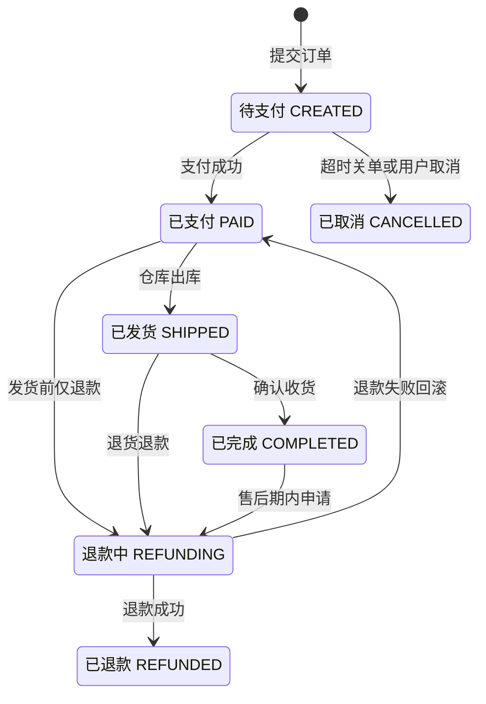
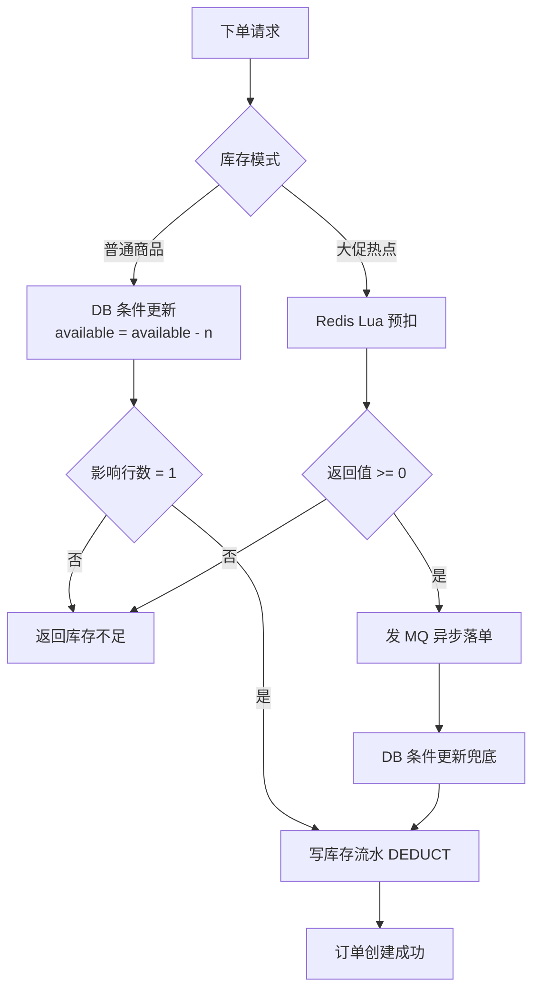
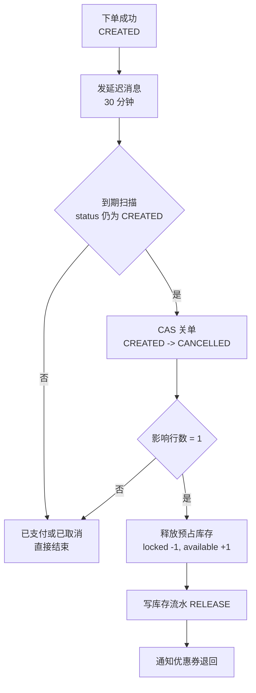
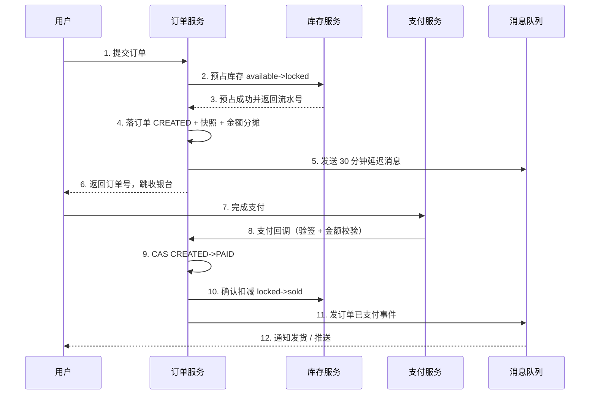

# 订单与库存系统设计

> 定位：订单是交易域的账本，库存是交易域的闸门。支付只负责把钱收进来，真正决定「这单算不算数、能不能发货、退不退得掉」的是订单与库存。这篇按「需求 → 挑战 → 架构 → 细节 → 坑点」讲清订单状态机与幂等、拆单合单、三级库存模型、三种防超卖、订单号、超时关单、对账补偿和分库分表，并说明什么规模不该上这些重方案。

## 一、为什么需要它

大多数业务系统的第一版订单表只有三个字段：`id`、`user_id`、`status`。上线半年后问题集中爆发：支付回调重复把「已支付」改成「待支付」；大促时同一件商品卖了 1200 件但库存只有 1000；用户退款后库存回补了两次；按订单号查得到、按用户查不到（分库分表后）。这些问题都不是「代码写得不认真」，而是**模型和约束没设计**。

订单与库存和普通 CRUD 的区别，先摆清楚：

| 维度 | 普通 CRUD | 订单与库存 |
|---|---|---|
| 数据性质 | 可覆盖、可修改 | 事实记录，只能追加和单向流转 |
| 一致性 | 覆盖写即可 | 状态、库存、金额三者必须自洽 |
| 并发点 | 少 | 同一 sku、同一订单、同一支付回调 |
| 失败处理 | 抛错重试 | 必须能补偿、能对账、能追溯 |
| 查询维度 | 主键 / 简单条件 | 用户、商家、订单号、时间、状态组合 |
| 审计 | 可选 | 必须，状态每次变更都要留痕 |

可以提炼出三条本质约束：

1. **订单是「事实」，不是「状态字段」**。一笔订单发生过什么，必须能按时间线还原。所以状态变更要单独记流水，不能只覆盖主表字段。
2. **库存是「有方向的资源」**。下单要占、支付要确认、取消要释放、退货要回补。每一步的方向错了，结果就是超卖或少卖。
3. **所有异步链路都不可靠**。支付回调会重、延迟消息会丢、MQ 会重复投递。幂等不是优化项，是订单系统的地基。

## 二、核心原理

### 2.1 订单模型：主单、子单与快照

订单不能只有一张表。合理的拆法是：

- `order_main` / `order_item`：主单承载支付状态与金额汇总，子单一个 sku 一行并记录优惠分摊。
- `order_state_log` / `order_snapshot`：状态流水用于追溯；商品快照防止改价后历史订单「变脸」。

拆单发生在下单时：一个购物车按「商家 + 仓库 + 配送方式」拆成多个子单，每个子单有独立的履约状态，但共享一个支付单。合单发生在履约侧：同一个仓库、同一收货地址的多个子单合并发货，只影响物流单，不影响订单主数据。拆单后最容易被忽略的是**金额分摊**：优惠 100 元按行金额比例摊到每个子单，摊完后各行之和必须严格等于总优惠。整数分摊不平是必然的，必须用「最大余额法」——先按比例向下取整，剩余的分逐条补给小数部分最大的行，否则财务对账每天差几分钱。

### 2.2 状态机：把并发问题变成状态问题

订单状态不要设计得太细，状态越多，非法迁移的组合越多。一套够用的状态：



读图要点：`PAID` 之后的「取消」路径必须消失，取消只能从 `CREATED` 出发；`REFUNDED` 是终态，不允许再回到 `PAID`。这两条边是订单系统最常被写错的地方。

状态机的价值在于：**只要状态只能单向流转，重复请求就自然不会重复处理**。一条重复的「支付成功」消息打到 `PAID` 订单上，因为 `PAID → PAID` 不在允许迁移表里，直接被丢弃。

### 2.3 状态流转必须幂等：迁移表 + CAS

只靠 `if (status == 待支付) { set 已支付 }` 是不够的，读和写之间有并发窗口。正确做法是三层：

1. 应用层校验「允许的迁移表」，非法迁移直接告警。
2. 数据库层用 CAS：`UPDATE ... WHERE order_no = ? AND status = 旧状态`。
3. 以影响行数为唯一判断依据：`0` 表示已处理过，按幂等成功返回。

```java
private static final Map<OrderStatus, Set<OrderStatus>> ALLOWED = Map.of(
    CREATED,   EnumSet.of(PAID, CANCELLED),
    PAID,      EnumSet.of(SHIPPED, REFUNDING),
    SHIPPED,   EnumSet.of(COMPLETED, REFUNDING),
    COMPLETED, EnumSet.of(REFUNDING),
    REFUNDING, EnumSet.of(REFUNDED, PAID),
    CANCELLED, EnumSet.noneOf(OrderStatus.class),
    REFUNDED,  EnumSet.noneOf(OrderStatus.class)
);
// 迁移前先查 ALLOWED，再执行 casStatus 并判断影响行数
```

`casStatus` 对应的 SQL 只有一句：

```sql
UPDATE order_main
SET status = #{to}, update_time = NOW()
WHERE order_no = #{orderNo} AND status = #{from};
```

注意这里**不要用 `version` 字段做乐观锁**。版本号适合「读出来、算一算、写回去」的场景；订单状态迁移的期望值就是「旧状态」，`WHERE status = 旧状态` 本身就是最精确的版本条件，多一个 version 只是多一次无意义的维护。

### 2.4 拆单、合单与逆向流程

**拆单**的触发条件通常是三组：商家不同、仓库不同、配送方式不同。拆单本身不难，难的是拆完之后：

- 支付要批量推进子单、部分失败要补偿；退款要按比例扣回优惠；缺货要决定整单取消还是部分发货。

主流做法是「支付单与主单 1:1，主单与子单 1:N」，子单状态独立推进，主单状态取子单的聚合值（全部发货才算已发货）。主单状态不直接由外部写入，只由聚合任务计算，避免两处写冲突。

**逆向**分两条链路，不能混：

| 流程 | 触发 | 货物 | 库存 | 资金 |
|---|---|---|---|---|
| 仅退款 | 未发货 / 未收到货 | 不回流 | 预占直接释放 | 原路退回 |
| 退货退款 | 已发货 | 需入库质检 | 质检合格后回补可售 | 收到货后打款 |

关键点：**退款成功不等于库存回补**。退货必须等仓库确认收到并质检通过，才能把库存从「待检」转为「可售」。很多系统为了体验，退款一成功就加库存，结果用户寄回的是空盒，库存虚增。

### 2.5 库存模型：可售、预占、已售与多级仓

库存不要只用一个 `stock` 字段。`available` 是可售、用户能下单的量；`locked` 是预占、已下单未支付/未发货的量；`sold` 是已售、已支付并占用成功的量。

恒等式是 `available + locked + sold = 总库存`（忽略盘亏盘盈）。下单时 `available -1, locked +1`；支付时 `locked -1, sold +1`；取消时 `locked -1, available +1`。每一次变动都要写一条 `stock_log`，带业务单号和变动类型，这是对账的唯一依据。

多级库存是另一个维度：区域仓 → 前置仓/门店 → 履约单元。用户下单时按「收货地址 + 时效」选仓，选中的仓扣减，其他仓不动。跨仓调拨是另一套流程（调拨单），不能和销售扣减混在一张流水里。



读图要点：无论走哪条路，最终都必须落一次数据库条件更新并写流水。Redis 只是「提前挡流量」，不是「库存事实」。

### 2.6 防超卖：条件更新、Redis 预扣与分桶

三种手段对应三个并发量级，不要一上来就全上。

**数据库条件更新**是最可靠的兜底：

```sql
UPDATE sku_stock
SET available = available - #{n}, locked = locked + #{n}
WHERE sku_id = #{skuId} AND available >= #{n};
```

影响行数为 0 就是库存不足。`WHERE available >= n` 让「判断」和「扣减」在同一个语句里完成，InnoDB 会对该行加排他锁，不存在读到旧值再写的窗口。

**Redis 预扣**用于扛住数据库扛不住的瞬时并发，用 Lua 保证「判断 + 扣减」原子：

```lua
-- KEYS[1] = stock:{skuId}
-- ARGV[1] = 购买数量
local stock = redis.call('GET', KEYS[1])
if not stock then return -2 end
if tonumber(stock) < tonumber(ARGV[1]) then return -1 end
return redis.call('DECRBY', KEYS[1], tonumber(ARGV[1]))
```

注意 key 里的 `{skuId}` 是 hash tag，保证同一 sku 的相关 key 落在同一个 slot，脚本里同时操作库存和限购 key 时不会报 `CROSSSLOT`。

**分桶**解决的是「单 key 打爆单节点」。把 1000 库存拆成 10 个桶，请求按 `hash(userId) % 10` 选桶，桶空顺延下一个。代价是桶粒度造成的少量少卖——这是主动取舍，不是缺陷。

| 方案 | 单点极限 | 一致性 | 复杂度 | 适用规模 |
|---|---|---|---|---|
| DB 条件更新 | 千级 TPS（同行） | 强 | 低 | 日订单十万以内 |
| Redis 预扣 + DB 兜底 | 十万级 QPS | 最终一致 | 中 | 大促、秒杀 |
| Redis 分桶 | 百万级 QPS | 最终一致，可能少卖 | 高 | 头部大促 |

**什么规模不该这么做**：日订单不到十万、单 sku 峰值并发不到几百，直接 `UPDATE ... WHERE available >= n` 就够了。引入 Redis 预扣会多出一整套「预热、回补、对账」的运维负担，收益远小于成本。

### 2.7 订单号生成

订单号要求：全局唯一、趋势递增（利于 B+ 树插入）、可读（能看出日期和分片）、不能暴露业务量级。常见三种：

| 方案 | 结构 | 优点 | 缺点 |
|---|---|---|---|
| 日期 + 分库位 + 号段 | `20261124` + `03` + 序列 | 可读、易定位分片 | 依赖号段服务 |
| 雪花算法 | 时间 + 机器 + 序列 | 本地生成、无网络 | 依赖时钟，回拨要处理 |
| 数据库自增 + 步长 | 简单 | 实现最简 | 扩展性差、易暴露量级 |

生产上更常用「日期 + 分片位 + 号段」：号段服务一次发 1000 个号，本地内存分配，用完再取。号段要**持久化已分配的最大值**，重启后从持久化值继续，不能从内存重新开始，否则会重号。雪花算法必须处理时钟回拨：回拨小于阈值就等待，超过阈值直接拒绝服务并告警，绝不允许「时间倒退还继续发号」。订单号里嵌入分片位还有个好处：**用订单号就能路由到库**，分库分表时这一位是刚需。

### 2.8 支付回调、超时关单与对账

支付回调处理必须做四件事：验签、校验金额、CAS 推进状态、同事务写本地消息。前三件在[支付系统设计](02-支付系统设计.md)里已经讲透，这里只强调订单侧的两条铁律：

1. **回调只允许把 `CREATED` 推到 `PAID`**，不能反向。重复回调因为 CAS 失败直接返回成功，让渠道停止重推。
2. **支付成功与订单状态变更之间用本地消息表**，不要「先改订单再发消息」，也不要用 XA。

超时关单是订单侧最危险的并发点：



读图要点：**只有关单 CAS 成功，才允许释放库存和退券**。如果先释放库存再关单，用户恰好在这一瞬间支付成功，就会既扣了钱又丢了库存，直接超卖。

延迟消息不是 100% 可靠，必须再加一个每 5 分钟扫一次「`CREATED` 且 `create_time < now - 30min`」的定时任务兜底。延迟消息负责「准时」，定时任务负责「不漏」。

**对账**是最后一道防线。订单侧至少要跑三组比对：

- 支付流水 vs 订单：有支付无订单（长款）、有订单无支付（短款）。
- 订单 vs 库存流水：每笔扣减/释放是否都能对应到订单事件。
- 库存恒等式：`available + locked + sold` 是否等于总库存，差异进差错池。

对不上不一定要立刻修，但一定要**发现并告警**。悄悄错比明显错更可怕。

## 三、关键机制与关键代码

### 3.1 核心表结构

```sql
CREATE TABLE `order_main` (
  `id`          bigint      NOT NULL AUTO_INCREMENT,
  `order_no`    varchar(32) NOT NULL COMMENT '订单号，含分片位',
  `user_id`     bigint      NOT NULL,
  `status`      tinyint     NOT NULL DEFAULT 0 COMMENT '0待支付 1已支付 2已发货 3完成 4取消 5退款中 6已退款',
  `total_amount` bigint     NOT NULL COMMENT '商品总额，单位分',
  `pay_amount`  bigint      NOT NULL COMMENT '实付金额，单位分',
  `pay_no`      varchar(32) DEFAULT NULL COMMENT '支付单号',
  `expire_time` datetime    NOT NULL COMMENT '支付截止时间',
  `create_time` datetime    NOT NULL DEFAULT CURRENT_TIMESTAMP,
  PRIMARY KEY (`id`),
  UNIQUE KEY `uk_order_no` (`order_no`),
  KEY `idx_user_time` (`user_id`, `create_time`),
  KEY `idx_status_expire` (`status`, `expire_time`)
) ENGINE=InnoDB DEFAULT CHARSET=utf8mb4;

CREATE TABLE `stock_log` (
  `id`        bigint      NOT NULL AUTO_INCREMENT,
  `biz_no`    varchar(32) NOT NULL COMMENT '业务单号，如订单号',
  `sku_id`    bigint      NOT NULL,
  `type`      varchar(16) NOT NULL COMMENT 'DEDUCT/RELEASE/CONFIRM/RETURN',
  `qty`       int         NOT NULL,
  `create_time` datetime  NOT NULL DEFAULT CURRENT_TIMESTAMP,
  PRIMARY KEY (`id`),
  UNIQUE KEY `uk_biz_sku_type` (`biz_no`, `sku_id`, `type`),
  KEY `idx_sku_time` (`sku_id`, `create_time`)
) ENGINE=InnoDB DEFAULT CHARSET=utf8mb4;
```

`stock_log` 上的 `uk_biz_sku_type` 是防重复回补的关键：同一个订单对同一个 sku 的 `RELEASE` 只能有一条，重复消费直接冲突，从数据库层面兜住幂等。

### 3.2 完整下单到支付时序



读图要点：第 2 步和第 4 步的顺序是「先占库存再落单」。反过来会让「有订单但没占库存」的窗口暴露，用户支付后无货可发。第 10 步是异步还是同步，取决于一致性要求：支付回调里同步确认最稳，但要控制超时。

### 3.3 超时关单的事务边界

关单方法在一个本地事务里做三件事：先 `casStatus(orderNo, CREATED, CANCELLED)`，影响行数为 0 立即返回 false；再对每个订单行调用 `stockService.release`；最后退回锁定中的优惠券。`release` 内部是 `locked - qty`、`available + qty`、`insert stock_log` 三条语句，必须同事务，任何一步失败整体回滚，不能出现「库存加了但流水没记」。

### 3.4 分库分表与订单查询

订单表分片键只有两个合理选择：`user_id` 或 `order_no`。按 `user_id` 分片，用户查自己的订单最快；按 `order_no` 分片，客服按单号查最快。两边都要，就得解决「双维度查询」。

三种主流做法：

| 方案 | 做法 | 代价 |
|---|---|---|
| 基因法 | 订单号末几位由 `user_id` 哈希生成，路由时从订单号反解 | 订单号生成要耦合分片规则 |
| 异构索引表 | 另建一张 `user_id -> order_no` 的映射表，双写 | 多一次写入，要保证一致 |
| 搜索库 | 订单数据同步到 ES，复杂查询走 ES | 有延迟，ES 只做查询不做事实 |

基因法是最省事的：`orderNo = 时间 + 分片位 + 序列`，其中分片位由 `userId % 1024` 得出。这样按订单号路由时直接取分片位；按用户查时算 `userId % 1024` 得到同一个分片位。一份数据，两种路由，不需要额外存储。

**什么规模不该分库分表**：单表行数低于 2000 万、日订单低于 50 万、写入 TPS 低于 2000，先做归档和索引优化。分库分表会带来跨库分页、分布式事务、全局唯一、运维复杂度四座大山，过早引入是负资产。

## 四、生产坑点与排查

### 坑点 1：支付回调重复导致状态回退

**现象**：用户已支付，订单列表偶尔显示「待支付」，过一会儿又变回来。
**原因**：回调处理里写了 `UPDATE order_main SET status = 1 WHERE order_no = ?`，没带旧状态条件。渠道重推历史回调（尤其是补发几天前的通知）时，把 `SHIPPED` 改回了 `PAID`，甚至把 `CANCELLED` 改回 `PAID`。
**解法**：所有状态更新必须带 `AND status = 期望旧状态`；回调入口先查状态，非 `CREATED` 直接返回成功；状态机迁移表做二次校验；对 `SUCCESS` 之后的回退单独告警。

### 坑点 2：关单与支付并发，已支付订单被取消

**现象**：用户付了钱，订单显示已取消，库存也回补了，导致超卖。
**原因**：关单逻辑写成「先查状态，未支付就释放库存」，查询和更新之间用户完成支付。
**解法**：关单必须 CAS，以影响行数为唯一依据；先关单再释放库存；`stock_log` 加唯一键防重复释放；关单后如果收到支付成功回调，走「异常支付」流程——不复活订单，而是触发自动退款并告警。

### 坑点 3：预占库存没释放，商品「卖不动」

**现象**：活动结束，可售库存为 0，但实际成交只有 60%。
**原因**：延迟消息丢失或消费失败，大量 `CREATED` 订单的 `locked` 永远没释放；或者释放接口抛异常被吞掉。
**解法**：延迟消息 + 定时扫表双保险；扫表条件用 `status = CREATED AND expire_time < now`；每日跑一次「`locked` 与未完成订单预占量」的对账，差异自动补偿并告警。

### 坑点 4：拆单金额分摊除不尽，财务每天差几分

**现象**：主单优惠 100 元，拆成 3 个子单后，子单优惠之和是 99.99 或 100.01。
**原因**：每行独立计算 `amount * discount / total` 并四舍五入，误差累加。
**解法**：统一「最大余额法」分摊；分摊结果落库而非每次实时算；对账校验 `sum(子单优惠) == 主单优惠`，不等直接阻断下单。金额一律用「分 + long」。

### 坑点 5：分库分表后按订单号查不到

**现象**：客服拿着订单号查订单，提示不存在；但用户截图明明有这单。
**原因**：按 `user_id` 分片，路由规则只认 `user_id`，按 `order_no` 查询时无法定位分片，代码默认走了 0 库。
**解法**：订单号内嵌分片位（基因法），或建异构索引表；查询入口统一走路由组件，禁止手写 `selectByOrderNo` 直连单库；上线前用「双维度查询」用例做回归。

### 坑点 6：热点 sku 把数据库连接池打满

**现象**：大促开始 10 秒，库存服务连接池耗尽，所有商品下单超时，故障扩散到主站。
**原因**：所有请求都更新同一个 `sku_stock` 行，行锁串行，连接被长时间占用；库存服务和主站共用连接池。
**解法**：热点商品走 Redis 预扣，DB 只承接放行后的量；库存服务独立部署、独立连接池；对热点行做分桶；配置熔断，库存服务不可用时快速失败而不是排队。

## 五、调优、选型与最佳实践

### 5.1 方案对比与决策

| 决策点 | 轻量方案 | 重量方案 | 切换信号 |
|---|---|---|---|
| 库存扣减 | DB 条件更新 | Redis 预扣 + 分桶 | 单 sku 峰值 > 千 TPS |
| 订单存储 | 单库单表 + 归档 | 分库分表 | 单表 > 2000 万行或写入 > 2000 TPS |
| 状态一致性 | CAS + 本地消息表 | 事务消息 | 已用 RocketMQ 且团队熟悉 |
| 超时关单 | 定时任务扫描 | 延迟消息 + 扫描兜底 | 订单量大、扫描窗口压力大 |
| 订单查询 | MySQL 索引 | 异构 ES 查询库 | 多条件组合查询、客服工作台 |

### 5.2 参数与容量建议

- 订单表按 `create_time` 月度分区或归档，热表保留 6~12 个月；库存流水按天分区，90 天在线。
- 延迟消息的扫描任务要分片执行，单实例控制在每秒几千行；库存服务连接池与业务隔离，热点接口单独线程池。

### 5.3 不该用的场景

- 日订单几万的小系统，不要上分库分表和 Redis 预扣，先把索引、事务边界、幂等做对。
- 不要用「定时全量扫描订单表」做关单，数据量一大就是慢查询加主从延迟。
- 不要为了「实时」把库存对账做成同步链路；不要在订单主表上物理删除，取消和退款是状态。

## 六、面试高频问法

**Q1：订单系统的状态机怎么设计？**

**一句话结论**：状态精简、单向流转、终态不可逆，每次变更用 CAS 以旧状态为条件。

展开：待支付 → 已支付 → 已发货 → 已完成，取消只从待支付出发，退款从已支付/已发货/已完成进入退款中再到已退款。应用层维护允许迁移表，数据库层 `UPDATE ... WHERE status = 旧状态`，影响行数为 0 视为已处理。

加分点：主动说「状态机把并发问题变成了状态问题」，重复消息打进来因为迁移非法被自然丢弃。

**Q2：怎么保证订单状态流转的幂等？**

**一句话结论**：迁移表校验 + CAS 更新 + 影响行数判断，三层缺一不可。

展开：应用层拒绝非法迁移；数据库用旧状态做条件；`affected == 0` 不报错而是当成功返回；状态流水表记录每次变更，用唯一键防重复写。

加分点：说清「幂等不是加 if 判断，而是让重复执行的结果和执行一次一样」，最终靠数据库约束兜底。

**Q3：库存有哪几个量？为什么要拆开？**

**一句话结论**：可售、预占、已售三个量，分别对应「能卖」「占了没付」「付了没发」。

展开：下单 `available-1, locked+1`；支付 `locked-1, sold+1`；取消 `locked-1, available+1`；退货质检后 `sold-1, available+1`。恒等式 `available + locked + sold = 总库存` 是对账依据。

加分点：说「只有一个 stock 字段的系统，一定会在取消和退款上算错账」。

**Q4：怎么防超卖？三种方案怎么选？**

**一句话结论**：DB 条件更新兜底，Redis 预扣扛峰值，分桶解决单 key 热点，按并发量逐级升级。

展开：`UPDATE ... WHERE available >= n` 消除 check-then-act 窗口；Redis Lua 原子预扣承接高并发；分桶把单 key 打散到多 key，代价是可能少卖。

加分点：说「超卖是资损，少卖是少赚，所以宁可少卖」，并给出「日订单十万以内不必上 Redis」的规模判断。

**Q5：超时关单怎么保证不误杀已支付订单？**

**一句话结论**：关单必须 CAS，只有关单成功才释放库存和退券。

展开：`UPDATE ... WHERE order_no = ? AND status = CREATED`；影响行数为 0 说明已支付或已取消，直接返回；释放库存写带唯一键的流水；关单后收到支付成功走自动退款而不是复活订单。

加分点：指出「关单和支付是并发关系，必须先拿到关单成功的确定结果再动库存」。

**Q6：拆单后金额和优惠怎么分摊？**

**一句话结论**：按行金额比例分摊，用最大余额法处理整数分余数，结果落库。

展开：先按比例向下取整，剩余的分按小数部分从大到小逐条补齐；校验子单之和等于主单；运费按包裹或按行分摊要全系统统一规则。

加分点：说「分摊规则必须可复算，同一批数据跑两次结果要一样，否则对账永远对不平」。

**Q7：支付回调重复或乱序怎么处理？**

**一句话结论**：状态机 + CAS + 本地消息表，重复当成功，乱序靠状态拒绝。

展开：回调只允许 `CREATED -> PAID`；金额和商户号校验；CAS 失败直接返回成功让渠道停止重推；同事务写本地消息通知下游，下游消费再幂等一次。

加分点：区分「重复」和「乱序」——重复靠 CAS 幂等，乱序靠状态机拒绝旧事件。

**Q8：订单表怎么分库分表？两个查询维度怎么办？**

**一句话结论**：按 `user_id` 分片 + 订单号内嵌分片位（基因法），或异构索引表。

展开：`orderNo = 时间 + userId 哈希位 + 序列`，按单号查询时反解分片位；或者建 `user_id -> order_no` 映射表双写；复杂条件查询同步到 ES。

加分点：说「别为了分库分表而分库分表，单表两千万以内先做归档和索引」。

## 小结

- 订单是事实记录：主单 + 子单 + 状态流水 + 商品快照，缺一个都会在客诉或对账时吃亏。
- 状态机的价值是把并发问题变成状态问题：迁移表 + CAS + 影响行数，三件套固定套路。
- 库存必须拆成可售/预占/已售，靠恒等式和流水对账；防超卖按并发量选择 DB、Redis 或分桶。
- 超时关单的唯一真理是「CAS 关单成功才释放资源」，顺序反了就是资损。
- 金额用分和 long，分摊用最大余额法，规则必须可复算。
- 分库分表是最后手段；订单号内嵌分片位能同时满足用户维度和单号维度查询。
