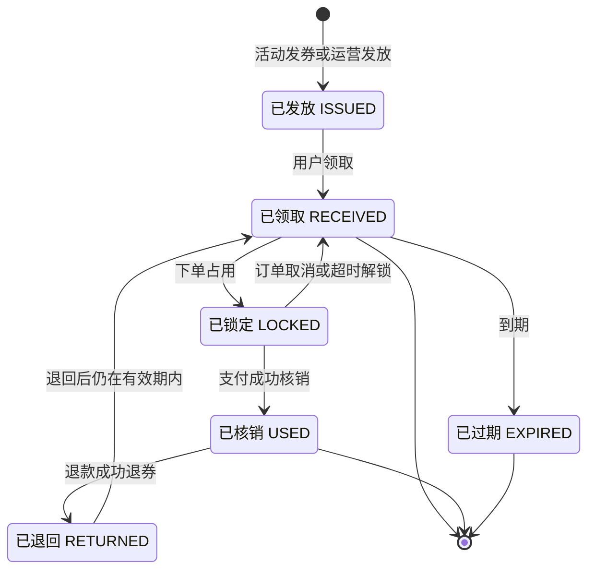
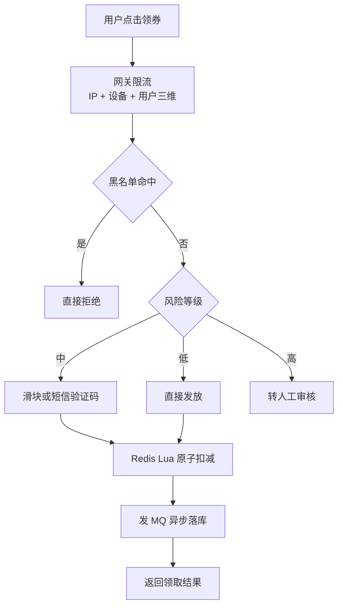
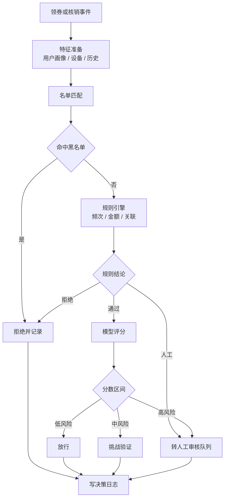
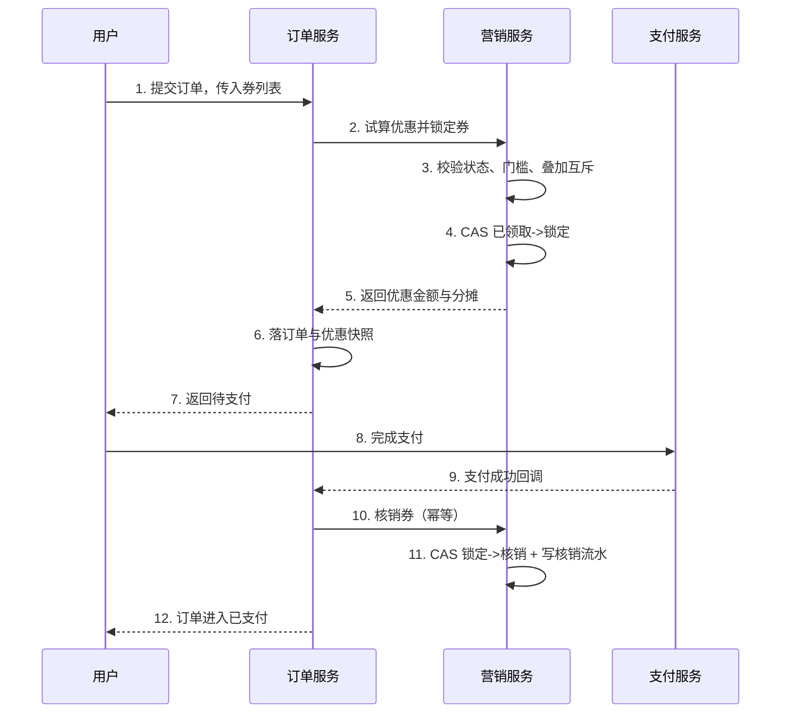

# 营销优惠券与风控系统设计

> 定位：营销系统是「最容易被薅羊毛」的业务系统，优惠券的每一次超发、重复核销、规则配置错误，都会直接变成资损。这篇讲清券模板与券实例的分离、生命周期状态机、叠加互斥规则、预算控制、发券防刷、核销幂等，以及一套「规则 + 名单 + 模型」的风控决策流，并说明营销系统与订单、支付之间该划在哪。

## 一、为什么需要它

一个典型的翻车现场：运营配置「满 100 减 50」的券，忘了设置「每人限领 1 张」和「总预算 10 万」，结果被脚本半小时领走 3 万张；又因为核销接口没有幂等，同一个订单重试了 3 次，扣了 150 元。第二天财务对账，营销费用超支，券的核销明细和订单优惠金额对不上。

营销系统的难点不在功能，而在**约束**：

| 维度 | 普通业务功能 | 营销优惠券 |
|---|---|---|
| 数据模型 | 一张表 | 模板与实例分离，还有规则、预算、流水 |
| 并发点 | 低 | 领券、核销、退券、过期回收同时发生 |
| 一致性 | 最终一致 | 预算不能超、券不能重复用 |
| 对抗性 | 无 | 有专业羊毛党，持续寻找规则漏洞 |
| 出错后果 | 功能不可用 | 直接资损，且难以追回 |

三条本质约束：

1. **预算是有上限的资源**，和库存一样会超卖，必须用原子操作控制。
2. **券是「一次性凭证」**，状态必须单向流转，任何重复核销都是资损。
3. **规则是运营配的，不是开发写的**。规则引擎要把「业务可变」和「代码稳定」隔开，同时保留可审计的决策记录。

## 二、核心原理

### 2.1 券模板与券实例分离

把「券长什么样」和「用户手里的这张券」分成两张表，是所有营销系统的基础：

- `coupon_template`：券模板，描述面额、门槛、有效期类型、适用范围、发放总量、每人限领。
- `coupon_instance`：券实例，一个用户领一张就生成一条，有唯一券码、绑定用户、绑定模板、独立状态。
- `coupon_rule`：叠加与互斥规则，描述哪些券可以一起用、优先级如何。
- `coupon_budget`：预算账户，按活动或模板维度控制总量与已用量。

为什么必须分开：模板是「配置」，实例是「资产」。模板可以改描述、改适用范围，但已经发出去的实例必须保持领取时的权益不变。这和订单快照是同一个道理——**用户领到的是当时的承诺**。实例表还要冗余模板的面额、门槛、有效期，而不是每次核销都去 join 模板；模板变更后老实例按快照执行，新实例按新配置执行。

### 2.2 生命周期状态机

一张券从生到死，状态不多，但每条边都对应一笔钱：



读图要点：`LOCKED` 只是「下单时占住」，此时券还没真正花掉；只有支付成功才进 `USED`。订单取消只能走 `LOCKED -> RECEIVED`，不能从 `USED` 直接回退——已核销的券要退，必须走退款成功后的 `RETURNED`。

状态流转同样用「迁移表 + CAS」，和订单状态机是同一套方法论。`UPDATE coupon_instance SET status = ? WHERE coupon_code = ? AND status = ?`，影响行数为 0 就是已处理过。

### 2.3 叠加与互斥：规则表与最优券计算

营销规则最容易失控的地方是「券能不能一起用」。如果写成代码里的 `if (type == A && type != B)`，运营每加一种活动就要发版。正确做法是把规则数据化：

| 规则类型 | 含义 | 示例 |
|---|---|---|
| 互斥组 | 同组只能选一张 | 平台券组、店铺券组 |
| 叠加白名单 | 允许与哪些类型叠加 | 平台券可叠加店铺券 |
| 优先级 | 冲突时的取舍顺序 | 先平台券，后店铺券 |
| 排他商品 | 券不适用的 sku/类目 | 手机数码不参与 |
| 最低成交价 | 用券后不得低于该价格 | 防止 0 元购 |

核销时先算出**候选券集合**，再用规则做过滤，最后用「用户利益最大化」选出一组。这是一个组合优化问题，但实际业务里券种类有限，直接按「优先级 + 面额」排序做贪心即可，不必上动态规划。

关键认知：**最优券必须在服务端算，不能信客户端传的券列表**。客户端只传「我想用哪几张」，服务端重新校验可用性、叠加关系和门槛，任何一条不满足就整单拒绝并返回原因。否则用户可以伪造券 ID 或绕过互斥。

### 2.4 预算与库存控制：防超发

券的超发和商品超卖是同一类问题，只是资源从「库存」换成了「预算/张数」。控制点有三层：

1. **模板总量**：`total_count` 和 `issued_count`，发一张加一，不能超过总量。
2. **活动预算**：按金额控制，比如总补贴 10 万元，每张券 50 元，最多 2000 张。
3. **用户限领**：每人每模板 N 张，靠唯一索引或 Redis 计数。

数据库层用条件更新兜底：

```sql
UPDATE coupon_budget
SET issued = issued + 1
WHERE template_id = #{templateId} AND issued < total;
```

影响行数为 0 就是发完了。Redis 预扣用于削峰，Lua 脚本同时判断「总量」和「每人限领」：

```lua
-- KEYS[1]=coupon:stock:{templateId}  KEYS[2]=coupon:user:{templateId}:{userId}
-- ARGV[1]=每人限领数
local stock = tonumber(redis.call('GET', KEYS[1]) or '-1')
if stock < 0 then return -2 end          -- 未初始化
if stock <= 0 then return -1 end          -- 已发完
local got = tonumber(redis.call('GET', KEYS[2]) or '0')
if got >= tonumber(ARGV[1]) then return -3 end
redis.call('DECR', KEYS[1])
redis.call('INCR', KEYS[2])
redis.call('EXPIRE', KEYS[2], 86400 * 30)
return stock - 1
```

要点：库存 key 和用户 key 用同一个 `{templateId}` hash tag，保证在同一个 slot，避免集群下的 `CROSSSLOT`。Redis 扣减成功后必须发消息异步落库，落库失败靠对账补偿——**宁可少发，不可超发**，这和秒杀同一个取舍。

### 2.5 发券渠道与防刷

发券渠道越多，攻击面越大：活动页领取、短信链接、客服补发、下单返券、积分兑换。防刷要做在「入口」而不是「发券逻辑」里，因为发券逻辑一旦被高频调用，后面做什么都晚了。



读图要点：验证码不是所有人都弹，而是按风险等级「分级挑战」。给正常用户弹验证码是体验伤害，给脚本不弹是资损，所以必须先用设备指纹和行为特征做一次风险分层。营销活动削峰的本质也在这里：把瞬时领取压力分散到「限流 + 预扣 + 异步落库」三段，前端只拿到「处理中」，真正的发券结果由消息队列慢慢消化。

防刷的具体手段：

- **限流**：IP、设备、用户三维度分别限流；**设备指纹**：采集 UA、屏幕、时区、Canvas/WebGL 特征，识别一台设备切多账号。
- **名单**：黑名单直接拒、白名单跳过验证、灰名单进人工；**验证码**：滑块、点选、短信按风险等级动态触发。
- **行为特征**：点击间隔、页面停留、请求顺序，脚本的「过于规律」本身就是特征；活动页下发一次性 token 防止直接构造接口。

### 2.6 核销幂等与最终一致

核销是整个营销系统唯一「真正花钱」的动作，必须做到：同一张券、同一个订单，只能成功一次。

三层幂等：

1. **券状态 CAS**：`LOCKED -> USED`，影响行数为 0 说明已被核销。
2. **核销流水唯一键**：`UNIQUE (coupon_code, order_no)`，重复插入直接冲突。
3. **订单侧幂等**：订单优惠金额只认第一次写入，重复消息不再叠加。

核销与订单、支付的关系必须是「最终一致」：

- 下单时只做 `RECEIVED -> LOCKED`，不扣预算、不写核销流水；支付成功回调里做 `LOCKED -> USED`，同事务写核销流水和本地消息。
- 订单取消或超时做 `LOCKED -> RECEIVED`；退款成功做 `USED -> RETURNED`，按券的有效期决定退回后是否可用。

这里最容易出的 bug 是「支付成功但核销失败」。解法不是把核销做成强一致，而是**核销失败不影响支付成功**，通过本地消息表重试 + 每日对账（支付成功订单 vs 已核销券）兜底。用户已经付了钱，不能因为券系统挂了就让支付回滚。

### 2.7 风控体系：规则、名单、模型与决策流

风控不是「一个 if」，而是一条决策流水线。三层能力各司其职：

| 层 | 输入 | 优势 | 局限 |
|---|---|---|---|
| 规则引擎 | 事件字段、累计计数 | 可解释、可快速上线 | 只能覆盖已知模式 |
| 名单 | 用户/设备/IP/卡号 | 精准、零成本 | 滞后，只能事后补充 |
| 模型评分 | 特征向量 | 能发现未知模式 | 不可解释，需要样本和迭代 |

决策流的典型形态是「串行 + 并行」混合：



读图要点：名单是「一票否决」，规则是「硬约束」，模型是「概率判断」。三者顺序不能反——先跑模型再跑黑名单，等于给已知坏人浪费算力，还会让决策日志难以解释。

**误杀与人工审核**是风控绕不开的成本。降低误杀的手段：

- 分级处置，高风险才拒绝，中风险走验证码而不是直接拒。
- 保留申诉入口，人工复核后可以把用户加白。
- 决策日志必须完整：命中了哪条规则、模型分数多少、特征快照是什么。否则用户投诉时无法自证。
- 规则上线先影子运行（只记录不拦截），观察命中率和误杀率再切正式。

### 2.8 与支付、订单的边界

很多团队把优惠计算塞进支付系统，结果支付系统变得越来越重。清晰的边界是：

- **营销系统**：管券的发放、锁定、核销、退回，输出「这一单优惠了多少」。
- **订单系统**：管订单金额的最终值，保存优惠分摊快照，对用户展示。
- **支付系统**：只管「实付金额」的收单，不关心这 100 元里有多少是券。

下单时订单系统调用营销系统「试算 + 锁券」，把结果（券 ID、优惠金额、分摊）落到订单快照里。支付时只传实付金额。退款时订单系统反向通知营销系统退券，营销系统按自己的状态机处理。这样任何一方重构都不会影响另外两方。

## 三、关键机制与关键代码

### 3.1 核心表结构

```sql
CREATE TABLE `coupon_template` (
  `id`           bigint      NOT NULL AUTO_INCREMENT,
  `template_no`  varchar(32) NOT NULL,
  `type`         tinyint     NOT NULL COMMENT '1满减 2折扣 3立减',
  `threshold`    bigint      NOT NULL COMMENT '门槛，单位分',
  `discount`     bigint      NOT NULL COMMENT '优惠值，折扣券存折扣率',
  `total_count`  int         NOT NULL,
  `issued_count` int         NOT NULL DEFAULT 0,
  `per_limit`    int         NOT NULL DEFAULT 1,
  `valid_type`   tinyint     NOT NULL COMMENT '1固定区间 2领取后N天',
  `start_time`   datetime    DEFAULT NULL,
  `end_time`     datetime    DEFAULT NULL,
  `valid_days`   int         DEFAULT NULL,
  PRIMARY KEY (`id`),
  UNIQUE KEY `uk_template_no` (`template_no`)
) ENGINE=InnoDB DEFAULT CHARSET=utf8mb4;

CREATE TABLE `coupon_instance` (
  `id`          bigint      NOT NULL AUTO_INCREMENT,
  `coupon_code` varchar(40) NOT NULL COMMENT '券码，全局唯一',
  `template_id` bigint      NOT NULL,
  `user_id`     bigint      NOT NULL,
  `status`      tinyint     NOT NULL COMMENT '1已领取 2锁定 3已核销 4已退回 5已过期',
  `order_no`    varchar(32) DEFAULT NULL COMMENT '锁定/核销时绑定',
  `start_time`  datetime    NOT NULL,
  `end_time`    datetime    NOT NULL,
  `version`     int         NOT NULL DEFAULT 0,
  PRIMARY KEY (`id`),
  UNIQUE KEY `uk_coupon_code` (`coupon_code`),
  KEY `idx_user_status` (`user_id`, `status`),
  KEY `idx_order` (`order_no`)
) ENGINE=InnoDB DEFAULT CHARSET=utf8mb4;

CREATE TABLE `coupon_writeoff_log` (
  `id`          bigint      NOT NULL AUTO_INCREMENT,
  `coupon_code` varchar(40) NOT NULL,
  `order_no`    varchar(32) NOT NULL,
  `amount`      bigint      NOT NULL COMMENT '本单优惠金额，单位分',
  `create_time` datetime    NOT NULL DEFAULT CURRENT_TIMESTAMP,
  PRIMARY KEY (`id`),
  UNIQUE KEY `uk_coupon_order` (`coupon_code`, `order_no`)
) ENGINE=InnoDB DEFAULT CHARSET=utf8mb4;
```

`uk_coupon_order` 是核销幂等的最后一道锁。即使应用层判断失效、消息重复投递，数据库也会拦住第二次核销。`coupon_rule` 存规则类型、作用域、优先级和 `config_json`，`coupon_budget` 存模板维度的总量与已用量，两者都由运营后台配置、服务端只读执行。

### 3.2 下单用券与核销时序



读图要点：第 2 到第 5 步是「锁」，第 10 到第 11 步才是「花」。把核销提前到下单时，用户不付款也会消耗券；把核销放到支付之后又不做补偿，会出现「付了钱券没扣」的漏洞。

### 3.3 叠加校验的关键约束

校验分四步：按券码查实例并校验归属和状态；校验金额门槛、有效期、适用商品范围；用规则引擎检查互斥组、叠加白名单和优先级；最后由服务端按「优先级 + 面额」贪心选出最优组合。所有校验在服务端重做，客户端传来的只是候选，不是结论；即使用户手动选券，也要走完整校验，不能因为「是用户选的」就跳过规则。

## 四、生产坑点与排查

### 坑点 1：预算并发超发

**现象**：模板配置 10000 张，实际发出 10500 张。
**原因**：先 `SELECT issued_count` 再 `UPDATE issued_count + 1`，两个请求读到同一个值；或者 Redis 预扣成功但 DB 落库失败后重试，重复加。
**解法**：DB 用 `UPDATE ... WHERE issued < total` 以影响行数为准；Redis 预扣和 DB 落库用同一个业务幂等键；落库失败进补偿队列，绝不重新扣 Redis。

### 坑点 2：重复核销导致多扣优惠

**现象**：一个订单的优惠金额被核销了两次，用户实付比应付少。
**原因**：支付回调重试，核销接口没有状态条件，直接 `SET status = USED` 并插入流水。
**解法**：CAS `LOCKED -> USED`；核销流水加 `(coupon_code, order_no)` 唯一键；订单侧优惠金额只认第一次写入，重复消息直接忽略。

### 坑点 3：叠加规则漏配，出现 0 元购

**现象**：平台券 + 店铺券 + 新人券叠完，实付 0 元，商品被大量拍下。
**原因**：规则只配了「可叠加」，没配「最低成交价」和「互斥组」。
**解法**：所有叠加必须配置最低成交价兜底；上线前用「券组合穷举」做用例回归；对实付低于成本价的订单进风控队列。

### 坑点 4：券锁定后订单丢失，券永远锁死

**现象**：用户领了券但一直显示「使用中」，无法再用。
**原因**：下单锁券成功，但订单落库失败；或者订单取消后解锁消息丢失。
**解法**：锁券时记录 `order_no` 和过期时间；定时任务扫描「锁定超过 30 分钟且订单不存在/已取消」的券，自动解锁；解锁和关单用同一个幂等键。

### 坑点 5：风控规则误杀正常用户

**现象**：大促当天大量真实用户领券失败，投诉激增。
**原因**：规则阈值按日常流量设定，大促时同一 WiFi、同一公司出口 IP 下大量用户被判定为「同设备批量领取」。
**解法**：规则上线先影子运行；对 IP 维度设置更宽松的阈值，设备维度更严格；大促前做压测式回放；提供人工加白和申诉通道。

### 坑点 6：发券消息堆积，用户「领了但没到账」

**现象**：活动页面提示领取成功，但「我的券」里没有。
**原因**：发券走异步落库，MQ 消费积压或消费失败进死信，没有补偿。
**解法**：领券结果用「处理中」状态，前端轮询；消费失败重试并告警；每日对账 Redis 扣减记录 vs 券实例表，差异补发；死信队列必须有人看。

## 五、调优、选型与最佳实践

### 5.1 规则引擎选型

| 方案 | 适合场景 | 优点 | 代价 |
|---|---|---|---|
| 硬编码 + 配置开关 | 规则少于 10 条、变化少 | 简单、性能最好 | 每次调整要发版 |
| 表达式引擎（Aviator/QLExpress） | 规则中等、运营可配 | 轻量、易嵌入 | 复杂流程编排弱 |
| Drools | 规则多、需要 RETE 匹配 | 表达能力强、生态成熟 | 学习成本高、内存占用大 |
| 自研规则平台 | 规则上百条、多业务复用 | 完全贴合业务 | 研发和维护成本高 |

判断标准不是「哪个先进」，而是「规则变更频率 × 参与人数」。一个月改一次的规则，硬编码加开关就够；每天都要运营自己调的活动，才需要规则平台。

### 5.2 风控接入方式

| 方式 | 时延 | 拦截能力 | 适用 |
|---|---|---|---|
| 同步调用 | 增加几十毫秒 | 实时拦截 | 领券、核销等资损点 |
| 异步旁路 | 不影响主链路 | 事后处置 | 行为采集、离线画像 |
| 定时批处理 | 分钟到小时级 | 事后封禁 | 名单更新、模型跑分 |

资损点必须同步拦截，但不能把所有逻辑都塞进同步链路。正确做法是「同步只跑名单和轻量规则，模型评分异步补算，事后命中再封禁」。

### 5.3 什么规模不该这么做

- 日发券几千张、规则只有「满减 + 限领一次」，不要上规则引擎和模型评分，`if` 加唯一索引足够。
- 没有专业风控团队，不要自研模型平台，先用名单 + 规则，把决策日志留好。
- 券种类少于 5 种时，不要做「组合优化」，按优先级排序取最优即可。
- 不要为了「实时」把券的核销做成强一致分布式事务，支付成功不能被券系统阻塞。

## 六、面试高频问法

**Q1：优惠券系统怎么设计？**

**一句话结论**：模板与实例分离、状态机管生命周期、预算原子扣减、核销幂等，四件事构成骨架。

展开：模板管配置和总量，实例管用户资产；状态从领取到锁定到核销单向流转；预算用条件更新和 Redis 预扣防超发；核销用 CAS 加唯一键防重。

加分点：主动说「模板可变、实例不可变」，以及「券和订单、支付是最终一致，不是强一致」。

**Q2：怎么防止优惠券超发？**

**一句话结论**：DB 条件更新兜底 + Redis 预扣削峰 + 用户限领唯一约束，三层。

展开：`UPDATE ... WHERE issued < total` 看影响行数；Redis Lua 同时判断库存和每人限领；`(template_id, user_id)` 唯一索引防同一用户重复领。

加分点：说「超发是资损，少发是体验问题，宁可少发」，和秒杀库存是同一套取舍。

**Q3：优惠券的叠加和互斥怎么实现？**

**一句话结论**：把规则数据化，服务端计算最优组合，客户端只传候选。

展开：规则表描述互斥组、叠加白名单、优先级、最低成交价；核销前先过滤候选集再选最优；所有校验在服务端重做，不信客户端结论。

加分点：说「规则配置必须有兜底」，比如最低成交价，防止组合出 0 元购。

**Q4：怎么保证核销幂等？**

**一句话结论**：券状态 CAS + 核销流水唯一键 + 订单侧只认首次写入。

展开：`UPDATE ... WHERE status = LOCKED`；`UNIQUE (coupon_code, order_no)`；重复消息返回成功不重复扣减；核销失败靠本地消息表和每日对账补偿。

加分点：说「核销失败不能回滚支付」，用户已经付钱，券系统的问题不能传染给交易主链路。

**Q5：下单、支付、退款三个环节，券的状态怎么变？**

**一句话结论**：下单锁定、支付核销、取消解锁、退款退券，四条边各自幂等。

展开：`RECEIVED -> LOCKED` 在下单；`LOCKED -> USED` 在支付回调；`LOCKED -> RECEIVED` 在取消或超时；`USED -> RETURNED` 在退款成功。每条边都带旧状态条件。

加分点：区分「锁」和「花」，锁定不消耗预算，核销才真正记账。

**Q6：发券怎么防刷？**

**一句话结论**：入口限流 + 设备指纹 + 分级验证 + 名单，分层提高攻击成本。

展开：IP、设备、用户三维限流；设备指纹识别多账号；按风险等级弹验证码而不是全量弹；黑名单直接拒，灰名单人工审；活动 token 一次性。

加分点：说「防刷是成本对抗，不是技术对抗」，让羊毛党的收益低于成本。

**Q7：风控系统怎么搭？规则、名单、模型怎么配合？**

**一句话结论**：名单一票否决、规则硬约束、模型判概率，串成决策流并留全量日志。

展开：名单最快最准但滞后；规则可解释、上线快；模型能发现未知模式但不可解释。决策流先名单、再规则、最后模型；高风险拒绝、中风险验证、低风险放行。

加分点：说「决策日志比模型更重要」，没有日志就无法解释误杀、无法迭代规则。

**Q8：风控误杀了正常用户怎么办？**

**一句话结论**：分级处置 + 影子运行 + 申诉通道 + 白名单，把误杀控制在可接受范围。

展开：中风险走验证码而不是直接拒绝；新规则先影子运行看命中率；提供人工复核和加白；大促前用历史流量回放校准阈值。

加分点：说「零误杀和零漏杀不可能同时做到，风控的本质是选一个业务能接受的平衡点」。

**Q9：营销系统和订单、支付的边界怎么划？**

**一句话结论**：营销管券、订单管金额快照、支付管实收，三方通过明确接口和消息解耦。

展开：下单时营销试算并锁券，订单保存优惠分摊快照；支付只收实付金额；退款由订单反向通知营销退券。任何一方不直接改另一方的数据。

加分点：说「边界清晰的价值是故障隔离」，券系统挂了不能影响支付。

## 小结

- 模板与实例分离：模板是配置可改，实例是用户资产不可变，实例要冗余关键字段做快照。
- 生命周期只有「锁」和「花」两个关键动作，锁不记账、核销才记账，每条边都用 CAS。
- 防超发三层：DB 条件更新、Redis 预扣、用户限领唯一约束；宁可少发不可超发。
- 叠加互斥必须数据化、服务端计算、配置兜底，客户端传来的永远只是候选。
- 风控是「名单 + 规则 + 模型」的决策流，分级处置比一刀切更可持续，决策日志是迭代基础。
- 营销与订单、支付是最终一致：券系统故障不能阻塞支付，所有差异靠对账补偿。
