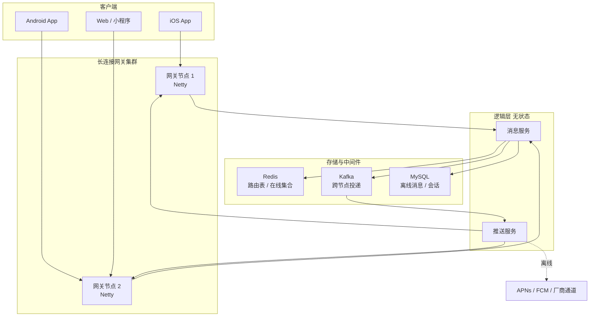
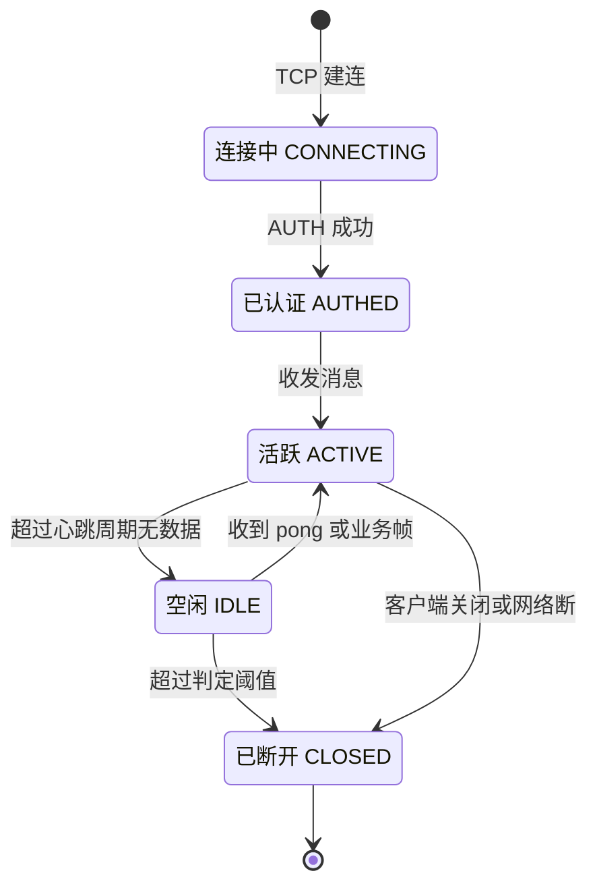
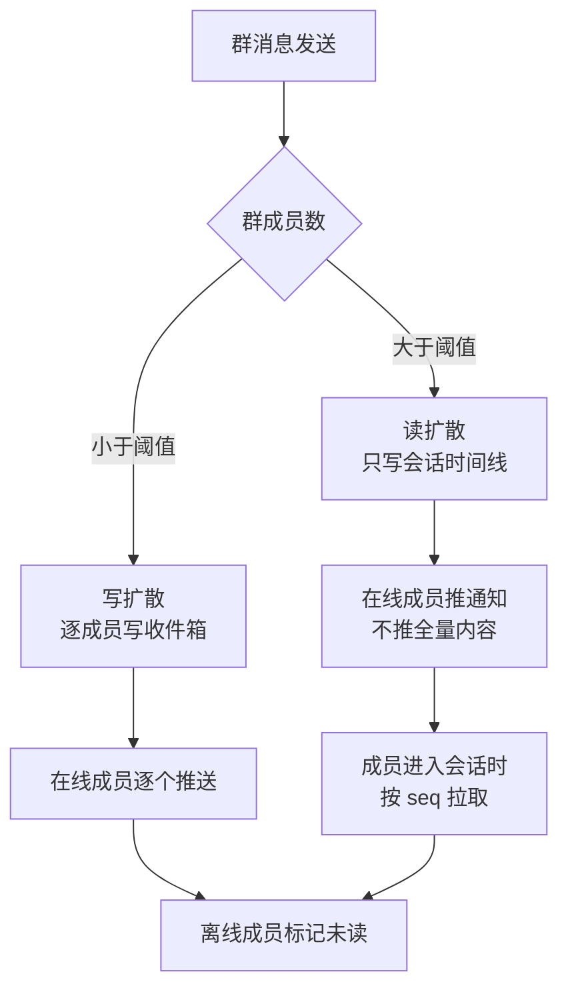
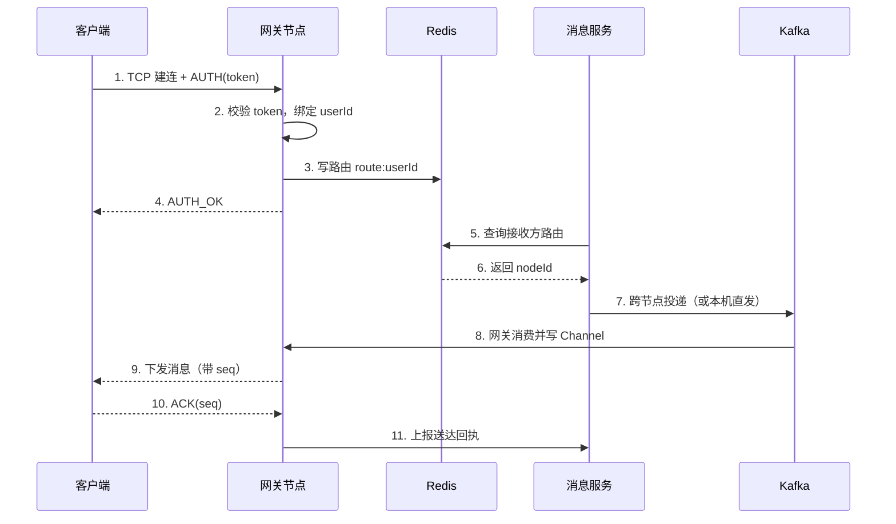

# 消息推送与长连接网关

> 定位：推送是「服务端主动找用户」的唯一手段，长连接网关是把百万级连接管起来的那层基础设施。这篇讲清 APNs、FCM、厂商通道、WebSocket、SSE 各自适合什么，长连接网关怎么注册连接、维护路由、做心跳重连和多机房，消息怎么保证不丢不重不乱序，以及万人群扩散、推送风暴、Android 保活这些「上线才会遇到」的问题。

## 一、为什么需要它

需求很朴素：用户下单后要收到「支付成功」，运营做活动要能触达全量用户，IM 消息要能实时到达。用 HTTP 轮询实现，客户端每隔几秒问一次「有我的消息吗」，用户量一上来，QPS 和电量都扛不住；改成服务端主动推，又必须自己维护几十万到上百万条长连接。

推送和普通 HTTP 服务的形态差异：

| 维度 | 普通 HTTP 服务 | 推送与长连接 |
|---|---|---|
| 通信方向 | 客户端发起 | 服务端主动下发 |
| 连接生命周期 | 请求结束即断开 | 长驻，几小时到几天 |
| 连接数 | 与 QPS 正相关 | 与在线用户数正相关 |
| 服务状态 | 无状态 | 有状态，必须知道「人在哪」 |
| 网络环境 | 相对稳定 | 弱网、切后台、系统杀进程、NAT 超时 |
| 失败语义 | 重试即可 | 不能丢、不能重、不能乱序 |

三条本质约束：

1. **连接是稀缺资源**。每条 TCP 连接占一个 fd、一块内核缓冲区和用户态对象，单机连接数有硬上限。
2. **推送必须知道「人在哪个节点」**。这是路由表存在的理由，也是推送比普通服务复杂一个量级的根因。
3. **移动端没有「永远在线」**。iOS 后台会被挂起，Android 会被厂商杀掉，长连接只能尽力而为，最终触达必须依赖系统通道。

## 二、核心原理

### 2.1 推送通道全景

没有一种通道能覆盖所有场景，生产系统通常是「自建长连接 + 系统推送通道 + 厂商通道」的组合：

| 通道 | 方向 | 适用 | 优势 | 限制 |
|---|---|---|---|---|
| APNs | 服务端到 iOS | iOS 通知、静默唤醒 | 系统级、到达率高 | 依赖苹果，载荷有大小上限 |
| FCM | 服务端到 Android/Web | 海外 Android、Web Push | 统一、免费 | 国内网络不可靠 |
| 厂商通道 | 服务端到 Android | 国内 Android 离线推送 | 系统级保活、省电 | 各家 API 不同，有配额和限流 |
| WebSocket | 双向 | IM、实时协作、前台应用 | 全双工、低延迟 | 需自建网关，移动端后台会断 |
| SSE | 服务端到客户端 | 通知流、AI 流式输出 | 基于 HTTP、自动重连、实现简单 | 单向、文本协议、连接数受浏览器限制 |

选择逻辑：**能前台实时就走长连接，不能前台就落系统通道**。不要把「到达率」寄托在自建长连接上，App 被系统挂起后连接就是断的，只有 APNs/FCM/厂商通道能叫醒它。

### 2.2 长连接网关：注册、路由、心跳、重连

网关的职责非常窄：握手鉴权、维护连接、编解码、转发。业务逻辑全部放在无状态的逻辑层，这样网关重启只影响本机连接，重连即恢复；逻辑层可以随意发布。



读图要点：网关只做「连接 + 转发」，逻辑层无状态；路由表在 Redis，跨节点投递走 Kafka；用户不在线时才落到系统推送通道。这条虚线是整个到达率的兜底。

**连接注册**：客户端建连后先发 `AUTH` 帧，网关校验 token，拿到 `userId`，然后在本地 `ConcurrentHashMap<connId, Channel>` 登记，同时写 Redis 路由表 `route:{userId} -> {nodeId, connId, ts}`，TTL 略大于心跳周期。路由表是「用户在哪个节点」的唯一真相。

**路由表结构**要能处理多端在线：一个用户可能有手机、平板、PC 三条连接，值用 Hash 或 Set，field 是 `deviceType`。推送时按设备类型分别路由，不能只保留最后一条。

**心跳**：用 Netty 的 `IdleStateHandler` 做读空闲检测，超过 `readerIdleTime` 没收到任何帧就发 ping；超过 `allIdleTime` 还没 pong 就关连接。心跳周期要在「省电」和「及时发现假死」之间取舍，移动端常见是 30~60 秒，服务端判定超时通常是心跳周期的 2~3 倍。

**断线重连**：客户端指数退避加随机抖动（比如 1s、2s、4s、8s，上限 30s，抖动 ±20%），避免机房故障恢复时百万客户端同时重连造成「惊群」。重连后带上次收到的 `seq`，服务端补发缺口消息。

### 2.3 连接状态与在线状态

连接状态和业务在线状态不是一回事，不要混：



读图要点：TCP 建连成功不等于用户在线，必须 `AUTH` 通过才算；`IDLE` 只是「暂时没数据」，不能立刻踢，要给 pong 留时间。很多「消息发出去没反应」的故障，就是把 `IDLE` 误判成了 `CLOSED`，或者反过来。

业务在线状态（`online:{userId}`）通常由「有活跃连接 + 最近 N 分钟有交互」共同决定，用 Redis TTL 维护。上下线要做**去抖**：地铁里频繁断连重连，不能每次都向所有好友广播「上线/下线」，否则会产生状态风暴。常见做法是延迟几秒确认，或者只在状态持续变化超过阈值时才广播。

### 2.4 消息可靠：ack、去重、离线、顺序

一条消息从 A 到 B，要跨过四段：A 到服务端、服务端落库、服务端到 B、B 确认。每一段都可能断，所以要分层确认：

| 层 | 确认方式 | 解决什么 |
|---|---|---|
| 客户端到服务端 | 服务端返回 `msgId` | 消息是否被接收 |
| 服务端持久化 | 落库成功后返回 | 服务端重启不丢 |
| 服务端到接收端 | 接收端回 `ACK(seq)` | 是否送达 |
| 离线补偿 | 重连时带 `lastSeq` 拉缺口 | 断线期间的消息 |

**去重**靠 `msgId`（客户端生成 UUID 或服务端雪花 ID）+ 接收端本地已收集合/数据库唯一键。**顺序**靠会话级 `seq`：同一个会话的消息由单一写入者分配递增序号（比如按 `conversationId` 分区到同一个 Kafka partition），接收端按 `seq` 排序，发现跳号就主动拉缺口。

不要依赖 TCP 的顺序来保证业务顺序：连接会断、会重连、会走不同节点，TCP 只保证「一条连接内」有序。

### 2.5 单聊、群聊、广播与万人群扩散

四种场景的扩散策略完全不同：

| 场景 | 写放大 | 策略 |
|---|---|---|
| 单聊 | 1 写 + 1 推 | 写收件箱，直接路由推送 |
| 小群（几百人） | 写扩散 | 每个成员收件箱写一份，在线成员推送 |
| 大群/万人群 | 读扩散 | 消息只写一份到会话时间线，成员拉取 |
| 全站广播 | 写 1 份 + 分批推 | 写公告，按在线分片批量下发 |



读图要点：小群写扩散换「读得快」，大群读扩散换「写得省」。阈值没有标准答案，取决于存储成本、在线率和读放大倍数；常见的分界在几百到几千人之间，要按自己的成本模型压测确定。

万人群还有一个隐藏问题：**在线推送本身就是放大**。1 万人群、10% 在线就是 1000 次推送，100 个这样的群同时活跃就是 10 万次。所以大群通常只推「有人发了消息」的轻通知，不推消息体，客户端收到后主动拉取。

### 2.6 推送风暴与限流

推送风暴有三个来源：广播任务几千万条同时下发；热点事件导致同一秒大量用户活跃；网关重启后几十万连接同时重连并拉离线消息。

对策是「削峰 + 合并 + 分级 + 限流」：广播按用户分片、每批几万条匀速下发；同一用户短时间内的多条通知合并成一条；交易类高优先级、营销类低优先级，拥塞时直接丢弃或延迟；网关按连接限速，慢消费者断开或降级，不能让它拖垮整个 EventLoop。

### 2.7 灰度与降级

网关是有状态服务，发布不能像无状态服务那样随便滚动。常见做法：

- **灰度分组**：按用户 ID 哈希分成多个桶，新版本只接一个桶，观察连接成功率、消息延迟、GC。
- **优雅下线**：先摘流量，再给客户端发 `RECONNECT` 指令，让连接主动迁移到其他节点，最后等连接数归零再停进程。
- **降级开关**：推送服务不可用时，降级为「只落离线消息，不实时推」；厂商通道不可用时，切备用通道或延迟重试；网关过载时，关闭非核心的心跳回包合并、降低广播频率。

### 2.8 Android 保活与厂商通道的取舍

Android 的保活是「和系统对抗」，没有一劳永逸的方案。现实约束：

- Doze 模式、后台限制、厂商省电策略会杀进程或冻结网络。
- 前台服务能提高存活率，但耗电、有通知栏，且新版本系统限制越来越严。
- 无限保活（双进程、JobScheduler 拉活）既不可靠，也违反应用商店政策。

厂商通道的代价是「碎片化」：每家注册、鉴权、报文、配额都不同，要用适配层统一成 `send(token, payload)`。正确的取舍是：**自建长连接只负责前台和短时间后台的实时性，离线触达交给厂商通道**；IM 类应用才有必要申请白名单，普通应用不应把保活做得很重。还要接受「厂商通道也会延迟、会折叠、会限流」，所以关键消息要有站内信/短信兜底。

## 三、关键机制与关键代码

### 3.1 路由表与连接注册

```java
// 连接建立并鉴权成功后
public void register(String userId, String deviceType, Channel channel) {
    String connId = channel.id().asLongText();
    LOCAL.put(connId, channel);
    // route:{userId} 是 Hash，field 为设备类型，value 为 nodeId#connId
    redis.opsForHash().put("route:" + userId, deviceType,
            nodeId + "#" + connId);
    redis.expire("route:" + userId, Duration.ofSeconds(90));
    presenceService.online(userId, deviceType);
}

// 推送时按用户查路由
public void push(String userId, PushMsg msg) {
    Map<Object, Object> routes = redis.opsForHash().entries("route:" + userId);
    if (routes.isEmpty()) {
        offlineService.save(userId, msg);   // 落离线，走系统通道
        return;
    }
    for (Object v : routes.values()) {
        String[] parts = v.toString().split("#");
        if (nodeId.equals(parts[0])) {
            writeLocal(parts[1], msg);       // 本机直发
        } else {
            kafka.send("gateway-push", parts[0], msg); // 跨节点投递
        }
    }
}
```

要点：路由表带 TTL，靠心跳续期，避免节点宕机后留下永久脏路由；跨节点投递必须带 `connId`，接收端要校验「这个连接是否还存在」，否则会把消息写到一个已经断开的 channel 上。

### 3.2 Netty 网关的关键参数

```java
ServerBootstrap b = new ServerBootstrap();
b.group(bossGroup, workerGroup)
 .channel(NioServerSocketChannel.class)
 .childOption(ChannelOption.TCP_NODELAY, true)
 .childOption(ChannelOption.SO_KEEPALIVE, true)
 .childOption(ChannelOption.WRITE_BUFFER_WATER_MARK,
     new WriteBufferWaterMark(32 * 1024, 64 * 1024))
 .childHandler(new ChannelInitializer<SocketChannel>() {
     protected void initChannel(SocketChannel ch) {
         ch.pipeline()
           .addLast(new IdleStateHandler(90, 0, 0, TimeUnit.SECONDS))
           .addLast(new LengthFieldBasedFrameDecoder(64 * 1024, 0, 4, 0, 4))
           .addLast(new ProtobufDecoder(Message.getDefaultInstance()))
           .addLast(new ProtobufEncoder())
           .addLast(new AuthHandler())
           .addLast(new HeartbeatHandler())
           .addLast(new BusinessDispatchHandler());
     }
 });
```

几个参数值得解释：`SO_KEEPALIVE` 只能发现链路层死连接，周期长，不能替代应用层心跳；`WRITE_BUFFER_WATER_MARK` 用来识别慢消费者，超过高水位就停止写入或断开；`IdleStateHandler` 的读空闲设为 90 秒，客户端心跳 30 秒，允许丢两次心跳。worker 线程数默认是 CPU 核数乘 2，连接数很大时要确认 EventLoop 没有被单个慢连接阻塞。

### 3.3 建连、推送与确认时序



读图要点：第 7 步跨节点投递是「至少一次」，网关消费必须幂等；第 10 步 ACK 只代表「客户端收到」，不代表「已读」，已读是另一个业务状态，不能混。

### 3.4 离线消息与缺口补偿

离线消息不要给每个用户建一张表，按「收件箱 + 会话时间线」存：

```sql
CREATE TABLE offline_inbox (
  id         bigint      NOT NULL AUTO_INCREMENT,
  user_id    bigint      NOT NULL,
  conv_id    varchar(64) NOT NULL,
  seq        bigint      NOT NULL,
  msg_id     varchar(64) NOT NULL,
  payload    blob        NOT NULL,
  create_time datetime   NOT NULL DEFAULT CURRENT_TIMESTAMP,
  PRIMARY KEY (id),
  UNIQUE KEY uk_user_msg (user_id, msg_id),
  KEY idx_user_seq (user_id, seq)
) ENGINE=InnoDB;
```

重连时客户端带 `lastSeq`，服务端返回 `seq > lastSeq` 的消息，按 `seq` 升序，客户端发现跳号就再拉一次。`uk_user_msg` 保证重复投递不会写两条；`idx_user_seq` 让缺口查询走索引。离线消息要设保留期（比如 7 天），过期归档，不能无限增长。

## 四、生产坑点与排查

### 坑点 1：连接假死，消息推过去石沉大海

**现象**：路由表显示在线，消息也写进了 Channel，但用户收不到；过几分钟才恢复。
**原因**：NAT 超时、地铁弱网、客户端进程被冻结，TCP 连接在内核看来还活着，但应用层已经不可达；只靠 `SO_KEEPALIVE` 发现不了。
**解法**：应用层心跳加 pong 超时判定；写操作设置写超时，连续失败就主动关连接；客户端重连后按 `lastSeq` 拉缺口；监控「推送成功率」而不是「连接数」。

### 坑点 2：fd 泄漏，网关跑几天就 `Too many open files`

**现象**：网关运行 3 天后新连接全部失败，日志报 `Too many open files`。
**原因**：客户端异常断开时 Channel 没关闭；或者业务 handler 抛异常导致 pipeline 中断，连接悬挂；或者 `ulimit -n` 还是默认的 1024。
**解法**：`ulimit` 调到十万级并写进 systemd/K8s 配置；`channelInactive` 里必须清理本地 map 和路由表；用 Netty 的 `ResourceLeakDetector` 排查 ByteBuf 泄漏；监控 fd 使用率并告警。

### 坑点 3：路由表脏数据，消息发到已断开的连接

**现象**：用户重连到新节点后，部分消息仍然发往旧节点，旧节点日志显示「连接不存在」。
**原因**：旧连接断开时没有删路由；或者新连接注册和旧连接清理并发，旧值覆盖了新值。
**解法**：路由值里带 `connId`，写入前用 Lua 比较并替换；`channelInactive` 时只有「路由值仍等于自己」才删除；TTL 兜底；跨节点投递失败时回查一次路由再重试。

### 坑点 4：广播任务打爆推送线程池

**现象**：运营发全量推送后，普通 IM 消息延迟从 50ms 涨到 5s，网关 CPU 打满。
**原因**：广播任务一次性把几千万条消息塞进推送队列，和实时消息抢同一个线程池；没有分级和限流。
**解法**：广播按用户分片、匀速下发；实时消息和广播用不同线程池/队列；低优先级任务在拥塞时丢弃；对单网关的下发速率做令牌桶限流。

### 坑点 5：群消息顺序错乱

**现象**：群里先发的消息后到，客户端展示顺序乱了。
**原因**：同一条群消息被并发处理，`seq` 分配不是原子的；或者不同节点各自分配 seq；客户端按到达时间排序。
**解法**：同一会话的写入串行化（按 `conversationId` 分区到同一个 Kafka partition 或单线程处理）；`seq` 由会话服务统一分配；客户端严格按 `seq` 排序，发现跳号先拉缺口再展示。

### 坑点 6：厂商通道限流导致「推送失败但不报错」

**现象**：某厂商机型大面积收不到推送，服务端调用返回成功。
**原因**：厂商通道有每日配额和 QPS 限制，超限后返回成功但实际丢弃；或者 token 过期没有清理。
**解法**：按厂商维度监控到达率和错误码；token 失效要清理并重新注册；关键消息准备多通道兜底（厂商通道失败转短信/站内信）；不要把「调用成功」当成「用户收到」。

## 五、调优、选型与最佳实践

### 5.1 自建长连接还是用第三方推送

| 方案 | 适用 | 代价 |
|---|---|---|
| 自建长连接 | IM、实时协作、强实时业务 | 网关、路由、心跳、多机房全自己扛 |
| 第三方推送 SDK | 普通 App 的通知触达 | 依赖第三方，数据合规要评估 |
| 云厂商移动推送 | 中小团队、快速上线 | 成本按量，深度定制受限 |

判断标准：**是否需要「服务端主动、低延迟、双向」**。只是发通知，用系统通道加第三方推送就够了；要做聊天、协同编辑、实时游戏，才需要自建网关。

### 5.2 WebSocket、SSE 与轮询

| 方案 | 方向 | 适用 | 不适用 |
|---|---|---|---|
| WebSocket | 双向 | IM、协作、游戏 | 只需要服务端推送的简单场景 |
| SSE | 单向 | 通知流、AI 流式输出 | 需要客户端高频上行 |
| 长轮询 | 单向 | 兼容性要求高的老系统 | 高并发、低延迟 |

SSE 的优势是「就是 HTTP」，网关、鉴权、压缩、断线重连都能复用现有设施，适合「服务端持续输出、客户端只读」的场景，比如大模型流式回答。WebSocket 的优势是全双工，但连接管理和心跳要自己做。

### 5.3 什么规模不该自建

- 日活低于十万、只做通知触达：直接用厂商通道和第三方推送，不要自建网关。
- 团队没有 Netty/网络排障能力：自建长连接的故障排查成本很高，弱网问题尤其难定位。
- 只需要「准实时」（分钟级）：轮询或 SSE 足够，长连接的复杂度不值。
- 多机房强一致路由还没解决：先单机房跑稳，再谈多机房。

## 六、面试高频问法

**Q1：推送系统怎么设计？**

**一句话结论**：自建长连接管实时，系统通道管离线，路由表管「人在哪」，三层确认管可靠。

展开：客户端连网关，鉴权后写路由表；消息服务查路由，本机直发、跨节点走 MQ；不在线落离线消息并走 APNs/FCM/厂商通道；接收端 ACK，重连按 seq 补缺口。

加分点：主动区分「实时」和「到达」，说清自建长连接不可能保证离线到达。

**Q2：百万连接怎么管？单机能撑多少？**

**一句话结论**：连接数受 fd、内存、内核参数限制，靠 Netty 多 EventLoop + 调优，单机规模要压测确定。

展开：调 `ulimit -n`、`somaxconn`、`tcp_max_syn_backlog`；每个连接占 fd 和缓冲区；网关无业务逻辑，只做编解码转发；连接数按节点分片，水平扩容。

加分点：说「不要拍脑袋说百万，连接数要和内存、fd、GC 一起算」，并提到 `Too many open files` 的排查。

**Q3：怎么检测连接假死？**

**一句话结论**：应用层心跳加 pong 超时，不能只靠 TCP KeepAlive。

展开：`IdleStateHandler` 检测读空闲，服务端发 ping；超过 2~3 个心跳周期没 pong 就关连接；写操作设超时；客户端重连后补消息。

加分点：说「TCP 连接活着不代表应用可达，NAT 超时和进程冻结都会造成假死」。

**Q4：消息怎么保证不丢、不重、不乱序？**

**一句话结论**：分层 ACK 保不丢，msgId 去重保不重，会话 seq 保有序。

展开：服务端落库后才返回 msgId；接收端 ACK；离线消息按 seq 补；同一会话单写入者分配 seq；客户端按 seq 排序并检测跳号。

加分点：说「TCP 只保证单连接内有序，重连换节点后必须靠业务 seq」。

**Q5：万人群消息怎么扩散？**

**一句话结论**：小群写扩散，大群读扩散，阈值按存储和读放大成本压测确定。

展开：写扩散给每个成员收件箱写一份，读得快但写放大；读扩散只写会话时间线，成员拉取；大群只推轻通知不推消息体；在线推送也要限流。

加分点：说「万人群的瓶颈不是存储，是在线推送的放大效应」。

**Q6：路由表怎么设计？节点挂了怎么办？**

**一句话结论**：Redis Hash 存 `userId -> deviceType -> nodeId#connId`，带 TTL，心跳续期，写入用 Lua 防覆盖。

展开：多端在线按设备类型分别存；TTL 兜底节点宕机；连接断开时只有路由值仍等于自己才删除；跨节点投递失败回查路由重试。

加分点：说「路由表是最终一致的，允许短暂脏，但不能永久脏」。

**Q7：广播/推送风暴怎么处理？**

**一句话结论**：分片削峰、通知合并、优先级分级、按连接限流。

展开：全量任务分批匀速；同一用户多条通知合并；交易类优先、营销类可丢；慢消费者断开；网关线程池隔离。

加分点：说「推送系统要有背压，不能无限往 Channel 里写」。

**Q8：Android 保活怎么做？**

**一句话结论**：不做无限保活，前台靠长连接，离线靠厂商通道，关键消息加短信/站内信兜底。

展开：Doze 和厂商省电策略会杀进程；前台服务有通知栏和耗电代价；双进程拉活不可靠且违反政策；厂商通道有配额和限流。

加分点：说「保活是成本对抗，投入产出要算清楚，普通 App 不值得」。

**Q9：网关怎么优雅发布？**

**一句话结论**：灰度分桶、先摘流量、通知客户端重连、等连接归零再停。

展开：按用户哈希灰度；新版本先接小流量；发布前把节点从路由中摘除；给客户端发 `RECONNECT`；观察连接成功率和消息延迟；回滚要能快速切回。

加分点：说「有状态服务的发布，核心是让连接迁移而不是让连接失败」。

## 小结

- 推送分两段：实时靠自建长连接，离线靠 APNs/FCM/厂商通道，前者保证不了后者。
- 网关只做连接和转发，逻辑层无状态；路由表是「人在哪」的唯一真相，必须带 TTL 和 connId 校验。
- 可靠性靠分层 ACK、msgId 去重、会话 seq 排序；TCP 的有序不能跨重连。
- 扩散策略按群规模选：小群写扩散、大群读扩散，万人群只推轻通知。
- 推送风暴用分片、合并、分级、限流解决，慢消费者要断开而不是无限缓冲。
- Android 不做无限保活，前台长连接 + 厂商通道 + 关键消息兜底，才是可持续方案。
