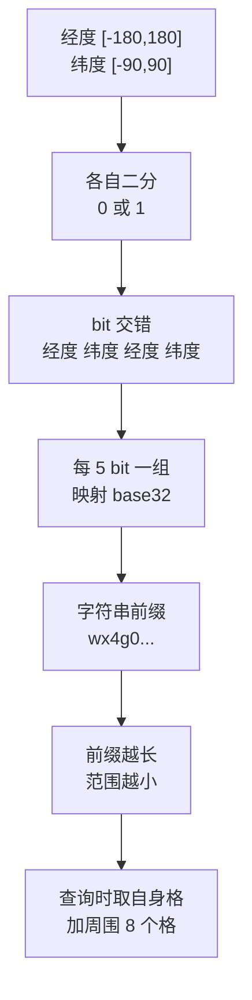
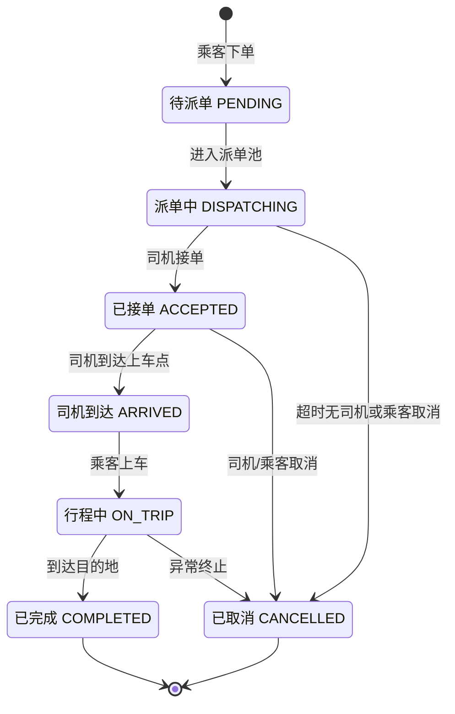
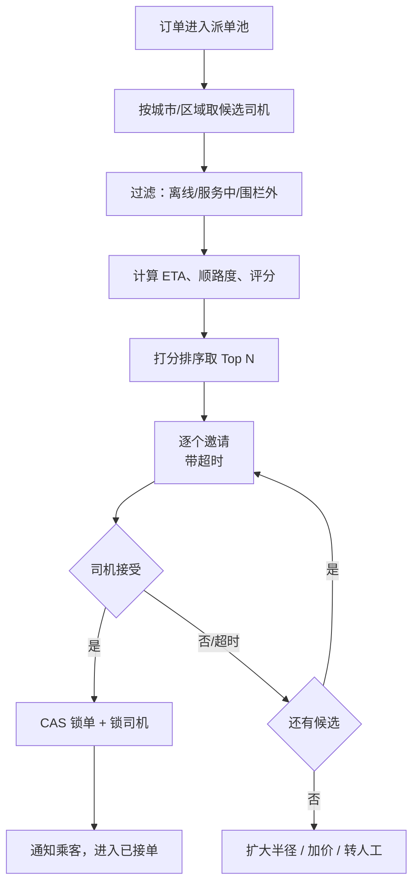
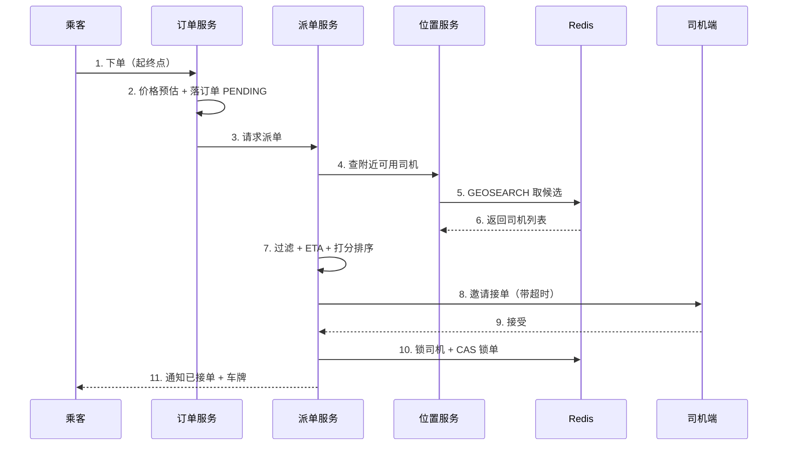

# LBS 与打车系统设计

> 定位：LBS 是「带地理维度的搜索 + 高频位置更新」，打车是它最难的落地场景：既要在地图上快速找车，又要在秒级完成派单，还要处理轨迹、围栏、ETA、隐私和高峰调度。这篇讲清 GeoHash、R-tree、Redis GEO、ES geo_point 的取舍，派单算法的设计，轨迹存储与电子围栏，并说明什么规模不该上重型方案。

## 一、为什么需要它

「附近 3 公里的餐厅」和「给我叫一辆 5 分钟能到的车」，看起来都是「按距离查」，但和普通查询完全不同。用 `WHERE latitude BETWEEN ... AND longitude BETWEEN ...` 加索引，数据量一大就退化成扫描，而且矩形边界会把角落的远点也算进来。更麻烦的是，司机位置每 3 秒变一次，写入量是订单的几十倍。

| 维度 | 普通业务查询 | LBS / 打车 |
|---|---|---|
| 查询条件 | 等值、范围（一维） | 二维空间范围、多边形 |
| 索引 | B+ 树 | GeoHash、R-tree、空间索引 |
| 数据更新 | 低 | 位置高频更新，写放大 |
| 结果 | 精确集合 | 按距离/ETA 排序的候选集 |
| 实时性 | 秒级可接受 | 派单要秒级、位置要新鲜 |
| 隐私 | 一般 | 坐标是敏感个人信息 |

三条本质约束：

1. **二维范围查询不能靠单列索引**。经纬度分别建索引只能各自过滤，数据库还要回表求交，数据量大时非常慢。
2. **位置是「会过期的状态」**，不是「要长期保存的事实」。最新位置用于匹配，历史轨迹用于计费和纠纷，两者存储策略完全不同。
3. **派单是「带约束的匹配问题」**，不是简单排序。距离近的司机可能正在服务、可能拒单率高、可能方向相反，单纯按距离派单会导致大量取消。

## 二、核心原理

### 2.1 GeoHash：把二维降成一维

GeoHash 的思路是：把经纬度分别做二分，交替取 bit，再按每 5 个 bit 编码成 base32 字符。前缀相同的点，地理上相邻。



读图要点：GeoHash 是「空间填曲线」，把二维网格映射成一维字符串。它的价值是能用普通 B+ 树或 Redis 字符串做范围查询；它的代价是**边界问题**——两个地理上很近的点，可能落在不同格子，所以查询必须带邻居格。

精度粗表（不同实现略有差异，按常用值理解量级）：

| 长度 | 格子宽高（约） | 典型用途 |
|---|---|---|
| 5 位 | 4.9km × 4.9km | 城市级筛选 |
| 6 位 | 1.2km × 0.6km | 附近门店 |
| 7 位 | 150m × 150m | 街区级、派单候选 |
| 8 位 | 38m × 19m | 精细定位 |

工程上不要把「格子」当最终结果：先用 GeoHash 粗筛出候选，再在内存里用 Haversine 公式算精确球面距离，最后过滤。只按格子判定会把边界附近的点漏掉或错算。

### 2.2 地理索引的四种实现

| 方案 | 原理 | 优点 | 缺点 | 适用 |
|---|---|---|---|---|
| GeoHash + B+ 树 | 字符串前缀 + 邻居格 | 通用、可落 MySQL | 边界要处理，精度受长度限制 | 中小规模、已有 MySQL |
| Redis GEO | geohash 整数存 zset，GEOSEARCH | 内存快、命令简单 | 单 key 容量和热点需规划 | 实时位置、派单候选 |
| Elasticsearch geo_point | BKD 树 / geohash 前缀 | 支持过滤、聚合、排序 | 有同步延迟，集群重 | 搜索型 LBS |
| PostGIS / R-tree | GiST/R-tree 多维索引 | 支持复杂几何、多边形 | 运维和调优门槛高 | GIS 专业场景 |

R-tree 的思路是用最小外接矩形（MBR）层层嵌套：根节点覆盖全图，子节点覆盖子区域，查询时先排除不相交的矩形，再精确判断。它适合「任意多边形范围」和「包含关系」，但更新频繁时树会分裂，写放大明显。

**怎么选**：只需要「附近 N 公里」且已有 Redis，用 Redis GEO；需要和关键词、类目、营业状态一起过滤，用 ES；需要复杂几何计算（电子围栏、路径），用 PostGIS 或自研网格；数据量小且不想加组件，用 GeoHash 字段加普通索引。

### 2.3 附近的人、店与 POI 检索

「附近」类需求分三层：先按 GeoHash 前缀或 Redis GEO 半径粗筛候选，再用 Haversine 算真实距离排序，最后叠加营业状态、类目、评分、是否拉黑等业务过滤。POI 检索还多一层「文本 + 空间」的组合：搜「附近的咖啡」，既要匹配名称和类目，又要限定地理范围，ES 的 `geo_distance` 过滤加 `match` 查询最顺手，Redis GEO 只能做空间、文本还得回表。

「附近的人」有额外的隐私约束：不能返回精确坐标，只能返回距离区间（如「500m 以内」）；不能无限翻页，否则可以被用来三角定位；要支持「隐身」和「仅好友可见」。

### 2.4 打车订单生命周期

打车订单比普通订单多了「司机」这个角色和「行程」这个阶段：



读图要点：`DISPATCHING` 是一个「可重入」的状态，一次派单失败要能回到池子继续派，但不能无限派；`ACCEPTED` 之后取消要区分责任方，涉及取消费和司机补偿。状态机同样用 CAS 推进，防止两个司机同时接到同一单。

### 2.5 派单算法：距离、评分、供需与抢单/指派

派单有两种基本模式：**抢单**是把订单广播给一批司机、先到先得，实现简单但容易挑单，远单没人接；**指派**是系统选最优司机直接派、司机可拒单，可控性强但要做负载均衡和拒单惩罚。真实系统通常是「指派为主、抢单为辅」，评分函数大致是：

```text
score = w1 * 接驾时间 + w2 * 司机评分 + w3 * 供需系数
      + w4 * 顺路度 - w5 * 拒单率 - w6 * 已服务时长
```

各项的含义：接驾时间比直线距离更合理（要算路网 ETA）；司机评分影响体验；供需系数在高峰时向「运力紧张区域」倾斜；顺路度避免司机接完这单要空驶很远；拒单率和已服务时长做公平性，防止「老司机一直接好单」。



读图要点：候选司机先过滤再打分，避免对全城司机算 ETA；邀请是「串行 + 超时」，不是无限等待；锁单和锁司机必须原子，否则两个订单会派给同一个司机。

**派单的并发控制**：司机是稀缺资源，必须用 Redis `SET driver:lock:{driverId} orderNo NX EX 60` 或数据库条件更新抢占。抢单模式下更是如此，100 个司机同时点「接单」，只能有一个成功。

### 2.6 司机轨迹上报与存储

司机端通常每 3~5 秒上报一次位置。一天 10 万司机、每人 8 小时、每 5 秒一次，就是约 5.8 亿个点/天。这类数据的特点是「写多、按时间查、很少改」。

分层存储：

| 用途 | 存储 | 保留 | 说明 |
|---|---|---|---|
| 最新位置 | Redis GEO / 内存 | 分钟级 | 派单和「附近车辆」用 |
| 近期轨迹 | 时序数据库 / Kafka | 几天到几月 | 行程回放、纠纷取证 |
| 历史轨迹 | 对象存储 / 冷库 | 按合规要求 | 压缩归档，按需解冻 |

轨迹点不要写 MySQL 单表：写放大太高，索引维护成本大。时序库（如 TDengine、InfluxDB）或列式存储更适合「按司机 + 时间范围」查询。每个点至少要带 `driverId`、`lat`、`lng`、`timestamp`、`speed`、`heading`、`accuracy`，并做去噪（漂移点、静止点抽稀）。

### 2.7 电子围栏

电子围栏用于「机场排队区」「禁停区」「运营区」「加价区」。核心是「点是否在多边形内」：

- **射线法**：从点向外发一条射线，与多边形边相交奇数次则在内部。实现简单，适合任意简单多边形。
- **网格预索引**：把多边形覆盖的 GeoHash 格子预先算出来，查询时先按格子过滤，再做精确判断。适合高频查询。
- **空间数据库**：PostGIS 的 `ST_Contains`，表达力最强，但依赖数据库。

围栏配置要版本化，司机端缓存围栏几何，服务端做最终判定。围栏变更要能灰度，避免全量司机同时刷新。

### 2.8 路径规划与 ETA

ETA（预计到达时间）是派单和用户体验的核心指标。三种精度层次：

1. **直线距离 × 系数**：最便宜，误差大，只适合兜底。
2. **路网最短路径**：把路网建成图，用 Dijkstra/A* 算距离，再按平均速度估时间。
3. **实时路况 + 历史速度**：按路段的历史和实时速度加权，精度最高，成本也最高。

生产上通常是「路网 + 分时段速度模型」，再叠加实时路况。ETA 要返回区间而不是单点（比如 8~12 分钟），并在行程中持续修正。**不要承诺精确到分钟**，路况、红绿灯、上下客都会影响。

### 2.9 多城市分片、隐私与高峰调度

**多城市分片**：以 `city_id` 作为分片键，订单、司机、围栏都按城市隔离。跨城订单（比如机场到邻市）单独标记，按出发城市路由，目的地城市只做计费参考。城市间数据不共享，避免一个城市的峰值影响全国。

**位置隐私**：传输和存储加密，坐标属于敏感个人信息；对外只给距离区间、GeoHash 截断或地图偏移；行程结束后按合规要求脱敏或删除原始轨迹；司机和乘客互相不可见精确坐标，只在接单后展示必要范围。

**高峰调度**：供需失衡时，手段包括扩大派单半径、动态加价（surge）、调度补贴、引导乘客拼车、预约单错峰。加价要透明、有上限，否则会引发舆情；补贴要防刷，和营销风控共用一套名单。

## 三、关键机制与关键代码

### 3.1 GeoHash 计算与邻居查询

```java
// 简化示意：经纬度交错编码为 base32，生产可直接用成熟工具库
private static final char[] BASE32 = "0123456789bcdefghjkmnpqrstuvwxyz".toCharArray();

public static String encode(double lat, double lng, int precision) {
    double[] latRange = {-90, 90}, lngRange = {-180, 180};
    StringBuilder sb = new StringBuilder();
    boolean even = true;
    int bit = 0, ch = 0;
    while (sb.length() < precision) {
        double[] range = even ? lngRange : latRange;
        double mid = (range[0] + range[1]) / 2;
        double value = even ? lng : lat;
        if (value >= mid) { ch = (ch << 1) | 1; range[0] = mid; }
        else { ch = ch << 1; range[1] = mid; }
        even = !even;
        if (++bit == 5) { sb.append(BASE32[ch]); bit = 0; ch = 0; }
    }
    return sb.toString();
}
```

要点：`even` 控制先经度后纬度交替；每 5 bit 出一个字符；精度 7 位约 150 米。查询时不能只查自身格，要取周围 8 个邻居格，否则边界附近的点会漏掉。

### 3.2 Redis GEO：最新位置的存取

```bash
# 司机上报位置（GEOADD 底层是 zset，score 是 geohash 整数）
GEOADD driver:geo:city:310000 121.4737 31.2304 driver:10086

# 查 3 公里内的司机，按距离升序，返回距离
GEOSEARCH driver:geo:city:310000 FROMMEMBER driver:10086 BYRADIUS 3 km ASC WITHDIST COUNT 50

# 批量删除离线司机
ZREM driver:geo:city:310000 driver:10086
```

按城市拆 key（`driver:geo:city:{cityId}`）可以避免单 key 过大和跨城热点；但一个超大城市仍可能有几十万司机，写入 QPS 高时要评估单节点上限，必要时按行政区再拆。`GEOSEARCH` 是 Redis 6.2 起的推荐命令，`GEORADIUS` 已标记为废弃，以 Redis 7 的文档为准。

### 3.3 ES 的 geo_point 查询

```json
{
  "query": {
    "bool": {
      "filter": [
        { "term": { "city_id": 310000 } },
        { "term": { "status": "OPEN" } },
        { "geo_distance": {
            "distance": "3km",
            "location": { "lat": 31.2304, "lon": 121.4737 }
        }}
      ]
    }
  },
  "sort": [
    { "_geo_distance": {
        "location": { "lat": 31.2304, "lon": 121.4737 },
        "order": "asc",
        "unit": "m"
    }}
  ]
}
```

`geo_distance` 放在 `filter` 里可以走缓存；`_geo_distance` 排序会计算每个候选的距离；mapping 里 `location` 要用 `geo_point` 类型。ES 适合「空间 + 关键词 + 类目」的组合查询，但位置同步有秒级延迟，不适合做派单的实时锁。

### 3.4 派单的原子锁

```java
public boolean tryAccept(String orderNo, String driverId) {
    // 1. 锁司机：同一司机同时只能接一单
    Boolean locked = redis.opsForValue()
            .setIfAbsent("driver:lock:" + driverId, orderNo, Duration.ofSeconds(60));
    if (Boolean.FALSE.equals(locked)) {
        return false;
    }
    // 2. CAS 锁单：订单仍在派单中才能被接
    int affected = orderMapper.casAccept(orderNo, driverId);
    if (affected == 0) {
        redis.delete("driver:lock:" + driverId); // 回滚司机锁
        return false;
    }
    // 3. 异步通知乘客、更新司机状态、记录派单日志
    dispatchEventPublisher.accepted(orderNo, driverId);
    return true;
}
```

顺序不能反：先锁司机再 CAS 锁单，失败要释放司机锁。反过来会出现「订单被锁了但司机没锁住」，两个订单抢同一个司机。

### 3.5 叫车与派单时序



读图要点：第 5 步只拿候选，第 7 步才做重计算；第 8 步的邀请有超时，超时自动找下一个；第 10 步是全局唯一的「成交点」，必须原子。

## 四、生产坑点与排查

### 坑点 1：只查自身 GeoHash 格，边界漏单

**现象**：距离只有 50 米的司机没被派到，系统显示「附近无车」。
**原因**：查询只取了订单所在的 GeoHash 格，司机在相邻格里；或者精度选得太细，格子太小。
**解法**：查询固定取「自身 + 8 个邻居」；精度按业务半径选，不要一味求细；粗筛后再用真实距离过滤；对边界场景写单测。

### 坑点 2：司机位置写入打爆 Redis 单节点

**现象**：早晚高峰司机端上报超时，派单查不到最新位置。
**原因**：全城司机共用一个 GEO key，写入集中在单个分片；每次上报还顺带写 MySQL 和多个索引。
**解法**：按城市/行政区拆 key；位置只写 Redis，MySQL 不同步；上报降频或批量合并；离线司机及时 `ZREM`；监控单 key 的 QPS 和内存。

### 坑点 3：同一司机被派了两单

**现象**：司机端同时弹出两个订单，接了一个另一个还显示进行中；乘客侧两单都显示已接。
**原因**：派单服务多实例并发，两个订单各自查到同一个司机，都执行了「更新司机状态」，没有原子锁。
**解法**：Redis `SET NX` 锁司机 + 订单 CAS；锁的 value 用 `orderNo`，释放时校验归属；接单失败回滚锁；派单日志记录每次邀请结果。

### 坑点 4：轨迹写入放大，数据库扛不住

**现象**：行程高峰期轨迹表写入延迟升高，影响订单查询。
**原因**：每个 GPS 点写一行 MySQL，还带多个二级索引；10 万司机 × 每 5 秒一个点，写入量远超订单。
**解法**：最新位置进 Redis，历史轨迹进时序库或 Kafka 落列式存储；批量写、按时间分区；静止点抽稀；历史数据定期归档。

### 坑点 5：ETA 严重偏差，乘客大量取消

**现象**：显示 5 分钟到，实际 20 分钟，取消率上升。
**原因**：用直线距离乘固定系数；高峰期路况没有纳入；司机先接单再绕路接人。
**解法**：路网 + 分时段速度 + 实时路况；返回区间而不是单点；行程中持续修正；把「历史 ETA 偏差」作为司机评分和派单特征。

### 坑点 6：位置隐私泄露

**现象**：乘客能看到司机的精确坐标和住址；或者通过多次查询推断出某人位置。
**原因**：接口直接返回原始经纬度；「附近的人」支持无限翻页和精确定位。
**解法**：对外只返回距离区间或模糊坐标；限制查询频次和翻页深度；行程结束后脱敏；敏感字段加密存储并按角色授权。

## 五、调优、选型与最佳实践

### 5.1 地理索引选型

| 场景 | 推荐 | 理由 |
|---|---|---|
| 实时派单、附近车辆 | Redis GEO | 内存快、写入简单、按城市拆 key |
| 附近门店 + 关键词 + 类目 | Elasticsearch geo_point | 空间与全文/过滤组合 |
| 复杂多边形、围栏、路径 | PostGIS | 几何能力完整 |
| 数据量小、已有 MySQL | GeoHash 字段 + B+ 树 | 不引入新组件 |
| 超大规模自定义 | H3 / 自研网格 | 可控制格子和聚合粒度 |

### 5.2 派单策略对比

| 策略 | 优点 | 缺点 | 适用 |
|---|---|---|---|
| 纯抢单 | 实现简单、司机积极 | 挑单、远单没人接 | 早期、运力充足 |
| 纯指派 | 可控、体验稳定 | 司机被动、需处理拒单 | 成熟平台 |
| 指派 + 抢单兜底 | 平衡 | 逻辑复杂 | 大多数生产系统 |

### 5.3 什么规模不该这么做

- 日订单几千、司机几百：不需要实时派单系统，人工派单或简单抢单就够，先把订单和计价做对。
- 只做「附近门店展示」：不需要 Redis GEO 和派单算法，ES 的 `geo_distance` 一次查询就够。
- 没有路网数据：不要硬做精确 ETA，用「直线距离 + 区间」并明确告知用户是预估。
- 单城市业务：不要提前做多城市分片，`city_id` 字段留好即可，等真有跨城需求再拆。

## 六、面试高频问法

**Q1：附近的人/店怎么实现？**

**一句话结论**：GeoHash 或 Redis GEO 粗筛候选，Haversine 精算距离，再叠加业务过滤。

展开：GeoHash 把二维降成一维，查询取自身加 8 个邻居格；Redis `GEOSEARCH` 直接按半径返回；候选出来后再算真实距离、过滤营业状态和类目。

加分点：说清「格子只是粗筛，不能直接当结果」，边界必须取邻居。

**Q2：GeoHash 的原理是什么？有什么缺陷？**

**一句话结论**：经纬度二分后 bit 交错、base32 编码，前缀代表空间邻近；缺陷是边界突变和精度固定。

展开：经度纬度交替二分，每 5 bit 一个字符；前缀越长范围越小；相邻的点可能前缀不同，所以要查邻居格；格子是矩形，不是圆形，最终要按距离过滤。

加分点：说「GeoHash 适合粗筛，精确距离和业务排序必须另外做」。

**Q3：Redis GEO、ES geo_point、PostGIS 怎么选？**

**一句话结论**：实时派单用 Redis GEO，组合搜索用 ES，复杂几何用 PostGIS。

展开：Redis 内存快、适合高频写和半径查询；ES 支持空间加全文加聚合，但有同步延迟；PostGIS 几何能力最强，运维成本也最高；小规模直接 GeoHash 字段加索引。

加分点：说「选型看查询形态和更新频率，不是看谁功能多」。

**Q4：打车订单的状态机怎么设计？**

**一句话结论**：待派单、派单中、已接单、已到达、行程中、已完成、已取消，派单中可重入但有上限。

展开：每次流转 CAS；派单失败回池继续派；接单要同时锁司机和锁单；取消区分责任方，涉及取消费。

加分点：说「派单中是唯一可重入的状态，其他状态单向流转」。

**Q5：派单算法怎么设计？**

**一句话结论**：先过滤再打分，综合 ETA、评分、供需、顺路度和公平性，指派为主、抢单兜底。

展开：按城市取候选，过滤离线/服务中/围栏外；算 ETA 和顺路度；加权排序取 Top N；串行邀请带超时；失败扩大半径或加价。

加分点：说「纯按距离派单会导致大量拒单和取消，公平性和供需必须进模型」。

**Q6：怎么保证一个司机不被派两单？**

**一句话结论**：Redis 锁司机 + 订单 CAS，两步都成功才算成交。

展开：`SET driver:lock:{id} orderNo NX EX 60`；订单 `UPDATE ... WHERE status = DISPATCHING`；订单 CAS 失败要释放司机锁；锁的 value 校验归属，防误删。

加分点：说「这是分布式锁的典型用法，锁粒度和超时时间要按业务定」。

**Q7：司机轨迹怎么存？**

**一句话结论**：最新位置进 Redis GEO，历史轨迹进时序库或列式存储，MySQL 只存行程摘要。

展开：3~5 秒上报一次；最新位置用于派单；历史点批量写、按时间分区；静止点抽稀；按合规要求归档和删除。

加分点：说「轨迹是写多读少，不能用订单表的思路存」。

**Q8：ETA 怎么算才准？**

**一句话结论**：路网最短路径 + 分时段速度 + 实时路况，输出区间并持续修正。

展开：直线距离只能兜底；路网图用 Dijkstra/A*；历史速度按路段和时段建模；实时路况加权；行程中不断更新。

加分点：说「ETA 是概率问题，给区间比给单点更诚实」。

**Q9：LBS 系统怎么保护隐私？**

**一句话结论**：最小化采集、模糊化展示、限频限深、加密存储、按合规保留。

展开：对外只给距离区间或截断的 GeoHash；限制查询频次和翻页；行程结束脱敏；坐标加密；按角色授权。

加分点：说「位置是敏感个人信息，隐私设计要在接口层就做，不能只靠前端隐藏」。

## 小结

- GeoHash 把二维空间降成一维前缀，适合粗筛；边界必须查邻居格，最终用真实距离过滤。
- 索引选型看查询形态：实时派单用 Redis GEO，组合搜索用 ES，复杂几何用 PostGIS。
- 打车订单状态机里「派单中」可重入但有上限，接单必须同时锁司机和锁单。
- 派单不是按距离排序，ETA、评分、供需、顺路度和公平性都要进评分函数。
- 轨迹是写多读少的高频数据，最新位置放 Redis，历史进时序库，不要写 MySQL 单表。
- 位置是敏感信息，模糊化、限频、加密、按合规保留，缺一不可。
