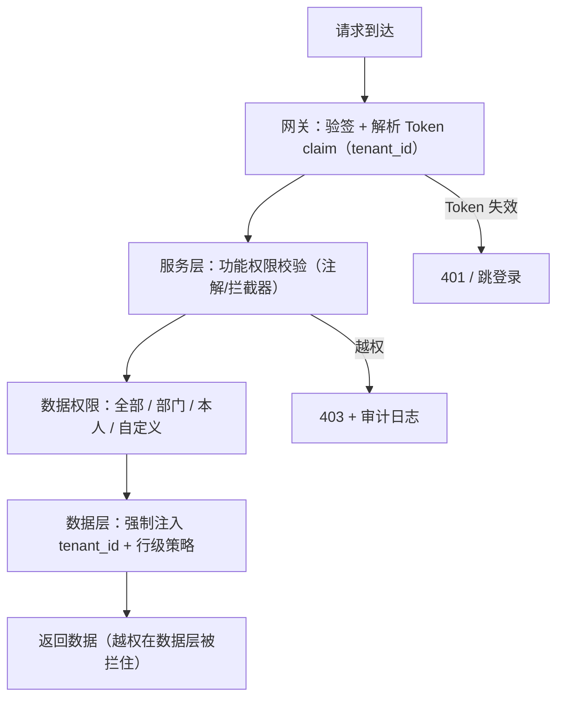
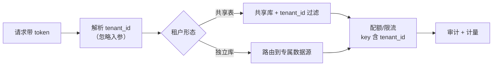

# 账号、权限与多租户 SaaS 设计

> 定位：B 端系统和 SaaS 有两块「看起来简单、出事最贵」的设计：账号体系与权限。权限做错不是功能 bug，而是**数据泄露**——前端藏了个按钮、后端没校验，越权就能把别人的订单、别的租户的客户名单拉走。这篇从认证（你是谁）、授权（你能干什么）、隔离（你的数据边界在哪）三条线讲清模型与落地，重点给「防越权」和「多租户漏租户键」这两类真实事故的解法。

## 一、为什么需要单独设计

账号权限的复杂度不在「登录」，在四个边界：

1. **身份边界**：一个人可能有多个身份（员工、管理员、外部协作方），同一账号在不同租户下权限不同。
2. **数据边界**：功能权限管「能不能点」，数据权限管「能看谁的数据」——后者才是泄露高发区。
3. **租户边界**：SaaS 一个库承载几百个租户，一条 SQL 漏了 `tenant_id` 就是跨租户泄露。
4. **生命周期**：入职/转岗/离职、角色变更、Token 吊销、会话失效——权限是会「过期」的。

> 一句话：**认证解决「你是谁」，授权解决「你能做什么」，租户解决「你的数据在哪」**。三者必须一起设计，缺一个就有洞。

## 二、核心原理

### 2.1 认证：账号、身份、凭证要分开

很多系统把三者揉成一张 `user` 表，结果做 SSO、做多租户、做第三方登录时全部推倒重来。正确的最小模型：

| 概念 | 含义 | 例子 |
|---|---|---|
| 账号（Account） | 计费/管理实体 | 企业账号、个人账号 |
| 身份（Identity） | 登录主体，可多个 | 手机号、邮箱、微信 openid、企业 SSO 工号 |
| 凭证（Credential） | 证明身份的东西 | 密码、短信码、OAuth token、证书 |
| 会话（Session） | 登录后的状态 | SessionId / JWT |

**Session vs JWT**：

| | Session（服务端存储） | JWT（自包含） |
|---|---|---|
| 状态 | 服务端有状态 | 客户端持有，服务端无状态 |
| 吊销 | 删 Session 即失效 | 到期前无法单独吊销（需黑名单/版本号） |
| 扩展 | 需共享存储（Redis） | 天然适合多服务 |
| 适合 | 后台管理、强管控 | 开放 API、跨域、无状态服务 |

**OAuth2 / OIDC**：三方登录与企业 SSO 的标准。OIDC = OAuth2 + 身份层（ID Token）。关键点：授权码模式（Authorization Code + PKCE）是唯一适合前端的；`implicit` 已废弃；`client_credentials` 用于服务间。

**MFA**：密码之外再加一层（TOTP/短信/硬件 key）。管理后台、资金操作必须开。

### 2.2 授权：RBAC 是起点，不是终点

**RBAC（基于角色的访问控制）**：`用户 → 角色 → 权限点`。适合「功能权限」——能不能进订单页、能不能导出。

但真实系统还需要三层：

1. **功能权限**：菜单/按钮/API 粒度，用权限点（如 `order:export`）表达。
2. **数据权限**：同一功能，不同人能看的数据范围不同。常见五种：全部、本部门、本人、指定角色可见、自定义规则。
3. **属性权限（ABAC）**：按属性动态判定（金额 > 10 万需二级审批、非工作时间禁止导出）。规则复杂时才上，别一开始就 ABAC。

**权限点设计原则**：

- 权限点用「资源:动作」命名（`order:read`、`order:refund`），别用「角色名」当权限；
- 权限点数量控制在百级，太细会变成维护地狱；
- 角色是「权限点的组合」，允许租户自定义角色，但**平台内置角色不可删**。

### 2.3 多租户：三种隔离，三种成本

| 模式 | 隔离性 | 成本 | 适用 |
|---|---|---|---|
| 独立库（Database per Tenant） | 最强 | 最高（连接数、迁移、备份都按租户算） | 大客户、强合规、数据不能混 |
| 共享库 + 独立 Schema | 较强 | 中（Schema 数量膨胀，DDL 要循环执行） | 中大型客户、需要独立备份 |
| 共享表 + `tenant_id` | 最弱（靠代码保证） | 最低 | 中小客户、海量租户 |

现实做法多是**混合**：中小租户共享表，KA 客户独立库；通过「租户 → 数据源」路由表切换。



**租户识别**：域名（`acme.example.com`）、请求头（`X-Tenant-Id`）、Token claim（`tenant_id`）。**最可靠的是 Token claim**——它由服务端签发，客户端改不了；请求头可伪造，必须校验与 Token 一致。

**租户路由**：`TenantRoutingDataSource`（Spring 的 `AbstractRoutingDataSource`）按当前租户切数据源；MyBatis 拦截器自动补 `tenant_id` 条件。

### 2.4 校验要分三层，别只在前端

```
网关：登录态校验、粗粒度路由权限（可选）
服务层：功能权限（注解/拦截器）+ 业务规则
数据层：租户键强制 + 行级权限（兜底，最不可绕过）
```

**前端隐藏按钮只是体验，不是安全**。真正的防线在服务端与数据层。

## 三、关键机制与参数

### 3.1 表结构最小集

```sql
-- 租户
tenant(id, name, plan, status, db_route)
-- 账号与身份
account(id, tenant_id, status)
identity(id, account_id, type, identifier, verified)  -- 手机号/邮箱/openid
-- 角色与权限
role(id, tenant_id, name, builtin)
permission(id, code, type)                             -- 功能权限点
role_permission(role_id, permission_id)
account_role(account_id, role_id, tenant_id)
-- 数据权限
data_policy(id, tenant_id, role_id, scope, rule_json)  -- 全部/部门/本人/自定义
```

**唯一索引必须带租户键**：`UNIQUE(tenant_id, email)`，否则两个租户不能有同一个邮箱，或反过来串号。

### 3.2 Token 设计

- **双 Token**：`access_token`（15-30 分钟，JWT）+ `refresh_token`（7-30 天，服务端存储，可吊销）。
- **吊销**：JWT 无法单独失效 → 用「用户级 token 版本号」（改密码/踢下线时 +1，校验时比对）或 Redis 黑名单（存 jti 到过期）。
- **claims 只放不敏感信息**：`sub`、`tenant_id`、`roles`、`exp`；别放手机号、身份证。
- **签名**：RS256（非对称，便于多服务验签）而非 HS256（共享密钥泄露即全崩）。

### 3.3 数据权限的三种落地

1. **SQL 拼接**：`where dept_id in (...)`，简单但容易漏、易注入（必须用参数化）。
2. **MyBatis 拦截器**：统一改写 SQL，把租户键与数据范围注入——集中但调试难。
3. **数据库行级安全（PG RLS）**：策略下沉到库，最不可绕过；MySQL 无原生 RLS，需靠视图或代理。

### 3.4 越权的两类与防法

- **水平越权（IDOR）**：把 `orderId=1001` 改成 `1002` 看别人订单。防法：**每个查询都带「当前用户/租户」条件**，而不是只查 ID。
- **垂直越权**：普通用户调用管理员接口。防法：接口级权限注解 + 服务端校验，不依赖前端菜单。

## 四、生产坑点与排查

### 坑点 1：只在前端隐藏按钮

**现象**：UI 上看不到「导出」，但用接口工具直接调 `/api/order/export` 成功。

**原因**：权限只做了前端菜单控制。

**解法**：所有写操作/敏感读在服务端做权限注解校验；用「越权测试用例」进 CI（普通用户 token 调管理员接口，断言 403）。

### 坑点 2：JWT 无法吊销，离职员工仍能访问

**现象**：员工离职当天注销账号，但他手里的 token 还有 2 小时有效期。

**解法**：短 access token（15 分钟）+ token 版本号；注销时版本号 +1；关键操作二次校验用户状态。

### 坑点 3：跨租户查询（漏 `tenant_id`）

**现象**：A 租户的运营在列表里看到了 B 租户的客户。

**原因**：新写的 SQL 忘了带租户条件，或手写 SQL 绕过了拦截器。

**解法**：数据层强制（共享表用「租户视图」或拦截器全局注入）；代码评审加检查项；测试环境用两个租户做交叉断言；**对账任务定期扫描跨租户可疑查询**。

### 坑点 4：权限缓存不失效

**现象**：给用户加了角色，10 分钟后才生效；或删了角色仍然能操作。

**原因**：权限缓存 TTL 太长，或只缓存不失效。

**解法**：角色变更发失效事件；权限缓存 TTL 短（1-5 分钟）+ 版本号；关键操作实时查库。

### 坑点 5：超级管理员绕过逻辑留后门

**现象**：`if (user.isAdmin()) return true;` 散落各处，某天被普通用户伪造了 admin 标记。

**原因**：超管判断依赖用户可控字段，或把「超管」写死在业务代码里。

**解法**：超管身份由服务端签发并签名；超管操作也要审计留痕；把「绕过」收敛到一个显式的 `PermissionChecker`，别散落。

### 坑点 6：租户数据迁移时串号

**现象**：把某租户从共享库迁到独立库，迁移后部分数据丢了或串到别的租户。

**原因**：迁移脚本按 `id` 范围而不是 `tenant_id` 过滤；双写期间两边不一致。

**解法**：迁移按 `tenant_id` 全量 + 增量（binlog/CDC）；迁移期间双写 + 对账；切换用「读开关」灰度，可回滚。

## 五、调优与最佳实践

### 5.1 权限模型的演进路线

```
阶段 1：角色写死在代码里（if role == ADMIN）        ← 只适合内部小系统
阶段 2：RBAC（用户-角色-权限点，菜单/接口粒度）      ← 大多数 B 端
阶段 3：RBAC + 数据权限（部门/本人/自定义范围）      ← 有组织架构的系统
阶段 4：ABAC / 策略引擎（按属性动态判定）            ← 规则频繁变化、强合规
```

**别一步到 4**：策略引擎的维护成本很高，规则没到「天天变」的程度，用 RBAC + 数据权限就够了。

### 5.2 SaaS 租户设计清单

- [ ] 所有业务表带 `tenant_id`，唯一索引包含租户键
- [ ] 租户来源以 Token claim 为准，请求头仅作辅助并校验一致
- [ ] 数据访问层统一注入租户条件，禁止业务代码手写裸 SQL
- [ ] 租户级配额（用户数、存储、API 调用）与计费口径一致
- [ ] 大客户独立库的路由表 + 迁移/回滚预案
- [ ] 越权测试用例进 CI（水平 + 垂直 + 跨租户）
- [ ] 权限变更可审计（谁在什么时候改了谁的角色）

### 5.3 安全基线

- 密码：Argon2/bcrypt，禁止明文与 MD5；
- 登录：失败次数限制 + 验证码 + 异常登录告警；
- 会话：Cookie 加 `HttpOnly`、`Secure`、`SameSite`；
- 接口：所有敏感操作幂等 + 审计日志（who/what/when/result）；
- 数据：手机号/身份证在日志与导出中脱敏。

## 六、权限模型落地：表结构与鉴权链路

讲清 RBAC 不难，难的是「数据权限」和「鉴权性能」。下面给一套可直接落地的表结构与链路。

### 7.1 核心表（共享库 + tenant_id）

```sql
-- 租户与用户
CREATE TABLE tenant (id BIGINT PRIMARY KEY, name VARCHAR(64), status TINYINT);
CREATE TABLE sys_user (id BIGINT PRIMARY KEY, tenant_id BIGINT, username VARCHAR(64),
                       dept_id BIGINT, status TINYINT, UNIQUE KEY uk_tenant_user (tenant_id, username));

-- 角色与权限
CREATE TABLE sys_role (id BIGINT PRIMARY KEY, tenant_id BIGINT, code VARCHAR(64), data_scope TINYINT);
CREATE TABLE sys_permission (id BIGINT PRIMARY KEY, code VARCHAR(128), type TINYINT); -- 菜单/按钮/API
CREATE TABLE sys_user_role (user_id BIGINT, role_id BIGINT, PRIMARY KEY (user_id, role_id));
CREATE TABLE sys_role_permission (role_id BIGINT, permission_id BIGINT, PRIMARY KEY (role_id, permission_id));
```

`data_scope` 用枚举表达数据范围：1=全部、2=本部门、3=本部门及下级、4=仅本人、5=自定义部门集合。**数据权限不要写进业务 SQL**，而是由框架在查询前注入条件（MyBatis 拦截器 / JPA Specification）。

### 7.2 鉴权链路

```java
// 伪代码：认证 → 功能权限 → 数据权限 → 审计
public List<Order> listOrders(OrderQuery q) {
    Long userId = SecurityContext.userId();          // 来自可信 token，不接受前端传
    Long tenantId = SecurityContext.tenantId();
    requirePermission("order:list");                 // 功能权限，失败 403
    DataScope scope = permissionService.scopeOf(userId, "order:list");
    q.setTenantId(tenantId);                         // 强制租户过滤
    q.applyScope(scope);                             // 注入 dept/user 条件
    List<Order> rows = orderMapper.select(q);
    audit("order:list", q, rows.size());             // 记录谁查了什么
    return rows;
}
```

四个必须守住的点：

1. **tenant_id 从 token 取，不从请求参数取**——否则改个参数就能跨租户；
2. **功能权限与数据权限分开校验**：能进页面 ≠ 能看全部数据；
3. **权限缓存要带版本**：角色变更后主动失效，别等 TTL；
4. **审计日志不可由业务代码随意删改**，至少 append-only。

### 7.3 常见越权与防护

| 越权类型 | 例子 | 防护 |
|---|---|---|
| 水平越权 | 改 orderId 查别人订单 | 每次查询强制带 userId/tenantId 条件 |
| 垂直越权 | 普通用户调用管理员 API | 网关 + 方法级注解双重校验 |
| 租户越权 | 改 tenant_id 头 | 以 token 中的租户为准，忽略入参 |
| 批量越权 | 批量接口只校验第一个 ID | 逐条校验归属，或按归属过滤 |

## 七、租户隔离与容量计费

### 8.1 三种隔离模式的成本对比

| 模式 | 数据隔离 | 成本 | 运维 | 适用 |
|---|---|---|---|---|
| 独立库 | 最强 | 最高（每租户一套库） | 复杂（备份/升级按租户） | 大客户、强合规 |
| 共享库独立 Schema | 强 | 中 | 中（连接数随租户涨） | 中大型租户、需要独立备份 |
| 共享表 + tenant_id | 弱（靠代码） | 最低 | 简单 | 大量中小租户 |

**混合模式**是常见解：中小租户共享表，大客户独立库；用「租户元数据」记录每个租户的部署形态，路由层按租户切换数据源。

### 8.2 配额、限流与计费

| 维度 | 做法 | 注意 |
|---|---|---|
| 请求配额 | 按租户 QPS/日调用量限流 | 限流 key 必须含 tenant_id |
| 存储配额 | 按租户统计行数/容量，超限告警 | 统计异步化，别在写路径算 |
| 并发配额 | 每租户独立线程池/信号量 | 防单租户打满全局资源 |
| 计费 | 按席位/调用量/存储计费 | 口径写进合同，账单可追溯 |

**故障域隔离**是 multi-tenant 的隐藏考点：一个租户的慢查询会拖垮共享库的所有租户。做法是「租户级限流 + 慢 SQL 按 tenant_id 归因 + 大租户独立库」。



> 面试加分点：能说出「多租户不是加个 tenant_id 就完事，还要解决越权、故障域、配额与计费四件事」。

## 八、面试高频问法

**Q1：Session 和 JWT 怎么选？**
一句话结论：需要强管控与即时吊销选 Session，需要无状态与跨服务选 JWT，且 JWT 必须配短有效期 + 版本号吊销。
展开：Session 服务端有状态、删了即失效；JWT 自包含、验签即可，但到期前无法单独失效。
加分点：能说出「JWT 不适合存敏感信息」「RS256 优于 HS256」。

**Q2：RBAC 怎么设计表？权限点粒度怎么定？**
一句话结论：用户-角色-权限点三张主表 + 关联表；权限点按「资源:动作」命名，控制在百级。
展开：角色是权限点组合，允许租户自定义；平台内置角色不可删；菜单权限与接口权限要一一对应。
加分点：能指出「角色名不是权限」，避免把角色硬编码进业务判断。

**Q3：功能权限和数据权限的区别？**
一句话结论：功能权限管「能不能做」，数据权限管「能对谁做」。
展开：功能权限用注解/拦截器；数据权限用「全部/部门/本人/自定义」策略，落到 SQL 条件或行级安全。
加分点：能举 IDOR 例子说明「只校验功能权限会水平越权」。

**Q4：多租户三种隔离模式怎么选？**
一句话结论：按客户规模与合规要求混合使用，中小共享表、KA 独立库。
展开：独立库隔离最强但运维成本高；共享表成本最低但靠代码保证；共享库独立 schema 是折中。
加分点：能说出「租户路由表 + 数据源切换」的实现方式（`AbstractRoutingDataSource`）。

**Q5：共享表模式下怎么防止跨租户数据泄露？**
一句话结论：数据层强制注入租户键 + 唯一索引带租户 + 越权测试 + 定期扫描。
展开：拦截器统一改写 SQL；禁止手写裸 SQL；测试环境两租户交叉断言。
加分点：提到「租户键来自 Token claim 而不是请求头」。

**Q6：JWT 怎么实现「踢下线」？**
一句话结论：短有效期 + token 版本号（或 jti 黑名单）。
展开：用户级版本号存在 Redis/DB，校验时比对；改密码、注销、异地登录都 +1。
加分点：能说清「黑名单要设 TTL 到 token 过期，避免无限增长」。

**Q7：越权漏洞怎么系统性防？**
一句话结论：每个查询都带主体条件 + 接口级权限注解 + 越权用例进 CI。
展开：水平越权靠「查询条件包含当前用户/租户」，垂直越权靠服务端权限校验；前端控制不算安全。
加分点：能说出「IDOR 的本质是把资源 ID 当成了授权凭证」。

**Q8：SaaS 租户要迁到独立库，怎么保证不停机？**
一句话结论：双写 + 全量/增量迁移 + 对账 + 读开关灰度 + 可回滚。
展开：按 `tenant_id` 迁，不按 ID 范围；CDC 追增量；切换前对账，切换后观察，异常回滚。
加分点：提到「迁移脚本必须幂等」，以及「双写失败要有补偿队列」。

## 小结

- 认证、授权、租户隔离是三件独立的事，必须一起设计。
- 账号/身份/凭证分离，才能支持 SSO、多租户、三方登录。
- RBAC 解决功能权限，数据权限必须单独建模；前端隐藏不是安全。
- 多租户三档隔离按客户分层，租户键来自 Token claim 最可靠。
- 越权（水平/跨租户）是最高发的事故，防线在数据层与测试用例。
- JWT 的吊销靠短有效期 + 版本号，别指望「签名即安全」。
